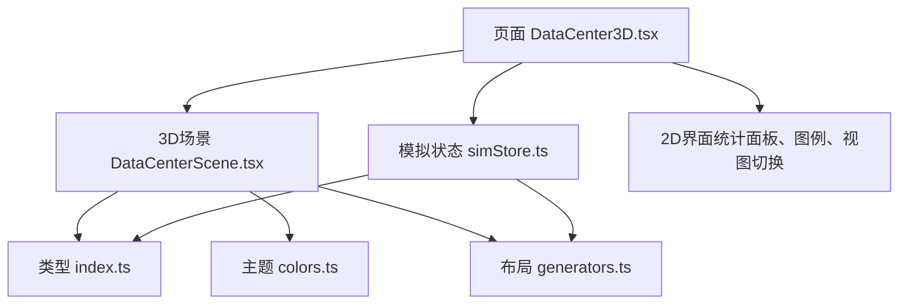
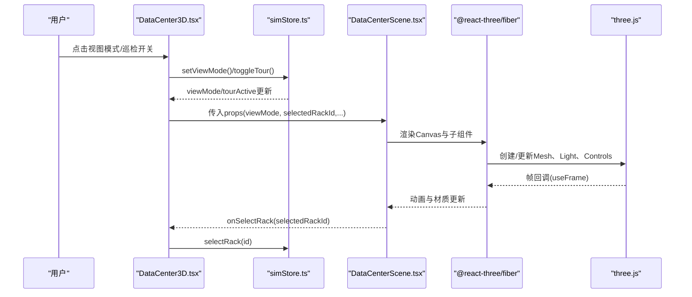
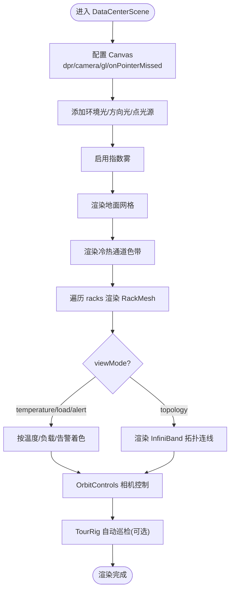
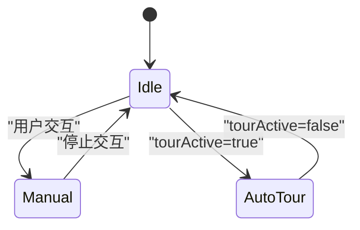
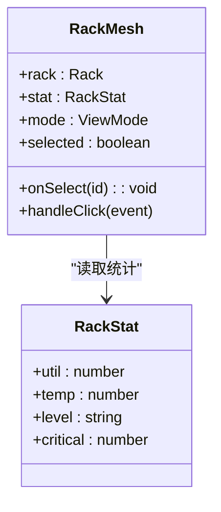
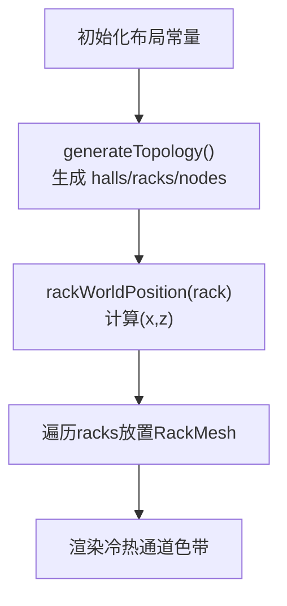
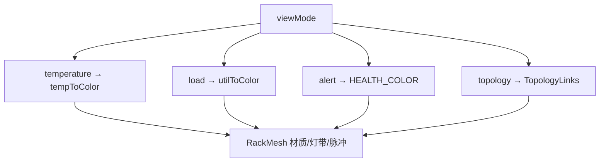
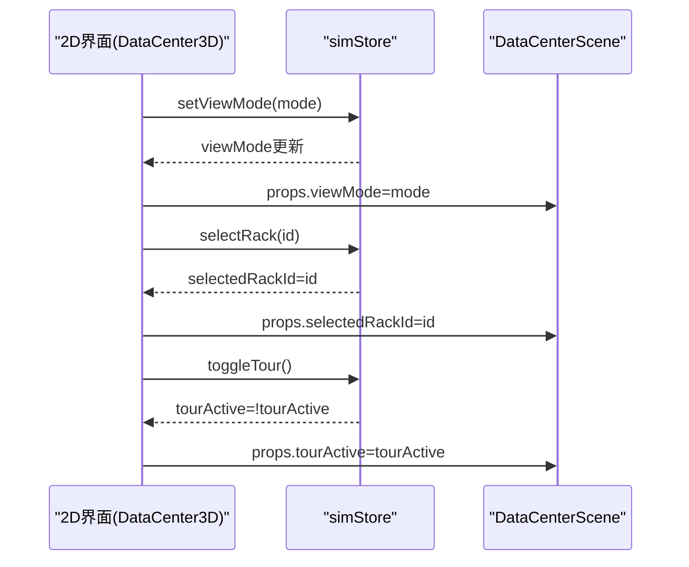
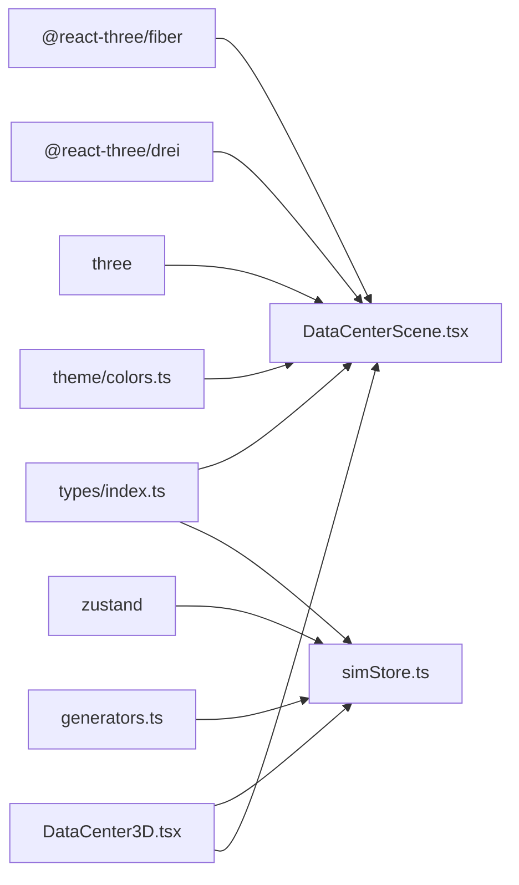

# 3D可视化系统

<cite>
**本文引用的文件**   
- [DataCenterScene.tsx](file://src/components/scene/DataCenterScene.tsx)
- [DataCenter3D.tsx](file://src/pages/DataCenter3D.tsx)
- [generators.ts](file://src/mock/generators.ts)
- [simStore.ts](file://src/stores/simStore.ts)
- [index.ts](file://src/types/index.ts)
- [colors.ts](file://src/theme/colors.ts)
- [package.json](file://package.json)
</cite>

## 目录
1. [引言](#引言)
2. [项目结构](#项目结构)
3. [核心组件](#核心组件)
4. [架构总览](#架构总览)
5. [详细组件分析](#详细组件分析)
6. [依赖关系分析](#依赖关系分析)
7. [性能与内存优化](#性能与内存优化)
8. [故障排查指南](#故障排查指南)
9. [结论](#结论)
10. [附录：扩展与自定义指南](#附录扩展与自定义指南)

## 引言
本技术文档面向IDC AI运维平台的3D可视化子系统，聚焦基于Three.js与@react-three/fiber的机房三维场景实现。内容覆盖场景初始化、相机控制、光照与雾效、几何体建模与材质应用、数据中心模型构建、交互式视图切换、节点选择与状态可视化、渲染性能优化、内存管理、WebGL最佳实践、配置项说明、事件处理以及与2D界面的数据同步机制，并提供扩展与自定义指导。

## 项目结构
3D可视化相关代码主要分布在以下位置：
- 页面入口：src/pages/DataCenter3D.tsx
- 3D场景组件：src/components/scene/DataCenterScene.tsx
- 数据中心拓扑与布局常量：src/mock/generators.ts
- 全局模拟状态与交互：src/stores/simStore.ts
- 类型定义：src/types/index.ts
- 主题色板与颜色映射：src/theme/colors.ts
- 依赖声明：package.json

图表来源
- [DataCenter3D.tsx:15-95](file://src/pages/DataCenter3D.tsx#L15-L95)
- [DataCenterScene.tsx:218-325](file://src/components/scene/DataCenterScene.tsx#L218-L325)
- [generators.ts:62-81](file://src/mock/generators.ts#L62-L81)
- [simStore.ts:99-163](file://src/stores/simStore.ts#L99-L163)
- [index.ts:160-161](file://src/types/index.ts#L160-L161)
- [colors.ts:66-96](file://src/theme/colors.ts#L66-L96)

章节来源
- [DataCenter3D.tsx:15-95](file://src/pages/DataCenter3D.tsx#L15-L95)
- [DataCenterScene.tsx:218-325](file://src/components/scene/DataCenterScene.tsx#L218-L325)
- [generators.ts:62-81](file://src/mock/generators.ts#L62-L81)
- [simStore.ts:99-163](file://src/stores/simStore.ts#L99-L163)
- [index.ts:160-161](file://src/types/index.ts#L160-L161)
- [colors.ts:66-96](file://src/theme/colors.ts#L66-L96)

## 核心组件
- 3D场景容器：DataCenterScene.tsx
  - 使用@react-three/fiber的Canvas创建渲染上下文
  - 集成OrbitControls进行相机旋转、平移、缩放
  - 通过useFrame驱动动画（机柜自发光脉冲、巡检巡游）
  - 根据viewMode动态渲染温度热力、负载、告警、线缆拓扑
  - 提供选中机柜的HTML浮层信息展示
- 页面组合器：DataCenter3D.tsx
  - 订阅Zustand store中的racks、nodes、viewMode、selectedRackId等状态
  - 计算并展示统计指标与图例
  - 提供视图模式切换按钮与自动巡检开关
  - 将用户操作（点击机柜、切换视图、开启巡检）回写store

章节来源
- [DataCenterScene.tsx:18-48](file://src/components/scene/DataCenterScene.tsx#L18-L48)
- [DataCenterScene.tsx:63-143](file://src/components/scene/DataCenterScene.tsx#L63-L143)
- [DataCenterScene.tsx:218-325](file://src/components/scene/DataCenterScene.tsx#L218-L325)
- [DataCenter3D.tsx:15-95](file://src/pages/DataCenter3D.tsx#L15-L95)

## 架构总览
3D可视化系统采用“React + Fiber + Three.js”分层架构：
- 表现层：React组件树，负责UI与交互
- 渲染层：Fiber Canvas与Three.js对象，负责3D场景绘制
- 数据层：Zustand store维护全局状态，模拟数据由generators生成
- 主题层：colors.ts提供统一的颜色映射与视觉规范

图表来源
- [DataCenter3D.tsx:51-68](file://src/pages/DataCenter3D.tsx#L51-L68)
- [simStore.ts:262-264](file://src/stores/simStore.ts#L262-L264)
- [DataCenterScene.tsx:218-325](file://src/components/scene/DataCenterScene.tsx#L218-L325)
- [DataCenterScene.tsx:83-99](file://src/components/scene/DataCenterScene.tsx#L83-L99)

## 详细组件分析

### 场景初始化与渲染管线
- Canvas配置
  - dpr：紧凑模式下为1，全屏模式为[1,1.8]自适应
  - camera：FOV、near/far、初始位置
  - gl：antialias=true，powerPreference='high-performance'
  - onPointerMissed：点击空白区域取消选中
- 光照与雾效
  - ambientLight强度0.35
  - directionalLight方向光强度0.5，冷色调
  - pointLight点光源强度0.6，距离80
  - fog指数雾，背景色与衰减范围
- 地面网格
  - Grid组件，cellSize=2，sectionSize=10，fadeDistance按compact调整
- 冷热通道色带
  - AisleBands按行交替冷/热通道，AdditiveBlending叠加显示

图表来源
- [DataCenterScene.tsx:231-256](file://src/components/scene/DataCenterScene.tsx#L231-L256)
- [DataCenterScene.tsx:314-323](file://src/components/scene/DataCenterScene.tsx#L314-L323)
- [DataCenterScene.tsx:329-352](file://src/components/scene/DataCenterScene.tsx#L329-L352)

章节来源
- [DataCenterScene.tsx:231-256](file://src/components/scene/DataCenterScene.tsx#L231-L256)
- [DataCenterScene.tsx:314-323](file://src/components/scene/DataCenterScene.tsx#L314-L323)
- [DataCenterScene.tsx:329-352](file://src/components/scene/DataCenterScene.tsx#L329-L352)

### 相机控制与自动巡检
- OrbitControls
  - enablePan：非紧凑模式允许平移
  - autoRotate：紧凑且未开启巡检时自动旋转
  - maxPolarAngle/minDistance/maxDistance/target：限制视角与目标点
- TourRig
  - useFrame中根据clock时间计算相机轨道位置，lookAt中心点
  - tourActive=false时禁用，避免与手动控制冲突

图表来源
- [DataCenterScene.tsx:146-157](file://src/components/scene/DataCenterScene.tsx#L146-L157)
- [DataCenterScene.tsx:314-323](file://src/components/scene/DataCenterScene.tsx#L314-L323)

章节来源
- [DataCenterScene.tsx:146-157](file://src/components/scene/DataCenterScene.tsx#L146-L157)
- [DataCenterScene.tsx:314-323](file://src/components/scene/DataCenterScene.tsx#L314-L323)

### 几何体建模与材质应用
- 机柜主体
  - boxGeometry尺寸来自RACK_W/RACK_H/RACK_D
  - MeshStandardMaterial：color、emissive、metalness、roughness、transparent、opacity
- 顶部灯条
  - meshBasicMaterial：颜色随mode变化，透明度随util变化
- 正面GPU灯带
  - planeGeometry + AdditiveBlending叠加发光效果
- 选中描边
  - lineSegments + edgesGeometry + lineBasicMaterial高亮
- 告警脉冲球
  - sphereGeometry + meshBasicMaterial，颜色来自HEALTH_COLOR.critical

图表来源
- [DataCenterScene.tsx:63-143](file://src/components/scene/DataCenterScene.tsx#L63-L143)
- [DataCenterScene.tsx:18-48](file://src/components/scene/DataCenterScene.tsx#L18-L48)

章节来源
- [DataCenterScene.tsx:63-143](file://src/components/scene/DataCenterScene.tsx#L63-L143)
- [DataCenterScene.tsx:18-48](file://src/components/scene/DataCenterScene.tsx#L18-L48)

### 数据中心3D模型构建
- 布局常量
  - HALLS=['A','B']，ROWS_PER_HALL=8，COLS_PER_ROW=12，NODES_PER_RACK=4
  - RACK_W/RACK_D/RACK_H/AISLE_GAP/ROW_GAP/HALL_GAP
- rackWorldPosition
  - 根据hall偏移、col/x轴排列、row/z轴纵深计算世界坐标
- 机柜阵列
  - 在DataCenterScene中遍历racks，按world position放置RackMesh
- 冷热通道
  - AisleBands按行交替冷/热通道色带，增强空间感知

图表来源
- [generators.ts:40-44](file://src/mock/generators.ts#L40-L44)
- [generators.ts:62-81](file://src/mock/generators.ts#L62-L81)
- [DataCenterScene.tsx:262-273](file://src/components/scene/DataCenterScene.tsx#L262-L273)
- [DataCenterScene.tsx:329-352](file://src/components/scene/DataCenterScene.tsx#L329-L352)

章节来源
- [generators.ts:40-44](file://src/mock/generators.ts#L40-L44)
- [generators.ts:62-81](file://src/mock/generators.ts#L62-L81)
- [DataCenterScene.tsx:262-273](file://src/components/scene/DataCenterScene.tsx#L262-L273)
- [DataCenterScene.tsx:329-352](file://src/components/scene/DataCenterScene.tsx#L329-L352)

### 交互式视图切换与状态可视化
- 视图模式
  - temperature：温度热力，颜色由tempToColor映射
  - load：负载视图，颜色由utilToColor映射
  - alert：告警视图，严重/警告/正常分别着色
  - topology：InfiniBand骨干链路拓扑连线
- 状态可视化
  - 机柜自发光强度随util变化，选中或critical时脉冲闪烁
  - 告警球体在机柜顶部显示
  - 选中机柜弹出Html浮层，展示平均利用率、温度、功耗、节点数、冷热通道温度等

图表来源
- [DataCenterScene.tsx:50-61](file://src/components/scene/DataCenterScene.tsx#L50-L61)
- [colors.ts:66-96](file://src/theme/colors.ts#L66-L96)
- [DataCenterScene.tsx:159-205](file://src/components/scene/DataCenterScene.tsx#L159-L205)
- [DataCenterScene.tsx:295-311](file://src/components/scene/DataCenterScene.tsx#L295-L311)

章节来源
- [DataCenterScene.tsx:50-61](file://src/components/scene/DataCenterScene.tsx#L50-L61)
- [colors.ts:66-96](file://src/theme/colors.ts#L66-L96)
- [DataCenterScene.tsx:159-205](file://src/components/scene/DataCenterScene.tsx#L159-L205)
- [DataCenterScene.tsx:295-311](file://src/components/scene/DataCenterScene.tsx#L295-L311)

### 与2D界面的数据同步机制
- 状态源
  - simStore.ts维护racks、nodes、viewMode、selectedRackId、tourActive等
- 数据流向
  - 2D界面（DataCenter3D.tsx）从store订阅状态并渲染统计面板与图例
  - 用户操作（视图切换、巡检开关、点击机柜）调用store action更新状态
  - 3D场景（DataCenterScene.tsx）接收props并根据状态渲染
- 关键action
  - setViewMode、selectRack、toggleTour

图表来源
- [DataCenter3D.tsx:15-48](file://src/pages/DataCenter3D.tsx#L15-L48)
- [simStore.ts:262-264](file://src/stores/simStore.ts#L262-L264)
- [DataCenterScene.tsx:218-226](file://src/components/scene/DataCenterScene.tsx#L218-L226)

章节来源
- [DataCenter3D.tsx:15-48](file://src/pages/DataCenter3D.tsx#L15-L48)
- [simStore.ts:262-264](file://src/stores/simStore.ts#L262-L264)
- [DataCenterScene.tsx:218-226](file://src/components/scene/DataCenterScene.tsx#L218-L226)

## 依赖关系分析
- 运行时依赖
  - @react-three/fiber：React与Three.js桥接，提供Canvas/useFrame等
  - @react-three/drei：常用Three.js辅助组件（Grid/OrbitControls/Line/Html）
  - three：底层3D引擎
  - zustand：轻量状态管理
- 模块耦合
  - DataCenterScene依赖types、colors、generators
  - DataCenter3D依赖stores、theme、components/ui
  - simStore依赖mock/generators与types

图表来源
- [package.json:11-21](file://package.json#L11-L21)
- [DataCenterScene.tsx:1-12](file://src/components/scene/DataCenterScene.tsx#L1-L12)
- [DataCenter3D.tsx:1-6](file://src/pages/DataCenter3D.tsx#L1-L6)
- [simStore.ts:1-21](file://src/stores/simStore.ts#L1-L21)

章节来源
- [package.json:11-21](file://package.json#L11-L21)
- [DataCenterScene.tsx:1-12](file://src/components/scene/DataCenterScene.tsx#L1-L12)
- [DataCenter3D.tsx:1-6](file://src/pages/DataCenter3D.tsx#L1-L6)
- [simStore.ts:1-21](file://src/stores/simStore.ts#L1-L21)

## 性能与内存优化
- WebGL与渲染参数
  - antialias=true保证边缘平滑
  - powerPreference='high-performance'优先高性能GPU路径
  - dpr自适应：紧凑模式固定1，全屏模式最高1.8，平衡清晰度与性能
- 材质与混合
  - 大量使用meshBasicMaterial用于静态/半透明元素，减少着色器开销
  - AdditiveBlending用于叠加发光效果，注意overdraw增加
- 几何体复用
  - 使用BoxGeometry/PlaneGeometry/SphereGeometry等基本几何体，避免复杂模型
  - 线框描边使用edgesGeometry+lineBasicMaterial，仅在选中时渲染
- 动画与帧循环
  - useFrame仅对必要对象更新emissiveIntensity与opacity，降低每帧计算量
  - TourRig仅在active时执行相机运动逻辑
- 网格与雾效
  - Grid.fadeDistance按compact调整，减少远处渲染压力
  - fog指数雾隐藏远端细节，提升整体观感与性能
- 数据聚合与更新频率
  - 机柜聚合stepRacks每3 tick更新一次，降低store更新频率
  - 慢节点检测每5 tick执行，避免频繁计算

建议
- 若场景规模扩大，考虑实例化渲染（InstancedMesh）批量绘制机柜
- 对热点材质与纹理进行缓存，避免重复创建
- 使用LOD（Level of Detail）在远距离降低几何复杂度
- 谨慎使用透明叠加，必要时关闭部分透明材质以提升性能

章节来源
- [DataCenterScene.tsx:231-256](file://src/components/scene/DataCenterScene.tsx#L231-L256)
- [DataCenterScene.tsx:83-99](file://src/components/scene/DataCenterScene.tsx#L83-L99)
- [DataCenterScene.tsx:314-323](file://src/components/scene/DataCenterScene.tsx#L314-L323)
- [simStore.ts:164-206](file://src/stores/simStore.ts#L164-L206)

## 故障排查指南
常见问题与定位要点：
- 3D场景不显示或黑屏
  - 检查Canvas dpr与camera near/far是否合理
  - 确认gl.antialias与powerPreference设置
  - 验证光照强度与雾效范围
- 机柜无颜色或异常
  - 检查computeRackStats是否正确聚合nodes到racks
  - 校验tempToColor/utilToColor输入范围与边界
- 点击无效或选中状态不更新
  - 确认RackMesh onClick事件阻止冒泡并调用onSelect
  - 检查onPointerMissed是否清空选中
- 自动巡检卡顿
  - 确保TourRig active=false时跳过useFrame逻辑
  - 降低autoRotateSpeed或禁用autoRotate

章节来源
- [DataCenterScene.tsx:83-99](file://src/components/scene/DataCenterScene.tsx#L83-L99)
- [DataCenterScene.tsx:231-256](file://src/components/scene/DataCenterScene.tsx#L231-L256)
- [DataCenterScene.tsx:314-323](file://src/components/scene/DataCenterScene.tsx#L314-L323)

## 结论
该3D可视化系统以React与Fiber为核心，结合Three.js实现了数据中心机柜的三维可视化与多视图模式切换。通过Zustand集中管理状态，2D界面与3D场景保持数据一致。系统在材质、光照、网格与动画方面做了基础优化，适合中等规模机房的实时监控与巡检。未来可通过实例化渲染、LOD、纹理缓存等手段进一步提升性能与可扩展性。

## 附录：扩展与自定义指南
- 新增视图模式
  - 在types/index.ts扩展ViewMode
  - 在DataCenterScene.tsx的rackColor与渲染分支中添加新模式的着色与可视化逻辑
  - 在DataCenter3D.tsx的VIEW_MODES数组中添加按钮与图标
- 自定义机柜外观
  - 修改RackMesh的材质属性（metalness、roughness、opacity）
  - 调整顶部灯条与正面GPU灯带的尺寸与透明度
  - 扩展选中描边样式或告警脉冲球大小
- 扩展拓扑连线
  - 在TopologyLinks中增加新的汇聚点与连线规则
  - 支持不同网络层级（核心-汇聚-接入）的多级拓扑
- 性能调优
  - 引入InstancedMesh批量绘制机柜
  - 使用LOD降低远距离几何复杂度
  - 按需加载纹理与模型资源
- 与后端数据对接
  - 替换simStore中的模拟数据为真实API拉取
  - 增量更新nodes/racks，避免全量重建
  - 使用WebSocket实时推送指标，触发useFrame局部更新

章节来源
- [index.ts:160-161](file://src/types/index.ts#L160-L161)
- [DataCenterScene.tsx:50-61](file://src/components/scene/DataCenterScene.tsx#L50-L61)
- [DataCenter3D.tsx:8-13](file://src/pages/DataCenter3D.tsx#L8-L13)
- [DataCenterScene.tsx:63-143](file://src/components/scene/DataCenterScene.tsx#L63-L143)
- [DataCenterScene.tsx:159-205](file://src/components/scene/DataCenterScene.tsx#L159-L205)