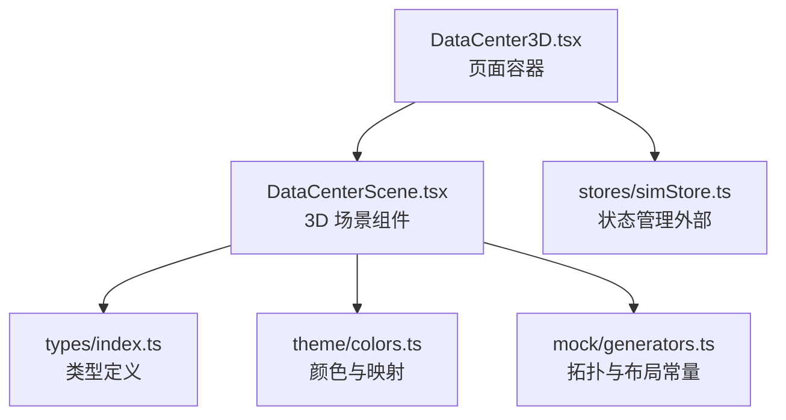
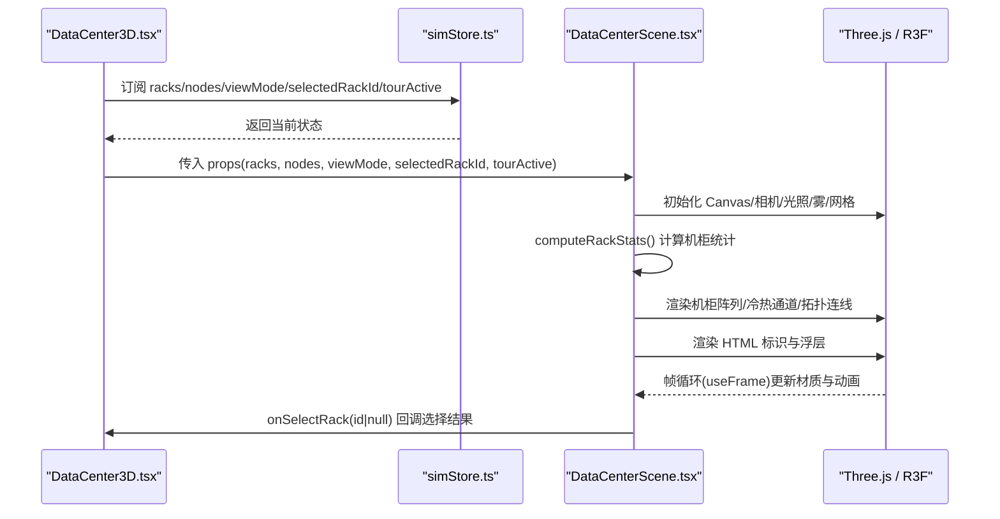
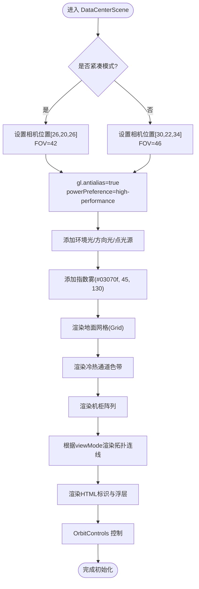
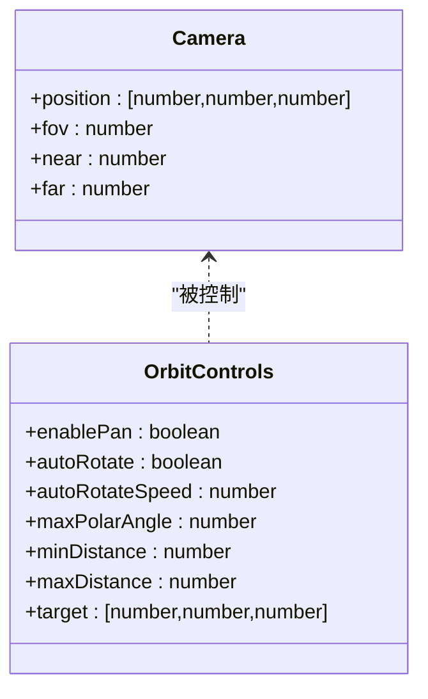
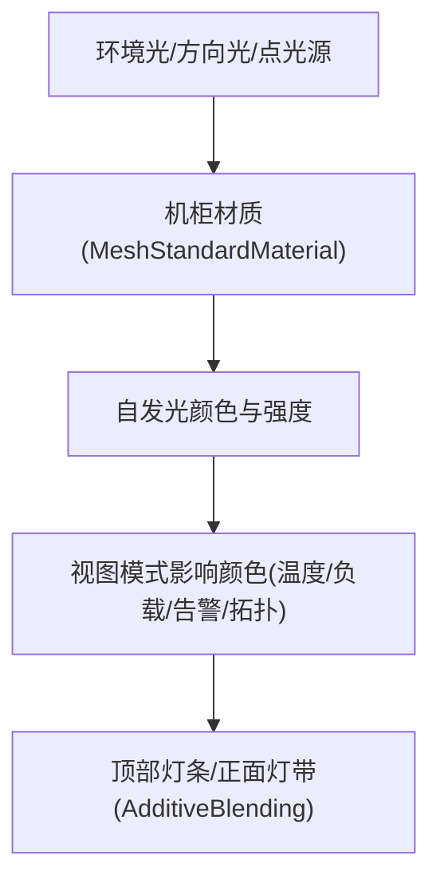
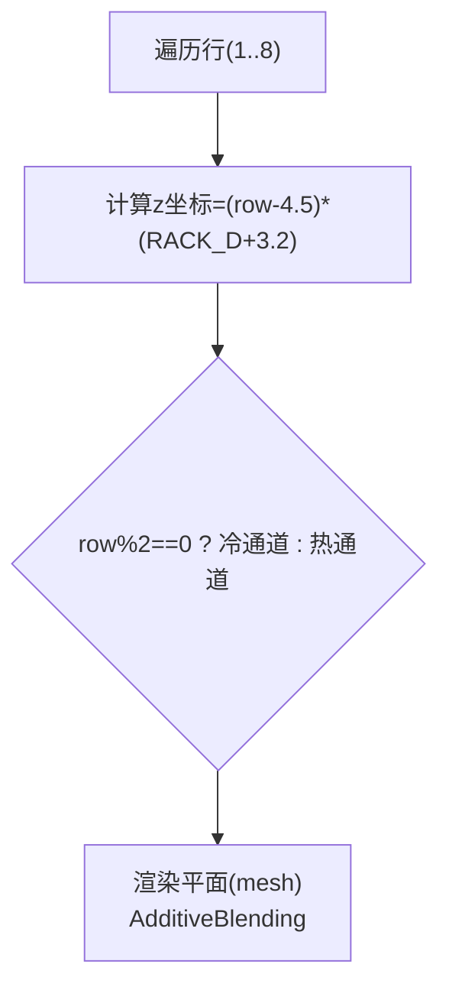
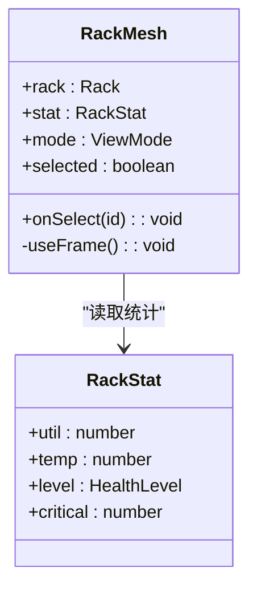
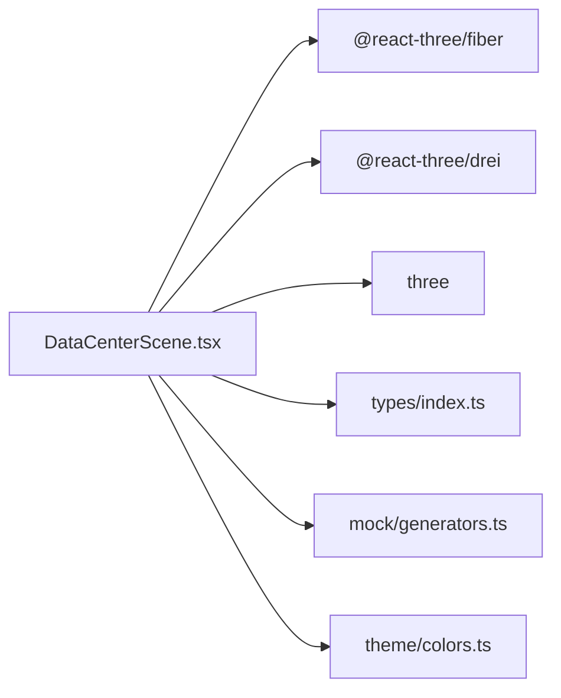

# 3D场景管理

<cite>
**本文引用的文件**   
- [DataCenterScene.tsx](file://src/components/scene/DataCenterScene.tsx)
- [DataCenter3D.tsx](file://src/pages/DataCenter3D.tsx)
- [generators.ts](file://src/mock/generators.ts)
- [colors.ts](file://src/theme/colors.ts)
- [index.ts](file://src/types/index.ts)
</cite>

## 目录
1. [引言](#引言)
2. [项目结构](#项目结构)
3. [核心组件](#核心组件)
4. [架构总览](#架构总览)
5. [详细组件分析](#详细组件分析)
6. [依赖关系分析](#依赖关系分析)
7. [性能与优化建议](#性能与优化建议)
8. [故障排查指南](#故障排查指南)
9. [结论](#结论)
10. [附录：配置与扩展清单](#附录配置与扩展清单)

## 引言
本技术文档围绕数据中心 3D 可视化场景，重点解析 DataCenterScene 组件的架构设计与实现细节。内容涵盖 Three.js 场景初始化、Canvas 与相机配置、光照系统（环境光、方向光、点光源）、雾效、地面网格渲染、冷热通道色带、机房标识 HTML 叠加层、机柜渲染与交互、拓扑连线以及巡检动画等。同时提供场景配置优化与自定义场景元素的实践指导，帮助开发者在现有代码基础上进行二次开发与性能调优。

## 项目结构
本项目采用 React + TypeScript + Vite 的前端工程结构，3D 场景由 React Three Fiber 驱动，使用 drei 提供的常用辅助组件。关键文件职责如下：
- src/components/scene/DataCenterScene.tsx：3D 场景主组件，负责 Canvas、相机、光照、雾、网格、机柜阵列、拓扑连线、HTML 标注与交互控制。
- src/pages/DataCenter3D.tsx：页面容器，负责视图模式切换、统计面板、图例与场景挂载。
- src/mock/generators.ts：生成机房拓扑、机柜与节点数据，并提供布局常量与坐标计算函数。
- src/theme/colors.ts：共享颜色映射与温度/利用率到颜色的转换函数。
- src/types/index.ts：领域模型与类型定义，包括机柜、节点、视图模式等。

图表来源
- [DataCenter3D.tsx:1-48](file://src/pages/DataCenter3D.tsx#L1-L48)
- [DataCenterScene.tsx:1-12](file://src/components/scene/DataCenterScene.tsx#L1-L12)
- [index.ts:160-161](file://src/types/index.ts#L160-L161)
- [colors.ts:66-96](file://src/theme/colors.ts#L66-L96)
- [generators.ts:65-80](file://src/mock/generators.ts#L65-L80)

章节来源
- [DataCenter3D.tsx:1-48](file://src/pages/DataCenter3D.tsx#L1-L48)
- [DataCenterScene.tsx:1-12](file://src/components/scene/DataCenterScene.tsx#L1-L12)

## 核心组件
DataCenterScene 是 3D 场景的核心组件，封装了以下能力：
- 场景初始化：通过 Canvas 创建 Three.js 渲染上下文，设置 dpr、相机参数、抗锯齿与性能偏好。
- 光照系统：包含环境光、方向光与点光源，营造机房空间感与金属质感。
- 雾效系统：使用指数雾增强景深与氛围。
- 地面网格：基于 Grid 组件绘制规则网格，支持分区线、透明度与无限网格。
- 冷热通道色带：按排交替渲染冷/热通道地面条带，使用加法混合提升视觉层次。
- 机柜渲染：每个机柜为独立 mesh，具备自发光、负载灯带、告警脉冲与选中描边。
- 拓扑连线：在 topology 模式下显示 InfiniBand 骨干链路。
- HTML 叠加层：机房标识与选中机柜信息浮层。
- 交互与控制：OrbitControls 旋转/平移/缩放，点击选择机柜，自动巡检动画。

章节来源
- [DataCenterScene.tsx:218-326](file://src/components/scene/DataCenterScene.tsx#L218-L326)
- [DataCenterScene.tsx:63-143](file://src/components/scene/DataCenterScene.tsx#L63-L143)
- [DataCenterScene.tsx:328-353](file://src/components/scene/DataCenterScene.tsx#L328-L353)
- [DataCenterScene.tsx:159-205](file://src/components/scene/DataCenterScene.tsx#L159-L205)

## 架构总览
下图展示页面与 3D 场景的数据流与组件交互关系：

图表来源
- [DataCenter3D.tsx:15-48](file://src/pages/DataCenter3D.tsx#L15-L48)
- [DataCenterScene.tsx:25-48](file://src/components/scene/DataCenterScene.tsx#L25-L48)
- [DataCenterScene.tsx:218-326](file://src/components/scene/DataCenterScene.tsx#L218-L326)

## 详细组件分析

### 场景初始化与 Canvas 配置
- Canvas 属性：
  - dpr：紧凑模式下为 1，非紧凑模式为动态范围 [1, 1.8]，平衡清晰度与性能。
  - camera：根据 compact 调整位置与 FOV，near/far 裁剪面分别为 0.1/400。
  - gl：开启抗锯齿，powerPreference 设置为 high-performance。
  - onPointerMissed：点击空白区域取消选中机柜。
  - style：背景使用径向渐变，营造深色科技风。

图表来源
- [DataCenterScene.tsx:231-256](file://src/components/scene/DataCenterScene.tsx#L231-L256)
- [DataCenterScene.tsx:258-259](file://src/components/scene/DataCenterScene.tsx#L258-L259)
- [DataCenterScene.tsx:261-293](file://src/components/scene/DataCenterScene.tsx#L261-L293)
- [DataCenterScene.tsx:314-323](file://src/components/scene/DataCenterScene.tsx#L314-L323)

章节来源
- [DataCenterScene.tsx:231-256](file://src/components/scene/DataCenterScene.tsx#L231-L256)

### 相机设置与视角控制
- 相机位置与 FOV：
  - 紧凑模式：更近视角与较小 FOV，适合缩略图预览。
  - 非紧凑模式：较远视角与较大 FOV，适合全局观察。
- OrbitControls：
  - 紧凑模式启用自动旋转；非紧凑模式禁用自动旋转但允许手动操作。
  - 限制极角与距离范围，避免穿模或过远。
  - 目标点固定在机房中心附近。

图表来源
- [DataCenterScene.tsx:233-233](file://src/components/scene/DataCenterScene.tsx#L233-L233)
- [DataCenterScene.tsx:314-323](file://src/components/scene/DataCenterScene.tsx#L314-L323)

章节来源
- [DataCenterScene.tsx:233-233](file://src/components/scene/DataCenterScene.tsx#L233-L233)
- [DataCenterScene.tsx:314-323](file://src/components/scene/DataCenterScene.tsx#L314-L323)

### 光照系统与材质表现
- 环境光：强度 0.35，提供基础照明。
- 方向光：位于右上方，强度 0.5，色温偏冷，模拟天光。
- 点光源：位于机房中心上方，强度 0.6，色相偏青，突出中心区域。
- 机柜材质：
  - MeshStandardMaterial：颜色深灰蓝，金属度 0.6，粗糙度 0.35，半透明。
  - emissive 颜色随视图模式变化，emissiveIntensity 随负载与选中/告警状态动态变化。
  - 顶部灯条与正面 GPU 灯带使用 MeshBasicMaterial，透明度与混合模式增强发光效果。

图表来源
- [DataCenterScene.tsx:239-241](file://src/components/scene/DataCenterScene.tsx#L239-L241)
- [DataCenterScene.tsx:101-141](file://src/components/scene/DataCenterScene.tsx#L101-L141)
- [DataCenterScene.tsx:50-61](file://src/components/scene/DataCenterScene.tsx#L50-L61)

章节来源
- [DataCenterScene.tsx:239-241](file://src/components/scene/DataCenterScene.tsx#L239-L241)
- [DataCenterScene.tsx:101-141](file://src/components/scene/DataCenterScene.tsx#L101-L141)
- [DataCenterScene.tsx:50-61](file://src/components/scene/DataCenterScene.tsx#L50-L61)

### 雾效系统
- 使用指数雾，颜色与背景一致，起始距离 45，结束距离 130，增强景深与沉浸感。
- 雾效对远处物体产生渐隐效果，有助于突出前景机柜与热点区域。

章节来源
- [DataCenterScene.tsx:238-238](file://src/components/scene/DataCenterScene.tsx#L238-L238)

### 地面网格渲染机制
- 使用 Grid 组件绘制规则网格：
  - 尺寸 140x140，单元格大小 2，厚度 0.4，颜色偏深蓝。
  - 分区线 size 10，厚度 0.9，颜色稍亮，用于划分区域。
  - fadeDistance 与 fadeStrength 控制远处网格淡出，compact 模式下缩短淡出距离。
  - infiniteGrid 启用无限网格，便于大场景漫游。

章节来源
- [DataCenterScene.tsx:244-256](file://src/components/scene/DataCenterScene.tsx#L244-L256)

### 冷热通道色带的可视化实现
- 每排机柜之间交替渲染冷/热通道地面条带：
  - 冷通道色：青色系，透明度 0.16。
  - 热通道色：橙红色系，透明度 0.12。
  - 使用 AdditiveBlending 叠加混合，使色带在地面上呈现柔和发光效果。
  - 宽度在紧凑模式下略窄，以适应缩略图布局。

图表来源
- [DataCenterScene.tsx:328-353](file://src/components/scene/DataCenterScene.tsx#L328-L353)
- [generators.ts:65-80](file://src/mock/generators.ts#L65-L80)

章节来源
- [DataCenterScene.tsx:328-353](file://src/components/scene/DataCenterScene.tsx#L328-L353)
- [generators.ts:65-80](file://src/mock/generators.ts#L65-L80)

### 机房标识的 HTML 叠加层
- 在非紧凑模式下，使用 Html 组件在三维空间中叠加文本标签：
  - A 栋机房与 B 栋机房分别位于左右两侧，固定高度与距离因子。
  - pointerEvents 设为 none，避免遮挡 3D 交互。
  - 样式使用 Tailwind 类名，字体与间距符合 HUD 风格。

章节来源
- [DataCenterScene.tsx:276-289](file://src/components/scene/DataCenterScene.tsx#L276-L289)

### 机柜渲染与交互
- RackMesh 组件：
  - 主体：BoxGeometry + MeshStandardMaterial，自发光颜色随视图模式变化。
  - 顶部灯条：BoxGeometry + MeshBasicMaterial，透明度随利用率变化。
  - 正面 GPU 灯带：PlaneGeometry + MeshBasicMaterial，AdditiveBlending 叠加。
  - 选中/告警：LineSegments 描边与球体脉冲。
  - useFrame 中根据时间更新 emissiveIntensity 与灯条透明度。
  - onClick 触发 onSelect，向父组件传递选中机柜 id。

图表来源
- [DataCenterScene.tsx:63-143](file://src/components/scene/DataCenterScene.tsx#L63-L143)
- [DataCenterScene.tsx:18-23](file://src/components/scene/DataCenterScene.tsx#L18-L23)

章节来源
- [DataCenterScene.tsx:63-143](file://src/components/scene/DataCenterScene.tsx#L63-L143)
- [DataCenterScene.tsx:18-23](file://src/components/scene/DataCenterScene.tsx#L18-L23)

### 拓扑连线（InfiniBand 骨干）
- TopologyLinks 组件：
  - 在 topology 模式下渲染排内串联线与汇聚点到核心的连线。
  - 使用 Line 组件绘制线段，颜色为青色，透明度 0.4。
  - 核心点位于机房中心上方，两机房分别对应不同 x 坐标。

章节来源
- [DataCenterScene.tsx:159-205](file://src/components/scene/DataCenterScene.tsx#L159-L205)

### 相机巡检巡游
- TourRig 组件：
  - 当 tourActive 为真时，相机沿圆形轨道环绕机房，高度有正弦波动。
  - lookAt 始终指向机房中心附近，形成平滑巡检效果。
  - 与 OrbitControls 的 enabled 状态联动，巡检时禁用手动控制。

章节来源
- [DataCenterScene.tsx:145-157](file://src/components/scene/DataCenterScene.tsx#L145-L157)
- [DataCenterScene.tsx:313-313](file://src/components/scene/DataCenterScene.tsx#L313-L313)

### 视图模式与颜色映射
- 视图模式：temperature/load/alert/topology。
- rackColor 函数根据 mode 返回不同颜色：
  - temperature：tempToColor(temp)。
  - load：utilToColor(util)。
  - alert：critical > 0 为红色，warning 为黄色，否则为青色。
  - topology：统一青色。
- tempToColor/utilToColor 来自 theme/colors.ts，提供连续或分段颜色映射。

章节来源
- [DataCenterScene.tsx:50-61](file://src/components/scene/DataCenterScene.tsx#L50-L61)
- [colors.ts:66-96](file://src/theme/colors.ts#L66-L96)

## 依赖关系分析
- DataCenterScene 依赖：
  - @react-three/fiber：Canvas、useFrame、ThreeEvent。
  - @react-three/drei：OrbitControls、Grid、Html、Line。
  - three：THREE 命名空间，用于几何体与材质。
  - types：Rack、ViewMode、GpuNode。
  - mock/generators：RACK_W/RACK_H/RACK_D、rackWorldPosition。
  - theme/colors：tempToColor、utilToColor、HEALTH_COLOR。

图表来源
- [DataCenterScene.tsx:1-12](file://src/components/scene/DataCenterScene.tsx#L1-L12)
- [index.ts:160-161](file://src/types/index.ts#L160-L161)
- [generators.ts:65-80](file://src/mock/generators.ts#L65-L80)
- [colors.ts:66-96](file://src/theme/colors.ts#L66-L96)

章节来源
- [DataCenterScene.tsx:1-12](file://src/components/scene/DataCenterScene.tsx#L1-L12)

## 性能与优化建议
- DPR 自适应：
  - 紧凑模式使用固定 DPR=1，非紧凑模式使用 [1, 1.8] 动态范围，在高 DPI 设备上提升清晰度，同时在低端设备上降低开销。
- 材质与混合模式：
  - 大量使用 MeshBasicMaterial 与 AdditiveBlending 可提升发光效果，但需注意批次合并与透明度排序，避免过度 draw call。
- 网格与雾效：
  - 合理设置 Grid 的 fadeDistance 与 Fog 的起始/结束距离，减少远处渲染压力。
- 动画频率：
  - useFrame 中仅更新必要材质属性，避免复杂计算；巡检动画仅在 tourActive 时运行。
- 拓扑连线：
  - 仅在 topology 模式下渲染，避免不必要的几何体与管线开销。
- 内存与对象复用：
  - 对于重复几何体（如机柜），考虑实例化几何体或 InstancedMesh 以优化性能。
- 事件处理：
  - onClick 中使用 e.stopPropagation() 防止事件冒泡，减少不必要的重绘。

[本节为通用性能建议，不直接分析具体文件]

## 故障排查指南
- 场景黑屏或无渲染：
  - 检查 Canvas 的 dpr 与 gl 配置是否正确。
  - 确认 Three.js 与 R3F 版本兼容。
- 相机异常或无法交互：
  - 检查 OrbitControls 的 enabled 与 autoRotate 状态是否与 tourActive 联动。
  - 确认 maxPolarAngle 与 min/maxDistance 未限制用户操作。
- 机柜颜色不正确：
  - 检查 rackColor 与 tempToColor/utilToColor 的输入值是否在有效范围内。
  - 确认视图模式与统计数据计算正确。
- 雾效或网格不可见：
  - 检查 fog 与 Grid 的 fadeDistance/fadeStrength 配置。
  - 确认相机 near/far 裁剪面覆盖场景范围。
- HTML 标签不显示：
  - 检查 Html 的 position 与 distanceFactor 是否合理。
  - 确认 pointerEvents 未阻止交互。

章节来源
- [DataCenterScene.tsx:231-256](file://src/components/scene/DataCenterScene.tsx#L231-L256)
- [DataCenterScene.tsx:314-323](file://src/components/scene/DataCenterScene.tsx#L314-L323)
- [DataCenterScene.tsx:276-289](file://src/components/scene/DataCenterScene.tsx#L276-L289)

## 结论
DataCenterScene 组件通过 React Three Fiber 与 drei 提供了完整的数据中心 3D 可视化能力，涵盖场景初始化、光照、雾效、网格、冷热通道色带、机柜渲染与交互、拓扑连线与巡检动画。结合页面容器与状态管理，实现了多视图模式与实时态势展示。开发者可在现有架构基础上扩展自定义场景元素、优化渲染性能并丰富交互体验。

[本节为总结性内容，不直接分析具体文件]

## 附录：配置与扩展清单
- 场景配置项（DataCenterScene props）：
  - racks：机柜数组。
  - nodes：GPU 节点数组。
  - viewMode：视图模式（temperature/load/alert/topology）。
  - selectedRackId：当前选中机柜 id。
  - onSelectRack：选中回调。
  - tourActive：是否启用巡检。
  - compact：紧凑模式开关。
- 可扩展点：
  - 新增视图模式：在 rackColor 与 UI 图例中添加新分支。
  - 自定义机柜外观：修改 RackMesh 的材质与几何体。
  - 扩展拓扑连线：增加更多网络层级或链路样式。
  - 增强 HTML 标注：添加更多信息卡片或交互按钮。
  - 性能优化：引入 InstancedMesh、LOD、视锥剔除等。

章节来源
- [DataCenterScene.tsx:207-226](file://src/components/scene/DataCenterScene.tsx#L207-L226)
- [DataCenterScene.tsx:50-61](file://src/components/scene/DataCenterScene.tsx#L50-L61)
- [DataCenter3D.tsx:8-13](file://src/pages/DataCenter3D.tsx#L8-L13)