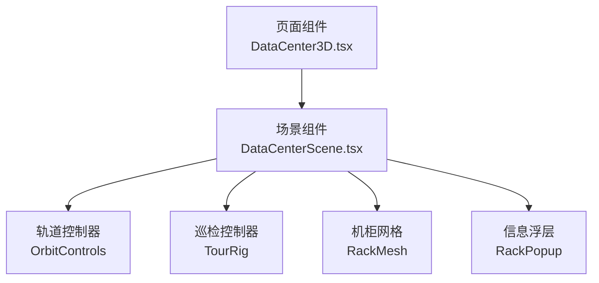
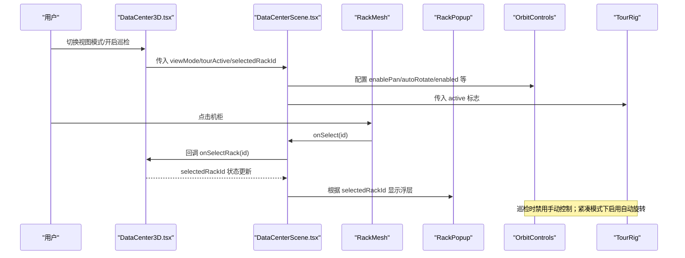
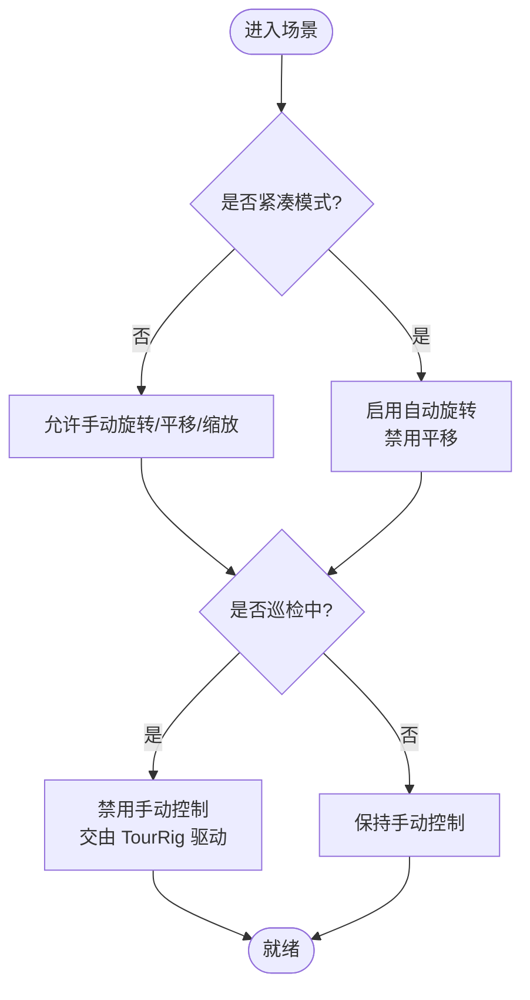
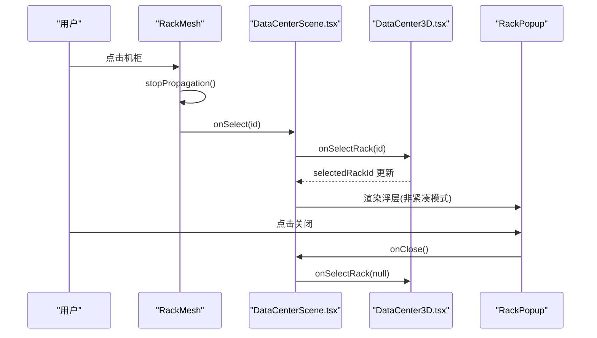
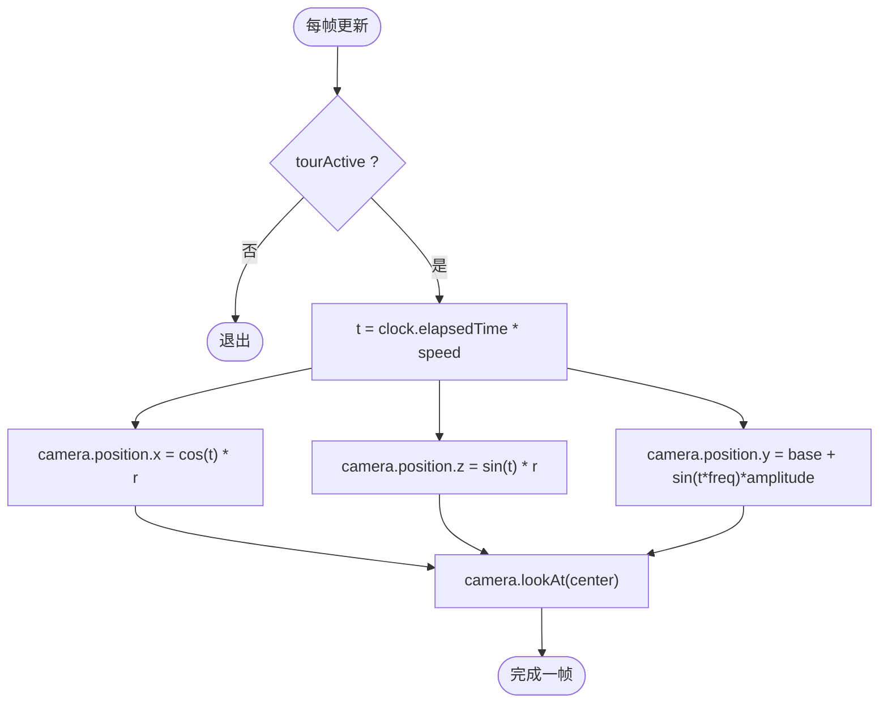
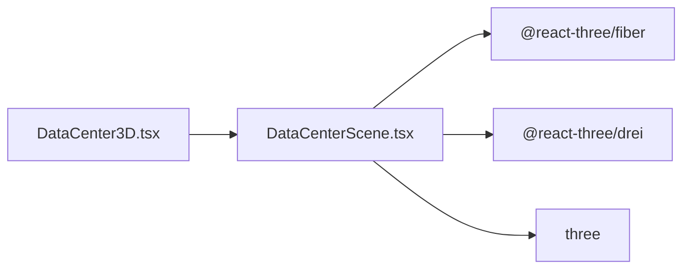

# 交互控制系统

<cite>
**本文引用的文件**   
- [DataCenter3D.tsx](file://src/pages/DataCenter3D.tsx)
- [DataCenterScene.tsx](file://src/components/scene/DataCenterScene.tsx)
</cite>

## 目录
1. [引言](#引言)
2. [项目结构](#项目结构)
3. [核心组件](#核心组件)
4. [架构总览](#架构总览)
5. [详细组件分析](#详细组件分析)
6. [依赖关系分析](#依赖关系分析)
7. [性能考量](#性能考量)
8. [故障排查指南](#故障排查指南)
9. [结论](#结论)
10. [附录：扩展与自定义指南](#附录扩展与自定义指南)

## 引言
本技术文档聚焦于机房三维可视化中的“交互控制系统”，围绕以下目标展开：
- OrbitControls 相机的配置与使用，包括旋转、缩放和平移行为。
- 点击事件处理机制：机柜选择、信息浮层显示与事件冒泡控制。
- TourRig 自动巡检功能：相机轨迹计算与动画控制。
- 紧凑模式与正常模式的交互差异。
- 为开发者提供自定义交互行为和扩展用户操作的完整指导。

## 项目结构
本项目采用 React + Three.js（通过 @react-three/fiber 和 @react-three/drei）构建三维场景。与交互控制直接相关的代码集中在页面组件与场景组件中：
- 页面层 DataCenter3D.tsx：负责视图模式切换、巡检开关、统计面板与操作提示等 UI 编排。
- 场景层 DataCenterScene.tsx：封装 Canvas、OrbitControls、TourRig、机柜网格、拓扑连线、信息浮层等三维交互逻辑。

图表来源
- [DataCenter3D.tsx:15-48](file://src/pages/DataCenter3D.tsx#L15-L48)
- [DataCenterScene.tsx:218-326](file://src/components/scene/DataCenterScene.tsx#L218-L326)

章节来源
- [DataCenter3D.tsx:15-95](file://src/pages/DataCenter3D.tsx#L15-L95)
- [DataCenterScene.tsx:218-326](file://src/components/scene/DataCenterScene.tsx#L218-L326)

## 核心组件
- 轨道控制器 OrbitControls：提供旋转、缩放、平移能力，并支持自动旋转与距离限制。
- 巡检控制器 TourRig：在每帧更新相机位置与朝向，实现环绕巡检动画。
- 机柜网格 RackMesh：渲染单个机柜，处理点击事件以触发选择与信息浮层。
- 信息浮层 RackPopup：展示选中机柜的指标与告警信息，支持关闭。
- 场景容器 DataCenterScene：组合上述组件，并根据 compact 模式调整交互行为。

章节来源
- [DataCenterScene.tsx:64-143](file://src/components/scene/DataCenterScene.tsx#L64-L143)
- [DataCenterScene.tsx:145-157](file://src/components/scene/DataCenterScene.tsx#L145-L157)
- [DataCenterScene.tsx:355-389](file://src/components/scene/DataCenterScene.tsx#L355-L389)
- [DataCenterScene.tsx:218-326](file://src/components/scene/DataCenterScene.tsx#L218-L326)

## 架构总览
下图展示了从页面到场景再到具体交互组件的调用链与数据流。

图表来源
- [DataCenter3D.tsx:15-48](file://src/pages/DataCenter3D.tsx#L15-L48)
- [DataCenterScene.tsx:218-326](file://src/components/scene/DataCenterScene.tsx#L218-L326)
- [DataCenterScene.tsx:96-99](file://src/components/scene/DataCenterScene.tsx#L96-L99)
- [DataCenterScene.tsx:294-310](file://src/components/scene/DataCenterScene.tsx#L294-L310)

## 详细组件分析

### OrbitControls 相机配置与使用
- 基本能力
  - 旋转：左键拖拽。
  - 平移：右键拖拽（受 compact 模式影响）。
  - 缩放：滚轮缩放。
- 关键配置项
  - enablePan：紧凑模式下禁用平移，避免缩略图内误操作。
  - autoRotate：紧凑模式下且未巡检时启用自动旋转，提升预览体验。
  - enabled：当 tourActive 为真时禁用手动控制，让 TourRig 接管相机。
  - maxPolarAngle：限制俯仰角，防止相机钻入地面以下。
  - minDistance/maxDistance：限制最近/最远观察距离，紧凑模式最大距离更小。
  - target：相机注视点固定在机房中心附近。
- 行为说明
  - 正常模式：可自由旋转、平移、缩放，适合详细查看。
  - 紧凑模式：仅允许旋转与缩放，默认自动慢速旋转，便于小尺寸预览。
  - 巡检模式：手动控制被禁用，由 TourRig 统一驱动相机。

图表来源
- [DataCenterScene.tsx:314-323](file://src/components/scene/DataCenterScene.tsx#L314-L323)

章节来源
- [DataCenterScene.tsx:314-323](file://src/components/scene/DataCenterScene.tsx#L314-L323)

### 点击事件处理机制：机柜选择、信息浮层与事件冒泡
- 点击入口
  - 每个机柜 mesh 绑定 onClick 处理器，调用 e.stopPropagation() 阻止事件冒泡至 Canvas 层，确保点击机柜不会触发“取消选择”。
  - 处理器内部调用 onSelect(rack.id)，将选择状态上抛给父组件。
- 选择状态管理
  - 页面层 DataCenter3D.tsx 维护 selectedRackId 并通过 store 暴露 selectRack 方法。
  - 场景层 DataCenterScene.tsx 接收 selectedRackId 与 onSelectRack 回调，用于渲染选中效果与浮层。
- 信息浮层显示
  - 当 selectedRack 存在且非紧凑模式时，在机柜上方渲染 Html 浮层 RackPopup，展示利用率、温度、功耗、节点数、冷热通道温度及严重告警数量。
  - 浮层右上角关闭按钮调用 onClose，即 onSelectRack(null)，隐藏浮层并清除选择。
- 取消选择
  - Canvas 的 onPointerMissed 回调会清空选择，适用于点击空白区域。

图表来源
- [DataCenterScene.tsx:96-99](file://src/components/scene/DataCenterScene.tsx#L96-L99)
- [DataCenterScene.tsx:294-310](file://src/components/scene/DataCenterScene.tsx#L294-L310)
- [DataCenterScene.tsx:355-389](file://src/components/scene/DataCenterScene.tsx#L355-L389)
- [DataCenter3D.tsx:15-48](file://src/pages/DataCenter3D.tsx#L15-L48)

章节来源
- [DataCenterScene.tsx:96-99](file://src/components/scene/DataCenterScene.tsx#L96-L99)
- [DataCenterScene.tsx:294-310](file://src/components/scene/DataCenterScene.tsx#L294-L310)
- [DataCenterScene.tsx:355-389](file://src/components/scene/DataCenterScene.tsx#L355-L389)
- [DataCenter3D.tsx:15-48](file://src/pages/DataCenter3D.tsx#L15-L48)

### TourRig 自动巡检：相机轨迹与动画控制
- 触发条件
  - 页面层 DataCenter3D.tsx 提供“自动巡检”按钮，切换 tourActive 状态。
  - 场景层 DataCenterScene.tsx 将 tourActive 传递给 TourRig 与 OrbitControls。
- 轨迹计算
  - 基于时钟时间 t 生成环形轨迹：X/Z 坐标按 cos/sin 变化，Y 坐标叠加正弦波动，形成环绕机房的椭圆/波浪式路径。
  - 每帧 camera.lookAt(0, 2, 0)，始终注视机房中心偏上位置。
- 动画控制
  - 当 tourActive 为真时，OrbitControls.enabled 设为 false，禁止手动干预。
  - 当 tourActive 为假时，恢复手动控制。
- 与紧凑模式的关系
  - 紧凑模式下若未巡检，则启用 OrbitControls.autoRotate 进行缓慢自转，作为轻量预览。
  - 巡检优先于自动旋转：一旦开启巡检，自动旋转不再生效。

图表来源
- [DataCenterScene.tsx:145-157](file://src/components/scene/DataCenterScene.tsx#L145-L157)
- [DataCenterScene.tsx:313-323](file://src/components/scene/DataCenterScene.tsx#L313-L323)

章节来源
- [DataCenterScene.tsx:145-157](file://src/components/scene/DataCenterScene.tsx#L145-L157)
- [DataCenterScene.tsx:313-323](file://src/components/scene/DataCenterScene.tsx#L313-L323)
- [DataCenter3D.tsx:51-68](file://src/pages/DataCenter3D.tsx#L51-L68)

### 紧凑模式与正常模式的交互差异
- 画布与相机
  - 紧凑模式：dpr=1，相机 FOV 更小，初始位置更靠近中心，适合缩略图预览。
  - 正常模式：dpr 动态范围更高，FOV 更大，初始位置更远，适合全景浏览。
- 交互能力
  - 紧凑模式：禁用平移，启用自动旋转（除非巡检），最大缩放距离更小。
  - 正常模式：允许平移、旋转、缩放，无自动旋转（除非手动开启）。
- 视觉元素
  - 紧凑模式：不显示机房标识文字与机柜信息浮层，减少干扰。
  - 正常模式：显示机房标识与选中机柜浮层，提供更丰富的上下文信息。

章节来源
- [DataCenterScene.tsx:231-236](file://src/components/scene/DataCenterScene.tsx#L231-L236)
- [DataCenterScene.tsx:275-310](file://src/components/scene/DataCenterScene.tsx#L275-L310)
- [DataCenterScene.tsx:314-323](file://src/components/scene/DataCenterScene.tsx#L314-L323)

## 依赖关系分析
- 组件耦合
  - DataCenter3D.tsx 与 DataCenterScene.tsx 通过 props 传递 viewMode、selectedRackId、tourActive 等状态，解耦良好。
  - DataCenterScene.tsx 内部通过子组件 RackMesh/RackPopup/TourRig/OrbitControls 协作，职责清晰。
- 外部依赖
  - @react-three/fiber：Canvas、useFrame、ThreeEvent 等。
  - @react-three/drei：OrbitControls、Grid、Html、Line 等。
  - three：基础几何体、材质、混合模式等。

图表来源
- [DataCenter3D.tsx:1-6](file://src/pages/DataCenter3D.tsx#L1-L6)
- [DataCenterScene.tsx:1-12](file://src/components/scene/DataCenterScene.tsx#L1-L12)

章节来源
- [DataCenter3D.tsx:1-6](file://src/pages/DataCenter3D.tsx#L1-L6)
- [DataCenterScene.tsx:1-12](file://src/components/scene/DataCenterScene.tsx#L1-L12)

## 性能考量
- 渲染质量
  - 正常模式使用更高的 dpr 范围，细节更好但开销更大；紧凑模式固定 dpr=1，适合缩略图。
- 光照与材质
  - 使用少量光源与半透明材质，注意 AdditiveBlending 的使用可能带来额外混合开销。
- 动画频率
  - useFrame 中仅做必要数学运算与属性更新，避免复杂计算。
- 事件处理
  - 点击事件仅在机柜 mesh 上触发，并通过 stopPropagation 避免多余事件传播。

[本节为通用性能建议，不直接分析具体文件]

## 故障排查指南
- 点击无效或无法选择机柜
  - 检查 RackMesh 的 onClick 是否调用了 stopPropagation，避免被 Canvas 的 onPointerMissed 覆盖。
  - 确认 onSelect 回调是否正确传回 rack.id。
- 信息浮层不显示
  - 确认 selectedRackId 已正确设置且非 null。
  - 确认当前不是紧凑模式（compact=true 时不显示浮层）。
- 巡检无法启动或无效
  - 检查 tourActive 状态是否切换成功。
  - 确认 OrbitControls.enabled 在巡检时为 false，避免手动控制冲突。
- 平移不可用
  - 紧凑模式下 enablePan=false，属于预期行为；切换到正常模式即可。

章节来源
- [DataCenterScene.tsx:96-99](file://src/components/scene/DataCenterScene.tsx#L96-L99)
- [DataCenterScene.tsx:294-310](file://src/components/scene/DataCenterScene.tsx#L294-L310)
- [DataCenterScene.tsx:314-323](file://src/components/scene/DataCenterScene.tsx#L314-L323)

## 结论
本交互控制系统通过 OrbitControls 与 TourRig 的组合，提供了灵活的相机控制与自动巡检能力。点击事件处理机制保证了机柜选择的准确性与浮层显示的稳定性。紧凑模式与正常模式在交互与视觉层面做了差异化设计，满足不同使用场景。整体架构清晰、职责分离，便于扩展与维护。

[本节为总结性内容，不直接分析具体文件]

## 附录：扩展与自定义指南
- 自定义相机轨迹
  - 在 TourRig 中替换三角函数轨迹，改为关键帧插值或贝塞尔曲线，实现更复杂的巡检路线。
  - 可通过 props 注入速度、半径、高度波动等参数，增强可配置性。
- 扩展点击行为
  - 在 RackMesh.onClick 中增加更多业务逻辑，如打开详情面板、播放高亮动画、联动其他视图。
  - 如需支持多选，可在 onSelect 中维护集合而非单值，并在 UI 中同步展示。
- 自定义 OrbitControls 行为
  - 调整 maxPolarAngle、minDistance、maxDistance 以适应不同场景布局。
  - 在特定模式下临时禁用某些手势，例如在编辑模式下禁用平移。
- 浮层扩展
  - 在 RackPopup 中增加更多指标或交互按钮，如跳转到该机柜的拓扑视图。
  - 支持键盘快捷键关闭浮层，提升无障碍体验。
- 模式切换优化
  - 将 compact 相关逻辑抽象为配置对象，便于在不同嵌入场景中复用。
  - 根据设备类型（移动端/桌面端）动态调整交互策略。

[本节为概念性指导，不直接分析具体文件]