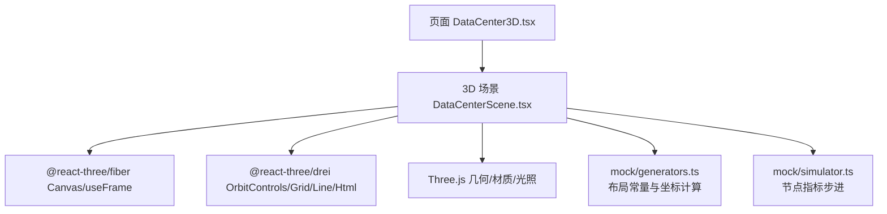
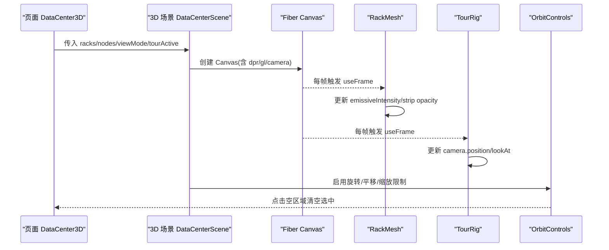
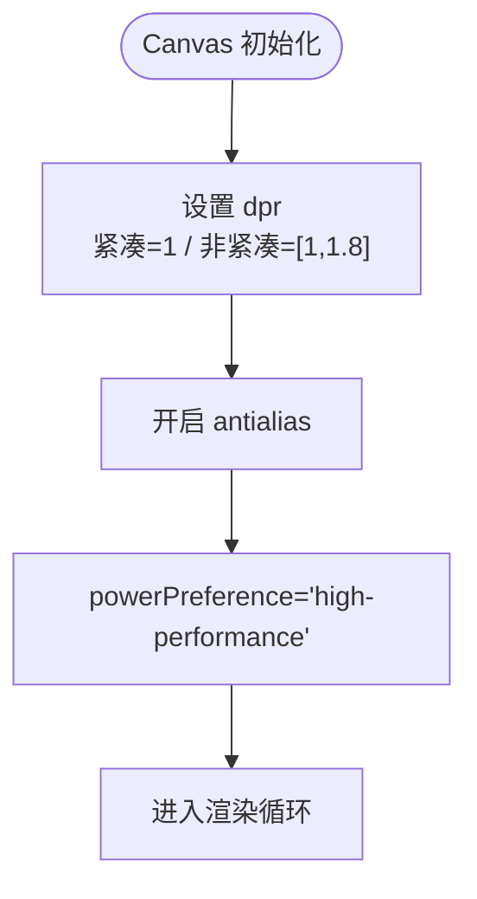
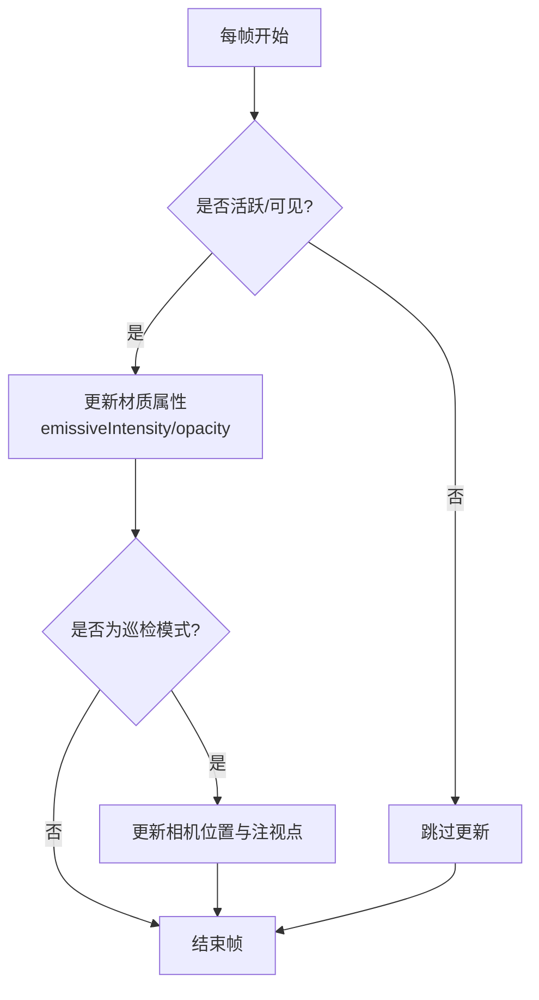
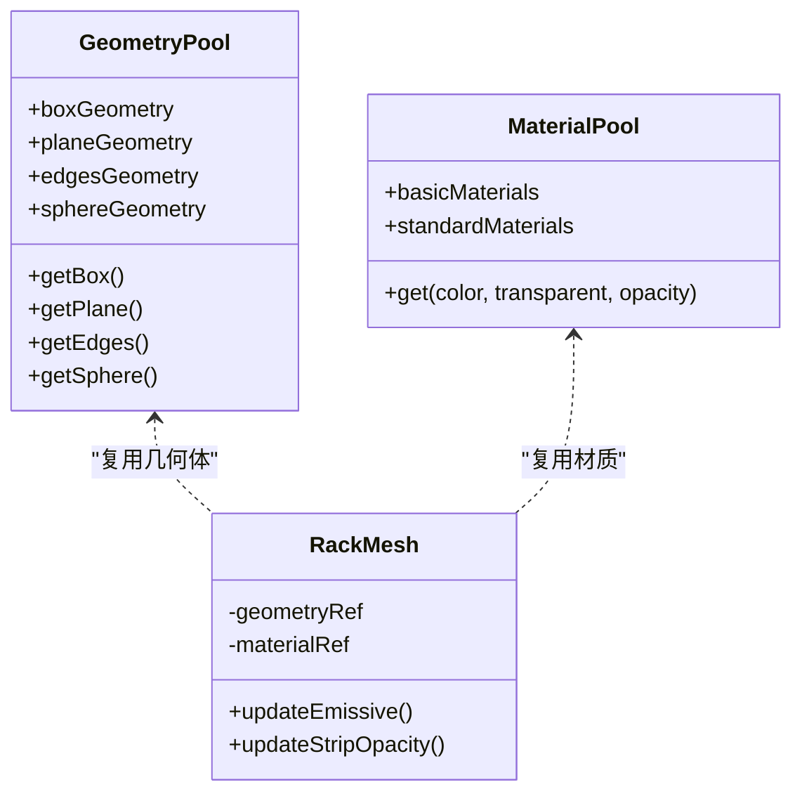
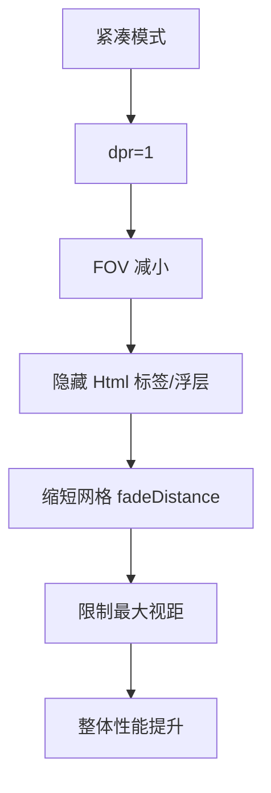
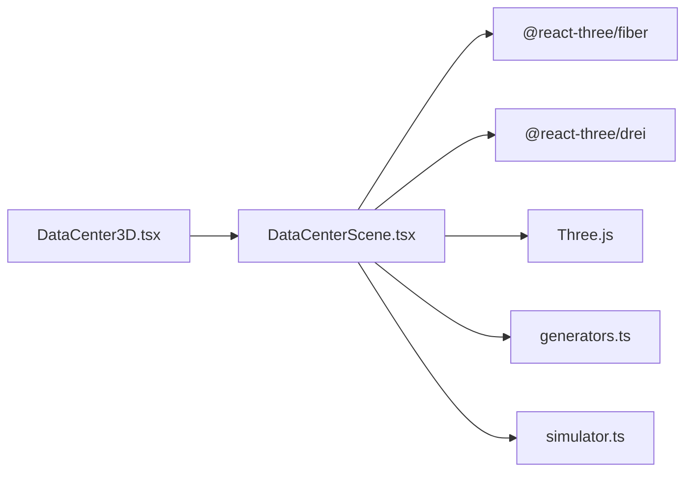

# 性能优化策略

<cite>
**本文引用的文件**   
- [DataCenter3D.tsx](file://src/pages/DataCenter3D.tsx)
- [DataCenterScene.tsx](file://src/components/scene/DataCenterScene.tsx)
- [generators.ts](file://src/mock/generators.ts)
- [simulator.ts](file://src/mock/simulator.ts)
</cite>

## 目录
1. [引言](#引言)
2. [项目结构](#项目结构)
3. [核心组件](#核心组件)
4. [架构总览](#架构总览)
5. [详细组件分析](#详细组件分析)
6. [依赖关系分析](#依赖关系分析)
7. [性能考量](#性能考量)
8. [故障排查指南](#故障排查指南)
9. [结论](#结论)
10. [附录](#附录)

## 引言
本技术文档聚焦于数据中心 3D 可视化场景的性能优化，围绕 WebGL 渲染、React Three Fiber 的 useFrame 使用模式、内存管理最佳实践、紧凑模式下的性能与质量权衡，以及性能监控与调试方法展开。文档基于仓库中的实际代码进行分析，给出可落地的优化建议与图示说明，帮助开发者在复杂机房拓扑与实时数据驱动下，获得稳定流畅的 3D 体验。

## 项目结构
本项目采用 React + TypeScript + Vite 的前端工程结构，3D 可视化能力由 @react-three/fiber 和 @react-three/drei 提供，Three.js 作为底层渲染引擎。关键路径如下：
- 页面入口：[DataCenter3D.tsx](file://src/pages/DataCenter3D.tsx)
- 3D 场景实现：[DataCenterScene.tsx](file://src/components/scene/DataCenterScene.tsx)
- 拓扑与布局常量生成：[generators.ts](file://src/mock/generators.ts)
- 模拟数据步进与指标更新：[simulator.ts](file://src/mock/simulator.ts)

**图表来源**
- [DataCenter3D.tsx:15-48](file://src/pages/DataCenter3D.tsx#L15-L48)
- [DataCenterScene.tsx:1-12](file://src/components/scene/DataCenterScene.tsx#L1-L12)
- [DataCenterScene.tsx:218-326](file://src/components/scene/DataCenterScene.tsx#L218-L326)
- [generators.ts:62-81](file://src/mock/generators.ts#L62-L81)
- [simulator.ts:49-71](file://src/mock/simulator.ts#L49-L71)

**章节来源**
- [DataCenter3D.tsx:15-48](file://src/pages/DataCenter3D.tsx#L15-L48)
- [DataCenterScene.tsx:1-12](file://src/components/scene/DataCenterScene.tsx#L1-L12)

## 核心组件
- 页面容器 DataCenter3D：负责 UI 状态（视图模式、巡检开关）、统计面板与图例，并将数据与回调传递给 3D 场景。
- 3D 场景 DataCenterScene：封装 Canvas、相机、灯光、网格、机柜 Mesh、拓扑连线、交互控制与紧凑模式配置。
- 机柜 Mesh RackMesh：每个机柜的自发光主体、负载灯带、告警脉冲球与选中描边，使用 useFrame 驱动动画。
- 相机巡检 TourRig：在自动巡检模式下驱动相机环绕运动。
- 拓扑连线 TopologyLinks：在拓扑视图模式下绘制 InfiniBand 骨干链路。
- 冷热通道色带 AisleBands：地面冷/热通道视觉指示。
- 布局与坐标 generators：提供机柜尺寸、间距、机房布局与 rackWorldPosition 等复用常量与函数。
- 模拟数据 simulator：按时间推进节点利用率、温度、功耗与健康等级。

**章节来源**
- [DataCenter3D.tsx:15-95](file://src/pages/DataCenter3D.tsx#L15-L95)
- [DataCenterScene.tsx:63-143](file://src/components/scene/DataCenterScene.tsx#L63-L143)
- [DataCenterScene.tsx:145-157](file://src/components/scene/DataCenterScene.tsx#L145-L157)
- [DataCenterScene.tsx:159-205](file://src/components/scene/DataCenterScene.tsx#L159-L205)
- [DataCenterScene.tsx:328-353](file://src/components/scene/DataCenterScene.tsx#L328-L353)
- [generators.ts:62-81](file://src/mock/generators.ts#L62-L81)
- [simulator.ts:49-71](file://src/mock/simulator.ts#L49-L71)

## 架构总览
下图展示从页面到 3D 渲染的关键调用链与数据流，包括 useFrame 驱动的动画循环、Canvas 的 WebGL 初始化参数与交互控制。

**图表来源**
- [DataCenter3D.tsx:15-48](file://src/pages/DataCenter3D.tsx#L15-L48)
- [DataCenterScene.tsx:83-94](file://src/components/scene/DataCenterScene.tsx#L83-L94)
- [DataCenterScene.tsx:147-155](file://src/components/scene/DataCenterScene.tsx#L147-L155)
- [DataCenterScene.tsx:218-326](file://src/components/scene/DataCenterScene.tsx#L218-L326)

## 详细组件分析

### WebGL 渲染优化：dpr、抗锯齿与硬件加速
- dpr 动态范围：在非紧凑模式下使用 [1, 1.8] 的动态 DPR 区间，兼顾高分屏清晰度与 GPU 压力；紧凑模式下固定为 1，降低像素填充率。
- 抗锯齿：开启 antialias，提升边缘平滑度。
- 硬件加速：设置 powerPreference 为 high-performance，优先选择高性能 GPU 执行渲染。

这些设置在 Canvas 初始化时生效，直接影响 WebGL 上下文与渲染管线行为。

**图表来源**
- [DataCenterScene.tsx:231-236](file://src/components/scene/DataCenterScene.tsx#L231-L236)

**章节来源**
- [DataCenterScene.tsx:231-236](file://src/components/scene/DataCenterScene.tsx#L231-L236)

### useFrame 钩子使用模式与性能考虑
useFrame 在 Fiber 渲染循环中每帧调用，适合驱动动画与相机运动。当前实现包含两类 useFrame：
- RackMesh.useFrame：根据时钟与负载计算 emissiveIntensity 与灯条透明度，支持告警脉冲与选中高亮。
- TourRig.useFrame：在 tourActive 时驱动相机环绕与俯仰变化。

性能要点：
- 避免在 useFrame 内创建对象或分配大量临时变量，应复用引用与缓存结果。
- 将昂贵计算移出 useFrame，例如拓扑连线点集通过 useMemo 预计算。
- 合理控制动画频率与幅度，避免过度刷新导致掉帧。

**图表来源**
- [DataCenterScene.tsx:83-94](file://src/components/scene/DataCenterScene.tsx#L83-L94)
- [DataCenterScene.tsx:147-155](file://src/components/scene/DataCenterScene.tsx#L147-L155)

**章节来源**
- [DataCenterScene.tsx:83-94](file://src/components/scene/DataCenterScene.tsx#L83-L94)
- [DataCenterScene.tsx:147-155](file://src/components/scene/DataCenterScene.tsx#L147-L155)

### 内存管理最佳实践：几何体复用、材质共享与对象池
当前实现中，每个 RackMesh 都会创建新的 boxGeometry、planeGeometry 与 edgesGeometry，并在告警球处创建 sphereGeometry。在高密度机柜阵列下，这会带来频繁的对象分配与销毁压力。建议：
- 几何体复用：将 BoxGeometry、PlaneGeometry、EdgesGeometry、SphereGeometry 提升到组件外部或使用 useRef 缓存，避免每帧重复创建。
- 材质共享：对相同颜色与透明度的 meshBasicMaterial/meshStandardMaterial 进行实例化后复用，减少材质切换与状态开销。
- 对象池：对频繁出现的临时对象（如向量、矩阵）建立对象池，避免 GC 抖动。
- 条件渲染：仅在必要时创建告警球与描边框，减少不可见对象的渲染成本。

**图表来源**
- [DataCenterScene.tsx:101-141](file://src/components/scene/DataCenterScene.tsx#L101-L141)

**章节来源**
- [DataCenterScene.tsx:101-141](file://src/components/scene/DataCenterScene.tsx#L101-L141)

### 紧凑模式下的性能优化策略与渲染质量调整
紧凑模式用于缩略图或低资源环境，已内置多项优化：
- dpr 固定为 1，降低像素填充率。
- 相机 FOV 更小，拉近视角，减少远处渲染面积。
- 禁用 Pan，启用 AutoRotate，简化交互。
- 隐藏 Html 文本标签与浮层，减少 DOM 与 HTML 叠加渲染。
- 网格 fadeDistance 缩短，减少远距离网格绘制。
- 最大视距缩小，限制相机移动范围。

建议在紧凑模式下进一步：
- 关闭拓扑连线与额外光效。
- 降低雾的强度与距离。
- 减少光源数量或强度。
- 使用更低的材质复杂度（metalness/roughness）。

**图表来源**
- [DataCenterScene.tsx:231-236](file://src/components/scene/DataCenterScene.tsx#L231-L236)
- [DataCenterScene.tsx:243-256](file://src/components/scene/DataCenterScene.tsx#L243-L256)
- [DataCenterScene.tsx:275-323](file://src/components/scene/DataCenterScene.tsx#L275-L323)

**章节来源**
- [DataCenterScene.tsx:231-236](file://src/components/scene/DataCenterScene.tsx#L231-L236)
- [DataCenterScene.tsx:243-256](file://src/components/scene/DataCenterScene.tsx#L243-L256)
- [DataCenterScene.tsx:275-323](file://src/components/scene/DataCenterScene.tsx#L275-L323)

### 拓扑连线与可视增强
拓扑连线在 topology 模式下启用，通过 Line 组件绘制多段折线，表示机柜间与汇聚点到核心的连接。该部分使用 useMemo 预计算线段集合，避免每帧重算。

建议：
- 对大量线段使用 BufferGeometry 合并绘制，减少 draw call。
- 使用统一的材质与透明度，减少状态切换。
- 在低性能设备上关闭拓扑连线。

**章节来源**
- [DataCenterScene.tsx:159-205](file://src/components/scene/DataCenterScene.tsx#L159-L205)

### 数据驱动与模拟步进
- 机柜统计 computeRackStats：聚合节点利用率、温度与健康等级，决定机柜颜色与告警状态。
- 模拟数据 stepNodes：基于时间与基线，正弦漂移加噪声更新节点指标，影响 3D 可视化表现。

建议：
- 将 computeRackStats 的结果缓存并仅在数据变更时重新计算。
- 对高频更新的节点指标使用增量更新，避免全量 map 带来的 CPU 压力。

**章节来源**
- [DataCenterScene.tsx:25-48](file://src/components/scene/DataCenterScene.tsx#L25-L48)
- [simulator.ts:49-71](file://src/mock/simulator.ts#L49-L71)

## 依赖关系分析
3D 场景依赖 React Three Fiber 提供的 Canvas 与 useFrame，依赖 drei 提供的 OrbitControls、Grid、Line、Html 等高级组件，底层使用 Three.js 的几何与材质系统。布局与坐标由 generators.ts 提供，模拟数据由 simulator.ts 驱动。

**图表来源**
- [DataCenter3D.tsx:1-6](file://src/pages/DataCenter3D.tsx#L1-L6)
- [DataCenterScene.tsx:1-12](file://src/components/scene/DataCenterScene.tsx#L1-L12)
- [generators.ts:1-12](file://src/mock/generators.ts#L1-L12)
- [simulator.ts:49-71](file://src/mock/simulator.ts#L49-L71)

**章节来源**
- [DataCenter3D.tsx:1-6](file://src/pages/DataCenter3D.tsx#L1-L6)
- [DataCenterScene.tsx:1-12](file://src/components/scene/DataCenterScene.tsx#L1-L12)

## 性能考量
- WebGL 上下文与渲染管线
  - dpr 动态范围与紧凑模式固定值平衡清晰度与性能。
  - antialias 提升视觉质量但增加采样开销，可在低端设备关闭。
  - powerPreference 确保使用独立 GPU，避免集成显卡瓶颈。
- useFrame 动画与相机控制
  - 避免在 useFrame 中进行昂贵计算或对象分配。
  - 将拓扑连线等静态数据用 useMemo 预计算。
  - 合理限制相机移动范围与速度，减少不必要的重绘。
- 几何体与材质
  - 复用几何体与材质实例，减少分配与状态切换。
  - 条件渲染告警球与描边框，避免多余 draw call。
- 数据更新
  - 增量更新节点指标，避免全量 map。
  - 缓存机柜统计结果，仅在数据变更时重算。
- 紧凑模式
  - 关闭非必要视觉效果（拓扑连线、Html 标签、强雾）。
  - 缩短网格 fadeDistance，限制最大视距。
  - 降低光源强度与数量。

[本节为通用性能指导，不直接分析具体文件]

## 故障排查指南
- 帧率下降或卡顿
  - 检查是否在每个 RackMesh 中频繁创建几何体或材质。
  - 确认 useFrame 内是否存在昂贵计算或未缓存的数据。
  - 评估 dpr 是否过高，尝试在紧凑模式下固定为 1。
- 内存泄漏或抖动
  - 检查是否在循环中创建临时对象，建议使用对象池。
  - 确认未使用的 Html 标签与浮层已被正确移除。
- 视觉异常
  - 校验抗锯齿与雾的参数是否合理。
  - 检查拓扑连线是否过多导致 draw call 激增。
- 交互问题
  - 确认 OrbitControls 的 enabled、autoRotate、maxPolarAngle 等参数是否符合预期。
  - 检查 onPointerMissed 是否正确清空选中状态。

**章节来源**
- [DataCenterScene.tsx:83-94](file://src/components/scene/DataCenterScene.tsx#L83-L94)
- [DataCenterScene.tsx:147-155](file://src/components/scene/DataCenterScene.tsx#L147-L155)
- [DataCenterScene.tsx:231-323](file://src/components/scene/DataCenterScene.tsx#L231-L323)

## 结论
通过对 WebGL 渲染参数、useFrame 使用模式、几何与材质复用、紧凑模式优化以及数据更新策略的系统性分析与改进建议，可以在保证视觉质量的同时显著提升 3D 场景的性能与稳定性。结合本文的架构图、流程图与类图，开发者可以更清晰地定位性能瓶颈并实施针对性优化。

[本节为总结性内容，不直接分析具体文件]

## 附录
- 相关类型与常量
  - 机柜尺寸与间距：RACK_W、RACK_D、RACK_H、AISLE_GAP、ROW_GAP、HALL_GAP。
  - 机房布局：HALLS、ROWS_PER_HALL、COLS_PER_ROW、NODES_PER_RACK、GPUS_PER_NODE。
  - 坐标计算：rackWorldPosition。

**章节来源**
- [generators.ts:40-81](file://src/mock/generators.ts#L40-L81)