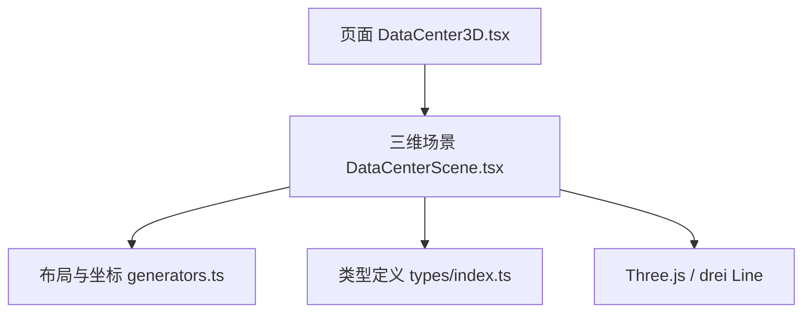
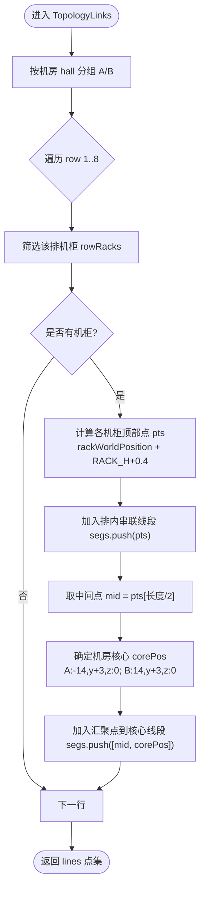
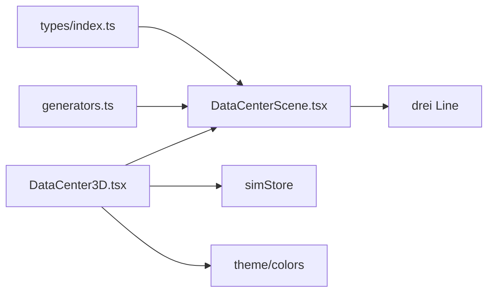

# 拓扑连线展示

<cite>
**本文引用的文件**   
- [DataCenterScene.tsx](file://src/components/scene/DataCenterScene.tsx)
- [DataCenter3D.tsx](file://src/pages/DataCenter3D.tsx)
- [generators.ts](file://src/mock/generators.ts)
- [index.ts](file://src/types/index.ts)
</cite>

## 目录
1. [引言](#引言)
2. [项目结构](#项目结构)
3. [核心组件](#核心组件)
4. [架构总览](#架构总览)
5. [详细组件分析](#详细组件分析)
6. [依赖关系分析](#依赖关系分析)
7. [性能与优化](#性能与优化)
8. [样式与透明度配置](#样式与透明度配置)
9. [扩展与自定义指南](#扩展与自定义指南)
10. [故障排查](#故障排查)
11. [结论](#结论)

## 引言
本文面向开发者，系统性解析数据中心三维可视化中的“拓扑连线展示”能力，重点围绕 TopologyLinks 组件的实现原理、InfiniBand 骨干网络可视化表达、拓扑连线的计算逻辑（排内串联、汇聚点到机房核心）、拓扑模式下连线的生成算法与性能优化策略，以及连线样式与透明度控制。同时提供扩展自定义网络拓扑结构与连接类型的实践指导。

## 项目结构
本项目采用 React + Three.js（通过 @react-three/fiber 与 @react-three/drei）构建三维数据机房场景。拓扑连线功能位于三维场景组件中，由页面层触发视图模式切换并传入机柜数据，场景组件负责渲染机柜、网格、光照、相机控制以及拓扑连线。



图表来源
- [DataCenter3D.tsx:41-48](file://src/pages/DataCenter3D.tsx#L41-L48)
- [DataCenterScene.tsx:218-326](file://src/components/scene/DataCenterScene.tsx#L218-L326)
- [generators.ts:65-80](file://src/mock/generators.ts#L65-L80)
- [index.ts:160-161](file://src/types/index.ts#L160-L161)

章节来源
- [DataCenter3D.tsx:1-159](file://src/pages/DataCenter3D.tsx#L1-L159)
- [DataCenterScene.tsx:1-401](file://src/components/scene/DataCenterScene.tsx#L1-L401)
- [generators.ts:65-80](file://src/mock/generators.ts#L65-L80)
- [index.ts:160-161](file://src/types/index.ts#L160-L161)

## 核心组件
- DataCenterScene：三维场景容器，负责渲染机柜、网格、光照、相机控制，并在 topology 视图模式下渲染 InfiniBand 骨干拓扑连线。
- TopologyLinks：专门用于绘制 InfiniBand 骨干拓扑连线的子组件，根据机柜拓扑计算连线段集合，并通过 drei 的 Line 组件进行渲染。
- DataCenter3D：页面级组件，负责视图模式切换、状态管理、统计面板与图例展示。
- generators：提供机柜布局常量、世界坐标计算函数与模拟数据生成。
- types：领域模型与视图模式等类型定义。

章节来源
- [DataCenterScene.tsx:159-205](file://src/components/scene/DataCenterScene.tsx#L159-L205)
- [DataCenterScene.tsx:218-326](file://src/components/scene/DataCenterScene.tsx#L218-L326)
- [DataCenter3D.tsx:8-13](file://src/pages/DataCenter3D.tsx#L8-L13)
- [generators.ts:65-80](file://src/mock/generators.ts#L65-L80)
- [index.ts:160-161](file://src/types/index.ts#L160-L161)

## 架构总览
拓扑连线在 topology 视图模式下启用，由 DataCenterScene 根据当前 viewMode 决定是否渲染 TopologyLinks。TopologyLinks 接收 racks 数据，计算每排机柜的顶部连线（排内串联），再计算每排汇聚点到机房核心的连线，最终通过 drei 的 Line 组件以线段形式呈现。

```mermaid
sequenceDiagram
participant Page as "页面 DataCenter3D"
participant Scene as "场景 DataCenterScene"
participant Links as "子组件 TopologyLinks"
participant Gen as "布局 generators"
participant Three as "drei Line"
Page->>Scene : 传入 viewMode=topology, racks
Scene->>Scene : 判断 viewMode === 'topology'
Scene->>Links : 渲染 TopologyLinks(racks)
Links->>Gen : rackWorldPosition(rack)
Links->>Links : 计算排内串联点集 pts
Links->>Links : 计算汇聚点 mid → 核心 corePos
Links->>Three : 使用 Line(points=pts/mid→corePos) 渲染
```

图表来源
- [DataCenter3D.tsx:41-48](file://src/pages/DataCenter3D.tsx#L41-L48)
- [DataCenterScene.tsx:291-292](file://src/components/scene/DataCenterScene.tsx#L291-L292)
- [DataCenterScene.tsx:160-205](file://src/components/scene/DataCenterScene.tsx#L160-L205)
- [generators.ts:76-80](file://src/mock/generators.ts#L76-L80)

## 详细组件分析

### TopologyLinks 组件实现原理
TopologyLinks 的核心职责是：
- 输入：racks（机柜数组）。
- 输出：若干线段点集，分别表示“排内串联”和“汇聚点到机房核心”。
- 渲染：使用 drei 的 Line 组件，设置颜色、线宽、透明与虚线等属性。

关键实现要点：
- 按机房 hall（A/B）分组处理。
- 对每个 row（1..8），筛选该排的机柜，计算其世界坐标并抬高到机柜顶部（RACK_H + 0.4）。
- 将同排机柜的顶部点依次连接形成“排内串联”线段。
- 取该排点集中间点作为“汇聚点”，连接到对应机房的“核心位置”（A 机房核心 x=-14，B 机房核心 x=14，y=coreY+3，z=0）。
- 所有线段点集缓存于 useMemo，避免重复计算。



图表来源
- [DataCenterScene.tsx:160-188](file://src/components/scene/DataCenterScene.tsx#L160-L188)
- [generators.ts:76-80](file://src/mock/generators.ts#L76-L80)

章节来源
- [DataCenterScene.tsx:159-205](file://src/components/scene/DataCenterScene.tsx#L159-L205)
- [generators.ts:76-80](file://src/mock/generators.ts#L76-L80)

### InfiniBand 骨干网络的可视化表达
- 视觉语义：青色线条代表 InfiniBand 骨干链路；机柜以青蓝色主体显示，负载灯带与正面 GPU 灯带叠加。
- 拓扑语义：
  - 排内串联：同一排机柜顶部依次相连，体现 IB 交换机或链路的水平互联。
  - 汇聚点到核心：每排汇聚点向上连接到机房核心，体现 IB 骨干汇聚与跨排汇聚。
- 视图联动：仅在 viewMode=topology 时显示连线，其他视图模式隐藏，避免干扰温度、负载、告警视图。

章节来源
- [DataCenterScene.tsx:50-60](file://src/components/scene/DataCenterScene.tsx#L50-L60)
- [DataCenterScene.tsx:160-205](file://src/components/scene/DataCenterScene.tsx#L160-L205)
- [DataCenter3D.tsx:8-13](file://src/pages/DataCenter3D.tsx#L8-L13)

### 拓扑连线的计算逻辑
- 排内串联：
  - 对每个 row，收集该排机柜的世界坐标，并将 y 坐标提升到机柜顶部（RACK_H + 0.4）。
  - 将这些点按顺序连接成一条折线，形成排内 IB 链路。
- 汇聚点到机房核心：
  - 取该排点集的中间点作为汇聚点。
  - 根据机房 hall 确定核心位置（A 机房核心 x=-14，B 机房核心 x=14），y 为 coreY+3，z=0。
  - 从汇聚点到核心绘制直线段。

复杂度分析：
- 时间复杂度：O(H × R × C)，其中 H 为机房数（2），R 为行数（8），C 为每排机柜数（12）。整体约 O(192) 次过滤与映射操作，属于常数规模。
- 空间复杂度：O(S)，S 为生成的线段点集数量，主要取决于排数与每排机柜数。

章节来源
- [DataCenterScene.tsx:160-188](file://src/components/scene/DataCenterScene.tsx#L160-L188)
- [generators.ts:65-80](file://src/mock/generators.ts#L65-L80)

### 拓扑模式下连线的生成算法与性能优化
- 生成算法：
  - 使用 useMemo 缓存 lines 点集，仅当 racks 变化时重新计算。
  - 对 halls 与 rows 的双重循环，结合 filter 与 map 构建点集。
- 性能优化：
  - useMemo 减少重复计算开销。
  - 使用 drei 的 Line 组件批量渲染线段，避免逐条创建复杂几何体。
  - 在 topology 模式下才渲染连线，降低非相关视图的渲染压力。
  - 合理设置 lineWidth、transparent、opacity，避免过度混合带来的性能损耗。

章节来源
- [DataCenterScene.tsx:160-205](file://src/components/scene/DataCenterScene.tsx#L160-L205)
- [DataCenterScene.tsx:291-292](file://src/components/scene/DataCenterScene.tsx#L291-L292)

## 依赖关系分析
- DataCenterScene 依赖：
  - generators：rackWorldPosition、RACK_H 等布局常量。
  - types：Rack、ViewMode 等类型。
  - drei：Line 组件用于绘制线段。
- DataCenter3D 依赖：
  - DataCenterScene：渲染三维场景。
  - simStore：获取 racks、nodes、viewMode 等状态。
  - theme/colors：颜色工具与图例展示。



图表来源
- [DataCenterScene.tsx:1-12](file://src/components/scene/DataCenterScene.tsx#L1-L12)
- [DataCenter3D.tsx:1-6](file://src/pages/DataCenter3D.tsx#L1-L6)
- [index.ts:160-161](file://src/types/index.ts#L160-L161)

章节来源
- [DataCenterScene.tsx:1-12](file://src/components/scene/DataCenterScene.tsx#L1-L12)
- [DataCenter3D.tsx:1-6](file://src/pages/DataCenter3D.tsx#L1-L6)
- [index.ts:160-161](file://src/types/index.ts#L160-L161)

## 性能与优化
- 计算缓存：lines 使用 useMemo 缓存，避免每次渲染重新计算。
- 条件渲染：仅在 topology 模式下渲染 TopologyLinks，减少无关视图的开销。
- 渲染优化：
  - 使用 Line 组件统一绘制线段，避免复杂几何体。
  - 合理设置 transparent 与 opacity，避免过度混合。
  - 控制 lineWidth，避免过粗线条导致像素填充压力。
- 数据规模：机柜规模固定（2 机房 × 8 排 × 12 机柜），计算量较小，无需额外分帧或增量更新。

章节来源
- [DataCenterScene.tsx:160-205](file://src/components/scene/DataCenterScene.tsx#L160-L205)
- [DataCenterScene.tsx:291-292](file://src/components/scene/DataCenterScene.tsx#L291-L292)

## 样式与透明度配置
- 连线颜色：青色 #22d3ee，代表 InfiniBand 骨干链路。
- 线宽：lineWidth=1，保持细线清晰。
- 透明度：transparent=true，opacity=0.4，使连线半透明，不遮挡机柜主体。
- 虚线：dashed=false，实线表示骨干链路。
- 图例：在 legend 中展示 IB 骨干链路颜色与机柜颜色，便于用户理解。

章节来源
- [DataCenterScene.tsx:190-205](file://src/components/scene/DataCenterScene.tsx#L190-L205)
- [DataCenter3D.tsx:137-157](file://src/pages/DataCenter3D.tsx#L137-L157)

## 扩展与自定义指南
- 自定义网络拓扑结构：
  - 修改 halls 与 rows 的遍历逻辑，支持更多机房或排数。
  - 调整 corePos 的计算方式，支持多核心或多层级汇聚。
  - 增加新的连接类型（如存储链路、管理网络），在 segs 中加入新的点集。
- 扩展连接类型：
  - 在 TopologyLinks 中新增分支，根据连接类型选择不同颜色、线型（虚线/实线）、透明度。
  - 引入连接元数据（如带宽、延迟、健康状态），动态调整连线样式。
- 性能扩展：
  - 对于大规模拓扑，考虑使用 BufferGeometry 与自定义 Shader 提升渲染性能。
  - 按需加载与分帧渲染，避免一次性计算过多线段。

章节来源
- [DataCenterScene.tsx:160-205](file://src/components/scene/DataCenterScene.tsx#L160-L205)
- [generators.ts:65-80](file://src/mock/generators.ts#L65-L80)

## 故障排查
- 连线未显示：
  - 检查 viewMode 是否为 'topology'。
  - 确认 racks 数据是否正确传入 TopologyLinks。
- 连线位置异常：
  - 检查 rackWorldPosition 计算是否正确。
  - 确认 RACK_H 与 RACK_D 等布局常量是否被修改。
- 性能问题：
  - 检查是否启用了不必要的透明混合。
  - 评估是否需要减少线段数量或改用更高效的渲染方式。

章节来源
- [DataCenterScene.tsx:160-205](file://src/components/scene/DataCenterScene.tsx#L160-L205)
- [generators.ts:76-80](file://src/mock/generators.ts#L76-L80)

## 结论
TopologyLinks 组件通过简洁而高效的算法，将 InfiniBand 骨干网络以排内串联与汇聚点到核心的方式可视化呈现。其在 topology 视图模式下启用，配合合理的样式与透明度配置，既保证了信息表达的清晰度，又兼顾了渲染性能。开发者可基于此扩展自定义拓扑结构与连接类型，满足更复杂的网络可视化需求。