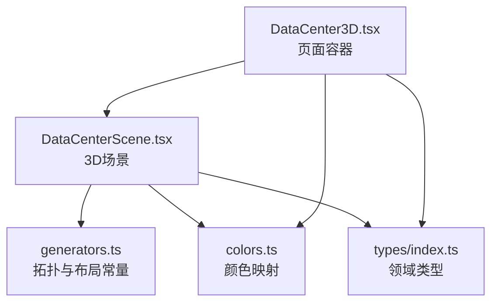
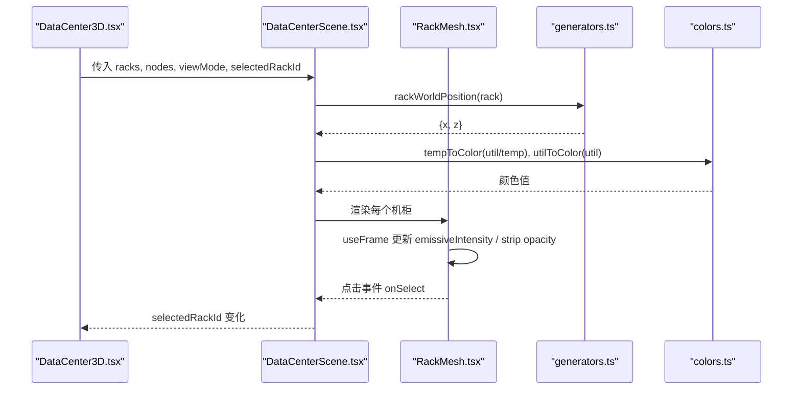
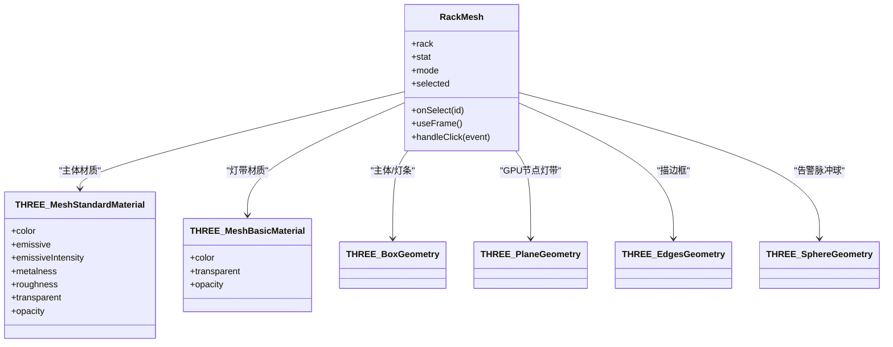
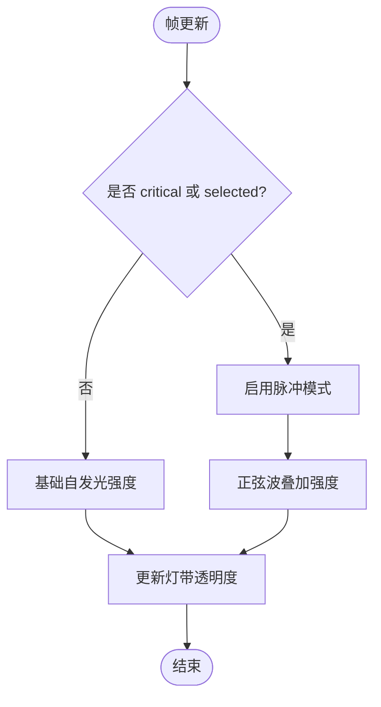
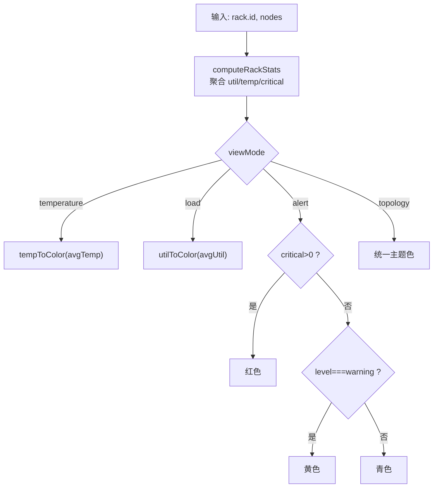
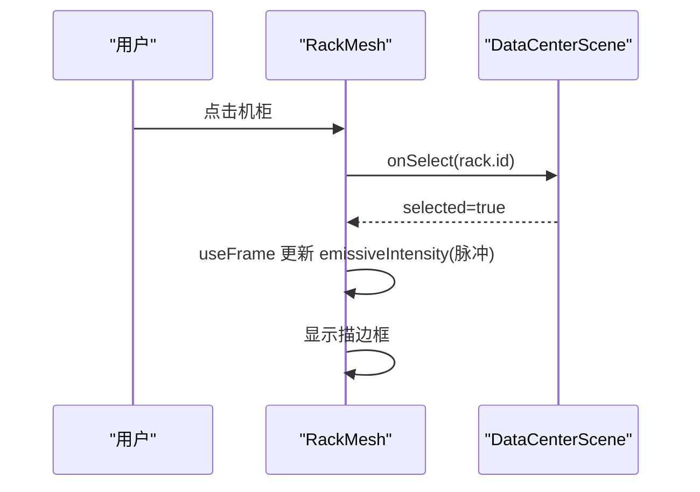
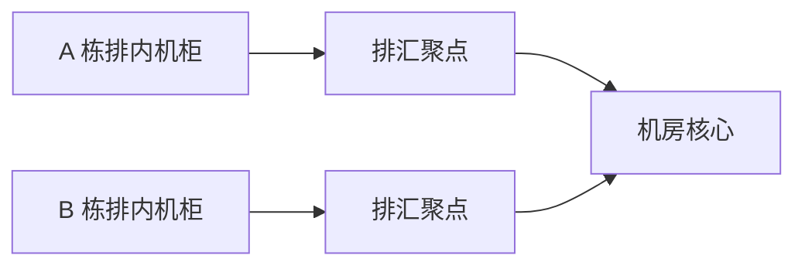
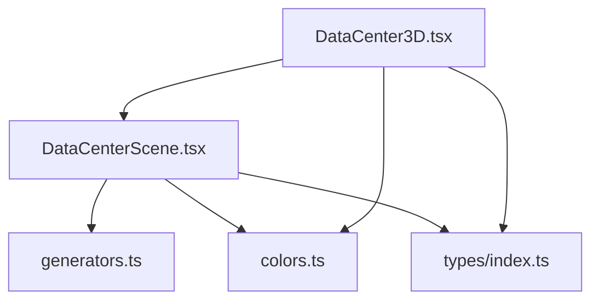

# 机柜3D模型

<cite>
**本文引用的文件**   
- [DataCenterScene.tsx](file://src/components/scene/DataCenterScene.tsx)
- [DataCenter3D.tsx](file://src/pages/DataCenter3D.tsx)
- [generators.ts](file://src/mock/generators.ts)
- [colors.ts](file://src/theme/colors.ts)
- [index.ts](file://src/types/index.ts)
</cite>

## 目录
1. [引言](#引言)
2. [项目结构](#项目结构)
3. [核心组件](#核心组件)
4. [架构总览](#架构总览)
5. [详细组件分析](#详细组件分析)
6. [依赖关系分析](#依赖关系分析)
7. [性能与渲染特性](#性能与渲染特性)
8. [自定义外观与扩展指南](#自定义外观与扩展指南)
9. [故障排查](#故障排查)
10. [结论](#结论)

## 引言
本技术文档聚焦“机柜3D可视化”的实现，重点解析 RackMesh 组件的几何建模、材质与自发光、负载灯带、GPU节点灯带、告警脉冲、选中描边等视觉表现；并说明温度、利用率、告警级别、拓扑模式下的颜色映射逻辑。同时给出扩展建议，帮助开发者自定义机柜外观和新增视觉效果。

## 项目结构
数据中心3D页面由页面容器、3D场景组件、数据生成器、主题色板与类型定义组成：
- 页面层：负责视图模式切换、统计面板、图例与交互入口。
- 场景层：封装 Three.js / React Three Fiber 场景，渲染网格、灯光、机柜阵列、拓扑连线与浮层信息。
- 数据层：生成机房拓扑、机柜与GPU节点指标，提供布局常量与坐标计算。
- 主题层：统一健康等级、告警等级、温度与利用率的颜色映射。
- 类型层：定义机柜、节点、视图模式等数据结构。

图表来源
- [DataCenter3D.tsx:1-159](file://src/pages/DataCenter3D.tsx#L1-L159)
- [DataCenterScene.tsx:1-401](file://src/components/scene/DataCenterScene.tsx#L1-L401)
- [generators.ts:62-81](file://src/mock/generators.ts#L62-L81)
- [colors.ts:66-96](file://src/theme/colors.ts#L66-L96)
- [index.ts:50-64](file://src/types/index.ts#L50-L64)

章节来源
- [DataCenter3D.tsx:1-159](file://src/pages/DataCenter3D.tsx#L1-L159)
- [DataCenterScene.tsx:1-401](file://src/components/scene/DataCenterScene.tsx#L1-L401)
- [generators.ts:62-81](file://src/mock/generators.ts#L62-L81)
- [colors.ts:66-96](file://src/theme/colors.ts#L66-L96)
- [index.ts:50-64](file://src/types/index.ts#L50-L64)

## 核心组件
- DataCenterScene：3D场景主组件，负责相机、灯光、网格、冷热通道色带、机柜阵列、拓扑连线、巡检动画、轨道控制器与浮层信息。
- RackMesh：单个机柜的3D模型，包含主体几何体、自发光材质、顶部负载灯条、正面GPU节点灯带、选中描边框、告警脉冲球。
- DataCenter3D：页面级容器，管理视图模式（温度/负载/告警/拓扑）、自动巡检开关、统计面板与图例。
- generators：提供机柜尺寸、间距、机房间隔等布局常量，以及 rackWorldPosition 坐标计算。
- colors：提供 tempToColor、utilToColor、HEALTH_COLOR 等颜色映射函数与常量。
- types：定义 Rack、GpuNode、ViewMode 等关键类型。

章节来源
- [DataCenterScene.tsx:18-143](file://src/components/scene/DataCenterScene.tsx#L18-L143)
- [DataCenterScene.tsx:207-326](file://src/components/scene/DataCenterScene.tsx#L207-L326)
- [DataCenter3D.tsx:8-13](file://src/pages/DataCenter3D.tsx#L8-L13)
- [generators.ts:65-81](file://src/mock/generators.ts#L65-L81)
- [colors.ts:21-27](file://src/theme/colors.ts#L21-L27)
- [colors.ts:66-96](file://src/theme/colors.ts#L66-L96)
- [index.ts:50-64](file://src/types/index.ts#L50-L64)
- [index.ts:160-161](file://src/types/index.ts#L160-L161)

## 架构总览
RackMesh 在每帧中根据当前视图模式与机柜状态更新自发光强度与灯带透明度；当存在严重告警或被选中时，触发脉冲效果与描边框。拓扑模式下额外绘制 InfiniBand 骨干链路。

图表来源
- [DataCenterScene.tsx:64-143](file://src/components/scene/DataCenterScene.tsx#L64-L143)
- [DataCenterScene.tsx:218-326](file://src/components/scene/DataCenterScene.tsx#L218-L326)
- [generators.ts:76-81](file://src/mock/generators.ts#L76-L81)
- [colors.ts:66-96](file://src/theme/colors.ts#L66-L96)

## 详细组件分析

### RackMesh 组件：几何体、材质与自发光
- 几何体
  - 机柜主体：BoxGeometry，尺寸来自 RACK_W、RACK_H、RACK_D。
  - 顶部负载灯条：BoxGeometry，宽度与深度为机柜比例缩放。
  - 正面GPU节点灯带：PlaneGeometry，叠加在机柜前表面，使用 AdditiveBlending 增强发光感。
  - 选中描边框：LineSegments + EdgesGeometry，基于 BoxGeometry 生成线框。
  - 告警脉冲球：SphereGeometry，位于机柜顶部上方。
- 材质与自发光
  - 主体材质：MeshStandardMaterial，设置 color、emissive、emissiveIntensity、metalness、roughness、transparent、opacity。
  - 灯带材质：MeshBasicMaterial，透明且颜色随视图模式变化。
  - 自发光强度：useFrame 中根据 mode 与 stat.util 动态调整；若处于 pulse（critical 或 selected），则叠加正弦波实现闪烁。
- 交互
  - onClick 阻止冒泡并调用 onSelect 回调，用于选中机柜。

图表来源
- [DataCenterScene.tsx:64-143](file://src/components/scene/DataCenterScene.tsx#L64-L143)

章节来源
- [DataCenterScene.tsx:64-143](file://src/components/scene/DataCenterScene.tsx#L64-L143)

### 负载灯带、GPU节点灯带与告警脉冲
- 负载灯带（顶部）
  - 位置：机柜顶部上方，尺寸略小于机柜。
  - 透明度：0.5 + (util/100)*0.5，随利用率线性变化。
  - 颜色：同机柜主体颜色，受视图模式影响。
- GPU节点灯带（正面）
  - 位置：机柜前表面中心，尺寸覆盖大部分前面板。
  - 混合模式：AdditiveBlending，呈现叠加发光效果。
  - 透明度：固定较低值，突出整体光晕。
- 告警脉冲
  - 条件：stat.critical > 0 或 selected。
  - 效果：自发光强度叠加正弦波，产生呼吸式闪烁；同时在机柜顶部显示小球作为告警标记。

图表来源
- [DataCenterScene.tsx:83-94](file://src/components/scene/DataCenterScene.tsx#L83-L94)

章节来源
- [DataCenterScene.tsx:83-94](file://src/components/scene/DataCenterScene.tsx#L83-L94)

### 机柜状态颜色映射逻辑
- 视图模式
  - temperature：按平均温度映射到蓝→青→绿→黄→红渐变。
  - load：按平均利用率分段映射到低/中/高/极高区间。
  - alert：根据是否有 critical 节点或机柜告警级别映射到红色/黄色/青色。
  - topology：统一使用机柜主题色。
- 颜色来源
  - tempToColor：插值计算 RGB，范围 20-90°C。
  - utilToColor：阈值分段返回不同颜色。
  - HEALTH_COLOR：健康等级到颜色的映射。
- 聚合规则
  - computeRackStats：对同一机柜下所有节点的 util、temp 求均值；若任一节点为 critical，则机柜 level 提升为 critical。

图表来源
- [DataCenterScene.tsx:25-61](file://src/components/scene/DataCenterScene.tsx#L25-L61)
- [colors.ts:66-96](file://src/theme/colors.ts#L66-L96)

章节来源
- [DataCenterScene.tsx:25-61](file://src/components/scene/DataCenterScene.tsx#L25-L61)
- [colors.ts:66-96](file://src/theme/colors.ts#L66-L96)

### 选中状态的描边框与动画
- 描边框
  - 条件：selected === true。
  - 实现：LineSegments + EdgesGeometry，颜色为浅青色，半透明。
- 动画
  - 自发光脉冲：pulse 状态下，emissiveIntensity 叠加正弦波，形成呼吸闪烁。
  - 灯带透明度：随利用率平滑变化。

图表来源
- [DataCenterScene.tsx:96-143](file://src/components/scene/DataCenterScene.tsx#L96-L143)

章节来源
- [DataCenterScene.tsx:96-143](file://src/components/scene/DataCenterScene.tsx#L96-L143)

### 拓扑连线与冷热通道色带
- 拓扑连线
  - 仅在 topology 模式下显示。
  - 每排机柜顶部串联至排汇聚点，再连接机房核心，形成 InfiniBand 骨干链路示意。
- 冷热通道色带
  - 地面平面色带，冷通道为青色，热通道为暖橙色，使用 AdditiveBlending 增强发光。

图表来源
- [DataCenterScene.tsx:159-205](file://src/components/scene/DataCenterScene.tsx#L159-L205)
- [DataCenterScene.tsx:329-353](file://src/components/scene/DataCenterScene.tsx#L329-L353)

章节来源
- [DataCenterScene.tsx:159-205](file://src/components/scene/DataCenterScene.tsx#L159-L205)
- [DataCenterScene.tsx:329-353](file://src/components/scene/DataCenterScene.tsx#L329-L353)

## 依赖关系分析
- DataCenterScene 依赖
  - generators：RACK_W/RACK_H/RACK_D、rackWorldPosition。
  - colors：tempToColor、utilToColor、HEALTH_COLOR。
  - types：Rack、GpuNode、ViewMode。
- DataCenter3D 依赖
  - DataCenterScene：渲染场景。
  - colors：图例与统计面板颜色。
  - types：ViewMode。

图表来源
- [DataCenter3D.tsx:1-159](file://src/pages/DataCenter3D.tsx#L1-L159)
- [DataCenterScene.tsx:1-12](file://src/components/scene/DataCenterScene.tsx#L1-L12)
- [generators.ts:65-81](file://src/mock/generators.ts#L65-L81)
- [colors.ts:66-96](file://src/theme/colors.ts#L66-L96)
- [index.ts:50-64](file://src/types/index.ts#L50-L64)

章节来源
- [DataCenter3D.tsx:1-159](file://src/pages/DataCenter3D.tsx#L1-L159)
- [DataCenterScene.tsx:1-12](file://src/components/scene/DataCenterScene.tsx#L1-L12)
- [generators.ts:65-81](file://src/mock/generators.ts#L65-L81)
- [colors.ts:66-96](file://src/theme/colors.ts#L66-L96)
- [index.ts:50-64](file://src/types/index.ts#L50-L64)

## 性能与渲染特性
- 渲染管线
  - Canvas dpr：紧凑模式下为 1，非紧凑模式为 [1, 1.8]，平衡清晰度与性能。
  - gl 配置：开启抗锯齿，powerPreference 设为 high-performance。
  - Fog：远距离渐隐，减少远处细节渲染压力。
- 材质优化
  - 主体材质使用 metalness/roughness 控制金属质感与粗糙度，配合 transparent/opacity 降低过度绘制。
  - 灯带使用 MeshBasicMaterial 与 AdditiveBlending，避免复杂光照计算。
- 动画频率
  - useFrame 每帧更新 emissiveIntensity 与 strip.opacity，开销较小。
- 交互
  - OrbitControls：限制最大极角、最小/最大距离，防止视角异常。
  - compact 模式：禁用平移，启用自动旋转，适合缩略图展示。

章节来源
- [DataCenterScene.tsx:231-236](file://src/components/scene/DataCenterScene.tsx#L231-L236)
- [DataCenterScene.tsx:238-256](file://src/components/scene/DataCenterScene.tsx#L238-L256)
- [DataCenterScene.tsx:314-323](file://src/components/scene/DataCenterScene.tsx#L314-L323)

## 自定义外观与扩展指南

### 自定义机柜几何体
- 修改尺寸
  - 通过 generators.ts 中的 RACK_W、RACK_H、RACK_D 调整机柜宽高深。
- 替换几何体
  - 在 RackMesh 中将 BoxGeometry 替换为其他几何体（如 CylinderGeometry、LatheGeometry）。
  - 注意同步调整灯条与灯带的尺寸与位置。

章节来源
- [generators.ts:65-68](file://src/mock/generators.ts#L65-L68)
- [DataCenterScene.tsx:104-126](file://src/components/scene/DataCenterScene.tsx#L104-L126)

### 自定义材质与自发光
- 主体材质
  - 调整 MeshStandardMaterial 的 color、metalness、roughness、transparent、opacity。
  - 修改 emissive 颜色以匹配视图模式。
- 自发光强度曲线
  - 在 useFrame 中调整 base 与 pulse 的强度公式，可引入缓动函数或噪声纹理。

章节来源
- [DataCenterScene.tsx:106-115](file://src/components/scene/DataCenterScene.tsx#L106-L115)
- [DataCenterScene.tsx:83-94](file://src/components/scene/DataCenterScene.tsx#L83-L94)

### 自定义灯带与节点灯带
- 顶部负载灯条
  - 调整 boxGeometry 的尺寸比例与位置偏移。
  - 修改 MeshBasicMaterial 的 color 与 opacity 曲线。
- 正面GPU节点灯带
  - 调整 planeGeometry 的尺寸与 blending 模式。
  - 可叠加纹理或使用 ShaderMaterial 实现流动光效。

章节来源
- [DataCenterScene.tsx:117-126](file://src/components/scene/DataCenterScene.tsx#L117-L126)

### 自定义告警脉冲与选中描边
- 告警脉冲
  - 调整 pulse 条件与正弦波频率/振幅。
  - 可添加粒子系统或外扩光环。
- 选中描边
  - 调整 lineBasicMaterial 的颜色、透明度与线宽。
  - 可使用 OutlineEffect 或自定义 Shader 实现更丰富的描边效果。

章节来源
- [DataCenterScene.tsx:127-140](file://src/components/scene/DataCenterScene.tsx#L127-L140)
- [DataCenterScene.tsx:83-94](file://src/components/scene/DataCenterScene.tsx#L83-L94)

### 扩展视图模式
- 新增 ViewMode
  - 在 types/index.ts 中扩展 ViewMode 联合类型。
  - 在 rackColor 中增加分支逻辑，映射新模式的视觉表现。
- 页面UI适配
  - 在 DataCenter3D.tsx 中添加新的 FilterChip 选项。
  - 更新 Legend 组件以显示新模式的图例。

章节来源
- [index.ts:160-161](file://src/types/index.ts#L160-L161)
- [DataCenterScene.tsx:50-61](file://src/components/scene/DataCenterScene.tsx#L50-L61)
- [DataCenter3D.tsx:8-13](file://src/pages/DataCenter3D.tsx#L8-L13)
- [DataCenter3D.tsx:110-158](file://src/pages/DataCenter3D.tsx#L110-L158)

## 故障排查
- 颜色不生效
  - 检查 viewMode 是否正确传入。
  - 确认 tempToColor/utilToColor 返回值是否符合预期。
- 自发光无动画
  - 确认 useFrame 是否被调用，clock.getElapsedTime 是否正常递增。
  - 检查 emissiveRef.current 是否存在。
- 描边框不显示
  - 确认 selected 状态是否为 true。
  - 检查 LineSegments 与 EdgesGeometry 的参数是否正确。
- 拓扑连线未显示
  - 确认 viewMode 是否为 'topology'。
  - 检查 TopologyLinks 的数据生成逻辑。

章节来源
- [DataCenterScene.tsx:83-94](file://src/components/scene/DataCenterScene.tsx#L83-L94)
- [DataCenterScene.tsx:127-140](file://src/components/scene/DataCenterScene.tsx#L127-L140)
- [DataCenterScene.tsx:159-205](file://src/components/scene/DataCenterScene.tsx#L159-L205)

## 结论
RackMesh 通过简洁的几何体组合与材质控制，实现了机柜的主体自发光、负载灯带、GPU节点灯带、告警脉冲与选中描边等视觉效果。结合 computeRackStats 与颜色映射函数，系统在温度、负载、告警、拓扑四种视图模式下提供了直观的状态表达。开发者可通过调整几何体、材质、动画曲线与视图模式扩展，灵活定制机柜外观与视觉反馈，满足多样化运维可视化需求。