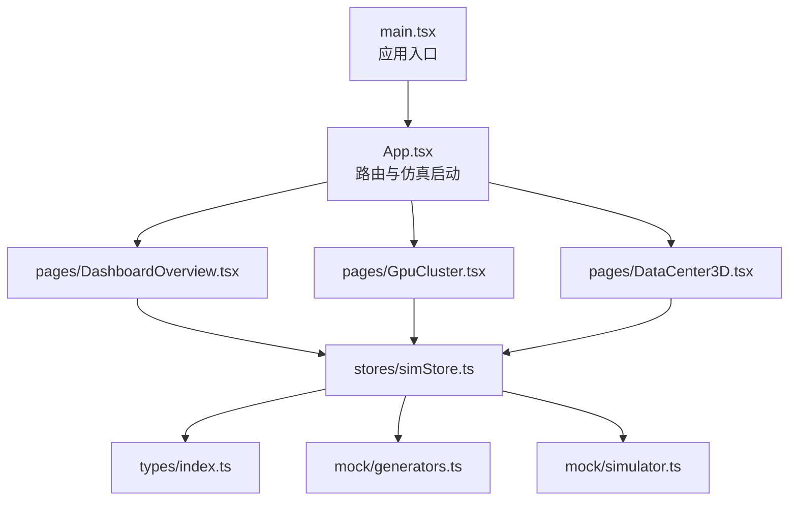
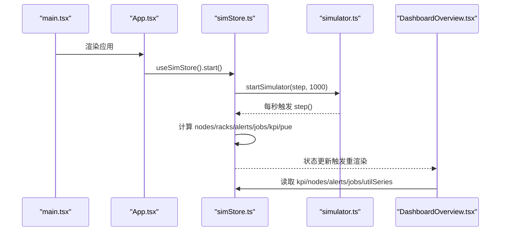
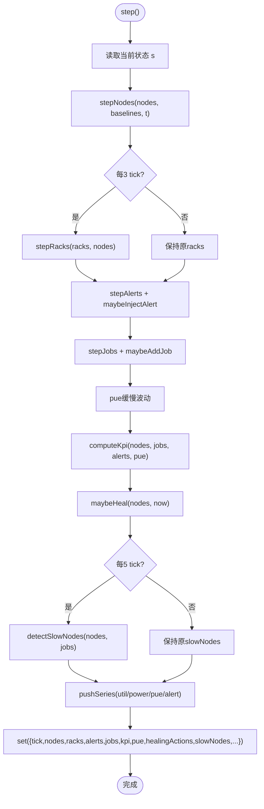
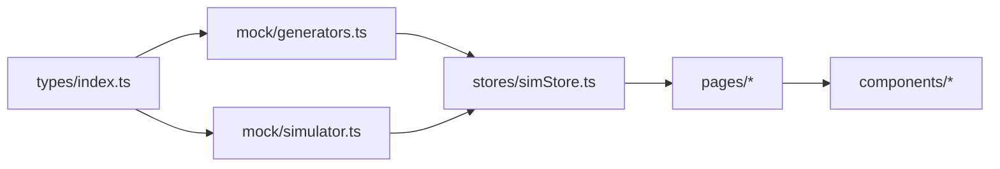

# API参考文档

<cite>
**本文引用的文件**   
- [simStore.ts](file://src/stores/simStore.ts)
- [index.ts](file://src/types/index.ts)
- [generators.ts](file://src/mock/generators.ts)
- [simulator.ts](file://src/mock/simulator.ts)
- [App.tsx](file://src/App.tsx)
- [main.tsx](file://src/main.tsx)
- [DashboardOverview.tsx](file://src/pages/DashboardOverview.tsx)
- [GpuCluster.tsx](file://src/pages/GpuCluster.tsx)
- [DataCenter3D.tsx](file://src/pages/DataCenter3D.tsx)
</cite>

## 目录
1. [简介](#简介)
2. [项目结构](#项目结构)
3. [核心状态与API总览](#核心状态与api总览)
4. [架构总览](#架构总览)
5. [Zustand Store详细规范](#zustand-store详细规范)
6. [TypeScript类型定义与业务规则](#typescript类型定义与业务规则)
7. [页面组件接口与使用方式](#页面组件接口与使用方式)
8. [仿真引擎与数据流](#仿真引擎与数据流)
9. [依赖关系分析](#依赖关系分析)
10. [性能与扩展建议](#性能与扩展建议)
11. [错误处理与排错指南](#错误处理与排错指南)
12. [版本兼容性与迁移指南](#版本兼容性与迁移指南)
13. [第三方集成与扩展规范](#第三方集成与扩展规范)
14. [结论](#结论)

## 简介
本文件为IDC AI运维平台的API参考文档，重点覆盖：
- Zustand Store的状态字段、操作方法、参数类型和返回值。
- React页面组件的Props接口、事件回调、默认值和配置选项。
- TypeScript类型定义、枚举值、接口约束和业务规则。
- API使用示例路径、错误处理模式与最佳实践。
- 版本兼容性说明与迁移指南。
- 第三方集成与组件扩展的接口规范。

平台通过Zustand维护全局仿真状态，结合Mock生成器与仿真驱动，实时推进机房拓扑、GPU节点、告警、任务、KPI与时序指标，并在多个页面中消费这些状态进行可视化展示。

## 项目结构
仓库采用按功能域组织的方式：
- `src/stores`：Zustand Store定义与导出。
- `src/types`：领域模型与公共类型。
- `src/mock`：确定性数据生成器与仿真引擎。
- `src/pages`：业务页面组件。
- `src/components`：通用UI与场景组件。
- `src/theme`：图表主题与颜色。
- `src/App.tsx`：路由与启动逻辑。
- `src/main.tsx`：应用入口。

**图示来源**
- [main.tsx:1-11](file://src/main.tsx#L1-L11)
- [App.tsx:1-47](file://src/App.tsx#L1-L47)
- [DashboardOverview.tsx:1-301](file://src/pages/DashboardOverview.tsx#L1-L301)
- [GpuCluster.tsx:1-287](file://src/pages/GpuCluster.tsx#L1-L287)
- [DataCenter3D.tsx:1-159](file://src/pages/DataCenter3D.tsx#L1-L159)
- [simStore.ts:1-270](file://src/stores/simStore.ts#L1-L270)
- [index.ts:1-192](file://src/types/index.ts#L1-L192)
- [generators.ts:1-408](file://src/mock/generators.ts#L1-L408)
- [simulator.ts:1-331](file://src/mock/simulator.ts#L1-L331)

**章节来源**
- [main.tsx:1-11](file://src/main.tsx#L1-L11)
- [App.tsx:1-47](file://src/App.tsx#L1-L47)

## 核心状态与API总览
Zustand Store暴露以下关键状态与方法：
- 运行控制：started、tick、step、start、stop。
- 拓扑与资产：halls、racks、nodes、assets。
- 告警与自愈：alerts、failurePredictions、healingActions、slowNodes。
- KPI与时序：kpi、utilSeries、powerSeries、pueSeries、alertSeries、pue。
- UI状态：viewMode、selectedRackId、tourActive。
- 操作API：ackAlert、silenceAlert、resolveAlert、submitJob、setViewMode、selectRack、toggleTour。

典型用法：
- 在页面中通过useSimStore订阅所需字段。
- 调用start/stop控制仿真心跳。
- 通过ackAlert等动作更新告警状态。
- 通过submitJob提交新任务。
- 通过setViewMode切换3D视图模式。

**章节来源**
- [simStore.ts:99-134](file://src/stores/simStore.ts#L99-L134)
- [simStore.ts:142-265](file://src/stores/simStore.ts#L142-L265)

## 架构总览
系统由三层组成：
- 表现层：React页面组件消费Store状态并渲染图表与列表。
- 状态层：Zustand Store聚合仿真数据并提供方法。
- 仿真层：Mock生成器与仿真引擎提供纯函数计算与心跳驱动。

**图示来源**
- [main.tsx:6-10](file://src/main.tsx#L6-L10)
- [App.tsx:18-26](file://src/App.tsx#L18-L26)
- [simStore.ts:209-219](file://src/stores/simStore.ts#L209-L219)
- [simulator.ts:323-330](file://src/mock/simulator.ts#L323-L330)
- [DashboardOverview.tsx:15-23](file://src/pages/DashboardOverview.tsx#L15-L23)

## Zustand Store详细规范

### 状态字段
- started: boolean，是否已启动仿真。
- tick: number，仿真步数。
- halls: Hall[]，机房列表。
- racks: Rack[]，机柜列表。
- nodes: GpuNode[]，GPU节点列表。
- alerts: AlertItem[]，告警列表。
- jobs: Job[]，任务列表。
- assets: Asset[]，CMDB资产列表。
- kpi: KpiSnapshot，KPI快照。
- failurePredictions: FailurePrediction[]，故障预测列表。
- healingActions: HealingAction[]，自愈动作日志。
- slowNodes: SlowNode[]，慢节点检测结果。
- utilSeries: TimePoint[]，算力利用率时序。
- powerSeries: TimePoint[]，功耗时序。
- pueSeries: TimePoint[]，PUE时序。
- alertSeries: TimePoint[]，告警数量时序。
- pue: number，当前PUE值。
- viewMode: ViewMode，3D视图模式。
- selectedRackId: string | null，选中的机柜ID。
- tourActive: boolean，自动巡检是否激活。

**章节来源**
- [simStore.ts:99-122](file://src/stores/simStore.ts#L99-L122)

### 操作方法
- step(): void，推进一次仿真步进，更新节点、机柜、告警、任务、KPI、PUE、慢节点与时序。
- start(): void，启动仿真心跳（每秒调用step）。
- stop(): void，停止仿真心跳。
- ackAlert(id: string): void，确认告警。
- silenceAlert(id: string): void，静音告警。
- resolveAlert(id: string): void，解决告警。
- submitJob(job: Partial<Job>): void，提交新任务，缺失字段将填充默认值。
- setViewMode(m: ViewMode): void，设置3D视图模式。
- selectRack(id: string | null): void，选择或取消选中机柜。
- toggleTour(): void，切换自动巡检开关。

返回值均为void；部分方法内部会更新Store状态并触发订阅者重渲染。

**章节来源**
- [simStore.ts:123-134](file://src/stores/simStore.ts#L123-L134)
- [simStore.ts:164-265](file://src/stores/simStore.ts#L164-L265)

### 初始化与默认值
- 初始拓扑、资产、任务、预测、基线在模块加载时一次性生成。
- 历史时序通过seedSeries生成24小时粒度曲线（演示用）。
- 初始KPI基于初始节点、任务、告警与PUE计算。
- 初始告警与自愈日志通过seedAlerts与seedHealing构造。
- 初始视图模式为temperature，未选中机柜，未开启自动巡检。

**章节来源**
- [simStore.ts:40-58](file://src/stores/simStore.ts#L40-L58)
- [simStore.ts:60-94](file://src/stores/simStore.ts#L60-L94)
- [simStore.ts:138-162](file://src/stores/simStore.ts#L138-L162)

### 使用示例路径
- 页面订阅状态：[DashboardOverview.tsx:15-23](file://src/pages/DashboardOverview.tsx#L15-L23)
- 启动与停止仿真：[App.tsx:18-26](file://src/App.tsx#L18-L26)
- 提交任务：[simStore.ts:240-260](file://src/stores/simStore.ts#L240-L260)
- 切换视图模式：[DataCenter3D.tsx:15-23](file://src/pages/DataCenter3D.tsx#L15-L23)

## TypeScript类型定义与业务规则

### 枚举与基础类型
- GpuModel: 'H100' | 'A100' | '910B'
- HealthLevel: 'normal' | 'warning' | 'critical' | 'offline'
- AlertLevel: 'P0' | 'P1' | 'P2' | 'P3'
- AlertStatus: 'active' | 'acked' | 'silenced' | 'resolved'
- AlertSource: 'GPU' | '节点' | '网络' | '存储' | '供电' | '制冷'
- JobStatus: 'queued' | 'running' | 'succeeded' | 'failed'
- QueueType: '训练' | '推理' | '调试'
- AssetType: '服务器' | 'GPU卡' | '交换机' | '存储阵列'
- LifecycleStatus: '在保' | '过保' | '待报废'
- ViewMode: 'temperature' | 'load' | 'alert' | 'topology'

**章节来源**
- [index.ts:5-18](file://src/types/index.ts#L5-L18)
- [index.ts:89-120](file://src/types/index.ts#L89-L120)
- [index.ts:154-161](file://src/types/index.ts#L154-L161)

### 核心实体
- GpuMetrics：单卡指标（index、util、memUtil、temp、power、nvlink、eccErrors、level）。
- GpuNode：节点信息（id、hall、row、rack、model、gpuCount、status、healthScore、util、memUtil、temp、power、ip、gpus）。
- Rack：机柜信息（id、hall、row、col、nodeCount、power、inletTemp、outletTemp、level、x、z）。
- Hall：机房信息（id、name、rows、colsPerRow、racks）。
- AlertItem：告警条目（id、level、source、title、target、status、value、timestamp、ackAt、resolveAt）。
- Job：任务（id、name、owner、queue、gpuRequest、status、progress、submitAt、startAt、endAt、priority、model、loss、throughput、mfu、assignedNodes）。
- Asset：资产（id、sn、type、model、vendor、hall、rackId、uPosition、onlineDate、warrantyUntil、lifecycle、business、status、repairCount）。
- KpiSnapshot：KPI汇总（totalPflops、gpuTotal、gpuOnline、onlineRate、avgUtil、activeAlerts、pue、runningJobs、totalPowerKw、itPowerKw、coolingPowerKw）。
- TimePoint：时序点（t、v）。
- FailurePrediction：故障预测（id、target、component、probability、rul、confidence）。
- HealingAction：自愈动作（id、timestamp、action、target、reason、status、latencyMs）。
- SlowNode：慢节点检测（nodeId、job、deviation、metric、suggestion）。

**章节来源**
- [index.ts:20-48](file://src/types/index.ts#L20-L48)
- [index.ts:50-73](file://src/types/index.ts#L50-L73)
- [index.ts:75-87](file://src/types/index.ts#L75-L87)
- [index.ts:95-113](file://src/types/index.ts#L95-L113)
- [index.ts:121-137](file://src/types/index.ts#L121-L137)
- [index.ts:139-152](file://src/types/index.ts#L139-L152)
- [index.ts:154-158](file://src/types/index.ts#L154-L158)
- [index.ts:163-182](file://src/types/index.ts#L163-L182)
- [index.ts:184-191](file://src/types/index.ts#L184-L191)

### 业务规则摘要
- 健康等级由温度与利用率决定：高温或高负载触发警告或严重。
- 节点离线时指标清零，健康评分归零。
- 机柜出风温度与整机功耗相关，超过阈值判定为警告或严重。
- KPI在线率、平均利用率、活跃告警数、PUE、运行任务数等由节点、任务、告警与PUE共同计算。
- 告警注入概率与目标节点热度相关；部分告警自然恢复。
- 任务并发上限为固定容量，排队任务按优先级尝试启动。
- PUE缓慢波动，限制在合理区间。
- 慢节点检测基于集群均值偏差，输出Top慢节点与建议。

**章节来源**
- [generators.ts:83-87](file://src/mock/generators.ts#L83-L87)
- [generators.ts:131-153](file://src/mock/generators.ts#L131-L153)
- [generators.ts:174-191](file://src/mock/generators.ts#L174-L191)
- [simulator.ts:54-71](file://src/mock/simulator.ts#L54-L71)
- [simulator.ts:76-92](file://src/mock/simulator.ts#L76-L92)
- [simulator.ts:97-139](file://src/mock/simulator.ts#L97-L139)
- [simulator.ts:165-194](file://src/mock/simulator.ts#L165-L194)
- [simulator.ts:199-234](file://src/mock/simulator.ts#L199-L234)
- [simulator.ts:303-318](file://src/mock/simulator.ts#L303-L318)

## 页面组件接口与使用方式

### DashboardOverview
- 数据来源：useSimStore订阅kpi、nodes、alerts、jobs、utilSeries、racks、viewMode。
- 主要职责：展示KPI条、集群健康度、Top高负载节点、全域机房3D透视、告警滚动播报、算力利用率趋势、任务队列概览。
- 交互：点击“进入大屏”跳转至3D页面。

Props与回调：
- 该页面直接消费Store，不对外暴露Props。
- 导航回调来自react-router-dom的useNavigate。

**章节来源**
- [DashboardOverview.tsx:15-23](file://src/pages/DashboardOverview.tsx#L15-L23)
- [DashboardOverview.tsx:68-274](file://src/pages/DashboardOverview.tsx#L68-L274)

### GpuCluster
- 数据来源：useSimStore订阅nodes。
- 筛选能力：机房、型号、状态、搜索关键词、分页。
- 热力图：采样节点×8 GPU，支持温度与利用率两种度量。
- 详情抽屉：选中节点后展示8卡实时指标与健康状态。

Props与回调：
- 该页面直接消费Store，不对外暴露Props。
- 内部状态包括hall、model、statuses、search、page、selected、heatMetric。

**章节来源**
- [GpuCluster.tsx:13-22](file://src/pages/GpuCluster.tsx#L13-L22)
- [GpuCluster.tsx:26-58](file://src/pages/GpuCluster.tsx#L26-L58)
- [GpuCluster.tsx:59-162](file://src/pages/GpuCluster.tsx#L59-L162)
- [GpuCluster.tsx:164-267](file://src/pages/GpuCluster.tsx#L164-L267)

### DataCenter3D
- 数据来源：useSimStore订阅racks、nodes、viewMode、selectedRackId、tourActive。
- 交互：切换视图模式、选择机柜、自动巡检开关。
- 统计面板：显示机房态势与色标图例。

Props与回调：
- 该页面直接消费Store，不对外暴露Props。
- 通过setViewMode/selectRack/toggleTour更新Store。

**章节来源**
- [DataCenter3D.tsx:15-23](file://src/pages/DataCenter3D.tsx#L15-L23)
- [DataCenter3D.tsx:37-95](file://src/pages/DataCenter3D.tsx#L37-L95)
- [DataCenter3D.tsx:98-158](file://src/pages/DataCenter3D.tsx#L98-L158)

## 仿真引擎与数据流

### 仿真步进流程

**图示来源**
- [simStore.ts:164-207](file://src/stores/simStore.ts#L164-L207)
- [simulator.ts:54-71](file://src/mock/simulator.ts#L54-L71)
- [simulator.ts:76-92](file://src/mock/simulator.ts#L76-L92)
- [simulator.ts:97-139](file://src/mock/simulator.ts#L97-L139)
- [simulator.ts:165-194](file://src/mock/simulator.ts#L165-L194)
- [simulator.ts:199-234](file://src/mock/simulator.ts#L199-L234)
- [simulator.ts:264-268](file://src/mock/simulator.ts#L264-L268)
- [simulator.ts:283-298](file://src/mock/simulator.ts#L283-L298)
- [simulator.ts:303-318](file://src/mock/simulator.ts#L303-L318)

### 心跳驱动
- startSimulator以固定间隔调用step回调。
- stop清理定时器并重置started状态。

**章节来源**
- [simulator.ts:323-330](file://src/mock/simulator.ts#L323-L330)
- [simStore.ts:209-219](file://src/stores/simStore.ts#L209-L219)

## 依赖关系分析

**图示来源**
- [index.ts:1-192](file://src/types/index.ts#L1-L192)
- [generators.ts:1-408](file://src/mock/generators.ts#L1-L408)
- [simulator.ts:1-331](file://src/mock/simulator.ts#L1-L331)
- [simStore.ts:1-270](file://src/stores/simStore.ts#L1-L270)

**章节来源**
- [simStore.ts:1-22](file://src/stores/simStore.ts#L1-L22)
- [generators.ts:1-12](file://src/mock/generators.ts#L1-L12)
- [simulator.ts:1-13](file://src/mock/simulator.ts#L1-L13)

## 性能与扩展建议
- 减少不必要的重渲染：在页面中使用useSimStore的选择器只订阅必要字段。
- 控制序列长度：时序数组有最大长度限制，避免无限增长。
- 降低高频计算：机柜聚合每3 tick更新，慢节点检测每5 tick更新。
- 扩展点：
  - 新增视图模式：在ViewMode中添加新值，并在DataCenter3D中增加对应FilterChip。
  - 新增告警模板：在ALERT_TEMPLATES中添加模板，影响maybeInjectAlert。
  - 新增自愈策略：在HEAL_ACTIONS中添加动作模板，影响maybeHeal。
  - 新增KPI维度：在computeKpi中扩展计算逻辑，并在Store中同步推送。

[本节为通用指导，不涉及具体文件分析]

## 错误处理与排错指南
- 告警状态流转：active可能自然恢复为resolved；用户可ack/silence/resolve。
- 任务失败：极小概率失败，状态变为failed并记录endAt。
- 节点离线：指标清零，健康评分归零，不参与KPI在线率与利用率计算。
- 排查步骤：
  - 检查store.started是否为true，确认start已调用。
  - 查看alerts与healingActions是否出现异常激增。
  - 观察slowNodes是否持续存在，定位慢节点原因。
  - 校验KPI与PUE是否在合理范围。

**章节来源**
- [simulator.ts:187-194](file://src/mock/simulator.ts#L187-L194)
- [simulator.ts:226-230](file://src/mock/simulator.ts#L226-L230)
- [simulator.ts:283-298](file://src/mock/simulator.ts#L283-L298)
- [simStore.ts:221-238](file://src/stores/simStore.ts#L221-L238)

## 版本兼容性与迁移指南
- React与Zustand：
  - React peerDependencies要求>=16.8。
  - immer与@types/react可选。
- 迁移建议：
  - 若升级React至18+，注意StrictMode下的双重渲染行为对仿真启动的影响（当前App在effect中启动/停止，符合预期）。
  - 若引入immer，可在Store中使用produce简化不可变更新（当前Store使用函数式set更新，无需immer）。
  - 若扩展类型，请在types/index.ts中统一声明，并在generators/simulator/store中保持一致。

**章节来源**
- [package-lock.json:3691-3714](file://package-lock.json#L3691-L3714)
- [main.tsx:6-10](file://src/main.tsx#L6-L10)

## 第三方集成与扩展规范
- 外部服务接入：
  - 建议在simulator.ts中新增纯函数用于对接外部指标源，并在Store的step中调用。
  - 通过BaselineMap扩展节点基线，使外部数据可参与漂移计算。
- 组件扩展：
  - 新增页面组件应通过useSimStore订阅状态，避免直接修改Store。
  - 如需跨页面共享视图模式或选中项，继续使用Store中的viewMode与selectedRackId。
- 图表扩展：
  - 在theme/chartOptions.ts中新增option配置，并在页面中使用ChartBox渲染。
  - 颜色与样式通过theme/colors.ts统一管理。

[本节为通用指导，不涉及具体文件分析]

## 结论
本API参考文档覆盖了IDC AI运维平台的核心状态、类型定义、页面组件接口与仿真数据流。通过Zustand Store集中管理仿真状态，结合Mock生成器与仿真引擎，平台实现了机房拓扑、GPU节点、告警、任务、KPI与时序指标的实时演进与可视化展示。开发者可在此基础上扩展视图模式、告警模板、自愈策略与KPI维度，以满足更多运维场景需求。