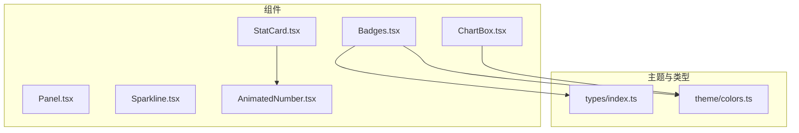
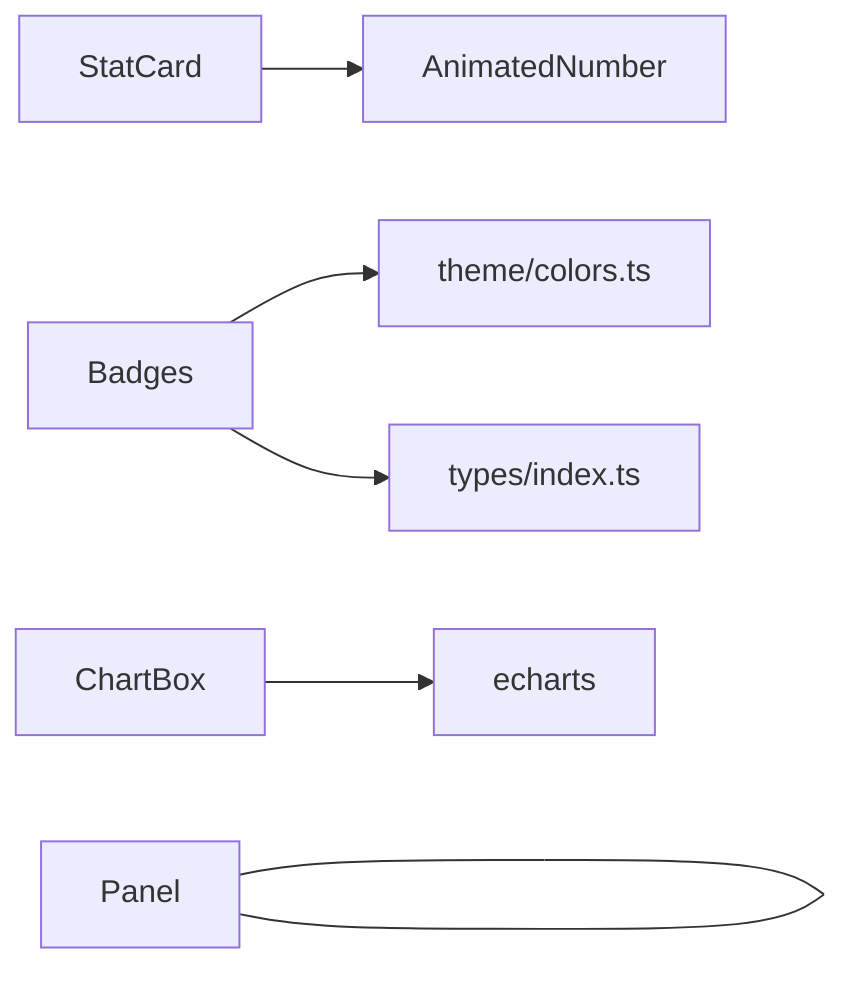
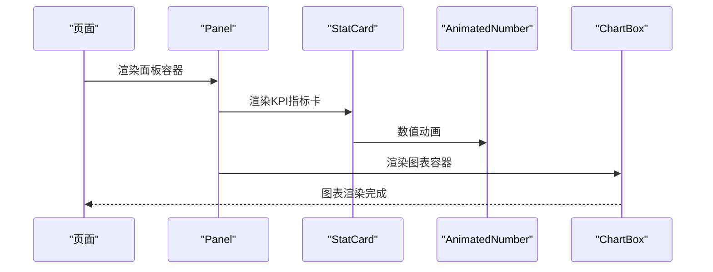

# React组件API

<cite>
**本文引用的文件**   
- [Panel.tsx](file://src/components/Panel.tsx)
- [ChartBox.tsx](file://src/components/ChartBox.tsx)
- [StatCard.tsx](file://src/components/StatCard.tsx)
- [Badges.tsx](file://src/components/Badges.tsx)
- [Sparkline.tsx](file://src/components/Sparkline.tsx)
- [AnimatedNumber.tsx](file://src/components/AnimatedNumber.tsx)
- [index.ts（类型定义）](file://src/types/index.ts)
- [colors.ts（主题色板）](file://src/theme/colors.ts)
</cite>

## 目录
1. [简介](#简介)
2. [项目结构](#项目结构)
3. [核心组件总览](#核心组件总览)
4. [架构概览](#架构概览)
5. [详细组件API参考](#详细组件api参考)
6. [依赖关系分析](#依赖关系分析)
7. [性能与优化建议](#性能与优化建议)
8. [样式与主题集成](#样式与主题集成)
9. [组合使用模式](#组合使用模式)
10. [常见问题排查](#常见问题排查)
11. [结论](#结论)

## 简介
本文件为数据中心运维驾驶舱的React基础UI组件API文档，覆盖以下组件：
- Panel 面板容器
- ChartBox ECharts图表容器
- StatCard 统计卡片
- Badges 徽章系列（告警等级、健康状态、任务状态等）
- Sparkline 迷你折线图
- AnimatedNumber 数字滚动动画

文档包含每个组件的Props接口、默认值、事件回调、视觉表现、交互行为、样式定制选项、响应式支持、组合模式、主题集成方法与性能优化技巧。

## 项目结构
组件位于 src/components 下，类型定义在 src/types，主题色板在 src/theme。页面层通过组合这些基础组件构建业务视图。



**图示来源**
- [Panel.tsx:1-54](file://src/components/Panel.tsx#L1-L54)
- [ChartBox.tsx:1-61](file://src/components/ChartBox.tsx#L1-L61)
- [StatCard.tsx:1-83](file://src/components/StatCard.tsx#L1-L83)
- [Badges.tsx:1-84](file://src/components/Badges.tsx#L1-L84)
- [Sparkline.tsx:1-51](file://src/components/Sparkline.tsx#L1-L51)
- [AnimatedNumber.tsx:1-62](file://src/components/AnimatedNumber.tsx#L1-L62)
- [index.ts:1-192](file://src/types/index.ts#L1-L192)
- [colors.ts:1-97](file://src/theme/colors.ts#L1-L97)

**章节来源**
- [Panel.tsx:1-54](file://src/components/Panel.tsx#L1-L54)
- [ChartBox.tsx:1-61](file://src/components/ChartBox.tsx#L1-L61)
- [StatCard.tsx:1-83](file://src/components/StatCard.tsx#L1-L83)
- [Badges.tsx:1-84](file://src/components/Badges.tsx#L1-L84)
- [Sparkline.tsx:1-51](file://src/components/Sparkline.tsx#L1-L51)
- [AnimatedNumber.tsx:1-62](file://src/components/AnimatedNumber.tsx#L1-L62)
- [index.ts:1-192](file://src/types/index.ts#L1-L192)
- [colors.ts:1-97](file://src/theme/colors.ts#L1-L97)

## 核心组件总览
- Panel：通用面板容器，提供标题栏、动作区、切角装饰、扫描线叠加和入场动效。
- ChartBox：ECharts封装，自动应用主题、自适应尺寸、增量更新配置、事件绑定。
- StatCard：KPI指标卡，聚合数值动画、单位、图标、进度条、趋势箭头。
- Badges：多类徽章组件，统一颜色与标签映射，支持健康、告警、任务状态。
- Sparkline：轻量SVG迷你图，用于表格或KPI内嵌趋势展示。
- AnimatedNumber：基于requestAnimationFrame的数字滚动动画，支持小数位与前后缀。

**章节来源**
- [Panel.tsx:18-53](file://src/components/Panel.tsx#L18-L53)
- [ChartBox.tsx:14-60](file://src/components/ChartBox.tsx#L14-L60)
- [StatCard.tsx:18-82](file://src/components/StatCard.tsx#L18-L82)
- [Badges.tsx:11-83](file://src/components/Badges.tsx#L11-L83)
- [Sparkline.tsx:11-50](file://src/components/Sparkline.tsx#L11-L50)
- [AnimatedNumber.tsx:12-61](file://src/components/AnimatedNumber.tsx#L12-L61)

## 架构概览
组件间依赖关系如下：
- StatCard 内部使用 AnimatedNumber 进行数值动画。
- Badges 使用 theme/colors.ts 中的颜色与标签映射，并引用 types/index.ts 中的领域类型。
- ChartBox 使用 echarts 与 ensureEchartsTheme 主题初始化。
- Panel 作为通用容器被多处复用，承载子组件内容。

```mermaid
classDiagram
class Panel {
+title? : string
+subtitle? : string
+actions? : ReactNode
+children : ReactNode
+className? : string
+bodyClassName? : string
+corners? : boolean
+scanline? : boolean
+delay? : number
}
class ChartBox {
+option : EChartsOption
+className? : string
+noAnimation? : boolean
+onEvents? : Record<string, (params)=>void>
}
class StatCard {
+label : string
+value : number
+decimals? : number
+unit? : string
+prefix? : string
+icon? : string
+color? : string
+hint? : string
+progress? : number
+trend? : number
}
class Badges {
+LevelBadge(level,size)
+LevelTag(level)
+HealthBadge(level,showLabel)
+AlertStatusBadge(status)
+JobStatusBadge(status)
}
class Sparkline {
+data : number[]
+width? : number
+height? : number
+color? : string
+fill? : boolean
+strokeWidth? : number
+className? : string
}
class AnimatedNumber {
+value : number
+decimals? : number
+duration? : number
+className? : string
+prefix? : string
+suffix? : string
}
StatCard --> AnimatedNumber : "使用"
Badges --> colors : "颜色映射"
ChartBox --> echarts : "渲染"
```

**图示来源**
- [Panel.tsx:4-16](file://src/components/Panel.tsx#L4-L16)
- [ChartBox.tsx:6-12](file://src/components/ChartBox.tsx#L6-L12)
- [StatCard.tsx:3-16](file://src/components/StatCard.tsx#L3-L16)
- [Badges.tsx:11-83](file://src/components/Badges.tsx#L11-L83)
- [Sparkline.tsx:1-9](file://src/components/Sparkline.tsx#L1-L9)
- [AnimatedNumber.tsx:3-10](file://src/components/AnimatedNumber.tsx#L3-L10)
- [colors.ts:1-97](file://src/theme/colors.ts#L1-L97)

## 详细组件API参考

### Panel 面板容器
- 作用：通用面板容器，提供霓虹风格边框、切角装饰、可选扫描线叠加、标题栏与动作区、入场动画。
- Props
  - title?: string — 面板标题
  - subtitle?: string — 副标题
  - actions?: ReactNode — 右侧动作区
  - children: ReactNode — 面板主体内容
  - className?: string — 外层容器类名
  - bodyClassName?: string — 内容区域类名
  - corners?: boolean — 是否显示切角装饰，默认 true
  - scanline?: boolean — 是否显示扫描线叠加，默认 false
  - delay?: number — 入场动画延迟秒数，默认 0
- 视觉与交互
  - 标题栏带底边框分隔；标题与副标题可截断显示
  - 支持 group-hover 等Tailwind类名扩展交互
  - 入场动画使用缓动 easeOut，持续0.4s
- 响应式
  - 使用flex布局，内容区域自适应高度
- 示例用法路径
  - [Panel.tsx:21-53](file://src/components/Panel.tsx#L21-L53)

**章节来源**
- [Panel.tsx:4-16](file://src/components/Panel.tsx#L4-L16)
- [Panel.tsx:21-53](file://src/components/Panel.tsx#L21-L53)

### ChartBox 图表容器
- 作用：ECharts封装，自动应用驾驶舱主题、监听容器尺寸变化、增量更新配置、注册事件回调。
- Props
  - option: EChartsOption — ECharts配置对象
  - className?: string — 外层容器类名（需设置高度）
  - noAnimation?: boolean — 高频刷新场景禁用动画，默认 false
  - onEvents?: Record<string, (params: unknown) => void> — 事件映射表，键为事件名，值为回调
- 生命周期与行为
  - 初始化时创建echarts实例并挂载ResizeObserver监听尺寸变化
  - option变更时调用setOption合并更新
  - onEvents变更时动态绑定/解绑事件
- 性能
  - 使用memo包裹避免不必要的重渲染
  - notMerge:false、lazyUpdate:false保证增量更新稳定
- 示例用法路径
  - [ChartBox.tsx:6-12](file://src/components/ChartBox.tsx#L6-L12)
  - [ChartBox.tsx:17-60](file://src/components/ChartBox.tsx#L17-L60)

**章节来源**
- [ChartBox.tsx:6-12](file://src/components/ChartBox.tsx#L6-L12)
- [ChartBox.tsx:17-60](file://src/components/ChartBox.tsx#L17-L60)

### StatCard 统计卡片
- 作用：顶部KPI指标卡，聚合大数字、单位、图标、进度条、趋势指示与提示文本。
- Props
  - label: string — 指标名称
  - value: number — 当前数值
  - decimals?: number — 小数位数，默认 0
  - unit?: string — 单位文本
  - prefix?: string — 数值前缀
  - icon?: string — 图标字符或节点
  - color?: string — 主色调，默认 #22d3ee
  - hint?: string — 副信息文本
  - progress?: number — 进度百分比 0-100
  - trend?: number — 相对变化百分比（正负）
- 视觉与交互
  - 背景辉光随hover增强
  - 趋势箭头根据正负切换颜色
  - 进度条带发光阴影
- 组合
  - 内部使用 AnimatedNumber 实现数值动画
- 示例用法路径
  - [StatCard.tsx:3-16](file://src/components/StatCard.tsx#L3-L16)
  - [StatCard.tsx:21-82](file://src/components/StatCard.tsx#L21-L82)

**章节来源**
- [StatCard.tsx:3-16](file://src/components/StatCard.tsx#L3-L16)
- [StatCard.tsx:21-82](file://src/components/StatCard.tsx#L21-L82)

### Badges 徽章系列
- 作用：统一的徽章与标签组件，涵盖告警等级、健康状态、告警状态、任务状态。
- 组件与Props
  - LevelBadge({ level, size = 'sm' })
    - level: AlertLevel
    - size: 'xs' | 'sm'
  - LevelTag({ level })
    - level: AlertLevel
  - HealthBadge({ level, showLabel = true })
    - level: HealthLevel
    - showLabel?: boolean
  - AlertStatusBadge({ status })
    - status: AlertStatus
  - JobStatusBadge({ status })
    - status: JobStatus
- 视觉与交互
  - 所有徽章使用主题色板映射颜色与边框、背景透明度
  - critical健康点带脉冲动画
  - running任务状态带脉冲点
- 数据源
  - 颜色与标签来自 theme/colors.ts
  - 类型来自 types/index.ts
- 示例用法路径
  - [Badges.tsx:11-83](file://src/components/Badges.tsx#L11-L83)
  - [colors.ts:21-64](file://src/theme/colors.ts#L21-L64)
  - [index.ts:8-18](file://src/types/index.ts#L8-L18)

**章节来源**
- [Badges.tsx:11-83](file://src/components/Badges.tsx#L11-L83)
- [colors.ts:21-64](file://src/theme/colors.ts#L21-L64)
- [index.ts:8-18](file://src/types/index.ts#L8-L18)

### Sparkline 迷你折线图
- 作用：轻量内联SVG迷你折线图，无外部图表库依赖，适合表格/KPI内嵌趋势展示。
- Props
  - data: number[] — 数据序列
  - width?: number — 宽度，默认 120
  - height?: number — 高度，默认 32
  - color?: string — 线条与填充色，默认 #22d3ee
  - fill?: boolean — 是否填充渐变面积，默认 true
  - strokeWidth?: number — 线条粗细，默认 1.5
  - className?: string — SVG容器类名
- 行为
  - 空数据返回空SVG
  - 计算最小/最大值与步长生成路径
  - 末尾点绘制圆点标记
- 示例用法路径
  - [Sparkline.tsx:1-9](file://src/components/Sparkline.tsx#L1-L9)
  - [Sparkline.tsx:14-50](file://src/components/Sparkline.tsx#L14-L50)

**章节来源**
- [Sparkline.tsx:1-9](file://src/components/Sparkline.tsx#L1-L9)
- [Sparkline.tsx:14-50](file://src/components/Sparkline.tsx#L14-L50)

### AnimatedNumber 数字滚动动画
- 作用：数值变化时平滑过渡，使用easeOutCubic缓动。
- Props
  - value: number — 目标数值
  - decimals?: number — 小数位数，默认 0
  - duration?: number — 动画时长毫秒，默认 600
  - className?: string — 外层span类名
  - prefix?: string — 前缀文本，默认 ''
  - suffix?: string — 后缀文本，默认 ''
- 行为
  - 使用requestAnimationFrame驱动动画帧
  - 格式化输出使用toLocaleString，保留指定小数位
  - 清理时使用cancelAnimationFrame释放资源
- 示例用法路径
  - [AnimatedNumber.tsx:3-10](file://src/components/AnimatedNumber.tsx#L3-L10)
  - [AnimatedNumber.tsx:15-61](file://src/components/AnimatedNumber.tsx#L15-L61)

**章节来源**
- [AnimatedNumber.tsx:3-10](file://src/components/AnimatedNumber.tsx#L3-L10)
- [AnimatedNumber.tsx:15-61](file://src/components/AnimatedNumber.tsx#L15-L61)

## 依赖关系分析
- StatCard 依赖 AnimatedNumber 以呈现数值动画。
- Badges 依赖 theme/colors.ts 的颜色与标签映射，以及 types/index.ts 的类型定义。
- ChartBox 依赖 echarts 与 ensureEchartsTheme 主题初始化。
- Panel 作为通用容器，不直接依赖其他组件，但常被组合使用。



**图示来源**
- [StatCard.tsx:1-2](file://src/components/StatCard.tsx#L1-L2)
- [Badges.tsx:1-9](file://src/components/Badges.tsx#L1-L9)
- [ChartBox.tsx:1-4](file://src/components/ChartBox.tsx#L1-L4)
- [colors.ts:1-97](file://src/theme/colors.ts#L1-L97)
- [index.ts:1-192](file://src/types/index.ts#L1-L192)

**章节来源**
- [StatCard.tsx:1-2](file://src/components/StatCard.tsx#L1-L2)
- [Badges.tsx:1-9](file://src/components/Badges.tsx#L1-L9)
- [ChartBox.tsx:1-4](file://src/components/ChartBox.tsx#L1-L4)
- [colors.ts:1-97](file://src/theme/colors.ts#L1-L97)
- [index.ts:1-192](file://src/types/index.ts#L1-L192)

## 性能与优化建议
- ChartBox
  - 高频刷新场景设置 noAnimation=true 减少重绘开销
  - 合理拆分option，避免每次全量更新
  - 使用 memo 包裹父组件以减少ChartBox重渲染
- AnimatedNumber
  - 控制 duration 与 decimals，避免过长动画造成卡顿
  - 大量数值同时更新时考虑节流或批量更新
- Sparkline
  - 数据量大时可降采样或限制点数
  - 关闭 fill 可减少路径计算与绘制成本
- StatCard
  - 仅在必要时启用 progress 与 trend，减少DOM层级
- Panel
  - 合理使用 corners 与 scanline，避免过多特效叠加影响渲染

[本节为通用指导，不直接分析具体文件]

## 样式与主题集成
- 主题色板
  - COLORS 提供基础色与网格线、轴标签、面板背景等
  - HEALTH_COLOR/HEALTH_LABEL、LEVEL_COLOR/LEVEL_LABEL、JOB_STATUS_COLOR/JOB_STATUS_LABEL 提供状态到颜色与中文标签的映射
  - tempToColor/utilToColor 将温度/利用率映射为渐变色
- 组件样式
  - 使用Tailwind类名构建布局与间距
  - 通过style属性注入动态颜色与阴影
- 自定义主题
  - 修改 theme/colors.ts 中的映射即可全局生效
  - 通过className与bodyClassName对Panel进行局部样式覆盖

**章节来源**
- [colors.ts:6-97](file://src/theme/colors.ts#L6-L97)
- [Panel.tsx:32-50](file://src/components/Panel.tsx#L32-L50)
- [StatCard.tsx:34-79](file://src/components/StatCard.tsx#L34-L79)
- [Badges.tsx:11-83](file://src/components/Badges.tsx#L11-L83)

## 组合使用模式
- 仪表盘KPI行
  - 使用多个 StatCard 横向排列，配合 Panel 作为分组容器
  - 使用 Badges 展示健康与告警状态
- 图表面板
  - 使用 Panel 包裹 ChartBox，传入option与onEvents
  - 在高频刷新场景禁用ChartBox动画以提升流畅度
- 迷你趋势嵌入
  - 在表格单元格或StatCard中嵌入 Sparkline，展示短期趋势
- 数值动画
  - 在StatCard中使用AnimatedNumber，或通过prefix/suffix添加单位与货币符号



**图示来源**
- [Panel.tsx:21-53](file://src/components/Panel.tsx#L21-L53)
- [StatCard.tsx:21-82](file://src/components/StatCard.tsx#L21-L82)
- [AnimatedNumber.tsx:15-61](file://src/components/AnimatedNumber.tsx#L15-L61)
- [ChartBox.tsx:17-60](file://src/components/ChartBox.tsx#L17-L60)

## 常见问题排查
- ChartBox尺寸异常
  - 确保外层容器设置了明确高度（如h-full），ChartBox内部绝对定位铺满
  - 检查ResizeObserver是否正确触发resize
- 图表事件未触发
  - 确认onEvents键名与echarts事件一致，且回调函数签名正确
- 数值动画卡顿
  - 降低duration或decimals，或在高频更新场景减少同时更新的AnimatedNumber数量
- 徽章颜色不正确
  - 检查传入的状态值是否在类型定义范围内，并确保colors.ts映射完整
- 面板样式错乱
  - 检查className与bodyClassName是否冲突，避免重复设置宽高导致布局异常

**章节来源**
- [ChartBox.tsx:51-57](file://src/components/ChartBox.tsx#L51-L57)
- [ChartBox.tsx:41-49](file://src/components/ChartBox.tsx#L41-L49)
- [AnimatedNumber.tsx:27-47](file://src/components/AnimatedNumber.tsx#L27-L47)
- [Badges.tsx:11-83](file://src/components/Badges.tsx#L11-L83)
- [Panel.tsx:32-50](file://src/components/Panel.tsx#L32-L50)

## 结论
以上组件构成了数据中心运维驾驶舱的基础UI能力。通过统一的类型定义与主题色板，组件具备良好的可扩展性与一致性。在实际使用中，建议结合业务场景选择合适的组合模式，并根据性能需求调整动画与渲染策略。主题与样式的集中管理使得整体视觉风格易于维护与演进。