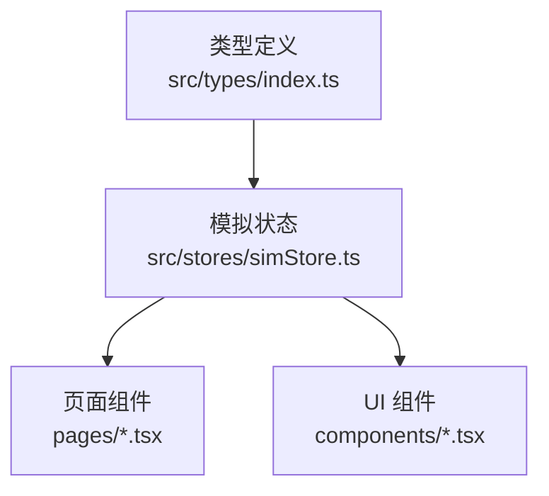
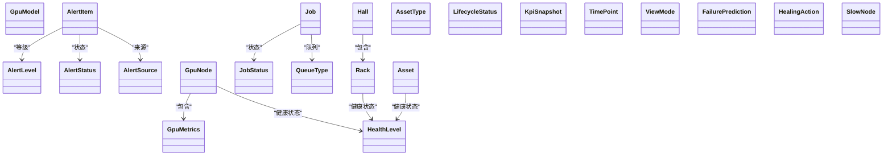
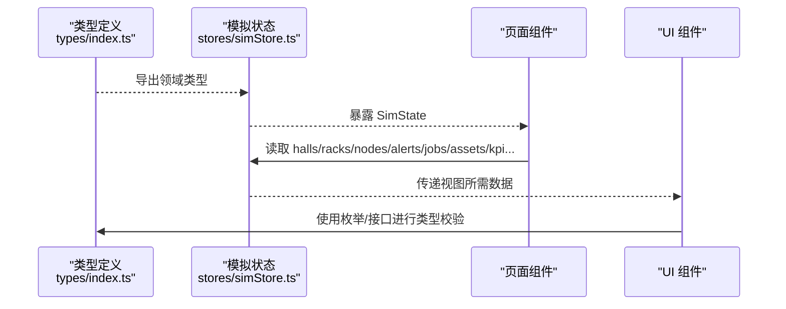
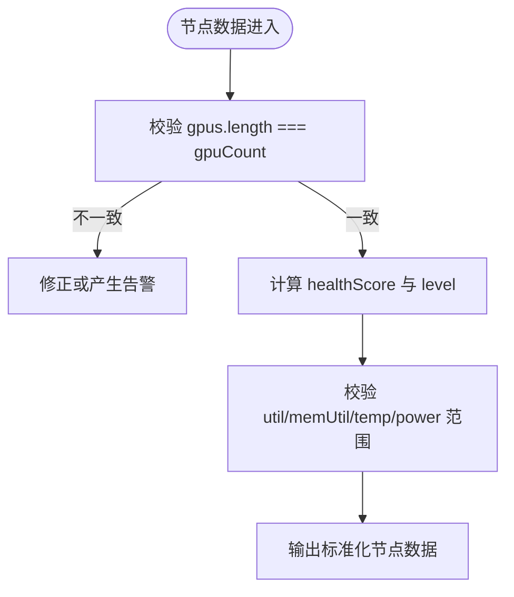
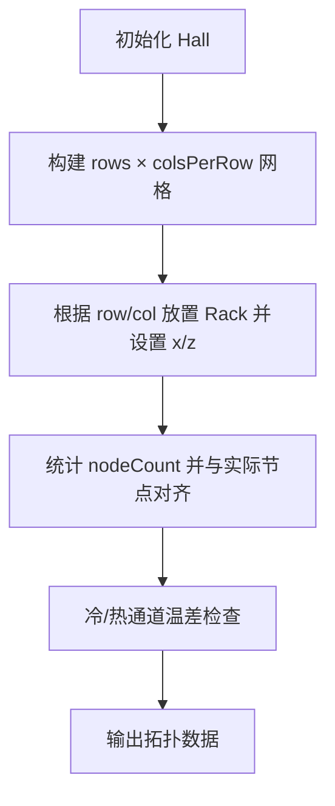
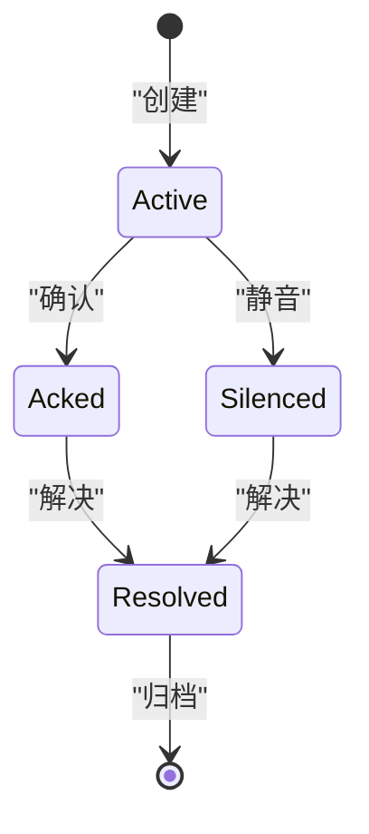
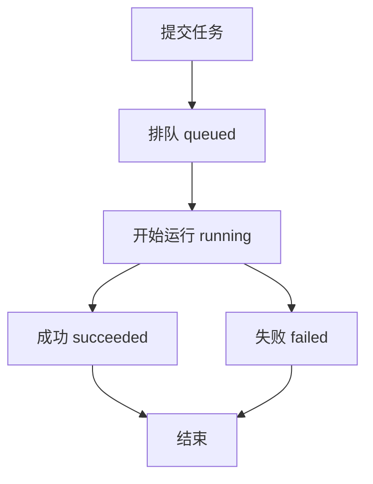
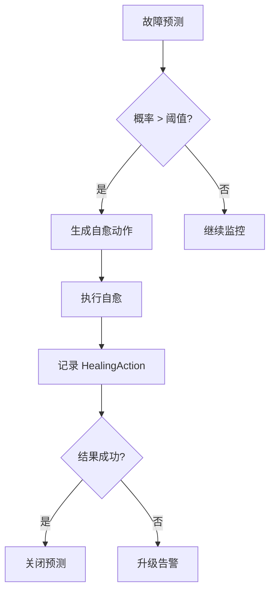
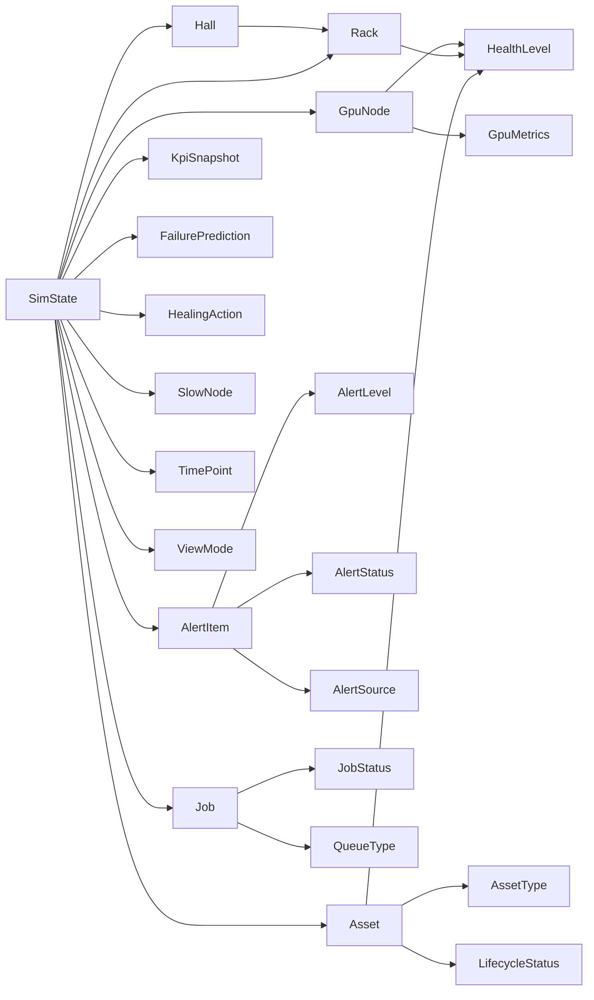

# TypeScript类型定义

<cite>
**本文引用的文件**   
- [src/types/index.ts](file://src/types/index.ts)
- [src/stores/simStore.ts](file://src/stores/simStore.ts)
</cite>

## 目录
1. [引言](#引言)
2. [项目结构](#项目结构)
3. [核心类型总览](#核心类型总览)
4. [架构概览](#架构概览)
5. [详细类型分析](#详细类型分析)
6. [依赖关系分析](#依赖关系分析)
7. [性能与建模建议](#性能与建模建议)
8. [常见问题与排错](#常见问题与排错)
9. [结论](#结论)

## 引言
本文件为“超级智算数据中心运维透视平台”的 TypeScript 类型定义参考文档，聚焦领域模型接口、枚举类型、字段语义、业务规则、扩展点以及类型安全的开发模式。所有类型均来源于仓库中的统一类型定义文件，并在模拟状态中作为全局数据结构的契约使用。

## 项目结构
本项目将领域类型集中在单一类型文件中，便于跨模块复用；模拟运行时在 Store 中以强类型方式消费这些类型，保证 UI、图表、仿真等模块共享一致的领域模型。

**图示来源**
- [src/types/index.ts:1-192](file://src/types/index.ts#L1-L192)
- [src/stores/simStore.ts:99-121](file://src/stores/simStore.ts#L99-L121)

**章节来源**
- [src/types/index.ts:1-192](file://src/types/index.ts#L1-L192)
- [src/stores/simStore.ts:99-121](file://src/stores/simStore.ts#L99-L121)

## 核心类型总览
本节按领域维度汇总所有类型，并说明其职责与关联关系。

- GPU 相关
  - GpuModel：GPU 型号枚举
  - GpuMetrics：单卡指标
  - GpuNode：GPU 计算节点（含多卡）
- 机房拓扑
  - Hall：机房
  - Rack：机柜
- 告警
  - AlertLevel：告警等级
  - AlertStatus：告警状态
  - AlertSource：告警来源类别
  - AlertItem：告警事件
- 任务调度
  - JobStatus：任务状态
  - QueueType：队列类型
  - Job：计算任务
- 资产 CMDB
  - AssetType：资产类型
  - LifecycleStatus：生命周期状态
  - Asset：资产条目
- KPI 与时序
  - KpiSnapshot：KPI 快照
  - TimePoint：时序数据点
- 视图与可视化
  - ViewMode：3D 视图模式
- 智能运维
  - FailurePrediction：故障预测
  - HealingAction：自愈动作日志
  - SlowNode：慢节点检测

**图示来源**
- [src/types/index.ts:5-191](file://src/types/index.ts#L5-L191)

**章节来源**
- [src/types/index.ts:5-191](file://src/types/index.ts#L5-L191)

## 架构概览
类型层位于应用最底层，被 Store 和页面/组件共同消费。Store 持有当前运行态数据，包括机房、机柜、节点、告警、任务、资产、KPI、预测、自愈、慢节点及各类时序曲线，并通过 viewMode 控制 3D 视图渲染模式。

**图示来源**
- [src/types/index.ts:1-192](file://src/types/index.ts#L1-L192)
- [src/stores/simStore.ts:99-121](file://src/stores/simStore.ts#L99-L121)

## 详细类型分析

### 基础枚举与通用类型
- GpuModel：限定 GPU 型号集合，用于节点型号约束。
- HealthLevel：设备健康分级，贯穿节点、机柜、资产等实体。
- AlertLevel：P0~P3 四级告警，用于告警严重度排序与过滤。
- AlertStatus：active/acked/silenced/resolved，描述告警生命周期。
- AlertSource：GPU/节点/网络/存储/供电/制冷，标识告警来源域。
- JobStatus：queued/running/succeeded/failed，描述任务生命周期。
- QueueType：训练/推理/调试，区分资源队列用途。
- AssetType：服务器/GPU卡/交换机/存储阵列，分类资产。
- LifecycleStatus：在保/过保/待报废，资产生命周期阶段。
- ViewMode：temperature/load/alert/topology，控制 3D 场景渲染主题。

使用建议
- 新增枚举值时，需同步更新所有 switch/case 或条件分支，避免未处理分支。
- 对关键数值字段（如利用率、温度、功耗）建议在消费侧增加范围校验，防止异常数据导致 UI 异常。

**章节来源**
- [src/types/index.ts:5-18](file://src/types/index.ts#L5-L18)
- [src/types/index.ts:89-119](file://src/types/index.ts#L89-L119)
- [src/types/index.ts:160-161](file://src/types/index.ts#L160-L161)

### GPU 与节点模型
- GpuMetrics：单卡指标，包含 index/util/memUtil/temp/power/nvlink/eccErrors/level。
- GpuNode：节点级聚合，包含 id/hall/row/rack/model/gpuCount/status/healthScore/util/memUtil/temp/power/ip/gpus。

业务规则与约束
- gpus 数组长度应与 gpuCount 一致；若不一致，应在初始化或刷新逻辑中进行修正或告警。
- healthScore 通常处于 0~100 区间，需在展示前做边界裁剪。
- util/memUtil/temp/power 等数值应结合阈值判断 level，确保与 HealthLevel 一致。

**图示来源**
- [src/types/index.ts:20-48](file://src/types/index.ts#L20-L48)

**章节来源**
- [src/types/index.ts:20-48](file://src/types/index.ts#L20-L48)

### 机房与机柜拓扑
- Hall：id/name/rows/colsPerRow/racks。
- Rack：id/hall/row/col/nodeCount/power/inletTemp/outletTemp/level/x/z。

业务规则与约束
- racks 数组应与 rows × colsPerRow 的网格布局一致；x/z 坐标应基于 row/col 映射。
- inletTemp/outletTemp 差值可用于热通道评估，必要时触发告警。
- nodeCount 应与实际挂载节点数一致，否则需要校准。

**图示来源**
- [src/types/index.ts:50-73](file://src/types/index.ts#L50-L73)

**章节来源**
- [src/types/index.ts:50-73](file://src/types/index.ts#L50-L73)

### 告警事件
- AlertItem：id/level/source/title/target/status/value/timestamp/ackAt/resolveAt。

业务规则与约束
- ackAt/resolveAt 为可选时间戳，分别表示确认与解决时间。
- status 流转应为 active → acked/silenced → resolved，禁止逆向跳转。
- target 应与具体对象（节点/机柜/资产等）ID 对应，便于联动定位。

**图示来源**
- [src/types/index.ts:75-87](file://src/types/index.ts#L75-L87)

**章节来源**
- [src/types/index.ts:75-87](file://src/types/index.ts#L75-L87)

### 计算任务
- Job：id/name/owner/queue/gpuRequest/status/progress/submitAt/startAt/endAt/priority/model/loss/throughput/mfu/assignedNodes。

业务规则与约束
- progress 应在 0~100 之间，且随 startAt/endAt 推进而更新。
- assignedNodes 非空时，status 通常为 running；succeeded/failed 后仍可保留分配记录。
- mfu/throughput/loss 等指标仅在运行期有效，完成后可归档。

**图示来源**
- [src/types/index.ts:89-113](file://src/types/index.ts#L89-L113)

**章节来源**
- [src/types/index.ts:89-113](file://src/types/index.ts#L89-L113)

### 资产 CMDB
- Asset：id/sn/type/model/vendor/hall/rackId/uPosition/onlineDate/warrantyUntil/lifecycle/business/status/repairCount。

业务规则与约束
- rackId 应与现有机柜 ID 匹配，hall 与 rack.hall 保持一致。
- warrantyUntil 早于当前日期时，lifecycle 应转为“过保”。
- repairCount 累计维修次数，超过阈值可触发预警。

**章节来源**
- [src/types/index.ts:115-137](file://src/types/index.ts#L115-L137)

### KPI 与时序
- KpiSnapshot：totalPflops/gpuTotal/gpuOnline/onlineRate/avgUtil/activeAlerts/pue/runningJobs/totalPowerKw/itPowerKw/coolingPowerKw。
- TimePoint：t/v，时间戳与数值对。

业务规则与约束
- onlineRate = gpuOnline / gpuTotal，需处理分母为零的情况。
- pue = totalPowerKw / itPowerKw，冷却功耗可通过 totalPowerKw - itPowerKw 推导。
- 时序数据应按 t 升序排列，去重并平滑后再入图。

**章节来源**
- [src/types/index.ts:139-158](file://src/types/index.ts#L139-L158)

### 视图模式
- ViewMode：temperature/load/alert/topology，决定 3D 场景渲染主题。

使用建议
- 切换视图时应缓存上一视图状态，支持快速回退。
- 不同视图下的高亮、筛选、交互行为应通过策略模式解耦。

**章节来源**
- [src/types/index.ts:160-161](file://src/types/index.ts#L160-L161)

### 智能运维：故障预测与自愈
- FailurePrediction：id/target/component/probability/rul/confidence。
- HealingAction：id/timestamp/action/target/reason/status/latencyMs。
- SlowNode：nodeId/job/deviation/metric/suggestion。

业务规则与约束
- probability 与 confidence 均为百分比或置信度，需统一归一化到 0~100。
- rul 剩余寿命以天为单位，负值表示已过期风险。
- HealingAction.status 为 success/running/failed，latencyMs 反映执行耗时。
- SlowNode.deviation 相对集群均值偏差，超过阈值即判定为慢节点。

**图示来源**
- [src/types/index.ts:163-191](file://src/types/index.ts#L163-L191)

**章节来源**
- [src/types/index.ts:163-191](file://src/types/index.ts#L163-L191)

## 依赖关系分析
类型之间的耦合主要体现在：
- GpuNode 依赖 GpuMetrics 与 HealthLevel。
- Hall 聚合 Rack，Rack 依赖 HealthLevel。
- AlertItem 依赖 AlertLevel/AlertStatus/AlertSource。
- Job 依赖 JobStatus/QueueType。
- Asset 依赖 AssetType/LifecycleStatus/HealthLevel。
- SimState 组合上述所有领域类型，形成运行时数据骨架。

**图示来源**
- [src/types/index.ts:5-191](file://src/types/index.ts#L5-L191)
- [src/stores/simStore.ts:99-121](file://src/stores/simStore.ts#L99-L121)

**章节来源**
- [src/types/index.ts:5-191](file://src/types/index.ts#L5-L191)
- [src/stores/simStore.ts:99-121](file://src/stores/simStore.ts#L99-L121)

## 性能与建模建议
- 批量更新时优先使用不可变更新，减少重渲染。
- 对大数组（racks/nodes/alerts/jobs/assets）采用分页或虚拟滚动。
- 时序数据做降采样与滑动窗口，避免图表卡顿。
- 对频繁读写的热点字段（如 avgUtil、pue）考虑局部缓存。

[本节为通用建议，不直接分析具体文件]

## 常见问题与排错
- 枚举未覆盖
  - 现象：新增枚举值后出现未处理分支。
  - 处理：集中维护枚举，并在消费端使用 exhaustive check（如 switch）。
- 数值越界
  - 现象：util/memUtil/temp/power 超出合理范围导致 UI 异常。
  - 处理：在数据接入层做范围裁剪与异常告警。
- 一致性校验失败
  - 现象：gpus.length !== gpuCount 或 rack.hall 与 hall 不一致。
  - 处理：在初始化/刷新流程中强制对齐，并记录修复日志。
- 告警状态非法流转
  - 现象：直接从 resolved 跳回 active。
  - 处理：在状态机中限制合法转换路径。

**章节来源**
- [src/types/index.ts:20-48](file://src/types/index.ts#L20-L48)
- [src/types/index.ts:75-87](file://src/types/index.ts#L75-L87)

## 结论
该类型体系围绕数据中心运维的核心实体展开，通过严格的枚举与接口约束，为前端可视化、仿真与智能运维提供了稳定契约。建议在后续迭代中持续完善数值校验、状态机与可扩展的枚举策略，以提升系统的健壮性与可维护性。