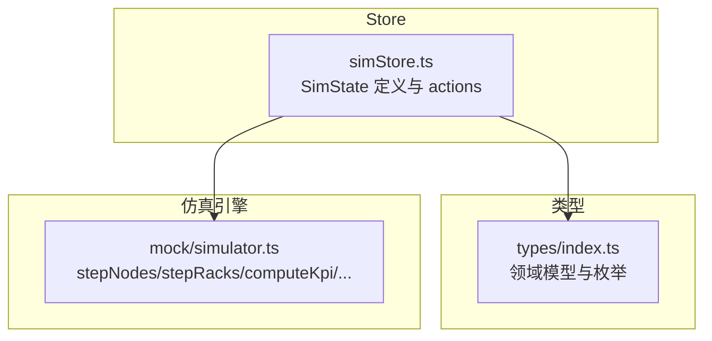
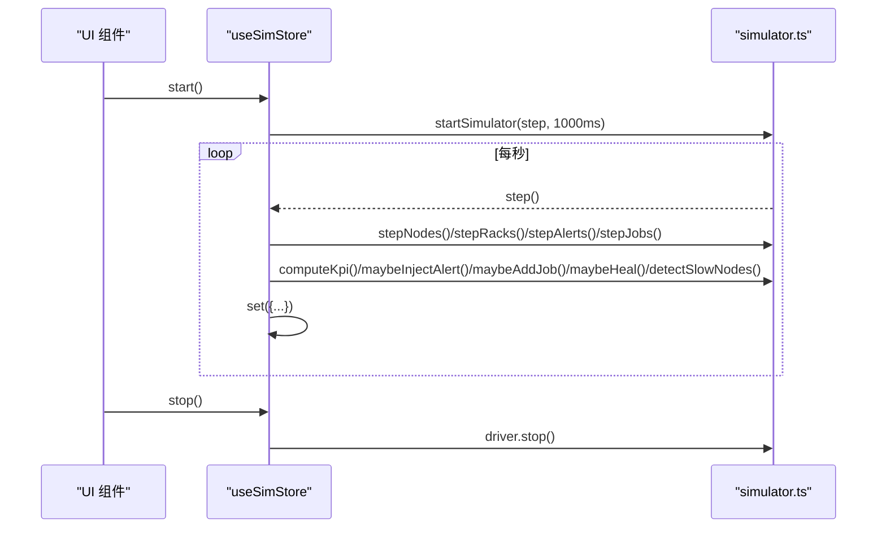
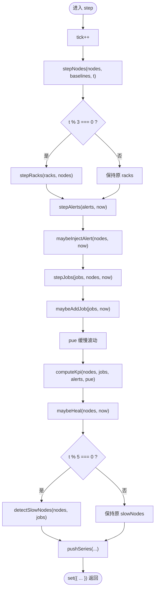
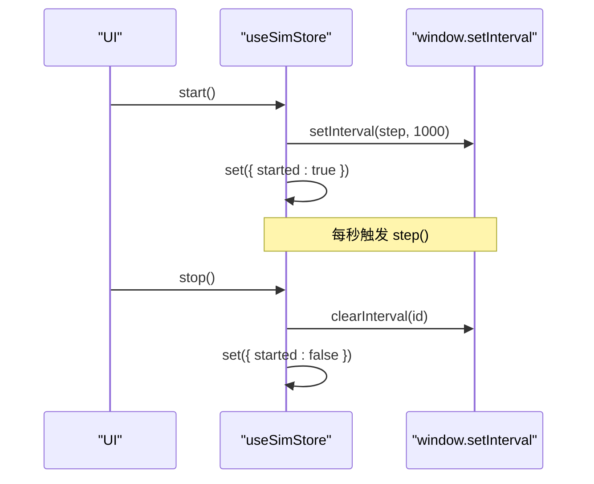
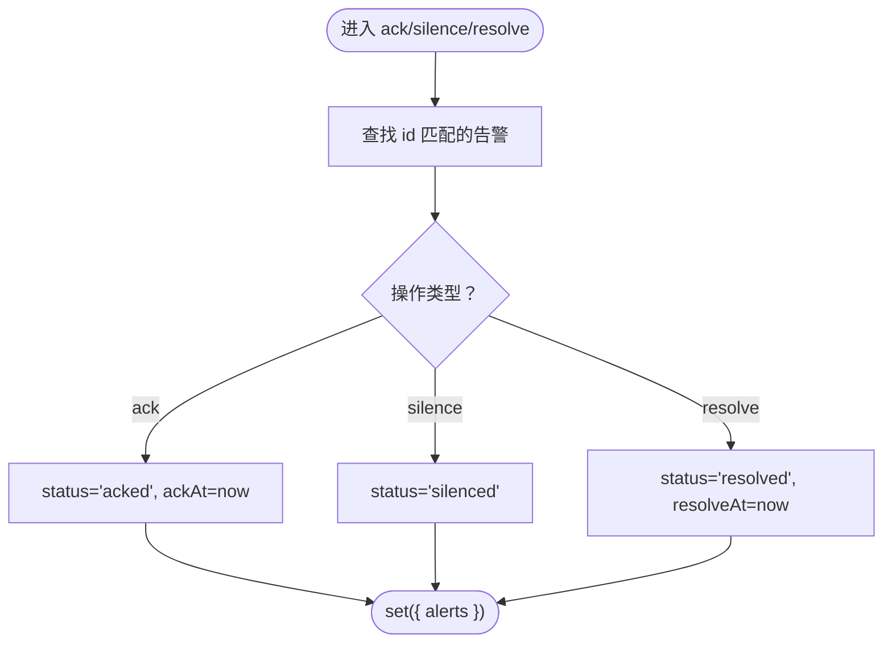
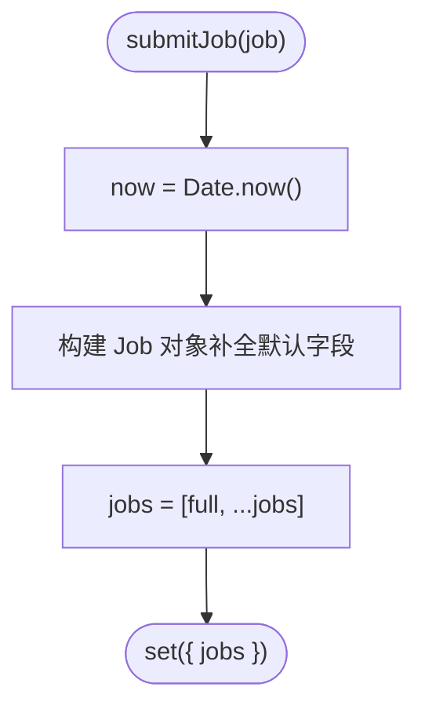
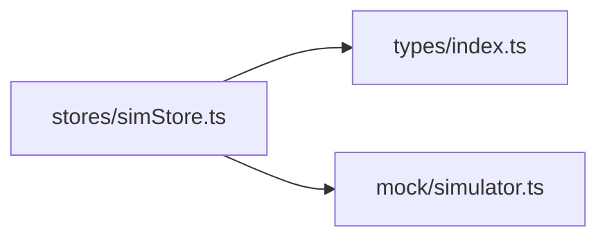

# Zustand Store API

<cite>
**本文引用的文件**   
- [src/stores/simStore.ts](file://src/stores/simStore.ts)
- [src/types/index.ts](file://src/types/index.ts)
- [src/mock/simulator.ts](file://src/mock/simulator.ts)
</cite>

## 目录
1. [简介](#简介)
2. [项目结构](#项目结构)
3. [核心组件](#核心组件)
4. [架构总览](#架构总览)
5. [详细组件分析](#详细组件分析)
6. [依赖关系分析](#依赖关系分析)
7. [性能与优化建议](#性能与优化建议)
8. [故障排查指南](#故障排查指南)
9. [结论](#结论)
10. [附录：完整类型定义速查](#附录完整类型定义速查)

## 简介
本文件为数据中心仿真可视化平台的 Zustand Store API 文档，聚焦于 `SimState` 接口及其暴露的所有状态字段与操作方法。该 Store 负责维护机房拓扑、机柜、节点、告警、任务、资产、KPI、时序指标、视图模式等数据，并通过纯函数驱动的仿真引擎推进系统状态。文档同时给出状态更新机制、副作用处理、错误处理模式以及性能优化建议，帮助开发者快速理解并正确使用该 Store。

## 项目结构
与 Store 直接相关的代码主要位于以下位置：
- Store 定义与动作实现：`src/stores/simStore.ts`
- 领域类型定义：`src/types/index.ts`
- 仿真引擎（纯函数）：`src/mock/simulator.ts`

**图表来源**
- [src/stores/simStore.ts:1-37](file://src/stores/simStore.ts#L1-L37)
- [src/types/index.ts:1-192](file://src/types/index.ts#L1-L192)
- [src/mock/simulator.ts:1-47](file://src/mock/simulator.ts#L1-L47)

**章节来源**
- [src/stores/simStore.ts:1-37](file://src/stores/simStore.ts#L1-L37)
- [src/types/index.ts:1-192](file://src/types/index.ts#L1-L192)
- [src/mock/simulator.ts:1-47](file://src/mock/simulator.ts#L1-L47)

## 核心组件
- SimState：Zustand Store 的状态与动作的 TypeScript 类型契约。
- useSimStore：基于 create 创建的 Store 实例，导出所有状态与动作。
- 仿真引擎：提供 stepNodes、stepRacks、computeKpi、maybeInjectAlert、stepAlerts、stepJobs、maybeAddJob、pushSeries、maybeHeal、detectSlowNodes、startSimulator 等纯函数。

**章节来源**
- [src/stores/simStore.ts:99-134](file://src/stores/simStore.ts#L99-L134)
- [src/stores/simStore.ts:142-265](file://src/stores/simStore.ts#L142-L265)
- [src/mock/simulator.ts:51-139](file://src/mock/simulator.ts#L51-L139)
- [src/mock/simulator.ts:165-330](file://src/mock/simulator.ts#L165-L330)

## 架构总览
Store 通过 start() 启动定时器驱动 step()，每步调用仿真引擎对节点、机柜、告警、任务、KPI、自愈日志、慢节点等进行计算，并将结果写回 store。UI 层通过 selectNodeById 等选择器读取数据渲染。

**图表来源**
- [src/stores/simStore.ts:164-219](file://src/stores/simStore.ts#L164-L219)
- [src/mock/simulator.ts:327-330](file://src/mock/simulator.ts#L327-L330)

## 详细组件分析

### SimState 接口与状态字段
SimState 定义了 Store 的全部状态字段与动作方法。下面按类别说明各字段的含义与用途。

- 仿真控制
  - started: boolean，是否已启动仿真循环。
  - tick: number，仿真步进计数。

- 拓扑与设备
  - halls: Hall[]，机房列表。
  - racks: Rack[]，机柜列表。
  - nodes: GpuNode[]，GPU 节点列表。
  - assets: Asset[]，CMDB 资产列表。

- 运维事件
  - alerts: AlertItem[]，告警事件列表。
  - failurePredictions: FailurePrediction[]，故障预测列表。
  - healingActions: HealingAction[]，自愈动作日志。
  - slowNodes: SlowNode[]，慢节点检测结果。

- 指标与 KPI
  - kpi: KpiSnapshot，KPI 快照。
  - pue: number，当前 PUE。
  - utilSeries/powerSeries/pueSeries/alertSeries: TimePoint[]，历史时序曲线。

- UI 状态
  - viewMode: ViewMode，3D 视图模式。
  - selectedRackId: string | null，选中机柜 ID。
  - tourActive: boolean，巡检模式开关。

- 动作方法
  - step(): void，执行一次仿真步进。
  - start(): void，启动仿真定时循环。
  - stop(): void，停止仿真定时循环。
  - ackAlert(id): void，确认告警。
  - silenceAlert(id): void，静默告警。
  - resolveAlert(id): void，解决告警。
  - submitJob(job): void，提交新任务。
  - setViewMode(m): void，切换视图模式。
  - selectRack(id): void，选择机柜。
  - toggleTour(): void，切换巡检模式。

**章节来源**
- [src/stores/simStore.ts:99-134](file://src/stores/simStore.ts#L99-L134)
- [src/types/index.ts:5-192](file://src/types/index.ts#L5-L192)

### 操作方法详解

#### step()
- 作用：执行一次仿真步进，推进节点指标、机柜聚合、告警注入与流转、任务调度、PUE 波动、KPI 汇总、自愈日志、慢节点检测，并更新时序曲线。
- 参数：无。
- 返回值：void。
- 关键流程：
  - 递增 tick。
  - 调用 stepNodes 更新节点指标。
  - 每 3 tick 调用 stepRacks 更新机柜聚合。
  - 调用 stepAlerts 与 maybeInjectAlert 管理告警。
  - 调用 stepJobs 与 maybeAddJob 推进任务队列。
  - 计算 pue 与 computeKpi。
  - 调用 maybeHeal 追加自愈日志。
  - 每 5 tick 调用 detectSlowNodes 更新慢节点。
  - 使用 pushSeries 追加时序点。
- 复杂度：O(N_nodes + N_jobs + N_alerts)，其中 N 为对应数组长度；部分聚合操作按 tick 周期触发以降低开销。

**图表来源**
- [src/stores/simStore.ts:164-207](file://src/stores/simStore.ts#L164-L207)
- [src/mock/simulator.ts:51-139](file://src/mock/simulator.ts#L51-L139)
- [src/mock/simulator.ts:165-318](file://src/mock/simulator.ts#L165-L318)

**章节来源**
- [src/stores/simStore.ts:164-207](file://src/stores/simStore.ts#L164-L207)
- [src/mock/simulator.ts:51-139](file://src/mock/simulator.ts#L51-L139)
- [src/mock/simulator.ts:165-318](file://src/mock/simulator.ts#L165-L318)

#### start() / stop()
- start()
  - 作用：启动仿真定时器，每秒调用一次 step()。
  - 参数：无。
  - 返回值：void。
  - 副作用：创建全局定时器句柄，设置 started=true。
- stop()
  - 作用：停止仿真定时器，清理句柄。
  - 参数：无。
  - 返回值：void。
  - 副作用：设置 started=false。

**图表来源**
- [src/stores/simStore.ts:209-219](file://src/stores/simStore.ts#L209-L219)
- [src/mock/simulator.ts:327-330](file://src/mock/simulator.ts#L327-L330)

**章节来源**
- [src/stores/simStore.ts:209-219](file://src/stores/simStore.ts#L209-L219)
- [src/mock/simulator.ts:327-330](file://src/mock/simulator.ts#L327-L330)

#### 告警处理方法
- ackAlert(id)
  - 作用：将指定告警标记为已确认，记录 ackAt。
  - 参数：id: string。
  - 返回值：void。
- silenceAlert(id)
  - 作用：将指定告警标记为静默。
  - 参数：id: string。
  - 返回值：void。
- resolveAlert(id)
  - 作用：将指定告警标记为已解决，记录 resolveAt。
  - 参数：id: string。
  - 返回值：void。

**图表来源**
- [src/stores/simStore.ts:221-238](file://src/stores/simStore.ts#L221-L238)

**章节来源**
- [src/stores/simStore.ts:221-238](file://src/stores/simStore.ts#L221-L238)

#### submitJob(job)
- 作用：提交一个新任务到队列，生成唯一 ID 与默认字段，初始状态为 queued。
- 参数：job: Partial<Job>，允许只传入必要字段，其余使用默认值。
- 返回值：void。
- 默认填充字段：
  - name: '未命名任务'
  - owner: '平台用户'
  - queue: '训练'
  - gpuRequest: 8
  - priority: 5
  - model: 'Custom-Model'
  - loss: 3.2
  - throughput: 12000
  - mfu: 40
  - assignedNodes: []

**图表来源**
- [src/stores/simStore.ts:240-260](file://src/stores/simStore.ts#L240-L260)

**章节来源**
- [src/stores/simStore.ts:240-260](file://src/stores/simStore.ts#L240-L260)

#### setViewMode(m) / selectRack(id) / toggleTour()
- setViewMode(m)
  - 作用：切换 3D 视图模式。
  - 参数：m: ViewMode。
  - 返回值：void。
- selectRack(id)
  - 作用：选择目标机柜。
  - 参数：id: string | null。
  - 返回值：void。
- toggleTour()
  - 作用：切换巡检模式开关。
  - 参数：无。
  - 返回值：void。

**章节来源**
- [src/stores/simStore.ts:262-264](file://src/stores/simStore.ts#L262-L264)

### 状态更新机制与副作用处理
- 状态更新
  - 所有状态变更通过 set() 原子更新，避免中间态不一致。
  - 时序数据通过 pushSeries 追加并保持固定长度，防止内存无限增长。
- 副作用处理
  - 定时器副作用由 startSimulator 管理，stop() 时清理。
  - 告警与任务在 step() 中通过纯函数推进，不直接访问外部 I/O。
  - 随机性与时间戳来源于确定性种子与 Date.now()，保证可重现性（模拟场景）。

**章节来源**
- [src/stores/simStore.ts:164-219](file://src/stores/simStore.ts#L164-L219)
- [src/mock/simulator.ts:264-268](file://src/mock/simulator.ts#L264-L268)
- [src/mock/simulator.ts:327-330](file://src/mock/simulator.ts#L327-L330)

## 依赖关系分析
Store 依赖类型定义与仿真引擎，形成单向依赖：Store → Types / Simulator。

**图表来源**
- [src/stores/simStore.ts:1-37](file://src/stores/simStore.ts#L1-L37)
- [src/types/index.ts:1-192](file://src/types/index.ts#L1-L192)
- [src/mock/simulator.ts:1-47](file://src/mock/simulator.ts#L1-L47)

**章节来源**
- [src/stores/simStore.ts:1-37](file://src/stores/simStore.ts#L1-L37)
- [src/types/index.ts:1-192](file://src/types/index.ts#L1-L192)
- [src/mock/simulator.ts:1-47](file://src/mock/simulator.ts#L1-L47)

## 性能与优化建议
- 周期性聚合
  - 机柜聚合每 3 tick 执行一次，降低频繁聚合开销。
  - 慢节点检测每 5 tick 执行一次，减少高成本计算频率。
- 序列长度限制
  - 时序数据通过 pushSeries 限制最大长度，避免内存膨胀。
- 任务与告警上限
  - 任务列表与告警列表在插入后切片限制长度，防止数据过大。
- 选择性更新
  - 仅在必要时更新 racks 与 slowNodes，其他 tick 复用旧值。
- 建议
  - 若渲染性能敏感，可在 UI 层使用 memoization 或虚拟滚动。
  - 对于超大集群，考虑分片渲染与按需加载。

**章节来源**
- [src/stores/simStore.ts:171-190](file://src/stores/simStore.ts#L171-L190)
- [src/stores/simStore.ts:176-180](file://src/stores/simStore.ts#L176-L180)
- [src/mock/simulator.ts:264-268](file://src/mock/simulator.ts#L264-L268)

## 故障排查指南
- 常见问题
  - 仿真未启动：检查 started 是否为 true，确认 start() 已被调用。
  - 定时器泄漏：确保 stop() 被调用，避免多次 start() 导致多个定时器。
  - 告警状态异常：确认 ack/silence/resolve 操作的 id 是否正确匹配。
  - 任务未运行：检查 stepJobs 的并发上限与资源分配逻辑。
- 调试建议
  - 打印 tick 与关键指标变化，定位问题步骤。
  - 观察 alertSeries 与 alert 列表长度，确认数据上限策略。
  - 检查 NodeBaseline 与 healthFromTemp 的逻辑，验证温度与利用率漂移是否符合预期。

**章节来源**
- [src/stores/simStore.ts:209-219](file://src/stores/simStore.ts#L209-L219)
- [src/stores/simStore.ts:221-238](file://src/stores/simStore.ts#L221-L238)
- [src/mock/simulator.ts:199-234](file://src/mock/simulator.ts#L199-L234)

## 结论
该 Zustand Store 以清晰的类型契约与纯函数驱动的仿真引擎为核心，提供了完整的仿真控制、告警处理、任务提交与视图切换能力。通过周期性聚合、序列长度限制与选择性更新等策略，在保证功能完整性的同时兼顾了性能。开发者可依据本文档快速集成与扩展 Store，满足数据中心仿真与可视化的需求。

## 附录：完整类型定义速查
以下为 SimState 相关核心类型的简要说明与用途，便于查阅。

- GpuModel：GPU 型号枚举。
- HealthLevel：设备健康等级。
- AlertLevel / AlertStatus / AlertSource：告警等级、状态与来源。
- GpuMetrics：单张 GPU 卡实时指标。
- GpuNode：GPU 计算节点（含多卡）。
- Rack：机柜聚合信息。
- Hall：机房布局。
- AlertItem：告警事件。
- JobStatus / QueueType / Job：任务状态、队列类型与任务详情。
- AssetType / LifecycleStatus / Asset：资产类型、生命周期与 CMDB 条目。
- KpiSnapshot：KPI 汇总。
- TimePoint：时序数据点。
- ViewMode：3D 视图模式。
- FailurePrediction：故障预测条目。
- HealingAction：自愈动作日志。
- SlowNode：慢节点检测结果。

**章节来源**
- [src/types/index.ts:5-192](file://src/types/index.ts#L5-L192)