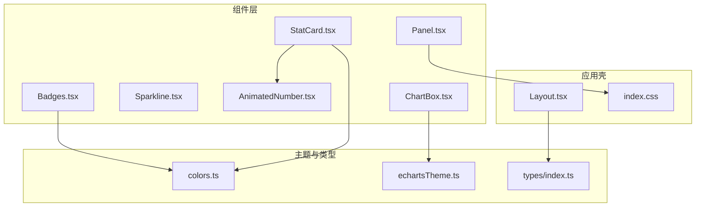
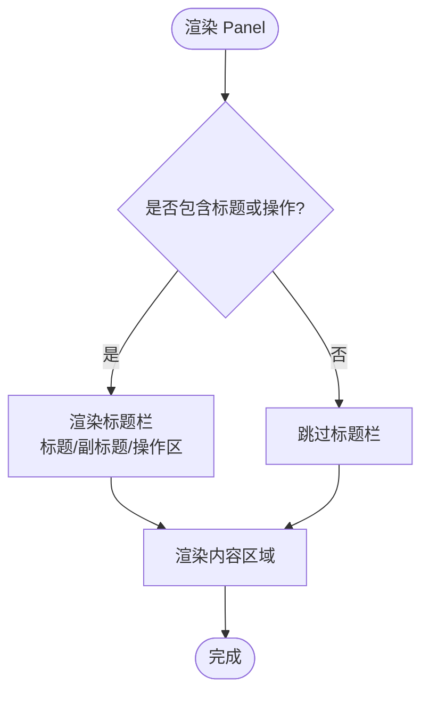
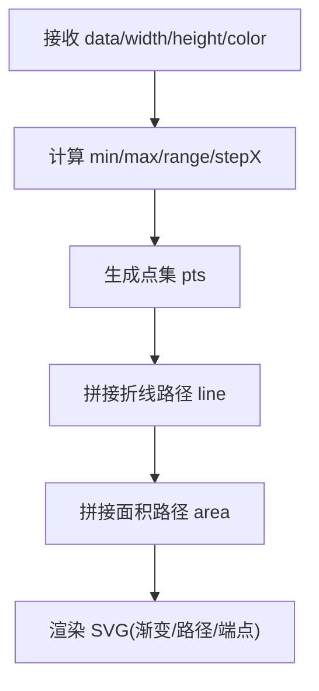
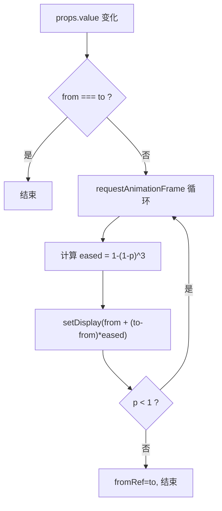
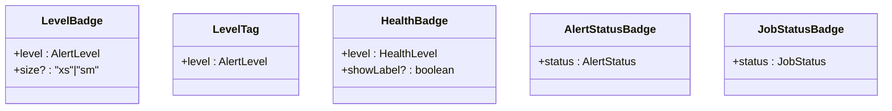
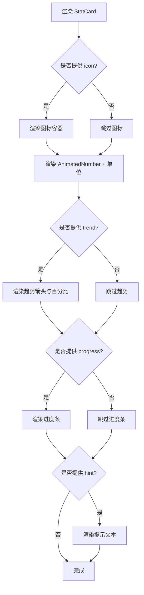
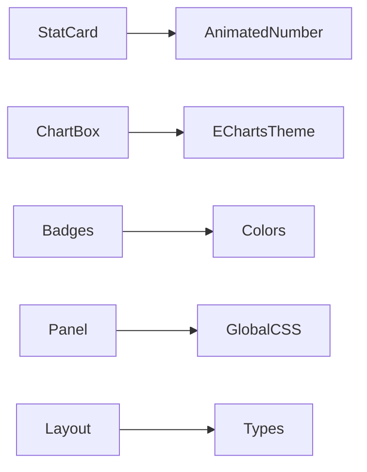

# UI组件库

<cite>
**本文引用的文件**   
- [Panel.tsx](file://src/components/Panel.tsx)
- [ChartBox.tsx](file://src/components/ChartBox.tsx)
- [Sparkline.tsx](file://src/components/Sparkline.tsx)
- [AnimatedNumber.tsx](file://src/components/AnimatedNumber.tsx)
- [Badges.tsx](file://src/components/Badges.tsx)
- [StatCard.tsx](file://src/components/StatCard.tsx)
- [colors.ts](file://src/theme/colors.ts)
- [echartsTheme.ts](file://src/theme/echartsTheme.ts)
- [index.ts](file://src/types/index.ts)
- [Layout.tsx](file://src/components/Layout.tsx)
- [index.css](file://src/index.css)
</cite>

## 目录
1. [简介](#简介)
2. [项目结构](#项目结构)
3. [核心组件总览](#核心组件总览)
4. [架构总览](#架构总览)
5. [组件详细分析](#组件详细分析)
6. [依赖关系分析](#依赖关系分析)
7. [性能与优化建议](#性能与优化建议)
8. [主题与样式定制](#主题与样式定制)
9. [响应式与无障碍](#响应式与无障碍)
10. [组合模式与最佳实践](#组合模式与最佳实践)
11. [故障排查](#故障排查)
12. [结论](#结论)

## 简介
本文件为 IDC AI 运维平台 UI 组件库的技术文档，聚焦以下可复用基础组件：面板（Panel）、图表容器（ChartBox）、迷你图（Sparkline）、动画数字（AnimatedNumber）、徽章（Badges）、统计卡片（StatCard）。文档覆盖功能特性、Props 接口、使用示例、样式定制、组合模式、主题扩展、响应式设计与无障碍访问支持，并提供性能优化建议与常见问题排查方法。

## 项目结构
UI 组件位于 src/components 下，主题与类型定义分别位于 src/theme 与 src/types。全局样式在 src/index.css 中集中管理，布局框架由 src/components/Layout.tsx 提供。



**图示来源**
- [Panel.tsx:1-54](file://src/components/Panel.tsx#L1-L54)
- [ChartBox.tsx:1-61](file://src/components/ChartBox.tsx#L1-L61)
- [Sparkline.tsx:1-51](file://src/components/Sparkline.tsx#L1-L51)
- [AnimatedNumber.tsx:1-62](file://src/components/AnimatedNumber.tsx#L1-L62)
- [Badges.tsx:1-84](file://src/components/Badges.tsx#L1-L84)
- [StatCard.tsx:1-83](file://src/components/StatCard.tsx#L1-L83)
- [colors.ts:1-97](file://src/theme/colors.ts#L1-L97)
- [echartsTheme.ts:1-72](file://src/theme/echartsTheme.ts#L1-L72)
- [index.ts:1-192](file://src/types/index.ts#L1-L192)
- [Layout.tsx:1-125](file://src/components/Layout.tsx#L1-L125)
- [index.css:1-148](file://src/index.css#L1-L148)

**章节来源**
- [Panel.tsx:1-54](file://src/components/Panel.tsx#L1-L54)
- [ChartBox.tsx:1-61](file://src/components/ChartBox.tsx#L1-L61)
- [Sparkline.tsx:1-51](file://src/components/Sparkline.tsx#L1-L51)
- [AnimatedNumber.tsx:1-62](file://src/components/AnimatedNumber.tsx#L1-L62)
- [Badges.tsx:1-84](file://src/components/Badges.tsx#L1-L84)
- [StatCard.tsx:1-83](file://src/components/StatCard.tsx#L1-L83)
- [colors.ts:1-97](file://src/theme/colors.ts#L1-L97)
- [echartsTheme.ts:1-72](file://src/theme/echartsTheme.ts#L1-L72)
- [index.ts:1-192](file://src/types/index.ts#L1-L192)
- [Layout.tsx:1-125](file://src/components/Layout.tsx#L1-L125)
- [index.css:1-148](file://src/index.css#L1-L148)

## 核心组件总览
- Panel：通用面板容器，支持标题、副标题、操作区、切角装饰、扫描线动效与入场动画。
- ChartBox：ECharts 封装，自动注册驾驶舱主题、自适应尺寸、增量更新配置、事件绑定与销毁清理。
- Sparkline：轻量内联 SVG 迷你折线图，无外部图表依赖，适合表格/KPI 内嵌趋势展示。
- AnimatedNumber：数字滚动动效，基于 requestAnimationFrame 实现缓动过渡。
- Badges：告警等级、健康状态、任务状态等徽章与标签组件，统一颜色与文案映射。
- StatCard：KPI 指标卡，聚合数值动画、单位、图标、进度条、趋势与提示文本。

**章节来源**
- [Panel.tsx:18-53](file://src/components/Panel.tsx#L18-L53)
- [ChartBox.tsx:14-58](file://src/components/ChartBox.tsx#L14-L58)
- [Sparkline.tsx:11-49](file://src/components/Sparkline.tsx#L11-L49)
- [AnimatedNumber.tsx:12-61](file://src/components/AnimatedNumber.tsx#L12-L61)
- [Badges.tsx:11-83](file://src/components/Badges.tsx#L11-L83)
- [StatCard.tsx:18-82](file://src/components/StatCard.tsx#L18-L82)

## 架构总览
组件层通过主题与类型系统保持一致的视觉语言与数据结构；ChartBox 依赖 ECharts 主题注册；StatCard 组合 AnimatedNumber；Badges 依赖颜色与标签映射；Panel 依赖全局 CSS 类名与 framer-motion 动效。

```mermaid
classDiagram
class Panel {
+title? : string
+subtitle? : string
+actions? : ReactNode
+children : ReactNode
+className? : string
+bodyClassName? : string
+corners? : boolean
+scanline? : boolean
+delay? : number
}
class ChartBox {
+option : EChartsOption
+className? : string
+noAnimation? : boolean
+onEvents? : Record<string, (params)=>void>
}
class Sparkline {
+data : number[]
+width? : number
+height? : number
+color? : string
+fill? : boolean
+strokeWidth? : number
+className? : string
}
class AnimatedNumber {
+value : number
+decimals? : number
+duration? : number
+className? : string
+prefix? : string
+suffix? : string
}
class Badges {
+LevelBadge(level,size)
+LevelTag(level)
+HealthBadge(level,showLabel)
+AlertStatusBadge(status)
+JobStatusBadge(status)
}
class StatCard {
+label : string
+value : number
+decimals? : number
+unit? : string
+prefix? : string
+icon? : string
+color? : string
+hint? : string
+progress? : number
+trend? : number
}
StatCard --> AnimatedNumber : "组合"
ChartBox --> EChartsTheme : "注册主题"
Badges --> Colors : "颜色/标签映射"
Panel --> GlobalCSS : "panel/corner-frame/scanline-overlay"
```

**图示来源**
- [Panel.tsx:4-16](file://src/components/Panel.tsx#L4-L16)
- [ChartBox.tsx:6-12](file://src/components/ChartBox.tsx#L6-L12)
- [Sparkline.tsx:1-9](file://src/components/Sparkline.tsx#L1-L9)
- [AnimatedNumber.tsx:3-10](file://src/components/AnimatedNumber.tsx#L3-L10)
- [Badges.tsx:11-83](file://src/components/Badges.tsx#L11-L83)
- [StatCard.tsx:3-16](file://src/components/StatCard.tsx#L3-L16)
- [echartsTheme.ts:64-69](file://src/theme/echartsTheme.ts#L64-L69)
- [colors.ts:21-64](file://src/theme/colors.ts#L21-L64)
- [index.css:59-134](file://src/index.css#L59-L134)

## 组件详细分析

### 面板 Panel
- 功能特性
  - 支持标题、副标题与右侧操作区。
  - 可选切角装饰与扫描线覆盖层。
  - 基于 framer-motion 的入场动画，支持延迟控制。
  - 通过 className/bodyClassName 进行样式扩展。
- Props 接口
  - title?: string
  - subtitle?: string
  - actions?: ReactNode
  - children: ReactNode
  - className?: string
  - bodyClassName?: string
  - corners?: boolean（默认 true）
  - scanline?: boolean（默认 false）
  - delay?: number（默认 0）
- 使用示例
  - 作为页面区块容器包裹图表或列表。
  - 将 ChartBox 放入 Panel 内部，配合标题与操作按钮。
- 样式定制
  - 通过 className 追加 Tailwind 类名。
  - 启用 corners 显示切角边框。
  - 启用 scanline 显示扫描线动效。
- 无障碍
  - 语义化 section/header/h3 结构，利于屏幕阅读器识别。
- 性能
  - 入场动画仅一次触发，避免频繁重排。



**图示来源**
- [Panel.tsx:32-51](file://src/components/Panel.tsx#L32-L51)

**章节来源**
- [Panel.tsx:1-54](file://src/components/Panel.tsx#L1-L54)
- [index.css:59-134](file://src/index.css#L59-L134)

### 图表容器 ChartBox
- 功能特性
  - 自动注册并应用驾驶舱主题。
  - 使用 ResizeObserver 监听容器尺寸变化并调用 resize。
  - 增量 setOption 更新，支持关闭动画以适配高频刷新场景。
  - 支持 onEvents 动态绑定 ECharts 事件，并在卸载时解绑。
- Props 接口
  - option: EChartsOption
  - className?: string
  - noAnimation?: boolean（默认 false）
  - onEvents?: Record<string, (params: unknown) => void>
- 使用示例
  - 传入 EChartsOption 配置对象，按需设置 series/grid/tooltip 等。
  - 通过 onEvents 绑定 click/dblclick 等交互。
- 样式定制
  - 外层 div 绝对定位铺满，确保图表占满父容器高度。
  - 可通过 className 控制容器宽高。
- 无障碍
  - 图表本身不直接提供 a11y 属性，建议在业务层补充 aria-label 或 tooltip 可读性。
- 性能
  - memo 包裹减少重复渲染。
  - notMerge:false 与 lazyUpdate:false 提升增量更新效率。
  - 高频数据场景可开启 noAnimation 降低渲染压力。

```mermaid
sequenceDiagram
participant Parent as "父组件"
participant Box as "ChartBox"
participant E as "ECharts实例"
participant RO as "ResizeObserver"
Parent->>Box : 传入 option/noAnimation/onEvents
Box->>E : init(ref,'cockpit',{renderer : 'canvas'})
Box->>RO : observe(ref)
RO-->>Box : 尺寸变化回调
Box->>E : resize()
Box->>E : setOption({animation : !noAnimation,...option})
Box->>E : on(evt,fn) for each in onEvents
Note over Box,E : 卸载时 dispose/chart.off
```

**图示来源**
- [ChartBox.tsx:17-49](file://src/components/ChartBox.tsx#L17-L49)
- [echartsTheme.ts:64-69](file://src/theme/echartsTheme.ts#L64-L69)

**章节来源**
- [ChartBox.tsx:1-61](file://src/components/ChartBox.tsx#L1-L61)
- [echartsTheme.ts:1-72](file://src/theme/echartsTheme.ts#L1-L72)

### 迷你图 Sparkline
- 功能特性
  - 纯 SVG 实现，无第三方图表依赖。
  - 支持渐变填充、线条宽度、颜色自定义。
  - 自动计算最小值/最大值与步长，生成路径。
- Props 接口
  - data: number[]
  - width?: number（默认 120）
  - height?: number（默认 32）
  - color?: string（默认 #22d3ee）
  - fill?: boolean（默认 true）
  - strokeWidth?: number（默认 1.5）
  - className?: string
- 使用示例
  - 在表格行尾或 KPI 卡片中嵌入趋势小图。
- 样式定制
  - 通过 color/strokeWidth/fill 调整外观。
  - 通过 className 叠加 Tailwind 类名。
- 无障碍
  - 当前未提供 aria 描述，可在上层添加 aria-label 说明趋势含义。
- 性能
  - 轻量计算，适合大量内嵌场景。



**图示来源**
- [Sparkline.tsx:14-49](file://src/components/Sparkline.tsx#L14-L49)

**章节来源**
- [Sparkline.tsx:1-51](file://src/components/Sparkline.tsx#L1-L51)

### 动画数字 AnimatedNumber
- 功能特性
  - 值变化时平滑过渡，使用 easeOutCubic 缓动。
  - 支持小数位数、前后缀、自定义时长。
- Props 接口
  - value: number
  - decimals?: number（默认 0）
  - duration?: number（默认 600）
  - className?: string
  - prefix?: string（默认 ''）
  - suffix?: string（默认 ''）
- 使用示例
  - 在 StatCard 中展示动态数值。
- 样式定制
  - 通过 className 控制字体、字号、阴影等。
- 无障碍
  - 输出为 span，可在上层增加 aria-live 或 role="status" 以播报数值变化。
- 性能
  - 使用 requestAnimationFrame 与 cancelAnimationFrame 保证动画帧率与清理。



**图示来源**
- [AnimatedNumber.tsx:27-47](file://src/components/AnimatedNumber.tsx#L27-L47)

**章节来源**
- [AnimatedNumber.tsx:1-62](file://src/components/AnimatedNumber.tsx#L1-L62)

### 徽章 Badges
- 功能特性
  - LevelBadge：告警等级 P0-P3 徽章，支持 xs/sm 尺寸。
  - LevelTag：告警等级完整中文标签。
  - HealthBadge：健康状态点+文字，严重级别带脉冲光晕。
  - AlertStatusBadge：活跃/已确认/已静默/已恢复状态徽章。
  - JobStatusBadge：排队中/运行中/已完成/已失败任务徽章，运行中带脉冲点。
- Props 接口
  - LevelBadge: level: AlertLevel; size?: 'xs' | 'sm'
  - LevelTag: level: AlertLevel
  - HealthBadge: level: HealthLevel; showLabel?: boolean
  - AlertStatusBadge: status: AlertStatus
  - JobStatusBadge: status: JobStatus
- 使用示例
  - 在告警列表、设备卡片、任务队列中使用对应徽章。
- 样式定制
  - 颜色与文案来自 colors.ts 映射，统一视觉风格。
  - 可通过 style 覆盖色值与阴影。
- 无障碍
  - 建议使用 aria-label 表达状态含义，如“告警等级 P1 严重”。
- 性能
  - 纯展示组件，开销极低。



**图示来源**
- [Badges.tsx:11-83](file://src/components/Badges.tsx#L11-L83)
- [colors.ts:21-64](file://src/theme/colors.ts#L21-L64)
- [index.ts:8-18](file://src/types/index.ts#L8-L18)

**章节来源**
- [Badges.tsx:1-84](file://src/components/Badges.tsx#L1-L84)
- [colors.ts:1-97](file://src/theme/colors.ts#L1-L97)
- [index.ts:8-18](file://src/types/index.ts#L8-L18)

### 统计卡片 StatCard
- 功能特性
  - 大数字 + 单位 + 图标 + 进度条 + 趋势箭头百分比 + 提示文本。
  - 背景辉光随 hover 增强，整体采用 panel 风格。
- Props 接口
  - label: string
  - value: number
  - decimals?: number
  - unit?: string
  - prefix?: string
  - icon?: string
  - color?: string（默认 #22d3ee）
  - hint?: string
  - progress?: number（0-100）
  - trend?: number（正负变化百分比）
- 使用示例
  - 顶部 KPI 区域展示 GPU 在线数、利用率、PUE 等关键指标。
- 样式定制
  - 通过 color 控制主色、进度条与辉光。
  - 通过 className 在更外层容器扩展样式。
- 无障碍
  - 建议在外层容器添加 aria-label 描述指标含义。
- 性能
  - 内部 AnimatedNumber 仅在值变化时触发动画。



**图示来源**
- [StatCard.tsx:21-82](file://src/components/StatCard.tsx#L21-L82)

**章节来源**
- [StatCard.tsx:1-83](file://src/components/StatCard.tsx#L1-L83)
- [AnimatedNumber.tsx:1-62](file://src/components/AnimatedNumber.tsx#L1-L62)

## 依赖关系分析
- 组件耦合
  - StatCard 依赖 AnimatedNumber。
  - ChartBox 依赖 echartsTheme 注册主题。
  - Badges 依赖 colors 的颜色与标签映射。
  - Panel 依赖 index.css 的 panel/corner-frame/scanline-overlay 样式。
- 外部依赖
  - ECharts：图表渲染与主题。
  - framer-motion：Panel 入场动画。
  - Tailwind CSS：全局样式与工具类。
- 类型系统
  - types/index.ts 定义领域模型与枚举，被 Badges 与业务页引用。



**图示来源**
- [StatCard.tsx:1-83](file://src/components/StatCard.tsx#L1-L83)
- [ChartBox.tsx:1-61](file://src/components/ChartBox.tsx#L1-L61)
- [Badges.tsx:1-84](file://src/components/Badges.tsx#L1-L84)
- [Panel.tsx:1-54](file://src/components/Panel.tsx#L1-L54)
- [Layout.tsx:1-125](file://src/components/Layout.tsx#L1-L125)

**章节来源**
- [StatCard.tsx:1-83](file://src/components/StatCard.tsx#L1-L83)
- [ChartBox.tsx:1-61](file://src/components/ChartBox.tsx#L1-L61)
- [Badges.tsx:1-84](file://src/components/Badges.tsx#L1-L84)
- [Panel.tsx:1-54](file://src/components/Panel.tsx#L1-L54)
- [Layout.tsx:1-125](file://src/components/Layout.tsx#L1-L125)

## 性能与优化建议
- ChartBox
  - 高频数据刷新时开启 noAnimation 以减少重绘。
  - 合理拆分 option，避免整份配置频繁重建。
  - 使用 memo 包裹 ChartBox 以避免不必要的重渲染。
- AnimatedNumber
  - 合理设置 duration，避免过短导致闪烁或过长影响感知。
  - 对大量同时变化的数字，考虑节流或批量更新。
- Sparkline
  - 数据量较大时可降采样后再绘制。
  - 避免频繁创建新数组，尽量复用 data 引用。
- Panel
  - 谨慎使用 scanline，过多扫描线会影响性能。
- 主题与样式
  - 避免在组件内大量 inline style，优先使用 Tailwind 类名与主题变量。
- 内存管理
  - ChartBox 在卸载时释放 ECharts 实例与 ResizeObserver，确保不再泄漏。

[本节为通用指导，不直接分析具体文件]

## 主题与样式定制
- 颜色体系
  - COLORS 提供主色、告警、在线、紫色、蓝色、网格线、轴标签、面板背景等。
  - HEALTH_COLOR/LEVEL_COLOR/JOB_STATUS_COLOR 提供状态到颜色的映射。
  - tempToColor/utilToColor 提供温度与利用率的渐变色转换。
- ECharts 主题
  - cockpit 主题注册了颜色、字体、网格、坐标轴、提示框等样式。
  - ensureEchartsTheme 保证主题只注册一次。
- 全局样式
  - index.css 定义了 panel、corner-frame、scanline-overlay、stat-value、hud-label、btn 等常用样式类。
- 定制建议
  - 新增状态颜色时，同步更新 colors.ts 映射与 Badges 组件。
  - 修改 ECharts 主题时，调整 echartsTheme.ts 中的 cockpit 主题对象。
  - 扩展面板样式时，在 index.css 的 @layer components 中添加类名。

**章节来源**
- [colors.ts:1-97](file://src/theme/colors.ts#L1-L97)
- [echartsTheme.ts:1-72](file://src/theme/echartsTheme.ts#L1-L72)
- [index.css:59-134](file://src/index.css#L59-L134)

## 响应式与无障碍
- 响应式设计
  - ChartBox 通过 ResizeObserver 自适应容器尺寸。
  - Panel 使用 flex 布局与 Tailwind 响应式类，便于在不同屏幕尺寸下排列。
  - Layout 侧边栏固定宽度，主内容区自适应。
- 无障碍访问
  - Panel 使用语义化标签（section/header/h3），有助于屏幕阅读器理解结构。
  - 徽章组件建议在业务层补充 aria-label 表达状态含义。
  - AnimatedNumber 可在外层容器添加 aria-live 或 role="status" 以播报数值变化。
  - ChartBox 的图表交互建议在业务层补充键盘可达性与焦点管理。

**章节来源**
- [ChartBox.tsx:22-33](file://src/components/ChartBox.tsx#L22-L33)
- [Panel.tsx:32-51](file://src/components/Panel.tsx#L32-L51)
- [Layout.tsx:45-122](file://src/components/Layout.tsx#L45-L122)

## 组合模式与最佳实践
- 组合模式
  - StatCard 组合 AnimatedNumber 实现数值动画。
  - Panel 作为容器包裹 ChartBox、Sparkline、Badges 等子组件。
  - Badges 与 colors.ts 解耦，便于扩展新的状态与颜色。
- 使用建议
  - 在页面顶部使用 StatCard 展示关键指标。
  - 在数据区块使用 Panel 承载 ChartBox 或表格。
  - 在表格行尾使用 Sparkline 展示趋势。
  - 在告警列表使用 LevelBadge/AlertStatusBadge/HealthBadge/JobStatusBadge。
- 主题扩展
  - 新增状态枚举时，先在 types/index.ts 定义，再在 colors.ts 添加映射，最后在 Badges 中消费。
  - 修改 ECharts 主题时，统一在 echartsTheme.ts 维护 cockpit 主题。
- 性能优化
  - 对高频更新的图表，开启 noAnimation 并减少 option 变更频率。
  - 对大量 Badge 渲染，避免不必要的重新计算，复用映射表。
  - 对大量 Sparkline，考虑虚拟列表或分页加载。

**章节来源**
- [StatCard.tsx:1-83](file://src/components/StatCard.tsx#L1-L83)
- [Panel.tsx:1-54](file://src/components/Panel.tsx#L1-L54)
- [Badges.tsx:1-84](file://src/components/Badges.tsx#L1-L84)
- [colors.ts:1-97](file://src/theme/colors.ts#L1-L97)
- [echartsTheme.ts:1-72](file://src/theme/echartsTheme.ts#L1-L72)

## 故障排查
- ChartBox 不显示或尺寸异常
  - 检查外层容器是否提供高度（className 或父级高度）。
  - 确认 ensureEchartsTheme 已调用且主题已注册。
  - 查看是否在卸载后仍持有 chart 引用。
- 图表动画卡顿
  - 开启 noAnimation 以降低渲染压力。
  - 减少 series 数量与数据点密度。
- 数字跳动异常
  - 检查 value 是否频繁突变，必要时做节流或平滑处理。
  - 调整 duration 以获得更自然的过渡。
- 徽章颜色不正确
  - 确认传入的 level/status 属于类型定义范围。
  - 检查 colors.ts 映射是否包含该键。
- 面板样式缺失
  - 确认 index.css 已引入，且 panel/corner-frame/scanline-overlay 类存在。
  - 检查 Tailwind 构建是否正常。

**章节来源**
- [ChartBox.tsx:17-49](file://src/components/ChartBox.tsx#L17-L49)
- [AnimatedNumber.tsx:27-47](file://src/components/AnimatedNumber.tsx#L27-L47)
- [Badges.tsx:11-83](file://src/components/Badges.tsx#L11-L83)
- [index.css:59-134](file://src/index.css#L59-L134)

## 结论
本 UI 组件库围绕 IDC AI 运维平台的可视化需求，提供了高内聚、低耦合的基础组件。通过统一的色彩与主题系统、清晰的 Props 接口与组合模式，开发者可以快速搭建仪表盘、监控面板与数据分析界面。遵循本文的性能优化与无障碍建议，可获得更流畅、更易用的用户体验。