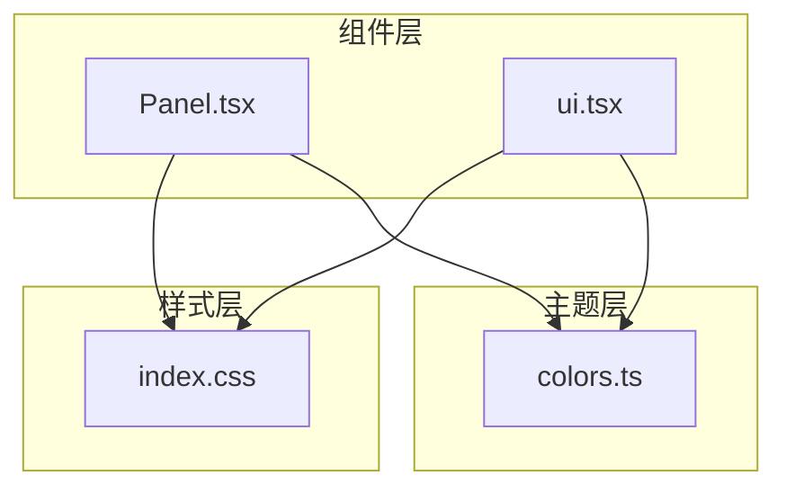
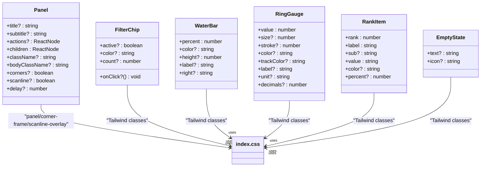
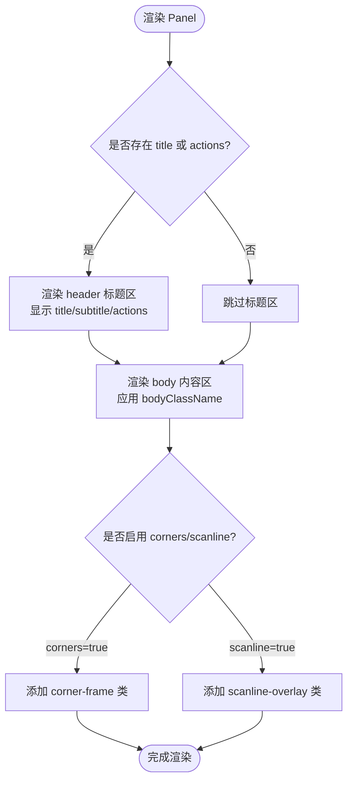
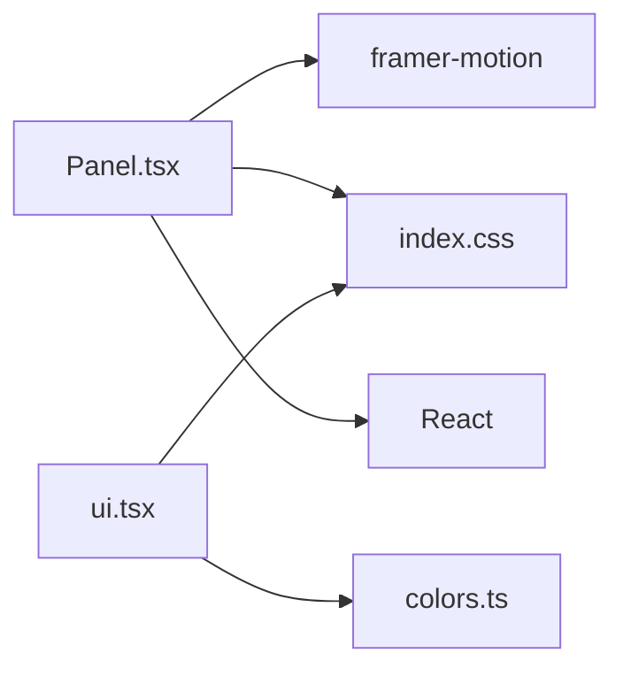

# 基础UI组件

<cite>
**本文引用的文件**   
- [Panel.tsx](file://src/components/Panel.tsx)
- [ui.tsx](file://src/components/ui.tsx)
- [index.css](file://src/index.css)
- [colors.ts](file://src/theme/colors.ts)
</cite>

## 目录
1. [简介](#简介)
2. [项目结构](#项目结构)
3. [核心组件](#核心组件)
4. [架构总览](#架构总览)
5. [详细组件分析](#详细组件分析)
6. [依赖关系分析](#依赖关系分析)
7. [性能与优化建议](#性能与优化建议)
8. [故障排查指南](#故障排查指南)
9. [结论](#结论)

## 简介
本文件面向“基础UI组件”的文档，重点围绕 Panel 面板组件与通用 UI 组件（筛选标签、水位条、环形仪表、排行条目、空状态）的实现原理与使用方法。内容涵盖：
- Panel 组件的 Props 接口说明（title、subtitle、actions、corners、scanline、delay 等）
- 样式定制选项与主题适配（霓虹描边、切角装饰、扫描线动画）
- 组合模式与使用示例路径
- 无障碍访问支持建议
- 性能优化建议

## 项目结构
本项目采用按功能模块组织的前端工程结构，UI 相关代码集中在 components 与 theme 目录中：
- src/components：UI 组件集合，包含 Panel 与通用 UI 组件
- src/theme：主题色板与颜色映射工具
- src/index.css：全局样式与组件样式层

图表来源
- [Panel.tsx:1-54](file://src/components/Panel.tsx#L1-L54)
- [ui.tsx:1-174](file://src/components/ui.tsx#L1-L174)
- [colors.ts:1-97](file://src/theme/colors.ts#L1-L97)
- [index.css:59-148](file://src/index.css#L59-L148)

章节来源
- [Panel.tsx:1-54](file://src/components/Panel.tsx#L1-L54)
- [ui.tsx:1-174](file://src/components/ui.tsx#L1-L174)
- [colors.ts:1-97](file://src/theme/colors.ts#L1-L97)
- [index.css:59-148](file://src/index.css#L59-L148)

## 核心组件
本节聚焦 Panel 面板组件与通用 UI 组件的职责边界与能力范围。

- Panel 面板容器
  - 职责：提供统一的视觉容器，包括标题区、副标题、操作区、内容区；支持切角装饰、扫描线覆盖、入场动效。
  - 关键特性：霓虹描边、切角装饰、扫描线动画、可延迟入场动画。
  - 扩展点：通过 className 与 bodyClassName 进行样式定制；通过 actions 注入任意 ReactNode 作为右侧操作区。

- 通用 UI 组件
  - FilterChip：筛选标签按钮，支持激活态高亮、数量徽标、自定义主色。
  - WaterBar：水位/占比条，支持百分比裁剪、发光效果、高度与标签配置。
  - RingGauge：SVG 环形仪表，支持尺寸、描边宽度、轨道色、数值精度、单位与标签。
  - RankItem：排行条目，支持前几名特殊样式、进度条、子信息。
  - EmptyState：空状态占位，支持自定义文本与图标。

章节来源
- [Panel.tsx:4-53](file://src/components/Panel.tsx#L4-L53)
- [ui.tsx:3-173](file://src/components/ui.tsx#L3-L173)

## 架构总览
Panel 组件基于 Tailwind 类名与 CSS 层样式实现视觉效果，结合 framer-motion 完成入场动画。通用 UI 组件通过内联样式与 Tailwind 类名组合，配合主题色板 colors.ts 输出一致的赛博朋克风格。

图表来源
- [Panel.tsx:4-53](file://src/components/Panel.tsx#L4-L53)
- [ui.tsx:3-173](file://src/components/ui.tsx#L3-L173)
- [index.css:59-148](file://src/index.css#L59-L148)

## 详细组件分析

### Panel 面板组件
Panel 是通用容器，负责：
- 标题区：显示 title 与 subtitle，并预留 actions 区域
- 内容区：承载 children，支持 bodyClassName 定制
- 视觉特效：霓虹描边、切角装饰、扫描线覆盖
- 动效：入场时淡入+上移，支持 delay 控制

#### Props 接口
- title：可选字符串，用于面板标题
- subtitle：可选字符串，用于副标题
- actions：可选 ReactNode，用于右侧操作区
- children：必填 ReactNode，面板内容
- className：可选字符串，附加到根节点
- bodyClassName：可选字符串，附加到内容区
- corners：布尔值，是否启用切角装饰（默认 true）
- scanline：布尔值，是否启用扫描线覆盖（默认 false）
- delay：数字，入场动画延迟秒数（默认 0）

#### 样式与视觉效果
- 霓虹描边：通过 .panel 类实现边框与阴影，形成微光边框与内部辉光
- 切角装饰：通过 .corner-frame::before 与 ::after 在左上与右下绘制斜角边框
- 扫描线：通过 .scanline-overlay::after 叠加渐变带并执行 translateY 动画

图表来源
- [Panel.tsx:21-51](file://src/components/Panel.tsx#L21-L51)
- [index.css:61-94](file://src/index.css#L61-L94)
- [index.css:117-143](file://src/index.css#L117-L143)

#### 动画与交互
- 入场动画：使用 motion.section 实现 opacity 与 y 位移，duration 0.4s，easeOut 缓动
- 延迟：delay 参数控制入场动画起始时间
- 交互：actions 区域可放置任意 ReactNode，例如按钮、开关等

#### 组合模式
- 与通用 UI 组件组合：将 FilterChip、WaterBar、RingGauge、RankItem、EmptyState 放入 Panel 的 children 或 actions 区域
- 多层嵌套：可在 Panel 内容区再嵌套其他 Panel，形成层级面板布局

章节来源
- [Panel.tsx:4-53](file://src/components/Panel.tsx#L4-L53)
- [index.css:61-94](file://src/index.css#L61-L94)
- [index.css:117-143](file://src/index.css#L117-L143)

### 通用 UI 组件

#### FilterChip 筛选标签
- 作用：展示筛选项，支持激活态高亮与数量徽标
- 关键属性：active、onClick、color、count、children
- 视觉：激活态使用 color 作为主色与发光阴影；非激活态为中性色

章节来源
- [ui.tsx:3-33](file://src/components/ui.tsx#L3-L33)

#### WaterBar 水位条
- 作用：展示百分比进度，支持发光效果
- 关键属性：percent、color、height、label、right
- 行为：自动裁剪 percent 至 0-100；支持自定义右侧文案或百分比显示

章节来源
- [ui.tsx:35-68](file://src/components/ui.tsx#L35-L68)

#### RingGauge 环形仪表
- 作用：以 SVG 环形展示数值占比
- 关键属性：value、size、stroke、color、trackColor、label、unit、decimals
- 行为：根据 value 计算 dasharray，带动画过渡；支持单位与标签

章节来源
- [ui.tsx:70-119](file://src/components/ui.tsx#L70-L119)

#### RankItem 排行条目
- 作用：展示排名、名称、数值与可选进度条
- 关键属性：rank、label、sub、value、color、percent
- 行为：前三名使用强调色背景；支持子信息与进度条

章节来源
- [ui.tsx:121-163](file://src/components/ui.tsx#L121-L163)

#### EmptyState 空状态
- 作用：无数据时的占位提示
- 关键属性：text、icon
- 行为：居中显示图标与文本

章节来源
- [ui.tsx:165-173](file://src/components/ui.tsx#L165-L173)

### 主题与颜色
- 共享色板 COLORS：定义赛博风主色、告警色、在线色等
- 健康等级与健康标签映射：HEALTH_COLOR、HEALTH_LABEL
- 告警等级与标签映射：LEVEL_COLOR、LEVEL_LABEL
- 任务状态映射：JOB_STATUS_COLOR、JOB_STATUS_LABEL
- 温度与利用率颜色函数：tempToColor、utilToColor

章节来源
- [colors.ts:6-97](file://src/theme/colors.ts#L6-L97)

## 依赖关系分析
- Panel 依赖
  - framer-motion：用于入场动画
  - Tailwind 与 index.css：用于样式与特效
  - React：ReactNode 类型与 JSX 渲染

- 通用 UI 组件依赖
  - Tailwind 与 index.css：样式与动画
  - colors.ts：主题色与状态色映射

图表来源
- [Panel.tsx:1-54](file://src/components/Panel.tsx#L1-L54)
- [ui.tsx:1-174](file://src/components/ui.tsx#L1-L174)
- [index.css:59-148](file://src/index.css#L59-L148)
- [colors.ts:1-97](file://src/theme/colors.ts#L1-L97)

章节来源
- [Panel.tsx:1-54](file://src/components/Panel.tsx#L1-L54)
- [ui.tsx:1-174](file://src/components/ui.tsx#L1-L174)
- [index.css:59-148](file://src/index.css#L59-L148)
- [colors.ts:1-97](file://src/theme/colors.ts#L1-L97)

## 性能与优化建议
- 动画性能
  - 合理使用 delay 避免大量同时入场导致的渲染抖动
  - 对频繁更新的组件（如 RingGauge、WaterBar）减少不必要的重绘，必要时使用 memo 包裹
- 样式性能
  - 尽量复用 Tailwind 类名，避免过多内联样式
  - 扫描线动画仅在需要时启用（scanline=false），避免持续动画带来的 GPU 压力
- 主题与颜色
  - 使用 colors.ts 中的统一色值，避免硬编码颜色导致不一致与重复计算
- 组合模式
  - 在 Panel 内容区避免过深嵌套，保持 DOM 层级扁平化以提升渲染效率

[本节为通用指导，不直接分析具体文件]

## 故障排查指南
- 切角装饰不显示
  - 检查是否正确传入 corners=true 或保留默认值
  - 确认 .corner-frame 类未被覆盖或移除
  - 参考样式定义位置：[index.css:74-94](file://src/index.css#L74-L94)

- 扫描线未出现
  - 检查 scanline 是否为 true
  - 确认 .scanline-overlay 与 @keyframes scanline 未被覆盖
  - 参考样式定义位置：[index.css:117-143](file://src/index.css#L117-L143)

- 标题区未渲染
  - 检查是否同时未设置 title 与 actions
  - 若需仅显示 actions，请确保传入 actions 节点

- 动画延迟无效
  - 检查 delay 参数是否为数字且大于等于 0
  - 确认外层容器未阻止 motion 动画

章节来源
- [index.css:74-94](file://src/index.css#L74-L94)
- [index.css:117-143](file://src/index.css#L117-L143)
- [Panel.tsx:21-51](file://src/components/Panel.tsx#L21-L51)

## 结论
Panel 面板组件提供了统一的容器与视觉风格，结合通用 UI 组件可快速构建具有赛博朋克风格的仪表盘界面。通过 props 控制标题、副标题、操作区、切角与扫描线等视觉效果，并使用主题色板保持一致性。建议在复杂场景中合理控制动画与样式复杂度，提升整体性能与可维护性。

[本节为总结性内容，不直接分析具体文件]