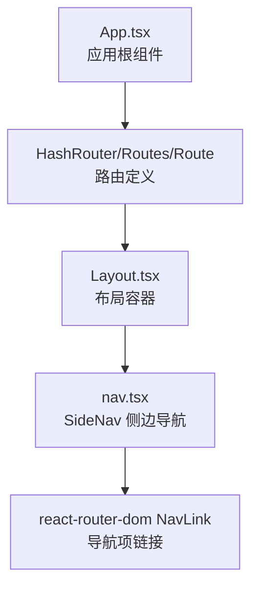
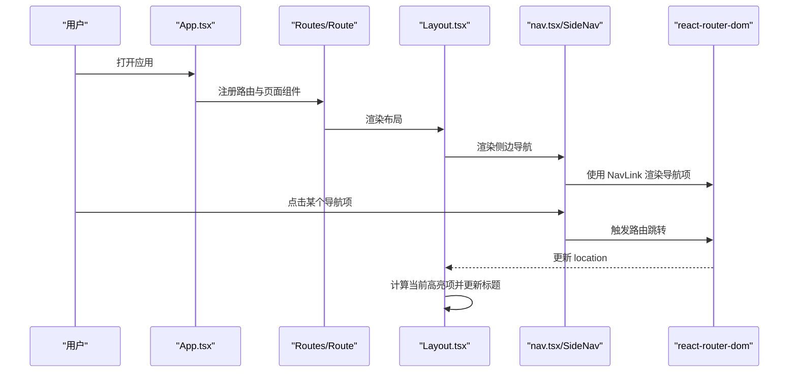
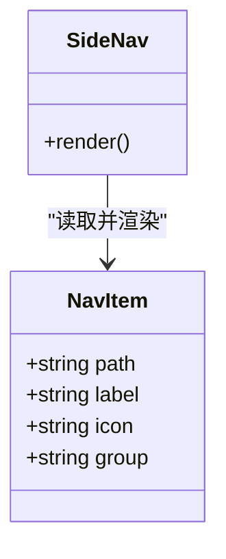
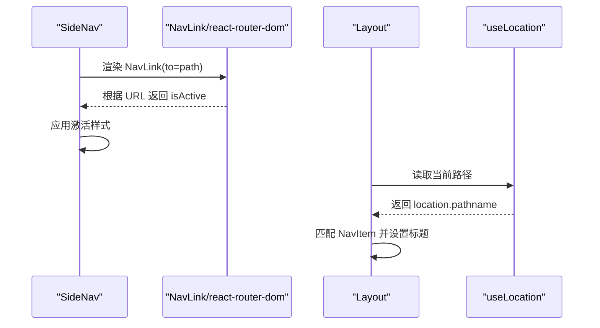
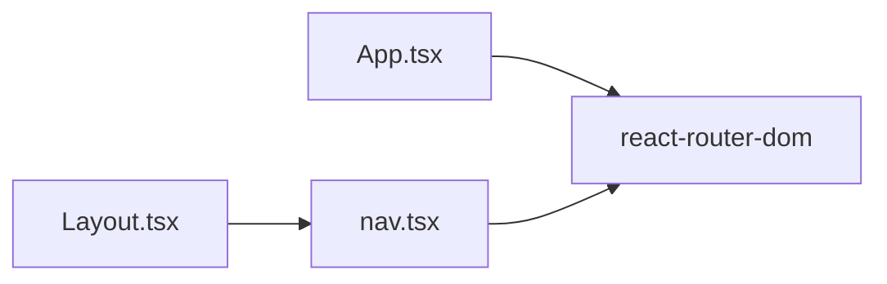

# 导航组件

<cite>
**本文引用的文件**   
- [src/components/nav.tsx](file://src/components/nav.tsx)
- [src/App.tsx](file://src/App.tsx)
- [src/components/Layout.tsx](file://src/components/Layout.tsx)
</cite>

## 目录
1. [简介](#简介)
2. [项目结构](#项目结构)
3. [核心组件](#核心组件)
4. [架构总览](#架构总览)
5. [详细组件分析](#详细组件分析)
6. [依赖关系分析](#依赖关系分析)
7. [性能与可访问性](#性能与可访问性)
8. [故障排查指南](#故障排查指南)
9. [结论](#结论)
10. [附录：配置与扩展示例](#附录配置与扩展示例)

## 简介
本文件面向“侧边栏导航组件”，系统性说明其功能特性、菜单结构与路由集成方式，并给出交互行为、激活状态管理、响应式适配、动画效果、键盘导航与无障碍访问的优化建议。同时提供动态菜单生成与权限控制的实现思路，以及实际的配置与自定义扩展方法。

## 项目结构
本项目采用 React + TypeScript + Tailwind CSS 的前端工程，导航相关代码集中在以下位置：
- 导航组件与配置：src/components/nav.tsx
- 应用路由入口：src/App.tsx
- 布局容器（包含侧边栏与主内容区）：src/components/Layout.tsx

图表来源
- [src/App.tsx:28-44](file://src/App.tsx#L28-L44)
- [src/components/Layout.tsx:45-80](file://src/components/Layout.tsx#L45-L80)
- [src/components/nav.tsx:26-68](file://src/components/nav.tsx#L26-L68)

章节来源
- [src/App.tsx:1-47](file://src/App.tsx#L1-L47)
- [src/components/Layout.tsx:1-125](file://src/components/Layout.tsx#L1-L125)
- [src/components/nav.tsx:1-69](file://src/components/nav.tsx#L1-L69)

## 核心组件
- 导航数据模型与配置
  - NavItem：描述单个导航项，包含路径、显示文本、图标与分组。
  - NAV_ITEMS：全局导航项数组，按 group 字段分组渲染。
  - NAV_GROUPS：分组名称常量，用于渲染分组标题。
- 侧边导航组件
  - SideNav：根据分组与导航项渲染侧边栏；使用 react-router-dom 的 NavLink 进行路由跳转与激活态样式控制。

章节来源
- [src/components/nav.tsx:3-24](file://src/components/nav.tsx#L3-L24)
- [src/components/nav.tsx:26-68](file://src/components/nav.tsx#L26-L68)

## 架构总览
导航在整体应用中的职责与协作如下：
- App 通过 HashRouter 定义页面路由，并将 Layout 作为外层布局包裹所有页面。
- Layout 负责侧边栏、顶栏与内容区的布局，并在顶部展示当前页面的标题。
- SideNav 基于 NAV_ITEMS 与 NAV_GROUPS 渲染分组与导航项，并通过 NavLink 与路由联动。

图表来源
- [src/App.tsx:28-44](file://src/App.tsx#L28-L44)
- [src/components/Layout.tsx:25-33](file://src/components/Layout.tsx#L25-L33)
- [src/components/nav.tsx:36-61](file://src/components/nav.tsx#L36-L61)

## 详细组件分析

### 导航数据模型与配置
- NavItem 字段
  - path：目标路由路径，需与 App.tsx 中 Route.path 保持一致。
  - label：导航项显示文本，也用于 Layout 顶部标题展示。
  - icon：图标字符，直接以文本形式渲染，便于快速替换或扩展。
  - group：分组名，用于将多个导航项聚合到同一组下。
- NAV_ITEMS
  - 集中维护所有导航项，新增页面时在此处添加对应条目即可。
- NAV_GROUPS
  - 声明分组顺序与可见分组，可按业务需要增删。

图表来源
- [src/components/nav.tsx:3-8](file://src/components/nav.tsx#L3-L8)
- [src/components/nav.tsx:26-68](file://src/components/nav.tsx#L26-L68)

章节来源
- [src/components/nav.tsx:3-24](file://src/components/nav.tsx#L3-L24)

### 侧边导航 SideNav 组件
- 分组渲染
  - 遍历 NAV_GROUPS，为每个分组渲染分组标题与对应的导航项列表。
- 导航项渲染
  - 使用 NavLink 渲染每个导航项，to 指向 NavItem.path。
  - 对根路径 '/' 使用 end 属性确保精确匹配。
- 激活状态与样式
  - 通过 NavLink 的 isActive 回调动态切换样式类。
  - 激活态包含左侧指示条、背景色与文字高亮等视觉反馈。
- 图标系统
  - 直接使用字符串图标，位于导航项左侧，激活态时可改变颜色。

```mermaid
flowchart TD
Start(["渲染 SideNav"]) --> Groups["遍历分组 NAV_GROUPS"]
Groups --> Items["过滤并渲染该分组的导航项"]
Items --> Link["使用 NavLink 渲染导航项"]
Link --> Active{"是否激活?"}
Active --> |是| ApplyActive["应用激活样式与指示条"]
Active --> |否| ApplyDefault["应用默认样式与悬停效果"]
ApplyActive --> End(["完成渲染"])
ApplyDefault --> End
```

图表来源
- [src/components/nav.tsx:29-65](file://src/components/nav.tsx#L29-L65)

章节来源
- [src/components/nav.tsx:26-68](file://src/components/nav.tsx#L26-L68)

### 路由集成与激活态联动
- 路由定义
  - App.tsx 中使用 HashRouter 包裹 Routes/Route，声明各页面路由。
- 导航跳转
  - SideNav 通过 NavLink 的 to 属性跳转到对应路径。
- 激活态计算
  - NavLink 内部根据当前 URL 判断 isActive，并返回相应样式类。
- 顶部标题同步
  - Layout 通过 useLocation 获取当前路径，查找匹配的 NavItem.label 作为页面标题。

图表来源
- [src/components/nav.tsx:36-61](file://src/components/nav.tsx#L36-L61)
- [src/components/Layout.tsx:25-33](file://src/components/Layout.tsx#L25-L33)
- [src/App.tsx:28-44](file://src/App.tsx#L28-L44)

章节来源
- [src/App.tsx:28-44](file://src/App.tsx#L28-L44)
- [src/components/Layout.tsx:25-33](file://src/components/Layout.tsx#L25-L33)
- [src/components/nav.tsx:36-61](file://src/components/nav.tsx#L36-L61)

### 交互行为与动画
- 悬停与激活过渡
  - 导航项使用 transition-all 实现平滑过渡。
  - 激活态左侧指示条高度变化，配合阴影增强视觉层次。
- 图标与文字高亮
  - 激活态图标与文字颜色变化，提升可读性与焦点感。

章节来源
- [src/components/nav.tsx:40-58](file://src/components/nav.tsx#L40-L58)

### 响应式适配
- 侧边栏宽度固定
  - aside 使用固定宽度与边框、背景与毛玻璃效果，保证在不同屏幕尺寸下的稳定性。
- 主内容区自适应
  - 主区域使用 flex-1 自适应剩余空间，确保内容区填满视口。
- 移动端建议
  - 可在 Layout 中增加折叠按钮与抽屉式侧边栏，结合媒体查询隐藏/显示侧边栏。

章节来源
- [src/components/Layout.tsx:45-80](file://src/components/Layout.tsx#L45-L80)

### 键盘导航与无障碍访问优化
- 键盘导航
  - 当前 NavLink 未显式处理键盘事件，建议为导航项添加 Tab 键聚焦与 Enter/Space 键触发跳转。
- 语义化标签
  - 已使用 nav 元素包裹导航区域，符合语义化要求。
- 无障碍属性
  - 可为导航项添加 aria-current="page" 表示当前页，辅助读屏器识别。
  - 为图标添加 aria-hidden="true"，避免重复朗读。
- 焦点可见性
  - 建议为焦点状态添加 outline 或 box-shadow，确保键盘用户可见。

[本节为通用优化建议，不直接分析具体文件]

### 动态菜单生成与权限控制
- 动态菜单
  - 可将 NAV_ITEMS 改为从后端接口或配置文件加载，前端根据返回数据渲染。
  - 支持按角色或权限字段过滤菜单项。
- 权限控制
  - 在渲染前根据用户权限过滤 NavItem，仅渲染允许访问的路由。
  - 对于无权限的路径，可重定向至 403 页面或提示无权限。

[本节为概念性方案，不直接分析具体文件]

## 依赖关系分析
- 外部依赖
  - react-router-dom：提供 HashRouter、Routes、Route、NavLink、useLocation 等能力。
- 内部依赖
  - Layout 依赖 SideNav 与 NAV_ITEMS。
  - App 定义路由与页面组件映射。

图表来源
- [src/App.tsx:2-3](file://src/App.tsx#L2-L3)
- [src/components/Layout.tsx:1-4](file://src/components/Layout.tsx#L1-L4)
- [src/components/nav.tsx:1](file://src/components/nav.tsx#L1)

章节来源
- [src/App.tsx:1-47](file://src/App.tsx#L1-L47)
- [src/components/Layout.tsx:1-125](file://src/components/Layout.tsx#L1-L125)
- [src/components/nav.tsx:1-69](file://src/components/nav.tsx#L1-L69)

## 性能与可访问性
- 性能
  - 导航项数量较少，渲染开销低；若未来菜单规模增大，可考虑虚拟滚动或懒加载分组。
  - 避免在 NavLink className 回调中进行复杂计算，保持轻量。
- 可访问性
  - 建议补充 aria-current、aria-label 等属性，提升无障碍体验。
  - 确保焦点顺序合理，键盘操作直观。

[本节为通用指导，不直接分析具体文件]

## 故障排查指南
- 导航无法跳转
  - 检查 NavItem.path 是否与 App.tsx 中 Route.path 一致。
  - 确认 NavLink 的 to 属性正确绑定。
- 激活态不生效
  - 检查 NavLink 的 end 属性是否正确应用于根路径。
  - 确认 isActive 样式类未被覆盖。
- 标题不更新
  - 检查 Layout 中 useLocation 的使用与 NavItem 匹配逻辑。
  - 确认 location.pathname 与 NavItem.path 匹配规则正确。

章节来源
- [src/App.tsx:28-44](file://src/App.tsx#L28-L44)
- [src/components/Layout.tsx:25-33](file://src/components/Layout.tsx#L25-L33)
- [src/components/nav.tsx:36-61](file://src/components/nav.tsx#L36-L61)

## 结论
本导航组件通过简洁的数据驱动方式实现了分组侧边栏、路由联动与激活态样式。其结构清晰、易于扩展，适合在中小型项目中快速落地。后续可通过动态菜单与权限控制进一步增强灵活性，并通过无障碍与键盘导航优化提升用户体验。

[本节为总结性内容，不直接分析具体文件]

## 附录：配置与扩展示例

### 导航配置示例
- 新增页面
  - 在 App.tsx 中添加 Route 定义。
  - 在 NAV_ITEMS 中添加对应 NavItem，确保 path 与 Route.path 一致。
- 新增分组
  - 在 NAV_GROUPS 中添加分组名。
  - 在 NAV_ITEMS 中将新项的 group 设置为该分组名。

章节来源
- [src/App.tsx:28-44](file://src/App.tsx#L28-L44)
- [src/components/nav.tsx:10-24](file://src/components/nav.tsx#L10-L24)

### 自定义扩展方法
- 图标系统扩展
  - 可将字符串图标替换为 SVG 组件或图标库，按需引入。
- 动态菜单
  - 将 NAV_ITEMS 改为异步加载，支持后端权限控制。
- 权限控制
  - 在渲染前根据用户角色过滤菜单项，并对无权限路径进行重定向或提示。

[本节为概念性方案，不直接分析具体文件]