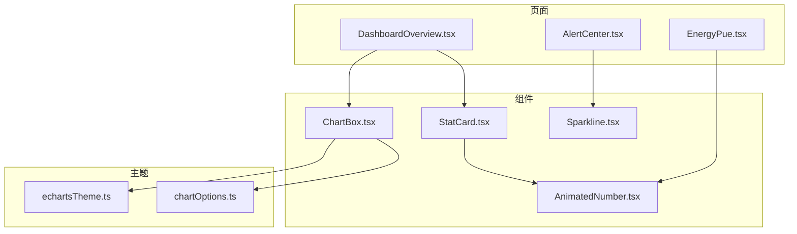
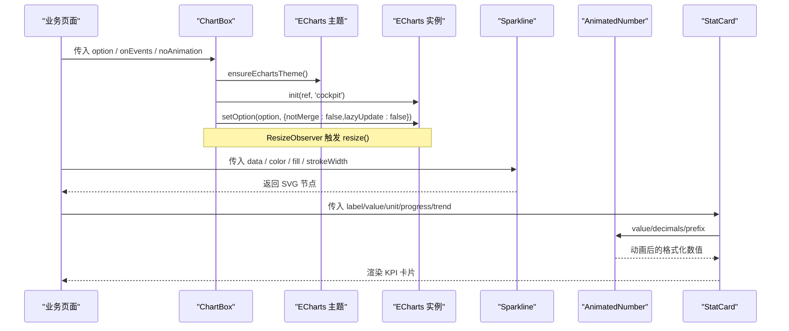
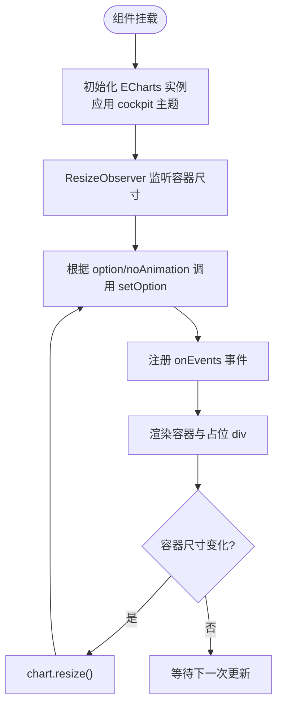
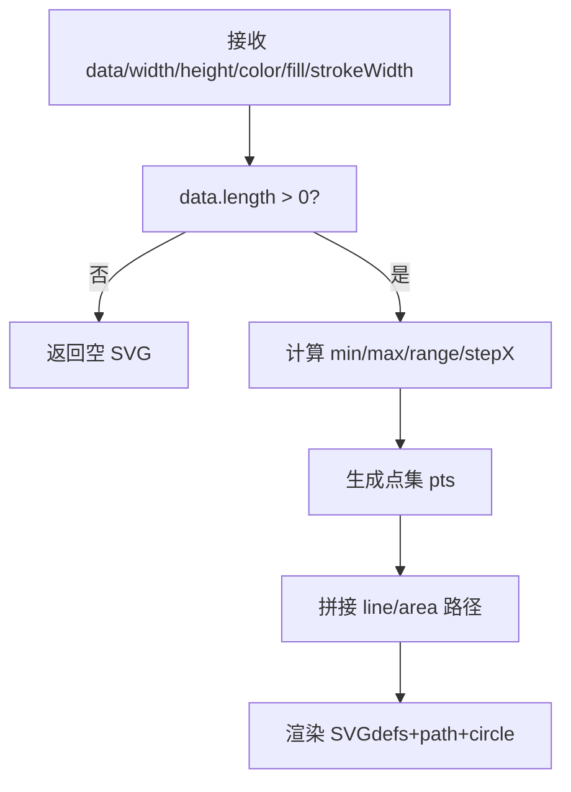
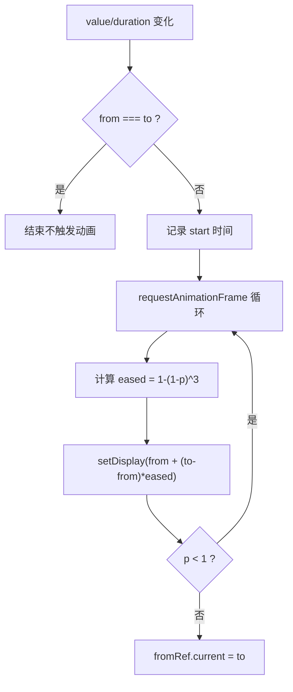
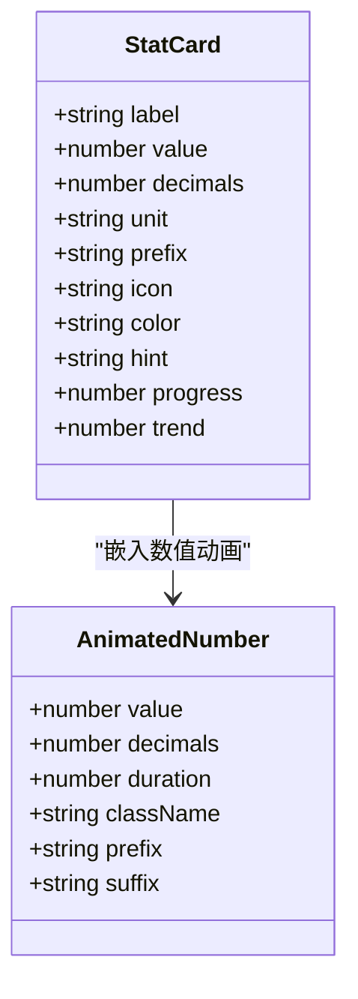
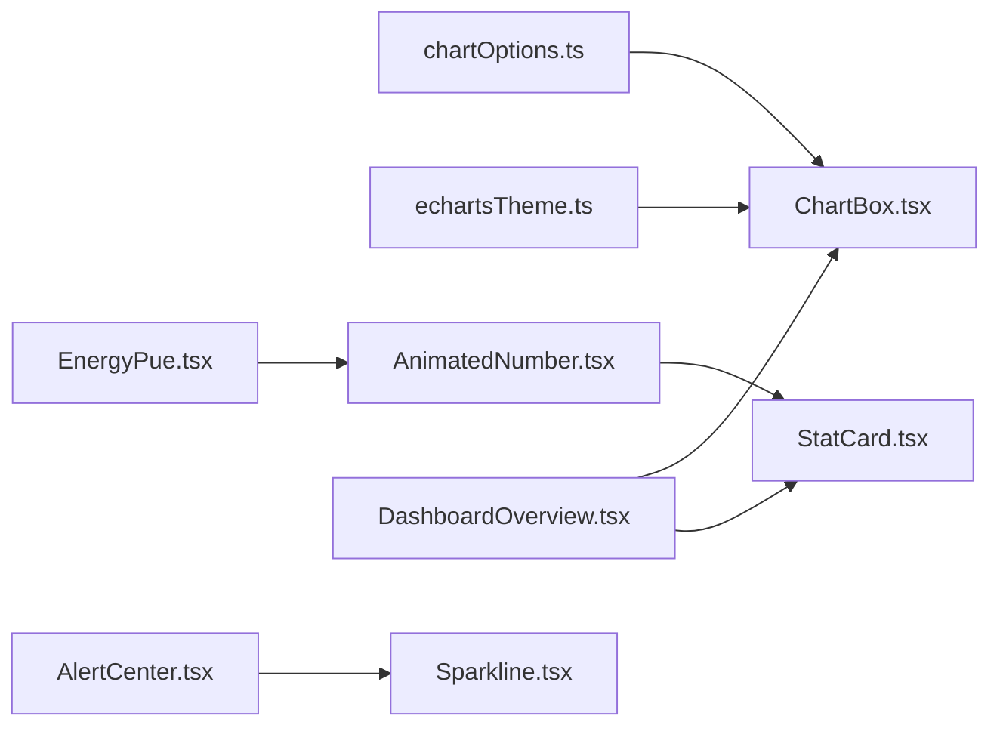

# 数据展示组件

<cite>
**本文引用的文件**   
- [ChartBox.tsx](file://src/components/ChartBox.tsx)
- [Sparkline.tsx](file://src/components/Sparkline.tsx)
- [AnimatedNumber.tsx](file://src/components/AnimatedNumber.tsx)
- [StatCard.tsx](file://src/components/StatCard.tsx)
- [chartOptions.ts](file://src/theme/chartOptions.ts)
- [echartsTheme.ts](file://src/theme/echartsTheme.ts)
- [index.ts](file://src/types/index.ts)
- [DashboardOverview.tsx](file://src/pages/DashboardOverview.tsx)
- [AlertCenter.tsx](file://src/pages/AlertCenter.tsx)
- [EnergyPue.tsx](file://src/pages/EnergyPue.tsx)
</cite>

## 目录
1. [简介](#简介)
2. [项目结构](#项目结构)
3. [核心组件](#核心组件)
4. [架构总览](#架构总览)
5. [详细组件分析](#详细组件分析)
6. [依赖关系分析](#依赖关系分析)
7. [性能与优化](#性能与优化)
8. [故障排查指南](#故障排查指南)
9. [结论](#结论)
10. [附录：配置与类型参考](#附录配置与类型参考)

## 简介
本文件面向“数据展示组件”的综合文档，覆盖以下关键组件：
- ChartBox 图表容器：ECharts 的轻量封装，负责主题、自适应尺寸、增量更新与事件绑定。
- Sparkline 迷你图：轻量内联 SVG 折线趋势图，适合表格/KPI 内嵌场景。
- AnimatedNumber 动画数字：数值变化时的平滑过渡动效。
- StatCard 统计卡片：KPI 指标卡，聚合大数字、单位、图标、进度条与趋势提示。

文档将说明各组件的数据绑定机制、配置选项、样式定制、交互行为，并给出 ECharts 集成、动画实现、响应式设计与性能优化策略，同时提供业务页面中的组合使用示例。

## 项目结构
本项目采用“组件 + 主题 + 页面”的分层组织方式：
- components：可复用 UI 与可视化组件（ChartBox、Sparkline、AnimatedNumber、StatCard）。
- theme：ECharts 主题与图表选项生成器（chartOptions.ts、echartsTheme.ts）。
- pages：业务页面，组合上述组件构建复杂可视化界面。
- types：领域模型与通用类型（TimePoint 等）。

**图示来源**
- [ChartBox.tsx:1-60](file://src/components/ChartBox.tsx#L1-L60)
- [Sparkline.tsx:1-50](file://src/components/Sparkline.tsx#L1-L50)
- [AnimatedNumber.tsx:1-61](file://src/components/AnimatedNumber.tsx#L1-L61)
- [StatCard.tsx:1-82](file://src/components/StatCard.tsx#L1-L82)
- [chartOptions.ts:1-319](file://src/theme/chartOptions.ts#L1-L319)
- [echartsTheme.ts:1-72](file://src/theme/echartsTheme.ts#L1-L72)
- [DashboardOverview.tsx](file://src/pages/DashboardOverview.tsx)
- [AlertCenter.tsx](file://src/pages/AlertCenter.tsx)
- [EnergyPue.tsx](file://src/pages/EnergyPue.tsx)

**章节来源**
- [ChartBox.tsx:1-60](file://src/components/ChartBox.tsx#L1-L60)
- [Sparkline.tsx:1-50](file://src/components/Sparkline.tsx#L1-L50)
- [AnimatedNumber.tsx:1-61](file://src/components/AnimatedNumber.tsx#L1-L61)
- [StatCard.tsx:1-82](file://src/components/StatCard.tsx#L1-L82)
- [chartOptions.ts:1-319](file://src/theme/chartOptions.ts#L1-L319)
- [echartsTheme.ts:1-72](file://src/theme/echartsTheme.ts#L1-L72)

## 核心组件
- ChartBox：ECharts 容器，自动应用驾驶舱主题、监听容器尺寸变化、增量 setOption、统一事件注册与清理。
- Sparkline：无 ECharts 依赖的轻量 SVG 迷你折线图，支持渐变填充、颜色与线宽自定义。
- AnimatedNumber：基于 requestAnimationFrame 的数字滚动动效，支持小数位控制与前缀后缀。
- StatCard：KPI 指标卡，内置 AnimatedNumber，支持单位、图标、进度条、趋势百分比与副标题。

**章节来源**
- [ChartBox.tsx:6-12](file://src/components/ChartBox.tsx#L6-L12)
- [Sparkline.tsx:1-9](file://src/components/Sparkline.tsx#L1-L9)
- [AnimatedNumber.tsx:3-10](file://src/components/AnimatedNumber.tsx#L3-L10)
- [StatCard.tsx:3-16](file://src/components/StatCard.tsx#L3-L16)

## 架构总览
下图展示了数据从页面到组件再到渲染引擎的完整链路：页面通过 props 向组件注入数据；ChartBox 调用 ECharts 进行渲染；Sparkline 直接输出 SVG；AnimatedNumber 驱动数值动画；StatCard 组合多个子元素形成 KPI 卡片。

**图示来源**
- [ChartBox.tsx:17-49](file://src/components/ChartBox.tsx#L17-L49)
- [echartsTheme.ts:64-69](file://src/theme/echartsTheme.ts#L64-L69)
- [Sparkline.tsx:14-49](file://src/components/Sparkline.tsx#L14-L49)
- [AnimatedNumber.tsx:15-47](file://src/components/AnimatedNumber.tsx#L15-L47)
- [StatCard.tsx:21-82](file://src/components/StatCard.tsx#L21-L82)

## 详细组件分析

### ChartBox 图表容器
- 功能特性
  - 自动应用驾驶舱主题（ensureEchartsTheme），确保视觉一致性。
  - 使用 ResizeObserver 监听容器尺寸变化，自动调用 chart.resize()。
  - 增量更新：setOption 时 notMerge=false、lazyUpdate=false，保证高频刷新下的性能与正确性。
  - 事件绑定：onEvents 对象键为事件名，值为回调函数；组件卸载时自动解绑。
  - 动画开关：noAnimation=true 时可禁用动画，适用于高频刷新场景。
- 数据绑定机制
  - 通过 option 属性传入 EChartsOption，内部合并 animation 字段后调用 setOption。
  - onEvents 在 effect 中遍历注册，并在清理阶段移除。
- 配置选项
  - option: EChartsOption，图表配置。
  - className?: string，外层容器类名，默认 h-full。
  - noAnimation?: boolean，是否禁用动画。
  - onEvents?: Record<string, (params: unknown) => void>，事件映射表。
- 样式定制
  - 外层 div 相对定位，内层绝对定位铺满，避免高度冲突导致 0 高。
  - 主题由 ensureEchartsTheme 注入，颜色、字体、网格、tooltip 等全局一致。
- 交互行为
  - 支持任意 ECharts 事件（如 click、legendselectchanged、datazoom 等），通过 onEvents 注入。
- 性能要点
  - 使用 memo 包裹组件，减少重复渲染。
  - 增量 setOption 与 ResizeObserver 避免全量重建。
  - 可选关闭动画以应对高频数据流。

**图示来源**
- [ChartBox.tsx:17-49](file://src/components/ChartBox.tsx#L17-L49)
- [echartsTheme.ts:64-69](file://src/theme/echartsTheme.ts#L64-L69)

**章节来源**
- [ChartBox.tsx:6-12](file://src/components/ChartBox.tsx#L6-L12)
- [ChartBox.tsx:17-58](file://src/components/ChartBox.tsx#L17-L58)
- [echartsTheme.ts:64-69](file://src/theme/echartsTheme.ts#L64-L69)

### Sparkline 迷你图
- 功能特性
  - 轻量内联 SVG 折线图，无需 ECharts 依赖，适合表格/KPI 内嵌趋势。
  - 支持渐变填充、颜色、线宽、宽高与类名定制。
- 数据绑定机制
  - data: number[]，按索引计算 x，按值归一化 y，生成路径点集。
  - 若 data 为空，返回空 SVG，避免异常。
- 配置选项
  - data: number[]
  - width?: number，默认 120
  - height?: number，默认 32
  - color?: string，默认 #22d3ee
  - fill?: boolean，默认 true
  - strokeWidth?: number，默认 1.5
  - className?: string
- 样式定制
  - 使用线性渐变 defs 实现面积填充。
  - 末端绘制圆点强调最新值。
- 性能要点
  - 纯函数式计算路径，无状态，渲染开销低。

**图示来源**
- [Sparkline.tsx:14-49](file://src/components/Sparkline.tsx#L14-L49)

**章节来源**
- [Sparkline.tsx:1-9](file://src/components/Sparkline.tsx#L1-L9)
- [Sparkline.tsx:14-49](file://src/components/Sparkline.tsx#L14-L49)

### AnimatedNumber 动画数字
- 功能特性
  - 数值变化时平滑过渡，使用 easeOutCubic 缓动。
  - 支持小数位数控制与前缀/后缀文本。
- 数据绑定机制
  - value: number，当 value 或 duration 变化时触发动画。
  - 使用 useRef 保存 from 值，useState 管理 display 显示值。
- 配置选项
  - value: number
  - decimals?: number，默认 0
  - duration?: number，默认 600ms
  - className?: string
  - prefix?: string
  - suffix?: string
- 样式定制
  - 通过 className 控制排版样式，prefix/suffix 用于单位或符号。
- 性能要点
  - 使用 requestAnimationFrame 逐帧更新，避免阻塞主线程。
  - 组件卸载时取消动画帧，防止内存泄漏。

**图示来源**
- [AnimatedNumber.tsx:15-47](file://src/components/AnimatedNumber.tsx#L15-L47)

**章节来源**
- [AnimatedNumber.tsx:3-10](file://src/components/AnimatedNumber.tsx#L3-L10)
- [AnimatedNumber.tsx:15-61](file://src/components/AnimatedNumber.tsx#L15-L61)

### StatCard 统计卡片
- 功能特性
  - 顶部 KPI 指标卡：大数字 + 单位 + 图标 + 进度条 + 趋势。
  - 背景辉光与 hover 效果增强视觉层次。
- 数据绑定机制
  - 使用 AnimatedNumber 渲染 value，支持 decimals/prefix。
  - trend 正负决定箭头与颜色类别。
  - progress 0-100 控制进度条宽度与发光阴影。
- 配置选项
  - label: string
  - value: number
  - decimals?: number
  - unit?: string
  - prefix?: string
  - icon?: string
  - color?: string，默认 #22d3ee
  - hint?: string
  - progress?: number
  - trend?: number
- 样式定制
  - 通过 style 动态设置颜色、边框、背景透明度等。
  - 进度条使用 transition-all 与 box-shadow 增强动效。
- 交互行为
  - hover 时背景辉光变亮，提升可读性与聚焦感。

**图示来源**
- [StatCard.tsx:21-82](file://src/components/StatCard.tsx#L21-L82)
- [AnimatedNumber.tsx:15-61](file://src/components/AnimatedNumber.tsx#L15-L61)

**章节来源**
- [StatCard.tsx:3-16](file://src/components/StatCard.tsx#L3-L16)
- [StatCard.tsx:21-82](file://src/components/StatCard.tsx#L21-L82)

## 依赖关系分析
- ChartBox 依赖 echartsTheme.ensureEchartsTheme 注入主题，并通过 EChartsOption 与 chartOptions.ts 提供的生成器配合使用。
- StatCard 依赖 AnimatedNumber 完成数值动画。
- 页面层（DashboardOverview、AlertCenter、EnergyPue）组合这些组件，形成完整的可视化界面。

**图示来源**
- [chartOptions.ts:1-319](file://src/theme/chartOptions.ts#L1-L319)
- [echartsTheme.ts:1-72](file://src/theme/echartsTheme.ts#L1-L72)
- [ChartBox.tsx:1-60](file://src/components/ChartBox.tsx#L1-L60)
- [StatCard.tsx:1-82](file://src/components/StatCard.tsx#L1-L82)
- [AnimatedNumber.tsx:1-61](file://src/components/AnimatedNumber.tsx#L1-L61)
- [DashboardOverview.tsx](file://src/pages/DashboardOverview.tsx)
- [AlertCenter.tsx](file://src/pages/AlertCenter.tsx)
- [EnergyPue.tsx](file://src/pages/EnergyPue.tsx)

**章节来源**
- [ChartBox.tsx:1-60](file://src/components/ChartBox.tsx#L1-L60)
- [StatCard.tsx:1-82](file://src/components/StatCard.tsx#L1-L82)
- [AnimatedNumber.tsx:1-61](file://src/components/AnimatedNumber.tsx#L1-L61)
- [chartOptions.ts:1-319](file://src/theme/chartOptions.ts#L1-L319)
- [echartsTheme.ts:1-72](file://src/theme/echartsTheme.ts#L1-L72)

## 性能与优化
- ECharts 集成优化
  - 使用 ensureEchartsTheme 一次性注册主题，避免重复初始化。
  - 增量 setOption 且 notMerge=false、lazyUpdate=false，兼顾性能与正确性。
  - 高频刷新场景可通过 noAnimation=true 禁用动画，降低重绘压力。
  - ResizeObserver 精准监听容器尺寸变化，避免频繁全量 resize。
- 动画优化
  - AnimatedNumber 使用 requestAnimationFrame 与 easeOutCubic 缓动，避免阻塞主线程。
  - 组件卸载时 cancelAnimationFrame，防止内存泄漏。
- 轻量图形
  - Sparkline 无外部依赖，SVG 路径计算简单，适合大量内嵌场景。
- 组件级优化
  - ChartBox 使用 memo 包裹，减少不必要的重渲染。
  - StatCard 通过条件渲染（trend/progress/hint）减少 DOM 节点数量。

[本节为通用指导，不直接分析具体文件]

## 故障排查指南
- 图表尺寸为 0
  - 检查外层容器是否提供高度（className 默认 h-full），ChartBox 内层绝对定位铺满以避免冲突。
  - 确认 ResizeObserver 已观察 ref.current，且在销毁时断开。
- 主题未生效
  - 确保 ensureEchartsTheme 在 ChartBox 初始化前被调用一次。
- 事件未触发或未清理
  - 检查 onEvents 是否正确传入，并确保组件卸载时 off 被调用。
- 数值动画卡顿
  - 检查 AnimatedNumber 的 duration 是否过短，或父组件是否过于频繁更新 value。
- 迷你图空白
  - 检查 Sparkline 的 data 是否为空数组，空数据会返回空 SVG。

**章节来源**
- [ChartBox.tsx:22-33](file://src/components/ChartBox.tsx#L22-L33)
- [ChartBox.tsx:41-49](file://src/components/ChartBox.tsx#L41-L49)
- [AnimatedNumber.tsx:27-47](file://src/components/AnimatedNumber.tsx#L27-L47)
- [Sparkline.tsx:23-23](file://src/components/Sparkline.tsx#L23-L23)

## 结论
本套数据展示组件围绕 ChartBox、Sparkline、AnimatedNumber、StatCard 四个核心模块，形成了从“轻量趋势图”到“重型图表容器”，从“数值动画”到“KPI 卡片”的完整能力矩阵。通过统一的 ECharts 主题与丰富的 chartOptions 生成器，可在不同业务页面中快速拼装出复杂的数据可视化界面。结合响应式尺寸、增量更新与动画优化策略，能够在高频数据流下保持流畅体验。

[本节为总结性内容，不直接分析具体文件]

## 附录：配置与类型参考
- ECharts 图表选项生成器（chartOptions.ts）
  - trendLineOption：时序趋势面积/折线图，支持 smooth、yMax、yUnit、showLegend。
  - rosePieOption：玫瑰/环形饼图，支持 roseType、inner、center。
  - gaugeOption：半环仪表盘，支持 name、max、color、unit、zones。
  - stackedAreaOption：堆叠面积图，适合告警趋势等。
  - hBarOption：水平条形图排行，支持 unit、max。
  - heatmapOption：热力图，支持 max、unit、visualColors。
  - sankeyOption：桑基图，能耗流向可视化。
  - histogramOption：直方图分布，bins/values/color/unit。
- ECharts 主题（echartsTheme.ts）
  - cockpit 主题：深色驾驶舱风格，包含颜色、字体、网格、tooltip 等。
  - ensureEchartsTheme：单例注册主题，避免重复初始化。
- 类型定义（types/index.ts）
  - TimePoint：时序数据点 { t: number; v: number }，常用于趋势图数据。

**章节来源**
- [chartOptions.ts:37-319](file://src/theme/chartOptions.ts#L37-L319)
- [echartsTheme.ts:7-69](file://src/theme/echartsTheme.ts#L7-L69)
- [index.ts:154-158](file://src/types/index.ts#L154-L158)