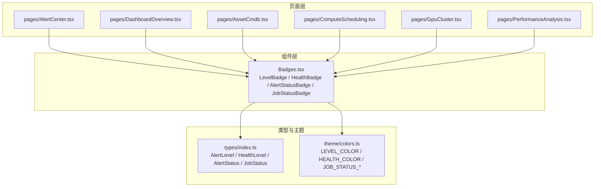
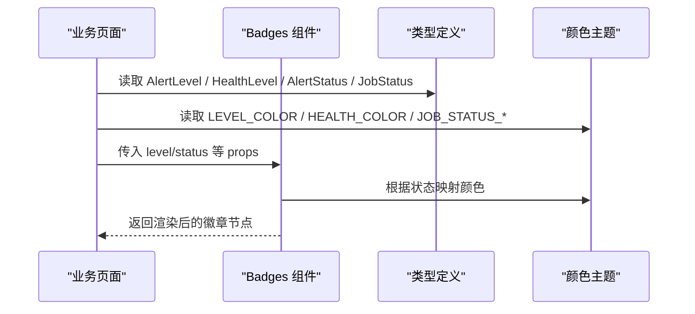
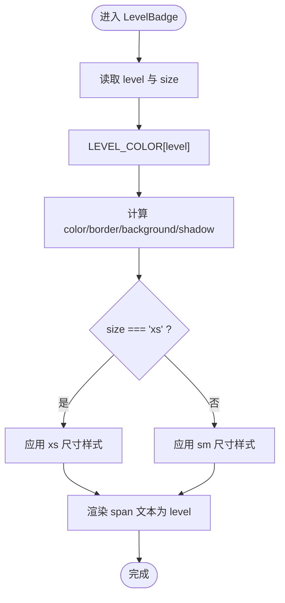
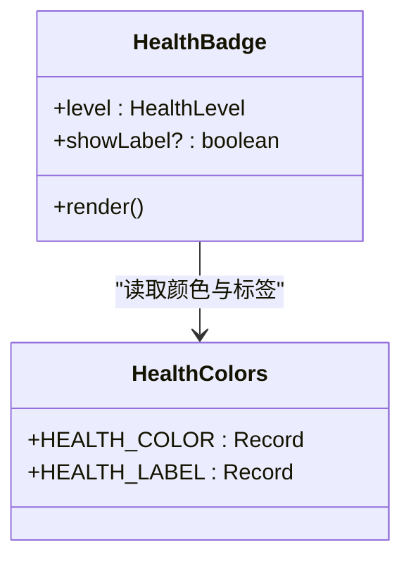
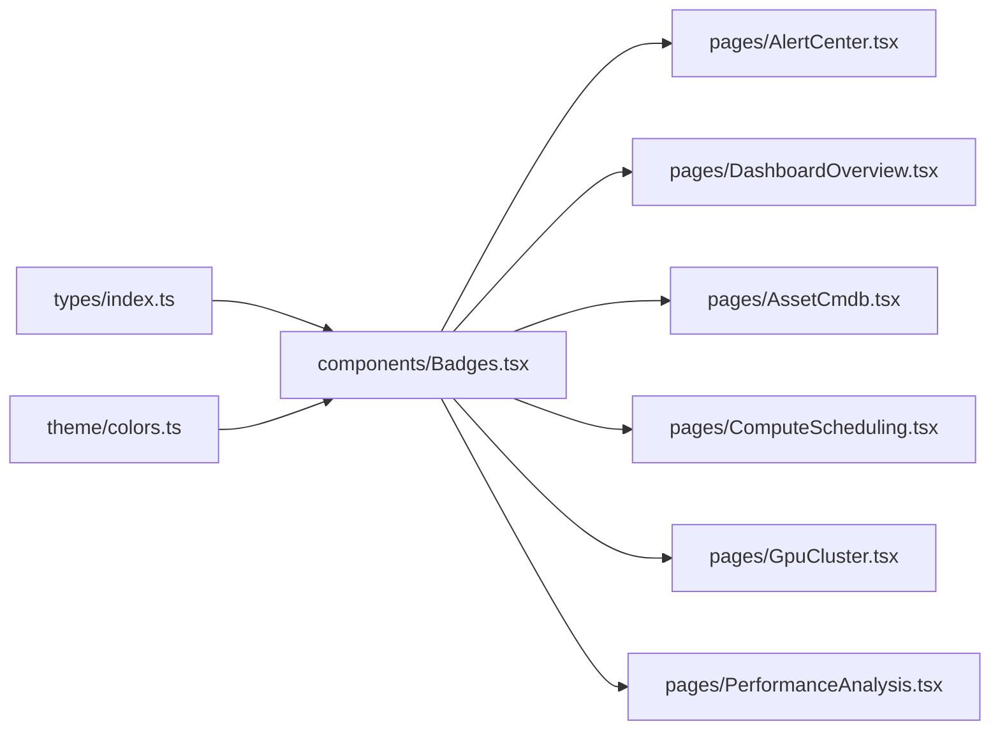

# 状态指示组件

<cite>
**本文引用的文件**   
- [Badges.tsx](file://src/components/Badges.tsx)
- [index.ts](file://src/types/index.ts)
- [colors.ts](file://src/theme/colors.ts)
- [AlertCenter.tsx](file://src/pages/AlertCenter.tsx)
- [DashboardOverview.tsx](file://src/pages/DashboardOverview.tsx)
- [AssetCmdb.tsx](file://src/pages/AssetCmdb.tsx)
- [ComputeScheduling.tsx](file://src/pages/ComputeScheduling.tsx)
- [GpuCluster.tsx](file://src/pages/GpuCluster.tsx)
- [PerformanceAnalysis.tsx](file://src/pages/PerformanceAnalysis.tsx)
</cite>

## 目录
1. [引言](#引言)
2. [项目结构](#项目结构)
3. [核心组件](#核心组件)
4. [架构总览](#架构总览)
5. [详细组件分析](#详细组件分析)
6. [依赖关系分析](#依赖关系分析)
7. [性能与可访问性](#性能与可访问性)
8. [故障排查指南](#故障排查指南)
9. [结论](#结论)
10. [附录：使用示例与扩展方法](#附录使用示例与扩展方法)

## 引言
本文件聚焦“状态指示组件”，重点解析 Badges 徽章组件的实现原理、类型系统、颜色主题、尺寸规格与显示状态，并说明其在告警级别、设备健康、任务进度等场景中的应用。同时提供自定义样式扩展、动画效果和无障碍访问支持建议，以及丰富的使用示例路径，帮助读者快速掌握在数据中心运维大屏中正确使用徽章的方法。

## 项目结构
Badges 徽章组件位于 src/components/Badges.tsx，其类型定义来自 src/types/index.ts，颜色映射来自 src/theme/colors.ts。页面层通过多个业务页面引入并使用这些徽章，例如告警中心、仪表盘、资产 CMDB、计算调度、GPU 集群和性能分析等。

图表来源
- [Badges.tsx:1-84](file://src/components/Badges.tsx#L1-L84)
- [index.ts:8-15,89-90:8-15](file://src/types/index.ts#L8-L15)
- [index.ts:89-90](file://src/types/index.ts#L89-L90)
- [colors.ts:21-64](file://src/theme/colors.ts#L21-L64)
- [AlertCenter.tsx:6-10](file://src/pages/AlertCenter.tsx#L6-L10)
- [DashboardOverview.tsx:8-13](file://src/pages/DashboardOverview.tsx#L8-L13)
- [AssetCmdb.tsx:5](file://src/pages/AssetCmdb.tsx#L5)
- [ComputeScheduling.tsx:5](file://src/pages/ComputeScheduling.tsx#L5)
- [GpuCluster.tsx:5](file://src/pages/GpuCluster.tsx#L5)
- [PerformanceAnalysis.tsx:5](file://src/pages/PerformanceAnalysis.tsx#L5)

章节来源
- [Badges.tsx:1-84](file://src/components/Badges.tsx#L1-L84)
- [index.ts:8-15,89-90:8-15](file://src/types/index.ts#L8-L15)
- [colors.ts:21-64](file://src/theme/colors.ts#L21-L64)

## 核心组件
Badges 模块导出以下徽章组件：
- LevelBadge：告警等级徽章（P0-P3），支持 xs/sm 两种尺寸
- LevelTag：告警等级完整标签（中文文案）
- HealthBadge：健康状态点 + 文字，critical 时带脉冲动画
- AlertStatusBadge：告警状态徽章（活跃/已确认/已静默/已恢复）
- JobStatusBadge：任务状态徽章（排队中/运行中/已完成/已失败），running 时带脉冲点

这些组件统一通过 types 中的枚举类型约束输入，并通过 theme/colors.ts 的颜色映射实现视觉一致性。

章节来源
- [Badges.tsx:11-83](file://src/components/Badges.tsx#L11-L83)
- [index.ts:8-15,89-90:8-15](file://src/types/index.ts#L8-L15)
- [colors.ts:21-64](file://src/theme/colors.ts#L21-L64)

## 架构总览
Badges 组件作为展示层原子组件，不持有业务状态，仅接收 props 渲染。类型系统与颜色主题解耦，便于扩展新的状态或主题色。页面层负责从模拟 Store 获取数据并传入徽章组件进行可视化呈现。

图表来源
- [Badges.tsx:1-84](file://src/components/Badges.tsx#L1-L84)
- [index.ts:8-15,89-90:8-15](file://src/types/index.ts#L8-L15)
- [colors.ts:21-64](file://src/theme/colors.ts#L21-L64)

## 详细组件分析

### 告警等级徽章 LevelBadge
- 功能：以紧凑的矩形徽章展示 P0-P3 等级，支持 xs/sm 尺寸
- 类型：level 为 AlertLevel；size 可选 'xs' | 'sm'
- 颜色：LEVEL_COLOR[level]
- 样式要点：边框半透明、背景低透明度、外发光阴影，尺寸影响字号与最小宽度
- 典型用法：告警列表单元格、滚动播报条

图表来源
- [Badges.tsx:11-24](file://src/components/Badges.tsx#L11-L24)
- [colors.ts:36-49](file://src/theme/colors.ts#L36-L49)

章节来源
- [Badges.tsx:11-24](file://src/components/Badges.tsx#L11-L24)
- [index.ts:11-12](file://src/types/index.ts#L11-L12)
- [colors.ts:36-49](file://src/theme/colors.ts#L36-L49)

### 告警等级标签 LevelTag
- 功能：展示中文等级的可读标签（如“P0 灾难”）
- 类型：level 为 AlertLevel
- 颜色：LEVEL_COLOR[level]
- 用途：详情面板标题旁用于增强可读性

章节来源
- [Badges.tsx:26-33](file://src/components/Badges.tsx#L26-L33)
- [colors.ts:44-49](file://src/theme/colors.ts#L44-L49)

### 健康状态徽章 HealthBadge
- 功能：显示健康状态圆点与可选文字
- 类型：level 为 HealthLevel；showLabel 可选布尔
- 颜色：HEALTH_COLOR[level]
- 动画：当 level 为 critical 时，圆点启用脉冲动画
- 用途：设备健康、节点健康、资产状态等

图表来源
- [Badges.tsx:35-51](file://src/components/Badges.tsx#L35-L51)
- [colors.ts:21-34](file://src/theme/colors.ts#L21-L34)

章节来源
- [Badges.tsx:35-51](file://src/components/Badges.tsx#L35-L51)
- [index.ts:8-9](file://src/types/index.ts#L8-L9)
- [colors.ts:21-34](file://src/theme/colors.ts#L21-L34)

### 告警状态徽章 AlertStatusBadge
- 功能：展示告警生命周期状态（活跃/已确认/已静默/已恢复）
- 类型：status 为 AlertStatus
- 样式：Tailwind 语义化类名组合，不同状态对应不同前景/边框/背景色
- 用途：告警列表的状态列、筛选器联动展示

章节来源
- [Badges.tsx:53-67](file://src/components/Badges.tsx#L53-L67)
- [index.ts:14-15](file://src/types/index.ts#L14-L15)

### 任务状态徽章 JobStatusBadge
- 功能：展示任务队列状态（排队中/运行中/已完成/已失败）
- 类型：status 为 JobStatus
- 颜色：JOB_STATUS_COLOR[status]
- 动画：running 状态附带脉冲点
- 用途：任务队列概览、任务列表状态列

章节来源
- [Badges.tsx:69-83](file://src/components/Badges.tsx#L69-L83)
- [index.ts:89-90](file://src/types/index.ts#L89-L90)
- [colors.ts:51-64](file://src/theme/colors.ts#L51-L64)

## 依赖关系分析
- 类型依赖：所有徽章组件均依赖 types/index.ts 中的联合类型，确保强类型约束
- 主题依赖：颜色与标签映射集中在 colors.ts，避免分散维护
- 页面集成：各页面按需引入相应徽章，形成松耦合的展示层

图表来源
- [Badges.tsx:1-84](file://src/components/Badges.tsx#L1-L84)
- [index.ts:8-15,89-90:8-15](file://src/types/index.ts#L8-L15)
- [colors.ts:21-64](file://src/theme/colors.ts#L21-L64)
- [AlertCenter.tsx:6-10](file://src/pages/AlertCenter.tsx#L6-L10)
- [DashboardOverview.tsx:8-13](file://src/pages/DashboardOverview.tsx#L8-L13)
- [AssetCmdb.tsx:5](file://src/pages/AssetCmdb.tsx#L5)
- [ComputeScheduling.tsx:5](file://src/pages/ComputeScheduling.tsx#L5)
- [GpuCluster.tsx:5](file://src/pages/GpuCluster.tsx#L5)
- [PerformanceAnalysis.tsx:5](file://src/pages/PerformanceAnalysis.tsx#L5)

章节来源
- [Badges.tsx:1-84](file://src/components/Badges.tsx#L1-L84)
- [index.ts:8-15,89-90:8-15](file://src/types/index.ts#L8-L15)
- [colors.ts:21-64](file://src/theme/colors.ts#L21-L64)

## 性能与可访问性
- 性能
  - 徽章组件为纯展示函数组件，无内部状态，渲染开销极低
  - 颜色与标签通过对象映射查找，时间复杂度 O(1)
  - 动画仅在特定状态触发（如 critical、running），减少不必要的重绘
- 可访问性
  - 当前徽章未设置 aria-* 属性，建议在关键信息处补充 role="status" 或 aria-label，提升屏幕阅读器体验
  - 颜色对比度需满足 WCAG 标准，尤其在暗色背景下，建议对关键状态增加高对比度边框或描边
  - 动画元素应尊重 prefers-reduced-motion，必要时禁用脉冲动画

章节来源
- [Badges.tsx:35-83](file://src/components/Badges.tsx#L35-L83)

## 故障排查指南
- 颜色不生效
  - 检查是否传入了正确的类型值（AlertLevel/HealthLevel/JobStatus）
  - 确认 colors.ts 中存在对应键值映射
- 尺寸异常
  - LevelBadge 的 size 仅支持 'xs' | 'sm'，传入其他值将回退到默认样式
- 动画不出现
  - HealthBadge 仅在 level='critical' 时触发脉冲
  - JobStatusBadge 仅在 status='running' 时显示脉冲点
- 文本不可读
  - 检查 Tailwind 配置是否包含相关语义化类名（如 text-alarm-400）
  - 若自定义主题色，请确保 CSS 变量或类名正确注入

章节来源
- [Badges.tsx:11-83](file://src/components/Badges.tsx#L11-L83)
- [colors.ts:21-64](file://src/theme/colors.ts#L21-L64)

## 结论
Badges 徽章组件通过类型系统与颜色主题解耦的方式，提供了统一的告警等级、健康状态、告警状态与任务状态的可视化能力。组件轻量、可扩展，适用于数据中心运维大屏的多类业务场景。结合页面层的实际使用，能够清晰传达系统状态，辅助运维人员快速定位问题。

## 附录：使用示例与扩展方法

### 在不同页面中的使用示例
- 告警中心
  - 列表行内展示告警等级与状态
  - 参考路径：[AlertCenter.tsx:167,175,247:167-175](file://src/pages/AlertCenter.tsx#L167-L175)
- 仪表盘
  - 滚动播报条展示告警等级
  - 参考路径：[DashboardOverview.tsx:213](file://src/pages/DashboardOverview.tsx#L213)
- 资产 CMDB
  - 资产表格与健康详情展示健康状态
  - 参考路径：[AssetCmdb.tsx:213,271:213-271](file://src/pages/AssetCmdb.tsx#L213-L271)
- 计算调度
  - 任务队列概览展示任务状态
  - 参考路径：[ComputeScheduling.tsx:269](file://src/pages/ComputeScheduling.tsx#L269)
- GPU 集群
  - 节点与 GPU 卡健康状态展示
  - 参考路径：[GpuCluster.tsx:175,251:175-251](file://src/pages/GpuCluster.tsx#L175-L251)
- 性能分析
  - 任务列表展示任务状态
  - 参考路径：[PerformanceAnalysis.tsx:184](file://src/pages/PerformanceAnalysis.tsx#L184)

### 自定义徽章样式的扩展方法
- 新增状态类型
  - 在 types/index.ts 中添加新的联合类型（如 NewStatus）
- 新增颜色映射
  - 在 colors.ts 中新增 NEW_STATUS_COLOR 与 NEW_STATUS_LABEL 映射
- 新增徽章组件
  - 在 Badges.tsx 中导出新组件，复用颜色与标签映射
- 页面接入
  - 在对应页面中引入并使用新徽章组件

### 动画效果说明
- HealthBadge：critical 状态圆点启用脉冲动画
- JobStatusBadge：running 状态左侧圆点启用脉冲动画
- 如需自定义动画，可在组件内追加 Tailwind 动画类或使用 CSS keyframes

### 无障碍访问建议
- 为关键徽章添加 aria-label 描述状态含义
- 为动态变化区域添加 role="status" 或 aria-live="polite"
- 遵循 prefers-reduced-motion 媒体查询，允许用户关闭动画