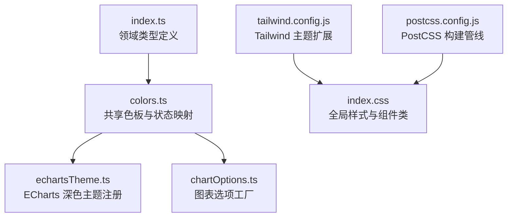
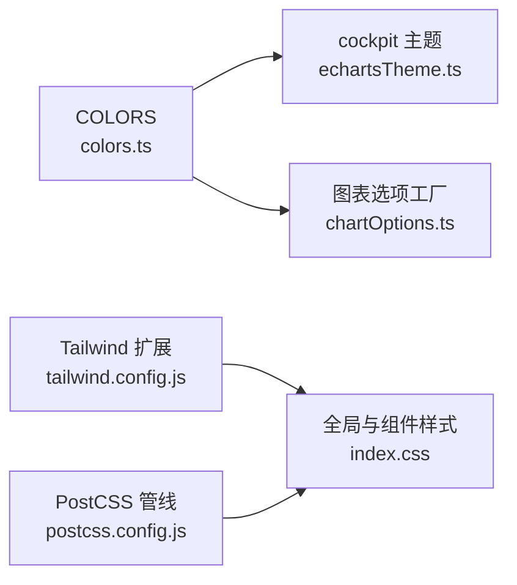
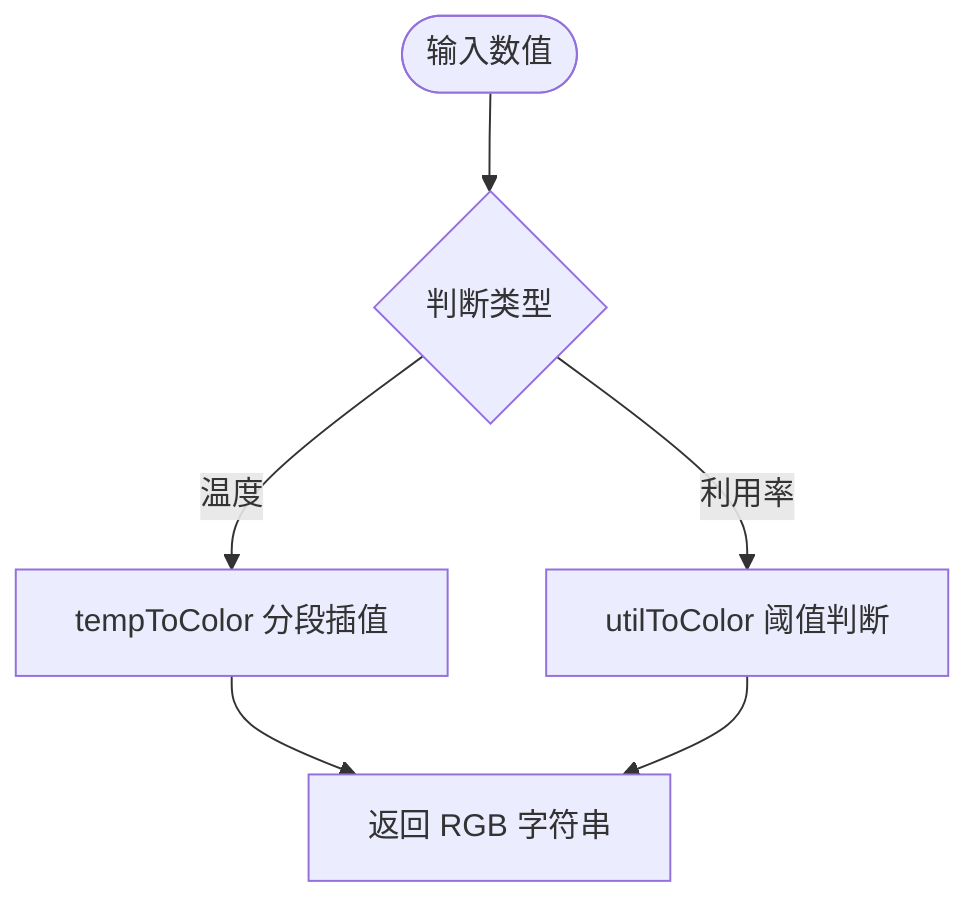
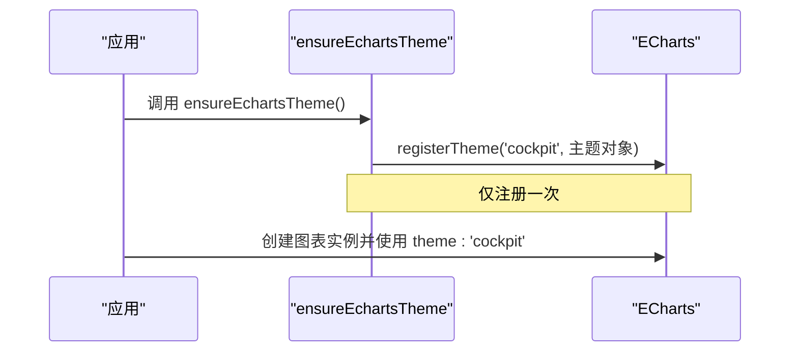
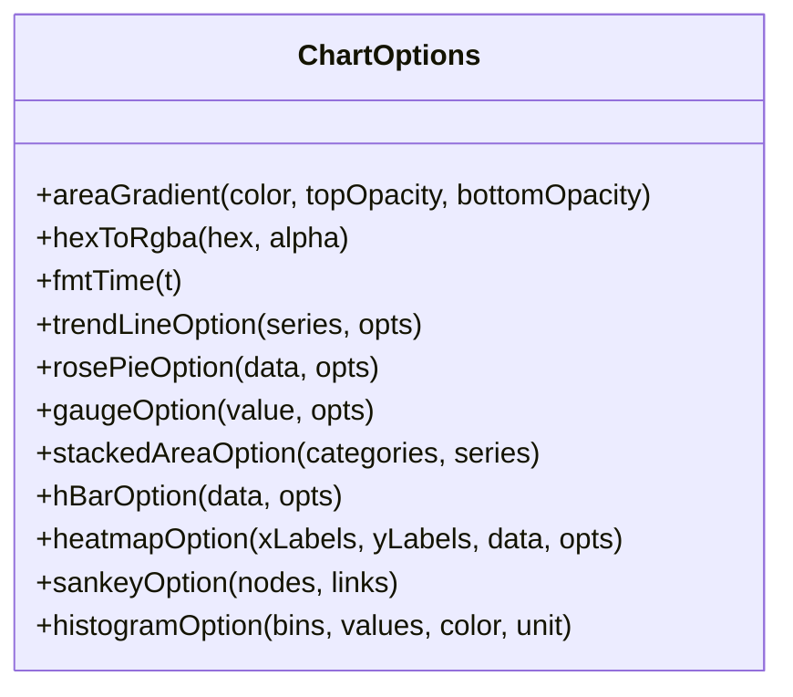
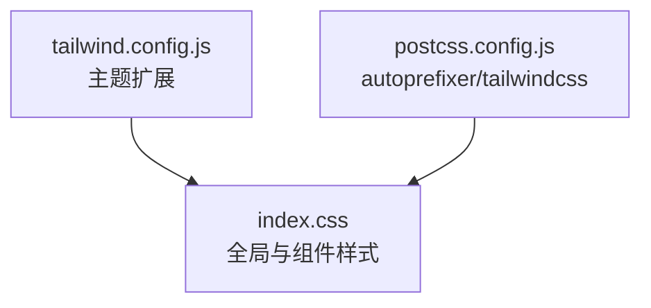
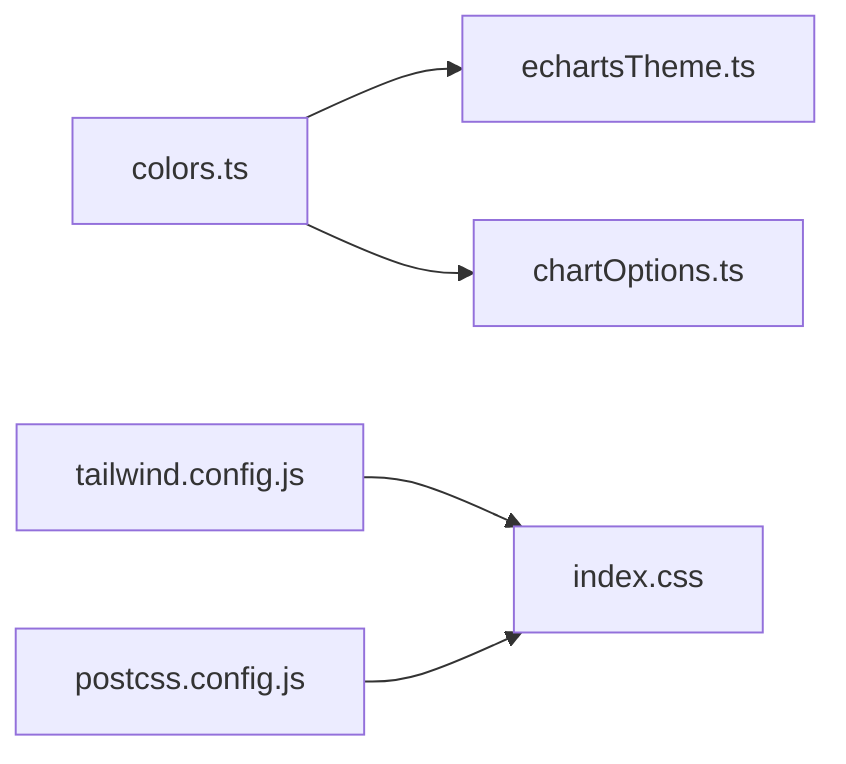

# 主题与样式

<cite>
**本文引用的文件**   
- [colors.ts](file://src/theme/colors.ts)
- [echartsTheme.ts](file://src/theme/echartsTheme.ts)
- [chartOptions.ts](file://src/theme/chartOptions.ts)
- [tailwind.config.js](file://tailwind.config.js)
- [index.css](file://src/index.css)
- [postcss.config.js](file://postcss.config.js)
- [index.ts](file://src/types/index.ts)
</cite>

## 目录
1. [引言](#引言)
2. [项目结构](#项目结构)
3. [核心组件](#核心组件)
4. [架构总览](#架构总览)
5. [详细组件分析](#详细组件分析)
6. [依赖关系分析](#依赖关系分析)
7. [性能考虑](#性能考虑)
8. [故障排查指南](#故障排查指南)
9. [结论](#结论)
10. [附录：扩展与最佳实践](#附录扩展与最佳实践)

## 引言
本文件面向 IDC AI 运维平台的“主题与样式系统”，系统性说明颜色主题、ECharts 图表主题、图表选项配置以及 Tailwind CSS 样式体系的设计与使用方式。文档将帮助读者理解如何自定义颜色方案、字体样式、组件外观和图表视觉风格，并给出 CSS 架构、样式组织、响应式设计与浏览器兼容性处理建议，同时提供主题扩展、样式覆盖与性能优化的最佳实践。

## 项目结构
本项目采用“主题集中化 + UI 层复用”的组织方式：
- 主题色板与状态映射集中在 `src/theme/colors.ts`
- ECharts 主题注册在 `src/theme/echartsTheme.ts`
- 图表通用选项工厂在 `src/theme/chartOptions.ts`
- Tailwind 主题扩展在 `tailwind.config.js`
- 全局样式与组件级样式在 `src/index.css`
- PostCSS 构建管线在 `postcss.config.js`
- 领域类型定义在 `src/types/index.ts`

**图示来源**
- [colors.ts:1-97](file://src/theme/colors.ts#L1-L97)
- [echartsTheme.ts:1-72](file://src/theme/echartsTheme.ts#L1-L72)
- [chartOptions.ts:1-319](file://src/theme/chartOptions.ts#L1-L319)
- [tailwind.config.js:1-93](file://tailwind.config.js#L1-L93)
- [index.css:1-148](file://src/index.css#L1-L148)
- [postcss.config.js:1-7](file://postcss.config.js#L1-L7)
- [index.ts:1-192](file://src/types/index.ts#L1-L192)

**章节来源**
- [colors.ts:1-97](file://src/theme/colors.ts#L1-L97)
- [echartsTheme.ts:1-72](file://src/theme/echartsTheme.ts#L1-L72)
- [chartOptions.ts:1-319](file://src/theme/chartOptions.ts#L1-L319)
- [tailwind.config.js:1-93](file://tailwind.config.js#L1-L93)
- [index.css:1-148](file://src/index.css#L1-L148)
- [postcss.config.js:1-7](file://postcss.config.js#L1-L7)
- [index.ts:1-192](file://src/types/index.ts#L1-L192)

## 核心组件
- 颜色主题与状态映射（colors.ts）
  - 提供统一色板 COLORS，包括主色、告警、在线、网格线、轴标签等
  - 健康等级、告警等级、任务状态的颜色与中文标签映射
  - 温度到颜色的插值函数 tempToColor
  - 利用率阈值到颜色的 utilToColor
- ECharts 主题定制（echartsTheme.ts）
  - 注册名为 cockpit 的深色主题，包含 color、textStyle、title、legend、grid、坐标轴、tooltip 等
  - ensureEchartsTheme 保证主题仅注册一次
- 图表选项配置（chartOptions.ts）
  - 提供趋势折线、玫瑰饼图、仪表盘、堆叠面积、水平条形、热力图、桑基图、直方图等通用选项生成器
  - 内置渐变工具 areaGradient、hexToRgba 和时间格式化 fmtTime
- Tailwind CSS 样式系统（tailwind.config.js + index.css）
  - 扩展 void/cyber/alarm/amber/online 色系，字体族、阴影、背景图、动画关键帧
  - 全局样式定义面板、标题、按钮、表格行等组件类，扫描线效果与文本辉光
- 构建管线（postcss.config.js）
  - 启用 tailwindcss 与 autoprefixer，确保样式兼容性与原子化输出

**章节来源**
- [colors.ts:1-97](file://src/theme/colors.ts#L1-L97)
- [echartsTheme.ts:1-72](file://src/theme/echartsTheme.ts#L1-L72)
- [chartOptions.ts:1-319](file://src/theme/chartOptions.ts#L1-L319)
- [tailwind.config.js:1-93](file://tailwind.config.js#L1-L93)
- [index.css:1-148](file://src/index.css#L1-L148)
- [postcss.config.js:1-7](file://postcss.config.js#L1-L7)

## 架构总览
主题与样式系统的职责边界清晰：
- colors.ts 作为“单一事实源”的色板与状态映射
- echartsTheme.ts 消费 COLORS，为 ECharts 提供一致的视觉语言
- chartOptions.ts 消费 COLORS，封装各类图表的默认选项，便于页面复用
- tailwind.config.js 与 index.css 共同构成 UI 层的样式基础，提供可复用的组件类
- postcss.config.js 负责编译与兼容性

**图示来源**
- [colors.ts:1-97](file://src/theme/colors.ts#L1-L97)
- [echartsTheme.ts:1-72](file://src/theme/echartsTheme.ts#L1-L72)
- [chartOptions.ts:1-319](file://src/theme/chartOptions.ts#L1-L319)
- [tailwind.config.js:1-93](file://tailwind.config.js#L1-L93)
- [index.css:1-148](file://src/index.css#L1-L148)
- [postcss.config.js:1-7](file://postcss.config.js#L1-L7)

## 详细组件分析

### 颜色主题与状态映射（colors.ts）
- 设计要点
  - 通过 COLORS 暴露统一的视觉变量，避免散落的硬编码色值
  - 使用 Record 类型将业务枚举（HealthLevel、AlertLevel、JobStatus）映射到颜色与中文标签，提升可读性与一致性
  - 提供 tempToColor 与 utilToColor 两个数值到颜色的映射函数，支持连续或阈值化的视觉表达
- 复杂度与性能
  - tempToColor 基于分段线性插值，时间复杂度 O(n)，n 为断点数量（固定常量），空间 O(1)
  - utilToColor 为条件分支判断，时间复杂度 O(1)
- 可扩展性
  - 新增状态时，只需扩展枚举与映射表；新增数值映射时，可在同文件追加函数

**图示来源**
- [colors.ts:66-97](file://src/theme/colors.ts#L66-L97)

**章节来源**
- [colors.ts:1-97](file://src/theme/colors.ts#L1-L97)
- [index.ts:8-12](file://src/types/index.ts#L8-L12)
- [index.ts:89-90](file://src/types/index.ts#L89-L90)

### ECharts 主题定制（echartsTheme.ts）
- 设计要点
  - 将 COLORS 中的主色、告警、在线等颜色注入 ECharts 的 color 数组，确保图表与整体主题一致
  - 设置全局 textStyle、title、legend、grid、坐标轴、tooltip 等，形成“驾驶舱”风格的深色主题
  - ensureEchartsTheme 使用布尔标记防止重复注册
- 依赖关系
  - 依赖 COLORS，导出 echarts 实例供外部使用
- 使用建议
  - 在应用启动时调用 ensureEchartsTheme，再创建图表实例时使用 theme: 'cockpit'

**图示来源**
- [echartsTheme.ts:64-72](file://src/theme/echartsTheme.ts#L64-L72)
- [echartsTheme.ts:7-62](file://src/theme/echartsTheme.ts#L7-L62)

**章节来源**
- [echartsTheme.ts:1-72](file://src/theme/echartsTheme.ts#L1-L72)
- [colors.ts:6-19](file://src/theme/colors.ts#L6-L19)

### 图表选项配置（chartOptions.ts）
- 设计要点
  - 以工厂函数形式提供多种图表的 EChartsOption，减少页面中重复配置
  - 内置 areaGradient 与 hexToRgba 实现面积图渐变，fmtTime 格式化时间轴
  - 各图表函数均遵循一致的 grid、splitLine、axisLabel 等布局规范，保持视觉统一
- 典型函数
  - trendLineOption：时序平滑折线/面积图
  - rosePieOption：玫瑰/环形饼图
  - gaugeOption：半环仪表盘，支持分区颜色带
  - stackedAreaOption：堆叠面积图
  - hBarOption：水平条形排行
  - heatmapOption：热力图矩阵
  - sankeyOption：桑基流向图
  - histogramOption：直方分布
- 性能与可维护性
  - 通过数据映射与样式复用降低重复代码
  - 对大数据量场景（如热力图）启用 progressive 等优化参数

**图示来源**
- [chartOptions.ts:5-319](file://src/theme/chartOptions.ts#L5-L319)

**章节来源**
- [chartOptions.ts:1-319](file://src/theme/chartOptions.ts#L1-L319)

### Tailwind CSS 样式系统（tailwind.config.js + index.css）
- 主题扩展（tailwind.config.js）
  - 颜色：void（深空蓝）、cyber（青色主高亮）、alarm（品红告警）、amber（琥珀警告）、online（状态绿）
  - 字体：mono（等宽）、display（展示字体）
  - 阴影：panel、glow、glow-sm、glow-alarm
  - 背景图：grid-cyan、radial-fade
  - 动画：scanline、pulseGlow、marquee、flicker
- 全局样式（index.css）
  - 引入 Orbitron、Rajdhani、JetBrains Mono 字体
  - 设置 body 背景、字体、滚动条样式
  - 定义 .panel、.panel-title、.corner-frame、.stat-value、.hud-label、.btn、.btn-cyber、.btn-ghost、.table-row 等组件类
  - 扫描线覆盖层 .scanline-overlay 与文本辉光 .text-glow
- 构建管线（postcss.config.js）
  - 启用 tailwindcss 与 autoprefixer，确保样式编译与跨浏览器兼容

**图示来源**
- [tailwind.config.js:1-93](file://tailwind.config.js#L1-L93)
- [index.css:1-148](file://src/index.css#L1-L148)
- [postcss.config.js:1-7](file://postcss.config.js#L1-L7)

**章节来源**
- [tailwind.config.js:1-93](file://tailwind.config.js#L1-L93)
- [index.css:1-148](file://src/index.css#L1-L148)
- [postcss.config.js:1-7](file://postcss.config.js#L1-L7)

## 依赖关系分析
- 模块耦合
  - echartsTheme.ts 依赖 colors.ts
  - chartOptions.ts 依赖 colors.ts
  - index.css 依赖 tailwind.config.js 定义的语义化类名
  - postcss.config.js 作用于 index.css 的编译流程
- 潜在循环依赖
  - 当前主题模块之间单向依赖，无循环引用风险
- 外部依赖
  - ECharts 库由 echartsTheme.ts 引入
  - Google Fonts 由 index.css 引入

**图示来源**
- [colors.ts:1-97](file://src/theme/colors.ts#L1-L97)
- [echartsTheme.ts:1-72](file://src/theme/echartsTheme.ts#L1-L72)
- [chartOptions.ts:1-319](file://src/theme/chartOptions.ts#L1-L319)
- [tailwind.config.js:1-93](file://tailwind.config.js#L1-L93)
- [index.css:1-148](file://src/index.css#L1-L148)
- [postcss.config.js:1-7](file://postcss.config.js#L1-L7)

**章节来源**
- [colors.ts:1-97](file://src/theme/colors.ts#L1-L97)
- [echartsTheme.ts:1-72](file://src/theme/echartsTheme.ts#L1-L72)
- [chartOptions.ts:1-319](file://src/theme/chartOptions.ts#L1-L319)
- [tailwind.config.js:1-93](file://tailwind.config.js#L1-L93)
- [index.css:1-148](file://src/index.css#L1-L148)
- [postcss.config.js:1-7](file://postcss.config.js#L1-L7)

## 性能考虑
- 主题与样式
  - 使用 Tailwind 原子类可减少冗余 CSS，但需关注构建产物体积；合理配置 content 路径以避免未使用样式被剔除
  - 全局背景网格与径向辉光使用伪元素与固定定位，注意在低端设备上可能影响滚动性能
- 图表渲染
  - 大数据量热力图已启用 progressive 参数以提升渲染性能
  - 面积图渐变通过 areaGradient 复用，避免重复计算
- 字体加载
  - Google Fonts 异步加载，建议在首屏关键路径上优先加载必要字体，或使用本地字体缓存策略

[本节为通用指导，不直接分析具体文件]

## 故障排查指南
- ECharts 主题未生效
  - 确认已在应用启动阶段调用 ensureEchartsTheme
  - 检查图表实例是否指定 theme: 'cockpit'
- 颜色不一致
  - 检查是否在多处硬编码色值，应统一从 COLORS 或 Tailwind 扩展色取值
- 样式未生效
  - 确认 PostCSS 插件已启用 tailwindcss 与 autoprefixer
  - 检查 Tailwind content 路径是否包含实际使用的模板文件
- 字体显示异常
  - 检查 Google Fonts 链接是否可访问，必要时替换为本地字体资源
- 动画卡顿
  - 减少复杂动画的使用频率，或在低性能设备上禁用非必要动画

**章节来源**
- [echartsTheme.ts:64-72](file://src/theme/echartsTheme.ts#L64-L72)
- [postcss.config.js:1-7](file://postcss.config.js#L1-L7)
- [tailwind.config.js:1-93](file://tailwind.config.js#L1-L93)
- [index.css:1-148](file://src/index.css#L1-L148)

## 结论
本主题与样式系统通过集中化的色板、统一的 ECharts 主题与可复用的图表选项工厂，结合 Tailwind 的原子化样式与全局组件类，构建了高度一致的 IDC AI 运维平台视觉体系。该体系具备良好的可扩展性与可维护性，适合在大型监控与可视化场景中持续演进。

[本节为总结性内容，不直接分析具体文件]

## 附录：扩展与最佳实践
- 自定义颜色方案
  - 在 colors.ts 中扩展 COLORS 或新增映射函数，并在 echartsTheme.ts 与 chartOptions.ts 中引用
  - 在 tailwind.config.js 中扩展对应语义色，确保 UI 层可用
- 自定义字体样式
  - 在 index.css 中引入新字体，并在 tailwind.config.js 中扩展 fontFamily
- 组件外观定制
  - 在 index.css 的 @layer components 中新增或覆盖组件类，遵循现有命名约定
- 图表视觉风格
  - 通过 chartOptions.ts 的工厂函数传入自定义 color、unit、zones 等参数进行局部覆盖
  - 如需全局调整，修改 echartsTheme.ts 的主题对象
- 响应式设计模式
  - 使用 Tailwind 的断点修饰符（如 sm/md/lg）组合语义化类名，保持布局一致性
- 浏览器兼容性处理
  - 依赖 autoprefixer 自动添加前缀；必要时在 index.css 中使用兼容性写法
- 性能优化
  - 控制动画与阴影强度，避免过度绘制
  - 图表大数据集启用 progressive 或分页渲染
  - 按需引入 ECharts 模块以减少包体

[本节为通用指导，不直接分析具体文件]