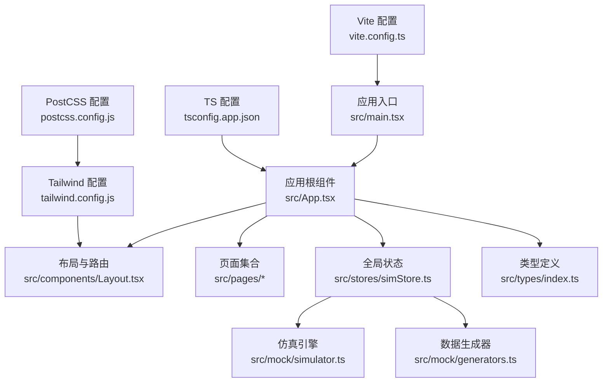
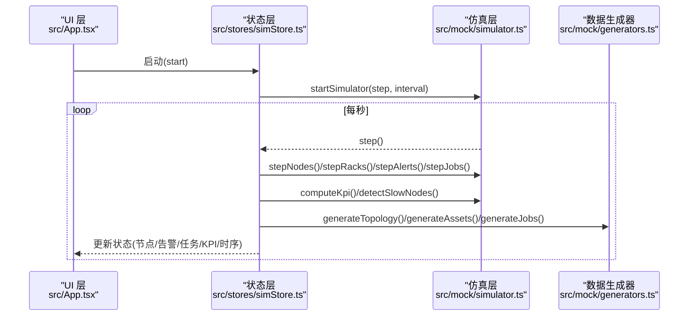
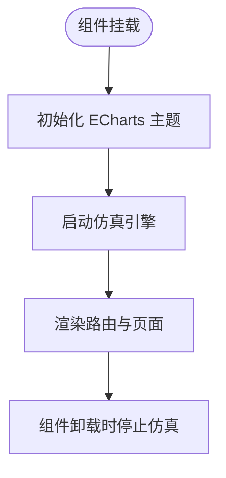
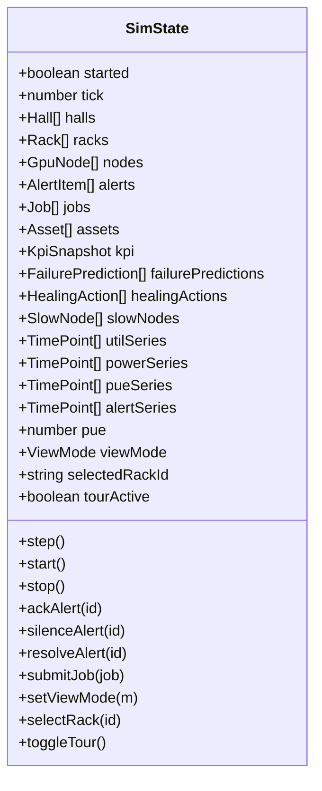
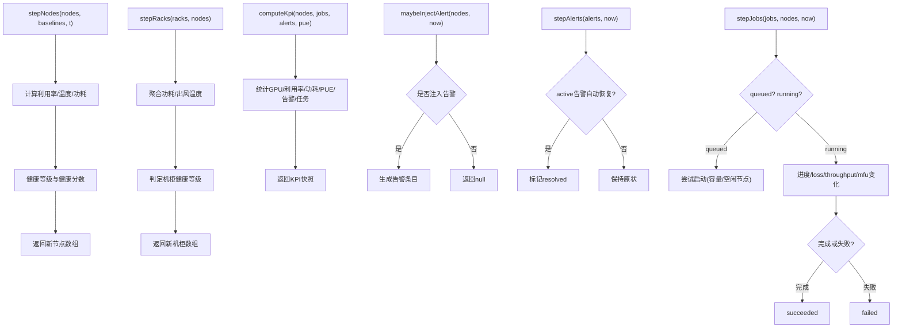
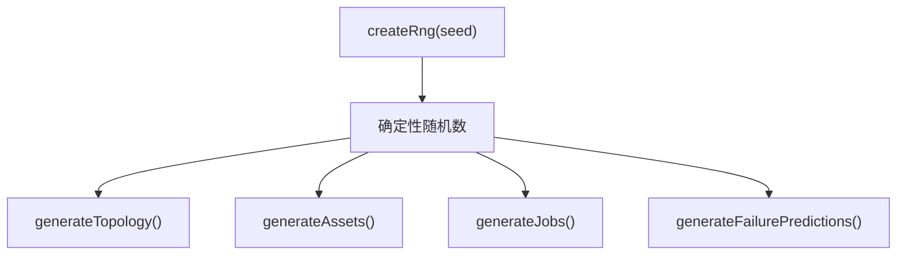
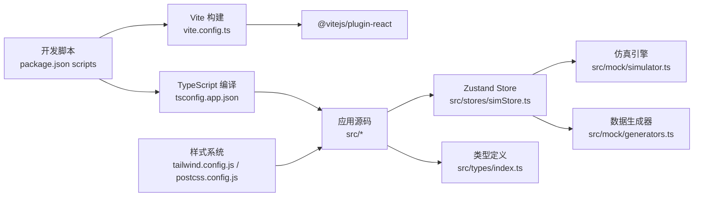

# 开发指南

<cite>
**本文引用的文件**   
- [package.json](file://package.json)
- [vite.config.ts](file://vite.config.ts)
- [tsconfig.json](file://tsconfig.json)
- [tsconfig.app.json](file://tsconfig.app.json)
- [postcss.config.js](file://postcss.config.js)
- [tailwind.config.js](file://tailwind.config.js)
- [src/main.tsx](file://src/main.tsx)
- [src/App.tsx](file://src/App.tsx)
- [src/types/index.ts](file://src/types/index.ts)
- [src/stores/simStore.ts](file://src/stores/simStore.ts)
- [src/mock/generators.ts](file://src/mock/generators.ts)
- [src/mock/simulator.ts](file://src/mock/simulator.ts)
</cite>

## 目录
1. [简介](#简介)
2. [项目结构](#项目结构)
3. [核心组件](#核心组件)
4. [架构总览](#架构总览)
5. [详细组件分析](#详细组件分析)
6. [依赖关系分析](#依赖关系分析)
7. [性能与构建优化](#性能与构建优化)
8. [调试与测试策略](#调试与测试策略)
9. [代码规范与协作流程](#代码规范与协作流程)
10. [故障排查](#故障排查)
11. [结论](#结论)

## 简介
本指南面向 IDC AI 运维平台的开发者与协作者，覆盖开发环境配置、构建与编译、代码规范、Git 工作流、调试与测试、性能分析与质量保证等全链路实践。平台基于 React + Vite + TypeScript 构建，使用 Zustand 管理状态，ECharts/Three.js 进行数据可视化与 3D 展示，TailwindCSS 提供样式体系。

## 项目结构
- 应用入口与路由：
  - 应用根组件负责初始化仿真引擎、主题与页面路由。
  - 主入口挂载 React 根节点并启用严格模式。
- 领域类型集中定义在统一类型文件中，供各模块共享。
- 状态层通过 Zustand store 驱动仿真数据更新与 UI 渲染。
- Mock 层包含拓扑生成器与仿真引擎，提供确定性随机数与纯函数式计算。
- 构建与样式：
  - Vite 作为开发与构建工具，React 插件启用 JSX。
  - TailwindCSS + PostCSS 提供原子化样式与浏览器兼容前缀。
  - TypeScript 采用模块化目标与严格检查。

**图表来源**
- [src/main.tsx:1-11](file://src/main.tsx#L1-L11)
- [src/App.tsx:1-47](file://src/App.tsx#L1-L47)
- [src/stores/simStore.ts:1-270](file://src/stores/simStore.ts#L1-L270)
- [src/mock/simulator.ts:1-331](file://src/mock/simulator.ts#L1-L331)
- [src/mock/generators.ts:1-408](file://src/mock/generators.ts#L1-L408)
- [src/types/index.ts:1-192](file://src/types/index.ts#L1-L192)
- [vite.config.ts:1-11](file://vite.config.ts#L1-L11)
- [tsconfig.app.json:1-22](file://tsconfig.app.json#L1-L22)
- [tailwind.config.js:1-93](file://tailwind.config.js#L1-L93)
- [postcss.config.js:1-7](file://postcss.config.js#L1-L7)

**章节来源**
- [src/main.tsx:1-11](file://src/main.tsx#L1-L11)
- [src/App.tsx:1-47](file://src/App.tsx#L1-L47)
- [vite.config.ts:1-11](file://vite.config.ts#L1-L11)
- [tsconfig.app.json:1-22](file://tsconfig.app.json#L1-L22)
- [tailwind.config.js:1-93](file://tailwind.config.js#L1-L93)
- [postcss.config.js:1-7](file://postcss.config.js#L1-L7)

## 核心组件
- 应用根组件
  - 初始化 ECharts 主题、启动/停止仿真引擎。
  - 使用 HashRouter 注册多个业务页面路由。
- 全局状态（Zustand）
  - 维护机房、机柜、节点、告警、任务、资产、KPI、时序曲线等状态。
  - 提供 tick 步进、开始/停止、告警处理、任务提交、视图切换等动作。
- 仿真引擎（纯函数）
  - 节点指标漂移、机柜聚合、KPI 汇总、告警注入与流转、任务状态机、慢节点检测、自愈日志、时序推进、心跳驱动。
- 数据生成器
  - 确定性伪随机数、机房拓扑、GPU 节点、资产台账、初始任务、故障预测。

**章节来源**
- [src/App.tsx:1-47](file://src/App.tsx#L1-L47)
- [src/stores/simStore.ts:1-270](file://src/stores/simStore.ts#L1-L270)
- [src/mock/simulator.ts:1-331](file://src/mock/simulator.ts#L1-L331)
- [src/mock/generators.ts:1-408](file://src/mock/generators.ts#L1-L408)

## 架构总览
系统采用“UI 层 + 状态层 + 仿真层”的分层架构：
- UI 层：React 组件与页面，消费 Zustand store 提供的状态与动作。
- 状态层：Zustand store 封装业务动作，协调仿真引擎的步进。
- 仿真层：纯函数实现，不直接依赖 UI 或 store，保证可测试性与可复用性。

**图表来源**
- [src/App.tsx:18-26](file://src/App.tsx#L18-L26)
- [src/stores/simStore.ts:142-219](file://src/stores/simStore.ts#L142-L219)
- [src/mock/simulator.ts:323-331](file://src/mock/simulator.ts#L323-L331)
- [src/mock/generators.ts:159-206](file://src/mock/generators.ts#L159-L206)

## 详细组件分析

### 应用根组件与路由
- 职责
  - 初始化 ECharts 主题。
  - 控制仿真引擎生命周期（start/stop）。
  - 声明页面路由映射。
- 关键点
  - 使用 useEffect 在挂载时启动仿真，卸载时停止。
  - 使用 HashRouter 与 Routes 组织多页面。

**图表来源**
- [src/App.tsx:22-26](file://src/App.tsx#L22-L26)
- [src/App.tsx:28-44](file://src/App.tsx#L28-L44)

**章节来源**
- [src/App.tsx:1-47](file://src/App.tsx#L1-L47)

### 全局状态（Zustand Store）
- 数据结构
  - 机房/机柜/节点/告警/任务/资产/KPI/时序曲线/视图模式等。
- 行为
  - step：每 tick 推进节点、机柜、告警、任务、PUE、KPI、自愈日志、慢节点检测，并更新时序曲线。
  - start/stop：通过定时器驱动仿真步进。
  - 告警操作：ack/silence/resolve。
  - 任务提交：构造默认字段并插入队列。
  - UI 交互：视图模式切换、机柜选择、引导开关。

**图表来源**
- [src/stores/simStore.ts:99-134](file://src/stores/simStore.ts#L99-L134)
- [src/stores/simStore.ts:142-265](file://src/stores/simStore.ts#L142-L265)

**章节来源**
- [src/stores/simStore.ts:1-270](file://src/stores/simStore.ts#L1-L270)

### 仿真引擎（纯函数）
- 节点推进
  - 围绕基线做正弦漂移与噪声，限制温度/功耗范围，计算健康等级与健康分数。
- 机柜聚合
  - 按机柜维度聚合功耗与出风温度，判定健康等级。
- KPI 汇总
  - 统计 GPU 总数/在线数/利用率/IT 功耗/PUE/冷却功耗/活跃告警/运行任务等。
- 告警注入与流转
  - 概率注入新告警；部分 active 告警自动恢复。
- 任务状态机
  - 排队任务按优先级尝试启动；运行任务进度增长、损失下降、吞吐波动；极小概率失败。
- 慢节点检测
  - 计算集群均值偏差，筛选异常偏低节点并给出建议。
- 自愈日志
  - 针对 critical 节点触发自愈动作，记录延迟与结果。
- 时序推进
  - 固定长度滑动窗口保存时间序列点。
- 心跳驱动
  - 使用 setInterval 驱动 step 回调，并提供 stop 清理。

**图表来源**
- [src/mock/simulator.ts:54-71](file://src/mock/simulator.ts#L54-L71)
- [src/mock/simulator.ts:76-92](file://src/mock/simulator.ts#L76-L92)
- [src/mock/simulator.ts:97-139](file://src/mock/simulator.ts#L97-L139)
- [src/mock/simulator.ts:165-182](file://src/mock/simulator.ts#L165-L182)
- [src/mock/simulator.ts:187-194](file://src/mock/simulator.ts#L187-L194)
- [src/mock/simulator.ts:199-234](file://src/mock/simulator.ts#L199-L234)

**章节来源**
- [src/mock/simulator.ts:1-331](file://src/mock/simulator.ts#L1-L331)

### 数据生成器
- 确定性随机数
  - 使用 Mulberry32 算法，固定种子确保每次刷新一致。
- 拓扑与设备
  - 机房/机柜/节点坐标与布局常量；节点模型、算力、功耗参数。
- 资产台账
  - 服务器/交换机/存储阵列/备件 GPU 卡，含供应商、型号、位置、生命周期、业务归属等。
- 初始任务
  - 训练/推理/调试三类队列，分配节点、进度、性能指标等。
- 故障预测
  - 基于健康分数排序，生成预测条目并按概率降序排列。

**图表来源**
- [src/mock/generators.ts:17-35](file://src/mock/generators.ts#L17-L35)
- [src/mock/generators.ts:159-206](file://src/mock/generators.ts#L159-L206)
- [src/mock/generators.ts:216-328](file://src/mock/generators.ts#L216-L328)
- [src/mock/generators.ts:345-384](file://src/mock/generators.ts#L345-L384)
- [src/mock/generators.ts:389-405](file://src/mock/generators.ts#L389-L405)

**章节来源**
- [src/mock/generators.ts:1-408](file://src/mock/generators.ts#L1-L408)

### 类型定义
- 领域模型
  - GPU 型号、健康等级、告警等级/状态/来源、GPU 指标、节点、机柜、机房、告警事件、任务、资产、KPI、时序点、视图模式、故障预测、自愈动作、慢节点等。
- 作用
  - 为 UI、状态、仿真层提供统一的类型契约，减少运行时错误，提升可维护性。

**章节来源**
- [src/types/index.ts:1-192](file://src/types/index.ts#L1-L192)

## 依赖关系分析
- 构建与脚本
  - 开发：vite dev
  - 构建：tsc -b && vite build
  - 预览：vite preview
- 运行时依赖
  - React、react-dom、react-router-dom、zustand、echarts、echarts-for-react、three、@react-three/fiber、@react-three/drei、framer-motion。
- 开发依赖
  - @vitejs/plugin-react、typescript、vite、tailwindcss、autoprefixer、postcss。

**图表来源**
- [package.json:6-32](file://package.json#L6-L32)
- [vite.config.ts:1-11](file://vite.config.ts#L1-L11)
- [tsconfig.app.json:1-22](file://tsconfig.app.json#L1-L22)
- [tailwind.config.js:1-93](file://tailwind.config.js#L1-L93)
- [postcss.config.js:1-7](file://postcss.config.js#L1-L7)

**章节来源**
- [package.json:1-38](file://package.json#L1-L38)
- [vite.config.ts:1-11](file://vite.config.ts#L1-L11)
- [tsconfig.app.json:1-22](file://tsconfig.app.json#L1-L22)

## 性能与构建优化
- Vite 构建
  - 启用 React 插件，开发服务器端口 5173，host 设为 true 以支持局域网访问。
- TypeScript 编译
  - 目标 ES2020，模块 ESNext，解析器 bundler，开启严格模式与未使用变量/参数检查，禁用 emit（由 Vite 处理）。
- 样式与兼容性
  - TailwindCSS 扩展颜色、阴影、动画等主题；PostCSS 启用 autoprefixer 保证跨浏览器兼容。
- 运行时性能
  - 仿真引擎使用纯函数与不可变更新，避免深层嵌套状态导致的重渲染。
  - 时序数据采用固定长度滑动窗口，控制内存占用。
  - 机柜聚合与慢节点检测按 tick 频率节流，降低计算开销。

**章节来源**
- [vite.config.ts:4-10](file://vite.config.ts#L4-L10)
- [tsconfig.app.json:2-18](file://tsconfig.app.json#L2-L18)
- [tailwind.config.js:1-93](file://tailwind.config.js#L1-L93)
- [postcss.config.js:1-7](file://postcss.config.js#L1-L7)
- [src/stores/simStore.ts:164-206](file://src/stores/simStore.ts#L164-L206)
- [src/mock/simulator.ts:264-268](file://src/mock/simulator.ts#L264-L268)

## 调试与测试策略
- 调试技巧
  - 使用浏览器开发者工具观察 Zustand store 状态变更与定时器行为。
  - 在关键步骤（stepNodes/stepRacks/stepAlerts/stepJobs/computeKpi）添加断点，验证数据边界与约束。
  - 利用确定性随机数（Mulberry32）复现问题场景，便于回归验证。
- 测试建议
  - 对纯函数（仿真引擎与生成器）编写单元测试，覆盖边界条件（离线节点、极端温度/功耗、任务并发上限、告警注入概率等）。
  - 对 store 动作进行集成测试，验证状态转换与副作用（定时器启停）。
  - 对 UI 组件进行快照测试与交互测试，确保主题与动画效果稳定。
- 质量保证
  - 保持 TypeScript 严格模式与未使用检查，避免潜在类型错误。
  - 在 CI 中执行构建与基础测试，确保分支合并质量。

[本节为通用指导，不直接分析具体文件]

## 代码规范与协作流程
- 代码规范
  - TypeScript 严格模式：启用 strict、noUnusedLocals、noUnusedParameters、noFallthroughCasesInSwitch。
  - JSX 使用 react-jsx 转换，模块系统遵循 ESNext。
  - 样式使用 TailwindCSS 原子类，必要时扩展主题（颜色、阴影、动画）。
- 命名与文件组织
  - 类型集中在 src/types/index.ts，供各模块引用。
  - 状态逻辑集中于 stores，仿真与数据生成置于 mock 目录，便于解耦与测试。
  - 页面组件按功能划分于 pages，公共组件置于 components。
- Git 工作流与分支策略
  - 主干分支：main/master 用于发布版本。
  - 功能分支：feature/<描述>，修复分支：fix/<描述>，实验分支：exp/<描述>。
  - 提交信息规范：type(scope): subject，如 feat(ui): 新增告警中心页面。
  - 代码审查：Pull Request 需至少一名评审，关注类型安全、性能影响与可测试性。
- 最佳实践
  - 优先使用纯函数与不可变更新，减少副作用。
  - 将复杂逻辑下沉至仿真层，UI 仅负责展示与交互。
  - 对耗时计算进行节流与缓存，避免阻塞渲染。

**章节来源**
- [tsconfig.app.json:2-18](file://tsconfig.app.json#L2-L18)
- [tailwind.config.js:1-93](file://tailwind.config.js#L1-L93)
- [src/types/index.ts:1-192](file://src/types/index.ts#L1-L192)
- [src/stores/simStore.ts:1-270](file://src/stores/simStore.ts#L1-L270)
- [src/mock/simulator.ts:1-331](file://src/mock/simulator.ts#L1-L331)
- [src/mock/generators.ts:1-408](file://src/mock/generators.ts#L1-L408)

## 故障排查
- 常见问题
  - 构建失败：检查 TypeScript 配置与模块解析方式，确认依赖版本兼容。
  - 样式异常：确认 TailwindCSS 扫描路径包含所有源文件，PostCSS 插件顺序正确。
  - 状态不同步：检查 store 动作是否正确更新状态，避免直接修改内部对象。
  - 仿真卡顿：确认 step 节流与数据量控制，避免过多 DOM 更新。
- 定位方法
  - 使用浏览器控制台输出关键状态与计时，定位瓶颈。
  - 在仿真引擎关键函数中添加日志，观察数据变化轨迹。
  - 使用确定性随机数复现问题，缩小范围。

**章节来源**
- [vite.config.ts:4-10](file://vite.config.ts#L4-L10)
- [tsconfig.app.json:2-18](file://tsconfig.app.json#L2-L18)
- [tailwind.config.js:1-93](file://tailwind.config.js#L1-L93)
- [postcss.config.js:1-7](file://postcss.config.js#L1-L7)
- [src/stores/simStore.ts:164-206](file://src/stores/simStore.ts#L164-L206)

## 结论
本指南梳理了 IDC AI 运维平台的架构与实现要点，明确了开发环境、构建与编译、代码规范、协作流程与调试测试策略。通过分层架构与纯函数仿真引擎，项目在可维护性、可测试性与性能方面具备良好基础。团队应遵循本文规范，持续提升代码质量与交付效率。