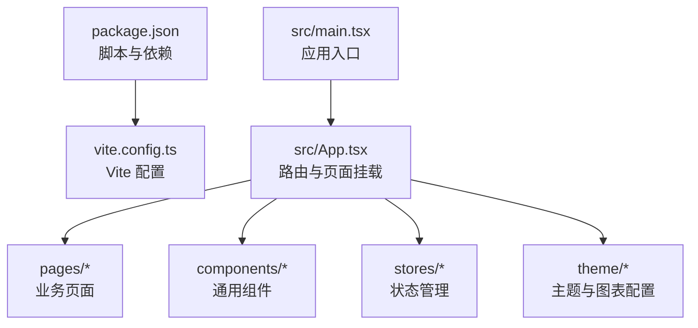

# 快速开始

<cite>
**本文引用的文件**   
- [package.json](file://package.json)
- [vite.config.ts](file://vite.config.ts)
- [src/main.tsx](file://src/main.tsx)
- [src/App.tsx](file://src/App.tsx)
</cite>

## 目录
1. [简介](#简介)
2. [项目结构](#项目结构)
3. [环境要求](#环境要求)
4. [安装与启动](#安装与启动)
5. [npm 脚本说明](#npm-脚本说明)
6. [常见问题与解决方案](#常见问题与解决方案)
7. [结论](#结论)

## 简介
本指南面向首次接触 IDC AI 运维平台的新用户，帮助你在最短时间内完成本地开发环境的搭建并成功运行。你将了解：
- 所需环境与版本
- 从克隆仓库到启动开发服务器的完整命令
- 主要 npm 脚本的用途
- 常见问题的排查方法

## 项目结构
本项目基于 Vite + React + TypeScript 构建，采用模块化页面组织方式。核心入口与路由如下：
- 应用入口：[src/main.tsx](file://src/main.tsx)
- 根组件与路由：[src/App.tsx](file://src/App.tsx)
- 开发服务器配置：[vite.config.ts](file://vite.config.ts)
- 依赖与脚本定义：[package.json](file://package.json)

**图示来源**
- [package.json:6-9](file://package.json#L6-L9)
- [vite.config.ts:4-9](file://vite.config.ts#L4-L9)
- [src/main.tsx:1-10](file://src/main.tsx#L1-L10)
- [src/App.tsx:18-46](file://src/App.tsx#L18-L46)

**章节来源**
- [package.json:1-38](file://package.json#L1-L38)
- [vite.config.ts:1-11](file://vite.config.ts#L1-L11)
- [src/main.tsx:1-11](file://src/main.tsx#L1-L11)
- [src/App.tsx:1-47](file://src/App.tsx#L1-L47)

## 环境要求
- Node.js：建议使用较新的长期支持版本（例如 18.x 或 20.x）
- 包管理器：npm（随 Node.js 安装），也可使用 pnpm/yarn
- 操作系统：Windows、macOS、Linux 均可

提示：若你的系统已安装 Node.js，可通过命令行检查版本是否符合预期。

**章节来源**
- [package.json:1-10](file://package.json#L1-L10)

## 安装与启动
以下命令在终端中依次执行（请将路径替换为你本地的实际路径）：

1. 克隆项目
   - git clone https://github.com/your-org/idc-ai-ops-platform.git
   - cd idc-ai-ops-platform

2. 安装依赖
   - npm install

3. 启动开发服务器
   - npm run dev

4. 打开浏览器访问
   - 默认地址：http://localhost:5173

说明：
- 开发服务器端口由配置决定，默认监听 5173。
- 首次运行会编译 TypeScript 并启动 Vite 开发服务器。

**章节来源**
- [vite.config.ts:6-9](file://vite.config.ts#L6-L9)
- [package.json:6-9](file://package.json#L6-L9)

## npm 脚本说明
- dev：启动 Vite 开发服务器，用于本地开发与热更新。
- build：先进行 TypeScript 类型检查与编译，再打包生产资源。
- preview：预览构建产物，模拟生产环境输出。

这些脚本定义位于项目的脚本配置中。

**章节来源**
- [package.json:6-9](file://package.json#L6-L9)

## 常见问题与解决方案
- 端口占用
  - 现象：启动时报端口被占用错误。
  - 解决：修改开发服务器端口后重新启动；或在系统中释放占用端口的进程。
  - 参考：开发服务器端口配置位置见 [vite.config.ts:6-9](file://vite.config.ts#L6-L9)。

- Node.js 版本不兼容
  - 现象：安装依赖或构建时报语法/引擎错误。
  - 解决：升级 Node.js 至推荐的长期支持版本，然后重新安装依赖。

- 依赖安装失败
  - 现象：网络超时或权限问题导致安装失败。
  - 解决：切换镜像源、清理缓存后重试；必要时以管理员权限运行终端。

- 无法访问 localhost
  - 现象：浏览器打不开 http://localhost:5173。
  - 解决：确认开发服务器已成功启动且未报错；检查防火墙或代理设置。

- 构建失败
  - 现象：npm run build 报类型错误或模块解析失败。
  - 解决：确保 TypeScript 版本与依赖匹配；清理 node_modules 后重装依赖；检查是否有缺失的类型声明。

- 预览构建产物异常
  - 现象：npm run preview 页面空白或样式丢失。
  - 解决：先执行 npm run build 生成 dist 目录，再运行 npm run preview。

**章节来源**
- [vite.config.ts:4-9](file://vite.config.ts#L4-L9)
- [package.json:6-9](file://package.json#L6-L9)

## 结论
按照本指南的步骤，你可以在几分钟内完成 IDC AI 运维平台的本地开发环境搭建。若遇到问题，优先检查 Node.js 版本、端口占用与依赖安装日志。如需进一步扩展，可阅读各页面与组件源码，逐步理解路由、状态管理与可视化图表的实现方式。