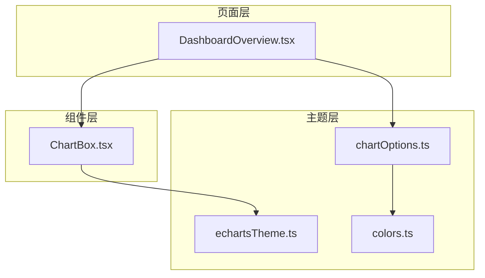
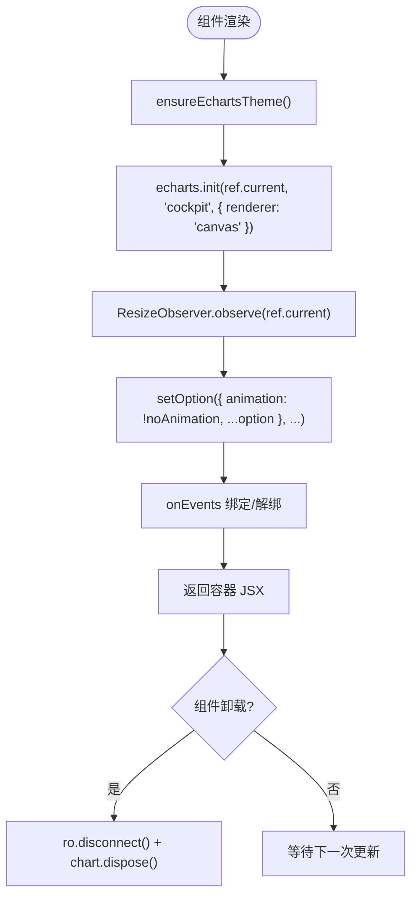
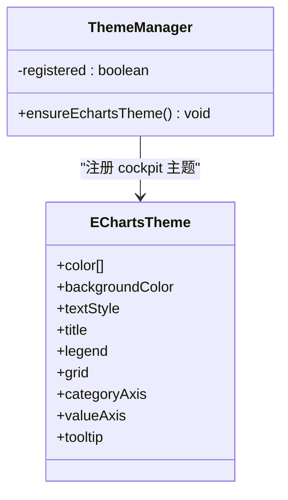
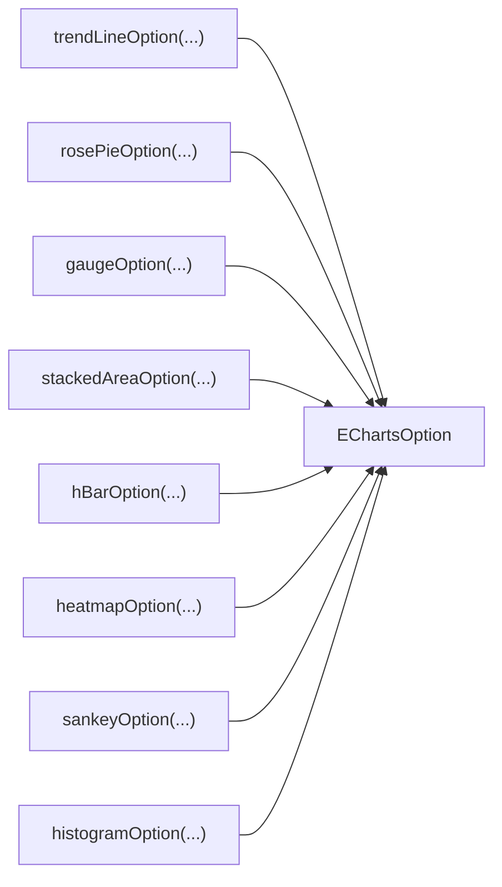
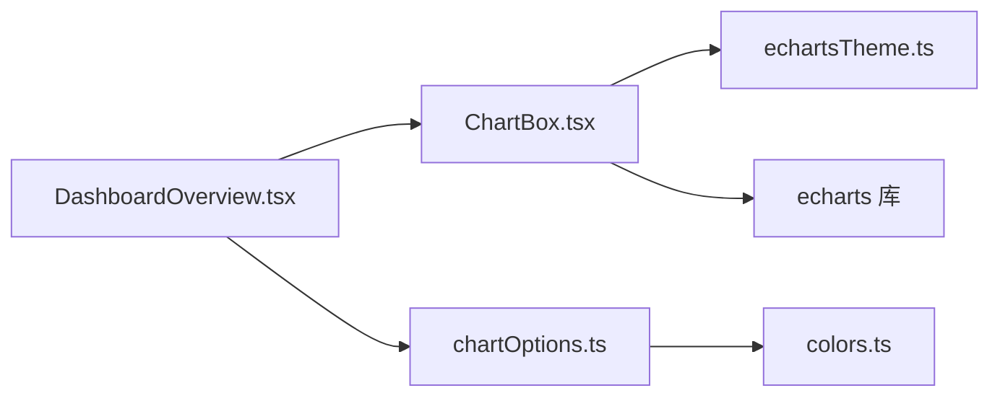

# ECharts集成与配置

<cite>
**本文引用的文件**   
- [ChartBox.tsx](file://src/components/ChartBox.tsx)
- [echartsTheme.ts](file://src/theme/echartsTheme.ts)
- [chartOptions.ts](file://src/theme/chartOptions.ts)
- [colors.ts](file://src/theme/colors.ts)
- [DashboardOverview.tsx](file://src/pages/DashboardOverview.tsx)
</cite>

## 目录
1. [简介](#简介)
2. [项目结构](#项目结构)
3. [核心组件](#核心组件)
4. [架构总览](#架构总览)
5. [详细组件分析](#详细组件分析)
6. [依赖关系分析](#依赖关系分析)
7. [性能与优化](#性能与优化)
8. [事件处理最佳实践](#事件处理最佳实践)
9. [常见问题与排错](#常见问题与排错)
10. [结论](#结论)

## 简介
本文档围绕项目中 ECharts 的集成方案展开，重点说明 ChartBox 组件的实现原理、主题系统 ensureEchartsTheme 的工作原理、ECharts 配置选项的标准化处理方式，以及图表事件处理的实践建议。文档同时给出在页面中使用 ChartBox 的实际示例路径，帮助读者快速上手并避免常见陷阱。

## 项目结构
本项目采用“组件 + 主题 + 页面”的分层组织方式：
- components：通用 UI 与业务组件，其中 ChartBox 是 ECharts 的统一封装。
- theme：主题与图表配置工厂，包含颜色体系、ECharts 主题注册和各类图表 option 生成器。
- pages：具体业务页面，通过组合 Panel、StatCard、Sparkline 等组件并使用 ChartBox 渲染图表。



**图示来源**
- [DashboardOverview.tsx:1-12](file://src/pages/DashboardOverview.tsx#L1-L12)
- [ChartBox.tsx:1-4](file://src/components/ChartBox.tsx#L1-L4)
- [echartsTheme.ts:1-3](file://src/theme/echartsTheme.ts#L1-L3)
- [chartOptions.ts:1-3](file://src/theme/chartOptions.ts#L1-L3)
- [colors.ts:1-19](file://src/theme/colors.ts#L1-L19)

**章节来源**
- [DashboardOverview.tsx:1-12](file://src/pages/DashboardOverview.tsx#L1-L12)
- [ChartBox.tsx:1-4](file://src/components/ChartBox.tsx#L1-L4)
- [echartsTheme.ts:1-3](file://src/theme/echartsTheme.ts#L1-L3)
- [chartOptions.ts:1-3](file://src/theme/chartOptions.ts#L1-L3)
- [colors.ts:1-19](file://src/theme/colors.ts#L1-L19)

## 核心组件
- ChartBox：ECharts 的 React 封装，负责实例化、尺寸自适应、增量更新、事件绑定与清理、主题注入。
- ensureEchartsTheme：确保全局仅注册一次驾驶舱主题，供 echarts.init 使用。
- chartOptions：提供趋势线、饼图、仪表盘、堆叠面积、水平条形、热力图、桑基图、直方图等标准 option 生成函数。
- colors：统一色板与状态映射，保证视觉一致性。

**章节来源**
- [ChartBox.tsx:6-12](file://src/components/ChartBox.tsx#L6-L12)
- [echartsTheme.ts:64-69](file://src/theme/echartsTheme.ts#L64-L69)
- [chartOptions.ts:34-319](file://src/theme/chartOptions.ts#L34-L319)
- [colors.ts:6-19](file://src/theme/colors.ts#L6-L19)

## 架构总览
下图展示了从页面到 ECharts 渲染的关键调用链与数据流向：

```mermaid
sequenceDiagram
participant Page as "页面<br/>DashboardOverview.tsx"
participant Box as "ChartBox.tsx"
participant Theme as "echartsTheme.ts"
participant E as "ECharts 引擎"
Page->>Box : 传入 option、className、noAnimation、onEvents
Box->>Theme : ensureEchartsTheme()
Theme->>E : registerTheme('cockpit', ...)
Box->>E : init(container, 'cockpit', { renderer : 'canvas' })
Box->>E : setOption({ animation : !noAnimation, ...option }, { notMerge : false, lazyUpdate : false })
Note over Box,E : ResizeObserver 监听容器变化并触发 resize()
Box->>E : on(evt, fn) / off(evt, fn)
```

**图示来源**
- [DashboardOverview.tsx:136-147](file://src/pages/DashboardOverview.tsx#L136-L147)
- [DashboardOverview.tsx:227-247](file://src/pages/DashboardOverview.tsx#L227-L247)
- [ChartBox.tsx:17-49](file://src/components/ChartBox.tsx#L17-L49)
- [echartsTheme.ts:64-69](file://src/theme/echartsTheme.ts#L64-L69)

## 详细组件分析

### ChartBox 组件实现原理
ChartBox 是一个受控的 ECharts 容器，职责包括：
- 主题注入：在渲染前调用 ensureEchartsTheme，确保 cockpit 主题已注册。
- 实例管理：使用 ref 持有 DOM 节点，用另一个 ref 保存 ECharts 实例，避免重复创建。
- 生命周期：
  - 挂载时初始化 ECharts，绑定 ResizeObserver 监听容器尺寸变化，并在卸载时断开观察并销毁实例。
  - 当 option 或 noAnimation 变化时，调用 setOption 进行增量更新。
  - 当 onEvents 变化时，动态绑定/解绑事件处理器。
- 响应式适配：外层 div 控制高度（默认 h-full），内层绝对定位铺满，避免同元素同时设置百分比高度与像素高度导致的 0 高问题。
- 内存优化：在卸载回调中执行 ro.disconnect() 与 chart.dispose()，并将实例引用置空，防止内存泄漏。



**图示来源**
- [ChartBox.tsx:17-49](file://src/components/ChartBox.tsx#L17-L49)

**章节来源**
- [ChartBox.tsx:17-49](file://src/components/ChartBox.tsx#L17-L49)

### ensureEchartsTheme 主题系统工作原理
主题系统的目标是：
- 主题注册：将 cockpit 主题一次性注册到 ECharts 全局，避免重复注册。
- 样式注入：主题对象定义颜色、背景、文本、网格、坐标轴、提示框等样式，统一视觉风格。
- 动态切换机制：当前实现为单例注册，后续如需多主题切换，可在 ensureEchartsTheme 基础上扩展注册表与切换 API。



**图示来源**
- [echartsTheme.ts:7-62](file://src/theme/echartsTheme.ts#L7-L62)
- [echartsTheme.ts:64-69](file://src/theme/echartsTheme.ts#L64-L69)

**章节来源**
- [echartsTheme.ts:7-62](file://src/theme/echartsTheme.ts#L7-L62)
- [echartsTheme.ts:64-69](file://src/theme/echartsTheme.ts#L64-L69)

### ECharts 配置选项的标准化处理
项目通过 chartOptions.ts 暴露一系列 option 生成函数，用于统一不同图表类型的配置：
- trendLineOption：时序折线/面积图，支持平滑、单位、Y 轴最大值、图例开关。
- rosePieOption：玫瑰/环形饼图，支持半径、中心位置、标签重叠避让。
- gaugeOption：半环仪表盘，支持分区颜色带、指针、刻度、标题与数值动画。
- stackedAreaOption：堆叠面积图，适用于告警趋势等场景。
- hBarOption：水平条形图，支持排序、单位、最大值限制。
- heatmapOption：热力图，支持 visualMap、渐进渲染、强调态阴影。
- sankeyOption：桑基图，支持节点宽度、间距、连线曲率与透明度。
- histogramOption：直方图分布，支持圆角渐变柱形。

这些函数内部统一使用了 COLORS 色板与 areaGradient 渐变工具，保证视觉一致性与可维护性。



**图示来源**
- [chartOptions.ts:34-319](file://src/theme/chartOptions.ts#L34-L319)

**章节来源**
- [chartOptions.ts:34-319](file://src/theme/chartOptions.ts#L34-L319)

### 实际使用示例
在 DashboardOverview 页面中，ChartBox 被多次使用：
- 仪表盘：传入 gaugeOption(health, {...}) 展示集群健康评分。
- 玫瑰饼图：传入 rosePieOption(alertDist, { roseType: true }) 展示告警等级分布。
- 趋势折线图：传入 trendLineOption([...], { yMax: 100, yUnit: '%' })，并通过 noAnimation 禁用动画以提升高频刷新性能。

```mermaid
sequenceDiagram
participant Page as "DashboardOverview.tsx"
participant Box as "ChartBox.tsx"
participant Opt as "chartOptions.ts"
Page->>Opt : gaugeOption(health, zones...)
Opt-->>Page : EChartsOption
Page->>Box : <ChartBox option={...} className="h-[132px]" />
Page->>Opt : rosePieOption(alertDist, { roseType : true })
Opt-->>Page : EChartsOption
Page->>Box : <ChartBox option={...} className="h-[140px]" />
Page->>Opt : trendLineOption(series, { yMax : 100, yUnit : '%' })
Opt-->>Page : EChartsOption
Page->>Box : <ChartBox noAnimation option={...} className="h-[90px]" />
```

**图示来源**
- [DashboardOverview.tsx:136-147](file://src/pages/DashboardOverview.tsx#L136-L147)
- [DashboardOverview.tsx:227-247](file://src/pages/DashboardOverview.tsx#L227-L247)
- [chartOptions.ts:107-155](file://src/theme/chartOptions.ts#L107-L155)
- [chartOptions.ts:72-105](file://src/theme/chartOptions.ts#L72-L105)
- [chartOptions.ts:34-70](file://src/theme/chartOptions.ts#L34-L70)

**章节来源**
- [DashboardOverview.tsx:136-147](file://src/pages/DashboardOverview.tsx#L136-L147)
- [DashboardOverview.tsx:227-247](file://src/pages/DashboardOverview.tsx#L227-L247)

## 依赖关系分析
ChartBox 与主题、配置之间的关系如下：



**图示来源**
- [ChartBox.tsx:1-4](file://src/components/ChartBox.tsx#L1-L4)
- [DashboardOverview.tsx:1-12](file://src/pages/DashboardOverview.tsx#L1-L12)
- [chartOptions.ts:1-3](file://src/theme/chartOptions.ts#L1-L3)
- [colors.ts:1-19](file://src/theme/colors.ts#L1-L19)

**章节来源**
- [ChartBox.tsx:1-4](file://src/components/ChartBox.tsx#L1-L4)
- [DashboardOverview.tsx:1-12](file://src/pages/DashboardOverview.tsx#L1-L12)
- [chartOptions.ts:1-3](file://src/theme/chartOptions.ts#L1-L3)
- [colors.ts:1-19](file://src/theme/colors.ts#L1-L19)

## 性能与优化
- 渲染器选择：ChartBox 初始化时指定 renderer: 'canvas'，适合复杂图形与大数据量场景；若需更高保真度与矢量输出，可考虑切换到 SVG（注意性能权衡）。
- 动画控制：对高频刷新场景（如实时利用率曲线）建议传入 noAnimation=true，减少重绘开销。
- 增量更新：setOption 使用 notMerge: false 与 lazyUpdate: false，在保持配置合并的同时尽快更新视图。
- 渐进渲染：热力图使用 progressive 参数提升大数据集渲染性能。
- 尺寸自适应：ResizeObserver 监听容器变化并调用 resize()，避免手动计算尺寸。
- 内存管理：卸载时断开 ResizeObserver 并销毁 ECharts 实例，释放 GPU/CPU 资源。

**章节来源**
- [ChartBox.tsx:22-33](file://src/components/ChartBox.tsx#L22-L33)
- [ChartBox.tsx:35-39](file://src/components/ChartBox.tsx#L35-L39)
- [chartOptions.ts:222-264](file://src/theme/chartOptions.ts#L222-L264)

## 事件处理最佳实践
ChartBox 支持通过 onEvents 属性传入事件处理器映射，内部会：
- 在 onEvents 变化时遍历键值对，逐个调用 chart.on(evt, fn) 绑定事件。
- 在卸载或依赖变化时，遍历相同键值对调用 chart.off(evt, fn) 解绑，避免重复绑定与内存泄漏。

建议：
- 始终使用稳定的函数引用作为事件处理器，或在外部使用 useCallback 包裹，避免不必要的重新绑定。
- 对于频繁触发的事件（如 mousemove），建议在回调中进行节流/防抖处理，降低渲染压力。
- 对复杂交互逻辑，优先在页面层处理事件后更新 store/state，再由 ChartBox 通过 option 增量更新视图。

```mermaid
sequenceDiagram
participant Box as "ChartBox.tsx"
participant E as "ECharts 实例"
Box->>E : on(evt, fn)
Note over Box,E : 依赖 onEvents 变化时绑定
Box->>E : off(evt, fn)
Note over Box,E : 卸载或依赖变化时解绑
```

**图示来源**
- [ChartBox.tsx:41-49](file://src/components/ChartBox.tsx#L41-L49)

**章节来源**
- [ChartBox.tsx:41-49](file://src/components/ChartBox.tsx#L41-L49)

## 常见问题与排错
- 图表高度为 0：
  - 原因：外层容器未正确设置高度，或同元素同时设置百分比与像素高度导致冲突。
  - 解决：使用 ChartBox 提供的 className 设置固定高度（如 h-[132px]），内部绝对定位铺满。
- 主题未生效：
  - 原因：未在渲染前调用 ensureEchartsTheme。
  - 解决：ChartBox 内部已自动调用，确保首次渲染即可；如需自定义主题，请在应用启动阶段注册。
- 内存泄漏：
  - 现象：组件卸载后仍有事件监听或实例残留。
  - 解决：确认 ChartBox 卸载回调中已执行 ro.disconnect() 与 chart.dispose()。
- 高频刷新卡顿：
  - 现象：实时更新时帧率下降。
  - 解决：传入 noAnimation=true；必要时关闭 tooltip 或简化 series 配置；考虑分页或降采样数据。
- 事件不触发或重复触发：
  - 现象：点击无响应或多次触发。
  - 解决：检查 onEvents 是否稳定引用；确保每次只绑定一次，避免重复 on；必要时在页面层去抖。

**章节来源**
- [ChartBox.tsx:22-33](file://src/components/ChartBox.tsx#L22-L33)
- [ChartBox.tsx:41-49](file://src/components/ChartBox.tsx#L41-L49)

## 结论
本项目通过 ChartBox 统一了 ECharts 的初始化、主题、尺寸自适应、增量更新与事件管理，配合 chartOptions 的标准化配置生成器与 colors 的统一色板，形成了清晰、可维护且高性能的图表集成方案。在实际使用中，建议遵循以下要点：
- 使用 ChartBox 承载所有 ECharts 图表，避免分散的 init/dispose 逻辑。
- 通过 chartOptions 生成器构造 option，保持视觉与行为一致。
- 对高频刷新场景启用 noAnimation，并结合 ResizeObserver 与增量 setOption 优化性能。
- 谨慎管理事件处理器引用，确保绑定与解绑成对出现。