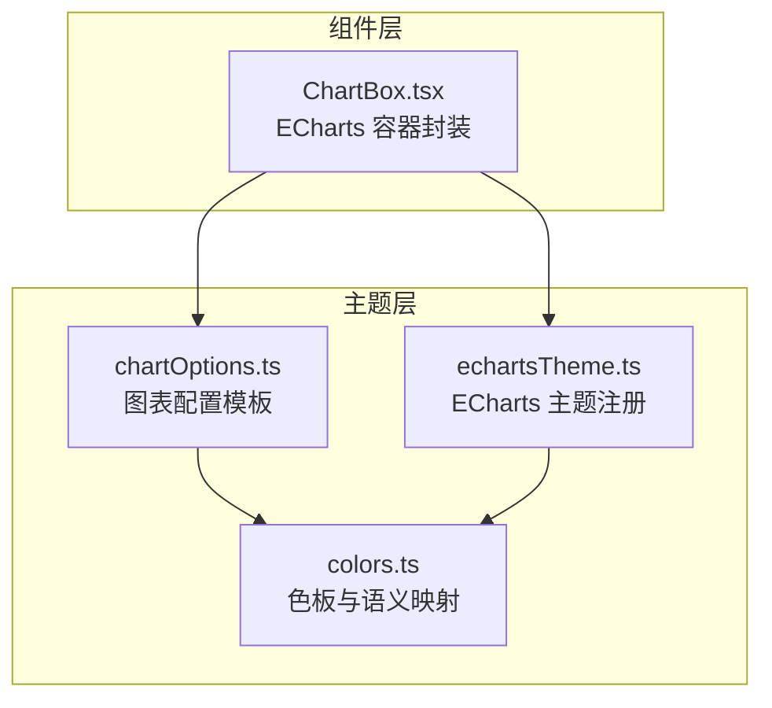
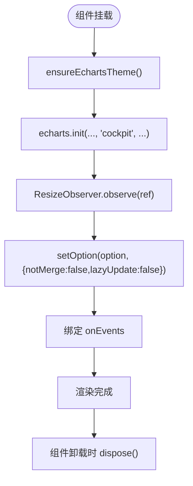
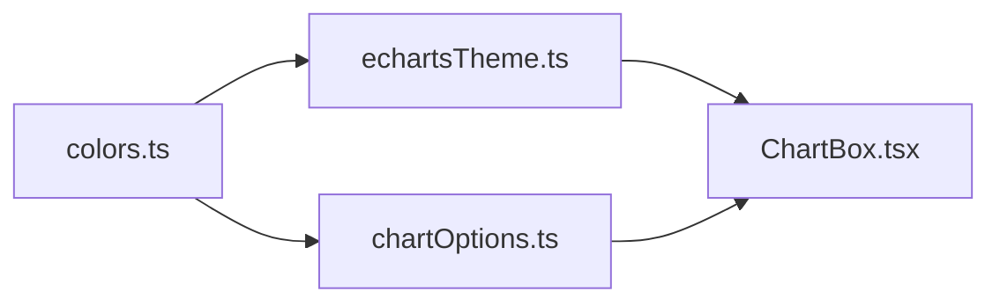

# 图表主题定制

<cite>
**本文引用的文件**   
- [colors.ts](file://src/theme/colors.ts)
- [chartOptions.ts](file://src/theme/chartOptions.ts)
- [echartsTheme.ts](file://src/theme/echartsTheme.ts)
- [ChartBox.tsx](file://src/components/ChartBox.tsx)
</cite>

## 目录
1. [引言](#引言)
2. [项目结构](#项目结构)
3. [核心组件](#核心组件)
4. [架构总览](#架构总览)
5. [详细组件分析](#详细组件分析)
6. [依赖关系分析](#依赖关系分析)
7. [性能与可维护性](#性能与可维护性)
8. [主题定制指南](#主题定制指南)
9. [测试与兼容性策略](#测试与兼容性策略)
10. [故障排查](#故障排查)
11. [结论](#结论)

## 引言
本文件系统化梳理“图表主题定制”体系，围绕颜色主题、语义化映射、动态主题切换、图表配置模板以及 ECharts 主题引擎展开。目标是帮助开发者快速理解并扩展驾驶舱风格的主题系统，实现品牌色适配、多主题支持与运行时更新。

## 项目结构
主题相关代码集中在 theme 目录，图表渲染封装在 components 中：
- src/theme/colors.ts：共享色板与状态语义映射
- src/theme/chartOptions.ts：预定义图表样式与布局规范
- src/theme/echartsTheme.ts：ECharts 主题注册与导出
- src/components/ChartBox.tsx：ECharts 容器封装，负责主题应用、自适应与事件绑定



**图示来源**
- [colors.ts:1-97](file://src/theme/colors.ts#L1-L97)
- [chartOptions.ts:1-319](file://src/theme/chartOptions.ts#L1-L319)
- [echartsTheme.ts:1-72](file://src/theme/echartsTheme.ts#L1-L72)
- [ChartBox.tsx:1-61](file://src/components/ChartBox.tsx#L1-L61)

**章节来源**
- [colors.ts:1-97](file://src/theme/colors.ts#L1-L97)
- [chartOptions.ts:1-319](file://src/theme/chartOptions.ts#L1-L319)
- [echartsTheme.ts:1-72](file://src/theme/echartsTheme.ts#L1-L72)
- [ChartBox.tsx:1-61](file://src/components/ChartBox.tsx#L1-L61)

## 核心组件
- 色彩与语义映射（colors.ts）
  - 提供基础色板 COLORS，以及健康等级、告警等级、任务状态的语义化颜色与标签映射。
  - 提供温度与利用率到颜色的计算函数，用于热力图与指标可视化。
- 图表配置模板（chartOptions.ts）
  - 提供趋势折线、玫瑰饼图、仪表盘、堆叠面积、水平条形、热力图、桑基图、直方图等预定义 EChartsOption 生成器。
  - 内置渐变工具、时间格式化等辅助方法，统一视觉风格。
- ECharts 主题引擎（echartsTheme.ts）
  - 定义 cockpit 主题对象，集中管理全局颜色、文本、网格、坐标轴、提示框等样式。
  - 提供 ensureEchartsTheme 进行一次性主题注册，避免重复注册。
- 图表容器（ChartBox.tsx）
  - 初始化 ECharts 实例时应用 cockpit 主题。
  - 使用 ResizeObserver 实现自适应尺寸。
  - 通过 setOption 增量更新配置，支持动画开关与事件绑定。

**章节来源**
- [colors.ts:1-97](file://src/theme/colors.ts#L1-L97)
- [chartOptions.ts:1-319](file://src/theme/chartOptions.ts#L1-L319)
- [echartsTheme.ts:1-72](file://src/theme/echartsTheme.ts#L1-L72)
- [ChartBox.tsx:1-61](file://src/components/ChartBox.tsx#L1-L61)

## 架构总览
主题系统采用分层设计：
- 数据层：业务类型与状态（HealthLevel、AlertLevel、JobStatus）
- 语义层：将状态映射为颜色与标签
- 视觉层：ECharts 主题对象与图表配置模板
- 运行层：ChartBox 容器负责实例化、主题应用、自适应与事件绑定

```mermaid
sequenceDiagram
participant App as "页面组件"
participant Box as "ChartBox.tsx"
participant Theme as "echartsTheme.ts"
participant E as "ECharts"
participant Opt as "chartOptions.ts"
participant Col as "colors.ts"
App->>Opt : 调用图表配置生成器
Opt->>Col : 读取色板与语义映射
App->>Box : 传入 option 与事件
Box->>Theme : ensureEchartsTheme()
Theme->>E : registerTheme('cockpit')
Box->>E : init(..., 'cockpit', ...)
Box->>E : setOption(option, { notMerge : false, lazyUpdate : false })
E-->>App : 渲染完成
```

**图示来源**
- [ChartBox.tsx:17-49](file://src/components/ChartBox.tsx#L17-L49)
- [echartsTheme.ts:64-69](file://src/theme/echartsTheme.ts#L64-L69)
- [chartOptions.ts:34-70](file://src/theme/chartOptions.ts#L34-L70)
- [colors.ts:6-19](file://src/theme/colors.ts#L6-L19)

## 详细组件分析

### 色彩与语义映射（colors.ts）
- 色板 COLORS
  - 包含主色、强调色、网格线、轴标签、面板背景等基础视觉变量。
- 语义映射
  - HEALTH_COLOR / HEALTH_LABEL：健康等级到颜色与中文标签的映射。
  - LEVEL_COLOR / LEVEL_LABEL：告警等级到颜色与中文标签的映射。
  - JOB_STATUS_COLOR / JOB_STATUS_LABEL：任务状态到颜色与中文标签的映射。
- 数值转颜色
  - tempToColor：根据温度区间插值生成 RGB 颜色，适用于热力图或温度指示。
  - utilToColor：按阈值返回不同颜色，适用于利用率等指标。

复杂度与性能
- 映射表为常量对象，查找复杂度 O(1)。
- tempToColor 线性扫描 stops 数组，最多 5 段，O(k)，k 很小，性能可忽略。

可扩展点
- 新增业务状态可在 colors.ts 追加映射，并在 chartOptions.ts 中使用。

**章节来源**
- [colors.ts:6-19](file://src/theme/colors.ts#L6-L19)
- [colors.ts:21-64](file://src/theme/colors.ts#L21-L64)
- [colors.ts:66-97](file://src/theme/colors.ts#L66-L97)

### 图表配置模板（chartOptions.ts）
- 通用工具
  - areaGradient：生成竖向渐变，用于面积图填充。
  - hexToRgba：十六进制转 RGBA。
  - fmtTime：时间戳转 HH:mm。
- 预定义图表
  - trendLineOption：时序平滑折线/面积图，支持 yMax、单位、平滑度、图例控制。
  - rosePieOption：玫瑰/环形饼图，支持内半径、中心位置、自定义扇区颜色。
  - gaugeOption：半环仪表盘，支持分段 zones、单位、指针与标题。
  - stackedAreaOption：堆叠面积图，适合告警趋势等叠加场景。
  - hBarOption：水平条形图，自动排序，支持单位与最大值。
  - heatmapOption：二维热力图，支持 visualMap 自定义色带。
  - sankeyOption：桑基图，展示能耗流向。
  - histogramOption：直方图分布，支持渐变色条。

设计要点
- 所有模板均返回 EChartsOption，便于组合与覆盖。
- 大量复用 COLORS 与渐变工具，保证视觉一致性。
- 对交互（tooltip、legend、grid）进行统一约束，减少页面级重复配置。

**章节来源**
- [chartOptions.ts:5-32](file://src/theme/chartOptions.ts#L5-L32)
- [chartOptions.ts:34-70](file://src/theme/chartOptions.ts#L34-L70)
- [chartOptions.ts:72-105](file://src/theme/chartOptions.ts#L72-L105)
- [chartOptions.ts:107-155](file://src/theme/chartOptions.ts#L107-L155)
- [chartOptions.ts:157-182](file://src/theme/chartOptions.ts#L157-L182)
- [chartOptions.ts:184-217](file://src/theme/chartOptions.ts#L184-L217)
- [chartOptions.ts:219-264](file://src/theme/chartOptions.ts#L219-L264)
- [chartOptions.ts:266-293](file://src/theme/chartOptions.ts#L266-L293)
- [chartOptions.ts:297-319](file://src/theme/chartOptions.ts#L297-L319)

### ECharts 主题引擎（echartsTheme.ts）
- cockpit 主题对象
  - color：系列默认调色板，基于 COLORS 主色与补充色。
  - backgroundColor：透明背景以适配深色驾驶舱。
  - textStyle/titleText/legend/grid/categoryAxis/valueAxis/tooltip：统一字体、字号、网格线、坐标轴、提示框样式。
- 主题注册
  - ensureEchartsTheme：确保主题仅注册一次，避免重复注册导致性能浪费或冲突。
- 导出
  - 同时导出 echarts 实例，供外部按需使用。

运行时行为
- ChartBox 在初始化前调用 ensureEchartsTheme，随后以 'cockpit' 主题创建实例。
- 后续 setOption 会继承主题样式，局部配置可覆盖主题默认值。

**章节来源**
- [echartsTheme.ts:7-62](file://src/theme/echartsTheme.ts#L7-L62)
- [echartsTheme.ts:64-72](file://src/theme/echartsTheme.ts#L64-L72)

### 图表容器（ChartBox.tsx）
职责
- 主题应用：调用 ensureEchartsTheme 确保 cockpit 主题可用。
- 实例生命周期：init 时指定 'cockpit' 主题，ResizeObserver 监听尺寸变化，dispose 清理资源。
- 配置更新：setOption 合并更新，关闭动画以提升高频刷新性能。
- 事件绑定：onEvents 透传至 ECharts，并在卸载时解绑。

关键流程


**图示来源**
- [ChartBox.tsx:17-49](file://src/components/ChartBox.tsx#L17-L49)

**章节来源**
- [ChartBox.tsx:1-61](file://src/components/ChartBox.tsx#L1-L61)

## 依赖关系分析
- colors.ts 被 chartOptions.ts 与 echartsTheme.ts 引用，作为单一事实源。
- chartOptions.ts 不直接依赖 echartsTheme.ts，保持配置模板与主题解耦。
- ChartBox.tsx 依赖 echartsTheme.ts 以确保主题可用，依赖 chartOptions.ts 获取预定义选项。



**图示来源**
- [colors.ts:1-97](file://src/theme/colors.ts#L1-L97)
- [chartOptions.ts:1-319](file://src/theme/chartOptions.ts#L1-L319)
- [echartsTheme.ts:1-72](file://src/theme/echartsTheme.ts#L1-L72)
- [ChartBox.tsx:1-61](file://src/components/ChartBox.tsx#L1-L61)

**章节来源**
- [colors.ts:1-97](file://src/theme/colors.ts#L1-L97)
- [chartOptions.ts:1-319](file://src/theme/chartOptions.ts#L1-L319)
- [echartsTheme.ts:1-72](file://src/theme/echartsTheme.ts#L1-L72)
- [ChartBox.tsx:1-61](file://src/components/ChartBox.tsx#L1-L61)

## 性能与可维护性
- 主题注册只执行一次，避免重复开销。
- setOption 使用 notMerge:false、lazyUpdate:false，兼顾增量更新与及时渲染。
- 高频场景可通过 noAnimation 禁用动画，降低重绘压力。
- 所有颜色与样式变量集中于 colors.ts 与 echartsTheme.ts，便于统一替换与维护。

[本节为通用建议，无需具体文件引用]

## 主题定制指南

### 自定义颜色方案
步骤
- 在 colors.ts 中扩展 COLORS 或新增语义映射，如新增品牌色、业务状态色。
- 在 echartsTheme.ts 中将新色加入 cockpit 主题的 color 数组，确保系列默认配色一致。
- 在 chartOptions.ts 的图表模板中引用新的颜色变量，保证各图表样式统一。

注意事项
- 保持对比度与可读性，尤其在高密度信息场景中。
- 若新增状态，请同步提供对应的 LABEL 映射，便于国际化与显示。

**章节来源**
- [colors.ts:6-19](file://src/theme/colors.ts#L6-L19)
- [colors.ts:21-64](file://src/theme/colors.ts#L21-L64)
- [echartsTheme.ts:7-17](file://src/theme/echartsTheme.ts#L7-L17)
- [chartOptions.ts:34-70](file://src/theme/chartOptions.ts#L34-L70)

### 品牌色适配
- 将品牌主色替换 COLORS.cyber 或新增 BRAND_PRIMARY 等变量。
- 调整 tooltip、网格线、分割线等辅助色的透明度，确保品牌色突出但不刺眼。
- 在 heatmapOption 的 visualMap.inRange.color 中替换色带，匹配品牌色系。

**章节来源**
- [colors.ts:6-19](file://src/theme/colors.ts#L6-L19)
- [chartOptions.ts:219-264](file://src/theme/chartOptions.ts#L219-L264)
- [echartsTheme.ts:52-61](file://src/theme/echartsTheme.ts#L52-L61)

### 多主题支持
目标
- 支持 cockpit 之外的其他主题（如浅色、高对比度）。

方案
- 在 echartsTheme.ts 中新增主题对象（如 lightTheme），并通过 ensureEchartsTheme 注册。
- 在 ChartBox.tsx 中根据运行时配置选择主题名，例如从 props 或全局 store 读取主题标识。
- 在 chartOptions.ts 中保留对 COLORS 的引用，必要时提供多套色板映射。

风险与建议
- 避免在运行时频繁切换主题，尽量在应用启动阶段确定主题。
- 对每个主题进行回归测试，确保所有图表类型均可正确渲染。

**章节来源**
- [echartsTheme.ts:64-69](file://src/theme/echartsTheme.ts#L64-L69)
- [ChartBox.tsx:17-25](file://src/components/ChartBox.tsx#L17-L25)

### 运行时主题更新
- 当前 ensureEchartsTheme 仅注册主题，未提供运行时切换 API。
- 如需运行时切换，可在 ChartBox.tsx 中根据主题名重新 init 实例，或在主题引擎中增加 switchTheme 方法，内部销毁旧实例后重建。

[本节为概念性说明，无需具体文件引用]

## 测试与兼容性策略

### 单元测试建议
- 颜色映射：验证 HEALTH_COLOR、LEVEL_COLOR、JOB_STATUS_COLOR 的键值对应关系。
- 数值转颜色：断言 tempToColor 与 utilToColor 的边界值与中间值输出符合预期。
- 图表模板：对 trendLineOption、rosePieOption、gaugeOption、heatmapOption 等返回的 EChartsOption 进行快照比对，确保结构稳定。

### 集成测试建议
- ChartBox 渲染：检查 cockpit 主题是否生效，网格线、坐标轴、提示框样式是否符合预期。
- 自适应：模拟容器尺寸变化，确认 resize 触发且图表无溢出或错位。
- 事件：验证 onEvents 回调能正确触发并在卸载后解绑。

### 兼容性保证
- ECharts 版本：确保使用的 EChartsOption 类型与主题字段在当前版本下有效。
- 浏览器差异：canvas 渲染在不同设备上的抗锯齿与阴影效果需做基础兼容测试。
- 主题字段：避免使用已废弃的 ECharts 主题属性，优先使用官方文档推荐字段。

[本节为通用指导，无需具体文件引用]

## 故障排查
常见问题
- 主题未生效
  - 检查是否在 ChartBox 初始化前调用了 ensureEchartsTheme。
  - 确认 init 时传入的主题名为 'cockpit'。
- 颜色不一致
  - 检查 chartOptions.ts 与 echartsTheme.ts 是否都引用了正确的 COLORS。
  - 确认 heatmapOption 的 visualMap.inRange.color 是否与主题色板一致。
- 图表尺寸异常
  - 检查外层 className 是否设置了高度，确保 ResizeObserver 能正确触发 resize。
- 内存泄漏
  - 确认组件卸载时调用了 dispose，避免 ECharts 实例残留。

**章节来源**
- [ChartBox.tsx:17-49](file://src/components/ChartBox.tsx#L17-L49)
- [chartOptions.ts:219-264](file://src/theme/chartOptions.ts#L219-L264)
- [echartsTheme.ts:64-69](file://src/theme/echartsTheme.ts#L64-L69)

## 结论
该主题定制系统通过清晰的层次划分与统一的色板管理，实现了驾驶舱风格的视觉一致性。colors.ts 提供语义化映射，chartOptions.ts 提供可复用的图表模板，echartsTheme.ts 集中管理全局主题，ChartBox.tsx 负责运行时装配。在此基础上，开发者可以便捷地扩展品牌色、新增主题与优化性能，同时通过测试与兼容性策略保障质量与稳定性。