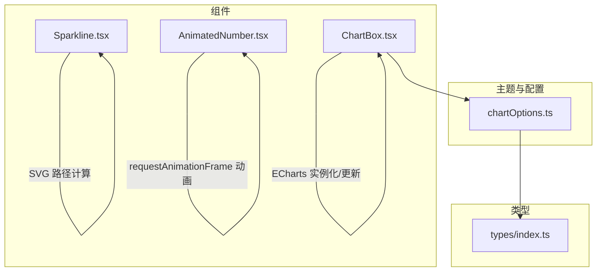
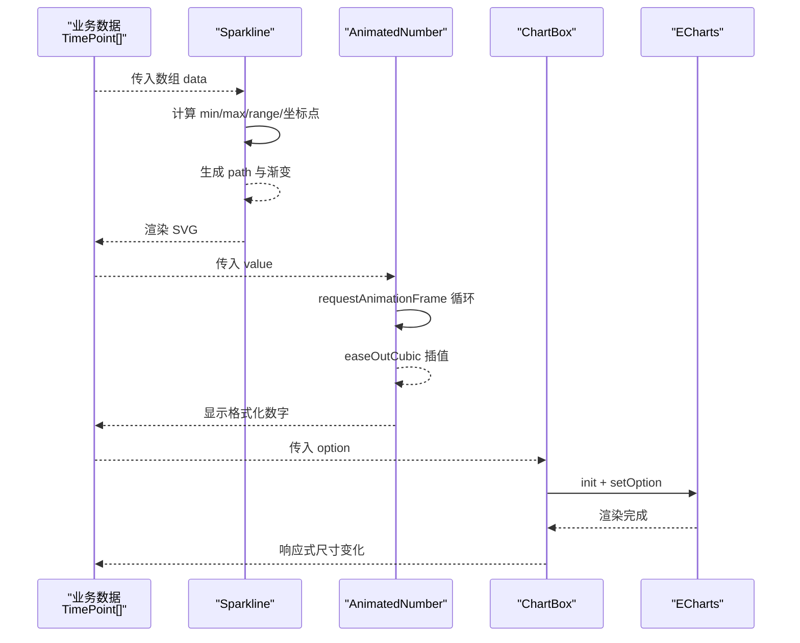
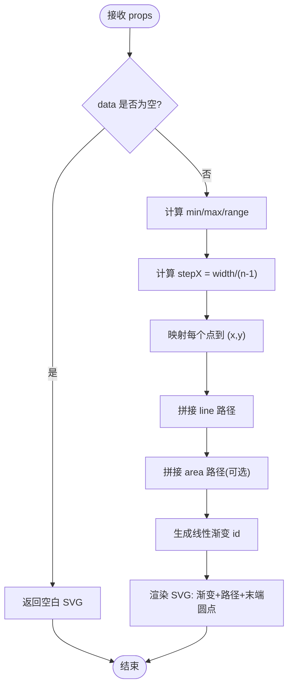
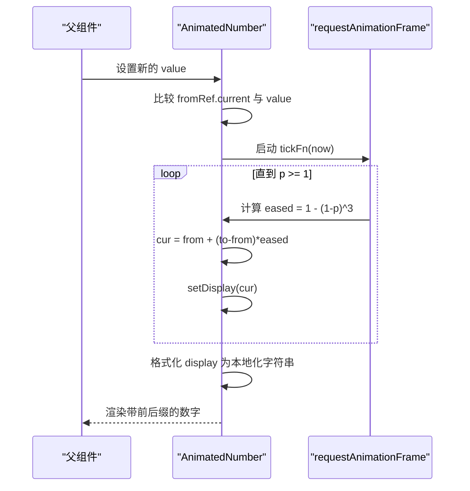
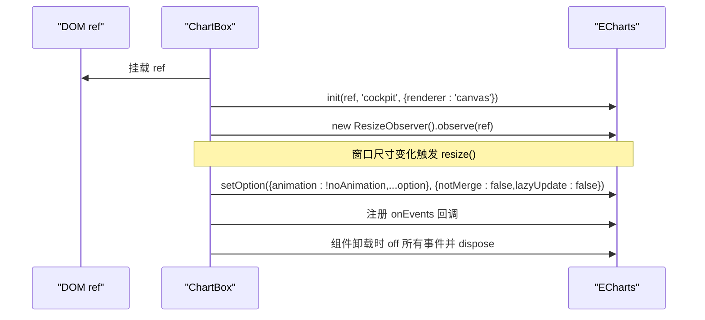
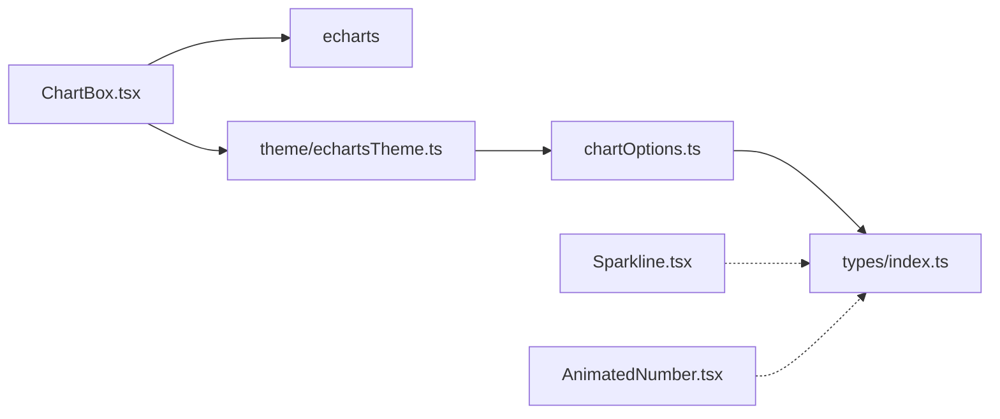

# 图表组件实现

<cite>
**本文引用的文件**   
- [Sparkline.tsx](file://src/components/Sparkline.tsx)
- [AnimatedNumber.tsx](file://src/components/AnimatedNumber.tsx)
- [ChartBox.tsx](file://src/components/ChartBox.tsx)
- [chartOptions.ts](file://src/theme/chartOptions.ts)
- [index.ts](file://src/types/index.ts)
</cite>

## 目录
1. [引言](#引言)
2. [项目结构](#项目结构)
3. [核心组件](#核心组件)
4. [架构总览](#架构总览)
5. [详细组件分析](#详细组件分析)
6. [依赖关系分析](#依赖关系分析)
7. [性能考虑与优化](#性能考虑与优化)
8. [使用示例与集成模式](#使用示例与集成模式)
9. [常见问题排查](#常见问题排查)
10. [结论](#结论)

## 引言
本文聚焦于仓库中的轻量级图表组件实现，重点解析以下两类基础能力：
- Sparkline 迷你折线图：无第三方库依赖的 SVG 内联渲染方案，适合表格、KPI 卡片等小尺寸场景。
- AnimatedNumber 动画数字：基于 requestAnimationFrame 的数字过渡动效，提供缓动函数与格式化输出。

同时补充 ECharts 封装组件 ChartBox 与主题配置 chartOptions，帮助理解在复杂图表场景下的统一渲染与性能控制策略。文档将覆盖组件接口、数据流、渲染流程、性能优化建议以及常见问题的定位方法。

## 项目结构
围绕图表相关代码，主要涉及以下模块：
- 组件层：Sparkline、AnimatedNumber、ChartBox
- 主题与选项：chartOptions（ECharts 配置生成器）
- 类型定义：TimePoint 等通用领域模型

**图示来源**
- [Sparkline.tsx:1-51](file://src/components/Sparkline.tsx#L1-L51)
- [AnimatedNumber.tsx:1-62](file://src/components/AnimatedNumber.tsx#L1-L62)
- [ChartBox.tsx:1-61](file://src/components/ChartBox.tsx#L1-L61)
- [chartOptions.ts:1-319](file://src/theme/chartOptions.ts#L1-L319)
- [index.ts:154-158](file://src/types/index.ts#L154-L158)

**章节来源**
- [Sparkline.tsx:1-51](file://src/components/Sparkline.tsx#L1-L51)
- [AnimatedNumber.tsx:1-62](file://src/components/AnimatedNumber.tsx#L1-L62)
- [ChartBox.tsx:1-61](file://src/components/ChartBox.tsx#L1-L61)
- [chartOptions.ts:1-319](file://src/theme/chartOptions.ts#L1-L319)
- [index.ts:154-158](file://src/types/index.ts#L154-L158)

## 核心组件
本节概述三个关键组件的职责与交互方式：
- Sparkline：纯 SVG 迷你折线/面积图，用于紧凑布局的趋势展示。
- AnimatedNumber：数字滚动动效，支持小数位、前后缀、缓动曲线。
- ChartBox：ECharts 容器封装，负责主题注入、自适应尺寸、增量更新与事件绑定。

**章节来源**
- [Sparkline.tsx:1-51](file://src/components/Sparkline.tsx#L1-L51)
- [AnimatedNumber.tsx:1-62](file://src/components/AnimatedNumber.tsx#L1-L62)
- [ChartBox.tsx:1-61](file://src/components/ChartBox.tsx#L1-L61)

## 架构总览
下图展示了从数据到视图的整体流程：业务数据通过类型约束进入组件；Sparkline 直接渲染 SVG；AnimatedNumber 驱动数值过渡；ChartBox 管理 ECharts 实例并应用主题与配置。

**图示来源**
- [Sparkline.tsx:23-48](file://src/components/Sparkline.tsx#L23-L48)
- [AnimatedNumber.tsx:27-47](file://src/components/AnimatedNumber.tsx#L27-L47)
- [ChartBox.tsx:22-49](file://src/components/ChartBox.tsx#L22-L49)
- [index.ts:154-158](file://src/types/index.ts#L154-L158)

## 详细组件分析

### Sparkline 迷你折线图
Sparkline 是一个轻量级的内联 SVG 组件，适用于表格行、KPI 卡片等空间受限的场景。其核心逻辑包括：
- 输入校验：空数据时返回空白 SVG。
- 数据归一化：计算最小值、最大值与范围，避免除零。
- 坐标映射：根据宽度与数据长度计算步长，将数据点映射为 SVG 路径。
- 视觉增强：可选填充区域与渐变色，末尾绘制圆点强调最新值。

#### Props 接口
- data: number[]（必需）
- width?: number（默认 120）
- height?: number（默认 32）
- color?: string（默认 #22d3ee）
- fill?: boolean（默认 true）
- strokeWidth?: number（默认 1.5）
- className?: string（默认 ''）

#### 渲染流程

**图示来源**
- [Sparkline.tsx:23-48](file://src/components/Sparkline.tsx#L23-L48)

#### 复杂度分析
- 时间复杂度：O(n)，遍历一次数据计算坐标与路径。
- 空间复杂度：O(n)，存储中间坐标点与路径字符串。

#### 性能要点
- 无第三方依赖，避免运行时开销。
- 仅在必要时启用填充区域以减少 DOM 节点数量。
- 使用固定宽高与 preserveAspectRatio="none" 提升布局稳定性。

**章节来源**
- [Sparkline.tsx:1-51](file://src/components/Sparkline.tsx#L1-L51)

### AnimatedNumber 动画数字
AnimatedNumber 通过 requestAnimationFrame 实现平滑的数字过渡，采用 easeOutCubic 缓动函数，使数值变化更自然。

#### Props 接口
- value: number（必需）
- decimals?: number（默认 0）
- duration?: number（默认 600ms）
- className?: string（默认 ''）
- prefix?: string（默认 ''）
- suffix?: string（默认 ''）

#### 动画流程

**图示来源**
- [AnimatedNumber.tsx:27-52](file://src/components/AnimatedNumber.tsx#L27-L52)

#### 性能考量
- 使用 useRef 保存上一次目标值，避免重复计算。
- 使用 requestAnimationFrame 保证与屏幕刷新同步，减少重排。
- 清理定时器：组件卸载或依赖变化时取消动画帧。

**章节来源**
- [AnimatedNumber.tsx:1-62](file://src/components/AnimatedNumber.tsx#L1-L62)

### ChartBox ECharts 封装
ChartBox 是对 ECharts 的统一封装，负责：
- 主题注入：确保 cockpit 主题可用。
- 实例生命周期：初始化、ResizeObserver 监听尺寸变化、销毁。
- 增量更新：setOption 合并更新，避免全量重绘。
- 事件绑定：动态注册/解绑 onEvents。

#### Props 接口
- option: EChartsOption（必需）
- className?: string（默认 ''）
- noAnimation?: boolean（默认 false）
- onEvents?: Record<string, (params: unknown) => void>

#### 生命周期与更新时序

**图示来源**
- [ChartBox.tsx:22-49](file://src/components/ChartBox.tsx#L22-L49)

**章节来源**
- [ChartBox.tsx:1-61](file://src/components/ChartBox.tsx#L1-L61)

### 主题与图表选项生成
chartOptions 提供多种 ECharts 配置生成器，涵盖趋势线、饼图、仪表盘、堆叠面积、水平条形、热力图、桑基图与直方图等。常用工具包括：
- areaGradient：生成竖向渐变对象。
- hexToRgba：十六进制颜色转 RGBA。
- fmtTime：时间戳转 HH:mm。
- trendLineOption：时序趋势折线/面积图。
- rosePieOption：玫瑰/环形饼图。
- gaugeOption：半环仪表盘。
- stackedAreaOption：堆叠面积图。
- hBarOption：水平条形图。
- heatmapOption：热力图。
- sankeyOption：桑基图。
- histogramOption：直方图。

这些函数以结构化方式组合 ECharts 配置，便于在不同页面复用。

**章节来源**
- [chartOptions.ts:1-319](file://src/theme/chartOptions.ts#L1-L319)

## 依赖关系分析
组件之间的依赖关系如下：
- ChartBox 依赖 ECharts 与主题配置（ensureEchartsTheme）。
- chartOptions 依赖 types/index.ts 中的 TimePoint 等类型。
- Sparkline 与 AnimatedNumber 不依赖外部图表库，保持轻量。

**图示来源**
- [ChartBox.tsx:1-61](file://src/components/ChartBox.tsx#L1-L61)
- [chartOptions.ts:1-319](file://src/theme/chartOptions.ts#L1-L319)
- [index.ts:154-158](file://src/types/index.ts#L154-L158)

**章节来源**
- [ChartBox.tsx:1-61](file://src/components/ChartBox.tsx#L1-L61)
- [chartOptions.ts:1-319](file://src/theme/chartOptions.ts#L1-L319)
- [index.ts:154-158](file://src/types/index.ts#L154-L158)

## 性能考虑与优化
- Sparkline
  - 避免不必要的填充区域：fill=false 可减少路径与渐变节点。
  - 数据压缩：对超长序列进行采样（例如每 N 个点取一个），降低 O(n) 路径构建成本。
  - 样式复用：color/strokeWidth 等属性尽量稳定，减少重新计算渐变 ID。
- AnimatedNumber
  - 合理设置 duration：高频更新场景缩短时长，避免频繁重建动画帧。
  - 防抖/节流：在父组件中对 value 变更做节流，减少不必要的动画启动。
  - 本地化格式化：decimals 固定后，可缓存 toLocaleString 结果。
- ChartBox
  - 禁用动画：noAnimation=true 用于高频刷新场景，减少重绘。
  - 增量更新：利用 setOption 的 notMerge/lazyUpdate 参数，避免全量重绘。
  - 尺寸监听：ResizeObserver 仅观察自身容器，避免全局监听带来的开销。
  - 事件解绑：onEvents 在卸载时统一 off，防止内存泄漏。

[本节为通用性能指导，不直接分析具体文件]

## 使用示例与集成模式
以下为典型集成模式与使用建议（不含具体代码内容，仅提供思路与参考路径）：

- 在表格中嵌入 Sparkline
  - 适用场景：指标列的趋势缩略图。
  - 数据准备：将后端时序数据转为 number[]（如最近 N 个点的值）。
  - 配置建议：width=120、height=32、fill=false、strokeWidth=1.5。
  - 参考路径：[Sparkline.tsx:1-51](file://src/components/Sparkline.tsx#L1-L51)

- 在 KPI 卡片中使用 AnimatedNumber
  - 适用场景：CPU/内存/功耗等指标的实时数值展示。
  - 配置建议：duration=600、decimals=1~2、prefix/suffix 添加单位。
  - 参考路径：[AnimatedNumber.tsx:1-62](file://src/components/AnimatedNumber.tsx#L1-L62)

- 在复杂图表中使用 ChartBox
  - 适用场景：趋势图、仪表盘、热力图等需要 ECharts 能力的场景。
  - 配置建议：noAnimation=false（常规）、true（高频刷新）；onEvents 绑定 click/hover 等。
  - 参考路径：[ChartBox.tsx:1-61](file://src/components/ChartBox.tsx#L1-L61)

- 使用 chartOptions 生成 ECharts 配置
  - 适用场景：趋势线、堆叠面积、水平条形、热力图、桑基图等。
  - 配置建议：根据业务选择对应生成器，传入 series/data/options。
  - 参考路径：[chartOptions.ts:1-319](file://src/theme/chartOptions.ts#L1-L319)

- 数据类型对接
  - 时序数据：TimePoint[t,v] 用于趋势图系列。
  - 参考路径：[index.ts:154-158](file://src/types/index.ts#L154-L158)

[本节为概念性说明，不直接分析具体文件]

## 常见问题排查
- Sparkline 显示异常
  - 现象：空数据或单点数据导致路径异常。
  - 排查：检查 data.length 与 range 计算，确保非空且避免除零。
  - 参考路径：[Sparkline.tsx:23-31](file://src/components/Sparkline.tsx#L23-L31)

- AnimatedNumber 卡顿或闪烁
  - 现象：数值频繁更新导致动画抖动。
  - 排查：确认父组件是否对 value 做了节流；检查 duration 是否过短；确保 useEffect 清理了动画帧。
  - 参考路径：[AnimatedNumber.tsx:27-47](file://src/components/AnimatedNumber.tsx#L27-L47)

- ChartBox 尺寸不正确或内存泄漏
  - 现象：图表高度为 0 或组件卸载后仍有监听。
  - 排查：确认外层容器提供高度；检查 ResizeObserver 是否正确 disconnect；确认 onEvents 已 off。
  - 参考路径：[ChartBox.tsx:22-49](file://src/components/ChartBox.tsx#L22-L49)

- ECharts 主题未生效
  - 现象：图表颜色不符合预期。
  - 排查：确保 ensureEchartsTheme 被调用；确认 theme 名称一致。
  - 参考路径：[ChartBox.tsx:17-18](file://src/components/ChartBox.tsx#L17-L18)

**章节来源**
- [Sparkline.tsx:23-31](file://src/components/Sparkline.tsx#L23-L31)
- [AnimatedNumber.tsx:27-47](file://src/components/AnimatedNumber.tsx#L27-L47)
- [ChartBox.tsx:22-49](file://src/components/ChartBox.tsx#L22-L49)

## 结论
本仓库提供了三类图表能力：
- Sparkline：轻量、无依赖、适合紧凑布局的迷你趋势图。
- AnimatedNumber：高性能数字过渡动效，适用于实时指标展示。
- ChartBox：统一的 ECharts 封装，结合 chartOptions 的主题与配置生成器，满足复杂可视化需求。

在实际项目中，建议：
- 优先使用 Sparkline 与 AnimatedNumber 处理轻量场景，降低依赖与渲染成本。
- 对于复杂图表，使用 ChartBox 与 chartOptions 统一管理主题、尺寸与事件。
- 针对高频刷新场景，关闭动画并使用增量更新策略，保障流畅体验。

[本节为总结性内容，不直接分析具体文件]