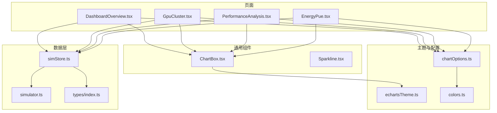
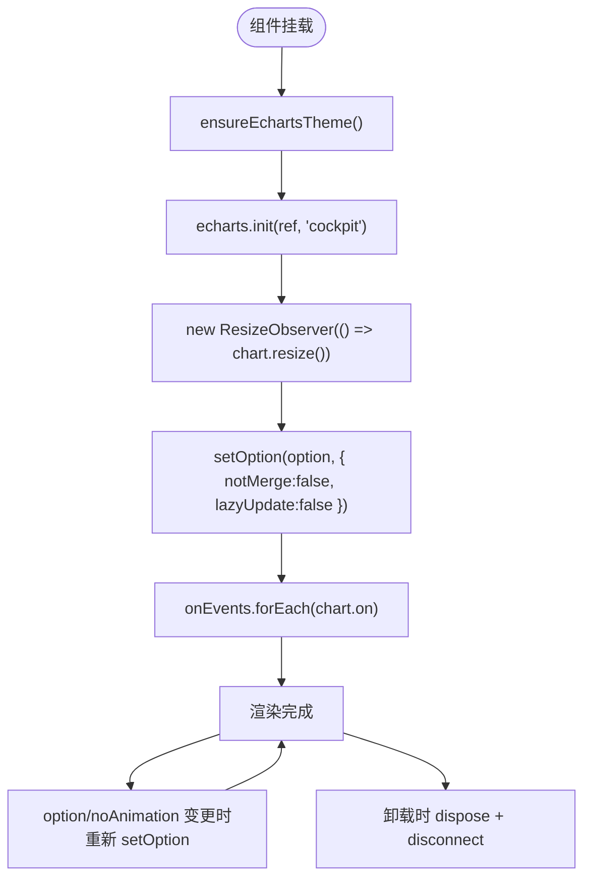
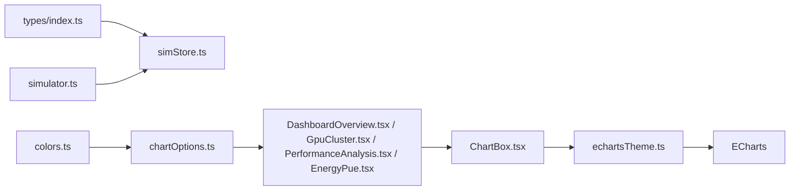

# 数据可视化

<cite>
**本文引用的文件**   
- [chartOptions.ts](file://src/theme/chartOptions.ts)
- [echartsTheme.ts](file://src/theme/echartsTheme.ts)
- [colors.ts](file://src/theme/colors.ts)
- [ChartBox.tsx](file://src/components/ChartBox.tsx)
- [Sparkline.tsx](file://src/components/Sparkline.tsx)
- [DashboardOverview.tsx](file://src/pages/DashboardOverview.tsx)
- [GpuCluster.tsx](file://src/pages/GpuCluster.tsx)
- [PerformanceAnalysis.tsx](file://src/pages/PerformanceAnalysis.tsx)
- [EnergyPue.tsx](file://src/pages/EnergyPue.tsx)
- [simStore.ts](file://src/stores/simStore.ts)
- [simulator.ts](file://src/mock/simulator.ts)
- [index.ts](file://src/types/index.ts)
</cite>

## 目录
1. [引言](#引言)
2. [项目结构](#项目结构)
3. [核心组件](#核心组件)
4. [架构总览](#架构总览)
5. [详细组件分析](#详细组件分析)
6. [依赖关系分析](#依赖关系分析)
7. [性能与大数据优化](#性能与大数据优化)
8. [主题、交互与扩展指南](#主题交互与扩展指南)
9. [故障排查](#故障排查)
10. [结论](#结论)

## 引言
本文件面向 IDC AI 运维平台的数据可视化子系统，聚焦基于 ECharts 的图表实现与组合。系统覆盖实时数据展示、趋势分析、热力图、交互式仪表板等场景，并给出配置选项、数据绑定机制、动画控制、主题定制、响应式适配和多图表组合的技术说明。同时提供性能优化策略、大数据量处理方案与缓存建议，帮助开发者快速扩展图表能力、自定义图形与分析功能。

## 项目结构
可视化相关代码主要分布在以下位置：
- 主题与配置：theme/chartOptions.ts、theme/echartsTheme.ts、theme/colors.ts
- 通用图表容器：components/ChartBox.tsx、components/Sparkline.tsx
- 页面级仪表板与图表组合：pages/DashboardOverview.tsx、pages/GpuCluster.tsx、pages/PerformanceAnalysis.tsx、pages/EnergyPue.tsx
- 仿真数据与状态：stores/simStore.ts、mock/simulator.ts
- 类型定义：types/index.ts



**图示来源**
- [chartOptions.ts:1-319](file://src/theme/chartOptions.ts#L1-L319)
- [echartsTheme.ts:1-72](file://src/theme/echartsTheme.ts#L1-L72)
- [colors.ts:1-97](file://src/theme/colors.ts#L1-L97)
- [ChartBox.tsx:1-61](file://src/components/ChartBox.tsx#L1-L61)
- [Sparkline.tsx:1-51](file://src/components/Sparkline.tsx#L1-L51)
- [DashboardOverview.tsx:1-301](file://src/pages/DashboardOverview.tsx#L1-L301)
- [GpuCluster.tsx:1-287](file://src/pages/GpuCluster.tsx#L1-L287)
- [PerformanceAnalysis.tsx:1-296](file://src/pages/PerformanceAnalysis.tsx#L1-L296)
- [EnergyPue.tsx:1-199](file://src/pages/EnergyPue.tsx#L1-L199)
- [simStore.ts:1-270](file://src/stores/simStore.ts#L1-L270)
- [simulator.ts:1-331](file://src/mock/simulator.ts#L1-L331)
- [index.ts:1-192](file://src/types/index.ts#L1-L192)

**章节来源**
- [chartOptions.ts:1-319](file://src/theme/chartOptions.ts#L1-L319)
- [echartsTheme.ts:1-72](file://src/theme/echartsTheme.ts#L1-L72)
- [colors.ts:1-97](file://src/theme/colors.ts#L1-L97)
- [ChartBox.tsx:1-61](file://src/components/ChartBox.tsx#L1-L61)
- [Sparkline.tsx:1-51](file://src/components/Sparkline.tsx#L1-L51)
- [DashboardOverview.tsx:1-301](file://src/pages/DashboardOverview.tsx#L1-L301)
- [GpuCluster.tsx:1-287](file://src/pages/GpuCluster.tsx#L1-L287)
- [PerformanceAnalysis.tsx:1-296](file://src/pages/PerformanceAnalysis.tsx#L1-L296)
- [EnergyPue.tsx:1-199](file://src/pages/EnergyPue.tsx#L1-L199)
- [simStore.ts:1-270](file://src/stores/simStore.ts#L1-L270)
- [simulator.ts:1-331](file://src/mock/simulator.ts#L1-L331)
- [index.ts:1-192](file://src/types/index.ts#L1-L192)

## 核心组件
- ChartBox：ECharts 封装组件，负责主题注册、实例初始化、ResizeObserver 自适应、增量 setOption、事件绑定与销毁。
- Sparkline：轻量 SVG 迷你折线，用于 KPI 内嵌趋势，无 ECharts 依赖。
- chartOptions：集中提供多种 ECharts 配置生成器（趋势线、玫瑰饼、仪表盘、堆叠面积、水平条形、热力图、桑基图、直方图等）。
- echartsTheme：注册 cockpit 深色主题，统一色彩、字体、网格、tooltip、legend 等全局样式。
- colors：共享色板与状态映射（健康等级、告警等级、任务状态、温度到颜色映射、利用率到颜色映射）。

关键职责与交互：
- 页面通过 useSimStore 订阅实时数据，计算派生指标后调用 chartOptions 生成 option，再传入 ChartBox 渲染。
- ChartBox 内部使用 ensureEchartsTheme 确保主题已注册，init 时指定 cockpit 主题，并使用 ResizeObserver 监听容器尺寸变化触发 resize。
- 高频刷新场景可通过 noAnimation 禁用动画，减少重绘开销。

**章节来源**
- [ChartBox.tsx:1-61](file://src/components/ChartBox.tsx#L1-L61)
- [Sparkline.tsx:1-51](file://src/components/Sparkline.tsx#L1-L51)
- [chartOptions.ts:1-319](file://src/theme/chartOptions.ts#L1-L319)
- [echartsTheme.ts:1-72](file://src/theme/echartsTheme.ts#L1-L72)
- [colors.ts:1-97](file://src/theme/colors.ts#L1-L97)

## 架构总览
数据流从仿真引擎驱动 store 更新，页面订阅 store 数据，转换为 ECharts option，由 ChartBox 渲染。

```mermaid
sequenceDiagram
participant Sim as "simulator.ts"
participant Store as "simStore.ts"
participant Page as "DashboardOverview.tsx / GpuCluster.tsx / PerformanceAnalysis.tsx / EnergyPue.tsx"
participant Theme as "chartOptions.ts / echartsTheme.ts / colors.ts"
participant Box as "ChartBox.tsx"
participant EC as "ECharts"
Sim->>Store : step() 推进节点/机柜/告警/任务/KPI/时序
Store-->>Page : 触发 re-rendernodes, kpi, utilSeries, ...
Page->>Theme : 调用 trendLineOption / heatmapOption / gaugeOption / sankeyOption / histogramOption
Theme-->>Page : 返回 EChartsOption
Page->>Box : 传入 option + className + noAnimation + onEvents
Box->>EC : init(ref, 'cockpit', { renderer : 'canvas' })
Box->>EC : setOption(option, { notMerge : false, lazyUpdate : false })
EC-->>Box : 渲染完成
Box->>EC : on(evt, handler) 绑定交互
```

**图示来源**
- [simulator.ts:1-331](file://src/mock/simulator.ts#L1-L331)
- [simStore.ts:1-270](file://src/stores/simStore.ts#L1-L270)
- [DashboardOverview.tsx:1-301](file://src/pages/DashboardOverview.tsx#L1-L301)
- [GpuCluster.tsx:1-287](file://src/pages/GpuCluster.tsx#L1-L287)
- [PerformanceAnalysis.tsx:1-296](file://src/pages/PerformanceAnalysis.tsx#L1-L296)
- [EnergyPue.tsx:1-199](file://src/pages/EnergyPue.tsx#L1-L199)
- [chartOptions.ts:1-319](file://src/theme/chartOptions.ts#L1-L319)
- [echartsTheme.ts:1-72](file://src/theme/echartsTheme.ts#L1-L72)
- [ChartBox.tsx:1-61](file://src/components/ChartBox.tsx#L1-L61)

## 详细组件分析

### 通用图表容器 ChartBox
职责：
- 确保 cockpit 主题已注册。
- 初始化 ECharts 实例，使用 canvas 渲染。
- 使用 ResizeObserver 监听容器尺寸变化，自动 resize。
- 根据 option 变更进行增量 setOption，支持关闭动画。
- 统一管理事件绑定与解绑。

关键点：
- 主题注册：ensureEchartsTheme() 保证 cockpit 主题可用。
- 自适应：ResizeObserver 监听 ref 容器，避免 h-full 与固定高度冲突导致 0 高。
- 增量更新：setOption 使用 notMerge: false，lazyUpdate: false，适合高频刷新。
- 事件管理：onEvents 对象键为事件名，值为回调；卸载时统一 off。



**图示来源**
- [ChartBox.tsx:1-61](file://src/components/ChartBox.tsx#L1-L61)
- [echartsTheme.ts:1-72](file://src/theme/echartsTheme.ts#L1-L72)

**章节来源**
- [ChartBox.tsx:1-61](file://src/components/ChartBox.tsx#L1-L61)
- [echartsTheme.ts:1-72](file://src/theme/echartsTheme.ts#L1-L72)

### 主题与配色体系
- echartsTheme：注册 cockpit 主题，统一 color、backgroundColor、textStyle、title、legend、grid、categoryAxis、valueAxis、tooltip 等。
- colors：提供 COLORS 基础色板、HEALTH_COLOR、LEVEL_COLOR、JOB_STATUS_COLOR、tempToColor、utilToColor 等映射函数。
- chartOptions：复用 COLORS 与 areaGradient 工具，生成各类图表 option。

主题定制要点：
- 通过 ensureEchartsTheme 一次性注册主题，避免重复注册。
- 所有图表默认使用 cockpit 主题，保证视觉一致性。
- 通过 colors.ts 的映射函数将业务状态映射到颜色，便于统一风格。

**章节来源**
- [echartsTheme.ts:1-72](file://src/theme/echartsTheme.ts#L1-L72)
- [colors.ts:1-97](file://src/theme/colors.ts#L1-L97)
- [chartOptions.ts:1-319](file://src/theme/chartOptions.ts#L1-L319)

### 图表配置生成器 chartOptions
提供的配置生成器包括：
- trendLineOption：平滑面积折线图（时序趋势），支持 yMax、yUnit、smooth、showLegend。
- rosePieOption：玫瑰/环形饼图，支持 roseType、inner、center。
- gaugeOption：半环仪表盘，支持 name、max、color、unit、zones。
- stackedAreaOption：堆叠面积图（告警趋势等）。
- hBarOption：水平条形图（排行），支持 unit、max。
- heatmapOption：热力图（GPU 温度-利用率矩阵），支持 max、unit、visualColors。
- sankeyOption：桑基图（能耗流向）。
- histogramOption：直方图分布。

配置项与数据绑定：
- 时间序列：trendLineOption 接收 TimePoint[]，内部格式化时间为 HH:mm。
- 分类数据：hBarOption、heatmapOption 使用 category 轴或二维数组。
- 数值范围：gaugeOption 支持 zones 分段着色；heatmapOption 支持 visualMap 自定义渐变。

动画与交互：
- 趋势图默认 smooth 曲线，可关闭 showSymbol。
- 热力图启用 progressive 提升大数据渲染性能，emphasis 高亮效果。
- 仪表盘 detail.valueAnimation 开启数值动画。

**章节来源**
- [chartOptions.ts:1-319](file://src/theme/chartOptions.ts#L1-L319)

### 页面级仪表板与图表组合

#### 概览仪表板 DashboardOverview
- 顶部 KPI 条：实时总算力、GPU 在线率、平均利用率、活跃告警、数据中心 PUE、运行任务。
- 左栏：集群健康度仪表盘（gaugeOption）、Top 高负载节点列表。
- 中栏：全域机房 3D 透视（DataCenterScene）、告警滚动播报条。
- 右栏：告警等级分布（rosePieOption）、算力利用率趋势（trendLineOption）、任务队列概览。

数据绑定：
- 使用 useSimStore 订阅 nodes、kpi、alerts、jobs、utilSeries、racks、viewMode。
- 计算 health、top5、alertDist、jobStat 等派生指标。
- 将 utilSeries 切片作为趋势图数据源，Sparkline 显示最近 40 点迷你趋势。

交互：
- 点击“进入大屏”跳转到 3D 视图页。
- 告警滚动条展示最近 12 条告警。

**章节来源**
- [DashboardOverview.tsx:1-301](file://src/pages/DashboardOverview.tsx#L1-L301)

#### GPU 集群监控 GpuCluster
- 筛选栏：机房、型号、状态、搜索框。
- 节点卡片墙：分页展示节点卡片，每张卡片包含 8 个 GPU 小格，显示利用率、温度、功耗。
- 热力图：采样最多 48 个节点 × 8 GPU，支持切换温度/利用率维度，visualColors 自定义。

数据绑定：
- filtered 节点集合用于卡片墙与热力图采样。
- heatMetric 切换 temp/util，动态调整 heatmapOption 的 max、unit、visualColors。

交互：
- FilterChip 切换筛选条件。
- 点击节点打开详情抽屉，展示每卡利用率、显存、温度等指标。

**章节来源**
- [GpuCluster.tsx:1-287](file://src/pages/GpuCluster.tsx#L1-L287)

#### 性能分析 PerformanceAnalysis
- 集群维度：GPU 利用率分布直方图、显存占用分布直方图、MFU 模型算力利用率趋势。
- 网络与存储：RDMA/InfiniBand 吞吐趋势、网络拥塞热点 Top7、存储 IOPS 与时延趋势。
- 训练任务视角：运行中任务列表、选中任务的 Loss/吞吐/Checkpoint 曲线、慢节点检测。

数据绑定：
- utilSeries 派生 MFU、RDMA 吞吐、IOPS、P50/P99 时延。
- nodes 计算 utilHist、memHist 直方图。
- jobs 过滤 runningJobs，selectedJobId 选择当前任务。

交互：
- 点击任务按钮切换 JobCurves 子图。
- 慢节点检测结果展示偏差、指标与建议。

**章节来源**
- [PerformanceAnalysis.tsx:1-296](file://src/pages/PerformanceAnalysis.tsx#L1-L296)

#### 能源与 PUE EnergyPue
- 顶部：实时 PUE 仪表盘、PUE 30 天趋势、能耗桑基图。
- 功率与能耗指标条：总功率、IT 负载功率、制冷功率、日耗电量。
- 下部：机柜功耗 Top10、机柜温度传感热力图、AI 节能优化建议。

数据绑定：
- kpi.pue 驱动仪表盘与趋势图。
- racks 聚合出 inletTemp/outletTemp，构建热力图数据。
- sankeyOption 基于 itPowerKw、totalPowerKw 计算分流。

交互：
- 建议卡片展示节能措施与预期收益。

**章节来源**
- [EnergyPue.tsx:1-199](file://src/pages/EnergyPue.tsx#L1-L199)

### 迷你折线 Sparkline
- 轻量 SVG 实现，无 ECharts 依赖，适合表格/KPI 内嵌趋势。
- 支持 width、height、color、fill、strokeWidth、className。
- 通过线性渐变填充区域，末端圆点突出最新值。

**章节来源**
- [Sparkline.tsx:1-51](file://src/components/Sparkline.tsx#L1-L51)

## 依赖关系分析
- 页面依赖 simStore 获取实时数据，并通过 chartOptions 生成 EChartsOption。
- ChartBox 依赖 echartsTheme 确保主题可用，依赖 ECharts 库进行渲染。
- chartOptions 依赖 colors 提供色板与工具函数。
- simulator 提供纯函数驱动的仿真逻辑，不直接依赖 store，避免循环引用。
- types 定义领域模型，贯穿 store、simulator、页面与图表配置。



**图示来源**
- [index.ts:1-192](file://src/types/index.ts#L1-L192)
- [simStore.ts:1-270](file://src/stores/simStore.ts#L1-L270)
- [simulator.ts:1-331](file://src/mock/simulator.ts#L1-L331)
- [colors.ts:1-97](file://src/theme/colors.ts#L1-L97)
- [chartOptions.ts:1-319](file://src/theme/chartOptions.ts#L1-L319)
- [DashboardOverview.tsx:1-301](file://src/pages/DashboardOverview.tsx#L1-L301)
- [GpuCluster.tsx:1-287](file://src/pages/GpuCluster.tsx#L1-L287)
- [PerformanceAnalysis.tsx:1-296](file://src/pages/PerformanceAnalysis.tsx#L1-L296)
- [EnergyPue.tsx:1-199](file://src/pages/EnergyPue.tsx#L1-L199)
- [ChartBox.tsx:1-61](file://src/components/ChartBox.tsx#L1-L61)
- [echartsTheme.ts:1-72](file://src/theme/echartsTheme.ts#L1-L72)

**章节来源**
- [index.ts:1-192](file://src/types/index.ts#L1-L192)
- [simStore.ts:1-270](file://src/stores/simStore.ts#L1-L270)
- [simulator.ts:1-331](file://src/mock/simulator.ts#L1-L331)
- [colors.ts:1-97](file://src/theme/colors.ts#L1-L97)
- [chartOptions.ts:1-319](file://src/theme/chartOptions.ts#L1-L319)
- [ChartBox.tsx:1-61](file://src/components/ChartBox.tsx#L1-L61)
- [echartsTheme.ts:1-72](file://src/theme/echartsTheme.ts#L1-L72)

## 性能与大数据优化
- 动画控制：ChartBox 支持 noAnimation，在高频刷新场景（如趋势图、热力图）禁用动画以减少重绘。
- 增量更新：setOption 使用 notMerge: false、lazyUpdate: false，结合 ResizeObserver 自适应，避免全量重建。
- 渲染后端：ChartBox 使用 canvas 渲染，适合大量数据与频繁更新。
- 热力图渐进渲染：heatmapOption 设置 progressive 提升大数据渲染性能。
- 数据切片：页面侧对 utilSeries 等时序数据进行 slice(-60)、slice(-40) 限制长度，降低内存与渲染压力。
- 采样策略：GpuCluster 对节点进行采样（最多 48 个节点 × 8 GPU），避免大规模矩阵渲染卡顿。
- 低频聚合：simStore 中对 stepRacks 与 detectSlowNodes 采用周期性更新（每 3 tick、每 5 tick），降低计算开销。
- 最小化重渲染：useMemo 计算派生指标（health、top5、alertDist、jobStat、utilHist、memHist、heat 等），避免每次渲染重复计算。

建议：
- 对超大数据集（>10k 点）考虑分页加载、虚拟滚动、Web Worker 预处理。
- 对高频更新图表，优先使用 noAnimation 与 progressive，必要时降低 series 数量。
- 使用 memo 包裹 ChartBox 与页面组件，减少不必要的重渲染。
- 对复杂 option 生成器进行缓存（例如按维度参数缓存 heatmapOption 结果）。

[本节为通用指导，不直接分析具体文件]

## 主题、交互与扩展指南

### 主题定制
- 通过 ensureEchartsTheme 注册 cockpit 主题，统一 color、backgroundColor、textStyle、title、legend、grid、axis、tooltip。
- 如需新增主题，可在 echartsTheme.ts 中扩展 registerTheme，并在 ChartBox 中切换主题名称。
- 使用 colors.ts 的映射函数（HEALTH_COLOR、LEVEL_COLOR、utilToColor、tempToColor）保持业务状态与颜色一致。

### 响应式适配
- ChartBox 使用 ResizeObserver 监听容器尺寸变化，自动调用 chart.resize。
- 外层容器通过 className 控制高度（如 h-[132px]、h-[90px]），内层绝对定位铺满，避免高度冲突。

### 用户交互处理
- ChartBox 支持 onEvents 对象，键为事件名（如 click、mouseover、legendselectchanged），值为回调函数。
- 页面侧可根据业务需求绑定事件，例如点击热力图单元格跳转详情、点击趋势图切换时间窗口。
- 建议在 useEffect 清理阶段统一 off 事件，避免内存泄漏。

### 多图表组合
- 同一页面可组合多个 ChartBox，分别承载仪表盘、趋势图、热力图、桑基图、直方图等。
- 通过 Panel 组件组织布局，配合 Grid/Flex 布局实现三栏或多栏仪表板。
- 使用 useMemo 计算各图表所需数据，避免重复计算。

### 图表扩展与自定义图形
- 新增图表类型：在 chartOptions.ts 中添加新的 Option 生成器（如 funnel、treemap、scatter3d），遵循现有命名与参数约定。
- 自定义图形：利用 ECharts 的 graphic 组件或自定义系列（series.type 扩展）绘制特殊图形。
- 数据分析功能：在页面侧对原始数据进行统计（分箱、排序、聚合），再传入 chartOptions 生成对应图表。

**章节来源**
- [echartsTheme.ts:1-72](file://src/theme/echartsTheme.ts#L1-L72)
- [colors.ts:1-97](file://src/theme/colors.ts#L1-L97)
- [ChartBox.tsx:1-61](file://src/components/ChartBox.tsx#L1-L61)
- [chartOptions.ts:1-319](file://src/theme/chartOptions.ts#L1-L319)

## 故障排查
常见问题与解决思路：
- 图表尺寸为 0：检查外层容器是否提供有效高度，ChartBox 内层使用绝对定位铺满，避免 h-full 与固定高度同元素冲突。
- 主题未生效：确认 ensureEchartsTheme 已调用，且 init 时指定了 'cockpit' 主题。
- 高频刷新卡顿：启用 noAnimation，减少 series 数量，使用 progressive 与数据切片。
- 事件未触发：检查 onEvents 是否正确传入，是否在卸载时统一 off。
- 热力图渲染缓慢：减少数据点数量，使用采样策略，调整 visualMap 与 itemStyle。
- 主题颜色不一致：统一使用 colors.ts 的映射函数，避免硬编码颜色。

**章节来源**
- [ChartBox.tsx:1-61](file://src/components/ChartBox.tsx#L1-L61)
- [chartOptions.ts:1-319](file://src/theme/chartOptions.ts#L1-L319)
- [colors.ts:1-97](file://src/theme/colors.ts#L1-L97)

## 结论
本数据可视化系统以 ChartBox 为核心容器，结合 chartOptions 的配置生成器与 echartsTheme/colors 的主题体系，构建了覆盖实时数据、趋势分析、热力图与交互式仪表板的完整能力。通过仿真引擎驱动 store 更新，页面侧按需计算派生指标并绑定图表，实现了高性能、可扩展、易维护的可视化方案。开发者可在此基础上继续扩展图表类型、自定义图形与数据分析功能，并结合性能优化策略应对大数据量与高频刷新场景。