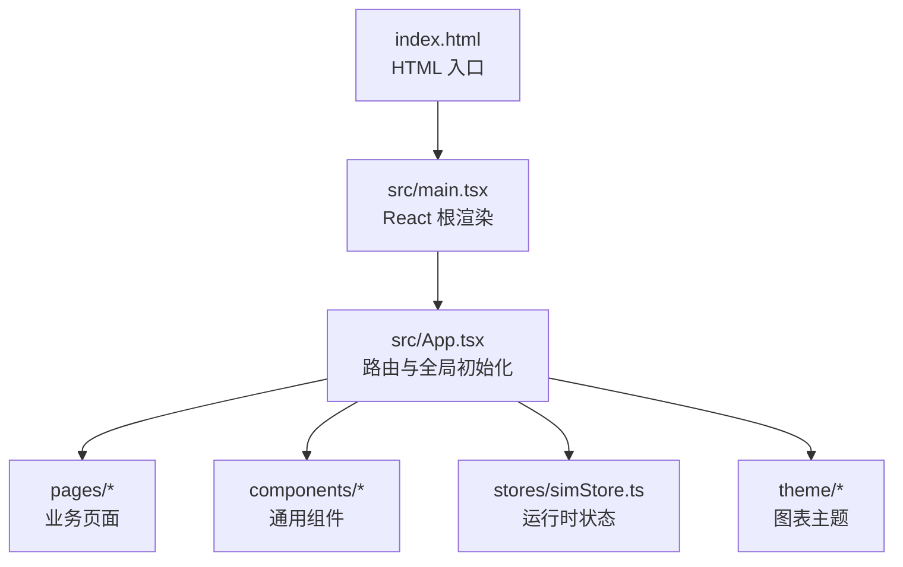
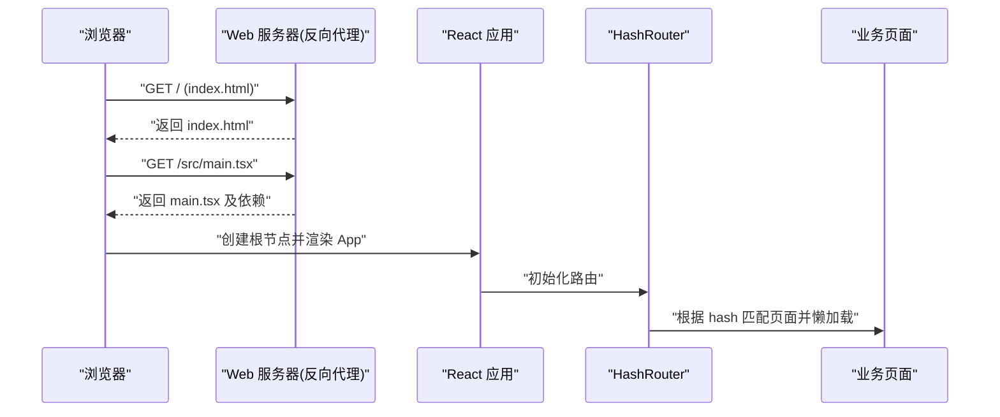
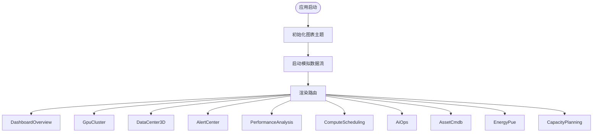
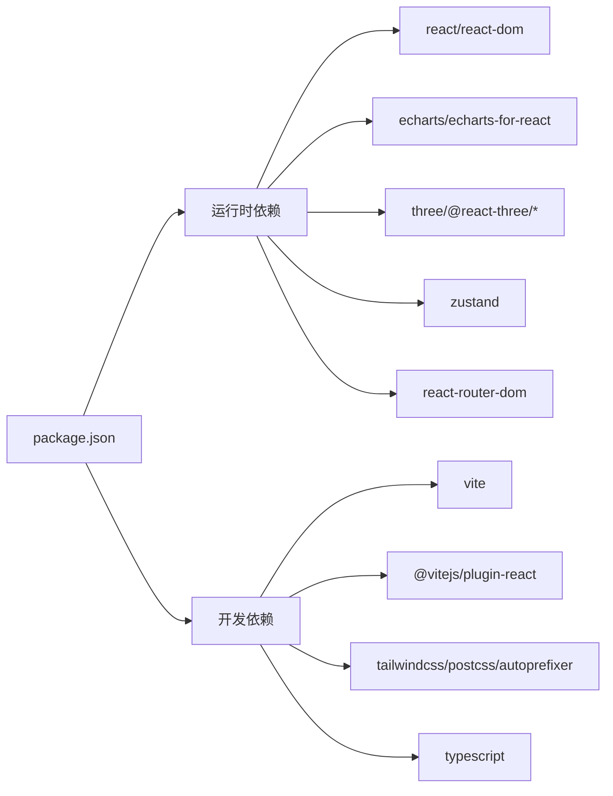

# 构建与部署

<cite>
**本文引用的文件**   
- [package.json](file://package.json)
- [vite.config.ts](file://vite.config.ts)
- [index.html](file://index.html)
- [src/main.tsx](file://src/main.tsx)
- [src/App.tsx](file://src/App.tsx)
- [tsconfig.app.json](file://tsconfig.app.json)
- [tsconfig.node.json](file://tsconfig.node.json)
</cite>

## 目录
1. [简介](#简介)
2. [项目结构](#项目结构)
3. [核心组件](#核心组件)
4. [架构总览](#架构总览)
5. [详细组件分析](#详细组件分析)
6. [依赖关系分析](#依赖关系分析)
7. [性能优化建议](#性能优化建议)
8. [环境变量与多环境策略](#环境变量与多环境策略)
9. [容器化与CI/CD](#容器化与cicd)
10. [生产部署指南](#生产部署指南)
11. [监控、错误追踪与排障](#监控错误追踪与排障)
12. [结论](#结论)

## 简介
本文件为 IDC AI 运维平台的构建与部署文档，聚焦生产环境的构建配置、资源优化策略与部署流程。内容涵盖 Vite 构建优化选项、代码分割与懒加载、资源压缩、环境变量管理、配置文件组织、多环境部署策略、Docker 容器化、CI/CD 流水线以及云平台部署要点，并提供性能监控、错误追踪和生产环境故障排除方法，帮助运维团队完成端到端的交付与维护。

## 项目结构
本项目采用基于功能模块的前端工程结构：
- 入口与路由：应用入口在 index.html 中挂载根节点，main.tsx 初始化 React 应用，App.tsx 使用 react-router-dom 的 HashRouter 定义页面路由。
- 页面与组件：pages 下按业务域划分页面（如 GPU 集群、数据中心 3D、告警中心、能效等），components 提供通用 UI 与布局。
- 状态与主题：stores 使用 zustand 维护模拟数据与运行时状态；theme 提供图表主题与颜色。
- 构建与类型：vite.config.ts 配置开发服务器与插件；tsconfig.* 分别约束应用与 Node 侧编译目标与模块解析。

**图示来源**
- [index.html:1-14](file://index.html#L1-L14)
- [src/main.tsx:1-11](file://src/main.tsx#L1-L11)
- [src/App.tsx:1-47](file://src/App.tsx#L1-L47)

**章节来源**
- [index.html:1-14](file://index.html#L1-L14)
- [src/main.tsx:1-11](file://src/main.tsx#L1-L11)
- [src/App.tsx:1-47](file://src/App.tsx#L1-L47)

## 核心组件
- 构建脚本与依赖：package.json 定义了 dev/build/preview 脚本，依赖 Vite、@vitejs/plugin-react、TailwindCSS、ECharts、Three.js 生态与 Zustand 等。
- 开发服务器：vite.config.ts 启用 React 插件并配置开发端口与 host。
- 类型系统：tsconfig.app.json 将应用目标设为 ES2020，严格模式开启；tsconfig.node.json 针对 Node 侧工具链设置更高目标版本。

关键职责与影响：
- package.json 的 build 脚本先执行 tsc -b 进行类型检查与增量构建，再调用 vite build 产出静态资源。
- vite.config.ts 当前仅启用 React 插件与基础开发服务器配置，未显式配置构建优化项，后续可在生产构建时按需扩展。
- tsconfig 的 strict 与 noUnused* 规则有助于在生产构建前发现潜在问题，降低线上风险。

**章节来源**
- [package.json:1-38](file://package.json#L1-L38)
- [vite.config.ts:1-11](file://vite.config.ts#L1-L11)
- [tsconfig.app.json:1-22](file://tsconfig.app.json#L1-L22)
- [tsconfig.node.json:1-19](file://tsconfig.node.json#L1-L19)

## 架构总览
下图展示从浏览器到前端应用的请求与渲染路径，以及与构建产物的关系。

**图示来源**
- [index.html:1-14](file://index.html#L1-L14)
- [src/main.tsx:1-11](file://src/main.tsx#L1-L11)
- [src/App.tsx:1-47](file://src/App.tsx#L1-L47)

## 详细组件分析

### 构建系统与脚本
- 构建命令：build 脚本组合 TypeScript 类型检查与 Vite 打包。
- 预览命令：preview 用于本地预览构建产物。
- 开发命令：dev 启动 Vite 开发服务器。

构建阶段关键点：
- 类型检查先行，确保生产包不包含类型错误。
- Vite 默认对 JS/CSS 进行 Tree-shaking 与压缩，但当前 vite.config.ts 未显式配置压缩器与分包策略，可结合后续“性能优化建议”进行增强。

**章节来源**
- [package.json:6-10](file://package.json#L6-L10)

### 应用入口与路由
- main.tsx 负责创建 React 根节点并挂载 App。
- App.tsx 使用 HashRouter 定义多个业务路由，并在 useEffect 中初始化图表主题与模拟数据生命周期。

路由与懒加载现状：
- 当前路由导入均为同步 import，未使用动态 import() 实现页面级懒加载。
- 可通过将大体积页面改为动态导入，减少首屏体积与提升加载速度。

**图示来源**
- [src/main.tsx:1-11](file://src/main.tsx#L1-L11)
- [src/App.tsx:1-47](file://src/App.tsx#L1-L47)

**章节来源**
- [src/main.tsx:1-11](file://src/main.tsx#L1-L11)
- [src/App.tsx:1-47](file://src/App.tsx#L1-L47)

### 类型与编译配置
- tsconfig.app.json：目标 ES2020，启用严格模式、isolatedModules、noEmit（由 Vite 处理打包）。
- tsconfig.node.json：Node 侧工具链目标 ES2022/ES2023，便于使用较新的语言特性。

这些配置对构建的影响：
- 严格模式有助于提前发现潜在运行时问题。
- isolatedModules 与 moduleDetection 强制模块边界，利于并行构建与 Tree-shaking。

**章节来源**
- [tsconfig.app.json:1-22](file://tsconfig.app.json#L1-L22)
- [tsconfig.node.json:1-19](file://tsconfig.node.json#L1-L19)

## 依赖关系分析
- 运行时依赖：react/react-dom、echarts/echarts-for-react、three/@react-three/*、zustand、react-router-dom。
- 开发依赖：vite、@vitejs/plugin-react、tailwindcss、postcss/autoprefixer、typescript。

依赖耦合与优化点：
- 3D 与图表库体积较大，建议在路由层进行懒加载，避免首屏阻塞。
- TailwindCSS 通过 PostCSS 处理，可按需裁剪样式以减少 CSS 体积。

**图示来源**
- [package.json:11-33](file://package.json#L11-L33)

**章节来源**
- [package.json:11-33](file://package.json#L11-L33)

## 性能优化建议
以下为面向生产环境的构建与运行期优化建议，结合当前仓库现状给出落地步骤与预期收益：

- 代码分割与懒加载
  - 将 pages 下的重页面改为动态 import()，仅在路由命中时加载，显著降低首屏体积。
  - 对大型第三方库（如 three、echarts）也建议按需引入或延迟加载。

- 资源压缩与缓存
  - 在 vite.config.ts 中启用 JS/CSS 压缩（例如 Terser 与 CSSNano），并开启 Brotli/Gzip 输出以适配 CDN 与反向代理。
  - 利用 Vite 的哈希文件名与长期缓存策略，配合 CDN 缓存头提升重复访问性能。

- 构建速度与并行性
  - 保持 tsconfig 的 isolatedModules 与 noEmit，充分利用 Vite/esbuild 的并行构建能力。
  - 在 CI 中缓存 node_modules 与 Vite 缓存目录，缩短二次构建时间。

- 样式优化
  - 使用 Tailwind 的 Purge/Content 配置剔除未使用样式，减小 CSS 体积。
  - 合并与压缩 CSS，必要时拆分首屏与非首屏样式。

- 运行时优化
  - 对高频更新的数据视图（如仪表盘、GPU 集群）采用增量更新与虚拟化列表，降低渲染压力。
  - 对 3D 场景使用 LOD、纹理压缩与按需加载模型。

[本节为通用优化指导，不直接分析具体文件]

## 环境变量与多环境策略
当前仓库未发现 .env 文件或 process.env/import.meta.env 的使用。建议如下：

- 变量命名规范
  - 使用 Vite 支持的环境变量前缀（如 VITE_）暴露给客户端。
  - 区分 API 地址、功能开关、埋点与日志级别等维度。

- 文件组织
  - 在仓库根目录放置 .env.development、.env.production、.env.staging 等环境文件。
  - 在 CI 中注入敏感信息（如密钥），避免提交至仓库。

- 多环境部署
  - 通过构建参数指定环境（如 --mode production/staging），Vite 会加载对应 .env.* 文件。
  - 在应用启动时读取环境变量，动态配置后端接口与功能开关。

- 安全与审计
  - 禁止在客户端暴露敏感信息（如数据库凭证）。
  - 对变更进行审计与回滚预案。

[本节为通用策略指导，不直接分析具体文件]

## 容器化与CI/CD
- Docker 镜像建议
  - 使用多阶段构建：第一阶段安装依赖并构建静态资源；第二阶段使用轻量 Nginx 镜像托管 dist 产物。
  - 非 root 用户运行，最小化攻击面。
  - 明确 Node 与 Nginx 版本，锁定依赖版本以保证可重现构建。

- CI/CD 流水线建议
  - 触发条件：push/PR 到主分支触发构建与测试，tag 触发发布。
  - 步骤：依赖缓存 -> 类型检查 -> 单元测试 -> 构建产物 -> 镜像构建 -> 推送镜像 -> 部署到预发/生产。
  - 制品归档：保留构建产物与镜像标签，便于回滚与审计。

- 云平台部署
  - 容器编排：Kubernetes 推荐 Deployment + Service + Ingress，配置健康检查与自动扩缩容。
  - 静态站点托管：可使用对象存储 + CDN，配置缓存与回源策略。
  - 灰度与蓝绿：通过流量切换实现零停机发布。

[本节为通用实践指导，不直接分析具体文件]

## 生产部署指南
- 前置准备
  - 确认 Node 版本满足 Vite 要求（参考依赖声明）。
  - 准备域名、SSL 证书与反向代理（Nginx/Traefik/云厂商网关）。

- 构建与产物
  - 执行构建脚本生成 dist 目录。
  - 校验产物完整性（文件大小、关键资源是否齐全）。

- 部署步骤
  - 将 dist 上传至 Web 服务器或对象存储。
  - 配置反向代理指向静态资源，开启压缩与缓存头。
  - 验证路由（Hash 模式）与所有页面可访问。

- 发布与回滚
  - 发布前进行冒烟测试与关键指标观测。
  - 保留上一版本产物与镜像，快速回滚。

[本节为通用部署指导，不直接分析具体文件]

## 监控、错误追踪与排障
- 性能监控
  - 接入前端性能 SDK，采集 LCP、FCP、CLS、TBT 等指标。
  - 对关键页面与接口添加自定义埋点，观察慢请求与异常。

- 错误追踪
  - 集成错误上报服务，捕获未处理异常与 Promise 拒绝。
  - 关联用户会话、设备信息与堆栈映射，加速定位。

- 常见排障清单
  - 404 路由：确认 HashRouter 与反向代理重写规则。
  - 资源 404：检查构建产物路径与 CDN 缓存。
  - 跨域问题：核对后端 CORS 与代理配置。
  - 内存泄漏：排查定时器、事件监听与 3D 场景销毁逻辑。
  - 图表渲染异常：检查主题初始化与数据格式。

[本节为通用排障指导，不直接分析具体文件]

## 结论
本项目已具备清晰的 React + Vite 前端工程结构与路由组织。为实现生产级的高可用与高性能，建议在 vite.config.ts 中完善构建优化（压缩、分包、缓存）、在路由层实施懒加载、建立环境变量与多环境策略，并通过容器化与 CI/CD 实现自动化构建与部署。同时，结合性能监控与错误追踪体系，形成闭环的生产运维保障。