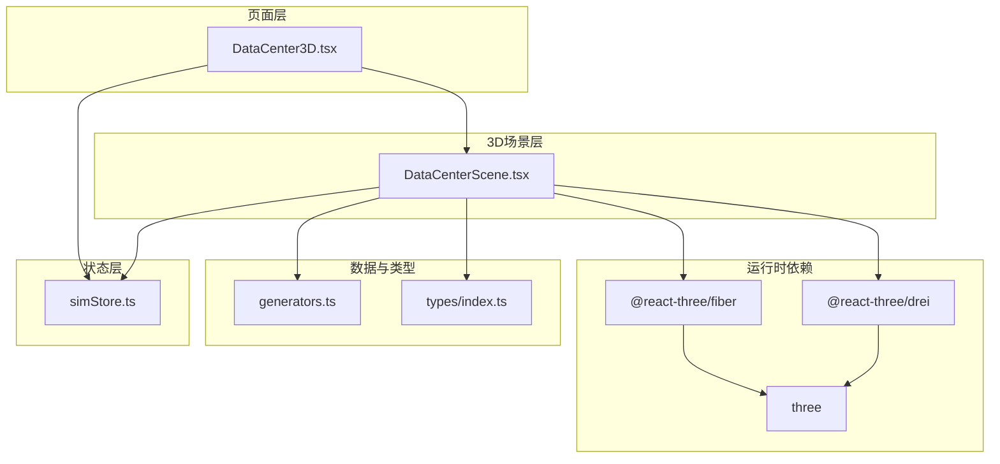
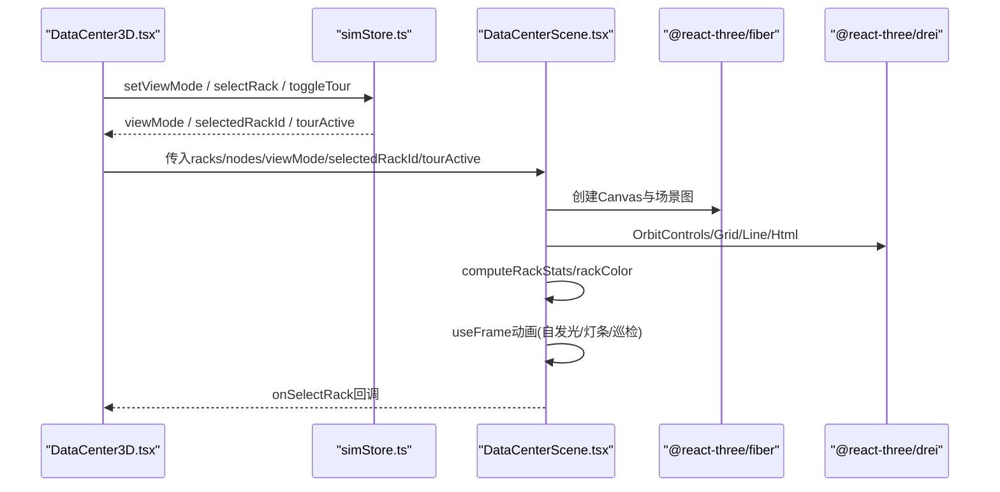
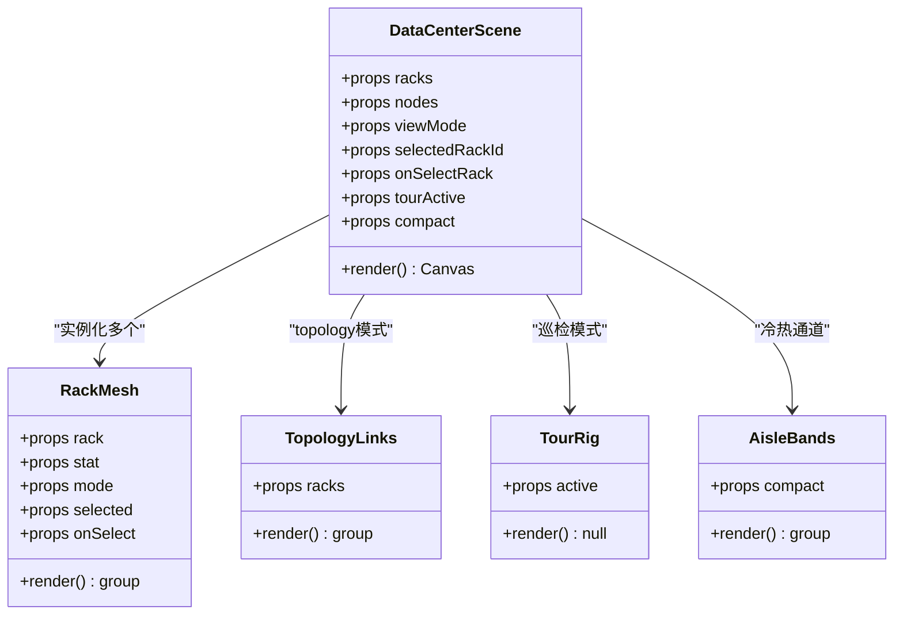
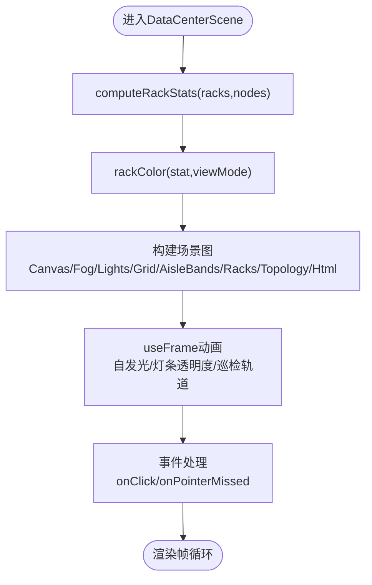
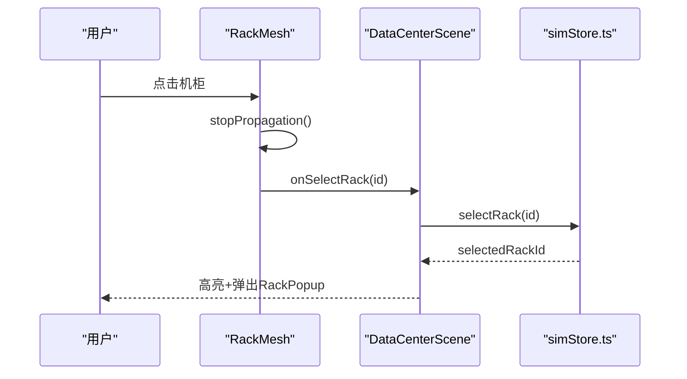
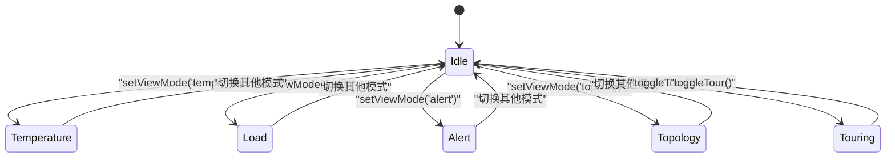
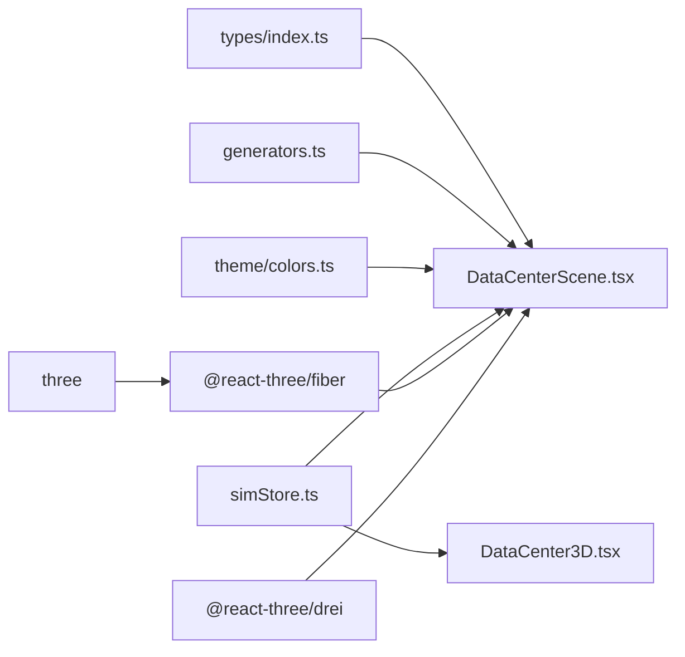

# 3D渲染架构

<cite>
**本文引用的文件**   
- [DataCenterScene.tsx](file://src/components/scene/DataCenterScene.tsx)
- [DataCenter3D.tsx](file://src/pages/DataCenter3D.tsx)
- [package.json](file://package.json)
- [generators.ts](file://src/mock/generators.ts)
- [simStore.ts](file://src/stores/simStore.ts)
- [index.ts](file://src/types/index.ts)
</cite>

## 目录
1. [引言](#引言)
2. [项目结构](#项目结构)
3. [核心组件](#核心组件)
4. [架构总览](#架构总览)
5. [详细组件分析](#详细组件分析)
6. [依赖关系分析](#依赖关系分析)
7. [性能与优化策略](#性能与优化策略)
8. [故障排查指南](#故障排查指南)
9. [结论](#结论)

## 引言
本文件面向IDC AI运维平台的3D可视化子系统，系统性阐述Three.js与@react-three/fiber的集成方案、场景图构建方式与渲染管线优化。重点解析DataCenterScene组件的设计模式，包括机柜模型组合、材质配置、光照设置、交互式相机控制、对象选择与事件处理，以及多视图模式切换、自动巡检和性能优化策略。文档同时提供3D场景架构图与交互流程图，帮助读者快速理解核心技术实现路径。

## 项目结构
本项目采用React + TypeScript前端工程，3D能力由Three.js与@react-three/fiber/@react-three/drei提供；状态与模拟数据通过Zustand store驱动。关键目录与职责如下：
- src/components/scene/DataCenterScene.tsx：3D机房场景主组件，封装Canvas、光照、网格、机柜Mesh、拓扑连线、巡检动画与交互。
- src/pages/DataCenter3D.tsx：页面级容器，负责视图模式切换、统计面板、图例与操作提示，并将store数据注入3D场景。
- src/stores/simStore.ts：全局状态管理，维护机房拓扑、节点指标、告警、任务、KPI与时序数据，并提供视图模式、选中机柜、自动巡检等UI动作。
- src/mock/generators.ts：确定性伪随机数生成器与机房拓扑、资产、任务、预测等静态数据生成逻辑，提供机柜布局常量与世界坐标计算函数。
- src/types/index.ts：领域模型类型定义，包含GPU节点、机柜、机房、告警、任务、KPI、时序、视图模式等。
- package.json：声明Three.js、@react-three/fiber、@react-three/drei等运行时依赖。

**图表来源**
- [DataCenter3D.tsx:1-159](file://src/pages/DataCenter3D.tsx#L1-L159)
- [DataCenterScene.tsx:1-401](file://src/components/scene/DataCenterScene.tsx#L1-L401)
- [simStore.ts:1-270](file://src/stores/simStore.ts#L1-L270)
- [generators.ts:1-408](file://src/mock/generators.ts#L1-L408)
- [index.ts:1-192](file://src/types/index.ts#L1-L192)
- [package.json:11-21](file://package.json#L11-L21)

**章节来源**
- [DataCenter3D.tsx:1-159](file://src/pages/DataCenter3D.tsx#L1-L159)
- [DataCenterScene.tsx:1-401](file://src/components/scene/DataCenterScene.tsx#L1-L401)
- [simStore.ts:1-270](file://src/stores/simStore.ts#L1-L270)
- [generators.ts:1-408](file://src/mock/generators.ts#L1-L408)
- [index.ts:1-192](file://src/types/index.ts#L1-L192)
- [package.json:11-21](file://package.json#L11-L21)

## 核心组件
- DataCenterScene：基于@react-three/fiber的Canvas容器，组织场景图（光照、网格、冷热通道色带、机柜阵列、拓扑连线、Html浮层、OrbitControls、TourRig）。按viewMode动态着色，支持点击选择与巡检漫游。
- RackMesh：单个机柜的3D组合体，包含主体Box、顶部灯条、正面发光面、可选描边框与告警球，使用useFrame进行自发光强度与灯条透明度动画。
- TopologyLinks：在topology模式下绘制InfiniBand骨干拓扑连线，将每排机柜串联并汇聚到机房核心点。
- TourRig：相机自动巡检轨道，周期性更新相机位置与lookAt目标。
- AisleBands：地面冷热通道色带，区分冷/热通道区域。
- RackPopup：HTML浮层展示选中机柜的利用率、温度、功耗、节点数、进出风温度与告警摘要。

**章节来源**
- [DataCenterScene.tsx:1-401](file://src/components/scene/DataCenterScene.tsx#L1-L401)

## 架构总览
下图展示从页面到3D场景的数据流与控制流：页面层订阅store状态，触发视图模式切换与自动巡检；store驱动节点与机柜指标更新；3D场景根据viewMode与选中项实时渲染。

**图表来源**
- [DataCenter3D.tsx:15-95](file://src/pages/DataCenter3D.tsx#L15-L95)
- [simStore.ts:142-265](file://src/stores/simStore.ts#L142-L265)
- [DataCenterScene.tsx:25-61](file://src/components/scene/DataCenterScene.tsx#L25-L61)
- [DataCenterScene.tsx:218-326](file://src/components/scene/DataCenterScene.tsx#L218-L326)

## 详细组件分析

### DataCenterScene组件设计模式
- 数据聚合与着色：computeRackStats将节点指标聚合为机柜维度统计，rackColor根据viewMode返回颜色（温度、负载、告警、拓扑），用于材质emissive与灯条颜色。
- 场景图组织：Canvas内包含环境光、方向光、点光源、Grid地面网格、AisleBands冷热通道色带、机柜组group、TopologyLinks拓扑连线、Html标识与浮层、TourRig巡检、OrbitControls相机控制。
- 交互机制：每个RackMesh绑定onClick，阻止冒泡并调用onSelectRack；Canvas onPointerMissed清空选中项。
- 多视图模式：viewMode控制材质颜色、是否显示拓扑连线、标签与图例。
- 紧凑模式：compact参数调整dpr、相机FOV、网格fadeDistance、OrbitControls行为（禁用平移、启用自动旋转）与标签显示。

**图表来源**
- [DataCenterScene.tsx:63-143](file://src/components/scene/DataCenterScene.tsx#L63-L143)
- [DataCenterScene.tsx:159-205](file://src/components/scene/DataCenterScene.tsx#L159-L205)
- [DataCenterScene.tsx:145-157](file://src/components/scene/DataCenterScene.tsx#L145-L157)
- [DataCenterScene.tsx:328-353](file://src/components/scene/DataCenterScene.tsx#L328-L353)
- [DataCenterScene.tsx:218-326](file://src/components/scene/DataCenterScene.tsx#L218-L326)

**章节来源**
- [DataCenterScene.tsx:25-61](file://src/components/scene/DataCenterScene.tsx#L25-L61)
- [DataCenterScene.tsx:218-326](file://src/components/scene/DataCenterScene.tsx#L218-L326)

### 3D模型加载、材质配置与光照设置
- 模型加载：当前场景以程序化几何体为主（BoxGeometry、PlaneGeometry、SphereGeometry、EdgesGeometry），未引入外部GLTF/GLB模型加载流程。若需扩展，可在RackMesh中替换为GLTFLoader加载真实机柜模型，并结合useGLTF缓存资源。
- 材质配置：
  - 主体材质：meshStandardMaterial，设置color、emissive、emissiveIntensity、metalness、roughness、transparent与opacity，结合useFrame动态调节自发光强度以体现负载与告警脉冲。
  - 灯条材质：meshBasicMaterial，透明叠加AdditiveBlending，透明度随利用率变化。
  - 告警球：meshBasicMaterial，颜色来自HEALTH_COLOR.critical，透明度较高。
- 光照设置：ambientLight提供基础照明；directionalLight模拟主光源；pointLight增强中心区域亮度；配合fog营造景深与氛围。

**图表来源**
- [DataCenterScene.tsx:25-61](file://src/components/scene/DataCenterScene.tsx#L25-L61)
- [DataCenterScene.tsx:83-94](file://src/components/scene/DataCenterScene.tsx#L83-L94)
- [DataCenterScene.tsx:145-157](file://src/components/scene/DataCenterScene.tsx#L145-L157)
- [DataCenterScene.tsx:230-326](file://src/components/scene/DataCenterScene.tsx#L230-L326)

**章节来源**
- [DataCenterScene.tsx:63-143](file://src/components/scene/DataCenterScene.tsx#L63-L143)
- [DataCenterScene.tsx:230-326](file://src/components/scene/DataCenterScene.tsx#L230-L326)

### 交互式3D视图实现机制
- 相机控制：OrbitControls提供旋转、平移、缩放；compact模式下禁用平移并启用autoRotate；tourActive时禁用OrbitControls，交由TourRig接管。
- 对象选择：RackMesh onClick捕获点击事件，调用onSelectRack(selectedRackId)；Canvas onPointerMissed清空选中项。
- 事件处理：ThreeEvent.stopPropagation避免穿透；useFrame中根据clock.getElapsedTime()驱动动画；Html浮层通过@react-three/drei的Html组件定位到世界坐标。

**图表来源**
- [DataCenterScene.tsx:96-99](file://src/components/scene/DataCenterScene.tsx#L96-L99)
- [DataCenterScene.tsx:230-326](file://src/components/scene/DataCenterScene.tsx#L230-L326)
- [simStore.ts:262-264](file://src/stores/simStore.ts#L262-L264)

**章节来源**
- [DataCenterScene.tsx:96-99](file://src/components/scene/DataCenterScene.tsx#L96-L99)
- [DataCenterScene.tsx:230-326](file://src/components/scene/DataCenterScene.tsx#L230-L326)
- [simStore.ts:262-264](file://src/stores/simStore.ts#L262-L264)

### 多视图模式切换与自动巡检功能
- 多视图模式：VIEW_MODES定义temperature/load/alert/topology四种模式，页面层FilterChip切换store.viewMode；场景层根据mode改变材质颜色与拓扑连线可见性。
- 自动巡检：toggleTour切换store.tourActive；TourRig在active=true时更新相机位置与lookAt，形成环绕巡检效果。

**图表来源**
- [DataCenter3D.tsx:8-13](file://src/pages/DataCenter3D.tsx#L8-L13)
- [DataCenter3D.tsx:51-68](file://src/pages/DataCenter3D.tsx#L51-L68)
- [DataCenterScene.tsx:145-157](file://src/components/scene/DataCenterScene.tsx#L145-L157)
- [simStore.ts:262-264](file://src/stores/simStore.ts#L262-L264)

**章节来源**
- [DataCenter3D.tsx:8-13](file://src/pages/DataCenter3D.tsx#L8-L13)
- [DataCenter3D.tsx:51-68](file://src/pages/DataCenter3D.tsx#L51-L68)
- [DataCenterScene.tsx:145-157](file://src/components/scene/DataCenterScene.tsx#L145-L157)
- [simStore.ts:262-264](file://src/stores/simStore.ts#L262-L264)

## 依赖关系分析
- 运行时依赖：
  - three：底层WebGL图形库。
  - @react-three/fiber：React与Three.js桥接，提供Canvas、useFrame、useThree等钩子。
  - @react-three/drei：常用Three.js辅助组件，如OrbitControls、Grid、Line、Html等。
- 应用依赖：
  - zustand：全局状态管理，驱动3D场景数据与交互。
  - react/react-dom：UI框架。
- 模块耦合：
  - DataCenterScene依赖generators.ts中的布局常量与世界坐标计算函数，依赖types/index.ts的类型定义，依赖theme/colors中的颜色映射工具。
  - DataCenter3D依赖simStore.ts的状态与动作，依赖theme/colors与types/index.ts。
  - simStore.ts依赖generators.ts生成初始拓扑与资产、任务、预测数据，依赖mock/simulator.ts驱动指标漂移与告警注入（未在本文展开）。

**图表来源**
- [index.ts:1-192](file://src/types/index.ts#L1-L192)
- [generators.ts:62-81](file://src/mock/generators.ts#L62-L81)
- [DataCenterScene.tsx:1-12](file://src/components/scene/DataCenterScene.tsx#L1-L12)
- [DataCenter3D.tsx:1-6](file://src/pages/DataCenter3D.tsx#L1-L6)
- [simStore.ts:1-21](file://src/stores/simStore.ts#L1-L21)
- [package.json:11-21](file://package.json#L11-L21)

**章节来源**
- [package.json:11-21](file://package.json#L11-L21)
- [DataCenterScene.tsx:1-12](file://src/components/scene/DataCenterScene.tsx#L1-L12)
- [DataCenter3D.tsx:1-6](file://src/pages/DataCenter3D.tsx#L1-L6)
- [simStore.ts:1-21](file://src/stores/simStore.ts#L1-L21)
- [generators.ts:62-81](file://src/mock/generators.ts#L62-L81)
- [index.ts:1-192](file://src/types/index.ts#L1-L192)

## 性能与优化策略
- 渲染质量与性能平衡：
  - dpr自适应：compact模式下降低dpr至1，非compact使用[1,1.8]范围，兼顾清晰度与性能。
  - gl配置：开启antialias与powerPreference='high-performance'。
  - fog与infiniteGrid：合理设置fadeDistance与fadeStrength，减少远处渲染开销。
- 几何与材质优化：
  - 使用简单几何体（Box/Plane/Sphere）而非复杂模型，减少顶点与法线计算。
  - meshBasicMaterial用于不需要光照的面（灯条、告警球），降低Shader复杂度。
  - AdditiveBlending用于半透明叠加，注意排序与混合开销。
- 动画与帧循环：
  - useFrame仅在必要时更新emissiveIntensity与strip opacity，避免频繁DOM或重绘。
  - TourRig仅在active时更新相机位置，减少无用计算。
- 数据聚合与更新频率：
  - computeRackStats在racks/nodes变化时通过useMemo缓存结果。
  - store.step中对racks聚合每3 tick更新一次，降低3D侧数据刷新压力。
- 交互与事件：
  - onClick.stopPropagation避免事件冒泡导致的重复选择。
  - onPointerMissed统一清空选中项，简化状态管理。

**章节来源**
- [DataCenterScene.tsx:230-326](file://src/components/scene/DataCenterScene.tsx#L230-L326)
- [DataCenterScene.tsx:83-94](file://src/components/scene/DataCenterScene.tsx#L83-L94)
- [simStore.ts:164-207](file://src/stores/simStore.ts#L164-L207)

## 故障排查指南
- 视图模式不生效：
  - 检查store.viewMode是否正确更新，确认页面层FilterChip点击回调setViewMode已触发。
  - 确认场景层rackColor分支覆盖所有ViewMode值。
- 自动巡检异常：
  - 检查tourActive状态与TourRig active属性传递是否正确。
  - 确认OrbitControls.enabled在tourActive时为false，避免冲突。
- 点击无响应：
  - 检查RackMesh onClick是否调用stopPropagation与onSelectRack。
  - 确认Canvas onPointerMissed能清空选中项。
- 性能卡顿：
  - 检查dpr与gl配置，适当降低dpr或关闭antialias。
  - 减少useFrame中的计算量，避免每帧创建临时对象。
  - 评估拓扑连线数量与透明度，必要时在topology模式下隐藏部分连线。

**章节来源**
- [DataCenter3D.tsx:51-68](file://src/pages/DataCenter3D.tsx#L51-L68)
- [DataCenterScene.tsx:96-99](file://src/components/scene/DataCenterScene.tsx#L96-L99)
- [DataCenterScene.tsx:145-157](file://src/components/scene/DataCenterScene.tsx#L145-L157)
- [DataCenterScene.tsx:230-326](file://src/components/scene/DataCenterScene.tsx#L230-L326)

## 结论
本3D渲染架构以DataCenterScene为核心，结合@react-three/fiber与@react-three/drei实现了高性能、可交互的机房可视化。通过store驱动的多视图模式与自动巡检，场景能够直观呈现温度、负载、告警与拓扑信息。组件化设计与useFrame动画保证了渲染效率与用户体验。未来可扩展外部模型加载、更精细的材质与后处理效果，进一步提升视觉表现力与运维洞察能力。