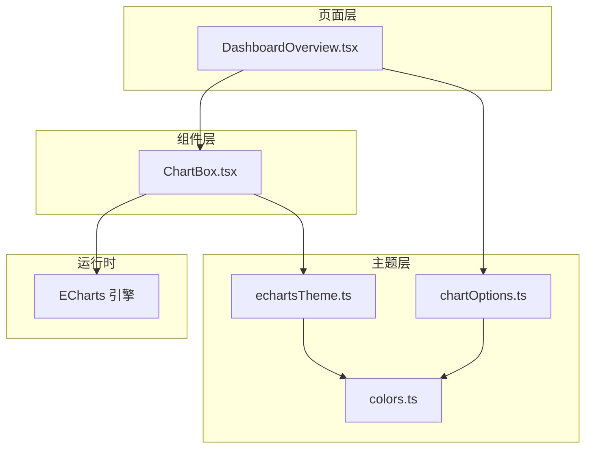
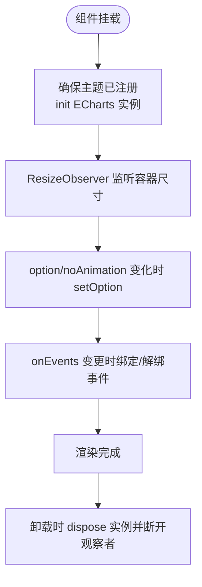
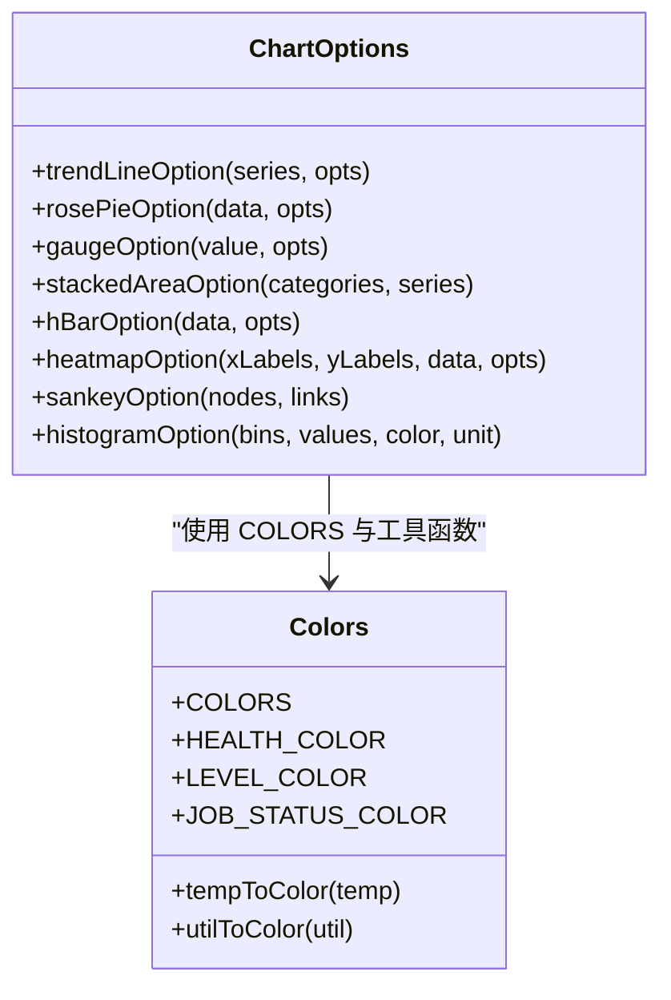
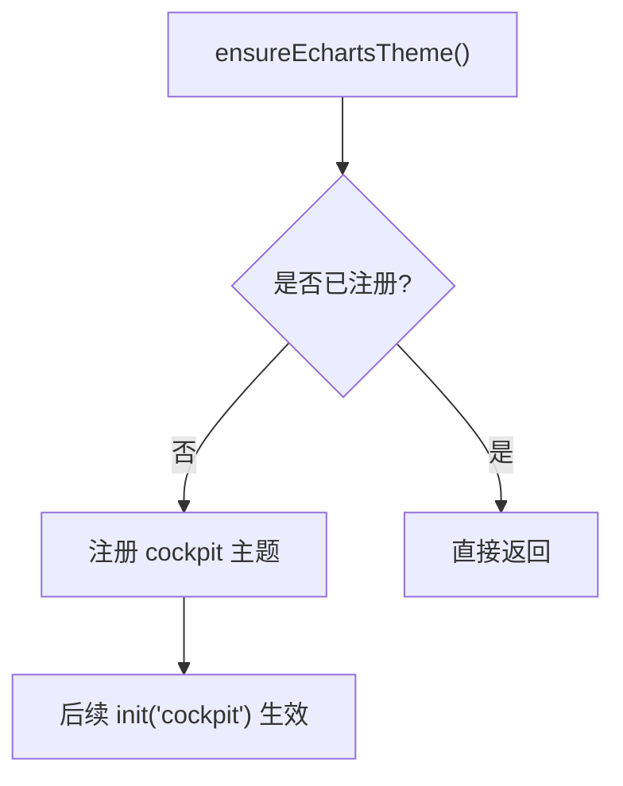
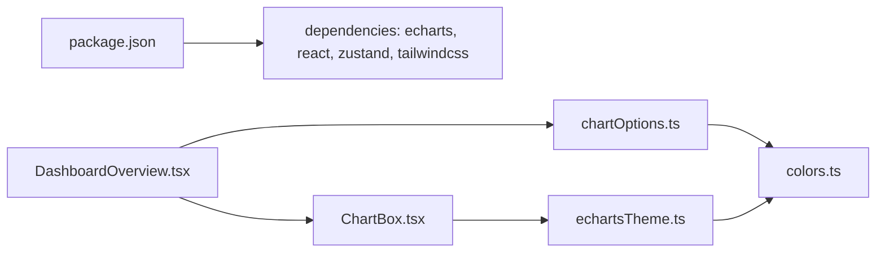
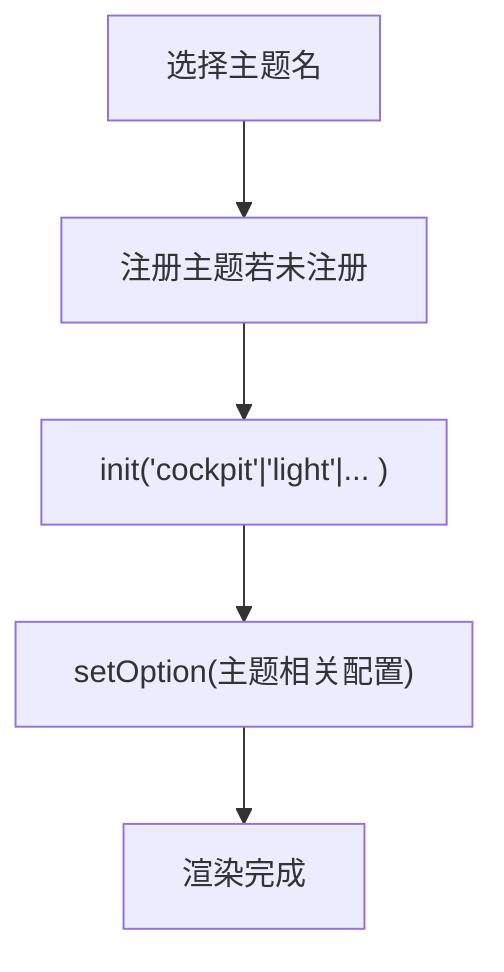

# 可视化架构

<cite>
**本文引用的文件**   
- [package.json](file://package.json)
- [src/theme/colors.ts](file://src/theme/colors.ts)
- [src/theme/echartsTheme.ts](file://src/theme/echartsTheme.ts)
- [src/theme/chartOptions.ts](file://src/theme/chartOptions.ts)
- [src/components/ChartBox.tsx](file://src/components/ChartBox.tsx)
- [src/pages/DashboardOverview.tsx](file://src/pages/DashboardOverview.tsx)
</cite>

## 目录
1. [引言](#引言)
2. [项目结构](#项目结构)
3. [核心组件](#核心组件)
4. [架构总览](#架构总览)
5. [详细组件分析](#详细组件分析)
6. [依赖关系分析](#依赖关系分析)
7. [性能与大数据优化](#性能与大数据优化)
8. [图表配置体系与示例](#图表配置体系与示例)
9. [主题定制与动态切换指南](#主题定制与动态切换指南)
10. [扩展新图表类型与样式主题](#扩展新图表类型与样式主题)
11. [故障排查](#故障排查)
12. [结论](#结论)

## 引言
本文件为 IDC AI 运维平台的可视化架构文档，聚焦 ECharts 集成方案、主题系统与 chartOptions 配置体系。文档面向不同技术背景的读者，既提供高层架构图，也给出代码级实现路径与最佳实践，帮助快速理解并扩展平台中的图表能力。

## 项目结构
本项目采用 React + TypeScript + Vite 的前端工程结构，ECharts 作为核心可视化引擎，通过统一的 theme 层与 ChartBox 组件进行封装，页面层按需组合各类图表。



**图示来源**
- [src/pages/DashboardOverview.tsx:1-301](file://src/pages/DashboardOverview.tsx#L1-L301)
- [src/components/ChartBox.tsx:1-61](file://src/components/ChartBox.tsx#L1-L61)
- [src/theme/colors.ts:1-97](file://src/theme/colors.ts#L1-L97)
- [src/theme/echartsTheme.ts:1-72](file://src/theme/echartsTheme.ts#L1-L72)
- [src/theme/chartOptions.ts:1-319](file://src/theme/chartOptions.ts#L1-L319)

**章节来源**
- [src/pages/DashboardOverview.tsx:1-301](file://src/pages/DashboardOverview.tsx#L1-L301)
- [src/components/ChartBox.tsx:1-61](file://src/components/ChartBox.tsx#L1-L61)
- [src/theme/colors.ts:1-97](file://src/theme/colors.ts#L1-L97)
- [src/theme/echartsTheme.ts:1-72](file://src/theme/echartsTheme.ts#L1-L72)
- [src/theme/chartOptions.ts:1-319](file://src/theme/chartOptions.ts#L1-L319)

## 核心组件
- ChartBox：ECharts 的 React 封装，负责实例化、主题注入、尺寸自适应、增量更新与事件绑定。
- chartOptions：按图表类型组织 EChartsOption 生成器，统一数据格式与视觉风格。
- echartsTheme：注册全局 cockpit 主题，集中管理颜色、字体、网格、提示框等基础样式。
- colors：共享色板与状态映射（健康等级、告警等级、任务状态、温度/利用率到颜色）。

**章节来源**
- [src/components/ChartBox.tsx:1-61](file://src/components/ChartBox.tsx#L1-L61)
- [src/theme/chartOptions.ts:1-319](file://src/theme/chartOptions.ts#L1-L319)
- [src/theme/echartsTheme.ts:1-72](file://src/theme/echartsTheme.ts#L1-L72)
- [src/theme/colors.ts:1-97](file://src/theme/colors.ts#L1-L97)

## 架构总览
下图展示从页面到 ECharts 渲染的完整链路，以及主题与配置的协作方式。

```mermaid
sequenceDiagram
participant Page as "DashboardOverview.tsx"
participant Box as "ChartBox.tsx"
participant Theme as "echartsTheme.ts"
participant Opts as "chartOptions.ts"
participant Colors as "colors.ts"
participant EC as "ECharts"
Page->>Opts : 调用具体图表生成器<br/>如 trendLineOption / rosePieOption / gaugeOption
Opts->>Colors : 读取 COLORS 与工具函数
Opts-->>Page : 返回 EChartsOption
Page->>Box : 传入 option 与 onEvents
Box->>Theme : ensureEchartsTheme() 注册 cockpit 主题
Box->>EC : init(ref, 'cockpit', {renderer : 'canvas'})
Box->>EC : setOption(option, {notMerge : false, lazyUpdate : false})
EC-->>Box : 渲染完成
Box->>EC : 监听 onEvents 回调
```

**图示来源**
- [src/pages/DashboardOverview.tsx:1-301](file://src/pages/DashboardOverview.tsx#L1-L301)
- [src/components/ChartBox.tsx:1-61](file://src/components/ChartBox.tsx#L1-L61)
- [src/theme/echartsTheme.ts:1-72](file://src/theme/echartsTheme.ts#L1-L72)
- [src/theme/chartOptions.ts:1-319](file://src/theme/chartOptions.ts#L1-L319)
- [src/theme/colors.ts:1-97](file://src/theme/colors.ts#L1-L97)

## 详细组件分析

### ChartBox：ECharts 容器与生命周期管理
- 职责
  - 初始化 ECharts 实例并应用 cockpit 主题。
  - 使用 ResizeObserver 监听容器尺寸变化，自动 resize。
  - 将外部传入的 option 以增量模式合并更新，避免全量重绘。
  - 统一管理事件订阅与销毁，防止内存泄漏。
- 关键行为
  - 首次渲染时创建实例，挂载后观察尺寸变化。
  - option 或 noAnimation 变化时调用 setOption，保持动画开关可控。
  - onEvents 对象键值对直接映射为 ECharts 事件名与回调。
- 性能要点
  - 高频刷新场景可通过 noAnimation 关闭动画减少重绘开销。
  - 外层容器通过 className 控制高度，内层绝对定位铺满，避免高度冲突导致的 0 高问题。



**图示来源**
- [src/components/ChartBox.tsx:1-61](file://src/components/ChartBox.tsx#L1-L61)

**章节来源**
- [src/components/ChartBox.tsx:1-61](file://src/components/ChartBox.tsx#L1-L61)

### chartOptions：图表类型与配置生成器
- 设计原则
  - 每个图表类型对应一个生成函数，输入业务数据与可选参数，输出标准 EChartsOption。
  - 颜色、网格线、标签等视觉元素统一引用 COLORS，保证主题一致性。
  - 提供通用工具函数（如 areaGradient、hexToRgba、fmtTime）简化配置。
- 已实现图表
  - 时序趋势折线：trendLineOption
  - 玫瑰/环形饼图：rosePieOption
  - 仪表盘（半环）：gaugeOption
  - 堆叠面积图：stackedAreaOption
  - 水平条形图：hBarOption
  - 热力图：heatmapOption
  - 桑基图：sankeyOption
  - 直方图分布：histogramOption
- 数据绑定约定
  - 时间序列：[时间戳, 数值] 数组；支持平滑曲线与面积渐变。
  - 分类数据：类别名称与数值数组；支持排序、单位后缀与标签格式化。
  - 矩阵数据：热力图使用三元组 [x, y, value]。
- 交互与提示
  - tooltip 统一配置触发方式与格式化逻辑。
  - legend 可显隐控制，适配紧凑布局。
  - 部分图表启用 emphasis 高亮效果。



**图示来源**
- [src/theme/chartOptions.ts:1-319](file://src/theme/chartOptions.ts#L1-L319)
- [src/theme/colors.ts:1-97](file://src/theme/colors.ts#L1-L97)

**章节来源**
- [src/theme/chartOptions.ts:1-319](file://src/theme/chartOptions.ts#L1-L319)
- [src/theme/colors.ts:1-97](file://src/theme/colors.ts#L1-L97)

### echartsTheme：主题注册与全局样式
- 主题内容
  - 定义 cockpit 主题的颜色序列、背景、文本字体、标题、图例、网格、坐标轴、提示框等。
  - 所有颜色来源于 COLORS，确保与图表配置一致。
- 注册机制
  - ensureEchartsTheme 在首次使用时注册主题，避免重复注册。
  - ChartBox 初始化时指定主题名为 'cockpit'，使所有图表继承该主题。



**图示来源**
- [src/theme/echartsTheme.ts:1-72](file://src/theme/echartsTheme.ts#L1-L72)

**章节来源**
- [src/theme/echartsTheme.ts:1-72](file://src/theme/echartsTheme.ts#L1-L72)

### DashboardOverview：页面集成与数据流
- 数据来源
  - 通过 Zustand store 获取 KPI、节点、告警、任务队列、利用率序列等数据。
- 图表使用
  - 仪表盘：gaugeOption 展示集群健康度。
  - 玫瑰饼图：rosePieOption 展示告警等级分布。
  - 趋势折线：trendLineOption 展示算力利用率趋势。
- 交互与导航
  - 点击按钮跳转到数据中心 3D 视图页面。
  - 滚动播报条展示实时告警信息。

```mermaid
sequenceDiagram
participant Store as "Zustand Store"
participant Page as "DashboardOverview.tsx"
participant Opts as "chartOptions.ts"
participant Box as "ChartBox.tsx"
Store-->>Page : kpi/nodes/alerts/jobs/utilSeries
Page->>Opts : 计算告警分布/Top节点/趋势数据
Page->>Box : 传入 gaugeOption / rosePieOption / trendLineOption
Box-->>Page : 渲染图表
```

**图示来源**
- [src/pages/DashboardOverview.tsx:1-301](file://src/pages/DashboardOverview.tsx#L1-L301)
- [src/theme/chartOptions.ts:1-319](file://src/theme/chartOptions.ts#L1-L319)

**章节来源**
- [src/pages/DashboardOverview.tsx:1-301](file://src/pages/DashboardOverview.tsx#L1-L301)

## 依赖关系分析
- 运行时依赖
  - ECharts 5.x 作为可视化引擎。
  - React 18 与 TypeScript 用于组件与类型安全。
  - TailwindCSS 用于样式与布局。
- 模块依赖
  - ChartBox 依赖 echartsTheme 与 ECharts。
  - chartOptions 依赖 colors。
  - DashboardOverview 依赖 chartOptions、colors 与 ChartBox。



**图示来源**
- [package.json:1-38](file://package.json#L1-L38)
- [src/pages/DashboardOverview.tsx:1-301](file://src/pages/DashboardOverview.tsx#L1-L301)
- [src/components/ChartBox.tsx:1-61](file://src/components/ChartBox.tsx#L1-L61)
- [src/theme/chartOptions.ts:1-319](file://src/theme/chartOptions.ts#L1-L319)
- [src/theme/echartsTheme.ts:1-72](file://src/theme/echartsTheme.ts#L1-L72)
- [src/theme/colors.ts:1-97](file://src/theme/colors.ts#L1-L97)

**章节来源**
- [package.json:1-38](file://package.json#L1-L38)
- [src/pages/DashboardOverview.tsx:1-301](file://src/pages/DashboardOverview.tsx#L1-L301)
- [src/components/ChartBox.tsx:1-61](file://src/components/ChartBox.tsx#L1-L61)
- [src/theme/chartOptions.ts:1-319](file://src/theme/chartOptions.ts#L1-L319)
- [src/theme/echartsTheme.ts:1-72](file://src/theme/echartsTheme.ts#L1-L72)
- [src/theme/colors.ts:1-97](file://src/theme/colors.ts#L1-L97)

## 性能与大数据优化
- 动画控制
  - 高频刷新场景建议设置 noAnimation=true，减少动画重绘开销。
- 增量更新
  - setOption 使用 notMerge=false 与 lazyUpdate=false，在保持主题与布局稳定的前提下进行增量更新。
- 渲染后端
  - 使用 canvas 渲染器，适合大量点线与热力图等大数据场景。
- 数据规模
  - 热力图启用 progressive 分批渲染，降低一次性绘制压力。
- 响应式
  - ResizeObserver 自动调整图表尺寸，避免固定高度导致的溢出或空白。
- 内存管理
  - 组件卸载时 dispose 实例并断开观察者，避免内存泄漏。

**章节来源**
- [src/components/ChartBox.tsx:1-61](file://src/components/ChartBox.tsx#L1-L61)
- [src/theme/chartOptions.ts:220-264](file://src/theme/chartOptions.ts#L220-L264)

## 图表配置体系与示例
- 图表类型选择
  - 时序趋势：trendLineOption，适用于 CPU/GPU 利用率、PUE 等随时间变化的指标。
  - 占比分布：rosePieOption，适用于告警等级、资源占用比例等。
  - 指标仪表：gaugeOption，适用于健康评分、在线率等单值指标。
  - 堆叠面积：stackedAreaOption，适用于多类告警叠加趋势。
  - 排行条形：hBarOption，适用于 TopN 节点负载排名。
  - 矩阵热力：heatmapOption，适用于 GPU 温度-利用率矩阵。
  - 流向桑基：sankeyOption，适用于能耗流向分析。
  - 分布直方：histogramOption，适用于节点数分布统计。
- 数据绑定方式
  - 时间序列：[时间戳, 数值]，支持格式化与单位显示。
  - 分类数据：类别名与数值数组，支持排序与单位后缀。
  - 矩阵数据：三元组 [x, y, value]，配合 visualMap 映射颜色。
- 交互事件处理
  - 通过 onEvents 传入事件名与回调，例如 click、mouseover、legendselectchanged 等。
  - 建议在回调中执行轻量操作，避免阻塞主线程。

**章节来源**
- [src/theme/chartOptions.ts:1-319](file://src/theme/chartOptions.ts#L1-L319)
- [src/components/ChartBox.tsx:1-61](file://src/components/ChartBox.tsx#L1-L61)
- [src/pages/DashboardOverview.tsx:1-301](file://src/pages/DashboardOverview.tsx#L1-L301)

## 主题定制与动态切换指南
- 颜色统一管理
  - COLORS 集中定义主色、网格线、标签色、面板背景等，所有图表与主题均引用该色板。
  - 状态映射（健康等级、告警等级、任务状态）与工具函数（温度/利用率转颜色）确保语义化配色。
- 主题系统设计
  - cockpit 主题定义全局颜色序列、字体、网格、坐标轴、提示框等。
  - ensureEchartsTheme 确保主题仅注册一次，避免重复开销。
- 动态主题切换
  - 当前实现为单一 cockpit 主题；如需多主题切换，可在 ensureEchartsTheme 前注册多个主题名，并在 ChartBox 初始化时根据状态选择主题名。
  - 切换策略建议：
    - 维护主题配置对象集合，包含 color、textStyle、grid、tooltip 等。
    - 在 store 中维护当前主题名，ChartBox 根据主题名初始化实例。
    - 切换时重新 init 实例或调用 setOption 覆盖主题相关配置。



**图示来源**
- [src/theme/echartsTheme.ts:1-72](file://src/theme/echartsTheme.ts#L1-L72)
- [src/theme/colors.ts:1-97](file://src/theme/colors.ts#L1-L97)
- [src/components/ChartBox.tsx:1-61](file://src/components/ChartBox.tsx#L1-L61)

**章节来源**
- [src/theme/echartsTheme.ts:1-72](file://src/theme/echartsTheme.ts#L1-L72)
- [src/theme/colors.ts:1-97](file://src/theme/colors.ts#L1-L97)
- [src/components/ChartBox.tsx:1-61](file://src/components/ChartBox.tsx#L1-L61)

## 扩展新图表类型与样式主题
- 新增图表类型步骤
  - 在 chartOptions.ts 中新增生成函数，遵循现有命名与参数约定。
  - 复用 COLORS 与工具函数，确保视觉一致性。
  - 在页面中引入并使用新生成函数，传入业务数据与可选参数。
- 新增样式主题步骤
  - 在 echartsTheme.ts 中定义新主题对象，参考 cockpit 主题结构。
  - 在 ensureEchartsTheme 中注册新主题名。
  - 在 ChartBox 初始化时根据状态选择新主题名。
- 最佳实践
  - 保持 EChartsOption 的结构清晰，分离数据与样式。
  - 对复杂图表提供默认参数与可选覆盖项，便于复用。
  - 对大数据图表启用 progressive 或分片渲染，提升性能。

**章节来源**
- [src/theme/chartOptions.ts:1-319](file://src/theme/chartOptions.ts#L1-L319)
- [src/theme/echartsTheme.ts:1-72](file://src/theme/echartsTheme.ts#L1-L72)
- [src/components/ChartBox.tsx:1-61](file://src/components/ChartBox.tsx#L1-L61)

## 故障排查
- 图表不显示或高度为 0
  - 检查外层容器是否提供有效高度，ChartBox 内部使用绝对定位铺满。
  - 确认 ResizeObserver 正常触发，必要时手动调用 resize。
- 主题未生效
  - 确保 ensureEchartsTheme 在 init 之前被调用。
  - 检查 init 时传入的主题名是否正确。
- 事件未触发或内存泄漏
  - 确认 onEvents 对象键名与 ECharts 事件名一致。
  - 组件卸载时会自动解绑事件并 dispose 实例，避免泄漏。
- 大数据卡顿
  - 开启 noAnimation 关闭动画。
  - 对热力图等大数据图表启用 progressive。
  - 减少 tooltip 与 label 的计算复杂度。

**章节来源**
- [src/components/ChartBox.tsx:1-61](file://src/components/ChartBox.tsx#L1-L61)
- [src/theme/chartOptions.ts:220-264](file://src/theme/chartOptions.ts#L220-L264)

## 结论
本架构通过 ChartBox 统一封装 ECharts 的生命周期与主题，通过 chartOptions 标准化图表配置生成，通过 echartsTheme 与 colors 集中管理视觉风格。该设计在保证一致性与可维护性的同时，提供了良好的性能与可扩展性，适合 IDC AI 运维平台的多场景可视化需求。未来可在此基础上扩展更多图表类型与主题，并结合数据流优化进一步提升大屏体验。