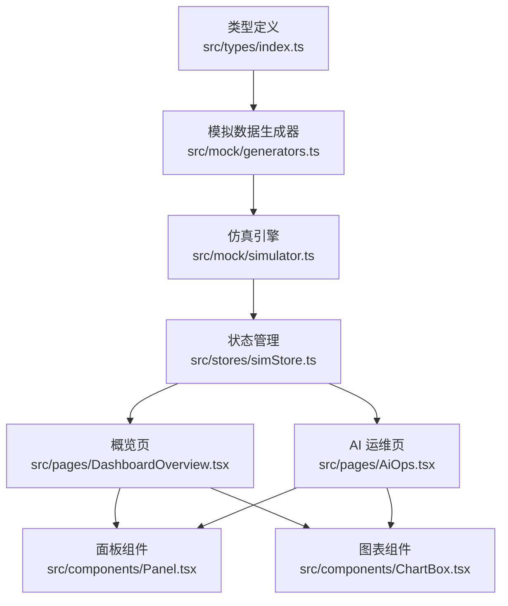
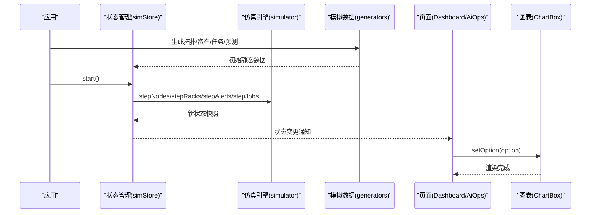
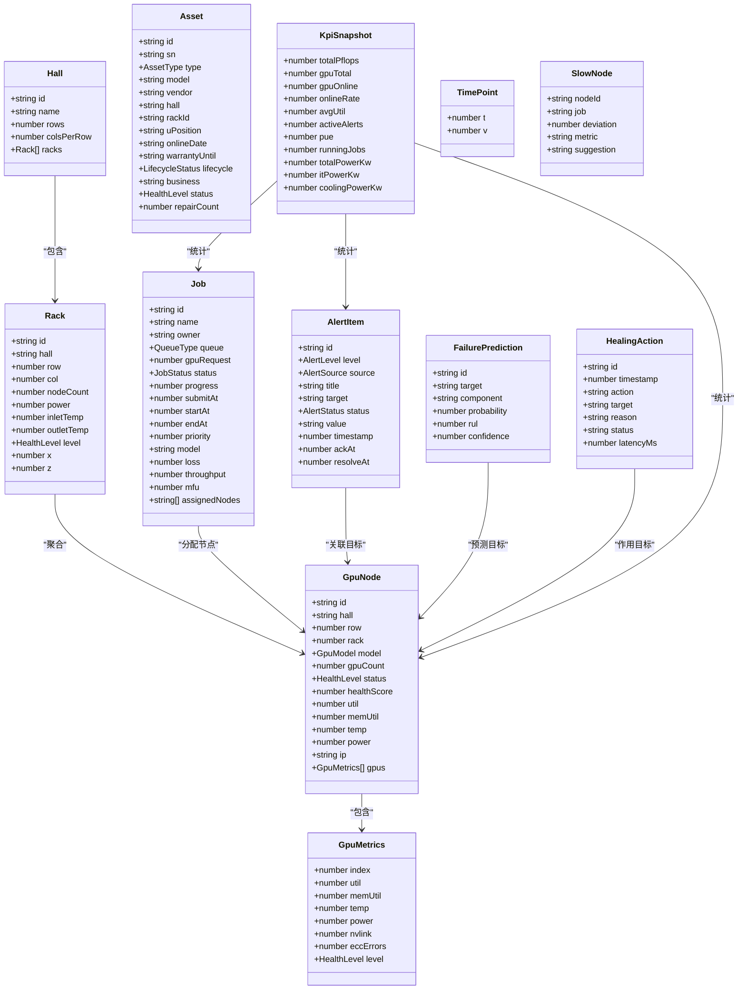
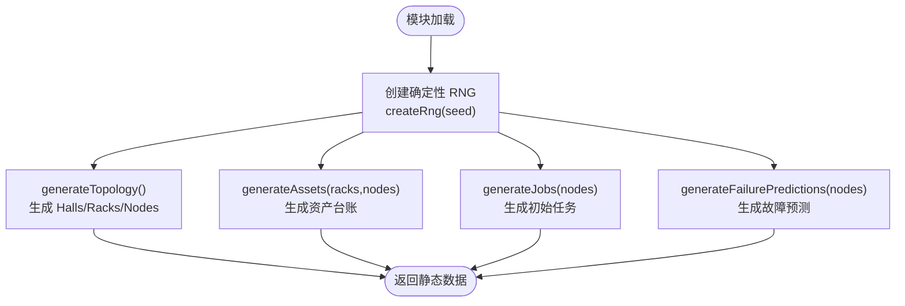
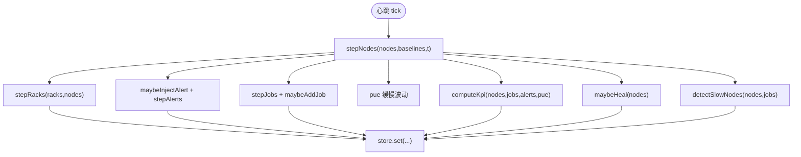
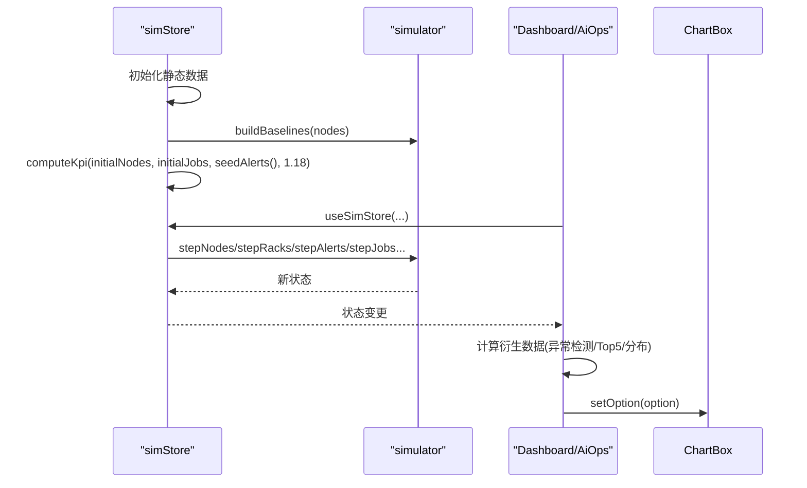
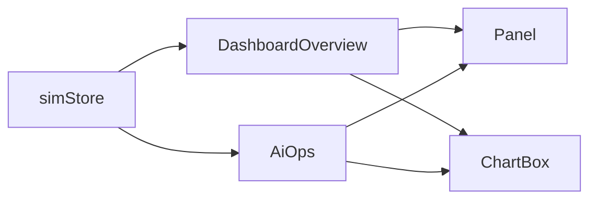
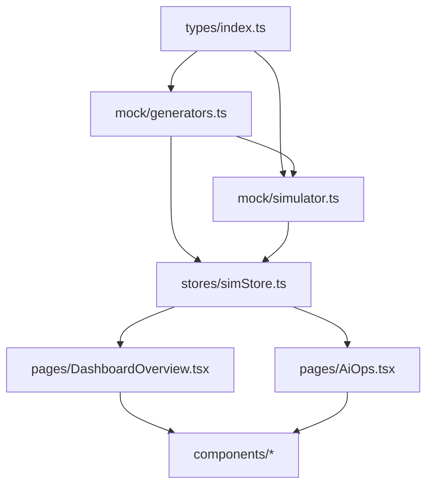

# 数据流设计

<cite>
**本文引用的文件**   
- [src/types/index.ts](file://src/types/index.ts)
- [src/mock/generators.ts](file://src/mock/generators.ts)
- [src/mock/simulator.ts](file://src/mock/simulator.ts)
- [src/stores/simStore.ts](file://src/stores/simStore.ts)
- [src/pages/DashboardOverview.tsx](file://src/pages/DashboardOverview.tsx)
- [src/pages/AiOps.tsx](file://src/pages/AiOps.tsx)
- [src/components/Panel.tsx](file://src/components/Panel.tsx)
- [src/components/ChartBox.tsx](file://src/components/ChartBox.tsx)
</cite>

## 目录
1. [引言](#引言)
2. [项目结构](#项目结构)
3. [核心组件](#核心组件)
4. [架构总览](#架构总览)
5. [详细组件分析](#详细组件分析)
6. [依赖关系分析](#依赖关系分析)
7. [性能与一致性](#性能与一致性)
8. [故障排查指南](#故障排查指南)
9. [结论](#结论)

## 引言
本设计文档面向 IDC AI 运维平台的数据流，覆盖从模拟数据生成器、仿真引擎到状态管理再到组件渲染的完整链路。重点说明：
- TypeScript 类型系统如何定义领域模型、接口规范与类型安全实践
- 仿真引擎的数据生成策略、随机数种子管理与数据一致性保证
- 数据验证规则、错误处理策略与数据转换流程
- 通过数据流图和数据模型关系图展示不同类型数据的流转过程与相互关系

## 项目结构
本项目采用“类型定义 + 模拟数据 + 仿真引擎 + 状态管理 + 页面组件”的分层组织方式：
- types：领域模型与枚举类型集中定义
- mock：静态拓扑/资产/任务生成与确定性伪随机数
- simulator：心跳驱动的纯函数仿真引擎
- stores：基于 Zustand 的状态容器，组合仿真逻辑并暴露 UI 操作
- pages：业务页面订阅 store 数据并渲染图表与面板
- components：通用 UI 组件（面板、图表等）

**图示来源**
- [src/types/index.ts:1-192](file://src/types/index.ts#L1-L192)
- [src/mock/generators.ts:1-408](file://src/mock/generators.ts#L1-L408)
- [src/mock/simulator.ts:1-331](file://src/mock/simulator.ts#L1-L331)
- [src/stores/simStore.ts:1-270](file://src/stores/simStore.ts#L1-L270)
- [src/pages/DashboardOverview.tsx:1-301](file://src/pages/DashboardOverview.tsx#L1-L301)
- [src/pages/AiOps.tsx:1-306](file://src/pages/AiOps.tsx#L1-L306)
- [src/components/Panel.tsx:1-54](file://src/components/Panel.tsx#L1-L54)
- [src/components/ChartBox.tsx:1-61](file://src/components/ChartBox.tsx#L1-L61)

**章节来源**
- [src/types/index.ts:1-192](file://src/types/index.ts#L1-L192)
- [src/mock/generators.ts:1-408](file://src/mock/generators.ts#L1-L408)
- [src/mock/simulator.ts:1-331](file://src/mock/simulator.ts#L1-L331)
- [src/stores/simStore.ts:1-270](file://src/stores/simStore.ts#L1-L270)
- [src/pages/DashboardOverview.tsx:1-301](file://src/pages/DashboardOverview.tsx#L1-L301)
- [src/pages/AiOps.tsx:1-306](file://src/pages/AiOps.tsx#L1-L306)
- [src/components/Panel.tsx:1-54](file://src/components/Panel.tsx#L1-L54)
- [src/components/ChartBox.tsx:1-61](file://src/components/ChartBox.tsx#L1-L61)

## 核心组件
- 类型系统：统一领域模型、枚举与接口，确保全链路类型安全
- 模拟数据生成器：确定性伪随机数、机房拓扑、资产台账、计算任务、故障预测
- 仿真引擎：节点指标漂移、机柜聚合、KPI 汇总、告警注入与流转、任务状态机、时序推进、自愈动作、慢节点检测、心跳驱动
- 状态管理：Zustand store 初始化静态数据、组合仿真步骤、暴露 UI 操作
- 页面组件：订阅 store 数据，渲染 KPI、图表、列表与交互

**章节来源**
- [src/types/index.ts:1-192](file://src/types/index.ts#L1-L192)
- [src/mock/generators.ts:1-408](file://src/mock/generators.ts#L1-L408)
- [src/mock/simulator.ts:1-331](file://src/mock/simulator.ts#L1-L331)
- [src/stores/simStore.ts:1-270](file://src/stores/simStore.ts#L1-L270)
- [src/pages/DashboardOverview.tsx:1-301](file://src/pages/DashboardOverview.tsx#L1-L301)
- [src/pages/AiOps.tsx:1-306](file://src/pages/AiOps.tsx#L1-L306)

## 架构总览
整体数据流遵循“静态生成 → 心跳步进 → 状态更新 → 视图渲染”的单向数据流：
- 模块加载时一次性生成拓扑、资产、任务、预测等静态数据
- 启动后由心跳驱动调用仿真引擎的纯函数，逐步推进节点、机柜、告警、任务、PUE、KPI、自愈日志、慢节点等
- Store 将新状态写入 Zustand，页面组件订阅相应字段并触发 ECharts 增量更新

**图示来源**
- [src/stores/simStore.ts:142-265](file://src/stores/simStore.ts#L142-L265)
- [src/mock/simulator.ts:35-331](file://src/mock/simulator.ts#L35-L331)
- [src/mock/generators.ts:159-408](file://src/mock/generators.ts#L159-L408)
- [src/components/ChartBox.tsx:17-58](file://src/components/ChartBox.tsx#L17-L58)

## 详细组件分析

### 类型系统与领域模型
- 设备健康等级、告警等级/状态/来源、GPU 型号等枚举类型约束了数据取值范围
- GpuMetrics/GpuNode/Rack/Hall/Asset/Job/KpiSnapshot/TimePoint/FailurePrediction/HealingAction/SlowNode 等接口定义了实体结构与字段语义
- ViewMode 控制 3D 视图模式，便于 UI 切换温度/负载/告警/拓扑视图

类型安全实践：
- 所有模拟数据与仿真输出严格使用上述类型，避免运行时类型错误
- 通过 Record<GpuModel, number> 等映射类型保证算力与功耗参数与 GPU 型号一一对应
- 在 store 中通过 TS 接口 SimState 明确状态结构与 action 签名

**图示来源**
- [src/types/index.ts:20-192](file://src/types/index.ts#L20-L192)

**章节来源**
- [src/types/index.ts:1-192](file://src/types/index.ts#L1-L192)

### 模拟数据生成器与确定性随机数
- 使用 Mulberry32 实现确定性伪随机数生成器 createRng，固定种子保证每次刷新一致
- 提供 rand/randInt/pick 等工具函数，统一随机行为
- 生成机房拓扑（Hall/Rack）、节点（GpuNode）、资产（Asset）、任务（Job）、故障预测（FailurePrediction）
- 提供布局常量与坐标计算函数，供 3D 场景复用

数据一致性保证：
- 全局 rng 实例与 seed 固定，确保拓扑、资产、任务等静态数据可复现
- 节点健康等级由温度与利用率阈值推导，避免不一致状态
- 机柜温度与功率由节点聚合计算，保持层级一致性

**图示来源**
- [src/mock/generators.ts:17-46](file://src/mock/generators.ts#L17-L46)
- [src/mock/generators.ts:159-206](file://src/mock/generators.ts#L159-L206)
- [src/mock/generators.ts:216-328](file://src/mock/generators.ts#L216-L328)
- [src/mock/generators.ts:345-384](file://src/mock/generators.ts#L345-L384)
- [src/mock/generators.ts:389-405](file://src/mock/generators.ts#L389-L405)

**章节来源**
- [src/mock/generators.ts:1-408](file://src/mock/generators.ts#L1-L408)

### 仿真引擎与心跳驱动
- 构建节点基线 BaselineMap，用于正弦漂移与噪声叠加
- stepNodes：围绕基线做正弦波动与噪声，限制数值范围，重新计算健康等级与健康分数
- stepRacks：按节点聚合机柜功耗与回风温度，判定健康等级
- computeKpi：汇总总算力、在线率、平均利用率、活跃告警、PUE 分解等
- maybeInjectAlert/stepAlerts：概率注入告警，自动恢复部分活跃告警
- stepJobs/maybeAddJob：任务排队启动、进度推进、失败与成功状态转移
- pushSeries：时序数据点追加与长度限制
- maybeHeal：对严重节点触发自愈动作日志
- detectSlowNodes：识别慢节点并给出建议
- startSimulator：基于 setInterval 的心跳驱动

**图示来源**
- [src/mock/simulator.ts:35-139](file://src/mock/simulator.ts#L35-L139)
- [src/mock/simulator.ts:165-194](file://src/mock/simulator.ts#L165-L194)
- [src/mock/simulator.ts:199-259](file://src/mock/simulator.ts#L199-L259)
- [src/mock/simulator.ts:264-331](file://src/mock/simulator.ts#L264-L331)

**章节来源**
- [src/mock/simulator.ts:1-331](file://src/mock/simulator.ts#L1-L331)

### 状态管理与数据流
- 模块加载时一次性生成拓扑、资产、任务、预测，并构建基线与初始 KPI
- 定义 SimState 接口，包含运行态、时间步、拓扑、节点、告警、任务、资产、KPI、预测、自愈日志、慢节点、时序曲线、PUE、UI 状态与 actions
- step 方法串联仿真引擎各步骤，按 tick 频率更新状态；start/stop 控制心跳
- 提供 ackAlert/silenceAlert/resolveAlert/submitJob/setViewMode/selectRack/toggleTour 等用户操作
- 导出 selectNodeById 便捷选择器

**图示来源**
- [src/stores/simStore.ts:42-158](file://src/stores/simStore.ts#L42-L158)
- [src/stores/simStore.ts:164-207](file://src/stores/simStore.ts#L164-L207)
- [src/stores/simStore.ts:221-265](file://src/stores/simStore.ts#L221-L265)

**章节来源**
- [src/stores/simStore.ts:1-270](file://src/stores/simStore.ts#L1-L270)

### 组件渲染与数据消费
- DashboardOverview：订阅 kpi/nodes/alerts/jobs/utilSeries/racks/viewMode，计算健康度、Top5、告警分布、任务队列，渲染 KPI 卡片、3D 场景、滚动告警条、趋势图
- AiOps：订阅 utilSeries/failurePredictions/healing/kpi，进行滑动窗口异常检测，渲染异常曲线、故障预测列表、自愈日志与智能诊断对话
- Panel/ChartBox：通用面板与 ECharts 封装，支持主题、自适应尺寸、增量更新与事件绑定

**图示来源**
- [src/pages/DashboardOverview.tsx:15-274](file://src/pages/DashboardOverview.tsx#L15-L274)
- [src/pages/AiOps.tsx:19-175](file://src/pages/AiOps.tsx#L19-L175)
- [src/components/Panel.tsx:21-51](file://src/components/Panel.tsx#L21-L51)
- [src/components/ChartBox.tsx:17-58](file://src/components/ChartBox.tsx#L17-L58)

**章节来源**
- [src/pages/DashboardOverview.tsx:1-301](file://src/pages/DashboardOverview.tsx#L1-L301)
- [src/pages/AiOps.tsx:1-306](file://src/pages/AiOps.tsx#L1-L306)
- [src/components/Panel.tsx:1-54](file://src/components/Panel.tsx#L1-L54)
- [src/components/ChartBox.tsx:1-61](file://src/components/ChartBox.tsx#L1-L61)

## 依赖关系分析
- generators 依赖 types 中的领域模型
- simulator 依赖 types 与 generators 提供的工具与常量
- simStore 依赖 generators 与 simulator，组合数据生成与仿真步骤
- 页面组件依赖 simStore 与 theme/colors/chartOptions，渲染可视化
- ChartBox 依赖 echarts 与主题配置

**图示来源**
- [src/types/index.ts:1-192](file://src/types/index.ts#L1-L192)
- [src/mock/generators.ts:1-408](file://src/mock/generators.ts#L1-L408)
- [src/mock/simulator.ts:1-331](file://src/mock/simulator.ts#L1-L331)
- [src/stores/simStore.ts:1-270](file://src/stores/simStore.ts#L1-L270)
- [src/pages/DashboardOverview.tsx:1-301](file://src/pages/DashboardOverview.tsx#L1-L301)
- [src/pages/AiOps.tsx:1-306](file://src/pages/AiOps.tsx#L1-L306)

**章节来源**
- [src/types/index.ts:1-192](file://src/types/index.ts#L1-L192)
- [src/mock/generators.ts:1-408](file://src/mock/generators.ts#L1-L408)
- [src/mock/simulator.ts:1-331](file://src/mock/simulator.ts#L1-L331)
- [src/stores/simStore.ts:1-270](file://src/stores/simStore.ts#L1-L270)
- [src/pages/DashboardOverview.tsx:1-301](file://src/pages/DashboardOverview.tsx#L1-L301)
- [src/pages/AiOps.tsx:1-306](file://src/pages/AiOps.tsx#L1-L306)

## 性能与一致性
- 确定性随机数：Mulberry32 固定种子保证静态数据可复现，便于调试与回归测试
- 心跳步进节流：机柜聚合每 3 tick 更新一次，慢节点检测每 5 tick 执行一次，降低高频计算开销
- 时序数据长度限制：pushSeries 默认保留最近 60 个点，避免内存增长
- 告警与任务上限：注入告警最多保留 120 条，新增任务最多保留 80 条，自愈日志最多保留 40 条
- 数值边界保护：clamp 函数限制利用率、温度、功率等范围，防止越界导致状态异常
- 视图渲染优化：ChartBox 使用 notMerge:false 与 lazyUpdate:false 提升增量更新效率，并提供 noAnimation 开关以禁用动画

[本节为一般性指导，不直接分析具体文件]

## 故障排查指南
常见问题与定位思路：
- 数据不可复现：检查是否修改了随机种子或使用了 Math.random 替代确定性 RNG
- 节点状态异常：核查 healthFromTemp 阈值与 clamp 边界，确认温度与利用率是否在合理区间
- 告警过多或过少：调整 maybeInjectAlert 的概率阈值与 ALERT_TEMPLATES 模板
- 任务堆积：检查 stepJobs 并发上限 capacity 与队列优先级逻辑
- 时序曲线抖动过大：调整 pushSeries 的 maxLen 与前端滑动窗口统计参数
- 图表不更新：确认 ChartBox 的 option 是否变化且 noAnimation 未误用

**章节来源**
- [src/mock/generators.ts:83-87](file://src/mock/generators.ts#L83-L87)
- [src/mock/simulator.ts:49-71](file://src/mock/simulator.ts#L49-L71)
- [src/mock/simulator.ts:165-194](file://src/mock/simulator.ts#L165-L194)
- [src/mock/simulator.ts:199-259](file://src/mock/simulator.ts#L199-L259)
- [src/mock/simulator.ts:264-268](file://src/mock/simulator.ts#L264-L268)
- [src/components/ChartBox.tsx:17-58](file://src/components/ChartBox.tsx#L17-L58)

## 结论
本数据流设计通过严格的 TypeScript 类型系统、确定性随机数与纯函数仿真引擎，实现了从静态数据生成到心跳驱动的状态演进，再到组件渲染的清晰单向数据流。该架构具备良好的可测试性与可维护性，同时通过节流与边界保护保障性能与稳定性。未来可在以下方面持续优化：
- 引入更细粒度的校验层（如运行时 schema 校验）增强鲁棒性
- 扩展仿真引擎的可配置化能力（阈值、概率、容量等）
- 增加端到端测试用例覆盖关键数据流路径

[本节为总结性内容，不直接分析具体文件]