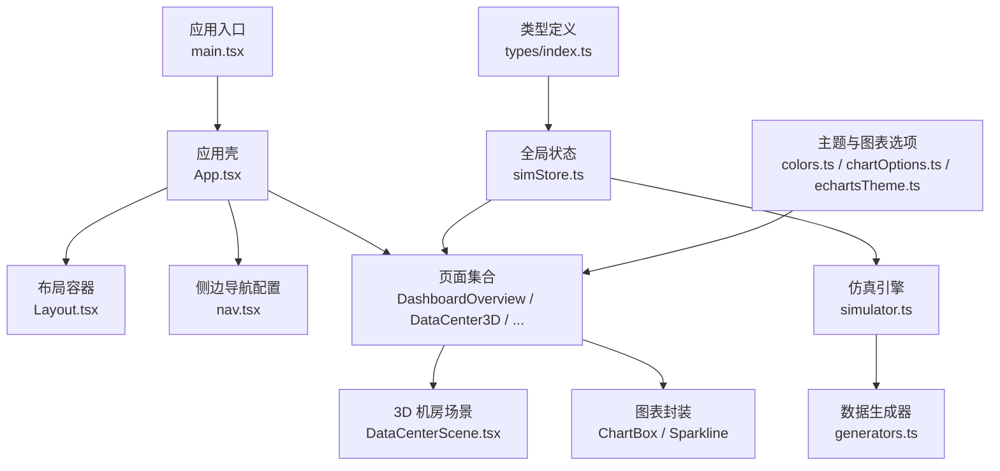
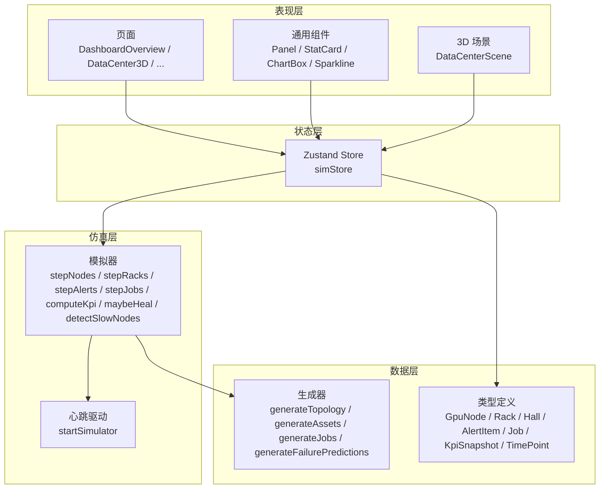
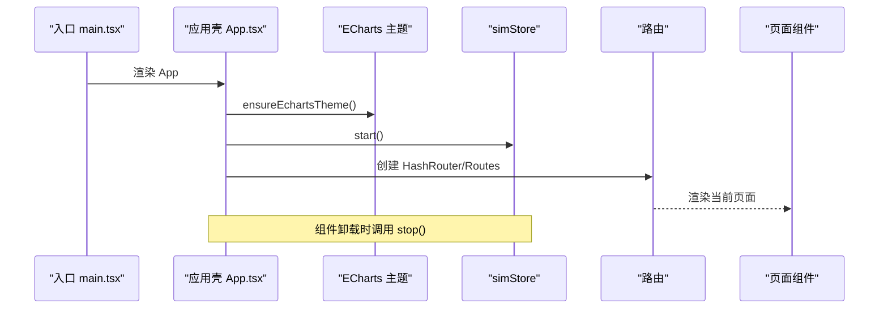
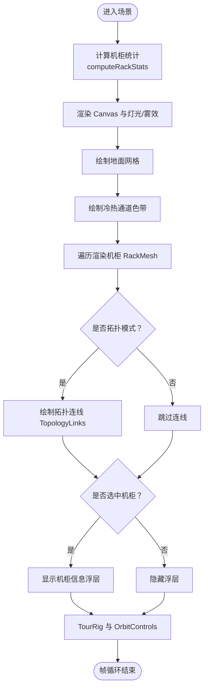
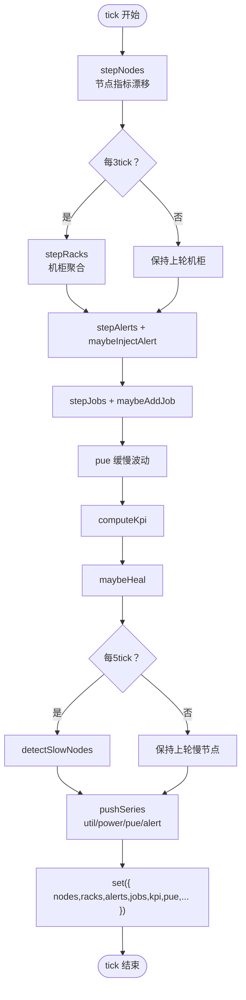
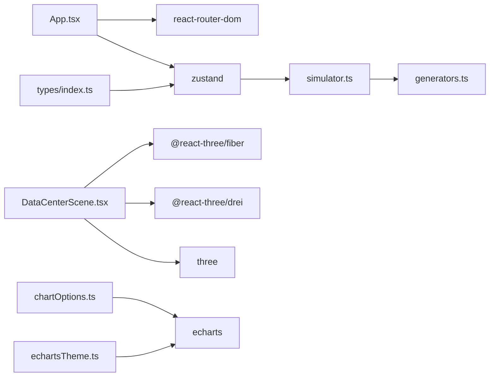

# 架构设计

<cite>
**本文引用的文件**   
- [package.json](file://package.json)
- [main.tsx](file://src/main.tsx)
- [App.tsx](file://src/App.tsx)
- [types/index.ts](file://src/types/index.ts)
- [stores/simStore.ts](file://src/stores/simStore.ts)
- [mock/generators.ts](file://src/mock/generators.ts)
- [mock/simulator.ts](file://src/mock/simulator.ts)
- [components/Layout.tsx](file://src/components/Layout.tsx)
- [components/nav.tsx](file://src/components/nav.tsx)
- [components/scene/DataCenterScene.tsx](file://src/components/scene/DataCenterScene.tsx)
- [pages/DashboardOverview.tsx](file://src/pages/DashboardOverview.tsx)
- [pages/DataCenter3D.tsx](file://src/pages/DataCenter3D.tsx)
- [theme/chartOptions.ts](file://src/theme/chartOptions.ts)
- [theme/colors.ts](file://src/theme/colors.ts)
- [theme/echartsTheme.ts](file://src/theme/echartsTheme.ts)
</cite>

## 目录
1. [引言](#引言)
2. [项目结构](#项目结构)
3. [核心组件](#核心组件)
4. [架构总览](#架构总览)
5. [详细组件分析](#详细组件分析)
6. [依赖关系分析](#依赖关系分析)
7. [性能与扩展性](#性能与扩展性)
8. [故障排查指南](#故障排查指南)
9. [结论](#结论)

## 引言
本架构文档面向 IDC AI 运维平台，围绕系统边界、模块职责、数据流与状态管理进行系统化说明。平台以 React + TypeScript 为前端基础，使用 Zustand 作为全局状态中枢，Three.js（通过 @react-three/fiber 与 drei）实现机房 3D 透视，ECharts 提供图表可视化能力，并通过自研模拟引擎生成可观测的时序指标、告警、任务与能耗数据。整体目标是构建一个高内聚、低耦合、可扩展且具备良好性能的超级智算数据中心运维透视系统。

## 项目结构
仓库采用按“领域+技术”混合组织：
- src/pages：页面级路由入口，承载业务视图
- src/components：通用 UI 与场景组件，含 3D 机房场景
- src/stores：Zustand 状态管理
- src/mock：确定性伪随机数、拓扑与指标生成器、仿真驱动
- src/theme：主题色板、ECharts 主题与图表选项工厂
- src/types：领域类型定义
- 根目录 package.json 声明运行时与开发期依赖

**图示来源**
- [main.tsx:1-11](file://src/main.tsx#L1-L11)
- [App.tsx:1-47](file://src/App.tsx#L1-L47)
- [components/Layout.tsx:1-125](file://src/components/Layout.tsx#L1-L125)
- [components/nav.tsx:1-69](file://src/components/nav.tsx#L1-L69)
- [components/scene/DataCenterScene.tsx:1-401](file://src/components/scene/DataCenterScene.tsx#L1-L401)
- [stores/simStore.ts:1-270](file://src/stores/simStore.ts#L1-L270)
- [mock/simulator.ts:1-331](file://src/mock/simulator.ts#L1-L331)
- [mock/generators.ts:1-408](file://src/mock/generators.ts#L1-L408)
- [types/index.ts:1-192](file://src/types/index.ts#L1-L192)
- [theme/chartOptions.ts:1-319](file://src/theme/chartOptions.ts#L1-L319)
- [theme/colors.ts:1-97](file://src/theme/colors.ts#L1-L97)
- [theme/echartsTheme.ts:1-72](file://src/theme/echartsTheme.ts#L1-L72)

**章节来源**
- [package.json:1-38](file://package.json#L1-L38)
- [main.tsx:1-11](file://src/main.tsx#L1-L11)
- [App.tsx:1-47](file://src/App.tsx#L1-L47)

## 核心组件
- 应用壳与路由：App 负责初始化 ECharts 主题、启动仿真引擎，并挂载各页面路由。
- 布局容器：Layout 提供侧边栏、顶部状态栏、全屏切换与 Outlet 内容区。
- 3D 机房场景：DataCenterScene 基于 Three.js 渲染机柜阵列、冷热通道、拓扑连线与相机巡检。
- 全局状态：simStore 聚合拓扑、节点、机柜、告警、任务、KPI、时序等数据，并提供 step/start/stop 等动作。
- 仿真引擎：simulator 提供纯函数驱动的 tick 推进逻辑，包括节点漂移、告警注入、任务流转、PUE/KPI 计算、慢节点检测等。
- 数据生成器：generators 提供确定性伪随机数、机房拓扑、资产台账、初始任务与故障预测。
- 主题与图表：colors 提供统一色板与映射；chartOptions 提供 ECharts 图表选项工厂；echartsTheme 注册深色主题。

**章节来源**
- [App.tsx:18-47](file://src/App.tsx#L18-L47)
- [components/Layout.tsx:25-125](file://src/components/Layout.tsx#L25-L125)
- [components/scene/DataCenterScene.tsx:218-326](file://src/components/scene/DataCenterScene.tsx#L218-L326)
- [stores/simStore.ts:99-265](file://src/stores/simStore.ts#L99-L265)
- [mock/simulator.ts:35-139](file://src/mock/simulator.ts#L35-L139)
- [mock/generators.ts:159-206](file://src/mock/generators.ts#L159-L206)
- [theme/chartOptions.ts:37-155](file://src/theme/chartOptions.ts#L37-L155)
- [theme/echartsTheme.ts:64-69](file://src/theme/echartsTheme.ts#L64-L69)

## 架构总览
系统分为四层：
- 表现层：React 页面与通用组件，负责交互与展示
- 状态层：Zustand store 作为单一事实源，订阅方按需选择字段
- 仿真层：心跳驱动的纯函数引擎，周期性更新领域模型
- 数据层：确定性生成器与静态拓扑，保证演示一致性

**图示来源**
- [stores/simStore.ts:142-265](file://src/stores/simStore.ts#L142-L265)
- [mock/simulator.ts:54-139](file://src/mock/simulator.ts#L54-L139)
- [mock/generators.ts:159-206](file://src/mock/generators.ts#L159-L206)
- [types/index.ts:21-158](file://src/types/index.ts#L21-L158)

## 详细组件分析

### 应用壳与路由（App.tsx）
- 职责：初始化 ECharts 主题、启动/停止仿真引擎、挂载路由与页面
- 关键流程：
  - 启动时调用 ensureEchartsTheme() 与 useSimStore.start()
  - 卸载时调用 stop()
  - 通过 HashRouter 与 Routes 挂载 Layout 与各页面

**图示来源**
- [App.tsx:18-47](file://src/App.tsx#L18-L47)
- [theme/echartsTheme.ts:64-69](file://src/theme/echartsTheme.ts#L64-L69)
- [stores/simStore.ts:209-219](file://src/stores/simStore.ts#L209-L219)

**章节来源**
- [App.tsx:1-47](file://src/App.tsx#L1-L47)
- [main.tsx:1-11](file://src/main.tsx#L1-L11)

### 布局容器（Layout.tsx）
- 职责：侧边导航、顶部时钟与活跃告警角标、全屏模式、Outlet 内容区
- 交互：读取 simStore.kpi.activeAlerts 与 started 状态，控制 UI 显示

**章节来源**
- [components/Layout.tsx:1-125](file://src/components/Layout.tsx#L1-L125)
- [components/nav.tsx:1-69](file://src/components/nav.tsx#L1-L69)

### 3D 机房场景（DataCenterScene.tsx）
- 职责：渲染机房网格、机柜阵列、冷热通道色带、拓扑连线、选中信息浮层、相机巡检与轨道控制
- 关键点：
  - 根据 viewMode 动态着色（温度/负载/告警/拓扑）
  - 每 tick 更新 emissiveIntensity 与灯条透明度
  - 紧凑模式下降低 DPR、禁用平移、启用自动旋转
  - 通过 rackWorldPosition 计算世界坐标

**图示来源**
- [components/scene/DataCenterScene.tsx:25-61](file://src/components/scene/DataCenterScene.tsx#L25-L61)
- [components/scene/DataCenterScene.tsx:64-143](file://src/components/scene/DataCenterScene.tsx#L64-L143)
- [components/scene/DataCenterScene.tsx:160-205](file://src/components/scene/DataCenterScene.tsx#L160-L205)
- [components/scene/DataCenterScene.tsx:218-326](file://src/components/scene/DataCenterScene.tsx#L218-L326)

**章节来源**
- [components/scene/DataCenterScene.tsx:1-401](file://src/components/scene/DataCenterScene.tsx#L1-L401)

### 全局状态与仿真引擎（simStore.ts + simulator.ts）
- 职责：
  - simStore：维护领域状态、提供 step/start/stop 等方法，组合模拟器与生成器
  - simulator：纯函数驱动，包含节点漂移、机柜聚合、告警注入与流转、任务状态机、KPI 计算、时序推进、自愈日志、慢节点检测、心跳驱动
- 数据流：
  - 每次 tick：stepNodes → stepRacks（节流）→ stepAlerts + maybeInjectAlert → stepJobs + maybeAddJob → pue 波动 → computeKpi → maybeHeal → detectSlowNodes（节流）→ pushSeries → set

**图示来源**
- [stores/simStore.ts:164-207](file://src/stores/simStore.ts#L164-L207)
- [mock/simulator.ts:54-139](file://src/mock/simulator.ts#L54-L139)
- [mock/simulator.ts:165-194](file://src/mock/simulator.ts#L165-L194)
- [mock/simulator.ts:199-259](file://src/mock/simulator.ts#L199-L259)
- [mock/simulator.ts:264-318](file://src/mock/simulator.ts#L264-L318)

**章节来源**
- [stores/simStore.ts:99-270](file://src/stores/simStore.ts#L99-L270)
- [mock/simulator.ts:1-331](file://src/mock/simulator.ts#L1-L331)

### 数据生成器（generators.ts）
- 职责：确定性伪随机数、机房拓扑、机柜/节点/机房层级结构、资产台账、初始任务与故障预测
- 关键点：
  - 使用 Mulberry32 固定种子保证刷新一致
  - 提供 RACK_W/H/D、AISLE_GAP、HALL_GAP 等 3D 布局常量
  - 生成拓扑时同时计算机柜功率、进出风温度与健康等级

**章节来源**
- [mock/generators.ts:1-408](file://src/mock/generators.ts#L1-L408)

### 类型系统（types/index.ts）
- 职责：定义领域模型与枚举，如 GpuModel、HealthLevel、AlertLevel、GpuMetrics、GpuNode、Rack、Hall、AlertItem、Job、Asset、KpiSnapshot、TimePoint、ViewMode、FailurePrediction、HealingAction、SlowNode
- 价值：强类型约束跨模块数据契约，提升可维护性与可读性

**章节来源**
- [types/index.ts:1-192](file://src/types/index.ts#L1-L192)

### 图表可视化（chartOptions.ts + colors.ts + echartsTheme.ts）
- 职责：
  - chartOptions：提供趋势线、玫瑰饼图、仪表盘、堆叠面积、水平条形、热力图、桑基图、直方图等选项工厂
  - colors：统一色板与状态到颜色的映射（健康、告警、任务、温度、利用率）
  - echartsTheme：注册深色驾驶舱主题并确保仅注册一次
- 集成点：DashboardOverview 等页面通过 ChartBox 传入 option 对象渲染图表

**章节来源**
- [theme/chartOptions.ts:1-319](file://src/theme/chartOptions.ts#L1-L319)
- [theme/colors.ts:1-97](file://src/theme/colors.ts#L1-L97)
- [theme/echartsTheme.ts:1-72](file://src/theme/echartsTheme.ts#L1-L72)

### 页面示例（DashboardOverview.tsx + DataCenter3D.tsx）
- DashboardOverview：聚合 KPI、健康度、Top 高负载节点、告警分布、算力利用率趋势、任务队列概览，并嵌入缩略版 3D 场景
- DataCenter3D：全屏 3D 场景，支持视图模式切换（温度/负载/告警/拓扑）、自动巡检、左侧统计面板与图例

**章节来源**
- [pages/DashboardOverview.tsx:1-301](file://src/pages/DashboardOverview.tsx#L1-L301)
- [pages/DataCenter3D.tsx:1-159](file://src/pages/DataCenter3D.tsx#L1-L159)

## 依赖关系分析
- 外部依赖（来自 package.json）：
  - 3D：three、@react-three/fiber、@react-three/drei
  - 图表：echarts、echarts-for-react
  - 动画：framer-motion
  - 路由：react-router-dom
  - 状态：zustand
  - 构建：vite、typescript、tailwindcss、postcss、autoprefixer

**图示来源**
- [package.json:11-32](file://package.json#L11-L32)
- [App.tsx:1-16](file://src/App.tsx#L1-L16)
- [components/scene/DataCenterScene.tsx:1-12](file://src/components/scene/DataCenterScene.tsx#L1-L12)
- [theme/chartOptions.ts:1-3](file://src/theme/chartOptions.ts#L1-L3)
- [theme/echartsTheme.ts:1-3](file://src/theme/echartsTheme.ts#L1-L3)
- [stores/simStore.ts:1-21](file://src/stores/simStore.ts#L1-L21)
- [mock/simulator.ts:1-13](file://src/mock/simulator.ts#L1-L13)
- [mock/generators.ts:1-12](file://src/mock/generators.ts#L1-L12)
- [types/index.ts:1-6](file://src/types/index.ts#L1-L6)

**章节来源**
- [package.json:1-38](file://package.json#L1-L38)

## 性能与扩展性

### 性能优化策略
- 3D 渲染
  - 紧凑模式降低 DPR 与 FOV，减少 GPU 压力
  - 使用 MeshStandardMaterial/MeshBasicMaterial 合理分配发光与透明度
  - 仅在必要时绘制拓扑连线与浮层
- 状态更新
  - 机柜聚合每 3 tick 执行一次，降低重复计算
  - 慢节点检测每 5 tick 执行一次
  - 时序数据使用 pushSeries 限制最大长度，避免无限增长
- 图表渲染
  - 使用 areaGradient 与 showSymbol:false 减少重绘开销
  - 主题注册确保一次生效

### 扩展性设计
- 类型先行：所有领域实体在 types/index.ts 中集中定义，便于新增字段或枚举
- 纯函数仿真：simulator 中的步骤函数无副作用，易于单元测试与替换
- 模块化主题：colors 与 chartOptions 解耦，便于扩展新图表类型与视觉风格
- 路由与页面：新增页面只需在 App.tsx 注册路由并在 pages 下添加组件

### 技术选型权衡
- Three.js vs WebGL：Three.js 生态成熟，配合 fiber/drei 降低样板代码
- ECharts vs 自研图表：ECharts 功能完备，适合复杂图表；通过 options 工厂统一管理样式
- Zustand vs Redux：Zustand 轻量、API 简洁，适合中小型应用的全局状态
- Vite + TS：快速构建与类型安全，利于大型前端工程

[本节为通用指导，不直接分析具体文件]

## 故障排查指南
- 仿真未启动
  - 检查 App 是否在 useEffect 中调用 ensureEchartsTheme 与 start
  - 确认 Layout 中仿真引擎状态指示是否正常
- 3D 场景异常
  - 检查 DataCenterScene 的 compact 模式参数与 camera 配置
  - 校验 rackWorldPosition 与 RACK_* 常量是否与 generators 一致
- 图表不显示或样式异常
  - 确认 ensureEchartsTheme 已调用且仅注册一次
  - 检查传入 option 的数据结构与颜色引用
- 状态不同步
  - 检查 simStore.step 是否正确调用 stepNodes/stepRacks/stepAlerts/stepJobs/computeKpi/pushSeries
  - 确认组件订阅的是最小必要字段，避免不必要的重渲染

**章节来源**
- [App.tsx:22-26](file://src/App.tsx#L22-L26)
- [components/Layout.tsx:67-79](file://src/components/Layout.tsx#L67-L79)
- [components/scene/DataCenterScene.tsx:231-236](file://src/components/scene/DataCenterScene.tsx#L231-L236)
- [theme/echartsTheme.ts:64-69](file://src/theme/echartsTheme.ts#L64-L69)
- [stores/simStore.ts:164-207](file://src/stores/simStore.ts#L164-L207)

## 结论
本架构以 React 为表现层、Zustand 为状态中枢、Three.js 与 ECharts 分别承担 3D 与图表可视化，结合确定性仿真引擎与类型化领域模型，形成清晰的分层与职责边界。通过纯函数驱动的状态演进、节流计算与主题/图表选项工厂，系统在可维护性、扩展性与性能之间取得平衡。未来可在以下方向持续演进：引入真实数据源替代模拟数据、细化权限与多租户、增强 3D 交互与可视化维度、完善监控与告警闭环。