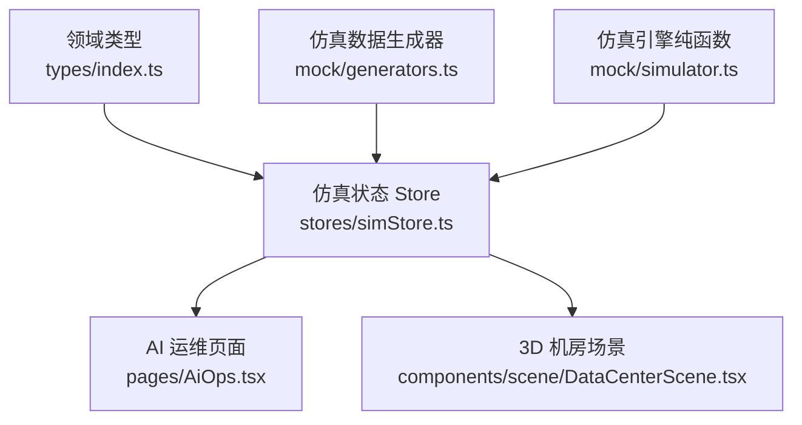
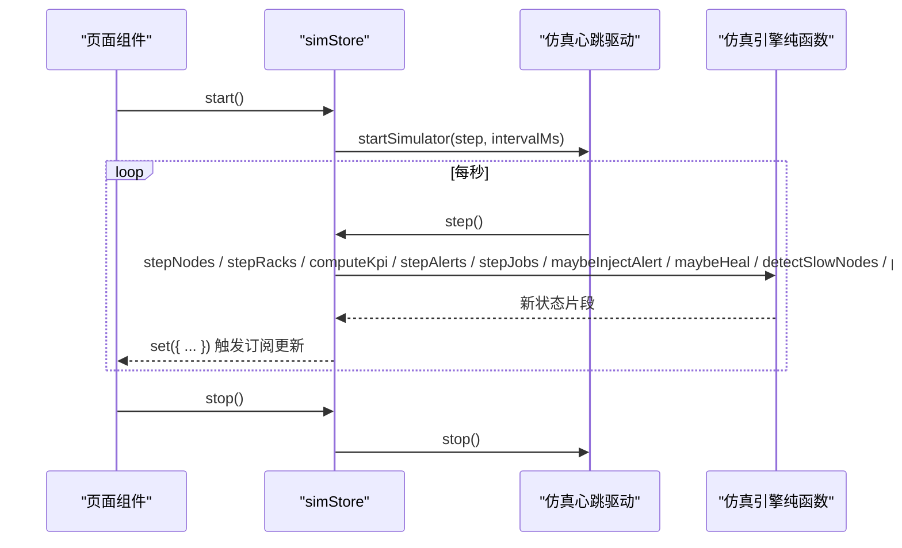
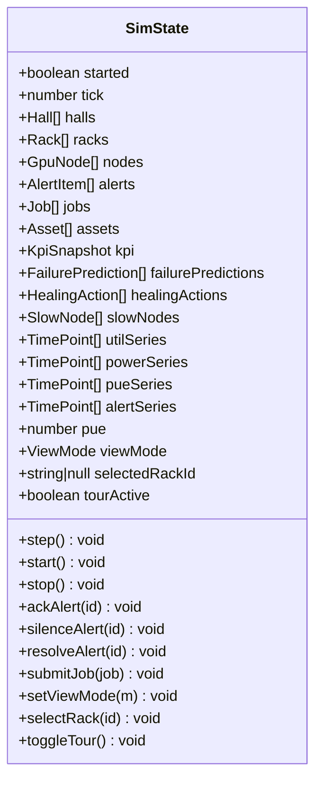
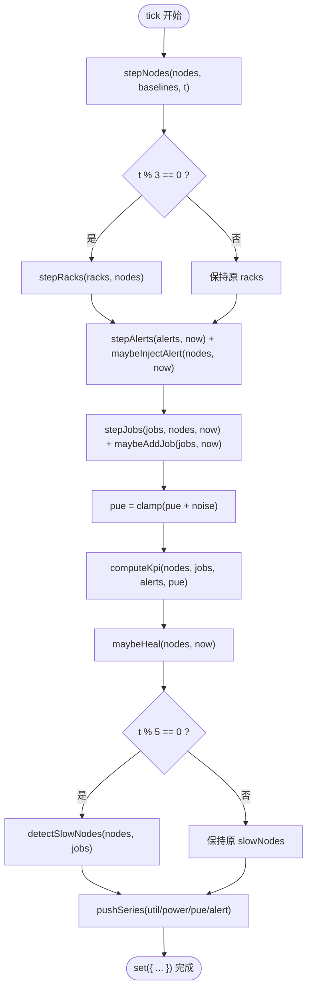
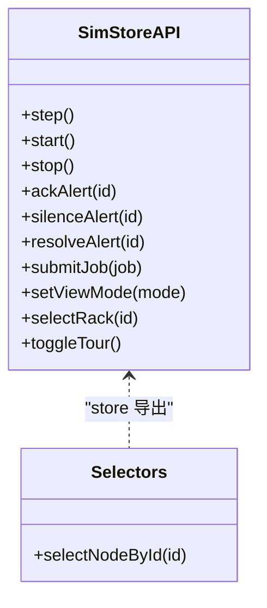
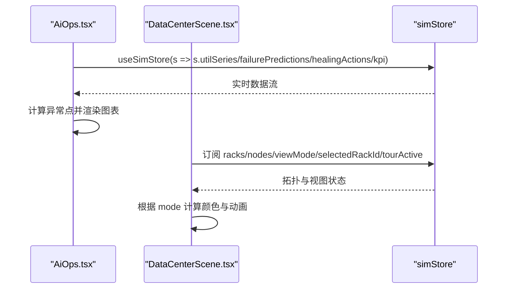
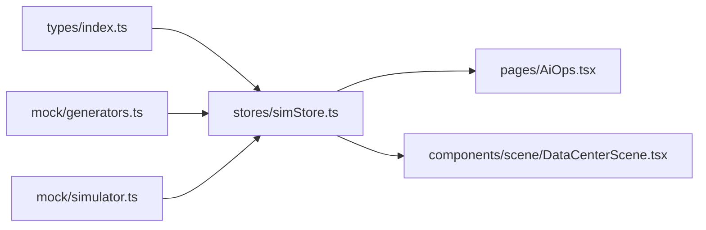

# 状态管理架构

<cite>
**本文引用的文件**   
- [simStore.ts](file://src/stores/simStore.ts)
- [index.ts](file://src/types/index.ts)
- [simulator.ts](file://src/mock/simulator.ts)
- [AiOps.tsx](file://src/pages/AiOps.tsx)
- [DataCenterScene.tsx](file://src/components/scene/DataCenterScene.tsx)
</cite>

## 目录
1. [引言](#引言)
2. [项目结构](#项目结构)
3. [核心组件](#核心组件)
4. [架构总览](#架构总览)
5. [详细组件分析](#详细组件分析)
6. [依赖关系分析](#依赖关系分析)
7. [性能与优化](#性能与优化)
8. [错误处理与调试](#错误处理与调试)
9. [结论](#结论)
10. [附录：使用示例与最佳实践](#附录使用示例与最佳实践)

## 引言
本文件面向 IDC AI 运维平台的状态管理子系统，聚焦 Zustand 驱动的仿真状态 store。文档将系统性说明 simStore 的状态结构设计、仿真引擎集成机制、实时数据更新流程、状态同步策略、操作 API 设计模式、Selectors 使用方式与性能优化技巧，并给出状态持久化、错误处理和调试工具的使用建议，以及典型页面中的状态流转和使用示例。

## 项目结构
本项目采用“领域类型 + 仿真驱动 + 状态 Store + 页面组件”的分层组织：
- 领域类型定义在 types 中，统一描述 GPU 节点、机柜、机房、告警、任务、KPI、时序等数据结构。
- 仿真逻辑以纯函数形式集中在 simulator 模块，避免与 UI 耦合。
- simStore 基于 Zustand 创建全局状态，封装状态变更动作和仿真心跳推进。
- 页面与可视化组件通过 useSimStore 订阅所需字段，实现响应式渲染。

**图表来源**
- [simStore.ts:1-270](file://src/stores/simStore.ts#L1-L270)
- [index.ts:1-192](file://src/types/index.ts#L1-L192)
- [simulator.ts:1-331](file://src/mock/simulator.ts#L1-L331)
- [AiOps.tsx:1-306](file://src/pages/AiOps.tsx#L1-L306)
- [DataCenterScene.tsx:1-401](file://src/components/scene/DataCenterScene.tsx#L1-L401)

**章节来源**
- [simStore.ts:1-270](file://src/stores/simStore.ts#L1-L270)
- [index.ts:1-192](file://src/types/index.ts#L1-L192)

## 核心组件
- 领域模型与枚举：GPU 型号、健康等级、告警等级/状态/来源、任务状态、队列类型、资产类型、生命周期状态、KPI 快照、时序点、视图模式、故障预测、自愈动作、慢节点检测等。
- 仿真引擎：节点指标漂移、机柜聚合、KPI 汇总、告警注入与流转、任务状态机、时序推进、慢节点检测、心跳驱动。
- 状态 Store：集中存储拓扑、节点、机柜、告警、任务、KPI、预测、自愈日志、慢节点、时序曲线、PUE、UI 控制项；提供 step/start/stop 及告警/任务/UI 操作。

**章节来源**
- [index.ts:1-192](file://src/types/index.ts#L1-L192)
- [simulator.ts:1-331](file://src/mock/simulator.ts#L1-L331)
- [simStore.ts:1-270](file://src/stores/simStore.ts#L1-L270)

## 架构总览
Zustand store 作为单一事实源，承载数据中心仿真运行时的全部状态。仿真引擎以纯函数暴露 stepNodes/stepRacks/computeKpi/stepAlerts/stepJobs/maybeInjectAlert/maybeHeal/detectSlowNodes/pushSeries 等能力，store 在每个 tick 调用这些函数计算新状态，并通过 set 原子更新。页面组件通过选择器订阅最小必要字段，确保细粒度重渲染。

**图表来源**
- [simStore.ts:142-265](file://src/stores/simStore.ts#L142-L265)
- [simulator.ts:322-331](file://src/mock/simulator.ts#L322-L331)

## 详细组件分析

### simStore 状态结构与职责
- 状态字段分组：
  - 拓扑与资源：halls/racks/nodes/assets
  - 运行时事件：alerts/jobs/failurePredictions/healingActions/slowNodes
  - 指标与时序：kpi/utilSeries/powerSeries/pueSeries/alertSeries/pue
  - UI 控制：viewMode/selectedRackId/tourActive
  - 仿真控制：started/tick
- 动作方法：
  - 仿真控制：step/start/stop
  - 告警处置：ackAlert/silenceAlert/resolveAlert
  - 任务提交：submitJob
  - UI 控制：setViewMode/selectRack/toggleTour
- 选择器：selectNodeById 提供按 id 查询节点的便捷选择器。

**图表来源**
- [simStore.ts:99-134](file://src/stores/simStore.ts#L99-L134)

**章节来源**
- [simStore.ts:99-134](file://src/stores/simStore.ts#L99-L134)
- [simStore.ts:267-270](file://src/stores/simStore.ts#L267-L270)

### 仿真引擎与状态管理的集成机制
- 初始化阶段：
  - 一次性生成拓扑、资产、初始任务、故障预测、基线映射。
  - 构造历史时序种子数据，用于图表展示。
  - 计算初始 KPI 快照。
- 运行时 tick：
  - 节点指标漂移：stepNodes(nodes, baselines, t)
  - 机柜聚合：stepRacks(racks, nodes)，每 3 tick 更新一次以降低开销
  - 告警注入与流转：maybeInjectAlert(nodes, now) + stepAlerts(alerts, now)
  - 任务状态机：stepJobs(jobs, nodes, now) + maybeAddJob(jobs, now)
  - PUE 缓慢波动：随机微扰并限制范围
  - KPI 汇总：computeKpi(nodes, jobs, alerts, pue)
  - 自愈日志：maybeHeal(nodes, now)
  - 慢节点检测：detectSlowNodes(nodes, jobs)，每 5 tick 计算一次
  - 时序推进：pushSeries(util/power/pue/alert series)
- 心跳驱动：
  - startSimulator(step, intervalMs) 返回 handle.stop()
  - store.start()/stop() 控制驱动启停，并维护 started 标志位

**图表来源**
- [simStore.ts:164-206](file://src/stores/simStore.ts#L164-L206)
- [simulator.ts:54-92](file://src/mock/simulator.ts#L54-L92)
- [simulator.ts:97-139](file://src/mock/simulator.ts#L97-L139)
- [simulator.ts:165-194](file://src/mock/simulator.ts#L165-L194)
- [simulator.ts:199-259](file://src/mock/simulator.ts#L199-L259)
- [simulator.ts:283-298](file://src/mock/simulator.ts#L283-L298)
- [simulator.ts:303-318](file://src/mock/simulator.ts#L303-L318)
- [simulator.ts:264-268](file://src/mock/simulator.ts#L264-L268)

**章节来源**
- [simStore.ts:40-58](file://src/stores/simStore.ts#L40-L58)
- [simStore.ts:138-162](file://src/stores/simStore.ts#L138-L162)
- [simStore.ts:164-206](file://src/stores/simStore.ts#L164-L206)
- [simulator.ts:54-92](file://src/mock/simulator.ts#L54-L92)
- [simulator.ts:97-139](file://src/mock/simulator.ts#L97-L139)
- [simulator.ts:165-194](file://src/mock/simulator.ts#L165-L194)
- [simulator.ts:199-259](file://src/mock/simulator.ts#L199-L259)
- [simulator.ts:283-298](file://src/mock/simulator.ts#L283-L298)
- [simulator.ts:303-318](file://src/mock/simulator.ts#L303-L318)
- [simulator.ts:264-268](file://src/mock/simulator.ts#L264-L268)

### 实时数据更新流程与状态同步策略
- 更新频率：默认每秒 tick，可通过 startSimulator 的 intervalMs 参数调整。
- 增量更新：仅对变化较大的字段进行批量 set，减少不必要的重渲染。
- 选择性计算：racks 每 3 tick 更新，slowNodes 每 5 tick 更新，降低 CPU 压力。
- 时序数据：pushSeries 固定长度滑动窗口，避免无限增长导致内存压力。
- 状态一致性：所有计算基于当前状态快照 get()，保证无竞态。

**章节来源**
- [simStore.ts:164-206](file://src/stores/simStore.ts#L164-L206)
- [simulator.ts:264-268](file://src/mock/simulator.ts#L264-L268)

### 状态操作 API 设计模式
- 不可变更新：所有 action 均返回新对象或数组，不直接修改原状态。
- 组合动作：step 内部组合多个仿真步骤，对外暴露简洁接口。
- 副作用隔离：仿真引擎为纯函数，副作用（定时器）由 store 管理。
- 选择器导出：selectNodeById 提供常用查询封装，便于组件按需订阅。

**图表来源**
- [simStore.ts:124-133](file://src/stores/simStore.ts#L124-L133)
- [simStore.ts:221-264](file://src/stores/simStore.ts#L221-L264)
- [simStore.ts:267-270](file://src/stores/simStore.ts#L267-L270)

**章节来源**
- [simStore.ts:124-133](file://src/stores/simStore.ts#L124-L133)
- [simStore.ts:221-264](file://src/stores/simStore.ts#L221-L264)
- [simStore.ts:267-270](file://src/stores/simStore.ts#L267-L270)

### 页面中的状态使用示例
- AI 运维页面：
  - 订阅 utilSeries/failurePredictions/healingActions/kpi
  - 基于 utilSeries 计算异常点，渲染 ECharts 折线图
  - 展示自愈动作日志列表
- 3D 机房场景：
  - 接收 racks/nodes/viewMode/selectedRackId/onSelectRack/tourActive 作为 props
  - 根据 viewMode 动态着色机柜，支持拓扑连线与巡检动画

**图表来源**
- [AiOps.tsx:19-38](file://src/pages/AiOps.tsx#L19-L38)
- [AiOps.tsx:96-124](file://src/pages/AiOps.tsx#L96-L124)
- [AiOps.tsx:131-171](file://src/pages/AiOps.tsx#L131-L171)
- [DataCenterScene.tsx:218-226](file://src/components/scene/DataCenterScene.tsx#L218-L226)
- [DataCenterScene.tsx:25-48](file://src/components/scene/DataCenterScene.tsx#L25-L48)
- [DataCenterScene.tsx:50-61](file://src/components/scene/DataCenterScene.tsx#L50-L61)

**章节来源**
- [AiOps.tsx:19-38](file://src/pages/AiOps.tsx#L19-L38)
- [AiOps.tsx:96-124](file://src/pages/AiOps.tsx#L96-L124)
- [AiOps.tsx:131-171](file://src/pages/AiOps.tsx#L131-L171)
- [DataCenterScene.tsx:25-48](file://src/components/scene/DataCenterScene.tsx#L25-L48)
- [DataCenterScene.tsx:50-61](file://src/components/scene/DataCenterScene.tsx#L50-L61)
- [DataCenterScene.tsx:218-226](file://src/components/scene/DataCenterScene.tsx#L218-L226)

## 依赖关系分析
- simStore 依赖：
  - 领域类型：types/index.ts
  - 仿真数据生成器：mock/generators.ts（拓扑、资产、任务、预测等）
  - 仿真引擎：mock/simulator.ts（纯函数集合）
- 页面组件依赖：
  - AiOps.tsx 依赖 simStore 的选择器与 actions
  - DataCenterScene.tsx 依赖 types 中的 Rack/GpuNode/ViewMode 等

**图表来源**
- [simStore.ts:1-21](file://src/stores/simStore.ts#L1-L21)
- [simStore.ts:22-37](file://src/stores/simStore.ts#L22-L37)
- [AiOps.tsx:1-8](file://src/pages/AiOps.tsx#L1-L8)
- [DataCenterScene.tsx:1-12](file://src/components/scene/DataCenterScene.tsx#L1-L12)

**章节来源**
- [simStore.ts:1-37](file://src/stores/simStore.ts#L1-L37)
- [AiOps.tsx:1-8](file://src/pages/AiOps.tsx#L1-L8)
- [DataCenterScene.tsx:1-12](file://src/components/scene/DataCenterScene.tsx#L1-L12)

## 性能与优化
- 选择器订阅：
  - 使用 useSimStore((s) => s.xxx) 精确订阅字段，避免全量重渲染。
  - 示例：AiOps 订阅 utilSeries/failurePredictions/healingActions/kpi。
- 选择性计算：
  - racks 每 3 tick 更新，slowNodes 每 5 tick 更新，减少昂贵计算。
- 时序数据限长：
  - pushSeries 默认最大长度 60，防止内存泄漏。
- 3D 场景优化：
  - compact 模式下降低 dpr 与网格细节，减少渲染压力。
- 计算缓存：
  - 页面内使用 useMemo 缓存图表配置与统计结果。

**章节来源**
- [AiOps.tsx:19-38](file://src/pages/AiOps.tsx#L19-L38)
- [simStore.ts:172-190](file://src/stores/simStore.ts#L172-L190)
- [simulator.ts:264-268](file://src/mock/simulator.ts#L264-L268)
- [DataCenterScene.tsx:231-235](file://src/components/scene/DataCenterScene.tsx#L231-L235)

## 错误处理与调试
- 错误处理：
  - 仿真引擎为纯函数，避免隐式副作用；store 中未显式 try/catch，建议在外部包装关键动作（如 submitJob）增加校验与容错。
  - 告警与自愈日志包含 status 字段，便于前端区分成功/失败/执行中状态。
- 调试工具：
  - 可在浏览器控制台打印 store 快照：useSimStore.getState()
  - 使用 React DevTools 查看 Zustand store 树与选择器订阅情况。
  - 在 step 中可临时记录 tick 与关键指标，辅助定位性能瓶颈。
- 持久化建议：
  - 可将关键状态（如 alerts/jobs/kpi/pue）序列化后存入 localStorage/sessionStorage。
  - 启动时从持久化存储恢复 lastTick/pue/series，保证会话连续性。
  - 注意：大数组（如 utilSeries/powerSeries）应限制大小并做压缩存储。

**章节来源**
- [simulator.ts:283-298](file://src/mock/simulator.ts#L283-L298)
- [simStore.ts:164-206](file://src/stores/simStore.ts#L164-L206)

## 结论
simStore 以 Zustand 为核心，结合纯函数仿真引擎，实现了 IDC AI 运维平台的实时状态管理与可视化联动。其设计强调不可变更新、选择性计算与细粒度订阅，兼顾性能与可维护性。通过清晰的 API 与选择器，页面组件能够高效消费状态，支撑告警中心、AI 诊断、3D 机房透视等核心功能。

## 附录：使用示例与最佳实践
- 在组件中订阅状态：
  - 使用 useSimStore((s) => s.field) 订阅最小必要字段。
  - 示例路径：[AiOps.tsx:19-38](file://src/pages/AiOps.tsx#L19-L38)
- 触发仿真控制：
  - 调用 store.start()/stop() 控制仿真启停。
  - 示例路径：[simStore.ts:209-219](file://src/stores/simStore.ts#L209-L219)
- 告警处置：
  - 使用 ackAlert/silenceAlert/resolveAlert 更新告警状态。
  - 示例路径：[simStore.ts:221-238](file://src/stores/simStore.ts#L221-L238)
- 提交任务：
  - 使用 submitJob 创建新任务并加入队列。
  - 示例路径：[simStore.ts:240-260](file://src/stores/simStore.ts#L240-L260)
- 3D 场景交互：
  - 通过 onSelectRack 更新 selectedRackId，触发选中效果与信息浮层。
  - 示例路径：[DataCenterScene.tsx:96-99](file://src/components/scene/DataCenterScene.tsx#L96-L99)

**章节来源**
- [AiOps.tsx:19-38](file://src/pages/AiOps.tsx#L19-L38)
- [simStore.ts:209-260](file://src/stores/simStore.ts#L209-L260)
- [DataCenterScene.tsx:96-99](file://src/components/scene/DataCenterScene.tsx#L96-L99)