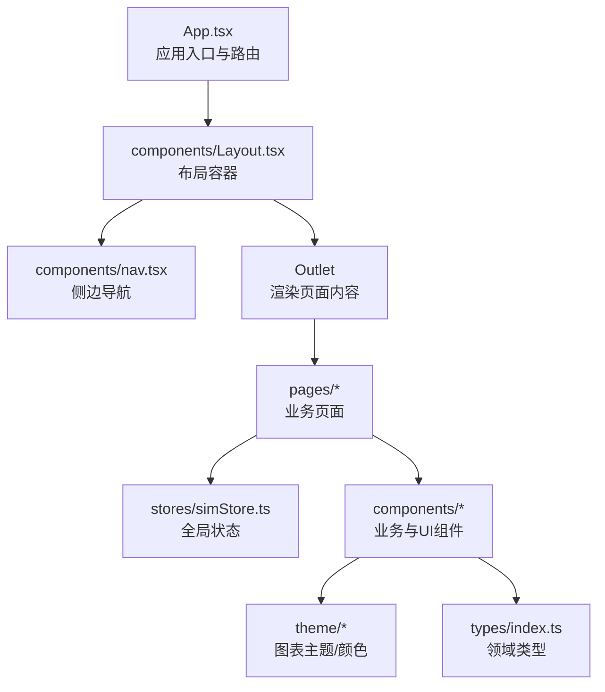
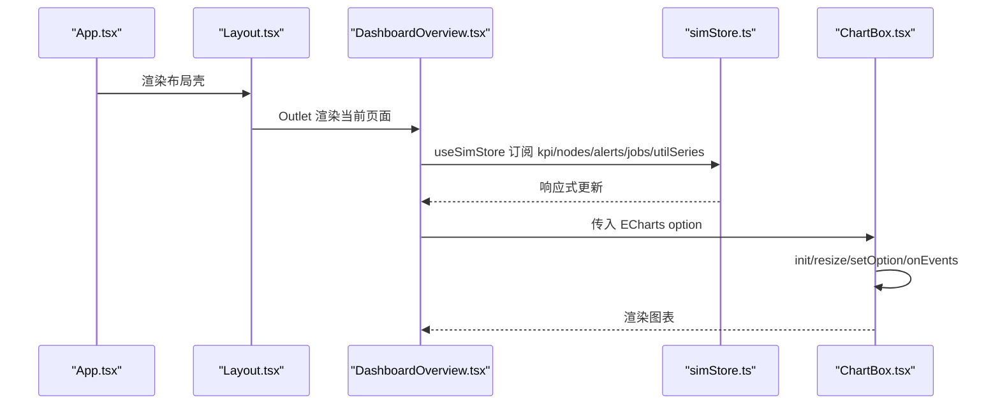
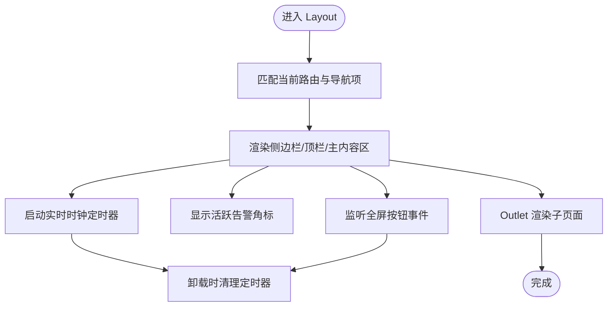
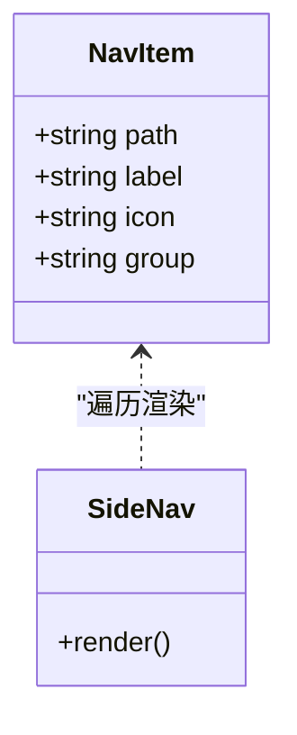
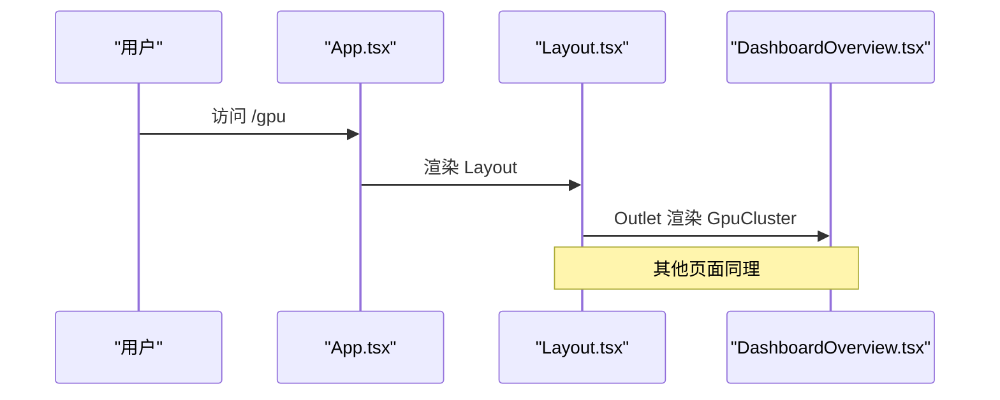
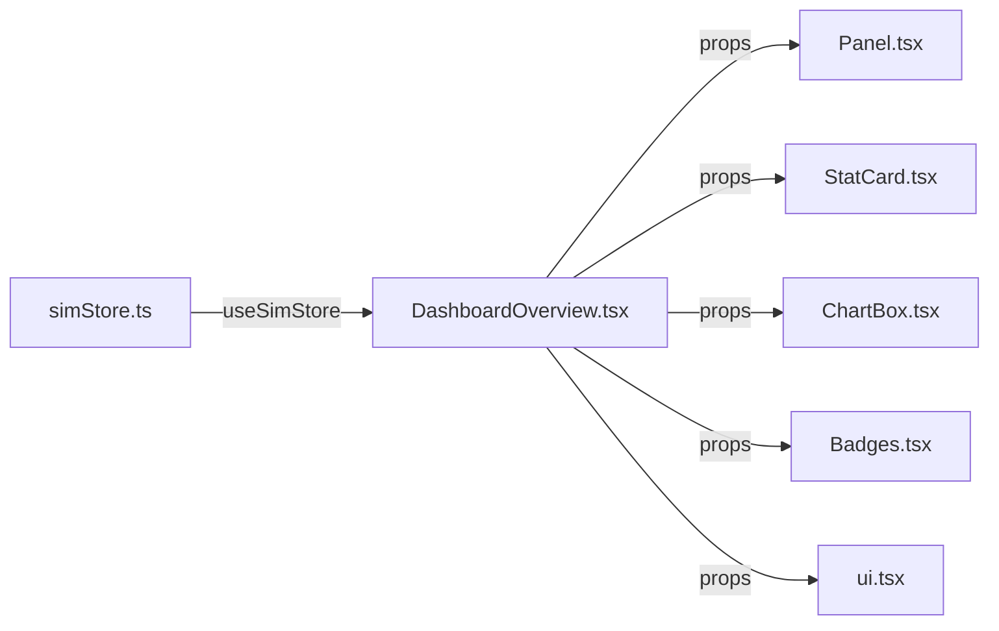
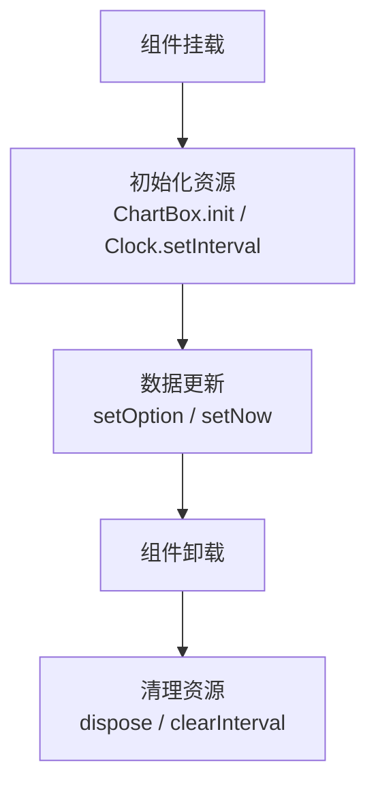
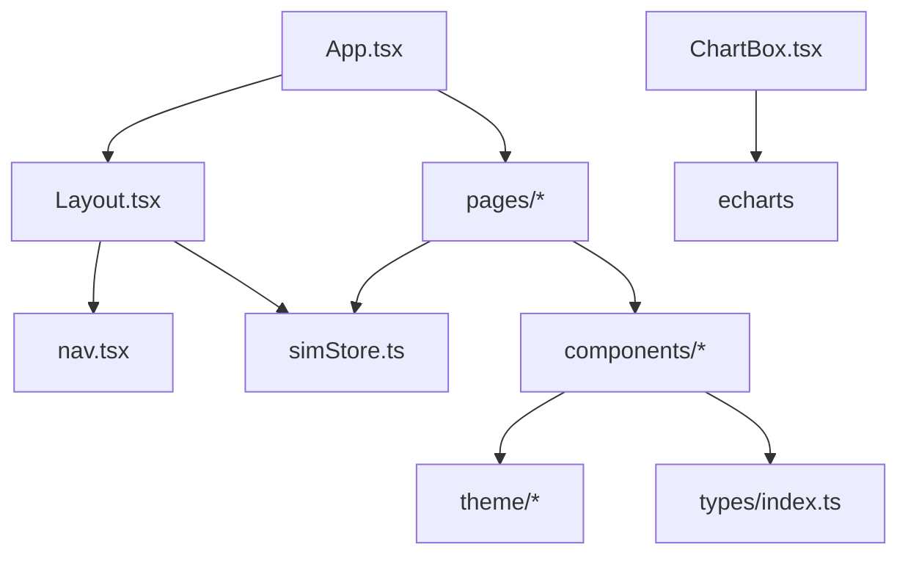

# 组件架构设计

<cite>
**本文引用的文件**   
- [App.tsx](file://src/App.tsx)
- [Layout.tsx](file://src/components/Layout.tsx)
- [nav.tsx](file://src/components/nav.tsx)
- [DashboardOverview.tsx](file://src/pages/DashboardOverview.tsx)
- [simStore.ts](file://src/stores/simStore.ts)
- [ui.tsx](file://src/components/ui.tsx)
- [Panel.tsx](file://src/components/Panel.tsx)
- [StatCard.tsx](file://src/components/StatCard.tsx)
- [ChartBox.tsx](file://src/components/ChartBox.tsx)
- [Badges.tsx](file://src/components/Badges.tsx)
- [index.ts](file://src/types/index.ts)
- [package.json](file://package.json)
</cite>

## 目录
1. [引言](#引言)
2. [项目结构](#项目结构)
3. [核心组件](#核心组件)
4. [架构总览](#架构总览)
5. [详细组件分析](#详细组件分析)
6. [依赖关系分析](#依赖关系分析)
7. [性能与可复用性](#性能与可复用性)
8. [排错指南](#排错指南)
9. [结论](#结论)

## 引言
本文件面向 IDC AI 运维平台的 React 前端，系统性梳理页面级、业务组件与基础 UI 组件的组织方式，重点说明 Layout 布局模式、侧边导航实现、路由集成、组件通信与状态共享策略，并给出生命周期管理、性能优化与可扩展实践。文档同时提供架构图与流程图，帮助读者快速理解并正确扩展平台组件。

## 项目结构
项目采用“页面 + 组件 + 状态 + 主题/类型”的分层组织：
- 页面层：位于 pages，承载具体业务视图（如总览、GPU 集群、告警中心、能耗等）。
- 组件层：位于 components，包含布局容器、通用面板、统计卡片、图表封装、徽章、基础 UI 控件以及 3D 场景。
- 状态层：stores 使用 Zustand 维护仿真数据与全局状态。
- 主题与类型：theme 提供图表主题与颜色；types 定义领域模型。
- 入口与路由：App.tsx 通过 react-router-dom 配置 HashRouter 与 Routes，统一挂载 Layout 与各页面。

**图示来源**
- [App.tsx:1-47](file://src/App.tsx#L1-L47)
- [Layout.tsx:1-125](file://src/components/Layout.tsx#L1-L125)
- [nav.tsx:1-69](file://src/components/nav.tsx#L1-L69)
- [DashboardOverview.tsx:1-301](file://src/pages/DashboardOverview.tsx#L1-L301)
- [simStore.ts:1-270](file://src/stores/simStore.ts#L1-L270)

**章节来源**
- [App.tsx:1-47](file://src/App.tsx#L1-L47)
- [package.json:1-38](file://package.json#L1-L38)

## 核心组件
- 应用入口与路由：App.tsx 负责初始化 ECharts 主题、启动/停止仿真引擎，并通过 HashRouter 注册各页面路由。
- 布局容器：Layout.tsx 提供侧边栏、顶栏、全屏切换、实时时钟与活跃告警角标，并使用 Outlet 渲染子页面。
- 侧边导航：nav.tsx 以分组配置驱动 NavLink 渲染，支持高亮与悬停动效。
- 页面示例：DashboardOverview.tsx 聚合 KPI、图表、3D 机房透视与任务队列等，展示典型页面组合模式。
- 全局状态：simStore.ts 基于 Zustand 提供仿真数据、KPI、时序曲线与一系列 action，供页面与组件订阅。
- 基础 UI：Panel.tsx、StatCard.tsx、ChartBox.tsx、Badges.tsx、ui.tsx 提供通用面板、指标卡、图表封装、徽章与基础控件。

**章节来源**
- [App.tsx:1-47](file://src/App.tsx#L1-L47)
- [Layout.tsx:1-125](file://src/components/Layout.tsx#L1-L125)
- [nav.tsx:1-69](file://src/components/nav.tsx#L1-L69)
- [DashboardOverview.tsx:1-301](file://src/pages/DashboardOverview.tsx#L1-L301)
- [simStore.ts:1-270](file://src/stores/simStore.ts#L1-L270)
- [Panel.tsx:1-54](file://src/components/Panel.tsx#L1-L54)
- [StatCard.tsx:1-83](file://src/components/StatCard.tsx#L1-L83)
- [ChartBox.tsx:1-61](file://src/components/ChartBox.tsx#L1-L61)
- [Badges.tsx:1-84](file://src/components/Badges.tsx#L1-L84)
- [ui.tsx:1-174](file://src/components/ui.tsx#L1-L174)

## 架构总览
整体采用“路由 → 布局 → 页面 → 组件 → 状态”的单向数据流：
- 路由层：App.tsx 通过 HashRouter 与 Routes 声明式配置页面路径。
- 布局层：Layout.tsx 作为 Shell，统一管理侧边导航、顶栏信息与全屏模式。
- 页面层：各页面组件组合业务组件与基础 UI，读取 simStore 数据并触发 action。
- 组件层：Panel/StatCard/ChartBox/Badges/ui 等提供可复用能力。
- 状态层：Zustand store 集中管理仿真数据、KPI、时序与 UI 控制项。

**图示来源**
- [App.tsx:18-46](file://src/App.tsx#L18-L46)
- [Layout.tsx:25-124](file://src/components/Layout.tsx#L25-L124)
- [DashboardOverview.tsx:15-274](file://src/pages/DashboardOverview.tsx#L15-L274)
- [simStore.ts:142-265](file://src/stores/simStore.ts#L142-L265)
- [ChartBox.tsx:17-60](file://src/components/ChartBox.tsx#L17-L60)

## 详细组件分析

### 布局组件 Layout 的设计模式
- 职责边界：Layout 不承载业务逻辑，仅负责页面外壳（侧边栏、顶栏、主内容区）与全局交互（全屏、时钟、活跃告警角标）。
- 导航联动：根据当前路由匹配 NAV_ITEMS，动态设置标题与高亮。
- 全屏模式：调用浏览器 Fullscreen API，并在 UI 上反馈状态。
- 与路由集成：使用 Outlet 渲染子路由页面，保证多页面共享同一布局。

**图示来源**
- [Layout.tsx:6-23](file://src/components/Layout.tsx#L6-L23)
- [Layout.tsx:25-124](file://src/components/Layout.tsx#L25-L124)

**章节来源**
- [Layout.tsx:1-125](file://src/components/Layout.tsx#L1-L125)

### 侧边导航组件的实现原理
- 配置驱动：NAV_ITEMS 与 NAV_GROUPS 定义导航分组与条目，便于扩展与维护。
- 路由集成：使用 NavLink 渲染链接，end 属性确保根路径精确匹配。
- 交互样式：isActive 回调返回类名，结合 Tailwind 实现高亮与悬停效果。
- 视觉增强：左侧指示条与图标在激活态发光，提升可读性。

**图示来源**
- [nav.tsx:3-22](file://src/components/nav.tsx#L3-L22)
- [nav.tsx:26-68](file://src/components/nav.tsx#L26-L68)

**章节来源**
- [nav.tsx:1-69](file://src/components/nav.tsx#L1-L69)

### 路由与组件的集成方式
- 路由声明：App.tsx 中通过 Routes 将多个页面挂载到 Layout 下，形成统一的布局壳。
- 页面内导航：DashboardOverview.tsx 使用 useNavigate 跳转到 /dc3d，体现页面间跳转。
- 导航高亮：Layout 根据 location.pathname 计算当前导航项，用于标题与高亮。

**图示来源**
- [App.tsx:28-44](file://src/App.tsx#L28-L44)
- [DashboardOverview.tsx:181-184](file://src/pages/DashboardOverview.tsx#L181-L184)

**章节来源**
- [App.tsx:1-47](file://src/App.tsx#L1-L47)
- [DashboardOverview.tsx:1-301](file://src/pages/DashboardOverview.tsx#L1-L301)

### 组件间的通信机制、Props 传递与状态共享
- 状态共享：页面与组件通过 useSimStore 订阅全局状态（kpi、nodes、alerts、jobs、utilSeries 等），实现跨层级数据同步。
- Props 传递：基础 UI 组件（Panel、StatCard、ChartBox、Badges、ui）通过 props 接收展示数据与行为回调，保持纯展示与低耦合。
- 事件回调：ChartBox 支持 onEvents 透传 ECharts 事件；SideNav 通过 NavLink 处理路由跳转；Layout 暴露全屏切换。

**图示来源**
- [simStore.ts:142-265](file://src/stores/simStore.ts#L142-L265)
- [DashboardOverview.tsx:15-274](file://src/pages/DashboardOverview.tsx#L15-L274)
- [Panel.tsx:4-16](file://src/components/Panel.tsx#L4-L16)
- [StatCard.tsx:3-16](file://src/components/StatCard.tsx#L3-L16)
- [ChartBox.tsx:6-12](file://src/components/ChartBox.tsx#L6-L12)
- [Badges.tsx:1-84](file://src/components/Badges.tsx#L1-L84)
- [ui.tsx:1-174](file://src/components/ui.tsx#L1-L174)

**章节来源**
- [simStore.ts:1-270](file://src/stores/simStore.ts#L1-L270)
- [DashboardOverview.tsx:1-301](file://src/pages/DashboardOverview.tsx#L1-L301)
- [Panel.tsx:1-54](file://src/components/Panel.tsx#L1-L54)
- [StatCard.tsx:1-83](file://src/components/StatCard.tsx#L1-L83)
- [ChartBox.tsx:1-61](file://src/components/ChartBox.tsx#L1-L61)
- [Badges.tsx:1-84](file://src/components/Badges.tsx#L1-L84)
- [ui.tsx:1-174](file://src/components/ui.tsx#L1-L174)

### 组件生命周期管理与错误处理
- 定时器管理：Layout 中的 Clock 使用 setInterval 每秒更新时间，并在卸载时 clearInterval，避免内存泄漏。
- 资源清理：ChartBox 在 useEffect 中创建 ECharts 实例与 ResizeObserver，并在卸载时 dispose 与 disconnect，防止 DOM 残留。
- 全屏 API：Layout 调用 document.fullscreenElement 与 requestFullscreen/exitFullscreen，捕获异常避免崩溃。
- 仿真引擎：App.tsx 在 useEffect 中启动 ensureEchartsTheme 与 start，并在卸载时 stop，保证生命周期对称。

**图示来源**
- [Layout.tsx:6-23](file://src/components/Layout.tsx#L6-L23)
- [ChartBox.tsx:17-60](file://src/components/ChartBox.tsx#L17-L60)
- [App.tsx:18-26](file://src/App.tsx#L18-L26)

**章节来源**
- [Layout.tsx:1-125](file://src/components/Layout.tsx#L1-L125)
- [ChartBox.tsx:1-61](file://src/components/ChartBox.tsx#L1-L61)
- [App.tsx:1-47](file://src/App.tsx#L1-L47)

### 性能优化技巧
- 图表动画开关：ChartBox 支持 noAnimation 参数，高频刷新场景禁用动画以降低重绘开销。
- 增量更新：ChartBox 使用 notMerge:false 与 lazyUpdate:false 进行增量 setOption，减少全量渲染。
- 观察尺寸变化：ChartBox 使用 ResizeObserver 自动 resize，避免手动计算尺寸。
- 列表与计算缓存：DashboardOverview 使用 useMemo 缓存健康度、Top5、告警分布与任务统计，降低重复计算。
- 节流聚合：simStore.step 中对 racks 每 3 tick 更新一次，slowNodes 每 5 tick 更新一次，降低计算压力。

**章节来源**
- [ChartBox.tsx:1-61](file://src/components/ChartBox.tsx#L1-L61)
- [DashboardOverview.tsx:25-66](file://src/pages/DashboardOverview.tsx#L25-L66)
- [simStore.ts:164-207](file://src/stores/simStore.ts#L164-L207)

### 可复用性设计原则
- 展示型组件：Panel、StatCard、ChartBox、Badges、ui 均为纯展示或轻量交互组件，通过 props 控制外观与行为。
- 配置驱动：nav.tsx 通过 NAV_ITEMS/NAV_GROUPS 配置导航，新增页面仅需添加配置即可出现在侧边栏。
- 类型安全：types/index.ts 定义领域模型，所有组件与 store 均基于强类型，提高可维护性与扩展性。
- 主题与颜色：theme/colors 与 echartsTheme 提供一致的主题系统，便于统一风格与扩展新配色。

**章节来源**
- [nav.tsx:1-69](file://src/components/nav.tsx#L1-L69)
- [types/index.ts:1-192](file://src/types/index.ts#L1-L192)
- [ChartBox.tsx:1-61](file://src/components/ChartBox.tsx#L1-L61)
- [Panel.tsx:1-54](file://src/components/Panel.tsx#L1-L54)
- [StatCard.tsx:1-83](file://src/components/StatCard.tsx#L1-L83)
- [Badges.tsx:1-84](file://src/components/Badges.tsx#L1-L84)
- [ui.tsx:1-174](file://src/components/ui.tsx#L1-L174)

## 依赖关系分析
- 外部依赖：react、react-router-dom、echarts、echarts-for-react、zustand、framer-motion、three/@react-three/*。
- 内部依赖：
  - App.tsx 依赖 Layout、stores、theme、pages。
  - Layout.tsx 依赖 nav、stores、react-router-dom。
  - DashboardOverview.tsx 依赖 stores、components、theme、types。
  - ChartBox.tsx 依赖 echarts、theme。
  - simStore.ts 依赖 types、mock/generators、mock/simulator。

**图示来源**
- [App.tsx:1-47](file://src/App.tsx#L1-L47)
- [Layout.tsx:1-125](file://src/components/Layout.tsx#L1-L125)
- [DashboardOverview.tsx:1-301](file://src/pages/DashboardOverview.tsx#L1-L301)
- [ChartBox.tsx:1-61](file://src/components/ChartBox.tsx#L1-L61)
- [simStore.ts:1-270](file://src/stores/simStore.ts#L1-L270)
- [package.json:11-22](file://package.json#L11-L22)

**章节来源**
- [package.json:1-38](file://package.json#L1-L38)
- [App.tsx:1-47](file://src/App.tsx#L1-L47)
- [Layout.tsx:1-125](file://src/components/Layout.tsx#L1-L125)
- [DashboardOverview.tsx:1-301](file://src/pages/DashboardOverview.tsx#L1-L301)
- [ChartBox.tsx:1-61](file://src/components/ChartBox.tsx#L1-L61)
- [simStore.ts:1-270](file://src/stores/simStore.ts#L1-L270)

## 性能与可复用性
- 渲染优化：
  - 使用 memo 包裹 ChartBox，减少不必要的重渲染。
  - 使用 useMemo 缓存页面级计算结果（健康度、Top5、告警分布、任务统计）。
  - 对频繁更新的序列数据（utilSeries/powerSeries/pueSeries/alertSeries）采用 pushSeries 追加，避免全量重建。
- 交互优化：
  - 图表动画按需关闭，避免高频刷新时的卡顿。
  - 侧边导航使用 NavLink 的高阶样式函数，减少额外状态。
- 可复用性：
  - 基础 UI 组件遵循单一职责，通过 props 暴露可控能力。
  - 导航与主题配置化，便于扩展新页面与新配色。
  - 类型定义集中，保障跨模块一致性。

**章节来源**
- [ChartBox.tsx:1-61](file://src/components/ChartBox.tsx#L1-L61)
- [DashboardOverview.tsx:25-66](file://src/pages/DashboardOverview.tsx#L25-L66)
- [simStore.ts:164-207](file://src/stores/simStore.ts#L164-L207)
- [nav.tsx:26-68](file://src/components/nav.tsx#L26-L68)

## 排错指南
- 图表不显示或尺寸异常：
  - 检查 ChartBox 外层是否提供高度（className 或默认 h-full）。
  - 确认 ensureEchartsTheme 已调用（App.tsx 中已初始化）。
- 实时时钟不更新：
  - 检查 Layout 中 useEffect 的定时器是否正确清理。
- 全屏按钮无效：
  - 检查浏览器是否允许全屏 API，注意权限与沙箱限制。
- 状态未更新：
  - 确认 useSimStore 选择器是否精确（避免订阅整棵状态树导致过度渲染）。
- 导航高亮异常：
  - 检查 NAV_ITEMS.path 与 Route path 是否一致，根路径需 end 精确匹配。

**章节来源**
- [ChartBox.tsx:17-60](file://src/components/ChartBox.tsx#L17-L60)
- [Layout.tsx:6-23](file://src/components/Layout.tsx#L6-L23)
- [App.tsx:18-26](file://src/App.tsx#L18-L26)
- [nav.tsx:36-40](file://src/components/nav.tsx#L36-L40)

## 结论
本架构通过清晰的分层与职责划分，实现了布局、导航、页面与组件的良好解耦；借助 Zustand 集中管理仿真数据与全局状态，配合 ECharts 封装与主题系统，提供了高性能、可复用的可视化能力。建议在扩展新页面时：
- 在 App.tsx 注册路由。
- 在 nav.tsx 添加导航配置。
- 在 pages 新建页面组件，组合 Panel/StatCard/ChartBox/Badges/ui。
- 通过 useSimStore 订阅与更新状态，必要时扩展 store actions。
- 遵循类型定义与主题规范，确保一致性与可维护性。