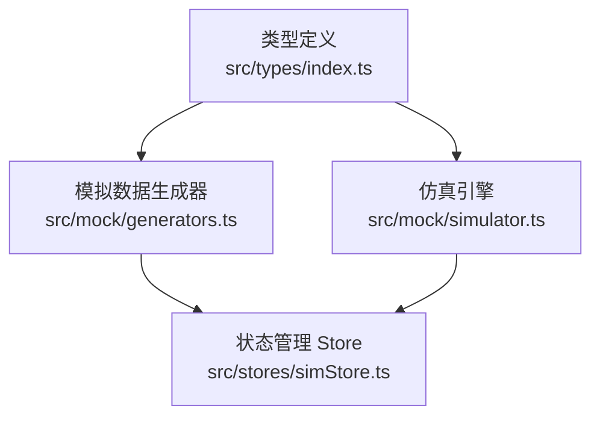
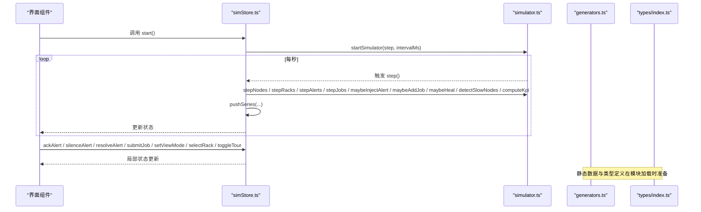
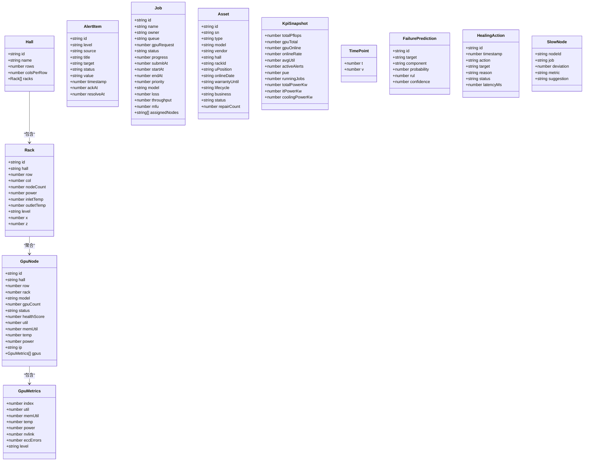
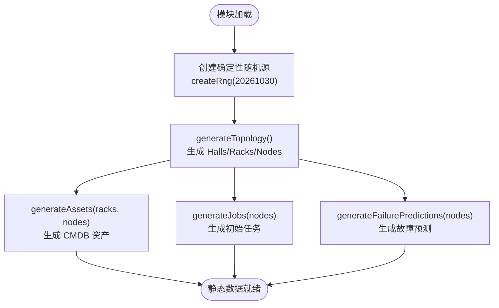
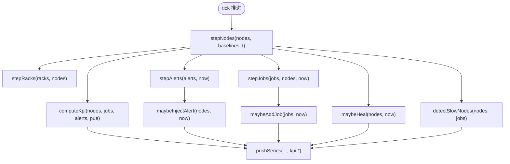
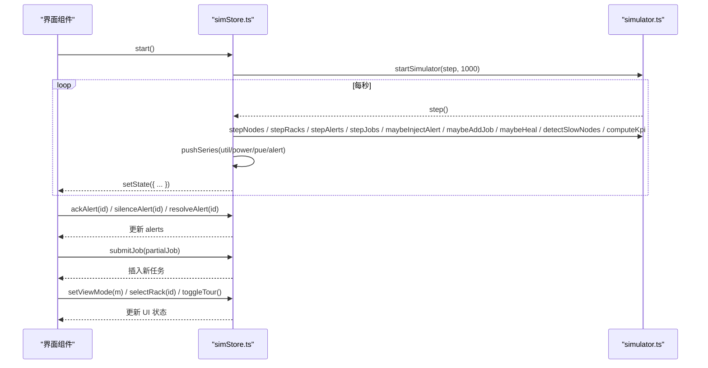
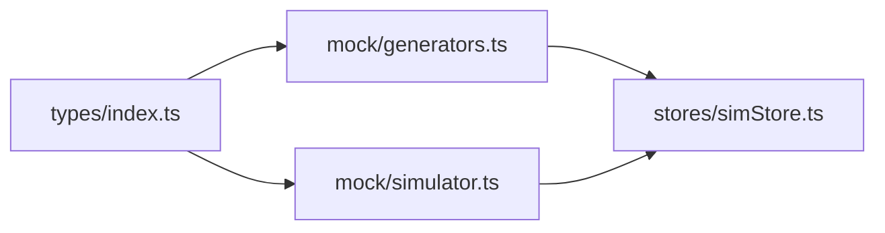

# 核心模块

<cite>
**本文引用的文件**   
- [simStore.ts](file://src/stores/simStore.ts)
- [generators.ts](file://src/mock/generators.ts)
- [simulator.ts](file://src/mock/simulator.ts)
- [types/index.ts](file://src/types/index.ts)
</cite>

## 目录
1. [引言](#引言)
2. [项目结构](#项目结构)
3. [核心组件](#核心组件)
4. [架构总览](#架构总览)
5. [详细组件分析](#详细组件分析)
6. [依赖关系分析](#依赖关系分析)
7. [性能与可扩展性](#性能与可扩展性)
8. [故障排查指南](#故障排查指南)
9. [结论](#结论)
10. [附录：API 与使用模式](#附录api-与使用模式)

## 引言
本文件面向 IDC AI 运维平台的核心仿真子系统，聚焦以下四个关键模块：
- 状态管理系统（Zustand store）：集中承载机房拓扑、节点指标、告警、任务、KPI、时序曲线与 UI 选择态。
- 模拟数据生成器：基于确定性随机种子，生成机房拓扑、资产台账、初始任务与故障预测。
- 仿真引擎：纯函数驱动的状态推进器，负责节点/机柜指标漂移、告警注入与流转、任务调度、KPI 汇总、慢节点检测与自愈日志。
- 类型定义系统：统一领域模型，贯穿生成器、仿真器与 store 的数据契约。

目标读者包括前端开发者、平台扩展者以及需要理解仿真机制的运维产品人员。文档以“从概念到实现”的方式展开，并附带架构图、流程图和 API 说明，帮助快速上手与二次开发。

## 项目结构
围绕核心模块的文件组织如下：
- src/types/index.ts：领域模型与枚举类型定义。
- src/mock/generators.ts：静态数据生成与拓扑布局常量。
- src/mock/simulator.ts：仿真引擎与心跳驱动。
- src/stores/simStore.ts：Zustand store，组合生成器与仿真器，暴露状态与操作方法。

**图表来源**
- [types/index.ts:1-192](file://src/types/index.ts#L1-L192)
- [generators.ts:1-408](file://src/mock/generators.ts#L1-L408)
- [simulator.ts:1-331](file://src/mock/simulator.ts#L1-L331)
- [simStore.ts:1-270](file://src/stores/simStore.ts#L1-L270)

**章节来源**
- [types/index.ts:1-192](file://src/types/index.ts#L1-L192)
- [generators.ts:1-408](file://src/mock/generators.ts#L1-L408)
- [simulator.ts:1-331](file://src/mock/simulator.ts#L1-L331)
- [simStore.ts:1-270](file://src/stores/simStore.ts#L1-L270)

## 核心组件
本节概述四大模块的职责边界与协作方式：
- 类型定义系统：提供 GpuNode、Rack、Hall、Job、AlertItem、Asset、KpiSnapshot、TimePoint、FailurePrediction、HealingAction、SlowNode 等核心类型，作为跨模块契约。
- 模拟数据生成器：基于固定种子的伪随机数，生成机房拓扑、节点指标、机柜布局、CMDB 资产、初始任务与故障预测；同时提供布局常量供 3D 场景复用。
- 仿真引擎：纯函数集合，按 tick 推进节点/机柜指标、注入告警、流转任务、计算 KPI、记录自愈动作、检测慢节点，并提供心跳驱动 startSimulator。
- 状态管理 Store：初始化静态数据，封装 step/start/stop 等方法，订阅 UI 交互（确认/静音/恢复告警、提交任务、切换视图、选择机柜），并通过 selector 暴露便捷查询。

**章节来源**
- [types/index.ts:1-192](file://src/types/index.ts#L1-L192)
- [generators.ts:1-408](file://src/mock/generators.ts#L1-L408)
- [simulator.ts:1-331](file://src/mock/simulator.ts#L1-L331)
- [simStore.ts:1-270](file://src/stores/simStore.ts#L1-L270)

## 架构总览
仿真子系统采用“Store 编排 + 纯函数引擎 + 确定性生成器”的分层设计：
- Store 不直接包含业务算法，而是调用 simulator 的纯函数完成状态推进。
- generators 仅负责一次性静态数据构造，避免在运行时引入不确定性。
- types 为所有数据结构提供强类型约束，确保各模块间契约一致。

**图表来源**
- [simStore.ts:142-265](file://src/stores/simStore.ts#L142-L265)
- [simulator.ts:54-139](file://src/mock/simulator.ts#L54-L139)
- [simulator.ts:165-331](file://src/mock/simulator.ts#L165-L331)
- [generators.ts:159-206](file://src/mock/generators.ts#L159-L206)
- [types/index.ts:1-192](file://src/types/index.ts#L1-L192)

## 详细组件分析

### 类型定义系统（types/index.ts）
- 设备与健康分级：GpuModel、HealthLevel、AlertLevel、AlertStatus、AlertSource。
- 资源实体：GpuMetrics、GpuNode、Rack、Hall。
- 运行态：AlertItem、Job、KpiSnapshot、TimePoint、FailurePrediction、HealingAction、SlowNode。
- UI 与展示：ViewMode。

该类型体系将“物理拓扑—运行指标—运维事件—可视化维度”统一建模，便于后续扩展新的指标或视图模式。

**图表来源**
- [types/index.ts:21-191](file://src/types/index.ts#L21-L191)

**章节来源**
- [types/index.ts:1-192](file://src/types/index.ts#L1-L192)

### 模拟数据生成器（generators.ts）
- 确定性随机：通过 Mulberry32 实现 createRng(seed)，保证刷新一致性。
- 拓扑常量：HALLS、ROWS_PER_HALL、COLS_PER_ROW、NODES_PER_RACK、GPUS_PER_NODE、GPU_MODELS、MODEL_PFLOPS、MODEL_TDP。
- 布局坐标：rackWorldPosition 用于 3D 场景定位。
- 节点生成：genNode 根据位置与型号分配算力、功耗、温度、利用率、ECC 错误等指标，并推导健康等级与健康分。
- 拓扑生成：generateTopology 构建 Hall/Rack/GpuNode 全量结构。
- 资产台账：generateAssets 生成服务器、交换机、存储阵列与备件 GPU 卡。
- 初始任务：generateJobs 生成训练/推理/调试三类任务，含进度、吞吐、MFU、loss 等指标。
- 故障预测：generateFailurePredictions 基于健康分生成概率与剩余寿命。

**图表来源**
- [generators.ts:17-35](file://src/mock/generators.ts#L17-L35)
- [generators.ts:159-206](file://src/mock/generators.ts#L159-L206)
- [generators.ts:216-328](file://src/mock/generators.ts#L216-L328)
- [generators.ts:345-384](file://src/mock/generators.ts#L345-L384)
- [generators.ts:389-405](file://src/mock/generators.ts#L389-L405)

**章节来源**
- [generators.ts:1-408](file://src/mock/generators.ts#L1-L408)

### 仿真引擎（simulator.ts）
- 基线构建：buildBaselines 为每个节点建立 util/temp/power/phase/speed 基线。
- 节点推进：stepNodes 基于正弦漂移与噪声更新指标，并重新评估健康等级与健康分。
- 机柜聚合：stepRacks 按节点聚合计算机柜功耗与冷热通道温度，并判定健康等级。
- KPI 汇总：computeKpi 统计算力、在线率、平均利用率、活跃告警、PUE 与能耗。
- 告警注入与流转：maybeInjectAlert 按概率注入告警；stepAlerts 让部分 active 告警自然恢复。
- 任务调度：stepJobs 实现 queued→running→succeeded/failed 的状态机，控制并发上限与指标演进；maybeAddJob 补充新任务维持队列活跃度。
- 时序推进：pushSeries 维护固定长度的时间序列。
- 自愈日志：maybeHeal 针对 critical 节点生成自愈动作。
- 慢节点检测：detectSlowNodes 识别偏离集群均值的慢节点，给出诊断建议。
- 心跳驱动：startSimulator 返回可停止的心跳句柄。

**图表来源**
- [simulator.ts:35-71](file://src/mock/simulator.ts#L35-L71)
- [simulator.ts:76-92](file://src/mock/simulator.ts#L76-L92)
- [simulator.ts:97-139](file://src/mock/simulator.ts#L97-L139)
- [simulator.ts:165-194](file://src/mock/simulator.ts#L165-L194)
- [simulator.ts:199-259](file://src/mock/simulator.ts#L199-L259)
- [simulator.ts:264-318](file://src/mock/simulator.ts#L264-L318)
- [simulator.ts:327-331](file://src/mock/simulator.ts#L327-L331)

**章节来源**
- [simulator.ts:1-331](file://src/mock/simulator.ts#L1-L331)

### 状态管理系统（simStore.ts）
- 初始化阶段：
  - 调用 generateTopology/generateAssets/generateJobs/generateFailurePredictions 构建静态数据。
  - buildBaselines 构建基线，seedSeries 生成 24h 历史曲线（算力利用率、功耗、PUE、告警数量）。
  - computeKpi/detectSlowNodes 计算初始 KPI 与慢节点列表。
- 状态字段：
  - 运行态：started、tick、pue。
  - 拓扑与指标：halls、racks、nodes、assets、kpi、failurePredictions、healingActions、slowNodes。
  - 运维事件：alerts、jobs。
  - 时序：utilSeries、powerSeries、pueSeries、alertSeries。
  - UI：viewMode、selectedRackId、tourActive。
- 操作方法：
  - step：单步推进引擎逻辑，批量更新状态。
  - start/stop：启动/停止心跳驱动。
  - ackAlert/silenceAlert/resolveAlert：告警生命周期操作。
  - submitJob：提交新任务，填充默认字段。
  - setViewMode/selectRack/toggleTour：UI 交互。
- Selector：selectNodeById 提供便捷查询。

**图表来源**
- [simStore.ts:42-46](file://src/stores/simStore.ts#L42-L46)
- [simStore.ts:49-58](file://src/stores/simStore.ts#L49-L58)
- [simStore.ts:142-265](file://src/stores/simStore.ts#L142-L265)
- [simulator.ts:54-139](file://src/mock/simulator.ts#L54-L139)
- [simulator.ts:165-331](file://src/mock/simulator.ts#L165-L331)

**章节来源**
- [simStore.ts:1-270](file://src/stores/simStore.ts#L1-L270)

## 依赖关系分析
- simStore.ts 依赖：
  - types/index.ts：导入所有领域类型。
  - mock/generators.ts：导入 generateTopology/generateAssets/generateJobs/generateFailurePredictions。
  - mock/simulator.ts：导入 buildBaselines/computeKpi/detectSlowNodes/maybeAddJob/maybeHeal/maybeInjectAlert/pushSeries/startSimulator 及 BaselineMap/SimDriverHandle。
- simulator.ts 依赖：
  - types/index.ts：导入运行态类型。
  - mock/generators.ts：导入 GPUS_PER_NODE/MODEL_PFLOPS/createRng/healthFromTemp。
- generators.ts 依赖：
  - types/index.ts：导入领域类型。

**图表来源**
- [simStore.ts:1-37](file://src/stores/simStore.ts#L1-L37)
- [simulator.ts:1-13](file://src/mock/simulator.ts#L1-L13)
- [generators.ts:1-12](file://src/mock/generators.ts#L1-L12)

**章节来源**
- [simStore.ts:1-37](file://src/stores/simStore.ts#L1-L37)
- [simulator.ts:1-13](file://src/mock/simulator.ts#L1-L13)
- [generators.ts:1-12](file://src/mock/generators.ts#L1-L12)

## 性能与可扩展性
- 性能要点：
  - 确定性随机：Mulberry32 避免 Math.random 的不确定性与抖动，提升可重复性。
  - 增量聚合：stepRacks 每 3 tick 更新一次，降低开销。
  - 慢节点检测：每 5 tick 执行一次，减少频繁计算。
  - 时序长度限制：pushSeries 固定最大长度，避免内存增长。
  - 并发上限：stepJobs 限制运行任务数量，防止过度负载。
- 可扩展点：
  - 新增指标：在 types/index.ts 扩展 GpuMetrics/KpiSnapshot，并在 simulator.ts 的 stepNodes/computeKpi 中接入。
  - 新增告警模板：在 ALERT_TEMPLATES 中添加规则，支持更多来源与阈值。
  - 自定义任务策略：扩展 maybeAddJob/stepJobs 的调度策略与优先级。
  - 视图模式：扩展 ViewMode 并在 UI 层适配渲染逻辑。
  - 基线策略：调整 buildBaselines 的 phase/speed 分布，改变波动特征。

[本节为通用指导，不直接分析具体文件]

## 故障排查指南
- 心跳未启动：
  - 检查是否调用了 start()，并确保浏览器环境支持 window.setInterval。
  - 若 stop() 后未重新启动，需再次调用 start()。
- 指标无变化：
  - 确认 step() 被每秒调用；检查 startSimulator 的 intervalMs 参数。
  - 检查 baselines 是否正确构建，节点是否处于 offline 状态（offline 节点不推进）。
- 告警不出现：
  - maybeInjectAlert 有概率过滤，属于预期行为；可通过增加 hotNodes 比例提高注入概率。
  - 检查 ALERT_TEMPLATES 配置是否覆盖所需场景。
- 任务不启动：
  - 检查 runningCount 是否达到 capacity 上限；确认存在 normal 状态的可用节点。
  - 校验 gpuRequest 与节点 GPU 数量的匹配关系。
- PUE 异常：
  - 检查 computeKpi 中的 PUE 输入值是否在合理范围；store 中 pue 会做上下界钳制。

**章节来源**
- [simulator.ts:165-194](file://src/mock/simulator.ts#L165-L194)
- [simulator.ts:199-259](file://src/mock/simulator.ts#L199-L259)
- [simulator.ts:97-139](file://src/mock/simulator.ts#L97-L139)
- [simStore.ts:164-219](file://src/stores/simStore.ts#L164-L219)

## 结论
本仿真子系统通过“类型契约 + 确定性生成 + 纯函数引擎 + Zustand store”的组合，实现了高内聚、低耦合的可扩展架构。Store 专注状态编排与 UI 交互，simulator 专注业务推进，generators 专注静态数据构造，types 提供统一领域模型。该设计便于扩展新指标、新告警与新视图，同时保持运行时的可预测性与可测试性。

[本节为总结性内容，不直接分析具体文件]

## 附录：API 与使用模式

### Zustand Store API
- 状态字段
  - started、tick、pue：运行控制与当前 PUE。
  - halls、racks、nodes、assets：拓扑与资产。
  - alerts、jobs、failurePredictions、healingActions、slowNodes：运维事件与分析结果。
  - utilSeries、powerSeries、pueSeries、alertSeries：时序曲线。
  - viewMode、selectedRackId、tourActive：UI 选择态。
- 操作方法
  - step：单步推进仿真。
  - start/stop：启动/停止心跳驱动。
  - ackAlert(id)/silenceAlert(id)/resolveAlert(id)：告警生命周期。
  - submitJob(partialJob)：提交新任务。
  - setViewMode(m)/selectRack(id)/toggleTour()：UI 交互。
- Selector
  - selectNodeById(id)：按 id 获取节点。

**章节来源**
- [simStore.ts:99-134](file://src/stores/simStore.ts#L99-L134)
- [simStore.ts:164-265](file://src/stores/simStore.ts#L164-L265)
- [simStore.ts:268-270](file://src/stores/simStore.ts#L268-L270)

### 仿真引擎 API
- 基线与推进
  - buildBaselines(nodes)：构建节点基线映射。
  - stepNodes(nodes, baselines, t)：推进节点指标。
  - stepRacks(racks, nodes)：推进机柜聚合指标。
- KPI 与检测
  - computeKpi(nodes, jobs, alerts, pue)：计算 KPI 快照。
  - detectSlowNodes(nodes, jobs)：检测慢节点。
- 告警与任务
  - maybeInjectAlert(nodes, now)：注入告警。
  - stepAlerts(alerts, now)：告警自然流转。
  - stepJobs(jobs, nodes, now)：任务状态机推进。
  - maybeAddJob(jobs, now)：补充新任务。
- 时序与自愈
  - pushSeries(series, t, v, maxLen)：时序数据推进。
  - maybeHeal(nodes, now)：自愈动作日志。
- 心跳驱动
  - startSimulator(step, intervalMs)：返回可停止的心跳句柄。

**章节来源**
- [simulator.ts:35-47](file://src/mock/simulator.ts#L35-L47)
- [simulator.ts:54-92](file://src/mock/simulator.ts#L54-L92)
- [simulator.ts:97-139](file://src/mock/simulator.ts#L97-L139)
- [simulator.ts:165-194](file://src/mock/simulator.ts#L165-L194)
- [simulator.ts:199-259](file://src/mock/simulator.ts#L199-L259)
- [simulator.ts:264-318](file://src/mock/simulator.ts#L264-L318)
- [simulator.ts:327-331](file://src/mock/simulator.ts#L327-L331)

### 生成器 API
- 随机与工具
  - createRng(seed)：确定性随机源。
  - rand/randInt/pick：常用随机工具。
- 拓扑与布局
  - generateTopology()：生成机房/机柜/节点拓扑。
  - rackWorldPosition(rack)：计算机柜世界坐标。
- 资产与任务
  - generateAssets(racks, nodes)：生成 CMDB 资产。
  - generateJobs(nodes)：生成初始任务。
  - generateFailurePredictions(nodes)：生成故障预测。
- 健康判定
  - healthFromTemp(temp, util)：根据温度与利用率判定健康等级。

**章节来源**
- [generators.ts:17-35](file://src/mock/generators.ts#L17-L35)
- [generators.ts:76-87](file://src/mock/generators.ts#L76-L87)
- [generators.ts:159-206](file://src/mock/generators.ts#L159-L206)
- [generators.ts:216-328](file://src/mock/generators.ts#L216-L328)
- [generators.ts:345-384](file://src/mock/generators.ts#L345-L384)
- [generators.ts:389-405](file://src/mock/generators.ts#L389-L405)
- [generators.ts:407-408](file://src/mock/generators.ts#L407-L408)