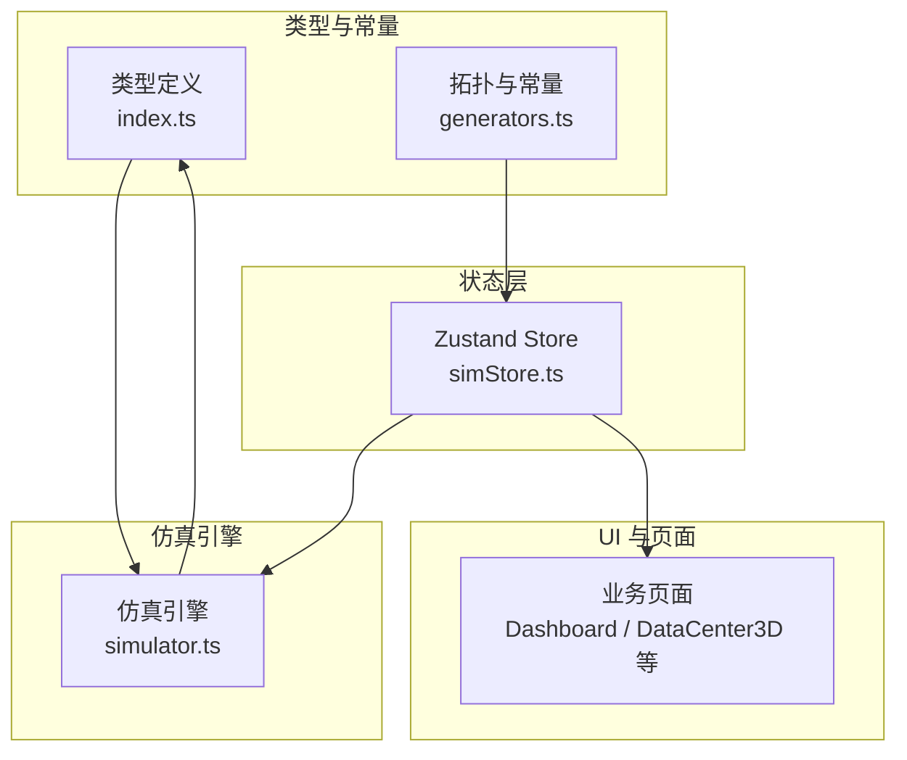
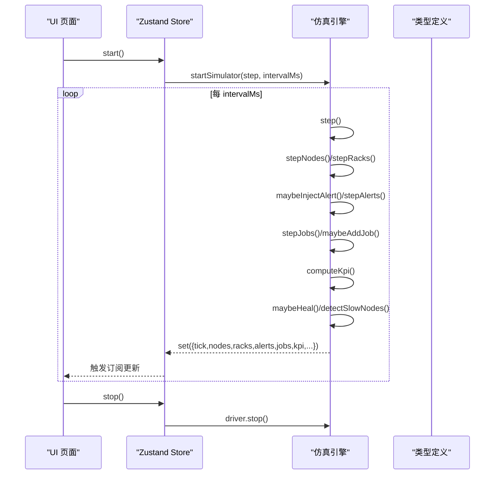
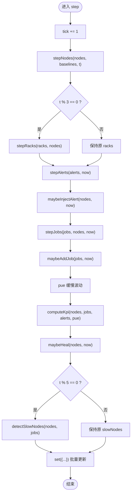
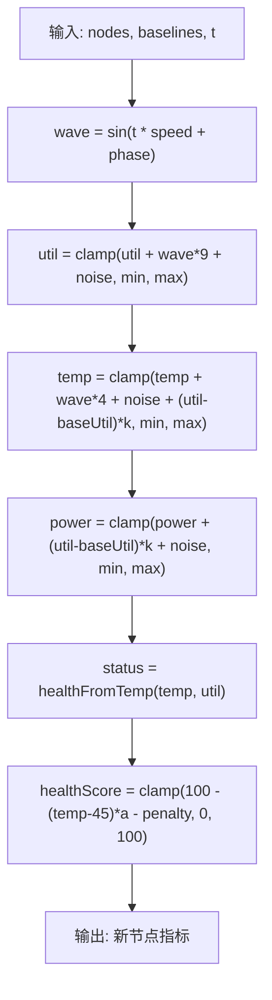
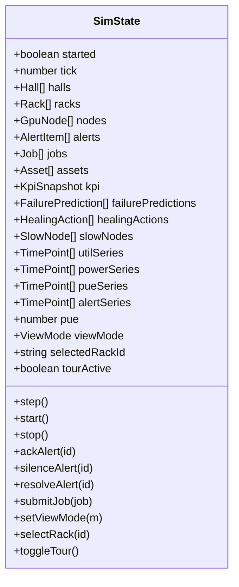
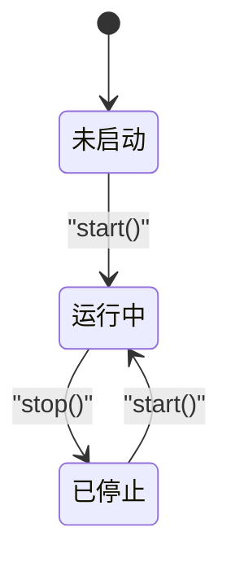
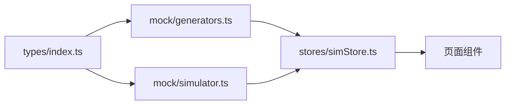

# 仿真引擎

<cite>
**本文引用的文件**   
- [simulator.ts](file://src/mock/simulator.ts)
- [generators.ts](file://src/mock/generators.ts)
- [simStore.ts](file://src/stores/simStore.ts)
- [index.ts](file://src/types/index.ts)
- [package.json](file://package.json)
</cite>

## 目录
1. [引言](#引言)
2. [项目结构](#项目结构)
3. [核心组件](#核心组件)
4. [架构总览](#架构总览)
5. [详细组件分析](#详细组件分析)
6. [依赖关系分析](#依赖关系分析)
7. [性能与扩展性](#性能与扩展性)
8. [故障排查指南](#故障排查指南)
9. [结论](#结论)
10. [附录：配置与测试建议](#附录配置与测试建议)

## 引言
本文件面向 IDC AI 运维平台中的“仿真引擎”，目标是帮助读者理解动态仿真的核心架构与运行机制，包括时间步进、状态更新循环、数据同步策略，以及 GPU 利用率波动、温度变化趋势、功耗动态调整、告警注入等实时数据模拟算法。同时说明仿真配置系统（时间间隔、更新频率、随机性与速度调节）、Zustand 状态管理集成方式、仿真生命周期管理（启动/暂停/恢复/停止），并提供测试、调试与性能监控方法，以及自定义仿真规则与扩展行为的指导。

## 项目结构
仿真相关代码主要分布在以下模块：
- 类型定义：领域模型、指标、任务、告警、KPI、时序点等统一在类型文件中声明。
- 数据生成器：负责拓扑、资产、任务、预测等静态数据的确定性初始化。
- 仿真引擎：纯函数式推进逻辑，包含节点指标漂移、机柜聚合、KPI 汇总、告警注入、任务状态机、自愈动作、慢节点检测、心跳驱动等。
- Zustand Store：封装仿真状态、订阅 UI、批量更新、生命周期控制。

**图表来源**
- [index.ts:1-192](file://src/types/index.ts#L1-L192)
- [generators.ts:1-408](file://src/mock/generators.ts#L1-L408)
- [simulator.ts:1-331](file://src/mock/simulator.ts#L1-L331)
- [simStore.ts:1-270](file://src/stores/simStore.ts#L1-L270)

**章节来源**
- [index.ts:1-192](file://src/types/index.ts#L1-L192)
- [generators.ts:1-408](file://src/mock/generators.ts#L1-L408)
- [simulator.ts:1-331](file://src/mock/simulator.ts#L1-L331)
- [simStore.ts:1-270](file://src/stores/simStore.ts#L1-L270)

## 核心组件
- 类型与领域模型：集中描述 GPU 节点、机柜、机房、告警、任务、KPI、时序点、自愈动作、慢节点等数据结构。
- 数据生成器：提供确定性伪随机数、机房拓扑、资产台账、初始任务、故障预测等。
- 仿真引擎：以纯函数形式实现时间步进，驱动节点指标、机柜指标、KPI、告警、任务、自愈、慢节点检测，并通过心跳驱动定时推进。
- Zustand Store：维护仿真状态，暴露 step/start/stop 等方法，将引擎输出批量写入 store，供 UI 订阅渲染。

**章节来源**
- [index.ts:1-192](file://src/types/index.ts#L1-L192)
- [generators.ts:1-408](file://src/mock/generators.ts#L1-L408)
- [simulator.ts:1-331](file://src/mock/simulator.ts#L1-L331)
- [simStore.ts:1-270](file://src/stores/simStore.ts#L1-L270)

## 架构总览
仿真引擎采用“纯函数 + 心跳驱动”的架构：
- 纯函数：stepNodes、stepRacks、computeKpi、maybeInjectAlert、stepAlerts、stepJobs、maybeAddJob、maybeHeal、detectSlowNodes 等均为无副作用的纯函数，便于测试与复用。
- 心跳驱动：startSimulator 使用 setInterval 周期性调用 step，step 内部组合多个纯函数完成一次仿真推进。
- 状态层：Zustand Store 持有全局状态，通过 set 批量更新，避免频繁重渲染；UI 通过选择器订阅所需字段。

**图表来源**
- [simStore.ts:142-265](file://src/stores/simStore.ts#L142-L265)
- [simulator.ts:327-330](file://src/mock/simulator.ts#L327-L330)
- [simulator.ts:54-70](file://src/mock/simulator.ts#L54-L70)
- [simulator.ts:76-92](file://src/mock/simulator.ts#L76-L92)
- [simulator.ts:97-139](file://src/mock/simulator.ts#L97-L139)
- [simulator.ts:165-194](file://src/mock/simulator.ts#L165-L194)
- [simulator.ts:199-259](file://src/mock/simulator.ts#L199-L259)
- [simulator.ts:283-298](file://src/mock/simulator.ts#L283-L298)
- [simulator.ts:303-318](file://src/mock/simulator.ts#L303-L318)

## 详细组件分析

### 时间步进机制与状态更新循环
- 心跳驱动：startSimulator 基于 window.setInterval 周期调用 step，默认间隔为 1000ms，可通过参数调整。
- 单步推进：step 内按顺序执行节点指标漂移、机柜聚合、告警注入与流转、任务状态机推进、PUE 波动、KPI 汇总、自愈日志追加、慢节点检测，最后批量 set 到 store。
- 节流优化：机柜聚合每 3 tick 更新一次，慢节点检测每 5 tick 计算一次，降低高频计算开销。

**图表来源**
- [simStore.ts:164-206](file://src/stores/simStore.ts#L164-L206)
- [simulator.ts:54-70](file://src/mock/simulator.ts#L54-L70)
- [simulator.ts:76-92](file://src/mock/simulator.ts#L76-L92)
- [simulator.ts:97-139](file://src/mock/simulator.ts#L97-L139)
- [simulator.ts:165-194](file://src/mock/simulator.ts#L165-L194)
- [simulator.ts:199-259](file://src/mock/simulator.ts#L199-L259)
- [simulator.ts:283-298](file://src/mock/simulator.ts#L283-L298)
- [simulator.ts:303-318](file://src/mock/simulator.ts#L303-L318)

**章节来源**
- [simStore.ts:164-206](file://src/stores/simStore.ts#L164-L206)
- [simulator.ts:327-330](file://src/mock/simulator.ts#L327-L330)

### 实时数据模拟算法
- GPU 利用率波动：围绕基线 util 做正弦漂移加噪声，并限制在合理区间。
- 温度变化趋势：根据利用率和健康等级映射，结合基线 temp 和噪声进行更新。
- 功耗动态调整：依据 util 变化与噪声调整 power，并限制上下限。
- 告警事件注入：按概率从模板中选择告警，优先针对热点节点或随机节点，支持自然恢复。

**图表来源**
- [simulator.ts:54-70](file://src/mock/simulator.ts#L54-L70)
- [generators.ts:83-87](file://src/mock/generators.ts#L83-L87)

**章节来源**
- [simulator.ts:54-70](file://src/mock/simulator.ts#L54-L70)
- [generators.ts:83-87](file://src/mock/generators.ts#L83-L87)

### 仿真配置系统
- 时间间隔控制：startSimulator 接受 intervalMs 参数，默认 1000ms。
- 数据更新频率：机柜聚合每 3 tick 更新，慢节点检测每 5 tick 计算。
- 随机性参数：使用确定性伪随机数生成器 createRng，保证刷新一致；引擎内使用独立 RNG 实例 simRng。
- 仿真速度调节：通过调整 intervalMs 可改变仿真节奏；也可在 step 中增加条件跳过部分计算以降低负载。

**章节来源**
- [simulator.ts:327-330](file://src/mock/simulator.ts#L327-L330)
- [simStore.ts:209-219](file://src/stores/simStore.ts#L209-L219)
- [generators.ts:17-26](file://src/mock/generators.ts#L17-L26)
- [simulator.ts:20-22](file://src/mock/simulator.ts#L20-L22)

### 与 Zustand 状态管理的集成
- 状态订阅：UI 通过 useSimStore 选择器订阅 halls/racks/nodes/alerts/jobs/kpi/pueSeries/utilSeries 等字段。
- 批量更新：step 内一次性 set 所有变更字段，减少多次 re-render。
- 性能优化：
  - 选择性更新：racks 与 slowNodes 低频更新。
  - 历史序列长度限制：pushSeries 保留固定长度，避免无限增长。
  - 确定性种子：拓扑与资产生成使用固定种子，确保可重复性。

**图表来源**
- [simStore.ts:99-134](file://src/stores/simStore.ts#L99-L134)

**章节来源**
- [simStore.ts:99-134](file://src/stores/simStore.ts#L99-L134)
- [simStore.ts:164-206](file://src/stores/simStore.ts#L164-L206)
- [simStore.ts:209-265](file://src/stores/simStore.ts#L209-L265)

### 仿真生命周期管理
- 启动：start 调用 startSimulator 注册定时器，设置 started=true。
- 暂停：store 未提供显式 pause；可通过外部逻辑清除定时器或阻止 step 执行来实现暂停。
- 恢复：再次调用 start 会重新创建定时器（需先 stop）。
- 停止：stop 清理定时器，设置 started=false。

**图表来源**
- [simStore.ts:209-219](file://src/stores/simStore.ts#L209-L219)
- [simulator.ts:327-330](file://src/mock/simulator.ts#L327-L330)

**章节来源**
- [simStore.ts:209-219](file://src/stores/simStore.ts#L209-L219)
- [simulator.ts:327-330](file://src/mock/simulator.ts#L327-L330)

### 告警注入与自愈动作
- 告警注入：按概率触发，优先选择处于 warning/critical 的节点，否则随机选择；模板涵盖 GPU、节点、网络、供电、制冷、存储等多来源。
- 告警自然恢复：active 告警有一定概率自动 resolved。
- 自愈动作：对 critical 节点按概率触发自动隔离、降频保护、任务迁移、服务重启、链路切换、快照等操作，记录延迟与状态。

**章节来源**
- [simulator.ts:165-194](file://src/mock/simulator.ts#L165-L194)
- [simulator.ts:283-298](file://src/mock/simulator.ts#L283-L298)

### 任务调度与状态机
- 排队任务：当并发运行数低于上限且满足概率时，尝试分配空闲节点并启动。
- 运行任务：进度递增，loss/throughput/mfu 波动，极小概率失败，达到进度则成功。
- 任务补充：维持队列活跃度，按队列类型与 GPU 需求生成新任务。

**章节来源**
- [simulator.ts:199-259](file://src/mock/simulator.ts#L199-L259)

### 慢节点检测
- 计算集群平均利用率，筛选显著低于均值的节点，关联其正在运行的任务，给出诊断与建议。

**章节来源**
- [simulator.ts:303-318](file://src/mock/simulator.ts#L303-L318)

## 依赖关系分析
- 类型依赖：所有模块共享 types/index.ts 中的领域模型。
- 生成器依赖：simStore 在初始化阶段调用 generateTopology/generateAssets/generateJobs/generateFailurePredictions。
- 引擎依赖：simulator.ts 依赖 generators.ts 提供的 healthFromTemp 与 MODEL_PFLOPS 等常量。
- Store 依赖：simStore.ts 同时依赖 generators.ts 与 simulator.ts，并将引擎输出作为状态持久化。

**图表来源**
- [index.ts:1-192](file://src/types/index.ts#L1-L192)
- [generators.ts:1-408](file://src/mock/generators.ts#L1-L408)
- [simulator.ts:1-331](file://src/mock/simulator.ts#L1-L331)
- [simStore.ts:1-270](file://src/stores/simStore.ts#L1-L270)

**章节来源**
- [index.ts:1-192](file://src/types/index.ts#L1-L192)
- [generators.ts:1-408](file://src/mock/generators.ts#L1-L408)
- [simulator.ts:1-331](file://src/mock/simulator.ts#L1-L331)
- [simStore.ts:1-270](file://src/stores/simStore.ts#L1-L270)

## 性能与扩展性
- 性能特性：
  - 纯函数设计避免副作用，便于并行化与缓存。
  - 低频聚合（racks/slowNodes）减少高频计算压力。
  - 历史序列长度限制防止内存膨胀。
  - 确定性随机数保证可复现性，利于回归测试。
- 扩展点：
  - 新增指标：在 stepNodes 中添加新的节点属性更新逻辑，并在 computeKpi 中汇总。
  - 自定义告警模板：扩展 ALERT_TEMPLATES，添加更多来源与阈值。
  - 自愈策略：扩展 HEAL_ACTIONS，加入新的自动化处置动作。
  - 任务调度策略：调整 stepJobs 的容量、优先级、失败率等参数。
  - 仿真速度：调整 intervalMs 或在 step 中增加条件分支控制计算粒度。

[本节为通用性能讨论，不直接分析具体文件]

## 故障排查指南
- 仿真不推进：
  - 检查是否调用了 start，确认 started 状态为 true。
  - 检查浏览器定时器是否被拦截或页面不可见导致节流。
- 数据异常：
  - 检查基线构建是否正确（buildBaselines），确认节点 id 与基线映射一致。
  - 检查阈值与范围限制（clamp）是否合理。
- 告警过多或过少：
  - 调整 maybeInjectAlert 的概率阈值与模板权重。
- 任务堆积：
  - 调整 stepJobs 的并发上限 capacity 与启动概率。
- 性能瓶颈：
  - 降低 update 频率（增大 intervalMs）。
  - 减少历史序列长度（pushSeries 的 maxLen）。
  - 关闭不必要的低频计算（如 slowNodes）。

**章节来源**
- [simStore.ts:164-206](file://src/stores/simStore.ts#L164-L206)
- [simulator.ts:54-70](file://src/mock/simulator.ts#L54-L70)
- [simulator.ts:165-194](file://src/mock/simulator.ts#L165-L194)
- [simulator.ts:199-259](file://src/mock/simulator.ts#L199-L259)

## 结论
该仿真引擎以纯函数为核心，配合心跳驱动与 Zustand 状态管理，实现了 IDC AI 运维平台的动态仿真能力。通过合理的节流策略与确定性随机数，系统在性能与可复现性之间取得平衡。未来可在指标扩展、告警模板、自愈策略与任务调度等方面持续增强，以满足更复杂的运维场景需求。

[本节为总结性内容，不直接分析具体文件]

## 附录：配置与测试建议
- 配置项建议：
  - intervalMs：仿真心跳间隔，默认 1000ms。
  - rackUpdateEvery：机柜聚合频率，默认每 3 tick。
  - slowNodeDetectEvery：慢节点检测频率，默认每 5 tick。
  - seriesMaxLength：时序历史长度，默认 60。
  - rngSeed：确定性随机种子，用于可复现实例。
- 测试用例建议：
  - 单元测试：验证 stepNodes/stepRacks/computeKpi 的输出边界与约束。
  - 集成测试：验证 start/stop 生命周期与定时器行为。
  - 回归测试：使用固定种子生成拓扑与任务，对比关键指标曲线。
- 调试工具建议：
  - 控制台打印 tick、nodes/racks/alerts/jobs 的关键摘要。
  - 可视化展示 utilSeries/powerSeries/pueSeries/alertSeries 曲线。
  - 性能计时：测量 step 执行耗时，定位热点函数。

[本节为通用指导，不直接分析具体文件]