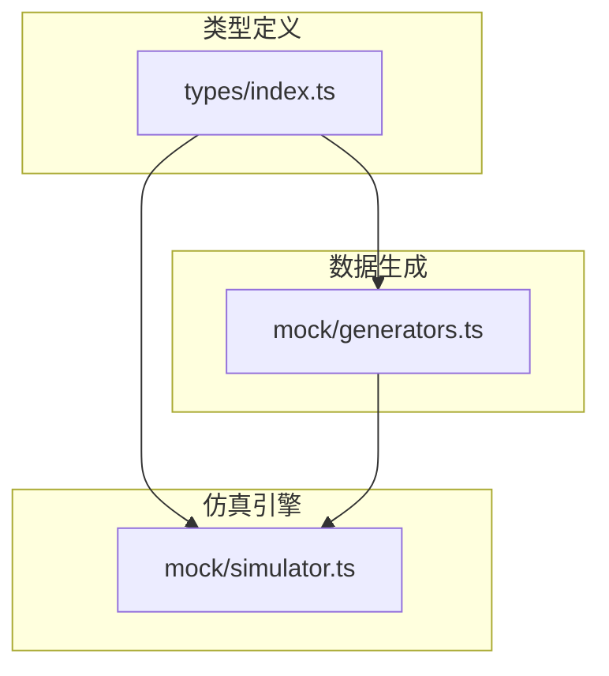
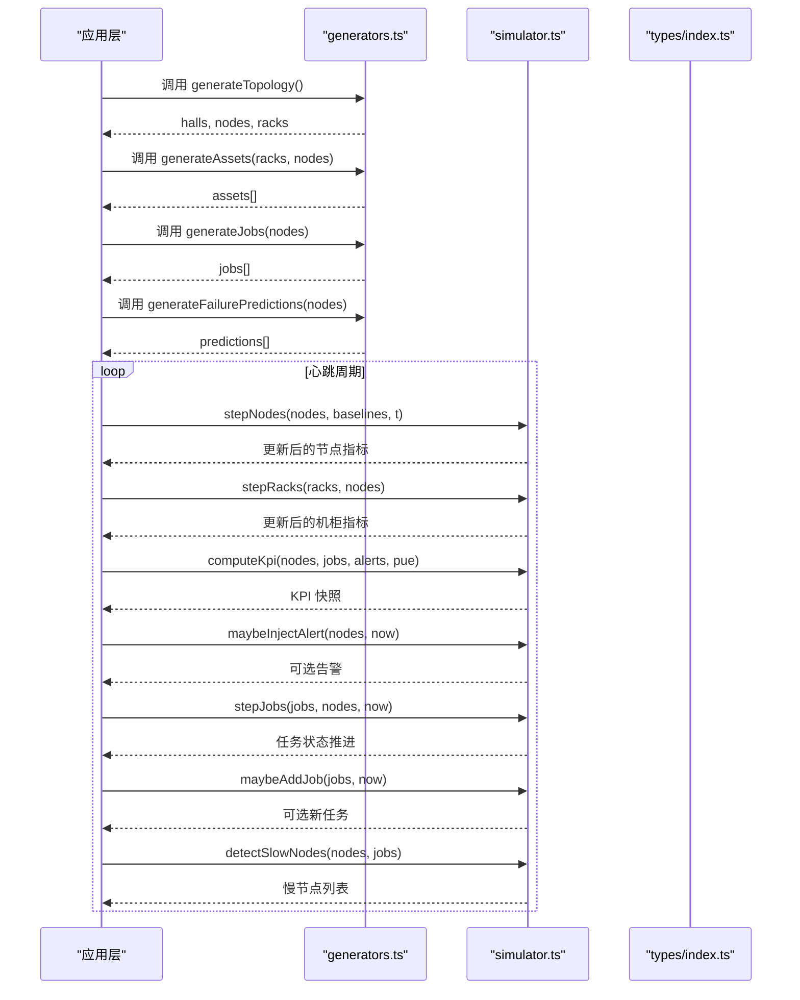
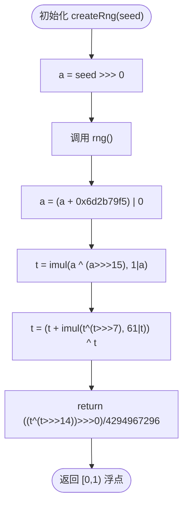
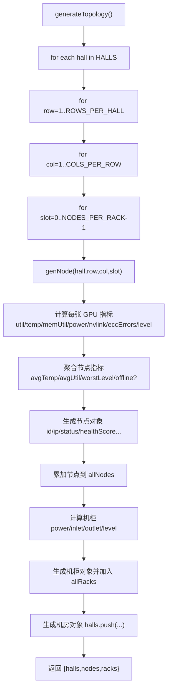
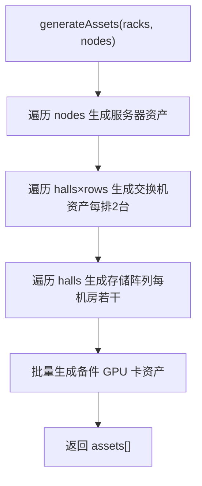
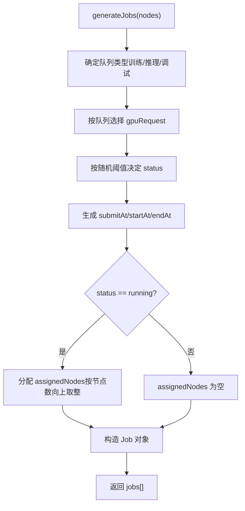
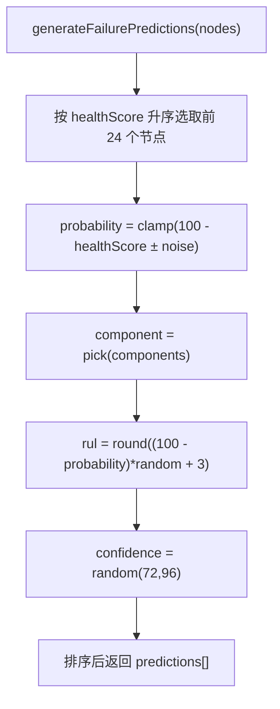
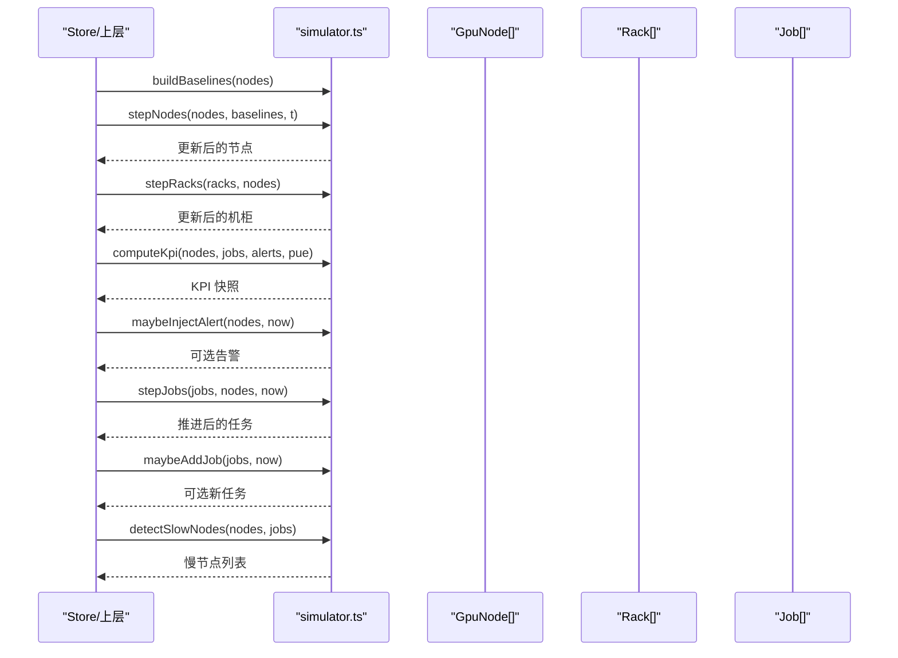
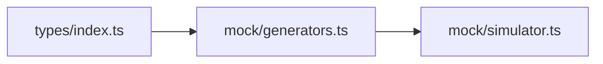
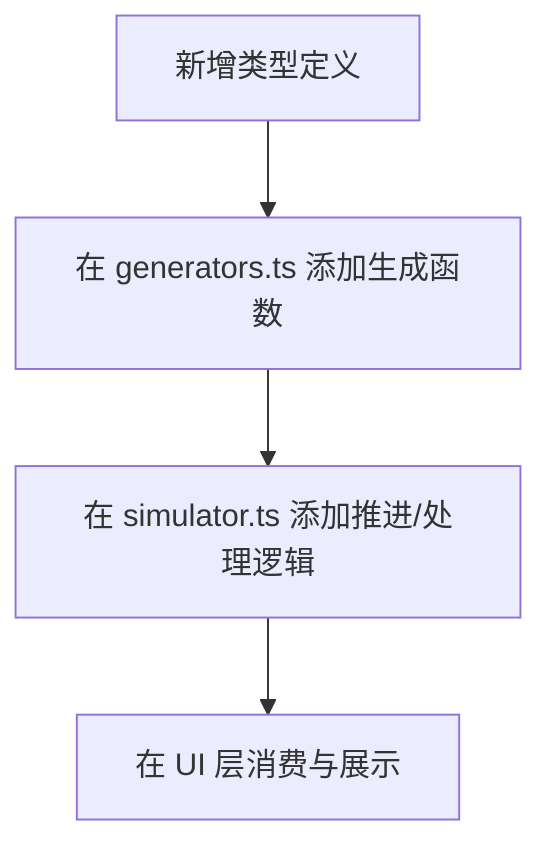

# 数据生成器

<cite>
**本文引用的文件**   
- [generators.ts](file://src/mock/generators.ts)
- [simulator.ts](file://src/mock/simulator.ts)
- [index.ts](file://src/types/index.ts)
</cite>

## 目录
1. [引言](#引言)
2. [项目结构](#项目结构)
3. [核心组件](#核心组件)
4. [架构总览](#架构总览)
5. [详细组件分析](#详细组件分析)
6. [依赖关系分析](#依赖关系分析)
7. [性能与大数据量策略](#性能与大数据量策略)
8. [API 使用示例与配置说明](#api-使用示例与配置说明)
9. [扩展新数据类型指南](#扩展新数据类型指南)
10. [故障排查](#故障排查)
11. [结论](#结论)

## 引言
本文件面向 IDC AI 运维平台的数据生成子系统，系统性梳理确定性伪随机数生成、GPU 节点拓扑生成、资产台账生成、计算任务生成与故障预测生成的实现原理与调用流程。文档同时提供可视化架构图、流程图和时序图，帮助读者从高层到代码层逐步理解数据生成器的设计思路、关键算法与扩展方式。

## 项目结构
数据生成相关逻辑集中在 mock 层：
- 类型定义位于 types 模块，统一描述领域模型。
- generators 模块负责“静态数据”的确定性生成：拓扑、资产、初始任务、故障预测等。
- simulator 模块负责“动态仿真”：心跳推进节点指标、机柜聚合、KPI 汇总、告警注入、任务状态机、慢节点检测等。

**图表来源**
- [index.ts:1-192](file://src/types/index.ts#L1-L192)
- [generators.ts:1-408](file://src/mock/generators.ts#L1-L408)
- [simulator.ts:1-331](file://src/mock/simulator.ts#L1-L331)

**章节来源**
- [index.ts:1-192](file://src/types/index.ts#L1-L192)
- [generators.ts:1-408](file://src/mock/generators.ts#L1-L408)
- [simulator.ts:1-331](file://src/mock/simulator.ts#L1-L331)

## 核心组件
- 确定性随机源：基于 Mulberry32 的可复现随机数生成器，为所有生成过程提供稳定种子。
- 拓扑生成器：按机房/排/列/槽位规则生成机柜、服务器节点与 GPU 卡指标。
- 资产台账生成器：自动生成服务器、交换机、存储阵列与备件 GPU 资产条目。
- 计算任务生成器：按队列类型分配资源请求，并生成时间戳、进度与调度结果。
- 故障预测生成器：基于健康度评分选择候选目标，计算故障概率与剩余寿命。
- 仿真引擎：心跳驱动节点指标漂移、机柜温度功耗聚合、KPI 汇总、告警注入、任务状态机流转、慢节点检测。

**章节来源**
- [generators.ts:14-408](file://src/mock/generators.ts#L14-L408)
- [simulator.ts:15-331](file://src/mock/simulator.ts#L15-L331)
- [index.ts:5-192](file://src/types/index.ts#L5-L192)

## 架构总览
数据生成与仿真整体分为两层：
- 静态生成层（generators）：一次性构建数据中心拓扑、资产、初始任务与故障预测。
- 动态仿真层（simulator）：以固定间隔推进系统状态，产出实时指标、告警、自愈动作与 KPI。

**图表来源**
- [generators.ts:159-206](file://src/mock/generators.ts#L159-L206)
- [generators.ts:216-328](file://src/mock/generators.ts#L216-L328)
- [generators.ts:345-384](file://src/mock/generators.ts#L345-L384)
- [generators.ts:389-405](file://src/mock/generators.ts#L389-L405)
- [simulator.ts:54-92](file://src/mock/simulator.ts#L54-L92)
- [simulator.ts:97-139](file://src/mock/simulator.ts#L97-L139)
- [simulator.ts:165-194](file://src/mock/simulator.ts#L165-L194)
- [simulator.ts:199-259](file://src/mock/simulator.ts#L199-L259)
- [simulator.ts:303-318](file://src/mock/simulator.ts#L303-L318)

## 详细组件分析

### 确定性伪随机数生成器（Mulberry32）与种子管理
- 实现要点：
  - 通过 createRng(seed) 返回一个闭包函数 rng()，内部维护 32 位无符号整型状态 a。
  - 每次调用执行加法、乘法与位移混合运算，输出 [0,1) 均匀分布浮点数。
  - 提供 rand(min,max)、randInt(min,max)、pick(arr) 等便捷方法。
- 种子管理：
  - 生成器模块使用固定种子 20261030，保证刷新页面时拓扑、资产、任务等静态数据一致。
  - 仿真引擎使用独立种子 88123，确保动态指标波动可复现且与静态生成解耦。
- 复杂度与特性：
  - 单次随机 O(1)，空间 O(1)。
  - 可重复性高，便于调试与回归测试。

**图表来源**
- [generators.ts:17-26](file://src/mock/generators.ts#L17-L26)

**章节来源**
- [generators.ts:17-35](file://src/mock/generators.ts#L17-L35)
- [simulator.ts:20-22](file://src/mock/simulator.ts#L20-L22)

### GPU 节点拓扑生成算法
- 布局常量：
  - 机房数量、每机房行数、每行列数、每机柜节点数、每节点 GPU 数。
  - 型号集合 H100/A100/910B，以及对应算力 PFLOPS 与功耗上限 TDP。
- 坐标与布局：
  - 两机房沿 x 轴左右分开，排沿 z 轴纵深，机柜沿 x 轴排列。
  - rackWorldPosition 根据 row/col/hall 计算世界坐标，供 3D 场景复用。
- 节点生成 genNode：
  - 根据 row/rack/slot 循环选择 GPU 型号。
  - 对每张 GPU 卡生成利用率、温度、显存占用、功耗、NVLink 带宽、ECC 错误与健康等级。
  - 节点级指标为各卡均值；少量节点被标记为离线；健康分数由温度、ECC 与最差健康等级综合计算。
- 拓扑生成 generateTopology：
  - 遍历机房/行/列/槽位，生成节点、机柜与机房对象。
  - 机柜功耗为节点功耗之和（kW），冷热通道温度由功率与噪声决定，健康等级由回风温度阈值判定。

**图表来源**
- [generators.ts:92-154](file://src/mock/generators.ts#L92-L154)
- [generators.ts:159-206](file://src/mock/generators.ts#L159-L206)

**章节来源**
- [generators.ts:37-81](file://src/mock/generators.ts#L37-L81)
- [generators.ts:92-154](file://src/mock/generators.ts#L92-L154)
- [generators.ts:159-206](file://src/mock/generators.ts#L159-L206)

### 资产台账生成规则
- 服务器资产：
  - 每台节点映射一条服务器资产，包含序列号、厂商、上架位置、上线日期、保修期、生命周期、业务归属、维修次数等。
  - 生命周期由年龄与保修到期日判断。
- 交换机资产：
  - 每排部署 2 台交换机，固定机架位置，业务标注 RDMA 计算网络。
- 存储阵列：
  - 每机房若干台，固定机架位置，业务标注并行文件存储。
- 备件 GPU：
  - 批量生成库存备件，随机仓库位置，业务标注备件库存。

**图表来源**
- [generators.ts:216-328](file://src/mock/generators.ts#L216-L328)

**章节来源**
- [generators.ts:216-328](file://src/mock/generators.ts#L216-L328)

### 计算任务生成算法
- 队列类型：训练、推理、调试。
- 资源请求：
  - 训练队列常见 64/128/256/512 卡。
  - 推理队列常见 8/16/32 卡。
  - 调试队列常见 1/2/4/8 卡。
- 状态分布：
  - 初始任务中 queued/running/succeeded 比例由随机阈值控制。
- 时间戳：
  - submitAt 为当前时间减去随机分钟数。
  - startAt/endAt 根据状态条件填充。
- 调度分配：
  - running 任务会分配若干节点 ID，数量为 ceil(gpuRequest / GPUS_PER_NODE)。

**图表来源**
- [generators.ts:345-384](file://src/mock/generators.ts#L345-L384)

**章节来源**
- [generators.ts:333-384](file://src/mock/generators.ts#L333-L384)

### 故障预测生成逻辑
- 健康度评估：
  - 节点健康分数由温度、ECC 错误与最差健康等级共同决定。
- 组件选择：
  - 候选组件包括 GPU、NVMe 磁盘、电源模块、风扇、内存条、HBM。
- 概率计算：
  - 概率与节点健康分数负相关，并在一定范围内抖动。
- RUL 与置信度：
  - RUL（剩余寿命天数）与概率反比，置信度在合理区间内随机。

**图表来源**
- [generators.ts:389-405](file://src/mock/generators.ts#L389-L405)

**章节来源**
- [generators.ts:389-405](file://src/mock/generators.ts#L389-L405)

### 仿真引擎与心跳推进
- 基线构建 buildBaselines：
  - 为每个节点记录初始 util/temp/power 与正弦波相位、速度。
- 节点推进 stepNodes：
  - 利用正弦波与噪声围绕基线漂移，限制范围，重新计算健康等级与健康分数。
- 机柜推进 stepRacks：
  - 按节点聚合机柜功耗与回风温度，判定健康等级。
- KPI 汇总 computeKpi：
  - 统计 GPU 总数/在线数、平均利用率、活跃告警数、PUE、运行任务数、IT 功耗与制冷功耗。
- 告警注入 maybeInjectAlert：
  - 每秒有一定概率产生告警，优先针对热点节点，模板化标题与值。
- 告警状态流转 stepAlerts：
  - active 告警有概率自动恢复。
- 任务状态机 stepJobs：
  - 排队任务按容量与概率启动；运行任务推进进度、loss、吞吐、MFU；极小概率失败。
- 新增任务 maybeAddJob：
  - 维持队列活跃度，随机生成新任务。
- 慢节点检测 detectSlowNodes：
  - 相对集群均值偏差超过阈值的节点被识别为慢节点，附带建议。

**图表来源**
- [simulator.ts:35-47](file://src/mock/simulator.ts#L35-L47)
- [simulator.ts:54-92](file://src/mock/simulator.ts#L54-L92)
- [simulator.ts:97-139](file://src/mock/simulator.ts#L97-L139)
- [simulator.ts:165-194](file://src/mock/simulator.ts#L165-L194)
- [simulator.ts:199-259](file://src/mock/simulator.ts#L199-L259)
- [simulator.ts:303-318](file://src/mock/simulator.ts#L303-L318)

**章节来源**
- [simulator.ts:35-47](file://src/mock/simulator.ts#L35-L47)
- [simulator.ts:54-92](file://src/mock/simulator.ts#L54-L92)
- [simulator.ts:97-139](file://src/mock/simulator.ts#L97-L139)
- [simulator.ts:165-194](file://src/mock/simulator.ts#L165-L194)
- [simulator.ts:199-259](file://src/mock/simulator.ts#L199-L259)
- [simulator.ts:303-318](file://src/mock/simulator.ts#L303-L318)

## 依赖关系分析
- generators.ts 依赖 types/index.ts 中的领域模型，用于强类型约束。
- simulator.ts 依赖 generators.ts 提供的 createRng、GPUS_PER_NODE、MODEL_PFLOPS、healthFromTemp。
- 类型定义作为公共契约，避免耦合具体实现细节。

**图表来源**
- [index.ts:1-192](file://src/types/index.ts#L1-L192)
- [generators.ts:1-12](file://src/mock/generators.ts#L1-L12)
- [simulator.ts:1-13](file://src/mock/simulator.ts#L1-L13)

**章节来源**
- [index.ts:1-192](file://src/types/index.ts#L1-L192)
- [generators.ts:1-12](file://src/mock/generators.ts#L1-L12)
- [simulator.ts:1-13](file://src/mock/simulator.ts#L1-L13)

## 性能与大数据量策略
- 确定性随机：
  - 使用 Mulberry32 替代 Math.random，提升可复现性与可控性。
- 批量生成优化：
  - 拓扑生成采用嵌套循环，时间复杂度 O(H×R×C×S×G)，其中 H 为机房数、R 为行数、C 为列数、S 为每机柜节点数、G 为每节点 GPU 数。
  - 资产生成线性于节点数与固定倍数（交换机/存储/备件）。
- 仿真推进：
  - stepNodes/stepRacks 均为 O(N) 或 O(R)，N 为节点数、R 为机柜数。
  - KPI 汇总 O(N)，告警注入 O(N)，任务推进 O(J)，J 为任务数。
- 大数据量建议：
  - 分块生成：将拓扑与资产拆分为批次，逐批写入存储或渲染管线。
  - 增量更新：仅对变化节点进行 diff 与重算，减少全量重建。
  - 采样与降采样：前端展示时对时序数据进行滑动窗口与下采样。
  - 预计算基线：buildBaselines 仅在拓扑变化时执行一次。
  - 并发与 Web Worker：将重型生成与仿真放入 Worker，避免阻塞 UI。

[本节为通用性能指导，不直接分析具体文件]

## API 使用示例与配置说明

### 主要 API 概览
- 确定性随机
  - createRng(seed): 返回随机函数 rng()
  - rand(min,max): 浮点区间随机
  - randInt(min,max): 整数区间随机
  - pick(arr): 数组元素随机选择
- 拓扑生成
  - generateTopology(): 返回 halls、nodes、racks
  - rackWorldPosition(rack): 计算机柜世界坐标
- 资产生成
  - generateAssets(racks, nodes): 返回资产列表
- 任务生成
  - generateJobs(nodes): 返回初始任务列表
- 故障预测
  - generateFailurePredictions(nodes): 返回预测列表
- 仿真引擎
  - buildBaselines(nodes): 构建节点基线
  - stepNodes(nodes, baselines, t): 推进节点指标
  - stepRacks(racks, nodes): 推进机柜指标
  - computeKpi(nodes, jobs, alerts, pue): 计算 KPI
  - maybeInjectAlert(nodes, now): 可能注入告警
  - stepAlerts(alerts, now): 告警状态流转
  - stepJobs(jobs, nodes, now): 任务状态推进
  - maybeAddJob(jobs, now): 可能新增任务
  - detectSlowNodes(nodes, jobs): 慢节点检测
  - startSimulator(step, intervalMs): 心跳驱动

**章节来源**
- [generators.ts:17-35](file://src/mock/generators.ts#L17-L35)
- [generators.ts:76-81](file://src/mock/generators.ts#L76-L81)
- [generators.ts:159-206](file://src/mock/generators.ts#L159-L206)
- [generators.ts:216-328](file://src/mock/generators.ts#L216-L328)
- [generators.ts:345-384](file://src/mock/generators.ts#L345-L384)
- [generators.ts:389-405](file://src/mock/generators.ts#L389-L405)
- [simulator.ts:35-47](file://src/mock/simulator.ts#L35-L47)
- [simulator.ts:54-92](file://src/mock/simulator.ts#L54-L92)
- [simulator.ts:97-139](file://src/mock/simulator.ts#L97-L139)
- [simulator.ts:165-194](file://src/mock/simulator.ts#L165-L194)
- [simulator.ts:199-259](file://src/mock/simulator.ts#L199-L259)
- [simulator.ts:303-318](file://src/mock/simulator.ts#L303-L318)
- [simulator.ts:327-330](file://src/mock/simulator.ts#L327-L330)

### 配置参数说明
- 拓扑常量
  - HALLS、ROWS_PER_HALL、COLS_PER_ROW、NODES_PER_RACK、GPUS_PER_NODE
  - GPU_MODELS、MODEL_PFLOPS、MODEL_TDP
  - RACK_W/RACK_D/RACK_H/AISLE_GAP/ROW_GAP/HALL_GAP
- 仿真参数
  - 心跳间隔 intervalMs（默认 1000ms）
  - 任务并发上限 capacity（演示值为 40）
  - 告警注入概率、恢复概率、新增任务概率等

**章节来源**
- [generators.ts:40-70](file://src/mock/generators.ts#L40-L70)
- [simulator.ts:200-201](file://src/mock/simulator.ts#L200-L201)
- [simulator.ts:327-330](file://src/mock/simulator.ts#L327-L330)

## 扩展新数据类型指南
- 步骤一：在 types/index.ts 中定义新类型接口与枚举。
- 步骤二：在 generators.ts 中添加生成函数，遵循现有模式：
  - 使用 createRng 派生的随机方法保证可复现。
  - 保持字段命名与语义清晰，必要时引入新的常量集合。
- 步骤三：在 simulator.ts 中增加对应的推进或处理逻辑：
  - 若为新实体指标，添加 stepXxx 函数。
  - 若需参与 KPI 或告警，修改 computeKpi 或 ALERT_TEMPLATES。
- 步骤四：在 UI 层消费新数据：
  - 在 store 或页面组件中订阅新字段，并进行可视化呈现。

[本节为概念性指导，不直接分析具体文件]

## 故障排查
- 随机数不一致：
  - 检查是否误用 Math.random 而非 createRng 派生函数。
  - 确认种子设置是否符合预期（静态生成与仿真引擎分别使用不同种子）。
- 拓扑异常：
  - 校验 ROWS_PER_HALL/COLS_PER_ROW/NODES_PER_RACK/GPUS_PER_NODE 配置。
  - 检查 IP 段与机房标识是否冲突。
- 资产缺失：
  - 确认 generateAssets 输入 racks/nodes 非空。
  - 检查交换机/存储/备件的生成循环边界。
- 任务未启动：
  - 检查 stepJobs 中 runningCount 与 capacity 的关系。
  - 确认节点状态是否为 normal 以供分配。
- 告警过多或过少：
  - 调整 maybeInjectAlert 的概率阈值。
  - 检查 ALERT_TEMPLATES 覆盖范围。
- 慢节点误报：
  - 调整 detectSlowNodes 的偏差阈值与筛选数量。

**章节来源**
- [generators.ts:17-35](file://src/mock/generators.ts#L17-L35)
- [generators.ts:159-206](file://src/mock/generators.ts#L159-L206)
- [generators.ts:216-328](file://src/mock/generators.ts#L216-L328)
- [simulator.ts:199-259](file://src/mock/simulator.ts#L199-L259)
- [simulator.ts:165-194](file://src/mock/simulator.ts#L165-L194)
- [simulator.ts:303-318](file://src/mock/simulator.ts#L303-L318)

## 结论
该数据生成器以确定性随机为核心，构建了稳定的 IDC 智算数据中心仿真环境。通过分层设计（静态生成+动态仿真），实现了拓扑、资产、任务与故障预测的全链路数据生产，并以心跳驱动的方式持续演进系统状态。其模块化与类型化的设计便于扩展与维护，适合用于平台演示、压测与回归验证。