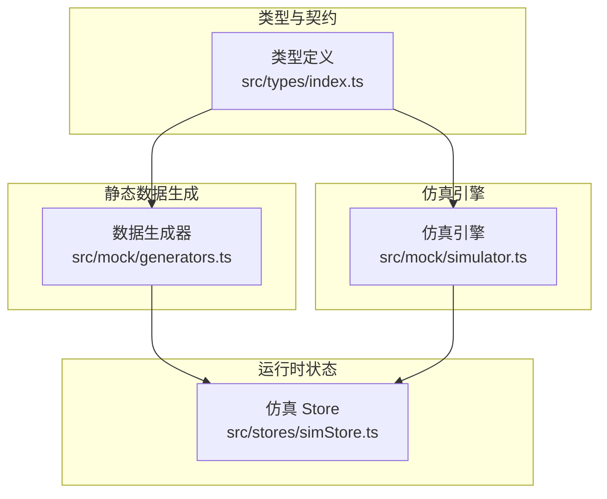
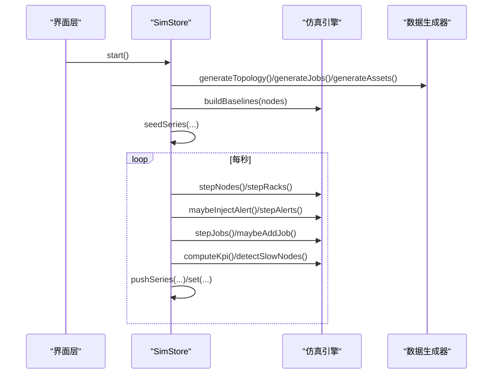
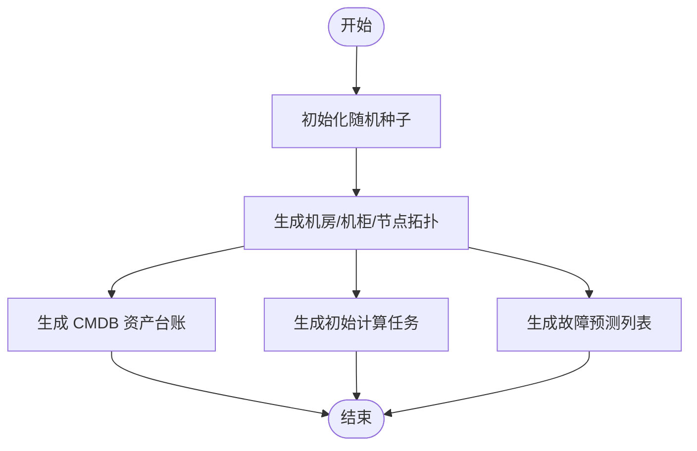
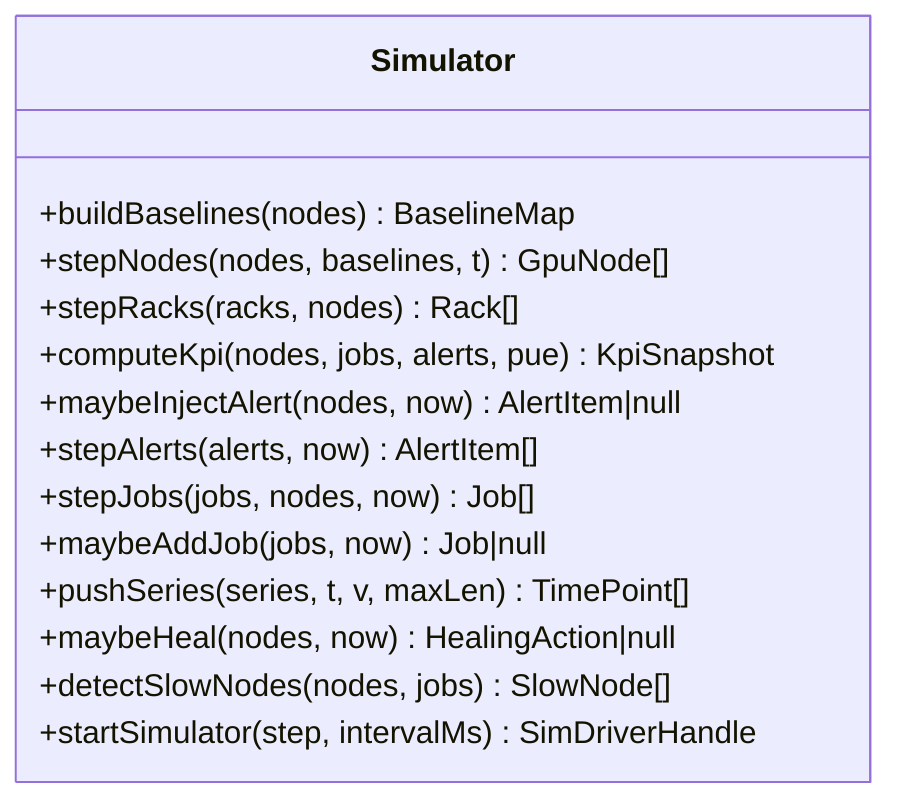
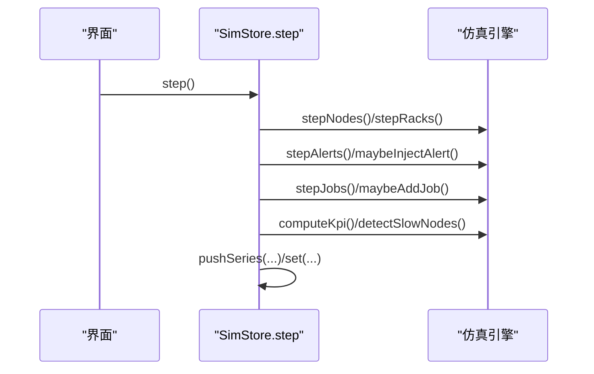
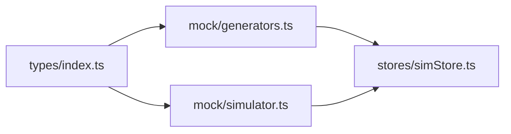

# 模拟数据系统

<cite>
**本文引用的文件**   
- [generators.ts](file://src/mock/generators.ts)
- [simulator.ts](file://src/mock/simulator.ts)
- [simStore.ts](file://src/stores/simStore.ts)
- [index.ts](file://src/types/index.ts)
</cite>

## 目录
1. [引言](#引言)
2. [项目结构](#项目结构)
3. [核心组件](#核心组件)
4. [架构总览](#架构总览)
5. [详细组件分析](#详细组件分析)
6. [依赖关系分析](#依赖关系分析)
7. [性能与扩展性](#性能与扩展性)
8. [测试数据生成策略](#测试数据生成策略)
9. [生产环境数据迁移方案](#生产环境数据迁移方案)
10. [故障排查指南](#故障排查指南)
11. [结论](#结论)

## 引言
本文件面向 IDC AI 运维平台的“模拟数据系统”，重点解析静态数据生成器与仿真引擎的实现原理，覆盖拓扑结构生成、节点状态模拟、告警事件注入、任务调度仿真、随机数种子管理以及时间序列数据处理。文档同时给出可扩展的数据源接入方式、自定义仿真规则方法、仿真配置选项与性能调优参数，并提供测试数据生成策略和生产环境数据迁移建议。

## 项目结构
模拟数据系统由三类模块组成：
- 类型定义：统一领域模型，约束各模块间数据结构契约。
- 静态数据生成器：基于确定性伪随机数生成机房拓扑、资产台账、初始任务和故障预测。
- 仿真引擎：心跳驱动的状态机推进，负责节点指标漂移、机柜聚合、KPI 汇总、告警注入与自愈动作、任务调度流转和慢节点检测。
- Store 层：组合上述能力，提供 UI 可订阅的运行时状态、控制启停及用户交互操作。

**图表来源**
- [index.ts:1-192](file://src/types/index.ts#L1-L192)
- [generators.ts:1-408](file://src/mock/generators.ts#L1-L408)
- [simulator.ts:1-331](file://src/mock/simulator.ts#L1-L331)
- [simStore.ts:1-270](file://src/stores/simStore.ts#L1-L270)

**章节来源**
- [index.ts:1-192](file://src/types/index.ts#L1-L192)
- [generators.ts:1-408](file://src/mock/generators.ts#L1-L408)
- [simulator.ts:1-331](file://src/mock/simulator.ts#L1-L331)
- [simStore.ts:1-270](file://src/stores/simStore.ts#L1-L270)

## 核心组件
- 类型定义（index.ts）：集中定义 GPU 型号、健康等级、告警、任务、资产、KPI、时序点等核心实体，作为生成器与仿真器的共同契约。
- 数据生成器（generators.ts）：实现确定性伪随机数、机房拓扑、机柜/节点/单卡指标、CMDB 资产、初始计算任务、故障预测等静态数据生成。
- 仿真引擎（simulator.ts）：纯函数式心跳驱动，包含基线构建、节点指标步进、机柜聚合、KPI 汇总、告警注入与恢复、任务状态机、慢节点检测、自愈动作日志、时间序列推进与定时器驱动。
- Store（simStore.ts）：初始化静态数据、维护运行态、编排仿真步骤、暴露 UI 操作接口并驱动定时循环。

**章节来源**
- [index.ts:1-192](file://src/types/index.ts#L1-L192)
- [generators.ts:1-408](file://src/mock/generators.ts#L1-L408)
- [simulator.ts:1-331](file://src/mock/simulator.ts#L1-L331)
- [simStore.ts:1-270](file://src/stores/simStore.ts#L1-L270)

## 架构总览
仿真系统采用“静态生成 + 动态仿真”的分层架构：
- 启动阶段：生成拓扑、资产、初始任务与预测，建立节点基线，构造历史时序。
- 运行阶段：Store 以固定间隔调用 step，依次推进节点、机柜、告警、任务、PUE、KPI、自愈日志、慢节点检测，并更新时序曲线。
- 解耦设计：仿真引擎不直接依赖 Store，避免循环引用；Store 仅负责状态装配与生命周期管理。

**图表来源**
- [simStore.ts:142-219](file://src/stores/simStore.ts#L142-L219)
- [simulator.ts:35-139](file://src/mock/simulator.ts#L35-L139)
- [simulator.ts:165-259](file://src/mock/simulator.ts#L165-L259)
- [simulator.ts:303-331](file://src/mock/simulator.ts#L303-L331)
- [generators.ts:159-206](file://src/mock/generators.ts#L159-L206)

## 详细组件分析

### 数据生成器（generators.ts）
- 确定性伪随机数：使用 Mulberry32 算法封装 createRng，固定种子保证每次刷新一致，便于复现问题与对比实验。
- 拓扑常量与布局：定义机房数量、每排机柜数、每机柜节点数、GPU 数量、机柜尺寸与间距，并提供世界坐标计算方法用于 3D 场景复用。
- 节点生成：按位置与模型分配算力与功耗参数，计算每张卡的利用率、温度、显存占用、功耗、NVLink 带宽与 ECC 错误，推导节点健康等级与健康分数，少量节点离线。
- 拓扑生成：双层循环生成机房、机柜、节点，计算机柜功耗与冷热通道温度，判定健康等级。
- 资产台账：为服务器、交换机、存储阵列与备件 GPU 卡生成 CMDB 条目，包括供应商、上架日期、保修期、业务归属、维修次数等。
- 初始任务：按队列（训练/推理/调试）生成不同规模的 GPU 请求，分配运行/排队/成功状态，附带进度、损失、吞吐与 MFU。
- 故障预测：按节点健康分数排序选取候选，估算故障概率、剩余寿命与置信度。

**图表来源**
- [generators.ts:17-35](file://src/mock/generators.ts#L17-L35)
- [generators.ts:76-87](file://src/mock/generators.ts#L76-L87)
- [generators.ts:92-154](file://src/mock/generators.ts#L92-L154)
- [generators.ts:159-206](file://src/mock/generators.ts#L159-L206)
- [generators.ts:216-328](file://src/mock/generators.ts#L216-L328)
- [generators.ts:345-384](file://src/mock/generators.ts#L345-L384)
- [generators.ts:389-405](file://src/mock/generators.ts#L389-L405)

**章节来源**
- [generators.ts:17-35](file://src/mock/generators.ts#L17-L35)
- [generators.ts:76-87](file://src/mock/generators.ts#L76-L87)
- [generators.ts:92-154](file://src/mock/generators.ts#L92-L154)
- [generators.ts:159-206](file://src/mock/generators.ts#L159-L206)
- [generators.ts:216-328](file://src/mock/generators.ts#L216-L328)
- [generators.ts:345-384](file://src/mock/generators.ts#L345-L384)
- [generators.ts:389-405](file://src/mock/generators.ts#L389-L405)

### 仿真引擎（simulator.ts）
- 基线构建：为每个节点记录初始利用率、温度、功耗、正弦波相位与速度，用于后续波动模拟。
- 节点步进：围绕基线叠加正弦漂移与噪声，限制范围后重新评估健康等级与健康分数。
- 机柜聚合：根据节点集合计算机柜功耗、回风温度与健康等级。
- KPI 汇总：统计 GPU 总数、在线率、平均利用率、活跃告警数、IT 功耗、冷却功耗与总功耗，结合 PUE 计算整体能效。
- 告警注入：按模板随机生成告警，优先针对热点节点；支持告警自然恢复。
- 任务状态机：排队任务在容量允许时启动，运行中任务逐步推进进度，极小概率失败，完成后输出损失、吞吐与 MFU。
- 慢节点检测：比较节点利用率相对集群均值偏差，识别通信或算力瓶颈并给出建议。
- 自愈动作：对严重故障节点触发自动隔离、降频、任务迁移、服务重启、链路切换、快照保护等动作。
- 时间序列推进：固定长度滑动窗口追加时间点与数值，用于图表展示。
- 心跳驱动：通过 setInterval 驱动 step 回调，返回停止句柄。

**图表来源**
- [simulator.ts:35-139](file://src/mock/simulator.ts#L35-L139)
- [simulator.ts:165-259](file://src/mock/simulator.ts#L165-L259)
- [simulator.ts:264-331](file://src/mock/simulator.ts#L264-L331)

**章节来源**
- [simulator.ts:35-139](file://src/mock/simulator.ts#L35-L139)
- [simulator.ts:165-259](file://src/mock/simulator.ts#L165-L259)
- [simulator.ts:264-331](file://src/mock/simulator.ts#L264-L331)

### Store 层（simStore.ts）
- 初始化：一次性生成拓扑、资产、初始任务与预测，构建基线与历史时序，计算初始 KPI。
- 运行步骤：每秒执行 step，顺序推进节点、机柜、告警、任务、PUE、KPI、自愈日志与慢节点检测，并更新多条时序曲线。
- 控制接口：start/stop 控制仿真循环，ack/silence/resolve 处理告警，submitJob 提交新任务，toggleTour/selectRack/setViewMode 控制视图。
- 时序数据：维护利用率、功耗、PUE、告警数量的历史曲线，用于可视化展示。

**图表来源**
- [simStore.ts:164-207](file://src/stores/simStore.ts#L164-L207)
- [simulator.ts:54-139](file://src/mock/simulator.ts#L54-L139)
- [simulator.ts:165-259](file://src/mock/simulator.ts#L165-L259)
- [simulator.ts:303-331](file://src/mock/simulator.ts#L303-L331)

**章节来源**
- [simStore.ts:42-58](file://src/stores/simStore.ts#L42-L58)
- [simStore.ts:142-219](file://src/stores/simStore.ts#L142-L219)
- [simStore.ts:221-265](file://src/stores/simStore.ts#L221-L265)

## 依赖关系分析
- generators.ts 依赖 types/index.ts 中的领域模型，确保生成的拓扑、资产、任务与预测符合契约。
- simulator.ts 依赖 types/index.ts 与 generators.ts 中的工具（如 createRng、healthFromTemp、GPUS_PER_NODE、MODEL_PFLOPS）。
- simStore.ts 同时依赖 generators.ts 与 simulator.ts，将静态数据与动态仿真组合为运行时状态。

**图表来源**
- [index.ts:1-192](file://src/types/index.ts#L1-L192)
- [generators.ts:1-12](file://src/mock/generators.ts#L1-L12)
- [simulator.ts:1-13](file://src/mock/simulator.ts#L1-L13)
- [simStore.ts:16-37](file://src/stores/simStore.ts#L16-L37)

**章节来源**
- [index.ts:1-192](file://src/types/index.ts#L1-L192)
- [generators.ts:1-12](file://src/mock/generators.ts#L1-L12)
- [simulator.ts:1-13](file://src/mock/simulator.ts#L1-L13)
- [simStore.ts:16-37](file://src/stores/simStore.ts#L16-L37)

## 性能与扩展性

### 性能特性与优化
- 确定性随机：Mulberry32 提供轻量、可复现的伪随机数，避免 Math.random 的不确定性与开销差异。
- 步进频率与节流：
  - 节点指标每秒更新一次。
  - 机柜聚合每 3 tick 更新一次，降低重复计算。
  - 慢节点检测每 5 tick 执行一次。
- 数据裁剪：告警与自愈日志保留最近 N 条，避免内存增长。
- 时间序列滑动窗口：固定最大长度，丢弃旧点，减少渲染压力。
- 阈值与范围钳制：所有指标均进行上下限钳制，防止异常值导致 UI 抖动。

**章节来源**
- [simStore.ts:164-207](file://src/stores/simStore.ts#L164-L207)
- [simulator.ts:264-268](file://src/mock/simulator.ts#L264-L268)
- [simulator.ts:165-194](file://src/mock/simulator.ts#L165-L194)
- [simulator.ts:283-298](file://src/mock/simulator.ts#L283-L298)

### 仿真配置选项
- 心跳间隔：可通过 startSimulator 的 intervalMs 调整仿真步长，默认 1000ms。
- 并发上限：stepJobs 中 runningCount < capacity 控制并行任务上限，当前演示值为 40。
- 告警注入概率：maybeInjectAlert 中 simRng() > 0.28 控制每秒产生告警的概率。
- 新增任务概率：maybeAddJob 中 simRng() > 0.06 控制新增任务概率，且限制最大任务数 60。
- 自愈动作概率：maybeHeal 中 simRng() > 0.2 控制自愈触发概率。
- 时间序列长度：pushSeries 的 maxLen 控制历史点数量，默认 60。

**章节来源**
- [simulator.ts:327-331](file://src/mock/simulator.ts#L327-L331)
- [simulator.ts:199-234](file://src/mock/simulator.ts#L199-L234)
- [simulator.ts:165-182](file://src/mock/simulator.ts#L165-L182)
- [simulator.ts:239-259](file://src/mock/simulator.ts#L239-L259)
- [simulator.ts:283-298](file://src/mock/simulator.ts#L283-L298)
- [simulator.ts:264-268](file://src/mock/simulator.ts#L264-L268)

### 扩展新的数据源
- 在 types/index.ts 中扩展领域模型，例如新增传感器类型、网络质量指标或能耗分项。
- 在 generators.ts 中增加对应静态数据生成函数，保持确定性随机与一致性。
- 在 simulator.ts 中新增步进逻辑，例如新增 sensorStep、networkStep，并在 Store 的 step 中编排调用。
- 在 Store 中维护新的时序数组，并通过 pushSeries 追加历史点。

**章节来源**
- [index.ts:1-192](file://src/types/index.ts#L1-L192)
- [generators.ts:159-206](file://src/mock/generators.ts#L159-L206)
- [simulator.ts:54-92](file://src/mock/simulator.ts#L54-L92)
- [simStore.ts:164-207](file://src/stores/simStore.ts#L164-L207)

### 自定义仿真规则
- 修改 healthFromTemp 或引入新的健康评分公式，影响节点状态与告警触发。
- 扩展 ALERT_TEMPLATES 或 HEAL_ACTIONS，丰富告警与自愈行为。
- 调整 stepJobs 的状态机逻辑，例如增加重试、抢占、资源回收等策略。
- 在 stepNodes 中增加更多物理约束，如风扇转速、液冷流量、供电相序等。

**章节来源**
- [generators.ts:83-87](file://src/mock/generators.ts#L83-L87)
- [simulator.ts:151-161](file://src/mock/simulator.ts#L151-L161)
- [simulator.ts:274-281](file://src/mock/simulator.ts#L274-L281)
- [simulator.ts:199-234](file://src/mock/simulator.ts#L199-L234)
- [simulator.ts:54-71](file://src/mock/simulator.ts#L54-L71)

### 集成真实监控系统
- 替换 maybeInjectAlert 与 maybeHeal 的随机逻辑，改为从监控 API 拉取真实告警与自愈事件。
- 将 stepNodes 的输出映射到真实设备指标，必要时加入校准与单位换算。
- 在 Store 中对接真实时序流，替代 seedSeries 与 pushSeries 的模拟数据。
- 保持类型契约不变，确保前端组件无需改动。

**章节来源**
- [simulator.ts:165-194](file://src/mock/simulator.ts#L165-L194)
- [simulator.ts:283-298](file://src/mock/simulator.ts#L283-L298)
- [simStore.ts:49-58](file://src/stores/simStore.ts#L49-L58)
- [simStore.ts:164-207](file://src/stores/simStore.ts#L164-L207)

## 测试数据生成策略
- 固定种子：使用 createRng(20261030) 与 createRng(88123) 分别用于生成器与仿真器，确保每次刷新结果一致，便于回归测试与问题复现。
- 分层数据：先拓扑，再资产与任务，最后预测，保证层级依赖正确。
- 边界用例：
  - 少量节点离线与高负载节点，验证健康等级与健康分数计算。
  - 告警注入概率与恢复概率，验证告警状态机。
  - 任务并发上限与失败概率，验证调度状态机。
  - 慢节点检测阈值，验证偏差筛选与建议输出。
- 时序数据：seedSeries 生成 120 个点，覆盖多周期波动与噪声，便于图表渲染与缩放测试。

**章节来源**
- [generators.ts:17-35](file://src/mock/generators.ts#L17-L35)
- [simulator.ts:20-22](file://src/mock/simulator.ts#L20-L22)
- [simStore.ts:49-58](file://src/stores/simStore.ts#L49-L58)
- [simulator.ts:165-194](file://src/mock/simulator.ts#L165-L194)
- [simulator.ts:199-234](file://src/mock/simulator.ts#L199-L234)
- [simulator.ts:303-318](file://src/mock/simulator.ts#L303-L318)

## 生产环境数据迁移方案
- 数据模型对齐：确保生产数据的字段与 types/index.ts 保持一致，必要时增加兼容字段与版本标识。
- 增量迁移：
  - 首次全量导入拓扑、资产与任务。
  - 后续按分钟粒度推送时序数据，使用 pushSeries 的滑动窗口机制限制历史长度。
- 状态同步：
  - 将真实告警与自愈事件映射到 AlertItem 与 HealingAction。
  - 将真实任务状态映射到 Job，保持进度、损失、吞吐与 MFU 的可观测性。
- 性能保障：
  - 在生产环境中降低心跳频率或批量合并更新，避免频繁重渲染。
  - 对热点指标（如告警、自愈）做采样与去抖。
- 回滚与校验：
  - 迁移前导出快照，迁移后校验关键 KPI（在线率、平均利用率、功耗）是否合理。
  - 提供一键回滚至上一稳定版本的能力。

[本节为概念性指导，不直接分析具体文件]

## 故障排查指南
- 节点温度与利用率异常：检查 healthFromTemp 与 stepNodes 的阈值与范围钳制，确认基线是否合理。
- 告警风暴：调整 maybeInjectAlert 的概率与模板，避免高频重复告警；检查 stepAlerts 的自然恢复逻辑。
- 任务堆积：检查 stepJobs 的并发上限与启动概率，确认资源分配逻辑是否符合预期。
- 慢节点误报：调整 detectSlowNodes 的偏差阈值与 metric 判断条件，结合 job 分配情况定位通信瓶颈。
- 时序数据断点：确认 pushSeries 的最大长度与插入时机，避免丢失关键历史点。

**章节来源**
- [generators.ts:83-87](file://src/mock/generators.ts#L83-L87)
- [simulator.ts:54-71](file://src/mock/simulator.ts#L54-L71)
- [simulator.ts:165-194](file://src/mock/simulator.ts#L165-L194)
- [simulator.ts:199-234](file://src/mock/simulator.ts#L199-L234)
- [simulator.ts:303-318](file://src/mock/simulator.ts#L303-L318)
- [simulator.ts:264-268](file://src/mock/simulator.ts#L264-L268)

## 结论
该模拟数据系统通过确定性随机与纯函数式仿真引擎，实现了 IDC AI 运维平台所需的拓扑、资产、任务、告警与自愈行为的完整模拟。Store 层将静态数据与动态仿真有机组合，提供稳定的运行时状态与可控的仿真节奏。系统在性能、扩展性与可测试性方面具备良好基础，适合进一步接入真实监控数据与复杂业务规则，支撑大规模智算中心的运维可视化与决策辅助。