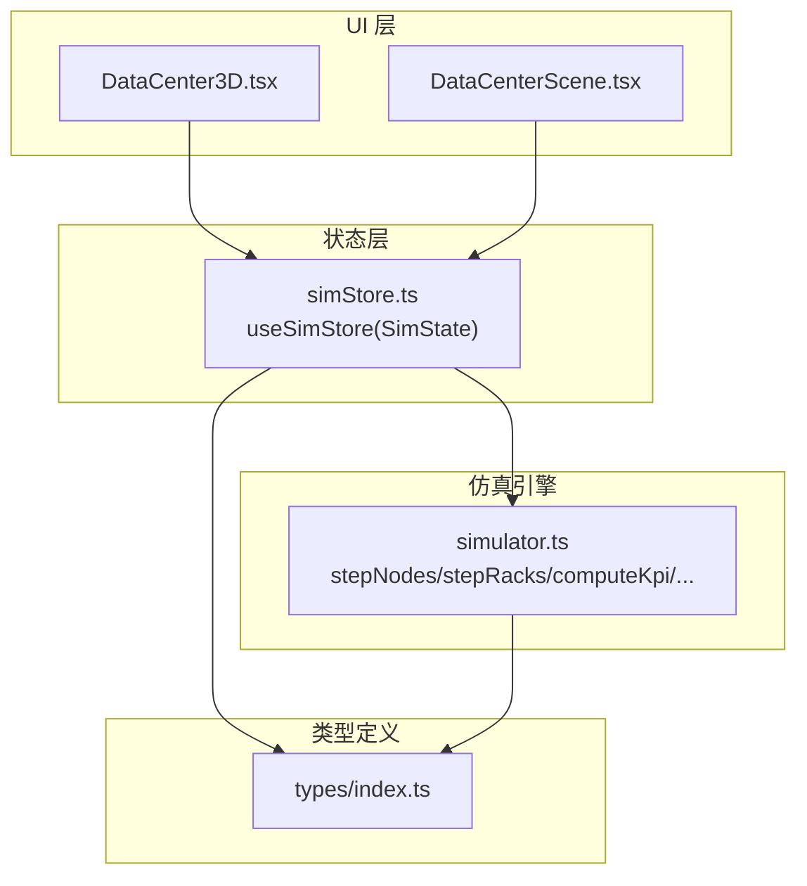
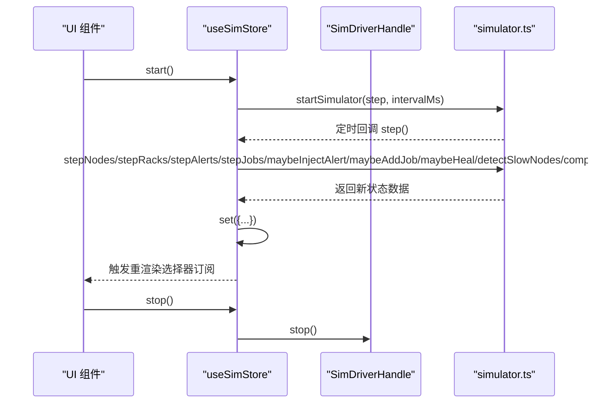
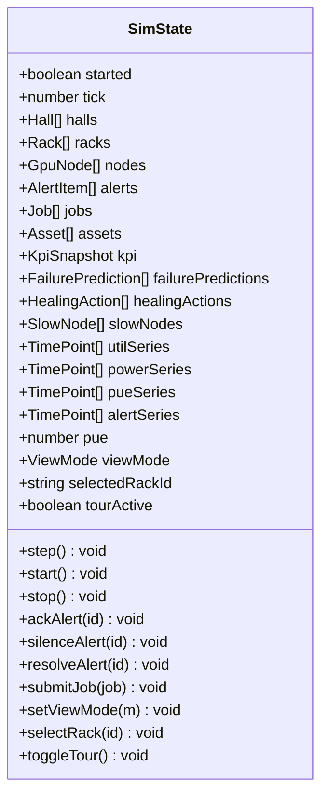
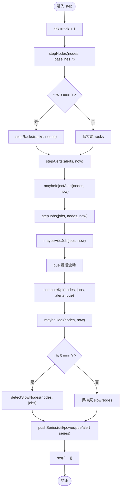
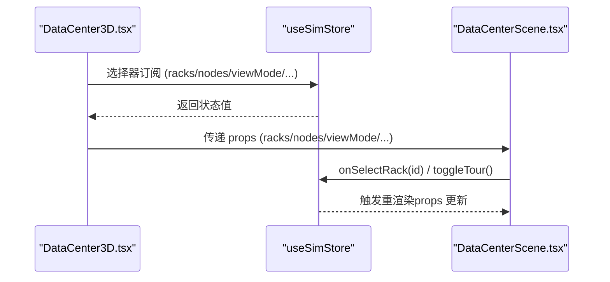
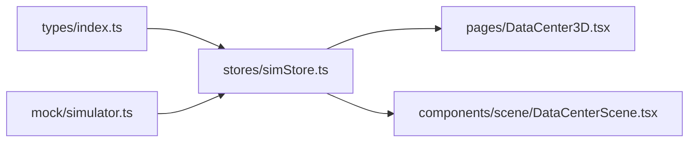

# 状态管理系统

<cite>
**本文引用的文件**   
- [simStore.ts](file://src/stores/simStore.ts)
- [index.ts](file://src/types/index.ts)
- [simulator.ts](file://src/mock/simulator.ts)
- [DataCenter3D.tsx](file://src/pages/DataCenter3D.tsx)
- [DataCenterScene.tsx](file://src/components/scene/DataCenterScene.tsx)
</cite>

## 目录
1. [引言](#引言)
2. [项目结构](#项目结构)
3. [核心组件](#核心组件)
4. [架构总览](#架构总览)
5. [详细组件分析](#详细组件分析)
6. [依赖关系分析](#依赖关系分析)
7. [性能与优化](#性能与优化)
8. [故障排查指南](#故障排查指南)
9. [结论](#结论)
10. [附录：使用示例与最佳实践](#附录使用示例与最佳实践)

## 引言
本文件系统性地梳理 IDC AI 运维平台的状态管理实现，重点围绕基于 Zustand 的仿真状态管理 store。文档涵盖 SimState 接口设计、状态结构定义、核心操作方法（step、start、stop 等）、选择器函数、仿真驱动机制、状态更新流程、数据持久化策略、性能优化方案，以及与仿真引擎的集成方式、事件处理机制和错误处理策略。同时提供面向开发者的最佳实践与常见问题解决方案。

## 项目结构
本项目采用“领域类型 + 仿真引擎 + 状态管理 + UI 渲染”的分层组织方式：
- 领域类型集中在 types 目录，统一描述数据中心拓扑、节点、机柜、告警、任务、KPI、时序等数据结构。
- 仿真引擎位于 mock/simulator.ts，以纯函数形式推进节点指标、机柜聚合、告警注入、任务流转、KPI 计算、慢节点检测等逻辑，并通过心跳驱动对外暴露 startSimulator。
- 状态管理位于 stores/simStore.ts，基于 Zustand 创建 useSimStore，封装 SimState 与一系列 actions，负责订阅并调用仿真引擎，维护 UI 所需的全局状态。
- UI 页面与场景分别位于 pages/DataCenter3D.tsx 与 components/scene/DataCenterScene.tsx，通过选择器订阅 store 中的状态，渲染 3D 机房透视视图与统计面板。

**图表来源**
- [DataCenter3D.tsx:1-159](file://src/pages/DataCenter3D.tsx#L1-L159)
- [DataCenterScene.tsx:1-401](file://src/components/scene/DataCenterScene.tsx#L1-L401)
- [simStore.ts:1-270](file://src/stores/simStore.ts#L1-L270)
- [simulator.ts:1-331](file://src/mock/simulator.ts#L1-L331)
- [index.ts:1-192](file://src/types/index.ts#L1-L192)

**章节来源**
- [simStore.ts:1-270](file://src/stores/simStore.ts#L1-L270)
- [simulator.ts:1-331](file://src/mock/simulator.ts#L1-L331)
- [index.ts:1-192](file://src/types/index.ts#L1-L192)
- [DataCenter3D.tsx:1-159](file://src/pages/DataCenter3D.tsx#L1-L159)
- [DataCenterScene.tsx:1-401](file://src/components/scene/DataCenterScene.tsx#L1-L401)

## 核心组件
本节聚焦 simStore.ts 中定义的 SimState 接口与 useSimStore 实现，包括状态字段、动作方法、选择器函数以及初始化策略。

- SimState 接口
  - 运行控制：started、tick
  - 拓扑与资产：halls、racks、nodes、assets
  - 业务数据：alerts、jobs、kpi、failurePredictions、healingActions、slowNodes
  - 时序数据：utilSeries、powerSeries、pueSeries、alertSeries、pue
  - UI 状态：viewMode、selectedRackId、tourActive
  - 动作方法：step、start、stop、ackAlert、silenceAlert、resolveAlert、submitJob、setViewMode、selectRack、toggleTour

- 初始化策略
  - 模块加载时一次性生成拓扑、资产、初始任务、故障预测、基线等静态数据，确保确定性种子。
  - 构造 24 小时历史算力利用率曲线作为演示用时序数据。
  - 预置若干告警与自愈日志，便于展示告警流与自愈链路。

- 核心动作
  - step：每 tick 推进节点指标、机柜聚合、告警注入与流转、任务流转、PUE 波动、KPI 汇总、自愈日志、慢节点检测，并推送时序数据。
  - start/stop：启动或停止仿真心跳驱动。
  - 告警操作：ackAlert、silenceAlert、resolveAlert 分别将告警标记为已确认、静默、已解决。
  - 任务提交：submitJob 构造完整 Job 对象并插入队列头部。
  - UI 控制：setViewMode、selectRack、toggleTour。

- 选择器函数
  - selectNodeById：按 id 从 nodes 中查找节点，供组件按需订阅。

**章节来源**
- [simStore.ts:99-134](file://src/stores/simStore.ts#L99-L134)
- [simStore.ts:142-265](file://src/stores/simStore.ts#L142-L265)
- [simStore.ts:267-270](file://src/stores/simStore.ts#L267-L270)

## 架构总览
下图展示状态管理与仿真引擎之间的交互关系，以及 UI 如何通过选择器订阅状态变化。

**图表来源**
- [simStore.ts:209-219](file://src/stores/simStore.ts#L209-L219)
- [simStore.ts:164-207](file://src/stores/simStore.ts#L164-L207)
- [simulator.ts:323-330](file://src/mock/simulator.ts#L323-L330)

## 详细组件分析

### SimState 与 useSimStore 设计
- 状态结构设计遵循“领域模型 + 运行时快照 + UI 控制”的三层划分：
  - 领域模型：GpuNode、Rack、Hall、AlertItem、Job、Asset、FailurePrediction、HealingAction、SlowNode、TimePoint、KpiSnapshot 等由 types/index.ts 统一定义。
  - 运行时快照：started、tick、kpi、pue、utilSeries/powerSeries/pueSeries/alertSeries 等反映当前仿真步态。
  - UI 控制：viewMode、selectedRackId、tourActive 用于控制 3D 场景渲染模式与交互。

- 动作方法的职责边界清晰：
  - step 是仿真主循环的核心，组合多个纯函数完成一次 tick 的数据推进。
  - start/stop 管理定时器生命周期，避免内存泄漏。
  - 告警与任务相关动作仅修改对应数组，保持不可变更新。

- 选择器函数提供细粒度订阅能力，减少不必要的重渲染。

**图表来源**
- [simStore.ts:99-134](file://src/stores/simStore.ts#L99-L134)

**章节来源**
- [simStore.ts:99-134](file://src/stores/simStore.ts#L99-L134)
- [index.ts:1-192](file://src/types/index.ts#L1-L192)

### 仿真驱动机制与状态更新流程
- 心跳驱动：
  - simulator.ts 暴露 startSimulator(step, intervalMs)，内部使用 window.setInterval 定时调用 step。
  - simStore.ts 在 start 中调用 startSimulator，并将 get().step 作为回调传入；stop 中清理定时器。

- 单步推进（step）：
  - 节点指标漂移：stepNodes 基于基线进行正弦漂移与噪声扰动，更新 util/temp/power/status/healthScore。
  - 机柜聚合：stepRacks 每 3 tick 更新一次，降低开销，计算 power/outletTemp/level。
  - 告警注入与流转：maybeInjectAlert 按概率注入新告警；stepAlerts 让部分 active 告警自然恢复。
  - 任务流转：stepJobs 推进 queued→running→succeeded/failed，模拟进度、loss、throughput、mfu 变化。
  - PUE 缓慢波动：在合理区间内随机扰动。
  - KPI 汇总：computeKpi 计算 totalPflops/gpuOnline/avgUtil/activeAlerts/pue/totalPowerKw 等。
  - 自愈日志：maybeHeal 根据 critical 节点概率生成自愈动作。
  - 慢节点检测：detectSlowNodes 每 5 tick 计算，筛选偏离集群均值的慢节点。
  - 时序数据：pushSeries 维护固定长度的时间序列，限制最大长度以避免无限增长。

**图表来源**
- [simStore.ts:164-207](file://src/stores/simStore.ts#L164-L207)
- [simulator.ts:54-92](file://src/mock/simulator.ts#L54-L92)
- [simulator.ts:97-139](file://src/mock/simulator.ts#L97-L139)
- [simulator.ts:165-194](file://src/mock/simulator.ts#L165-L194)
- [simulator.ts:199-259](file://src/mock/simulator.ts#L199-L259)
- [simulator.ts:283-318](file://src/mock/simulator.ts#L283-L318)
- [simulator.ts:264-268](file://src/mock/simulator.ts#L264-L268)

**章节来源**
- [simStore.ts:164-207](file://src/stores/simStore.ts#L164-L207)
- [simulator.ts:54-92](file://src/mock/simulator.ts#L54-L92)
- [simulator.ts:97-139](file://src/mock/simulator.ts#L97-L139)
- [simulator.ts:165-194](file://src/mock/simulator.ts#L165-L194)
- [simulator.ts:199-259](file://src/mock/simulator.ts#L199-L259)
- [simulator.ts:283-318](file://src/mock/simulator.ts#L283-L318)
- [simulator.ts:264-268](file://src/mock/simulator.ts#L264-L268)

### 与仿真引擎的集成方式、事件处理与错误处理
- 集成方式：
  - simStore.ts 导入 simulator.ts 的纯函数与 startSimulator，不直接依赖 store 的 getState/setState，避免循环引用。
  - startSimulator 接收 step 回调，store 通过闭包访问最新状态，保证每次 tick 读取的是最新快照。

- 事件处理：
  - 告警注入与流转：maybeInjectAlert 按概率注入告警；stepAlerts 让部分 active 告警自动恢复。
  - 任务状态机：stepJobs 推进任务状态，模拟失败与成功。
  - 自愈动作：maybeHeal 根据 critical 节点概率生成自愈日志。

- 错误处理：
  - 当前实现未显式抛出异常，主要依靠条件判断与概率控制来维持稳定运行。
  - 建议在关键路径增加 try/catch 与日志记录，以便定位异常数据或外部依赖问题。

**章节来源**
- [simulator.ts:323-330](file://src/mock/simulator.ts#L323-L330)
- [simulator.ts:165-194](file://src/mock/simulator.ts#L165-L194)
- [simulator.ts:199-259](file://src/mock/simulator.ts#L199-L259)
- [simulator.ts:283-318](file://src/mock/simulator.ts#L283-L318)

### UI 与状态管理的交互
- DataCenter3D.tsx 通过 useSimStore 的选择器订阅 racks、nodes、viewMode、selectedRackId、tourActive 等状态，并提供 setViewMode、selectRack、toggleTour 等动作。
- DataCenterScene.tsx 接收 racks、nodes、viewMode、selectedRackId、onSelectRack、tourActive 等 props，渲染 3D 场景并根据 viewMode 切换可视化模式。

**图表来源**
- [DataCenter3D.tsx:15-23](file://src/pages/DataCenter3D.tsx#L15-L23)
- [DataCenter3D.tsx:54-67](file://src/pages/DataCenter3D.tsx#L54-L67)
- [DataCenterScene.tsx:218-226](file://src/components/scene/DataCenterScene.tsx#L218-L226)

**章节来源**
- [DataCenter3D.tsx:15-23](file://src/pages/DataCenter3D.tsx#L15-L23)
- [DataCenter3D.tsx:54-67](file://src/pages/DataCenter3D.tsx#L54-L67)
- [DataCenterScene.tsx:218-226](file://src/components/scene/DataCenterScene.tsx#L218-L226)

## 依赖关系分析
- 模块耦合：
  - simStore.ts 依赖 types/index.ts 的类型定义与 mock/simulator.ts 的仿真函数。
  - UI 组件依赖 simStore.ts 提供的选择器与动作方法。
- 潜在循环依赖：
  - simulator.ts 不直接依赖 store，避免循环引用。
- 外部依赖：
  - Zustand 提供 create 与选择器订阅机制。
  - React Three Fiber/Drei 用于 3D 场景渲染。

**图表来源**
- [simStore.ts:1-21](file://src/stores/simStore.ts#L1-L21)
- [simulator.ts:1-13](file://src/mock/simulator.ts#L1-L13)
- [DataCenter3D.tsx:1-6](file://src/pages/DataCenter3D.tsx#L1-L6)
- [DataCenterScene.tsx:1-12](file://src/components/scene/DataCenterScene.tsx#L1-L12)

**章节来源**
- [simStore.ts:1-21](file://src/stores/simStore.ts#L1-L21)
- [simulator.ts:1-13](file://src/mock/simulator.ts#L1-L13)
- [DataCenter3D.tsx:1-6](file://src/pages/DataCenter3D.tsx#L1-L6)
- [DataCenterScene.tsx:1-12](file://src/components/scene/DataCenterScene.tsx#L1-L12)

## 性能与优化
- 计算频率控制：
  - 机柜聚合每 3 tick 更新一次，降低频繁聚合开销。
  - 慢节点检测每 5 tick 执行一次，避免每步都进行复杂计算。
- 时序数据长度限制：
  - pushSeries 默认最大长度为 60，防止数组无限增长导致内存压力。
- 选择器订阅：
  - UI 组件通过选择器订阅最小必要字段，减少无关重渲染。
- 3D 渲染优化：
  - Canvas dpr 根据紧凑模式调整，降低高分屏渲染压力。
  - OrbitControls 在巡检模式下禁用手动控制，避免冲突。

[本节为通用性能建议，不直接分析具体代码文件]

## 故障排查指南
- 仿真未启动或停止后无更新：
  - 检查 start/stop 是否被正确调用，driver 是否为空。
  - 确认 setInterval 是否被清除，避免重复启动。
- 告警不产生或不恢复：
  - 检查 maybeInjectAlert 的概率阈值与 hotNodes 过滤逻辑。
  - 确认 stepAlerts 的自然恢复概率是否生效。
- 任务不推进或卡住：
  - 检查 stepJobs 的状态机转换条件与并发上限 capacity。
  - 确认 maybeAddJob 的任务注入概率与队列长度限制。
- 慢节点检测为空：
  - 检查 detectSlowNodes 的偏差阈值与排序逻辑。
- 时序数据不更新：
  - 确认 pushSeries 的最大长度与时间戳是否正确。

**章节来源**
- [simStore.ts:209-219](file://src/stores/simStore.ts#L209-L219)
- [simulator.ts:165-194](file://src/mock/simulator.ts#L165-L194)
- [simulator.ts:199-259](file://src/mock/simulator.ts#L199-L259)
- [simulator.ts:303-318](file://src/mock/simulator.ts#L303-L318)
- [simulator.ts:264-268](file://src/mock/simulator.ts#L264-L268)

## 结论
本状态管理系统以 Zustand 为核心，结合纯函数驱动的仿真引擎，实现了数据中心运维平台的实时态势感知与可视化。SimState 接口清晰定义了状态结构与动作方法，step/start/stop 等核心操作保证了仿真驱动的稳定运行。通过选择器订阅与频率控制，系统在性能与可维护性之间取得平衡。未来可在错误处理、数据持久化与扩展性方面进一步增强。

[本节为总结性内容，不直接分析具体代码文件]

## 附录：使用示例与最佳实践

### 使用 store 进行状态读写与订阅更新
- 订阅状态：
  - 在组件中使用 useSimStore((s) => s.racks)、useSimStore((s) => s.nodes) 等选择器订阅所需字段。
- 触发动作：
  - 调用 useSimStore((s) => s.start)/stop 控制仿真启停。
  - 调用 useSimStore((s) => s.setViewMode)/selectRack/toggleTour 控制 UI 行为。
- 处理用户交互：
  - 在 DataCenter3D.tsx 中通过 FilterChip 切换视图模式与巡检状态。
  - 在 DataCenterScene.tsx 中点击机柜触发 onSelectRack。

**章节来源**
- [DataCenter3D.tsx:15-23](file://src/pages/DataCenter3D.tsx#L15-L23)
- [DataCenter3D.tsx:54-67](file://src/pages/DataCenter3D.tsx#L54-L67)
- [DataCenterScene.tsx:96-99](file://src/components/scene/DataCenterScene.tsx#L96-L99)

### 与仿真引擎集成的最佳实践
- 保持仿真引擎与 store 解耦：
  - simulator.ts 仅提供纯函数与心跳驱动，不直接访问 store。
- 控制计算频率：
  - 对昂贵计算（如机柜聚合、慢节点检测）设置步进间隔。
- 限制数据规模：
  - 对时序数组设置最大长度，避免内存增长。
- 明确错误边界：
  - 在关键路径添加 try/catch 与日志记录，便于定位问题。

**章节来源**
- [simulator.ts:323-330](file://src/mock/simulator.ts#L323-L330)
- [simStore.ts:164-207](file://src/stores/simStore.ts#L164-L207)