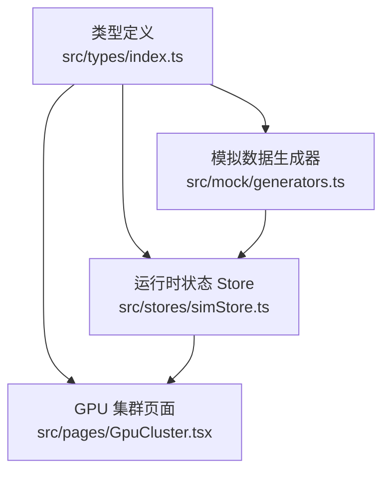
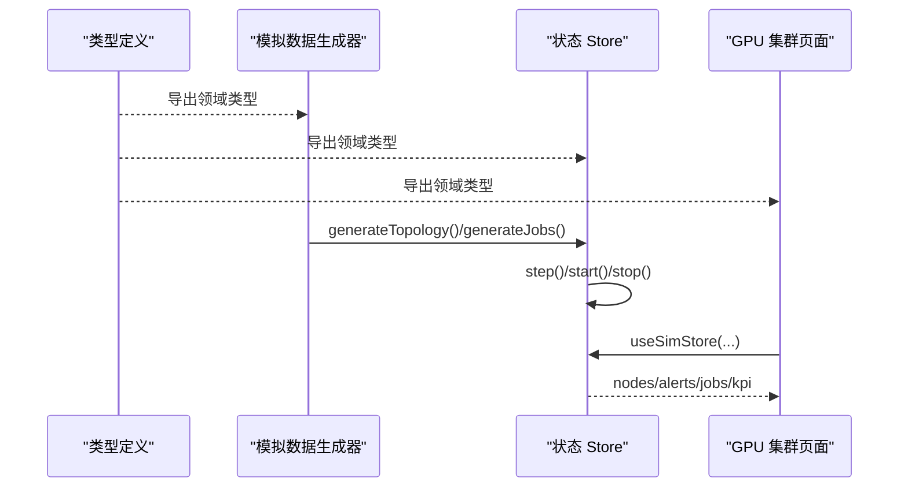
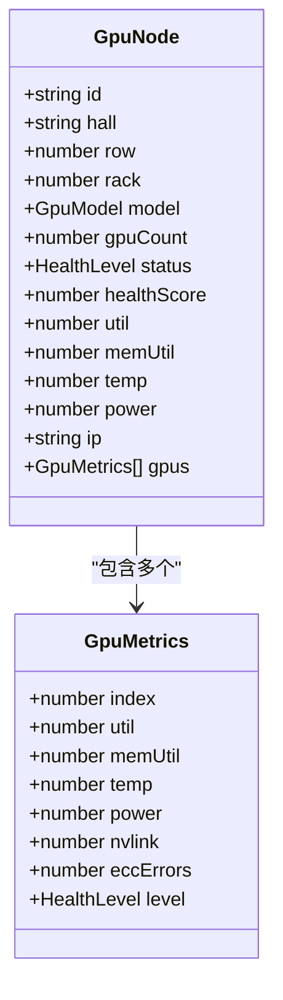
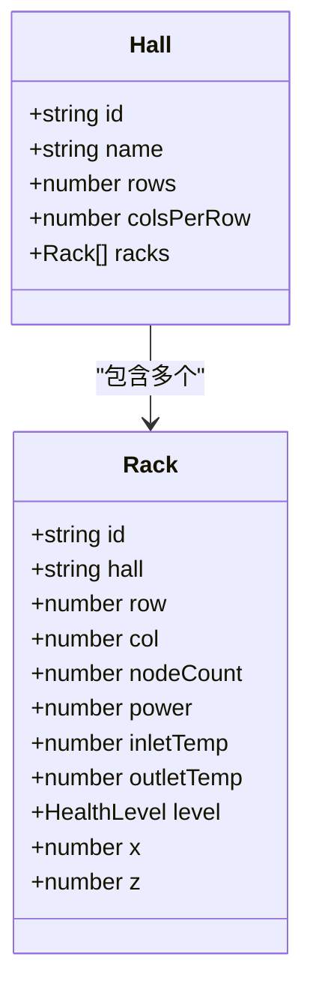
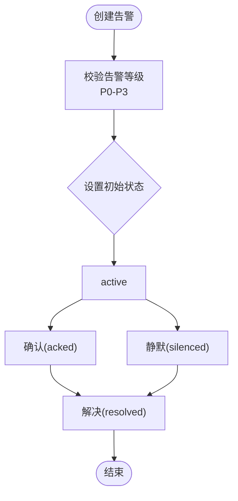
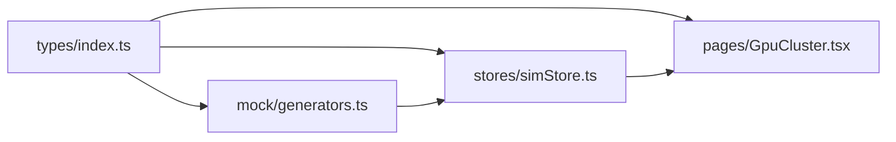

# 类型定义系统

<cite>
**本文引用的文件**   
- [src/types/index.ts](file://src/types/index.ts)
- [src/mock/generators.ts](file://src/mock/generators.ts)
- [src/stores/simStore.ts](file://src/stores/simStore.ts)
- [src/pages/GpuCluster.tsx](file://src/pages/GpuCluster.tsx)
</cite>

## 目录
1. [引言](#引言)
2. [项目结构](#项目结构)
3. [核心领域模型](#核心领域模型)
4. [架构总览](#架构总览)
5. [详细组件分析](#详细组件分析)
6. [依赖关系分析](#依赖关系分析)
7. [性能与可扩展性](#性能与可扩展性)
8. [排错指南](#排错指南)
9. [结论](#结论)
10. [附录：类型设计最佳实践与常见陷阱](#附录类型设计最佳实践与常见陷阱)

## 引言
本文件面向 IDC AI 运维平台的“类型定义系统”，聚焦领域模型的设计思路与实现方式，重点覆盖以下实体与概念：
- GpuNode（GPU 计算节点）
- Rack（机柜）
- Hall（机房）
- AlertItem（告警事件）
- Job（调度任务）
同时说明数据类型约束、关系映射、业务规则验证、泛型使用、联合类型与类型守卫的实践。文档以仓库中的类型定义为核心，结合模拟数据生成器、状态存储与页面组件的使用方式，给出从编译期到运行时的完整类型安全闭环。

## 项目结构
本项目将领域类型集中在单一类型文件中，其他模块通过导入该类型进行强类型交互：
- 类型定义：src/types/index.ts
- 模拟数据生成：src/mock/generators.ts
- 运行时状态管理：src/stores/simStore.ts
- 页面展示与筛选：src/pages/GpuCluster.tsx

图表来源
- [src/types/index.ts:1-192](file://src/types/index.ts#L1-L192)
- [src/mock/generators.ts:1-408](file://src/mock/generators.ts#L1-L408)
- [src/stores/simStore.ts:1-270](file://src/stores/simStore.ts#L1-L270)
- [src/pages/GpuCluster.tsx:1-287](file://src/pages/GpuCluster.tsx#L1-L287)

章节来源
- [src/types/index.ts:1-192](file://src/types/index.ts#L1-L192)
- [src/mock/generators.ts:1-408](file://src/mock/generators.ts#L1-L408)
- [src/stores/simStore.ts:1-270](file://src/stores/simStore.ts#L1-L270)
- [src/pages/GpuCluster.tsx:1-287](file://src/pages/GpuCluster.tsx#L1-L287)

## 核心领域模型
本节梳理关键类型及其职责边界、字段约束与关联关系。

### 基础枚举与联合类型
- GpuModel：GPU 型号，限定为 H100、A100、910B。用于设备能力与功耗等常量映射。
- HealthLevel：设备健康分级，normal / warning / critical / offline。贯穿节点、机柜、资产等对象的状态表达。
- AlertLevel：告警等级 P0/P1/P2/P3。
- AlertStatus：告警生命周期 active / acked / silenced / resolved。
- AlertSource：告警来源类别 GPU/节点/网络/存储/供电/制冷。
- JobStatus：任务状态 queued / running / succeeded / failed。
- QueueType：资源队列类型 训练 / 推理 / 调试。
- AssetType：资产类型 服务器 / GPU卡 / 交换机 / 存储阵列。
- LifecycleStatus：生命周期在保 / 过保 / 待报废。
- ViewMode：视图模式 temperature / load / alert / topology。

这些联合类型确保 UI 展示、过滤条件、排序逻辑与后端协议保持一致，避免魔法字符串和非法值进入系统。

章节来源
- [src/types/index.ts:5-18](file://src/types/index.ts#L5-L18)
- [src/types/index.ts:89-120](file://src/types/index.ts#L89-L120)
- [src/types/index.ts:161](file://src/types/index.ts#L161)

### 单卡指标与节点模型
- GpuMetrics：单张 GPU 的实时指标，包含利用率、显存占用、温度、功耗、NVLink 带宽、ECC 错误计数与健康级别。
- GpuNode：一台含多卡的服务器节点，聚合了位置信息（hall/row/rack）、设备型号、健康评分、平均指标以及 gpus 数组。

约束与规则要点：
- gpuCount 固定为 8（由生成器保证）。
- gpus 数组长度与 GPU 槽位一致，UI 按 8 列渲染。
- 节点级 util/temp/power 由单卡指标聚合而来。
- status 由单卡最严重级别或离线标记决定。

章节来源
- [src/types/index.ts:20-48](file://src/types/index.ts#L20-L48)
- [src/mock/generators.ts:92-154](file://src/mock/generators.ts#L92-L154)

### 机柜与机房
- Rack：机柜维度，包含 hall/row/col、nodeCount、功耗、冷热通道温度、健康级别与 3D 布局坐标 x/z。
- Hall：机房维度，包含 rows/colsPerRow 与 racks 列表。

关系映射：
- Hall.racks → Rack[]
- Rack.nodeCount 与节点数量一致（由生成器构建拓扑时填充）。
- Rack.x/z 用于 3D 场景定位。

章节来源
- [src/types/index.ts:50-73](file://src/types/index.ts#L50-L73)
- [src/mock/generators.ts:159-206](file://src/mock/generators.ts#L159-L206)

### 告警与任务
- AlertItem：告警事件，包含 level/source/title/target/status/value/timestamp 及可选 ackAt/resolveAt。
- Job：调度任务，包含 queue/gpuRequest/status/progress/时间戳/priority/model/loss/throughput/mfu/assignedNodes 等。

业务规则要点：
- AlertItem.status 随操作流转（active→acked→silenced/resolved），并记录对应时间戳。
- Job.status 与 assignedNodes 联动：running 时分配节点；succeeded 时结束并记录 endAt。
- QueueType 影响 gpuRequest 分布（训练更大，推理较小）。

章节来源
- [src/types/index.ts:75-113](file://src/types/index.ts#L75-L113)
- [src/stores/simStore.ts:60-85](file://src/stores/simStore.ts#L60-L85)
- [src/mock/generators.ts:345-384](file://src/mock/generators.ts#L345-L384)

### 资产、KPI 与辅助类型
- Asset：CMDB 资产条目，包含 sn/type/model/vendor/hall/rackId/uPosition/onlineDate/warrantyUntil/lifecycle/business/status/repairCount。
- KpiSnapshot：KPI 汇总，如 totalPflops、gpuTotal、onlineRate、avgUtil、pue、totalPowerKw 等。
- TimePoint：时序点 {t, v}。
- FailurePrediction/HealingAction/SlowNode：故障预测、自愈日志、慢节点检测等扩展领域类型。

章节来源
- [src/types/index.ts:115-192](file://src/types/index.ts#L115-L192)

## 架构总览
类型系统在项目中承担“契约”角色：
- 类型定义集中维护，所有模块共享同一份领域模型。
- 模拟数据生成器严格遵循类型构造数据，保证初始态合法。
- Store 作为运行时中枢，驱动数据更新与业务动作，保持类型安全。
- 页面组件消费 Store 数据，并通过类型约束实现筛选、排序与可视化。

图表来源
- [src/types/index.ts:1-192](file://src/types/index.ts#L1-L192)
- [src/mock/generators.ts:159-206](file://src/mock/generators.ts#L159-L206)
- [src/stores/simStore.ts:142-265](file://src/stores/simStore.ts#L142-L265)
- [src/pages/GpuCluster.tsx:13-57](file://src/pages/GpuCluster.tsx#L13-L57)

## 详细组件分析

### GpuNode 与 GpuMetrics
GpuNode 是平台的核心实体之一，承载物理节点与其 8 张 GPU 的实时指标。其设计体现“聚合 + 明细”的结构：
- 聚合层：节点级别的 healthScore/util/temp/power/status。
- 明细层：gpus 数组中每张卡的独立指标与健康级别。

图表来源
- [src/types/index.ts:20-48](file://src/types/index.ts#L20-L48)

章节来源
- [src/types/index.ts:20-48](file://src/types/index.ts#L20-L48)
- [src/mock/generators.ts:92-154](file://src/mock/generators.ts#L92-L154)
- [src/pages/GpuCluster.tsx:164-215](file://src/pages/GpuCluster.tsx#L164-L215)

### Rack 与 Hall
Rack 与 Hall 构成机房拓扑的基础单元：
- Hall 持有 racks 列表，描述机房的行列规模。
- Rack 提供 3D 坐标 x/z，便于在三维场景中定位。

图表来源
- [src/types/index.ts:50-73](file://src/types/index.ts#L50-L73)

章节来源
- [src/types/index.ts:50-73](file://src/types/index.ts#L50-L73)
- [src/mock/generators.ts:159-206](file://src/mock/generators.ts#L159-L206)

### AlertItem 与 Job
AlertItem 与 Job 分别代表运维侧的告警流与调度侧的任务流。二者均具备明确的生命周期与状态机语义。

图表来源
- [src/types/index.ts:75-87](file://src/types/index.ts#L75-L87)
- [src/stores/simStore.ts:221-238](file://src/stores/simStore.ts#L221-L238)

章节来源
- [src/types/index.ts:75-113](file://src/types/index.ts#L75-L113)
- [src/stores/simStore.ts:60-85](file://src/stores/simStore.ts#L60-L85)
- [src/stores/simStore.ts:221-238](file://src/stores/simStore.ts#L221-L238)
- [src/mock/generators.ts:345-384](file://src/mock/generators.ts#L345-L384)

### 类型在页面中的使用示例
页面组件通过类型约束完成筛选、分页与可视化：
- 使用 HealthLevel 联合类型控制状态筛选按钮集合。
- 使用 GpuModel 联合类型控制型号筛选。
- 使用 GpuNode 接口访问节点属性，渲染 8 卡格子与详情抽屉。

章节来源
- [src/pages/GpuCluster.tsx:13-57](file://src/pages/GpuCluster.tsx#L13-L57)
- [src/pages/GpuCluster.tsx:164-215](file://src/pages/GpuCluster.tsx#L164-L215)

## 依赖关系分析
类型定义被多处引用，形成稳定的依赖方向：
- generators.ts 依赖 types/index.ts 的类型来构造数据。
- simStore.ts 依赖 types/index.ts 的类型来定义状态与动作。
- GpuCluster.tsx 依赖 types/index.ts 的类型来渲染与筛选。

图表来源
- [src/types/index.ts:1-192](file://src/types/index.ts#L1-L192)
- [src/mock/generators.ts:1-12](file://src/mock/generators.ts#L1-L12)
- [src/stores/simStore.ts:1-21](file://src/stores/simStore.ts#L1-L21)
- [src/pages/GpuCluster.tsx:1-9](file://src/pages/GpuCluster.tsx#L1-L9)

章节来源
- [src/types/index.ts:1-192](file://src/types/index.ts#L1-L192)
- [src/mock/generators.ts:1-12](file://src/mock/generators.ts#L1-L12)
- [src/stores/simStore.ts:1-21](file://src/stores/simStore.ts#L1-L21)
- [src/pages/GpuCluster.tsx:1-9](file://src/pages/GpuCluster.tsx#L1-L9)

## 性能与可扩展性
- 类型层面：联合类型与接口组合减少运行时分支判断，提升可读性与可维护性。
- 数据生成：确定性随机数与批量生成策略降低初始化开销。
- 状态更新：Store 中 step 函数对非关键数据（如 racks）做降频更新，减少重渲染压力。
- 可扩展性：新增领域类型只需在 types/index.ts 中声明，并在相关模块导入使用，无需改动既有逻辑。

[本节为通用指导，不直接分析具体文件]

## 排错指南
常见问题与排查建议：
- 字段缺失或类型不符：检查是否在生成器或 Store 中遗漏必填字段，确保与接口定义一致。
- 状态流转异常：确认告警/任务的状态变更是否设置了相应时间戳，并符合状态机规则。
- 数值越界：如 util/temp/power 超出合理范围，检查生成器的边界处理逻辑。
- 筛选无效：确认页面筛选条件使用的联合类型与数据字段一致，避免字符串不一致导致过滤失败。

章节来源
- [src/stores/simStore.ts:164-207](file://src/stores/simStore.ts#L164-L207)
- [src/mock/generators.ts:92-154](file://src/mock/generators.ts#L92-L154)
- [src/pages/GpuCluster.tsx:26-34](file://src/pages/GpuCluster.tsx#L26-L34)

## 结论
本项目的类型定义系统以集中式领域模型为核心，通过联合类型与接口组合，构建了清晰的实体关系与严格的类型约束。模拟数据生成器与 Store 共同保障数据的合法性与一致性，页面组件则借助类型安全实现高效的筛选与可视化。整体设计兼顾可读性、可维护性与可扩展性，为后续功能演进提供了坚实基础。

[本节为总结性内容，不直接分析具体文件]

## 附录：类型设计最佳实践与常见陷阱

### 最佳实践
- 使用联合类型表达有限集合（如 HealthLevel、AlertLevel、QueueType），避免魔法字符串。
- 将聚合与明细分离（如 GpuNode 与 GpuMetrics），便于单独扩展与维护。
- 在 Store 中统一状态变更入口，保证类型与业务规则的一致性。
- 在生成器中集中实现业务规则（如健康级别判定、任务分配），减少分散逻辑。

### 常见陷阱
- 忽略可选字段的时间戳语义（如 ackAt/resolveAt），导致报表统计不准确。
- 未对数值字段做边界校验（如 util/temp/power），造成 UI 显示异常。
- 在页面中使用硬编码字符串进行筛选，破坏类型安全。
- 过度耦合 UI 与领域类型，导致展示逻辑侵入领域模型。

[本节为通用指导，不直接分析具体文件]