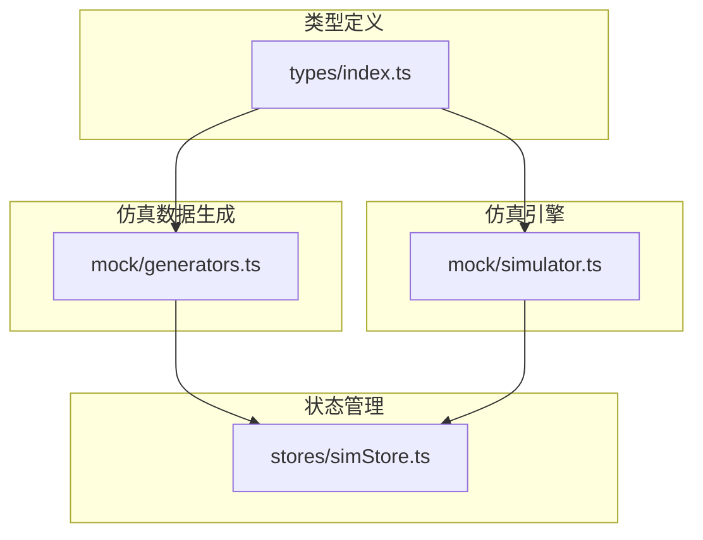
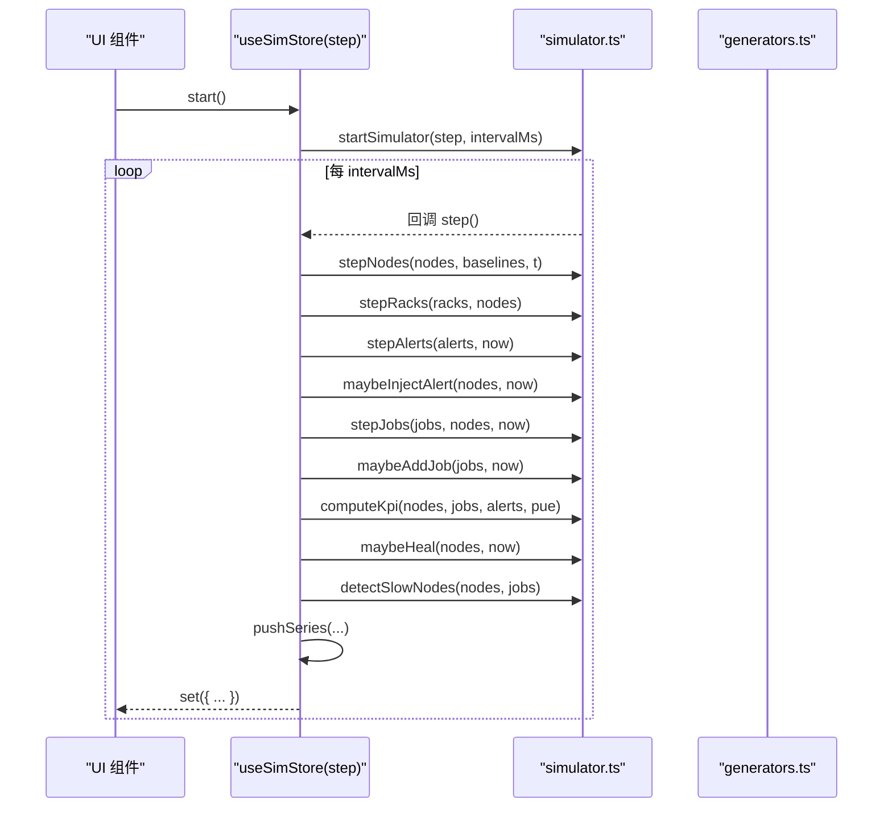
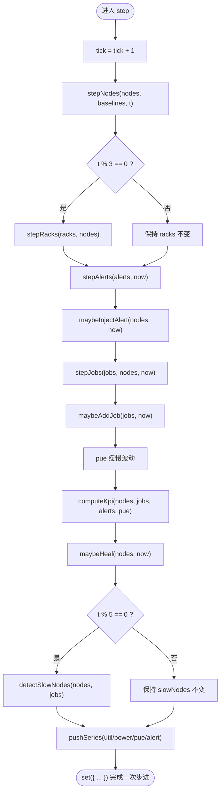
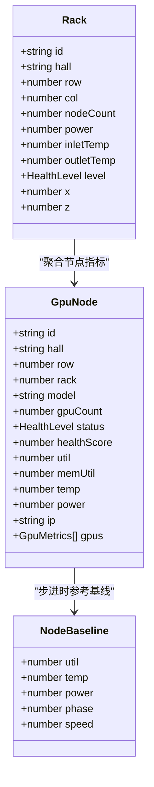
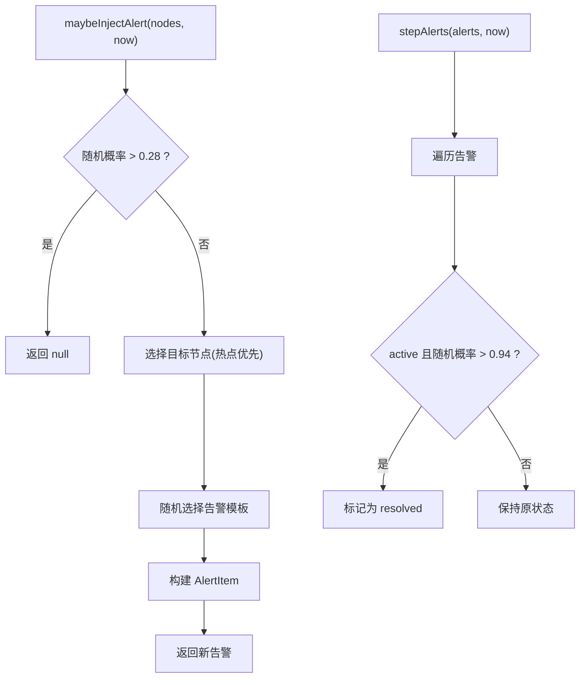
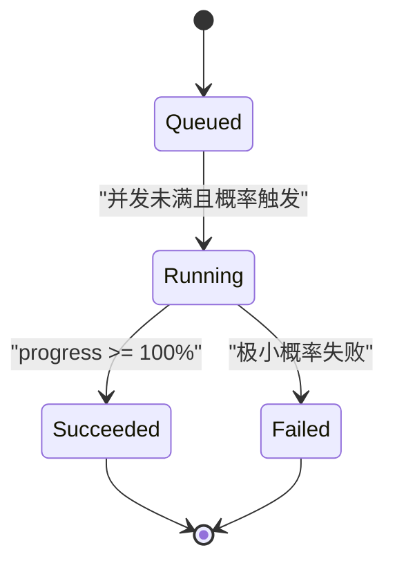
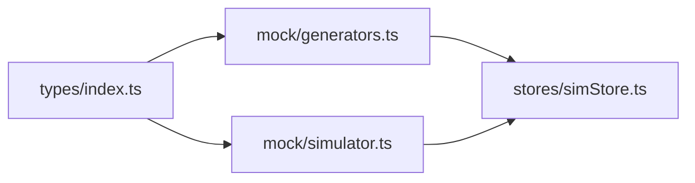
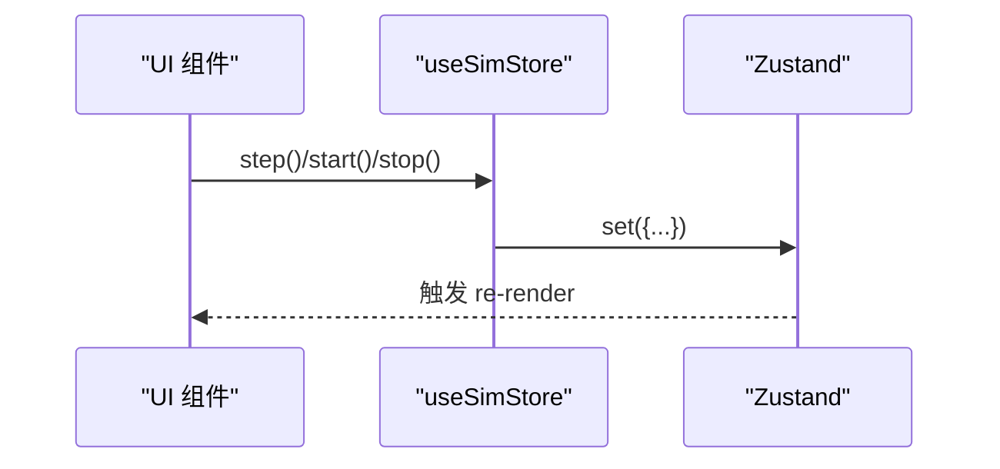

# 动态仿真引擎

<cite>
**本文引用的文件**   
- [simStore.ts](file://src/stores/simStore.ts)
- [simulator.ts](file://src/mock/simulator.ts)
- [generators.ts](file://src/mock/generators.ts)
- [index.ts](file://src/types/index.ts)
- [package.json](file://package.json)
</cite>

## 目录
1. [引言](#引言)
2. [项目结构](#项目结构)
3. [核心组件](#核心组件)
4. [架构总览](#架构总览)
5. [详细组件分析](#详细组件分析)
6. [依赖关系分析](#依赖关系分析)
7. [性能与内存优化](#性能与内存优化)
8. [仿真参数调优指南](#仿真参数调优指南)
9. [Zustand 集成与数据流同步](#zustand-集成与数据流同步)
10. [扩展与自定义开发指南](#扩展与自定义开发指南)
11. [故障排查](#故障排查)
12. [结论](#结论)

## 引言
本技术文档面向 IDC AI 运维平台的“动态仿真引擎”，聚焦以下目标：
- 时间步进机制：仿真时钟管理、状态更新调度、事件驱动架构。
- 实时数据更新：触发条件、增量更新策略、性能优化技巧。
- 仿真参数调优：仿真速度控制、内存管理策略。
- Zustand 集成：状态管理、数据流同步、实时更新最佳实践。
- 扩展能力：如何自定义仿真规则、扩展仿真逻辑。

该引擎以纯函数为核心，通过心跳驱动推进节点、机柜、任务、告警、KPI 与时序指标，最终由 Zustand store 暴露给 UI 订阅渲染。

## 项目结构
本项目采用“领域模型 + 仿真器 + Store”的分层组织方式：
- types：领域类型定义，统一数据结构契约。
- mock/generators：拓扑、资产、任务等静态/初始数据生成器，以及确定性随机数。
- mock/simulator：纯函数式仿真引擎，负责每个 tick 的状态演进。
- stores/simStore：基于 Zustand 的仿真状态容器，封装 step/start/stop 等动作。
- pages/components：页面与 UI 组件（不在本文重点）。

**图表来源**
- [index.ts:1-192](file://src/types/index.ts#L1-L192)
- [generators.ts:1-408](file://src/mock/generators.ts#L1-L408)
- [simulator.ts:1-331](file://src/mock/simulator.ts#L1-L331)
- [simStore.ts:1-270](file://src/stores/simStore.ts#L1-L270)

**章节来源**
- [index.ts:1-192](file://src/types/index.ts#L1-L192)
- [generators.ts:1-408](file://src/mock/generators.ts#L1-L408)
- [simulator.ts:1-331](file://src/mock/simulator.ts#L1-L331)
- [simStore.ts:1-270](file://src/stores/simStore.ts#L1-L270)

## 核心组件
- 类型契约：GpuNode/Rack/Hall/Job/AlertItem/KpiSnapshot/TimePoint 等。
- 数据生成器：generateTopology/generateAssets/generateJobs/generateFailurePredictions。
- 仿真引擎：stepNodes/stepRacks/computeKpi/maybeInjectAlert/stepAlerts/stepJobs/maybeAddJob/pushSeries/maybeHeal/detectSlowNodes/startSimulator。
- Zustand Store：useSimStore，提供 step/start/stop 及交互动作。

关键职责边界：
- generators.ts：只负责构造初始拓扑、资产、任务、预测等静态数据；不感知仿真 tick。
- simulator.ts：纯函数集合，无副作用，仅根据输入计算下一时刻状态；通过 startSimulator 暴露心跳驱动接口。
- simStore.ts：组合上述模块，维护全局状态，对外暴露 actions，供 UI 订阅。

**章节来源**
- [index.ts:1-192](file://src/types/index.ts#L1-L192)
- [generators.ts:1-408](file://src/mock/generators.ts#L1-L408)
- [simulator.ts:1-331](file://src/mock/simulator.ts#L1-L331)
- [simStore.ts:1-270](file://src/stores/simStore.ts#L1-L270)

## 架构总览
仿真引擎采用“心跳驱动 + 纯函数步进 + Zustand 状态容器”的架构：
- 心跳驱动：startSimulator 使用 setInterval 周期性调用 step。
- 纯函数步进：stepNodes/stepRacks/stepAlerts/stepJobs 等按顺序推进各子系统。
- 状态容器：useSimStore 聚合所有状态，并提供 UI 可订阅的 actions。

**图表来源**
- [simStore.ts:164-219](file://src/stores/simStore.ts#L164-L219)
- [simulator.ts:54-92](file://src/mock/simulator.ts#L54-L92)
- [simulator.ts:165-194](file://src/mock/simulator.ts#L165-L194)
- [simulator.ts:199-259](file://src/mock/simulator.ts#L199-L259)
- [simulator.ts:264-330](file://src/mock/simulator.ts#L264-L330)

## 详细组件分析

### 时间步进机制与仿真时钟
- 仿真时钟：store 内部维护 tick 计数器，每次 step 自增。
- 心跳驱动：startSimulator 使用 window.setInterval 以固定间隔（默认 1000ms）触发 step。
- 步进流程：step 中依次执行节点漂移、机柜聚合、告警注入与流转、任务状态机、PUE 波动、KPI 汇总、自愈日志、慢节点检测、时序数据追加。

**图表来源**
- [simStore.ts:164-207](file://src/stores/simStore.ts#L164-L207)
- [simulator.ts:54-92](file://src/mock/simulator.ts#L54-L92)
- [simulator.ts:165-194](file://src/mock/simulator.ts#L165-L194)
- [simulator.ts:199-259](file://src/mock/simulator.ts#L199-L259)
- [simulator.ts:264-330](file://src/mock/simulator.ts#L264-L330)

**章节来源**
- [simStore.ts:164-219](file://src/stores/simStore.ts#L164-L219)
- [simulator.ts:327-330](file://src/mock/simulator.ts#L327-L330)

### 节点与机柜状态更新
- 节点指标漂移：围绕基线做正弦波扰动 + 噪声，结合健康阈值判定状态与健康分。
- 机柜聚合：按机房/排/列分组，计算机柜功耗、出风温度与等级。
- 增量更新：每 3 tick 才重新计算机柜，降低聚合开销。

**图表来源**
- [index.ts:32-64](file://src/types/index.ts#L32-L64)
- [simulator.ts:24-47](file://src/mock/simulator.ts#L24-L47)
- [simulator.ts:54-92](file://src/mock/simulator.ts#L54-L92)

**章节来源**
- [simulator.ts:54-92](file://src/mock/simulator.ts#L54-L92)
- [index.ts:32-64](file://src/types/index.ts#L32-L64)

### 告警注入与流转
- 注入概率：每秒有一定概率产生新告警，优先从热点节点中选择目标。
- 告警模板：预置多种告警模板，动态生成 value 描述。
- 自然流转：部分 active 告警会随时间自动恢复为 resolved。

**图表来源**
- [simulator.ts:151-182](file://src/mock/simulator.ts#L151-L182)
- [simulator.ts:187-194](file://src/mock/simulator.ts#L187-L194)

**章节来源**
- [simulator.ts:151-194](file://src/mock/simulator.ts#L151-L194)

### 任务状态机与队列
- 排队启动：queued 任务在并发上限内按优先级尝试启动，分配空闲节点。
- 运行推进：running 任务进度、loss、throughput、mfu 逐步变化，达到 100% 成功，极小概率失败。
- 补充任务：维持队列活跃度，按不同队列类型生成不同 GPU 请求规模。

**图表来源**
- [simulator.ts:199-259](file://src/mock/simulator.ts#L199-L259)

**章节来源**
- [simulator.ts:199-259](file://src/mock/simulator.ts#L199-L259)

### KPI 汇总与 PUE 波动
- KPI 汇总：统计 GPU 总数/在线数、平均利用率、活跃告警数、IT 功耗、冷却功耗、总功耗、运行任务数等。
- PUE 波动：每步对 PUE 进行小幅随机扰动并钳制范围，体现数据中心能效的动态性。

**章节来源**
- [simulator.ts:97-139](file://src/mock/simulator.ts#L97-L139)
- [simStore.ts:181-184](file://src/stores/simStore.ts#L181-L184)

### 时序数据推进
- 固定长度滑动窗口：pushSeries 维护最大长度（默认 60），超出则丢弃最旧点。
- 多序列并行：utilSeries/powerSeries/pueSeries/alertSeries 分别记录不同指标的时序。

**章节来源**
- [simulator.ts:264-268](file://src/mock/simulator.ts#L264-L268)
- [simStore.ts:202-205](file://src/stores/simStore.ts#L202-L205)

### 自愈动作与慢节点检测
- 自愈动作：当存在 critical 节点时，有一定概率生成自愈动作日志（隔离、降频、迁移等）。
- 慢节点检测：对比集群均值，筛选偏差较大的节点，给出诊断建议。

**章节来源**
- [simulator.ts:273-318](file://src/mock/simulator.ts#L273-L318)

## 依赖关系分析
- types/index.ts 被 generators.ts、simulator.ts、simStore.ts 共同引用，作为领域契约。
- generators.ts 提供拓扑、资产、任务、预测等初始数据，被 simStore.ts 消费。
- simulator.ts 提供纯函数步进逻辑，被 simStore.ts 编排。
- simStore.ts 组合以上模块，并通过 Zustand 暴露状态与 actions。

**图表来源**
- [index.ts:1-192](file://src/types/index.ts#L1-L192)
- [generators.ts:1-408](file://src/mock/generators.ts#L1-L408)
- [simulator.ts:1-331](file://src/mock/simulator.ts#L1-L331)
- [simStore.ts:1-270](file://src/stores/simStore.ts#L1-L270)

**章节来源**
- [index.ts:1-192](file://src/types/index.ts#L1-L192)
- [generators.ts:1-408](file://src/mock/generators.ts#L1-L408)
- [simulator.ts:1-331](file://src/mock/simulator.ts#L1-L331)
- [simStore.ts:1-270](file://src/stores/simStore.ts#L1-L270)

## 性能与内存优化
- 增量更新策略：
  - 机柜聚合每 3 tick 执行一次，减少 Map 分组与归约开销。
  - 慢节点检测每 5 tick 执行一次，避免频繁排序与过滤。
- 时序数据限制：
  - pushSeries 使用固定长度数组切片，防止无限增长导致内存泄漏。
- 随机性与确定性：
  - 使用 Mulberry32 确定性随机数，保证刷新一致性与可复现实验。
- 计算复杂度：
  - stepNodes 为 O(N)，stepRacks 为 O(N+R)，computeKpi 为 O(N)，detectSlowNodes 为 O(N log N)。
- 渲染优化建议：
  - 将高频更新的时序数据与低频更新的拓扑数据拆分到不同 selector，减少重渲染。
  - 对大图场景（如 3D 场景）使用视锥剔除与 LOD。

[本节为通用性能指导，不直接分析具体代码行]

## 仿真参数调优指南
- 仿真速度控制：
  - 调整 startSimulator 的 intervalMs 参数（默认 1000ms）以加快或放慢仿真节奏。
- 节点漂移强度：
  - 调节 stepNodes 中的正弦振幅与噪声范围，影响指标波动幅度。
- 告警注入频率：
  - 调整 maybeInjectAlert 的概率阈值（默认 0.28），控制告警密度。
- 任务并发上限：
  - 调整 stepJobs 中的 capacity（默认 40），模拟不同资源池容量。
- 时序窗口长度：
  - 调整 pushSeries 的 maxLen（默认 60），平衡历史深度与内存占用。
- PUE 波动范围：
  - 调整 PUE 的上下限与步长，反映数据中心能效稳定性。

**章节来源**
- [simStore.ts:209-219](file://src/stores/simStore.ts#L209-L219)
- [simulator.ts:54-70](file://src/mock/simulator.ts#L54-L70)
- [simulator.ts:165-182](file://src/mock/simulator.ts#L165-L182)
- [simulator.ts:199-259](file://src/mock/simulator.ts#L199-L259)
- [simulator.ts:264-268](file://src/mock/simulator.ts#L264-L268)

## Zustand 集成与数据流同步
- 状态结构：
  - SimState 包含 started/tick/halls/racks/nodes/alerts/jobs/assets/kpi/failurePredictions/healingActions/slowNodes/utilSeries/powerSeries/pueSeries/alertSeries/pue/viewMode/selectedRackId/tourActive 等字段。
- Actions：
  - step/start/stop：控制仿真生命周期。
  - ackAlert/silenceAlert/resolveAlert：告警操作。
  - submitJob：提交新任务。
  - setViewMode/selectRack/toggleTour：UI 交互。
- 数据流同步：
  - step 中调用模拟器纯函数，计算新状态后通过 set 更新 store。
  - UI 通过 useSimStore 订阅所需字段，实现响应式更新。

**图表来源**
- [simStore.ts:99-134](file://src/stores/simStore.ts#L99-L134)
- [simStore.ts:142-265](file://src/stores/simStore.ts#L142-L265)

**章节来源**
- [simStore.ts:99-134](file://src/stores/simStore.ts#L99-L134)
- [simStore.ts:142-265](file://src/stores/simStore.ts#L142-L265)

## 扩展与自定义开发指南
- 自定义节点漂移规则：
  - 在 stepNodes 中增加新的指标维度（如网络带宽、NVLink 抖动），并结合基线与噪声生成。
- 新增告警模板：
  - 在 ALERT_TEMPLATES 中添加模板，支持动态 value 生成。
- 扩展任务状态机：
  - 在 stepJobs 中增加新状态（如 paused/cancelled），并在 maybeAddJob 中支持对应队列类型。
- 自定义自愈策略：
  - 在 HEAL_ACTIONS 中增加动作模板，或在 maybeHeal 中引入更复杂的触发条件。
- 接入外部数据源：
  - 将 maybeInjectAlert/stepJobs 等替换为真实数据推送接口，保持纯函数步进语义。
- 性能扩展：
  - 对大规模节点场景，考虑 Web Worker 执行步进逻辑，主线程仅负责渲染。

**章节来源**
- [simulator.ts:151-182](file://src/mock/simulator.ts#L151-L182)
- [simulator.ts:199-259](file://src/mock/simulator.ts#L199-L259)
- [simulator.ts:273-318](file://src/mock/simulator.ts#L273-L318)

## 故障排查
- 仿真未启动：
  - 检查 start 是否被调用，driver 是否正确创建。
- 步进卡顿：
  - 检查 step 中是否执行了昂贵操作（如全量排序），确认增量更新开关（每 3/5 tick）。
- 时序数据溢出：
  - 检查 pushSeries 的 maxLen 设置，确保不会无限增长。
- 告警过多或过少：
  - 调整 maybeInjectAlert 的概率阈值与模板分布。
- 任务队列堆积：
  - 调整 stepJobs 的 capacity 与启动概率，观察队列长度变化。

**章节来源**
- [simStore.ts:209-219](file://src/stores/simStore.ts#L209-L219)
- [simulator.ts:165-182](file://src/mock/simulator.ts#L165-L182)
- [simulator.ts:199-259](file://src/mock/simulator.ts#L199-L259)
- [simulator.ts:264-268](file://src/mock/simulator.ts#L264-L268)

## 结论
本动态仿真引擎通过心跳驱动与纯函数步进，实现了 IDC 智算中心的多维指标动态演化。其设计强调：
- 清晰的职责分离：类型契约、数据生成、仿真逻辑、状态管理各司其职。
- 可扩展的仿真规则：通过模板与参数化配置，便于扩展告警、任务、自愈等逻辑。
- 高性能与可控内存：增量更新、固定长度时序、确定性随机数保障稳定运行。
- 与 Zustand 的良好集成：简洁的 state/actions 模型，便于 UI 订阅与调试。

开发者可在现有基础上，按需扩展节点指标、告警模板、任务状态机与自愈策略，同时结合性能优化手段，支撑更大规模的仿真场景。