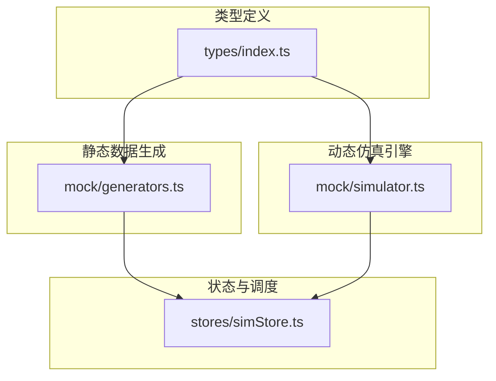
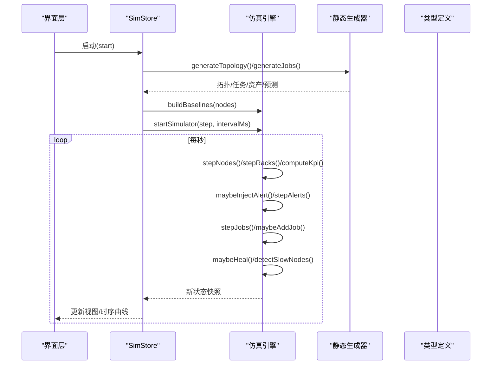
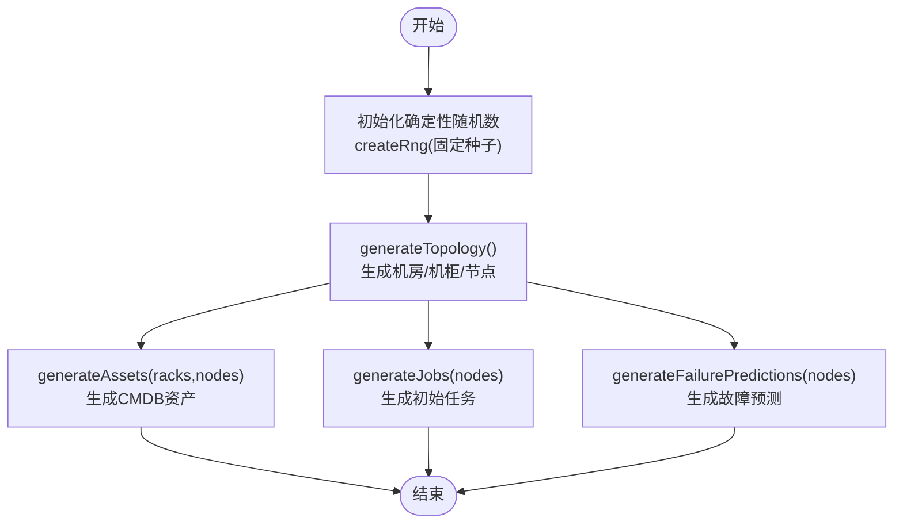
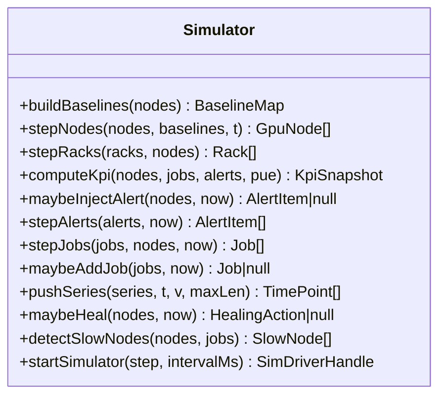
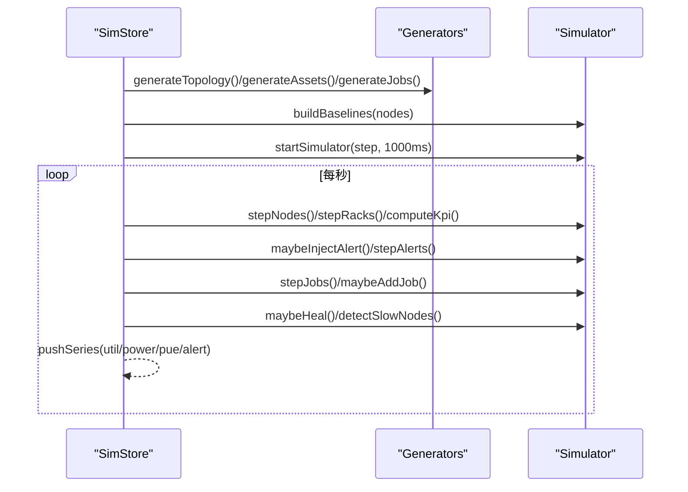
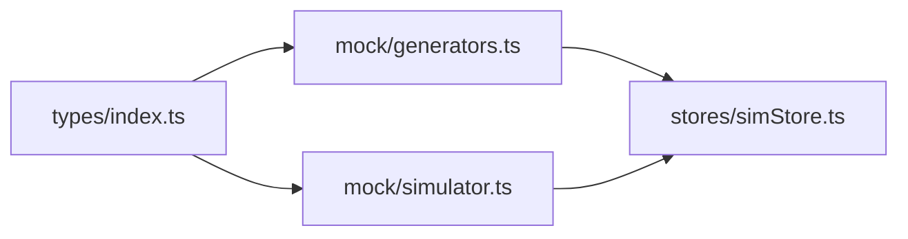

# 模拟数据系统

<cite>
**本文引用的文件**   
- [generators.ts](file://src/mock/generators.ts)
- [simulator.ts](file://src/mock/simulator.ts)
- [index.ts](file://src/types/index.ts)
- [simStore.ts](file://src/stores/simStore.ts)
</cite>

## 目录
1. [引言](#引言)
2. [项目结构](#项目结构)
3. [核心组件](#核心组件)
4. [架构总览](#架构总览)
5. [详细组件分析](#详细组件分析)
6. [依赖关系分析](#依赖关系分析)
7. [性能与优化](#性能与优化)
8. [故障排查指南](#故障排查指南)
9. [结论](#结论)
10. [附录：扩展开发指南](#附录扩展开发指南)

## 引言
本技术文档围绕 IDC AI 运维平台的“模拟数据系统”，系统性解析静态数据生成器与动态仿真引擎的实现原理，覆盖 GPU 节点、机房拓扑、告警事件、计算任务等关键业务数据的生成算法与随机数种子管理；同时说明仿真引擎的时间步进机制、状态更新逻辑与实时数据推送流程。文档还包含数据模型完整性校验建议、仿真参数调优方法与性能优化策略，并为开发者提供自定义数据生成器与仿真规则的开发指导。

## 项目结构
模拟数据系统由以下关键模块组成：
- 类型定义：集中声明领域模型，确保各模块间数据结构一致。
- 静态数据生成器：基于确定性伪随机数生成机房拓扑、GPU 节点、资产台账、初始任务与故障预测。
- 动态仿真引擎：以心跳驱动推进节点指标、机柜聚合、KPI、告警、任务状态机、自愈动作与慢节点检测。
- Store 集成层：组合生成器与仿真器，维护应用状态并提供 UI 交互方法。

图表来源
- [index.ts:1-192](file://src/types/index.ts#L1-L192)
- [generators.ts:1-408](file://src/mock/generators.ts#L1-L408)
- [simulator.ts:1-331](file://src/mock/simulator.ts#L1-L331)
- [simStore.ts:1-270](file://src/stores/simStore.ts#L1-L270)

章节来源
- [index.ts:1-192](file://src/types/index.ts#L1-L192)
- [generators.ts:1-408](file://src/mock/generators.ts#L1-L408)
- [simulator.ts:1-331](file://src/mock/simulator.ts#L1-L331)
- [simStore.ts:1-270](file://src/stores/simStore.ts#L1-L270)

## 核心组件
- 确定性随机数生成器（Mulberry32）：通过固定种子保证每次刷新数据一致，便于复现问题与对比实验。
- 静态数据生成器：
  - 机房拓扑：按机房/排/列/槽位生成机柜与节点，并计算世界坐标用于 3D 展示。
  - GPU 节点：为每张卡生成利用率、温度、显存占用、功耗、NVLink 带宽、ECC 错误与健康等级。
  - CMDB 资产：服务器、交换机、存储阵列与备件 GPU 卡的台账信息。
  - 初始任务：训练/推理/调试队列的任务集合，含分配节点、进度、吞吐、MFU 等指标。
  - 故障预测：基于节点健康分排序后估算故障概率与剩余寿命。
- 动态仿真引擎：
  - 时间步进：基于心跳间隔推进 tick，对节点指标做正弦漂移 + 噪声扰动。
  - 机柜聚合：根据节点功耗与冷通道温度推导热通道温度与健康等级。
  - KPI 汇总：算力、在线率、平均利用率、活跃告警数、PUE 与能耗分解。
  - 告警注入与流转：按模板与概率注入告警，部分自动恢复。
  - 任务状态机：排队→运行→完成/失败，支持新增任务与并发上限控制。
  - 自愈动作日志：针对严重告警或高健康风险节点触发自愈动作。
  - 慢节点检测：识别偏离集群均值的异常节点并给出诊断建议。
  - 时序数据推送：维护利用率、功耗、PUE、告警数量等历史曲线。
- Store 集成层：
  - 初始化静态数据与基线，启动仿真心跳，封装 step/start/stop 等方法。
  - 提供告警处理、任务提交、视图模式切换等用户操作接口。

章节来源
- [generators.ts:14-408](file://src/mock/generators.ts#L14-L408)
- [simulator.ts:15-331](file://src/mock/simulator.ts#L15-L331)
- [simStore.ts:39-270](file://src/stores/simStore.ts#L39-L270)

## 架构总览
模拟数据系统采用“静态生成 + 动态仿真”的分层架构：
- 类型层：统一领域模型，约束数据字段与取值范围。
- 生成层：一次性构建拓扑、资产、任务与预测，使用确定性随机数保证可重复性。
- 仿真层：纯函数式步进，不直接耦合 Store，避免循环依赖，由 Store 注入 getState/setState。
- 集成层：Zustand Store 负责状态管理与 UI 交互，调用仿真器推进状态并推送时序数据。

图表来源
- [simStore.ts:142-213](file://src/stores/simStore.ts#L142-L213)
- [simulator.ts:35-331](file://src/mock/simulator.ts#L35-L331)
- [generators.ts:159-408](file://src/mock/generators.ts#L159-L408)
- [index.ts:1-192](file://src/types/index.ts#L1-L192)

## 详细组件分析

### 静态数据生成器（generators.ts）
- 确定性随机数与工具函数
  - Mulberry32 实现 createRng(seed)，提供 rng/rand/randInt/pick 等工具，保证相同种子产生相同序列。
  - 全局 rng 使用固定种子，所有静态数据生成均复用该实例。
- 机房拓扑常量与布局
  - HALLS、ROWS_PER_HALL、COLS_PER_ROW、NODES_PER_RACK、GPUS_PER_NODE 等常量定义规模。
  - rackWorldPosition 将机柜网格索引映射到世界坐标，供 3D 场景复用。
- GPU 节点生成
  - genNode 依据行列槽位选择 GPU 型号，为每张卡生成 util/temp/memUtil/power/nvlink/eccErrors/level，并按健康规则判定节点级别与离线概率。
  - 节点健康分数综合温度、ECC 错误与级别惩罚。
- 全量拓扑生成
  - generateTopology 遍历机房/排/列/槽位，批量生成节点与机柜，计算机柜功耗与冷热通道温度，并赋予健康等级。
- CMDB 资产台账
  - generateAssets 生成服务器、交换机、存储阵列与备件 GPU 卡，附带厂商、型号、上架位置、生命周期、业务归属与状态。
- 初始计算任务
  - generateJobs 创建不同队列的任务，设置 gpuRequest、优先级、进度、吞吐、MFU 与损失值，并为运行中任务分配节点。
- 故障预测
  - generateFailurePredictions 按节点健康分排序选取候选，估算故障概率、剩余寿命与置信度。

图表来源
- [generators.ts:17-45](file://src/mock/generators.ts#L17-L45)
- [generators.ts:92-154](file://src/mock/generators.ts#L92-L154)
- [generators.ts:159-206](file://src/mock/generators.ts#L159-L206)
- [generators.ts:216-328](file://src/mock/generators.ts#L216-L328)
- [generators.ts:345-384](file://src/mock/generators.ts#L345-L384)
- [generators.ts:389-405](file://src/mock/generators.ts#L389-L405)

章节来源
- [generators.ts:14-408](file://src/mock/generators.ts#L14-L408)

### 动态仿真引擎（simulator.ts）
- 基线与步进
  - buildBaselines 为每个节点记录初始 util/temp/power 与相位、速度，作为正弦漂移的基准。
  - stepNodes 在每个 tick 内对节点指标施加正弦波与噪声扰动，并根据 healthFromTemp 重新判定健康等级与健康分数。
- 机柜聚合
  - stepRacks 根据节点功耗与冷通道温度推导热通道温度，并设定健康等级。
- KPI 汇总
  - computeKpi 统计 GPU 总数/在线数、平均利用率、活跃告警数、PUE、IT 功耗、制冷功耗与总功耗。
- 告警注入与流转
  - maybeInjectAlert 按模板与概率注入告警，优先从热点节点中选择目标。
  - stepAlerts 让部分 active 告警自然恢复为 resolved。
- 任务状态机
  - stepJobs 实现 queued→running→succeeded/failed 的状态流转，限制并发上限，逐步推进进度、loss、throughput、mfu。
  - maybeAddJob 周期性补充新任务，维持队列活跃度。
- 自愈动作日志
  - maybeHeal 在存在 critical 节点时按概率触发自愈动作，记录执行结果与延迟。
- 慢节点检测
  - detectSlowNodes 计算节点利用率相对均值偏差，筛选出显著低于均值的节点并给出诊断建议。
- 时序数据推送
  - pushSeries 维护固定长度的时间序列，支持利用率、功耗、PUE、告警数量等指标的历史曲线。
- 心跳驱动
  - startSimulator 使用 setInterval 驱动 step 回调，返回 stop 句柄以便停止仿真。

图表来源
- [simulator.ts:35-331](file://src/mock/simulator.ts#L35-L331)

章节来源
- [simulator.ts:15-331](file://src/mock/simulator.ts#L15-L331)

### Store 集成层（simStore.ts）
- 初始化阶段
  - 调用 generateTopology/generateAssets/generateJobs/generateFailurePredictions 构建静态数据。
  - 使用 buildBaselines 建立节点基线，seedSeries 生成历史时序数据。
  - 计算初始 KPI 与慢节点列表，填充告警与自愈日志。
- 步进逻辑
  - step 依次推进节点指标、机柜聚合、告警注入与流转、任务状态机、PUE 波动、KPI 汇总、自愈日志与慢节点检测。
  - 每步更新时序曲线，保持长度上限。
- 控制与交互
  - start/stop 控制仿真心跳。
  - ackAlert/silenceAlert/resolveAlert 处理告警状态。
  - submitJob 提交新任务。
  - setViewMode/selectRack/toggleTour 管理 UI 状态。

图表来源
- [simStore.ts:42-58](file://src/stores/simStore.ts#L42-L58)
- [simStore.ts:142-213](file://src/stores/simStore.ts#L142-L213)
- [simulator.ts:35-331](file://src/mock/simulator.ts#L35-L331)
- [generators.ts:159-408](file://src/mock/generators.ts#L159-L408)

章节来源
- [simStore.ts:39-270](file://src/stores/simStore.ts#L39-L270)

## 依赖关系分析
- 类型依赖
  - generators.ts 与 simulator.ts 均引用 types/index.ts 中的领域模型，确保数据一致性。
- 模块耦合
  - simulator.ts 仅依赖 generators.ts 中的 createRng 与 healthFromTemp，避免与 Store 的直接耦合。
  - simStore.ts 组合 generators.ts 与 simulator.ts，承担状态管理与 UI 交互职责。
- 外部依赖
  - 使用 window.setInterval/clearInterval 驱动仿真心跳。
  - 使用 Zustand 管理应用状态。

图表来源
- [index.ts:1-192](file://src/types/index.ts#L1-L192)
- [generators.ts:1-408](file://src/mock/generators.ts#L1-L408)
- [simulator.ts:1-331](file://src/mock/simulator.ts#L1-L331)
- [simStore.ts:1-270](file://src/stores/simStore.ts#L1-L270)

章节来源
- [index.ts:1-192](file://src/types/index.ts#L1-L192)
- [generators.ts:1-408](file://src/mock/generators.ts#L1-L408)
- [simulator.ts:1-331](file://src/mock/simulator.ts#L1-L331)
- [simStore.ts:1-270](file://src/stores/simStore.ts#L1-L270)

## 性能与优化
- 确定性随机数
  - 使用 Mulberry32 替代 Math.random，保证可重复性与可测试性。
- 步进频率与开销控制
  - 机柜聚合每 3 tick 更新一次，降低计算压力。
  - 慢节点检测每 5 tick 执行一次，减少频繁计算。
- 数据裁剪
  - 告警与自愈日志保留最近 N 条，防止内存增长。
  - 时序曲线固定最大长度，避免无限增长。
- 数值边界保护
  - clamp 函数确保指标处于合理区间，避免极端值影响可视化与 KPI。
- PUE 波动范围
  - PUE 在合理范围内缓慢波动，避免剧烈抖动导致图表失真。

[本节为通用性能讨论，不直接分析具体代码文件]

## 故障排查指南
- 节点健康异常
  - 检查 healthFromTemp 判定阈值与节点温度/利用率是否超出预期。
  - 确认 stepNodes 的正弦漂移幅度与噪声范围是否合适。
- 告警风暴
  - 调整 maybeInjectAlert 的概率与模板权重，避免过多告警涌入。
  - 检查 stepAlerts 的自然恢复概率，确保告警能正常收敛。
- 任务堆积
  - 调整 stepJobs 的并发上限 capacity 与排队启动概率，平衡资源利用与队列长度。
  - 检查 maybeAddJob 的新增概率与队列分布，避免任务过多。
- 慢节点误报
  - 调整 detectSlowNodes 的偏差阈值与采样窗口，减少误判。
- 时序曲线异常
  - 检查 pushSeries 的最大长度与数据更新频率，确保曲线平滑且不过载。

章节来源
- [generators.ts:83-87](file://src/mock/generators.ts#L83-L87)
- [simulator.ts:54-71](file://src/mock/simulator.ts#L54-L71)
- [simulator.ts:165-194](file://src/mock/simulator.ts#L165-L194)
- [simulator.ts:199-259](file://src/mock/simulator.ts#L199-L259)
- [simulator.ts:303-318](file://src/mock/simulator.ts#L303-L318)
- [simulator.ts:264-268](file://src/mock/simulator.ts#L264-L268)

## 结论
模拟数据系统通过确定性静态生成与纯函数式动态仿真，构建了贴近真实 IDC AI 运维场景的数据流。其优势在于可重复性、可扩展性与低耦合设计。结合 Store 的状态管理与 UI 交互，系统能够稳定地驱动仪表盘、3D 场景与各类分析页面。通过合理的参数调优与性能优化策略，可在保证仿真质量的同时控制计算与内存开销。

[本节为总结性内容，不直接分析具体代码文件]

## 附录：扩展开发指南
- 自定义数据生成器
  - 在 generators.ts 中新增生成函数，复用 createRng 与 pick/rand 工具，确保输出符合 types/index.ts 定义的模型。
  - 若需引入新的设备类型或业务属性，先在类型定义中扩展接口，再在生成器中填充字段。
- 自定义仿真规则
  - 在 simulator.ts 中添加新的步进函数，遵循纯函数原则，输入当前状态与时间戳，输出新状态。
  - 如需注入新告警或自愈动作，扩展 ALERT_TEMPLATES 或 HEAL_ACTIONS，并在 maybeInjectAlert/maybeHeal 中调用。
- 参数调优建议
  - 调整 stepNodes 的正弦振幅与噪声范围，以匹配实际负载波动特征。
  - 调节 maybeInjectAlert 的概率与模板权重，控制告警密度与严重级别分布。
  - 调整 stepJobs 的并发上限与任务新增概率，平衡队列长度与资源利用率。
- 性能优化实践
  - 对高频计算步骤进行降频（如机柜聚合、慢节点检测）。
  - 对长列表进行裁剪（告警、自愈日志、时序曲线），避免内存泄漏。
  - 使用 clamp 与边界检查，确保数值稳定性。

章节来源
- [generators.ts:17-45](file://src/mock/generators.ts#L17-L45)
- [generators.ts:92-154](file://src/mock/generators.ts#L92-L154)
- [simulator.ts:151-161](file://src/mock/simulator.ts#L151-L161)
- [simulator.ts:274-298](file://src/mock/simulator.ts#L274-L298)
- [simulator.ts:54-71](file://src/mock/simulator.ts#L54-L71)
- [simulator.ts:199-259](file://src/mock/simulator.ts#L199-L259)