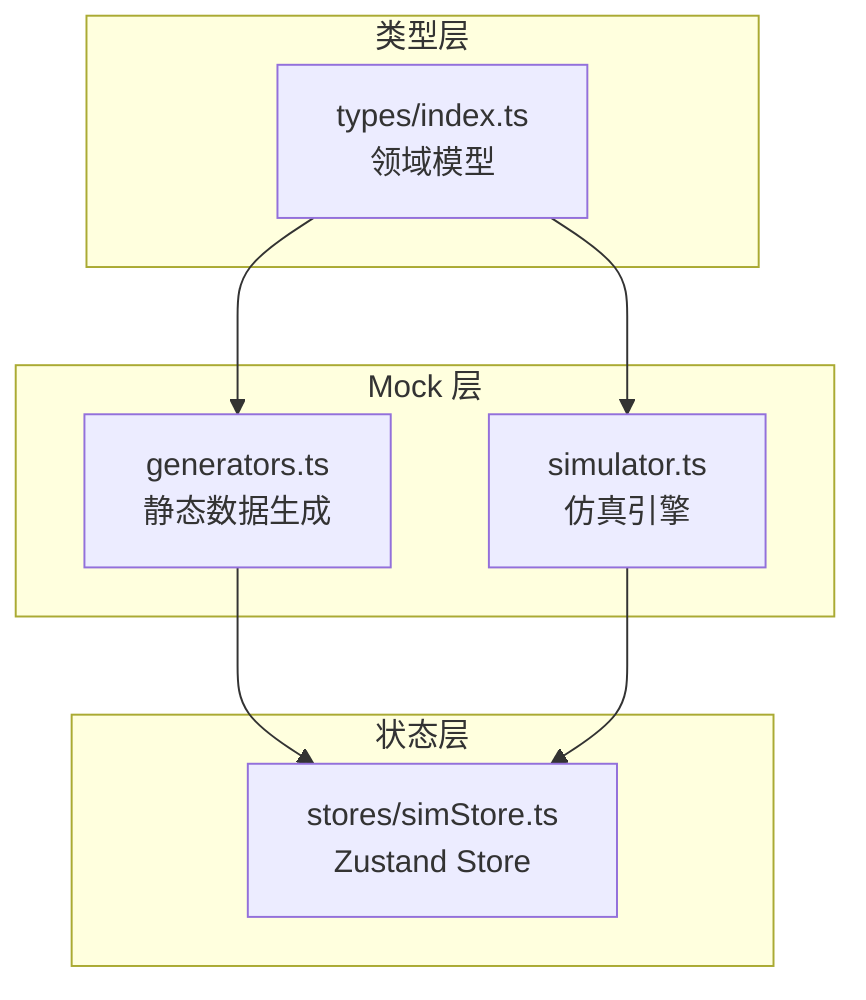
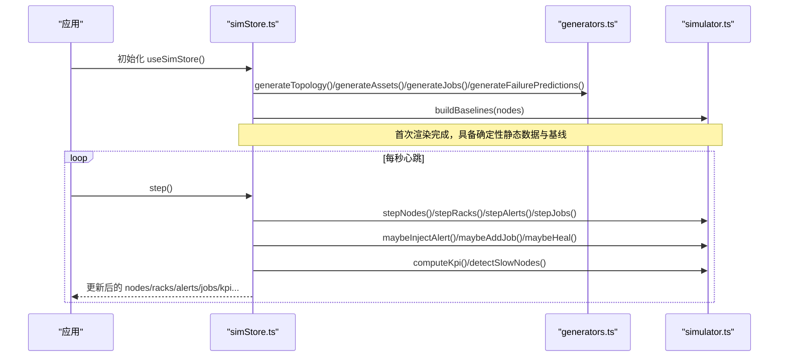
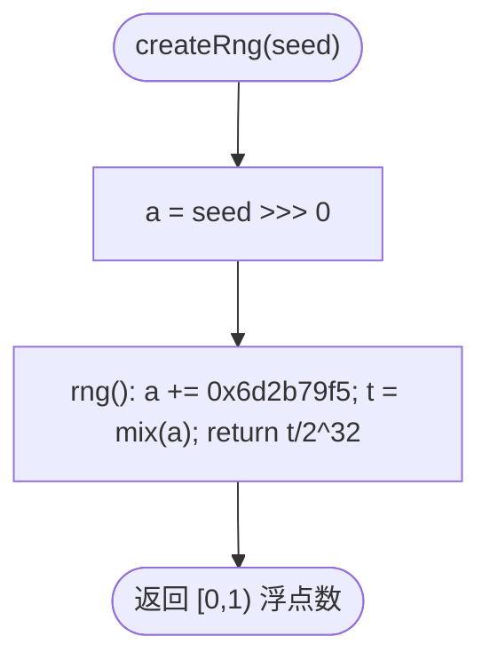
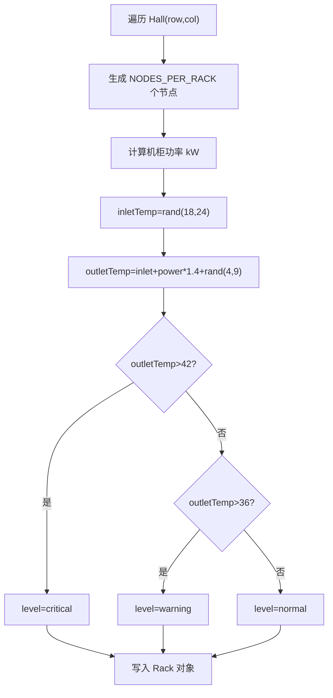
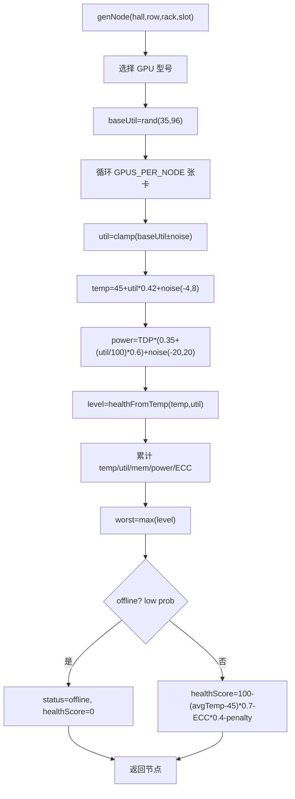
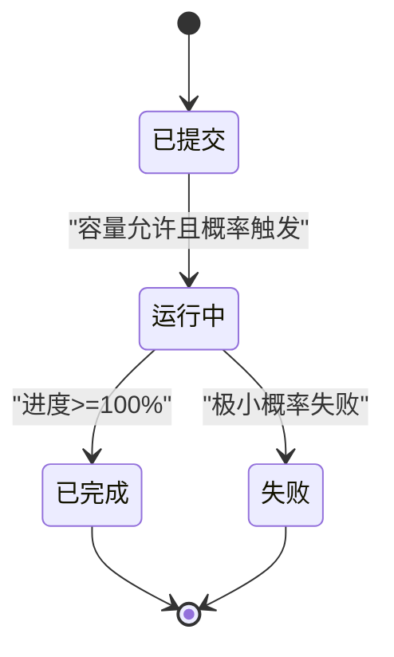
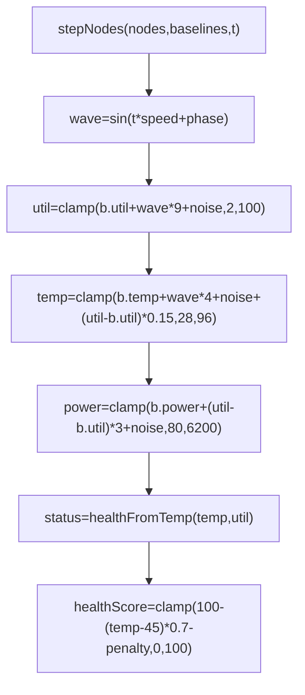
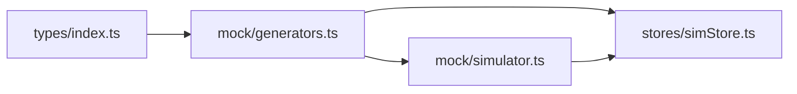

# 静态数据生成器

<cite>
**本文引用的文件**   
- [generators.ts](file://src/mock/generators.ts)
- [simulator.ts](file://src/mock/simulator.ts)
- [index.ts](file://src/types/index.ts)
- [simStore.ts](file://src/stores/simStore.ts)
</cite>

## 目录
1. [引言](#引言)
2. [项目结构](#项目结构)
3. [核心组件](#核心组件)
4. [架构总览](#架构总览)
5. [详细组件分析](#详细组件分析)
6. [依赖关系分析](#依赖关系分析)
7. [性能与可扩展性](#性能与可扩展性)
8. [故障排查指南](#故障排查指南)
9. [结论](#结论)
10. [附录：扩展点与自定义规则](#附录扩展点与自定义规则)

## 引言
本技术文档面向 IDC AI 运维平台的“静态数据生成器”子系统，目标是帮助开发者理解并扩展以下能力：
- 确定性伪随机数生成器（Mulberry32）的实现原理与种子管理，确保每次刷新数据一致。
- GPU 节点、机房拓扑、机柜布局、资产台账、计算任务等核心业务数据的生成算法。
- 健康度评分模型、温度功耗关系、故障预测概率计算等关键业务逻辑。
- 数据中心物理布局坐标计算、机柜世界位置映射、3D 场景复用配置。
- 为开发者提供自定义数据生成规则与扩展点的指导。

## 项目结构
本项目采用按职责划分的模块组织方式：
- mock/generators.ts：静态数据生成器，负责拓扑、节点、资产、任务、故障预测等确定性数据构造。
- mock/simulator.ts：仿真引擎，基于心跳驱动推进节点指标、告警、任务状态机、KPI 汇总等动态行为。
- types/index.ts：领域模型定义，统一数据结构与枚举类型。
- stores/simStore.ts：状态容器，组合生成器与仿真器，暴露 UI 可消费的状态与动作。

图表来源
- [generators.ts:1-408](file://src/mock/generators.ts#L1-L408)
- [simulator.ts:1-331](file://src/mock/simulator.ts#L1-L331)
- [index.ts:1-192](file://src/types/index.ts#L1-L192)
- [simStore.ts:1-270](file://src/stores/simStore.ts#L1-L270)

章节来源
- [generators.ts:1-408](file://src/mock/generators.ts#L1-L408)
- [simulator.ts:1-331](file://src/mock/simulator.ts#L1-L331)
- [index.ts:1-192](file://src/types/index.ts#L1-L192)
- [simStore.ts:1-270](file://src/stores/simStore.ts#L1-L270)

## 核心组件
- 确定性随机源：Mulberry32 实现 createRng，固定种子保证一致性。
- 拓扑与布局：机房 Hall、排 Row、列 Col、机柜 Rack、节点 Node 的层级结构与坐标映射。
- 业务数据：GPU 节点指标、CMDB 资产、计算任务、故障预测。
- 仿真引擎：基线构建、正弦漂移 + 噪声、告警注入、任务状态机、KPI 汇总、慢节点检测、自愈日志。
- 状态容器：Zustand store 聚合初始数据与心跳步进，对外暴露 step/start/stop 等方法。

章节来源
- [generators.ts:14-81](file://src/mock/generators.ts#L14-L81)
- [simulator.ts:20-71](file://src/mock/simulator.ts#L20-L71)
- [simStore.ts:39-160](file://src/stores/simStore.ts#L39-L160)

## 架构总览
静态数据生成器与仿真引擎通过类型层解耦，store 作为编排者协调数据初始化与运行时推进。

图表来源
- [simStore.ts:142-207](file://src/stores/simStore.ts#L142-L207)
- [simulator.ts:35-71](file://src/mock/simulator.ts#L35-L71)
- [simulator.ts:165-234](file://src/mock/simulator.ts#L165-L234)
- [simulator.ts:283-318](file://src/mock/simulator.ts#L283-L318)
- [simulator.ts:97-139](file://src/mock/simulator.ts#L97-L139)
- [generators.ts:159-206](file://src/mock/generators.ts#L159-L206)

## 详细组件分析

### 确定性伪随机数生成器（Mulberry32）与种子管理
- 实现要点：
  - 使用 32 位无符号整数累加常数，结合位移与乘法混合，输出 [0,1) 浮点序列。
  - 通过闭包保存内部状态 a，避免外部污染。
- 种子策略：
  - 静态数据生成器使用固定种子 20261030，确保页面刷新后拓扑、节点、资产、任务等完全一致。
  - 仿真引擎使用独立种子 88123，用于动态指标漂移、告警注入、任务调度等，避免与静态数据相互影响。
- 工具函数：
  - rand/randInt/pick 封装区间随机、整数随机、数组选择，简化业务代码。

图表来源
- [generators.ts:17-28](file://src/mock/generators.ts#L17-L28)

章节来源
- [generators.ts:17-35](file://src/mock/generators.ts#L17-L35)
- [simulator.ts:20-22](file://src/mock/simulator.ts#L20-L22)

### 机房拓扑与机柜布局
- 拓扑常量：
  - HALLS：A/B 两机房；ROWS_PER_HALL=8；COLS_PER_ROW=12；NODES_PER_RACK=4；GPUS_PER_NODE=8。
- 布局坐标：
  - rackWorldPosition 将 (hall,row,col) 映射到世界坐标 (x,z)，两机房沿 x 轴左右分开，排沿 z 轴纵深，机柜沿 x 轴排列。
  - 3D 场景可直接复用 RACK_W/RACK_D/RACK_H/AISLE_GAP/ROW_GAP/HALL_GAP 等常量。
- 拓扑生成：
  - generateTopology 遍历机房、排、列、槽位，生成 Hall/Rack/GpuNode 全量结构，同时计算机柜入/出风温度与健康等级。

图表来源
- [generators.ts:159-206](file://src/mock/generators.ts#L159-L206)

章节来源
- [generators.ts:40-81](file://src/mock/generators.ts#L40-L81)
- [generators.ts:159-206](file://src/mock/generators.ts#L159-L206)

### GPU 节点生成与健康度评分模型
- 节点生成 genNode：
  - 根据 row/rack/slot 轮转选择 GPU 型号，基础利用率 baseUtil 在 [35,96] 之间。
  - 单卡指标：util、memUtil、temp、power、nvlink、eccErrors、level。
  - 温度模型：temp ≈ 45 + util * 0.42 + noise(-4,8)。
  - 功耗模型：power ≈ TDP * (0.35 + (util/100)*0.6) + noise(-20,20)。
  - 健康等级 healthFromTemp：依据 temp/util 阈值判定 normal/warning/critical。
  - 节点级健康分数：综合平均温度、ECC 错误计数、最差等级进行扣分，范围 [0,100]。
  - 少量节点离线：以低概率标记 offline，healthScore=0。

图表来源
- [generators.ts:83-154](file://src/mock/generators.ts#L83-L154)

章节来源
- [generators.ts:83-154](file://src/mock/generators.ts#L83-L154)

### 资产台账生成
- 服务器资产：
  - 基于节点信息生成 SN、在线日期、保修期、生命周期、业务归属、维修次数等。
- 交换机资产：
  - 每排 2 台，固定放置于首列高 U 位，状态以低概率异常。
- 存储阵列：
  - 每机房若干，尾列 U1-U20，生命周期随年龄变化。
- 备件 GPU 卡：
  - 固定数量库存条目，仓库位置 BIN 编号随机。

章节来源
- [generators.ts:211-328](file://src/mock/generators.ts#L211-L328)

### 计算任务生成与仿真流转
- 初始任务生成 generateJobs：
  - 队列类型训练/推理/调试，不同队列分配不同 GPU 请求规模。
  - 任务状态分布：running/succeeded/queued，附带进度、优先级、模型名、loss、throughput、mfu。
  - 运行任务分配节点：按 8 卡/节点切分，从节点列表切片选取。
- 仿真阶段 stepJobs：
  - 排队任务尝试启动：并发上限 40，优先正常节点。
  - 运行任务进度递增，loss/throughput/mfu 波动，达到 100% 成功，极小概率失败。
- 可能新增任务 maybeAddJob：
  - 维持队列活跃度，限制最大长度，随机选择队列与资源需求。

图表来源
- [simulator.ts:199-234](file://src/mock/simulator.ts#L199-L234)
- [simulator.ts:239-259](file://src/mock/simulator.ts#L239-L259)

章节来源
- [generators.ts:333-384](file://src/mock/generators.ts#L333-L384)
- [simulator.ts:199-259](file://src/mock/simulator.ts#L199-L259)

### 故障预测概率计算
- 候选节点：按健康分数升序取前 24 个。
- 概率计算：probability = clamp(100 - healthScore ± noise, 12, 97)。
- 剩余寿命 rul：与概率反相关，乘以随机系数。
- 置信度 confidence：[72,96] 随机。
- 结果按概率降序排序。

章节来源
- [generators.ts:389-405](file://src/mock/generators.ts#L389-L405)

### 实时指标仿真与 KPI 汇总
- 基线构建 buildBaselines：
  - 为每个节点记录初始 util/temp/power，以及相位 phase 与速度 speed，用于正弦漂移。
- 节点步进 stepNodes：
  - util = clamp(util + sin(t*speed + phase)*9 + noise(-3,3), 2, 100)
  - temp = clamp(temp + sin(...)*4 + noise(-1.5,1.5) + (util-b.util)*0.15, 28, 96)
  - power = clamp(power + (util-b.util)*3 + noise(-15,15), 80, 6200)
  - status = healthFromTemp(temp, util)
  - healthScore = clamp(100 - (temp-45)*0.7 - penalty, 0, 100)
- 机柜步进 stepRacks：
  - 按节点聚合 power，outletTemp = inletTemp + power*1.4 + noise(-0.5,0.5)
  - level 由 outletTemp 阈值决定。
- KPI 汇总 computeKpi：
  - 统计 GPU 总数/在线数、平均利用率、IT 功耗、理论算力 PFLOPS、PUE 换算总功耗与制冷功耗。

图表来源
- [simulator.ts:35-71](file://src/mock/simulator.ts#L35-L71)

章节来源
- [simulator.ts:35-71](file://src/mock/simulator.ts#L35-L71)
- [simulator.ts:76-92](file://src/mock/simulator.ts#L76-L92)
- [simulator.ts:97-139](file://src/mock/simulator.ts#L97-L139)

### 告警注入与自愈动作
- 告警模板 ALERT_TEMPLATES：
  - 覆盖 GPU/节点/网络/供电/制冷/存储等多来源，包含标题、值描述函数。
- 注入策略 maybeInjectAlert：
  - 每秒有概率产生新告警，优先针对热点节点或随机节点。
- 告警流转 stepAlerts：
  - active 告警有一定概率自动恢复 resolved。
- 自愈动作 maybeHeal：
  - 对 critical 节点触发自动隔离、降频、热迁移、服务重启、链路切换、快照等动作，带延迟与成功率。

章节来源
- [simulator.ts:151-182](file://src/mock/simulator.ts#L151-L182)
- [simulator.ts:187-194](file://src/mock/simulator.ts#L187-L194)
- [simulator.ts:274-298](file://src/mock/simulator.ts#L274-L298)

### 慢节点检测
- 计算运行节点的平均利用率，筛选相对均值偏差低于 -18% 的节点。
- 根据偏差程度给出诊断建议：通信同步耗时偏高或算力利用率偏低。
- 最多返回 8 条，按偏差升序排序。

章节来源
- [simulator.ts:303-318](file://src/mock/simulator.ts#L303-L318)

### 3D 场景复用配置
- 布局常量：
  - RACK_W/RACK_D/RACK_H/AISLE_GAP/ROW_GAP/HALL_GAP 提供机柜尺寸与通道间距。
- 世界坐标：
  - rackWorldPosition 将网格索引映射到世界坐标，供 3D 场景直接复用。
- 机房维度：
  - HALLS/ROWS_PER_HALL/COLS_PER_ROW 控制机房规模与行列布局。

章节来源
- [generators.ts:62-81](file://src/mock/generators.ts#L62-L81)

## 依赖关系分析
- generators.ts 依赖 types/index.ts 中的领域模型。
- simulator.ts 依赖 types/index.ts 与 generators.ts 中的常量与函数（如 GPUS_PER_NODE、MODEL_PFLOPS、createRng、healthFromTemp）。
- simStore.ts 组合 generators.ts 与 simulator.ts，并通过 Zustand 暴露状态与动作。

图表来源
- [generators.ts:1-12](file://src/mock/generators.ts#L1-L12)
- [simulator.ts:1-13](file://src/mock/simulator.ts#L1-L13)
- [simStore.ts:16-37](file://src/stores/simStore.ts#L16-L37)

章节来源
- [generators.ts:1-12](file://src/mock/generators.ts#L1-L12)
- [simulator.ts:1-13](file://src/mock/simulator.ts#L1-L13)
- [simStore.ts:16-37](file://src/stores/simStore.ts#L16-L37)

## 性能与可扩展性
- 性能特性：
  - 静态数据一次性生成，避免重复计算。
  - 仿真引擎纯函数设计，避免副作用，便于测试与并行化。
  - 机柜聚合每 3 tick 更新一次，慢节点检测每 5 tick 执行一次，降低开销。
- 可扩展性：
  - 通过替换 createRng 的种子与工厂函数，可定制随机策略。
  - 扩展 ALER_TEMPLATES、HEAL_ACTIONS、JOB_MODELS 等常量集合即可扩展业务行为。
  - 在 stepNodes/stepRacks/computeKpi 等函数中增加新的指标或聚合维度。

[本节为通用指导，不直接分析具体文件]

## 故障排查指南
- 数据不一致问题：
  - 检查是否误用 Math.random 替代 Mulberry32；确认静态数据生成器与仿真引擎各自使用固定种子。
- 健康等级异常：
  - 核对 healthFromTemp 阈值与温度/利用率范围；检查 stepNodes 中 temp/util 的边界钳制。
- 告警风暴：
  - 调整 maybeInjectAlert 的概率阈值与模板权重；检查 stepAlerts 的自动恢复概率。
- 任务堆积：
  - 检查 stepJobs 的并发上限 capacity 与启动概率；确认 maybeAddJob 的长度限制。
- 3D 布局错位：
  - 校验 rackWorldPosition 的偏移与间距常量；确认 ROWS_PER_HALL/COLS_PER_ROW 与实际场景一致。

章节来源
- [generators.ts:17-35](file://src/mock/generators.ts#L17-L35)
- [simulator.ts:54-71](file://src/mock/simulator.ts#L54-L71)
- [simulator.ts:165-194](file://src/mock/simulator.ts#L165-L194)
- [simulator.ts:199-234](file://src/mock/simulator.ts#L199-L234)
- [generators.ts:76-81](file://src/mock/generators.ts#L76-L81)

## 结论
静态数据生成器通过 Mulberry32 确定性随机源与清晰的拓扑/业务数据生成算法，提供了稳定一致的演示数据；仿真引擎在此基础上实现了贴近真实的数据漂移、告警与任务流转。类型层解耦了数据结构，store 层编排了初始化与心跳步进，整体架构清晰、可扩展性强，适合进一步扩展业务规则与可视化场景。

[本节为总结性内容，不直接分析具体文件]

## 附录：扩展点与自定义规则
- 自定义随机策略：
  - 修改 createRng 或替换种子，以适配不同场景的一致性需求。
- 扩展拓扑规模：
  - 调整 HALLS/ROWS_PER_HALL/COLS_PER_ROW/NODES_PER_RACK/GPUS_PER_NODE 常量。
- 扩展 GPU 型号与参数：
  - 在 GPU_MODELS 与 MODEL_PFLOPS/MODEL_TDP 中添加新机型与对应算力/功耗参数。
- 扩展资产类别：
  - 在 generateAssets 中新增设备类型与生成逻辑，补充 VENDORS/BUSINESSES 等枚举。
- 扩展任务队列与模型：
  - 在 JOB_MODELS/OWNERS 中添加更多模型与负责人；在 stepJobs 中扩展队列行为。
- 扩展告警与自愈：
  - 在 ALERT_TEMPLATES/HEAL_ACTIONS 中新增模板与动作，丰富运维事件表现。
- 扩展健康评分模型：
  - 在 healthFromTemp 与 healthScore 计算中加入新的指标（如 ECC、NVLink 带宽、HBM 温度等）。
- 扩展 3D 场景：
  - 复用 RACK_W/RACK_D/RACK_H/AISLE_GAP/ROW_GAP/HALL_GAP 与 rackWorldPosition，对接 Three.js 或其他 3D 引擎。

章节来源
- [generators.ts:40-81](file://src/mock/generators.ts#L40-L81)
- [generators.ts:211-328](file://src/mock/generators.ts#L211-L328)
- [generators.ts:333-384](file://src/mock/generators.ts#L333-L384)
- [simulator.ts:151-182](file://src/mock/simulator.ts#L151-L182)
- [simulator.ts:274-298](file://src/mock/simulator.ts#L274-L298)
- [simulator.ts:54-71](file://src/mock/simulator.ts#L54-L71)