# 3D数据中心可视化

<cite>
**本文引用的文件**   
- [DataCenter3D.tsx](file://src/pages/DataCenter3D.tsx)
- [DataCenterScene.tsx](file://src/components/scene/DataCenterScene.tsx)
- [generators.ts](file://src/mock/generators.ts)
- [simStore.ts](file://src/stores/simStore.ts)
- [colors.ts](file://src/theme/colors.ts)
- [index.ts](file://src/types/index.ts)
- [package.json](file://package.json)
</cite>

## 目录
1. [引言](#引言)
2. [项目结构](#项目结构)
3. [核心组件](#核心组件)
4. [架构总览](#架构总览)
5. [详细组件分析](#详细组件分析)
6. [依赖关系分析](#依赖关系分析)
7. [性能与渲染优化](#性能与渲染优化)
8. [多视图模式与交互流程](#多视图模式与交互流程)
9. [自动巡检模式](#自动巡检模式)
10. [节点选择与信息展示](#节点选择与信息展示)
11. [数据同步机制](#数据同步机制)
12. [移动端适配方案](#移动端适配方案)
13. [故障排查指南](#故障排查指南)
14. [扩展与定制开发指导](#扩展与定制开发指导)
15. [结论](#结论)

## 引言
本页面面向“超级智算数据中心运维透视平台”的 3D 数据中心可视化能力，重点说明以下方面：
- Three.js 场景搭建、机房布局建模、机柜状态可视化、温度热力图与负载热力图。
- 相机控制、点击交互、自动巡检巡游。
- 多视图模式切换：temperature/load/alert/topology。
- 3D 场景与 2D 界面的数据同步、性能优化策略与移动端适配建议。
- 如何基于现有代码进行二次开发与扩展。

该实现以 React + TypeScript 为基础，使用 @react-three/fiber 和 @react-three/drei 构建 3D 场景，使用 Zustand 管理全局仿真状态，并通过 mock 数据驱动可视化效果。

## 项目结构
围绕 3D 数据中心可视化的关键文件如下：
- 页面入口：[DataCenter3D.tsx](file://src/pages/DataCenter3D.tsx)
- 3D 场景组件：[DataCenterScene.tsx](file://src/components/scene/DataCenterScene.tsx)
- 拓扑与布局常量、模拟数据生成：[generators.ts](file://src/mock/generators.ts)
- 全局仿真状态与动作：[simStore.ts](file://src/stores/simStore.ts)
- 颜色主题与映射函数：[colors.ts](file://src/theme/colors.ts)
- 领域类型定义：[index.ts](file://src/types/index.ts)
- 依赖声明：[package.json](file://package.json)

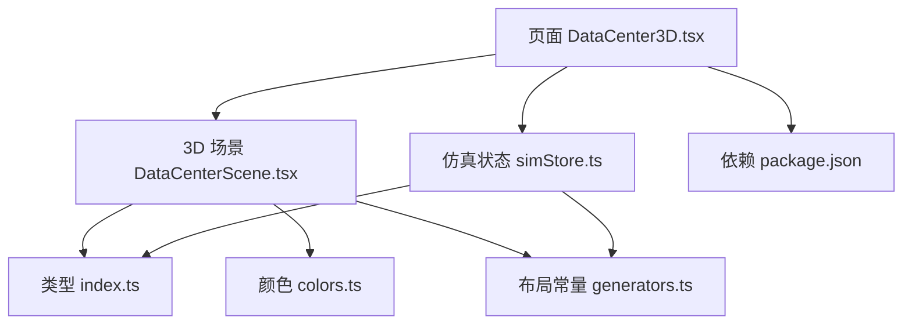

**图表来源**
- [DataCenter3D.tsx:1-48](file://src/pages/DataCenter3D.tsx#L1-L48)
- [DataCenterScene.tsx:1-12](file://src/components/scene/DataCenterScene.tsx#L1-L12)
- [simStore.ts:1-21](file://src/stores/simStore.ts#L1-L21)
- [generators.ts:62-81](file://src/mock/generators.ts#L62-L81)
- [colors.ts:66-96](file://src/theme/colors.ts#L66-L96)
- [index.ts:160-161](file://src/types/index.ts#L160-L161)
- [package.json:11-21](file://package.json#L11-L21)

**章节来源**
- [DataCenter3D.tsx:1-48](file://src/pages/DataCenter3D.tsx#L1-L48)
- [DataCenterScene.tsx:1-12](file://src/components/scene/DataCenterScene.tsx#L1-L12)
- [package.json:11-21](file://package.json#L11-L21)

## 核心组件
- DataCenter3D（页面）
  - 负责 UI 层：视图模式切换、统计面板、图例、操作提示、自动巡检开关。
  - 从 store 订阅 racks/nodes/viewMode/selectedRackId/tourActive，并传递给 3D 场景。
- DataCenterScene（3D 场景）
  - 使用 @react-three/fiber 的 Canvas 创建 Three.js 场景。
  - 渲染机房网格、冷热通道色带、机柜 Mesh、拓扑连线、选中信息浮层。
  - 提供 OrbitControls 相机控制与 TourRig 自动巡检。
- simStore（仿真状态）
  - 维护 halls/racks/nodes/alerts/jobs/kpi 等状态。
  - 提供 setViewMode/selectRack/toggleTour 等动作。
  - 通过 step/start/stop 驱动仿真步进。
- generators（布局与数据）
  - 定义机房布局常量（HALLS/ROWS_PER_HALL/COLS_PER_ROW/NODES_PER_RACK）。
  - 提供 rackWorldPosition 计算世界坐标。
  - 生成拓扑、资产、任务、预测等模拟数据。
- colors（颜色主题）
  - 提供 tempToColor/utilToColor/HEALTH_COLOR 等映射。
- types（类型定义）
  - 定义 GpuNode/Rack/Hall/AlertItem/Job/ViewMode 等类型。

**章节来源**
- [DataCenter3D.tsx:15-96](file://src/pages/DataCenter3D.tsx#L15-L96)
- [DataCenterScene.tsx:18-48](file://src/components/scene/DataCenterScene.tsx#L18-L48)
- [simStore.ts:99-134](file://src/stores/simStore.ts#L99-L134)
- [generators.ts:40-81](file://src/mock/generators.ts#L40-L81)
- [colors.ts:66-96](file://src/theme/colors.ts#L66-L96)
- [index.ts:32-64](file://src/types/index.ts#L32-L64)

## 架构总览
整体架构分为三层：
- 表现层（React UI）：DataCenter3D 页面承载顶部工具栏、左侧统计面板、底部操作提示。
- 3D 渲染层（Three.js via Fiber/Drei）：DataCenterScene 负责场景、灯光、网格、机柜 Mesh、拓扑连线、相机控制。
- 数据与状态层（Zustand + Mock）：simStore 聚合仿真数据，generators 提供初始拓扑与模拟数据。

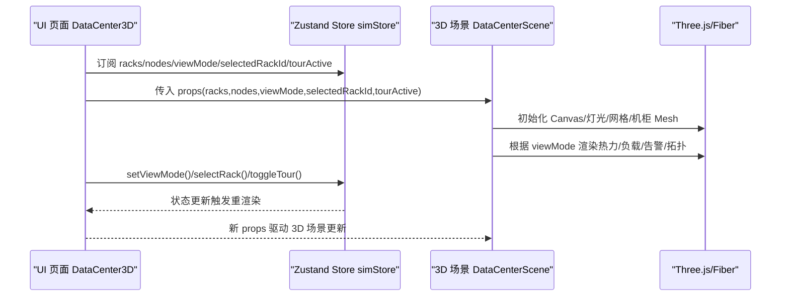

**图表来源**
- [DataCenter3D.tsx:15-48](file://src/pages/DataCenter3D.tsx#L15-L48)
- [DataCenterScene.tsx:218-326](file://src/components/scene/DataCenterScene.tsx#L218-L326)
- [simStore.ts:142-164](file://src/stores/simStore.ts#L142-L164)

## 详细组件分析

### 3D 场景搭建与渲染管线
- 场景容器：Canvas 配置 dpr、camera、gl 抗锯齿与高性能偏好，背景为径向渐变。
- 光照系统：环境光 + 方向光 + 点光源，营造科技感氛围。
- 地面网格：Grid 组件绘制无限网格，区分主网格与分区网格颜色。
- 冷热通道色带：AisleBands 按行生成冷/热通道地面条带，使用 AdditiveBlending 增强发光感。
- 机柜阵列：遍历 racks 渲染 RackMesh，每个机柜包含主体 Mesh、顶部灯带、正面 GPU 灯带、选中描边、告警脉冲球。
- 拓扑连线：TopologyLinks 在 topology 模式下显示 InfiniBand 骨干链路，按排串联到汇聚点再连至机房核心。
- 信息浮层：Html 将 HTML 浮层定位到选中机柜上方，展示平均利用率、温度、功耗、节点数、冷热通道温度等。

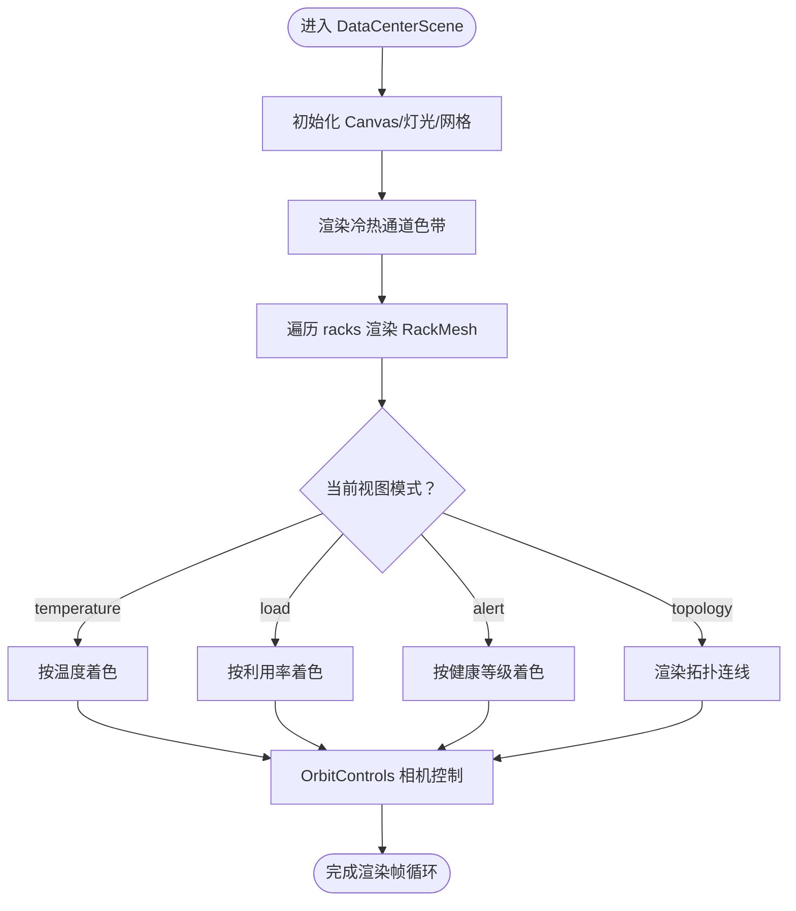

**图表来源**
- [DataCenterScene.tsx:231-326](file://src/components/scene/DataCenterScene.tsx#L231-L326)
- [DataCenterScene.tsx:328-353](file://src/components/scene/DataCenterScene.tsx#L328-L353)
- [DataCenterScene.tsx:159-205](file://src/components/scene/DataCenterScene.tsx#L159-L205)

**章节来源**
- [DataCenterScene.tsx:231-326](file://src/components/scene/DataCenterScene.tsx#L231-L326)
- [DataCenterScene.tsx:328-353](file://src/components/scene/DataCenterScene.tsx#L328-L353)
- [DataCenterScene.tsx:159-205](file://src/components/scene/DataCenterScene.tsx#L159-L205)

### 机房布局与机柜模型
- 布局常量：HALLS、ROWS_PER_HALL、COLS_PER_ROW、NODES_PER_RACK、RACK_W/RACK_D/RACK_H、AISLE_GAP/ROW_GAP/HALL_GAP。
- 世界坐标：rackWorldPosition 根据 hall/row/col 计算 x/z 位置，两机房沿 x 轴左右分开，排沿 z 轴纵深，机柜沿 x 轴排列。
- 机柜尺寸：宽 1.2、深 1.6、高 4.2；每排间距 ROW_GAP=2.0；冷热通道间距 AISLE_GAP=3.2；机房间隔 HALL_GAP=14。

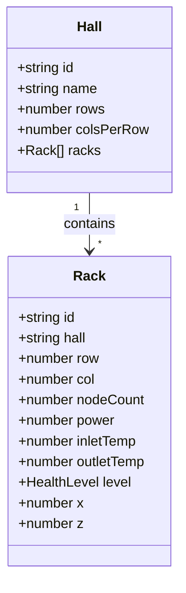

**图表来源**
- [index.ts:50-73](file://src/types/index.ts#L50-L73)
- [generators.ts:40-81](file://src/mock/generators.ts#L40-L81)

**章节来源**
- [generators.ts:40-81](file://src/mock/generators.ts#L40-L81)
- [index.ts:50-73](file://src/types/index.ts#L50-L73)

### 机柜状态可视化与热力图
- 温度热力：tempToColor 将温度映射为蓝→青→绿→黄→红渐变色。
- 负载热力：utilToColor 将利用率映射为青色/蓝色/琥珀色/红色。
- 告警视图：根据 critical/warning/normal 状态映射到不同颜色。
- 拓扑视图：统一使用固定颜色表示网络骨干链路。
- 机柜自发光与灯带：RackMesh 中 emissiveIntensity 随 util 变化，顶部灯带透明度随 util 变化，critical 或 selected 时增加脉冲效果。

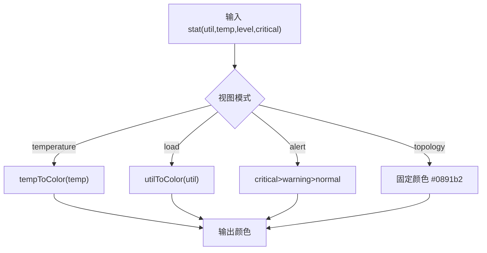

**图表来源**
- [DataCenterScene.tsx:50-61](file://src/components/scene/DataCenterScene.tsx#L50-L61)
- [colors.ts:66-96](file://src/theme/colors.ts#L66-L96)

**章节来源**
- [DataCenterScene.tsx:50-61](file://src/components/scene/DataCenterScene.tsx#L50-L61)
- [colors.ts:66-96](file://src/theme/colors.ts#L66-L96)

### 相机控制与自动巡检
- 相机控制：OrbitControls 支持左键旋转、右键平移、滚轮缩放；限制最大极角与距离范围。
- 自动巡检：TourRig 在 tourActive 时按时间 t 计算相机环绕轨迹，保持 lookAt(0,2,0)。
- 紧凑模式：compact=true 时启用 autoRotate，禁用 pan，缩小画布与 FOV。

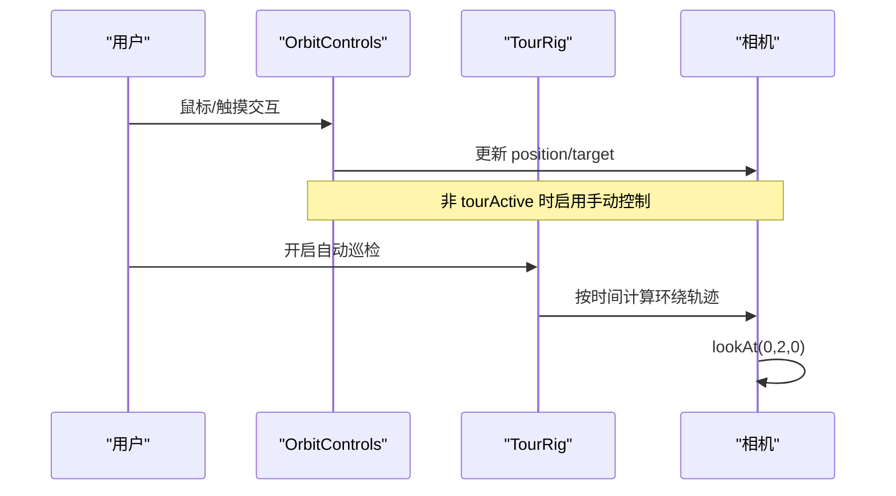

**图表来源**
- [DataCenterScene.tsx:145-157](file://src/components/scene/DataCenterScene.tsx#L145-L157)
- [DataCenterScene.tsx:314-323](file://src/components/scene/DataCenterScene.tsx#L314-L323)

**章节来源**
- [DataCenterScene.tsx:145-157](file://src/components/scene/DataCenterScene.tsx#L145-L157)
- [DataCenterScene.tsx:314-323](file://src/components/scene/DataCenterScene.tsx#L314-L323)

### 拓扑连线与网络可视化
- TopologyLinks 在 topology 模式下渲染 InfiniBand 骨干链路。
- 逻辑：每排机柜顶部串联到排汇聚点，再连接到机房核心（A/B 机房分别位于 x=-14/x=14）。
- 视觉：青色线条，半透明，线宽 1。

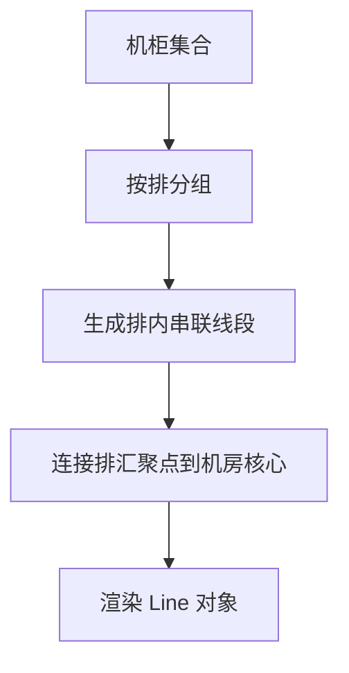

**图表来源**
- [DataCenterScene.tsx:159-205](file://src/components/scene/DataCenterScene.tsx#L159-L205)

**章节来源**
- [DataCenterScene.tsx:159-205](file://src/components/scene/DataCenterScene.tsx#L159-L205)

## 依赖关系分析
- 页面 DataCenter3D 依赖：
  - DataCenterScene（3D 场景）
  - FilterChip（UI 组件）
  - useSimStore（Zustand store）
  - tempToColor/utilToColor/COLORS（颜色主题）
  - ViewMode（类型）
- 3D 场景 DataCenterScene 依赖：
  - @react-three/fiber（Canvas/useFrame/ThreeEvent）
  - @react-three/drei（OrbitControls/Grid/Html/Line）
  - three（THREE 对象）
  - types（Rack/GpuNode/ViewMode）
  - generators（RACK_W/RACK_D/RACK_H/rackWorldPosition）
  - colors（tempToColor/utilToColor/HEALTH_COLOR）
- Store simStore 依赖：
  - types（各类领域模型）
  - generators（generateTopology/generateAssets/generateJobs/generateFailurePredictions）
  - simulator（stepNodes/stepRacks/stepAlerts/stepJobs/computeKpi 等）

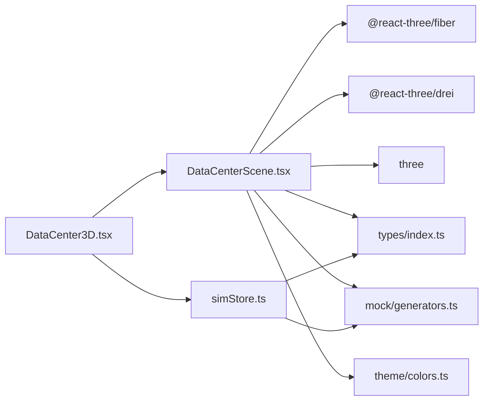

**图表来源**
- [DataCenter3D.tsx:1-6](file://src/pages/DataCenter3D.tsx#L1-L6)
- [DataCenterScene.tsx:1-12](file://src/components/scene/DataCenterScene.tsx#L1-L12)
- [simStore.ts:1-21](file://src/stores/simStore.ts#L1-L21)
- [package.json:11-21](file://package.json#L11-L21)

**章节来源**
- [DataCenter3D.tsx:1-6](file://src/pages/DataCenter3D.tsx#L1-L6)
- [DataCenterScene.tsx:1-12](file://src/components/scene/DataCenterScene.tsx#L1-L12)
- [simStore.ts:1-21](file://src/stores/simStore.ts#L1-L21)
- [package.json:11-21](file://package.json#L11-L21)

## 性能与渲染优化
- DPR 自适应：compact=false 时使用 [1,1.8] 动态 DPR，compact=true 时为 1，降低移动端或缩略图渲染压力。
- 几何体复用：机柜主体、灯带、正面面板均为简单 BoxGeometry/PlaneGeometry，避免复杂模型加载开销。
- 材质优化：
  - MeshStandardMaterial 设置 metalness/roughness/transparent/opacity，减少过度混合。
  - MeshBasicMaterial 用于灯带与拓扑连线，降低逐像素计算。
  - AdditiveBlending 用于冷/热通道色带与正面 GPU 灯带，提升发光效果但需注意混合成本。
- 动画频率：useFrame 中仅对必要材质属性做轻量更新（emissiveIntensity/opacity），避免昂贵计算。
- 网格与雾效：Grid 使用 infiniteGrid 与 fadeDistance/fadeStrength 控制远端衰减；fog 控制远景深度。
- 相机距离限制：minDistance/maxDistance 防止极端视角导致渲染异常。
- 拓扑连线仅在 topology 模式渲染，减少非必要 DrawCall。

**章节来源**
- [DataCenterScene.tsx:231-256](file://src/components/scene/DataCenterScene.tsx#L231-L256)
- [DataCenterScene.tsx:258-259](file://src/components/scene/DataCenterScene.tsx#L258-L259)
- [DataCenterScene.tsx:291-292](file://src/components/scene/DataCenterScene.tsx#L291-L292)
- [DataCenterScene.tsx:314-323](file://src/components/scene/DataCenterScene.tsx#L314-L323)

## 多视图模式与交互流程
- 视图模式：temperature/load/alert/topology。
- 切换方式：页面顶部 FilterChip 调用 setViewMode。
- 渲染差异：
  - temperature：按 tempToColor 映射温度。
  - load：按 utilToColor 映射利用率。
  - alert：按 critical/warning/normal 映射告警颜色。
  - topology：显示 InfiniBand 骨干链路。

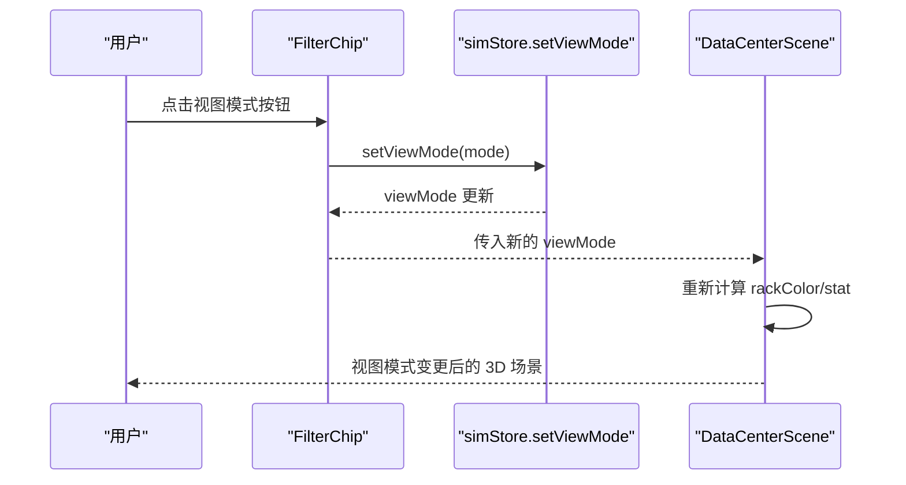

**图表来源**
- [DataCenter3D.tsx:51-68](file://src/pages/DataCenter3D.tsx#L51-L68)
- [simStore.ts:262-264](file://src/stores/simStore.ts#L262-L264)
- [DataCenterScene.tsx:50-61](file://src/components/scene/DataCenterScene.tsx#L50-L61)

**章节来源**
- [DataCenter3D.tsx:51-68](file://src/pages/DataCenter3D.tsx#L51-L68)
- [simStore.ts:262-264](file://src/stores/simStore.ts#L262-L264)
- [DataCenterScene.tsx:50-61](file://src/components/scene/DataCenterScene.tsx#L50-L61)

## 自动巡检模式
- 开关：页面顶部 FilterChip 调用 toggleTour。
- 行为：tourActive=true 时 TourRig 接管相机运动，按时间计算环绕轨迹并保持 lookAt(0,2,0)。
- 交互冲突：当 tourActive=true 时，OrbitControls.enabled=false，禁止手动控制。

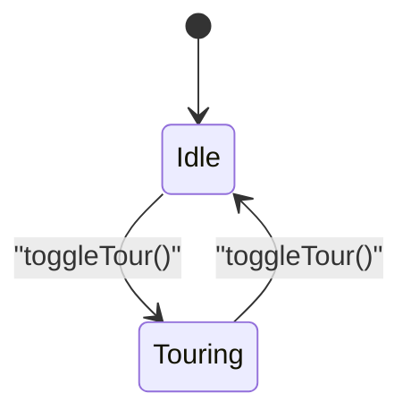

**图表来源**
- [DataCenter3D.tsx:64-67](file://src/pages/DataCenter3D.tsx#L64-L67)
- [DataCenterScene.tsx:145-157](file://src/components/scene/DataCenterScene.tsx#L145-L157)
- [DataCenterScene.tsx:314-323](file://src/components/scene/DataCenterScene.tsx#L314-L323)

**章节来源**
- [DataCenter3D.tsx:64-67](file://src/pages/DataCenter3D.tsx#L64-L67)
- [DataCenterScene.tsx:145-157](file://src/components/scene/DataCenterScene.tsx#L145-L157)
- [DataCenterScene.tsx:314-323](file://src/components/scene/DataCenterScene.tsx#L314-L323)

## 节点选择与信息展示
- 选择逻辑：点击机柜触发 onSelect(rack.id)，store 更新 selectedRackId。
- 浮层展示：Html 定位到选中机柜上方，展示平均利用率、平均温度、机柜功耗、节点数、冷/热通道温度，以及严重告警数量。
- 关闭浮层：点击浮层关闭按钮调用 onClose()，即 onSelect(null)。

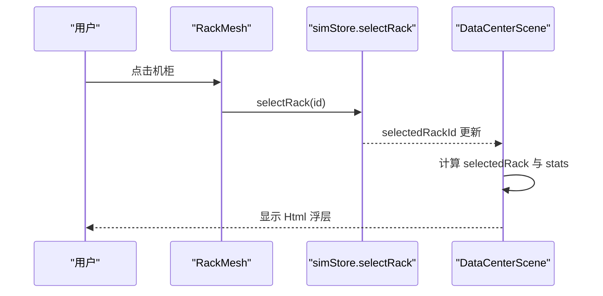

**图表来源**
- [DataCenterScene.tsx:96-99](file://src/components/scene/DataCenterScene.tsx#L96-L99)
- [DataCenterScene.tsx:294-311](file://src/components/scene/DataCenterScene.tsx#L294-L311)
- [simStore.ts:262-264](file://src/stores/simStore.ts#L262-L264)

**章节来源**
- [DataCenterScene.tsx:96-99](file://src/components/scene/DataCenterScene.tsx#L96-L99)
- [DataCenterScene.tsx:294-311](file://src/components/scene/DataCenterScene.tsx#L294-L311)
- [simStore.ts:262-264](file://src/stores/simStore.ts#L262-L264)

## 数据同步机制
- 数据来源：
  - 初始拓扑与模拟数据由 generators.generateTopology/generateAssets/generateJobs/generateFailurePredictions 生成。
  - 运行时指标通过 simStore.step 周期性推进：stepNodes/stepRacks/stepAlerts/stepJobs/computeKpi/pue 波动。
- 状态订阅：
  - DataCenter3D 页面订阅 racks/nodes/viewMode/selectedRackId/tourActive。
  - DataCenterScene 接收 racks/nodes/viewMode/selectedRackId/tourActive 作为 props。
- 同步路径：
  - Store.step 更新 nodes/racks/alerts/jobs/kpi/pue 等。
  - 页面与 3D 场景根据最新 props 重渲染。
  - 3D 场景内部 computeRackStats 将节点指标聚合为机柜统计，用于着色与浮层展示。

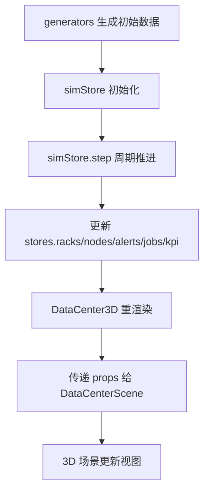

**图表来源**
- [simStore.ts:42-46](file://src/stores/simStore.ts#L42-L46)
- [simStore.ts:164-207](file://src/stores/simStore.ts#L164-L207)
- [DataCenter3D.tsx:15-48](file://src/pages/DataCenter3D.tsx#L15-L48)
- [DataCenterScene.tsx:227-228](file://src/components/scene/DataCenterScene.tsx#L227-L228)

**章节来源**
- [simStore.ts:42-46](file://src/stores/simStore.ts#L42-L46)
- [simStore.ts:164-207](file://src/stores/simStore.ts#L164-L207)
- [DataCenter3D.tsx:15-48](file://src/pages/DataCenter3D.tsx#L15-L48)
- [DataCenterScene.tsx:227-228](file://src/components/scene/DataCenterScene.tsx#L227-L228)

## 移动端适配方案
- 紧凑模式：compact=true 时减小画布尺寸、FOV、自动旋转、禁用 pan，适合缩略图或小屏预览。
- DPR 控制：compact=false 时使用 [1,1.8] 动态 DPR，compact=true 时为 1，降低移动端渲染压力。
- 交互限制：compact 模式下禁用 pan，减少误触；OrbitControls.maxDistance 缩小为 60。
- 建议扩展：
  - 在移动端检测视口宽度，自动切换 compact 模式。
  - 针对触摸设备优化点击区域与浮层定位。
  - 降低 Grid 与拓扑连线复杂度，减少 DrawCall。

**章节来源**
- [DataCenterScene.tsx:231-236](file://src/components/scene/DataCenterScene.tsx#L231-L236)
- [DataCenterScene.tsx:314-323](file://src/components/scene/DataCenterScene.tsx#L314-L323)

## 故障排查指南
- 视图模式不生效：
  - 检查 setViewMode 是否被调用，确认 store.viewMode 是否更新。
  - 确认 DataCenterScene 接收到的 mode 是否正确。
- 机柜颜色异常：
  - 检查 computeRackStats 聚合逻辑与 rackColor 映射。
  - 确认 tempToColor/utilToColor 输入值范围。
- 自动巡检无反应：
  - 检查 tourActive 状态与 TourRig.active 绑定。
  - 确认 OrbitControls.enabled 在 tourActive=true 时被禁用。
- 浮层不显示：
  - 检查 selectedRackId 是否为空，selectedRack 是否存在。
  - 确认 Html 定位参数与 distanceFactor 设置。

**章节来源**
- [DataCenterScene.tsx:25-48](file://src/components/scene/DataCenterScene.tsx#L25-L48)
- [DataCenterScene.tsx:50-61](file://src/components/scene/DataCenterScene.tsx#L50-L61)
- [DataCenterScene.tsx:145-157](file://src/components/scene/DataCenterScene.tsx#L145-L157)
- [DataCenterScene.tsx:294-311](file://src/components/scene/DataCenterScene.tsx#L294-L311)

## 扩展与定制开发指导
- 新增视图模式：
  - 在 types/index.ts 扩展 ViewMode。
  - 在 DataCenter3D.tsx 的 VIEW_MODES 中添加新项。
  - 在 DataCenterScene.tsx 的 rackColor 中实现新模式的着色逻辑。
- 自定义机柜外观：
  - 修改 RackMesh 的几何体与材质（BoxGeometry/PlaneGeometry/MeshStandardMaterial/MeshBasicMaterial）。
  - 调整 emissiveIntensity/opacity 动画曲线。
- 扩展拓扑连线：
  - 在 TopologyLinks 中增加更多汇聚点或链路规则。
  - 使用 Line 组件绘制更复杂的网络拓扑。
- 接入真实数据：
  - 替换 generators 生成的模拟数据，改为 API 拉取或 WebSocket 推送。
  - 在 simStore.step 中对接真实指标更新逻辑。
- 性能调优：
  - 使用 InstancedMesh 批量渲染机柜，减少 DrawCall。
  - 按需加载拓扑连线与浮层，减少不必要的渲染。
  - 降低 Grid 与雾效强度，优化远端渲染。

**章节来源**
- [index.ts:160-161](file://src/types/index.ts#L160-L161)
- [DataCenter3D.tsx:8-13](file://src/pages/DataCenter3D.tsx#L8-L13)
- [DataCenterScene.tsx:50-61](file://src/components/scene/DataCenterScene.tsx#L50-L61)
- [DataCenterScene.tsx:159-205](file://src/components/scene/DataCenterScene.tsx#L159-L205)

## 结论
本项目通过 React + Three.js 构建了完整的 3D 数据中心可视化页面，实现了机房布局展示、机柜状态可视化、温度/负载热力图、告警视图与拓扑连线。借助 Zustand 管理仿真状态，页面与 3D 场景之间数据同步清晰稳定。通过紧凑模式、DPR 控制与材质优化，系统在性能与可访问性上取得平衡。未来可扩展视图模式、拓扑规则与真实数据接入，进一步提升平台的可视化能力与运维效率。