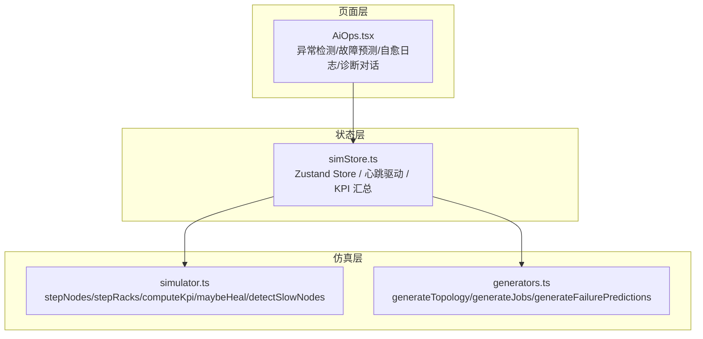
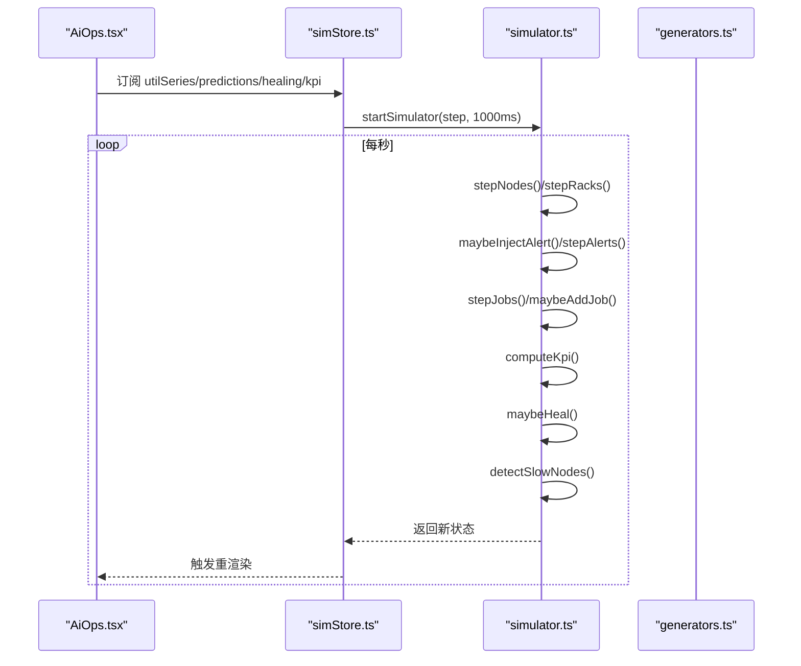
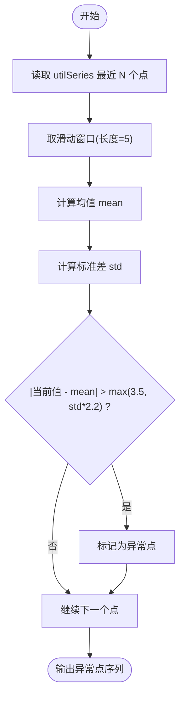
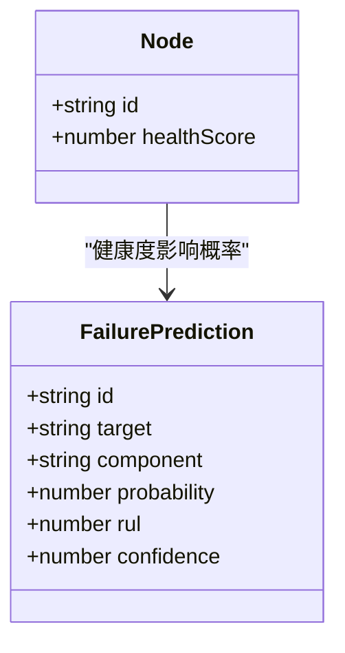
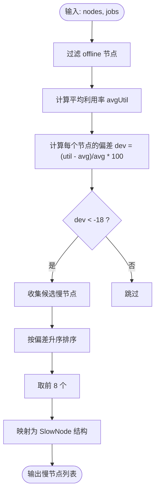
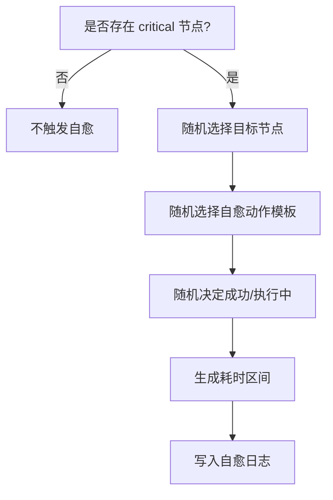
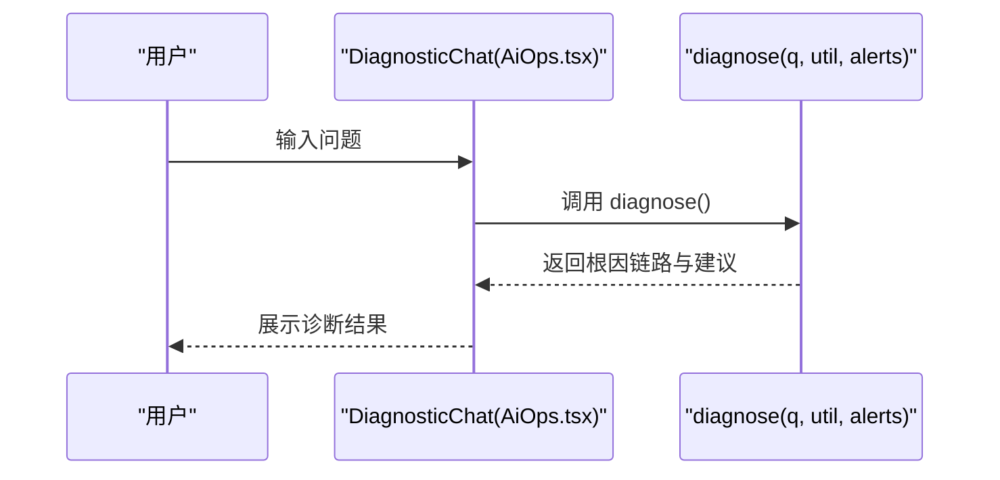
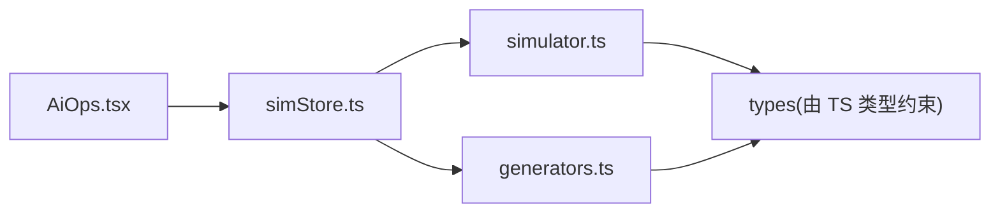

# AI运维中心

<cite>
**本文引用的文件**   
- [AiOps.tsx](file://src/pages/AiOps.tsx)
- [simStore.ts](file://src/stores/simStore.ts)
- [simulator.ts](file://src/mock/simulator.ts)
- [generators.ts](file://src/mock/generators.ts)
- [package.json](file://package.json)
</cite>

## 目录
1. [引言](#引言)
2. [项目结构](#项目结构)
3. [核心组件](#核心组件)
4. [架构总览](#架构总览)
5. [详细组件分析](#详细组件分析)
6. [依赖关系分析](#依赖关系分析)
7. [性能与可扩展性](#性能与可扩展性)
8. [故障排查指南](#故障排查指南)
9. [结论](#结论)
10. [附录：AI策略配置与优化实践](#附录ai策略配置与优化实践)

## 引言
本仓库实现了一个面向智算数据中心的“AI运维中心”前端演示系统。它通过模拟集群拓扑、节点指标、任务调度、告警注入与自愈动作，展示以下智能化能力：
- 异常检测：基于滑动窗口统计的实时异常点标注
- 慢节点检测：识别拖慢分布式训练的落后节点
- 设备故障预测：按健康度排序的风险清单与剩余寿命估计
- 自愈动作日志：自动化闭环处置的执行记录
- 智能诊断对话：规则驱动的根因分析与建议动作

该文档从代码层面解释这些功能如何组织、数据如何流转、算法如何落地，并给出可操作的策略配置与持续优化建议。

## 项目结构
本项目采用 React + TypeScript + Vite 的前端工程结构，核心逻辑集中在页面、状态管理与仿真模块中：
- 页面层：AiOps 作为 AI 运维主界面，聚合异常检测、故障预测、自愈日志与智能诊断
- 状态层：Zustand store 负责驱动仿真心跳、推进指标、维护全局状态
- 仿真层：纯函数引擎生成/推进节点、机柜、任务、告警、自愈动作与时序曲线
- 资源层：确定性随机数、拓扑与资产生成器，保证演示一致性

**图表来源**
- [AiOps.tsx:19-175](file://src/pages/AiOps.tsx#L19-L175)
- [simStore.ts:142-207](file://src/stores/simStore.ts#L142-L207)
- [simulator.ts:54-139](file://src/mock/simulator.ts#L54-L139)
- [generators.ts:159-206](file://src/mock/generators.ts#L159-L206)

**章节来源**
- [AiOps.tsx:19-175](file://src/pages/AiOps.tsx#L19-L175)
- [simStore.ts:142-207](file://src/stores/simStore.ts#L142-L207)
- [simulator.ts:54-139](file://src/mock/simulator.ts#L54-L139)
- [generators.ts:159-206](file://src/mock/generators.ts#L159-L206)

## 核心组件
- AiOps 页面：渲染异常检测图、设备故障预测列表、自愈动作日志与智能诊断对话
- simStore：集中管理仿真状态，提供 step/start/stop 等动作，串联仿真引擎
- simulator：纯函数集合，负责节点/机柜/KPI/告警/任务/自愈/慢节点检测与时序推进
- generators：确定性随机数、机房拓扑、资产台账、初始任务与故障预测生成

关键职责边界清晰：
- 页面只关注展示与交互
- Store 协调仿真节拍与状态更新
- Simulator 封装业务算法（异常检测、慢节点检测、自愈触发）
- Generators 提供静态数据与种子化随机

**章节来源**
- [AiOps.tsx:19-175](file://src/pages/AiOps.tsx#L19-L175)
- [simStore.ts:99-163](file://src/stores/simStore.ts#L99-L163)
- [simulator.ts:54-139](file://src/mock/simulator.ts#L54-L139)
- [generators.ts:159-206](file://src/mock/generators.ts#L159-L206)

## 架构总览
下图展示了从页面到仿真引擎的数据流与控制流：

**图表来源**
- [AiOps.tsx:19-175](file://src/pages/AiOps.tsx#L19-L175)
- [simStore.ts:209-219](file://src/stores/simStore.ts#L209-L219)
- [simulator.ts:327-330](file://src/mock/simulator.ts#L327-L330)
- [simulator.ts:165-194](file://src/mock/simulator.ts#L165-L194)
- [simulator.ts:199-259](file://src/mock/simulator.ts#L199-L259)
- [simulator.ts:283-298](file://src/mock/simulator.ts#L283-L298)
- [simulator.ts:303-318](file://src/mock/simulator.ts#L303-L318)

## 详细组件分析

### 异常检测与趋势可视化
- 算法思路：对利用率时序使用滑动窗口计算均值与标准差，超过阈值即标记为异常点
- 展示方式：ECharts 折线图叠加异常标记点，同时显示模型准确率、误报率、检出延迟等 KPI
- 数据来源：store 中的 utilSeries；异常结果在页面内即时计算

**图表来源**
- [AiOps.tsx:25-38](file://src/pages/AiOps.tsx#L25-L38)

**章节来源**
- [AiOps.tsx:25-66](file://src/pages/AiOps.tsx#L25-L66)
- [simStore.ts:155-158](file://src/stores/simStore.ts#L155-L158)

### 设备故障预测
- 预测依据：节点健康度越低，预测概率越高；结合 RUL（剩余寿命）与置信度
- 展示方式：Top 风险列表，含目标设备、部件、概率条、RUL 天数与置信度
- 数据来源：generator 生成的 FailurePrediction 列表

**图表来源**
- [generators.ts:389-405](file://src/mock/generators.ts#L389-L405)
- [AiOps.tsx:90-124](file://src/pages/AiOps.tsx#L90-L124)

**章节来源**
- [generators.ts:389-405](file://src/mock/generators.ts#L389-L405)
- [AiOps.tsx:90-124](file://src/pages/AiOps.tsx#L90-L124)

### 慢节点检测
- 算法思路：计算在线节点的平均利用率，筛选偏离度低于阈值的节点，判定为慢节点
- 输出字段：节点 ID、关联任务、偏差百分比、主要指标原因与建议
- 执行频率：每 5 tick 计算一次，降低开销

**图表来源**
- [simulator.ts:303-318](file://src/mock/simulator.ts#L303-L318)

**章节来源**
- [simulator.ts:303-318](file://src/mock/simulator.ts#L303-L318)
- [simStore.ts:189-190](file://src/stores/simStore.ts#L189-L190)

### 自愈动作日志
- 触发条件：存在 critical 节点时，以一定概率生成自愈动作
- 动作类型：自动隔离、降频保护、任务热迁移、通信服务重启、链路切换、存储快照
- 展示字段：动作名称、目标、原因、状态、耗时与时间戳

**图表来源**
- [simulator.ts:283-298](file://src/mock/simulator.ts#L283-L298)

**章节来源**
- [simulator.ts:283-298](file://src/mock/simulator.ts#L283-L298)
- [AiOps.tsx:131-171](file://src/pages/AiOps.tsx#L131-L171)

### 智能诊断助手（根因分析）
- 机制：基于关键词匹配的规则引擎，结合当前 KPI（平均利用率、活跃告警数）输出根因链路与建议动作
- 覆盖场景：温度过高、训练变慢、利用率偏低、节点故障、网络抖动、能耗 PUE 偏高等
- 交互：用户输入或快捷问题，AI 回复结构化诊断文本

**图表来源**
- [AiOps.tsx:191-212](file://src/pages/AiOps.tsx#L191-L212)
- [AiOps.tsx:214-301](file://src/pages/AiOps.tsx#L214-L301)

**章节来源**
- [AiOps.tsx:191-212](file://src/pages/AiOps.tsx#L191-L212)
- [AiOps.tsx:214-301](file://src/pages/AiOps.tsx#L214-L301)

## 依赖关系分析
- 页面依赖 Store：AiOps 通过 useSimStore 订阅 utilSeries、failurePredictions、healingActions、kpi
- Store 依赖 Simulator 与 Generators：step 流程调用 stepNodes/stepRacks/stepAlerts/stepJobs/maybeHeal/detectSlowNodes/computeKpi
- Generators 提供静态数据：拓扑、资产、初始任务、故障预测
- 外部库：React、Zustand、ECharts、Vite、Tailwind

**图表来源**
- [AiOps.tsx:1-9](file://src/pages/AiOps.tsx#L1-L9)
- [simStore.ts:1-37](file://src/stores/simStore.ts#L1-L37)
- [simulator.ts:1-13](file://src/mock/simulator.ts#L1-L13)
- [generators.ts:1-12](file://src/mock/generators.ts#L1-L12)

**章节来源**
- [AiOps.tsx:1-9](file://src/pages/AiOps.tsx#L1-L9)
- [simStore.ts:1-37](file://src/stores/simStore.ts#L1-L37)
- [simulator.ts:1-13](file://src/mock/simulator.ts#L1-L13)
- [generators.ts:1-12](file://src/mock/generators.ts#L1-L12)

## 性能与可扩展性
- 心跳驱动：默认 1 秒推进一次，避免频繁渲染
- 节流优化：机柜聚合每 3 tick 更新一次，慢节点检测每 5 tick 计算一次
- 数据裁剪：告警与自愈日志保留最近 N 条，防止内存增长
- 时序窗口：util/power/pue/alert 系列固定最大长度，避免无限增长
- 可扩展点：
  - 将异常检测算法替换为机器学习模型（如 Isolation Forest、ST-AD）
  - 将自愈策略接入真实编排系统（Kubernetes/CRI-O/自研调度器）
  - 增加模型评估面板（AUC、PR-AUC、F1、延迟分布）

[本节为通用指导，不直接分析具体文件]

## 故障排查指南
- 无自愈动作：检查是否产生 critical 节点；确认 maybeHeal 触发概率与临界条件
- 异常检测过多/过少：调整滑动窗口长度与阈值系数（均值±倍数标准差）
- 慢节点未检出：检查偏差阈值（-18%）与节点利用率波动范围
- 预测概率异常：核对健康度计算与概率映射逻辑
- 诊断问答无响应：确认输入非空且不在 typing 状态；检查关键词匹配分支

**章节来源**
- [simulator.ts:283-298](file://src/mock/simulator.ts#L283-L298)
- [AiOps.tsx:25-38](file://src/pages/AiOps.tsx#L25-L38)
- [simulator.ts:303-318](file://src/mock/simulator.ts#L303-L318)
- [generators.ts:389-405](file://src/mock/generators.ts#L389-L405)

## 结论
本 AI 运维中心以轻量前端工程为载体，完整呈现了异常检测、慢节点识别、故障预测与自愈闭环的关键流程。通过纯函数仿真与确定性随机数，保证了演示的一致性与可复现性。未来可将规则与统计方法逐步升级为机器学习模型，并结合真实平台进行端到端验证与持续优化。

[本节为总结，不直接分析具体文件]

## 附录：AI策略配置与优化实践

### 异常检测策略配置
- 滑动窗口大小：建议根据业务周期（分钟/小时级）调整窗口长度
- 阈值系数：标准差倍数与绝对阈值需结合历史基线校准
- 指标选择：优先选择稳定性高、噪声可控的指标（如利用率、温度、功耗）

**章节来源**
- [AiOps.tsx:25-38](file://src/pages/AiOps.tsx#L25-L38)

### 慢节点检测策略配置
- 偏差阈值：-18% 适用于多机训练场景，可根据 AllReduce 同步特性调优
- 指标维度：除利用率外，可加入通信耗时、GPU 利用率方差、NCCL 带宽
- 处理建议：隔离慢节点、启用通信/计算重叠、检查 NIC 与链路质量

**章节来源**
- [simulator.ts:303-318](file://src/mock/simulator.ts#L303-L318)

### 自愈策略配置
- 触发条件：critical 节点、预测高风险、通信超时、链路误码率升高
- 动作优先级：先保护（降频/隔离），再恢复（迁移/重启），最后修复（更换硬件）
- 回滚机制：对热迁移失败、重启失败的动作设置回滚与告警升级

**章节来源**
- [simulator.ts:283-298](file://src/mock/simulator.ts#L283-L298)

### 模型训练数据与评估
- 训练数据：节点健康度、温度、功耗、ECC 错误、任务吞吐、MFU、PUE
- 评估指标：准确率、误报率、检出延迟、AUC、PR-AUC、F1、召回率
- 数据治理：去噪、对齐采样频率、标注异常标签、划分训练/验证/测试集

**章节来源**
- [AiOps.tsx:81-86](file://src/pages/AiOps.tsx#L81-L86)
- [simulator.ts:97-139](file://src/mock/simulator.ts#L97-L139)

### 模型更新机制
- 增量学习：定期用新数据微调模型，保持概念漂移下的精度
- 灰度发布：新旧模型并行运行，对比指标后切换
- 监控看板：跟踪模型准确率、误报率、延迟分布与资源消耗

[本节为通用指导，不直接分析具体文件]

### 效果评估与持续优化
- 业务指标：任务成功率、平均完成时间、PUE、算力利用率
- 运维指标：告警收敛时间、自愈成功率、慢节点占比
- 优化闭环：策略参数回归分析 → A/B 实验 → 滚动发布 → 复盘沉淀

[本节为通用指导，不直接分析具体文件]