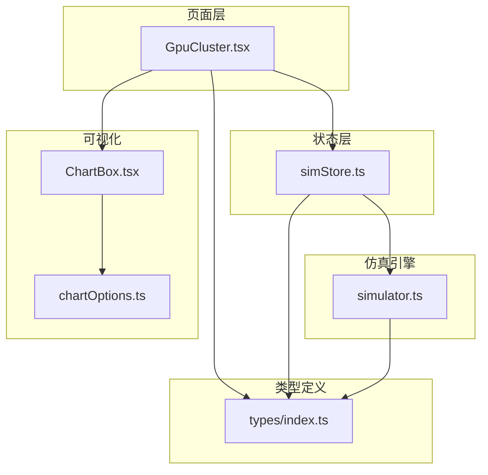
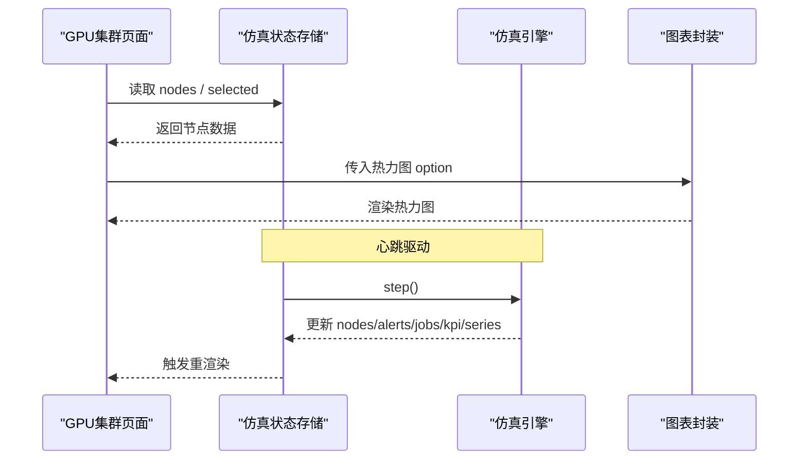
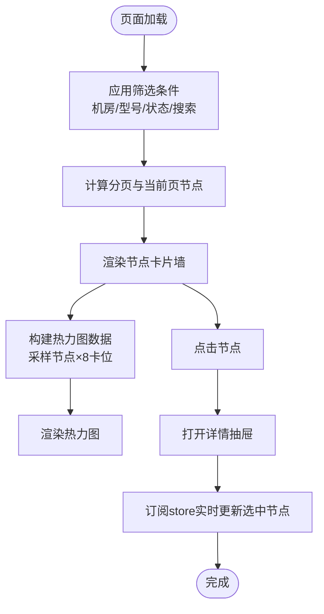
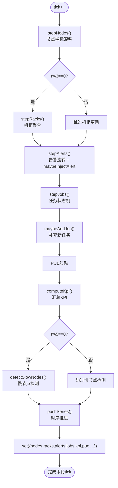
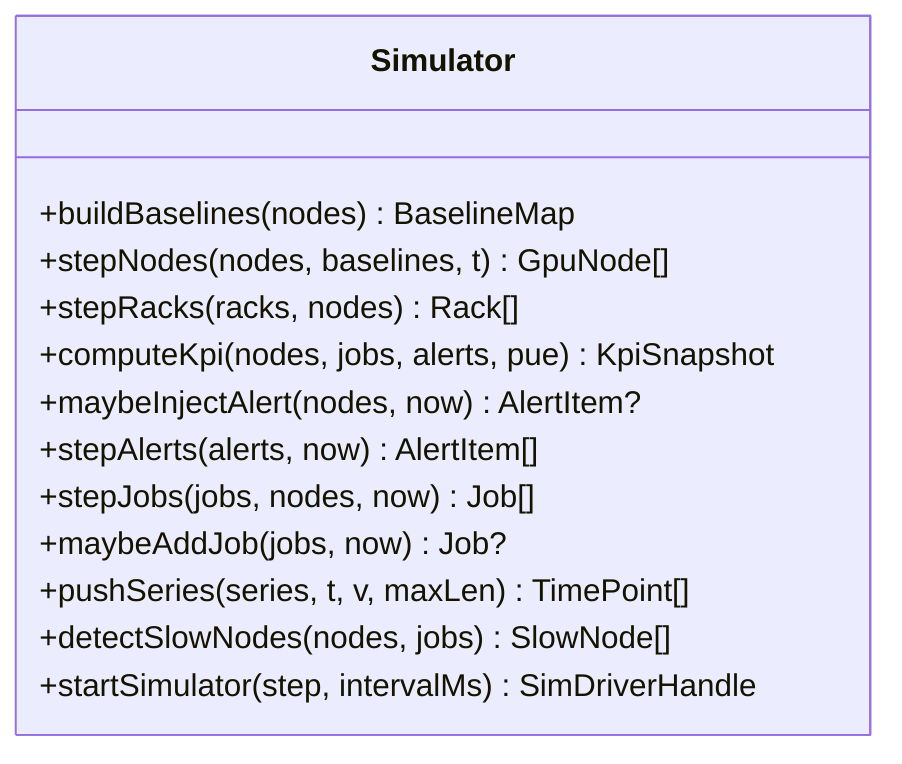
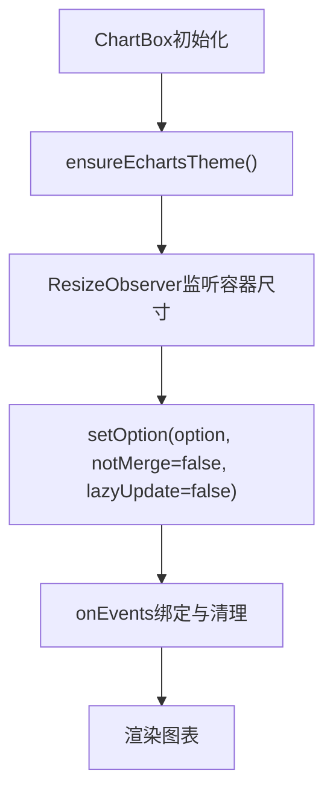
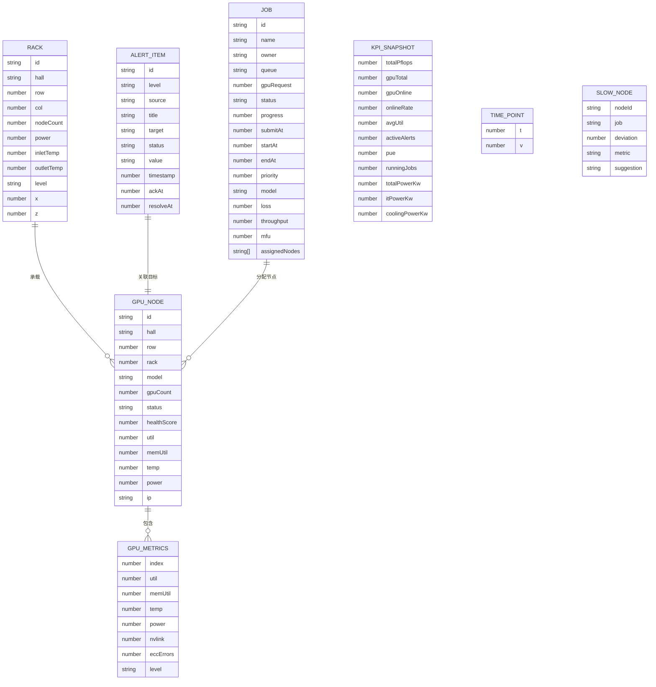
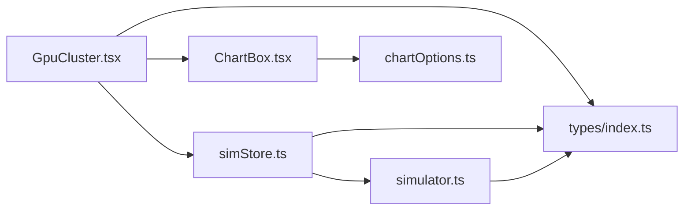

# GPU集群管理

<cite>
**本文引用的文件**   
- [GpuCluster.tsx](file://src/pages/GpuCluster.tsx)
- [simStore.ts](file://src/stores/simStore.ts)
- [simulator.ts](file://src/mock/simulator.ts)
- [index.ts](file://src/types/index.ts)
- [ChartBox.tsx](file://src/components/ChartBox.tsx)
- [chartOptions.ts](file://src/theme/chartOptions.ts)
</cite>

## 目录
1. [引言](#引言)
2. [项目结构](#项目结构)
3. [核心组件](#核心组件)
4. [架构总览](#架构总览)
5. [详细组件分析](#详细组件分析)
6. [依赖关系分析](#依赖关系分析)
7. [性能与内存优化](#性能与内存优化)
8. [故障诊断与排错指南](#故障诊断与排错指南)
9. [结论](#结论)

## 引言
本页面面向GPU集群管理与监控场景，提供节点筛选、排序、搜索、拓扑展示、资源利用率监控、温度功耗管理等能力。页面通过仿真引擎驱动数据实时更新，结合热力图、卡片墙和详情抽屉，帮助运维人员快速定位异常节点并掌握集群整体健康度。

## 项目结构
GPU集群管理功能主要由以下模块构成：
- 页面层：GPU集群主页面，负责筛选、分页、热力图切换、节点详情抽屉等交互。
- 状态层：仿真状态存储，集中维护节点、机柜、任务、告警、KPI与时序指标。
- 仿真引擎：纯函数驱动的指标漂移、告警注入、任务流转、慢节点检测等。
- 图表渲染：ECharts封装与主题配置，支持趋势图、热力图等可视化。
- 类型定义：统一领域模型，包括节点、GPU卡、机柜、任务、告警等数据结构。

**图示来源**
- [GpuCluster.tsx:1-10](file://src/pages/GpuCluster.tsx#L1-L10)
- [simStore.ts:1-20](file://src/stores/simStore.ts#L1-L20)
- [simulator.ts:1-15](file://src/mock/simulator.ts#L1-L15)
- [ChartBox.tsx:1-12](file://src/components/ChartBox.tsx#L1-L12)
- [chartOptions.ts:1-5](file://src/theme/chartOptions.ts#L1-L5)
- [index.ts:1-10](file://src/types/index.ts#L1-L10)

**章节来源**
- [GpuCluster.tsx:1-20](file://src/pages/GpuCluster.tsx#L1-L20)
- [simStore.ts:1-20](file://src/stores/simStore.ts#L1-L20)
- [simulator.ts:1-15](file://src/mock/simulator.ts#L1-L15)
- [ChartBox.tsx:1-12](file://src/components/ChartBox.tsx#L1-L12)
- [chartOptions.ts:1-5](file://src/theme/chartOptions.ts#L1-L5)
- [index.ts:1-10](file://src/types/index.ts#L1-L10)

## 核心组件
- GPU集群页面（GpuCluster）
  - 提供机房、型号、健康状态筛选与搜索框。
  - 节点卡片墙展示每个节点的8张GPU小格，直观呈现利用率与温度。
  - 右侧热力图支持“温度/利用率”切换，采样节点×8卡位矩阵。
  - 点击节点打开详情抽屉，展示平均利用率、温度、整机功耗、健康评分及每卡实时指标。
- 仿真状态存储（simStore）
  - 维护节点、机柜、任务、告警、KPI、时序指标等全局状态。
  - 提供step/start/stop等方法驱动仿真心跳更新。
- 仿真引擎（simulator）
  - 纯函数实现节点指标漂移、机柜聚合、KPI计算、告警注入、任务流转、慢节点检测、时序推进。
  - 心跳驱动startSimulator以固定间隔调用step回调。
- 图表封装（ChartBox）
  - ECharts初始化、ResizeObserver自适应、增量setOption、事件绑定与销毁。
- 图表选项（chartOptions）
  - 提供趋势线、仪表盘、堆叠面积、水平条形、热力图、桑基图、直方图等配置生成器。
- 类型定义（types/index.ts）
  - 统一节点、GPU卡、机柜、任务、告警、KPI、慢节点等数据结构。

**章节来源**
- [GpuCluster.tsx:13-162](file://src/pages/GpuCluster.tsx#L13-L162)
- [simStore.ts:99-163](file://src/stores/simStore.ts#L99-L163)
- [simulator.ts:35-71](file://src/mock/simulator.ts#L35-L71)
- [ChartBox.tsx:17-58](file://src/components/ChartBox.tsx#L17-L58)
- [chartOptions.ts:222-264](file://src/theme/chartOptions.ts#L222-L264)
- [index.ts:20-48](file://src/types/index.ts#L20-L48)

## 架构总览
GPU集群管理采用“页面-状态-仿真-可视化”的分层架构：
- 页面层订阅状态层的节点列表与选中节点，渲染卡片墙与热力图。
- 状态层通过仿真引擎的step方法周期性更新节点指标、告警、任务、KPI与时序数据。
- 可视化层使用ECharts封装组件渲染图表，图表选项由主题配置生成。
- 类型定义贯穿各层，确保数据结构一致性与可维护性。

**图示来源**
- [GpuCluster.tsx:14-21](file://src/pages/GpuCluster.tsx#L14-L21)
- [simStore.ts:164-207](file://src/stores/simStore.ts#L164-L207)
- [simulator.ts:327-330](file://src/mock/simulator.ts#L327-L330)
- [ChartBox.tsx:22-39](file://src/components/ChartBox.tsx#L22-L39)

## 详细组件分析

### GPU集群页面（GpuCluster）
- 筛选与搜索
  - 机房筛选：全部/A栋/B栋。
  - 型号筛选：全部/H100/A100/910B。
  - 健康状态多选：正常/警告/严重/离线。
  - 搜索框：按节点ID模糊匹配。
- 分页与展示
  - 每页固定数量节点，左右翻页按钮与页码显示。
  - 节点卡片墙网格布局，每张卡片包含8个GPU小格，背景色与边框色随利用率变化。
- 热力图
  - 从筛选结果中采样最多48个节点，构建节点×8卡位的矩阵数据。
  - 支持“温度/利用率”切换，视觉颜色映射不同指标范围。
- 节点详情抽屉
  - 概览指标：平均利用率、平均温度、整机功耗、健康评分。
  - 每卡指标表：利用率、显存占用、温度、NVLink带宽、ECC错误计数。
  - 实时同步：根据store中的nodes查找最新选中节点数据。

**图示来源**
- [GpuCluster.tsx:26-54](file://src/pages/GpuCluster.tsx#L26-L54)
- [GpuCluster.tsx:100-159](file://src/pages/GpuCluster.tsx#L100-L159)
- [GpuCluster.tsx:164-215](file://src/pages/GpuCluster.tsx#L164-L215)
- [GpuCluster.tsx:217-267](file://src/pages/GpuCluster.tsx#L217-L267)

**章节来源**
- [GpuCluster.tsx:13-162](file://src/pages/GpuCluster.tsx#L13-L162)
- [GpuCluster.tsx:164-215](file://src/pages/GpuCluster.tsx#L164-L215)
- [GpuCluster.tsx:217-267](file://src/pages/GpuCluster.tsx#L217-L267)

### 仿真状态存储（simStore）
- 初始数据
  - 拓扑、资产、任务、预测、基线等一次性生成。
  - 历史时序数据（算力利用率、功耗、PUE、告警数）种子填充。
- 心跳步进（step）
  - 节点指标漂移：基于基线的正弦波动与噪声。
  - 机柜聚合：每3 tick更新一次，降低开销。
  - 告警注入与流转：概率注入新告警，部分active自动恢复。
  - 任务流转：排队任务启动、运行进度、成功率与失败率模拟。
  - PUE缓慢波动与KPI汇总：在线率、平均利用率、活跃告警数、总功耗等。
  - 慢节点检测：每5 tick计算相对均值偏差，输出Top8慢节点。
  - 时序推进：pushSeries限制最大长度，避免内存增长。
- 控制方法
  - start/stop：启动或停止仿真心跳。
  - ackAlert/silenceAlert/resolveAlert：告警操作。
  - submitJob：提交新任务。
  - setViewMode/selectRack/toggleTour：视图与交互控制。

**图示来源**
- [simStore.ts:164-207](file://src/stores/simStore.ts#L164-L207)
- [simulator.ts:54-71](file://src/mock/simulator.ts#L54-L71)
- [simulator.ts:76-92](file://src/mock/simulator.ts#L76-L92)
- [simulator.ts:97-139](file://src/mock/simulator.ts#L97-L139)
- [simulator.ts:165-194](file://src/mock/simulator.ts#L165-L194)
- [simulator.ts:199-259](file://src/mock/simulator.ts#L199-L259)
- [simulator.ts:264-268](file://src/mock/simulator.ts#L264-L268)
- [simulator.ts:303-318](file://src/mock/simulator.ts#L303-L318)

**章节来源**
- [simStore.ts:40-58](file://src/stores/simStore.ts#L40-L58)
- [simStore.ts:99-163](file://src/stores/simStore.ts#L99-L163)
- [simStore.ts:164-207](file://src/stores/simStore.ts#L164-L207)
- [simStore.ts:209-265](file://src/stores/simStore.ts#L209-L265)

### 仿真引擎（simulator）
- 节点指标漂移
  - 围绕基线util/temp/power做正弦波动与随机噪声，限制在合理区间。
  - 根据温度与健康等级计算healthScore。
- 机柜聚合
  - 按hall-row-col分组，计算机柜功耗与冷热通道温度，判定健康等级。
- KPI汇总
  - 统计GPU总数、在线数、平均利用率、活跃告警数、PUE、运行任务数、IT功耗、冷却功耗等。
- 告警注入与流转
  - 概率注入新告警，模板化标题与值描述；部分active告警自动恢复。
- 任务状态机
  - queued→running→succeeded/failed，模拟进度、loss、throughput、mfu变化。
- 慢节点检测
  - 计算节点利用率相对集群均值的偏差，筛选Top8慢节点并给出建议。
- 时序推进
  - pushSeries限制最大长度，防止无限增长。
- 心跳驱动
  - startSimulator使用window.setInterval定时调用step回调。

**图示来源**
- [simulator.ts:35-71](file://src/mock/simulator.ts#L35-L71)
- [simulator.ts:76-92](file://src/mock/simulator.ts#L76-L92)
- [simulator.ts:97-139](file://src/mock/simulator.ts#L97-L139)
- [simulator.ts:165-194](file://src/mock/simulator.ts#L165-L194)
- [simulator.ts:199-259](file://src/mock/simulator.ts#L199-L259)
- [simulator.ts:264-268](file://src/mock/simulator.ts#L264-L268)
- [simulator.ts:303-318](file://src/mock/simulator.ts#L303-L318)
- [simulator.ts:327-330](file://src/mock/simulator.ts#L327-L330)

**章节来源**
- [simulator.ts:35-71](file://src/mock/simulator.ts#L35-L71)
- [simulator.ts:76-92](file://src/mock/simulator.ts#L76-L92)
- [simulator.ts:97-139](file://src/mock/simulator.ts#L97-L139)
- [simulator.ts:165-194](file://src/mock/simulator.ts#L165-L194)
- [simulator.ts:199-259](file://src/mock/simulator.ts#L199-L259)
- [simulator.ts:264-268](file://src/mock/simulator.ts#L264-L268)
- [simulator.ts:303-318](file://src/mock/simulator.ts#L303-L318)
- [simulator.ts:327-330](file://src/mock/simulator.ts#L327-L330)

### 图表封装与选项（ChartBox与chartOptions）
- ChartBox
  - 初始化ECharts实例，应用主题，监听容器尺寸变化并resize。
  - 增量setOption更新图表，支持禁用动画以提升高频刷新性能。
  - 事件绑定与清理，避免内存泄漏。
- chartOptions
  - heatmapOption：节点×8卡位热力图，支持视觉颜色映射与单位设置。
  - trendLineOption/gaugeOption/stackedAreaOption/hBarOption/sankeyOption/histogramOption：其他常用图表配置生成器。

**图示来源**
- [ChartBox.tsx:17-58](file://src/components/ChartBox.tsx#L17-L58)
- [chartOptions.ts:222-264](file://src/theme/chartOptions.ts#L222-L264)

**章节来源**
- [ChartBox.tsx:17-58](file://src/components/ChartBox.tsx#L17-L58)
- [chartOptions.ts:222-264](file://src/theme/chartOptions.ts#L222-L264)

### 类型定义（types/index.ts）
- GpuMetrics：单张GPU卡的实时指标（利用率、显存、温度、功耗、NVLink、ECC错误、健康等级）。
- GpuNode：计算节点（含8张GPU），包含机房、排、柜、型号、健康评分、IP、GPU列表等。
- Rack/Hall：机柜与机房结构。
- AlertItem/Job/KpiSnapshot/TimePoint/SlowNode：告警、任务、KPI、时序点、慢节点等。

**图示来源**
- [index.ts:20-48](file://src/types/index.ts#L20-L48)
- [index.ts:50-73](file://src/types/index.ts#L50-L73)
- [index.ts:75-87](file://src/types/index.ts#L75-L87)
- [index.ts:96-113](file://src/types/index.ts#L96-L113)
- [index.ts:139-152](file://src/types/index.ts#L139-L152)
- [index.ts:154-158](file://src/types/index.ts#L154-L158)
- [index.ts:184-191](file://src/types/index.ts#L184-L191)

**章节来源**
- [index.ts:20-48](file://src/types/index.ts#L20-L48)
- [index.ts:50-73](file://src/types/index.ts#L50-L73)
- [index.ts:75-87](file://src/types/index.ts#L75-L87)
- [index.ts:96-113](file://src/types/index.ts#L96-L113)
- [index.ts:139-152](file://src/types/index.ts#L139-L152)
- [index.ts:154-158](file://src/types/index.ts#L154-L158)
- [index.ts:184-191](file://src/types/index.ts#L184-L191)

## 依赖关系分析
- 页面层依赖状态层提供的nodes与selected节点数据。
- 状态层依赖仿真引擎的纯函数进行数据更新。
- 可视化层依赖图表封装与主题配置。
- 类型定义被所有层引用，保证数据结构一致性。

**图示来源**
- [GpuCluster.tsx:1-10](file://src/pages/GpuCluster.tsx#L1-L10)
- [simStore.ts:1-20](file://src/stores/simStore.ts#L1-L20)
- [simulator.ts:1-15](file://src/mock/simulator.ts#L1-L15)
- [ChartBox.tsx:1-12](file://src/components/ChartBox.tsx#L1-L12)
- [chartOptions.ts:1-5](file://src/theme/chartOptions.ts#L1-L5)
- [index.ts:1-10](file://src/types/index.ts#L1-L10)

**章节来源**
- [GpuCluster.tsx:1-10](file://src/pages/GpuCluster.tsx#L1-L10)
- [simStore.ts:1-20](file://src/stores/simStore.ts#L1-L20)
- [simulator.ts:1-15](file://src/mock/simulator.ts#L1-L15)
- [ChartBox.tsx:1-12](file://src/components/ChartBox.tsx#L1-L12)
- [chartOptions.ts:1-5](file://src/theme/chartOptions.ts#L1-L5)
- [index.ts:1-10](file://src/types/index.ts#L1-L10)

## 性能与内存优化
- 节点卡片墙分页：每页固定数量节点，减少DOM渲染压力。
- 热力图采样：从筛选结果中采样最多48个节点，避免大数据量导致卡顿。
- 机柜聚合节流：每3 tick更新一次机柜指标，降低计算开销。
- 慢节点检测节流：每5 tick执行一次，平衡准确性与性能。
- 时序数据长度限制：pushSeries限制最大长度，防止内存无限增长。
- 图表增量更新：ChartBox使用notMerge=false与lazyUpdate=false，配合noAnimation开关提升高频刷新性能。
- 选择器优化：liveSelected通过id查找最新节点，避免重复订阅与多余渲染。

[本节为通用性能指导，不直接分析具体文件]

## 故障诊断与排错指南
- 节点温度过高
  - 现象：节点状态变为critical，健康评分下降，详情页温度条变红。
  - 排查：查看节点详情抽屉的温度与功耗，确认是否超过阈值；检查机柜热通道温度。
  - 自愈：仿真引擎可能触发降频保护或隔离动作。
- 节点离线
  - 现象：节点状态offline，不再参与KPI计算。
  - 排查：检查心跳丢失告警与网络链路抖动告警。
  - 自愈：可能触发任务热迁移或重启通信服务。
- 慢节点
  - 现象：利用率显著低于集群均值，可能被标记为慢节点。
  - 排查：查看慢节点检测结果与建议，关注通信同步耗时或算力利用率问题。
  - 处理：建议排查NIC链路或重新调度任务。
- 告警未恢复
  - 现象：active告警长时间未resolved。
  - 排查：手动ack/silence/resolve告警，观察是否自然恢复。
  - 自愈：部分active告警会按概率自动恢复。

**章节来源**
- [simulator.ts:151-182](file://src/mock/simulator.ts#L151-L182)
- [simulator.ts:187-194](file://src/mock/simulator.ts#L187-L194)
- [simulator.ts:303-318](file://src/mock/simulator.ts#L303-L318)
- [simStore.ts:221-238](file://src/stores/simStore.ts#L221-L238)

## 结论
GPU集群管理页面通过分层架构与仿真引擎驱动，实现了节点监控、集群状态概览、性能指标分析与拓扑展示等核心能力。页面提供丰富的筛选、搜索与交互功能，并结合热力图与详情抽屉帮助运维人员快速定位异常。通过节流、采样与增量更新等优化策略，系统在保持实时性的同时兼顾了性能与内存占用。未来可扩展更多可视化维度与自动化处置流程，进一步提升集群运维效率。