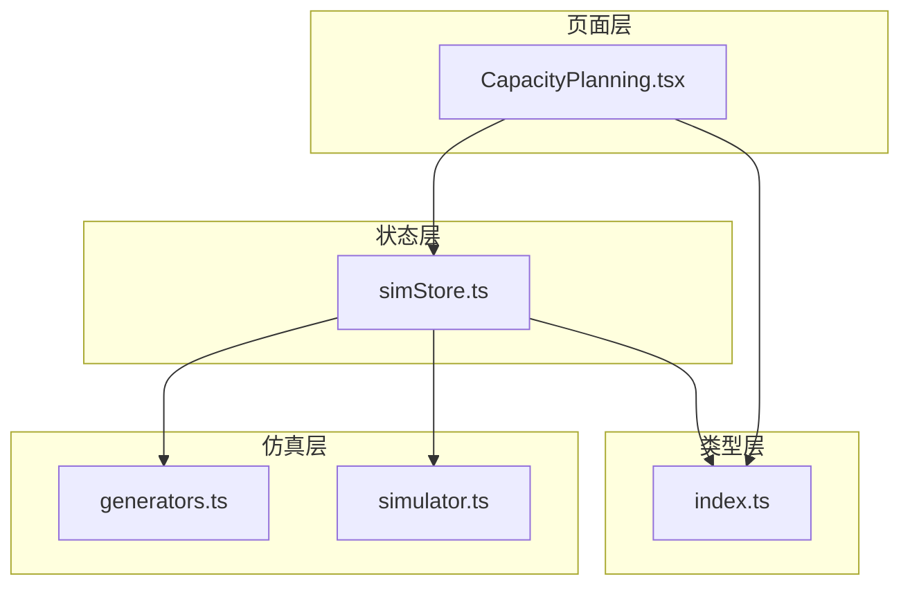
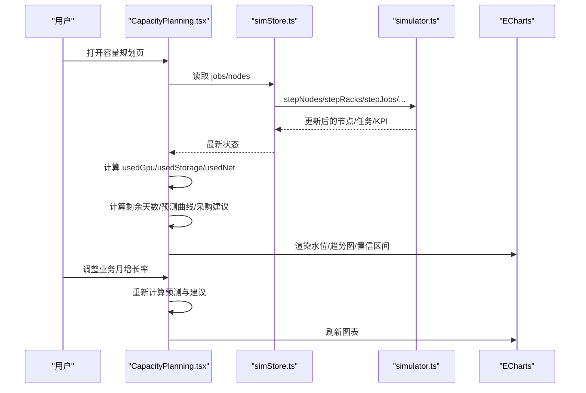
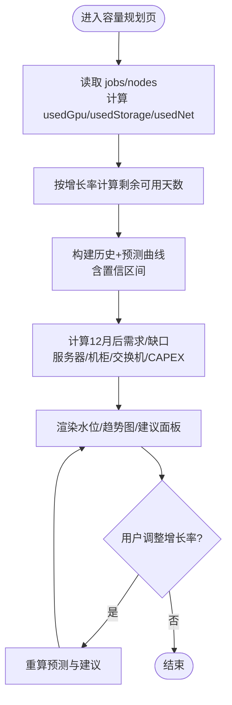
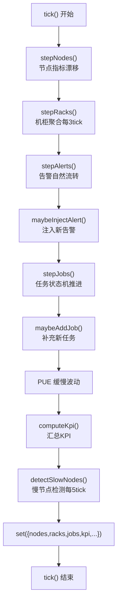
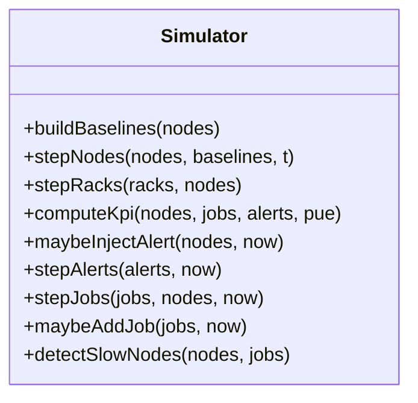
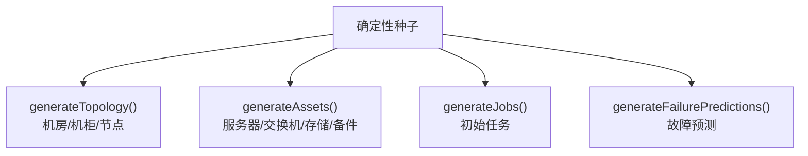
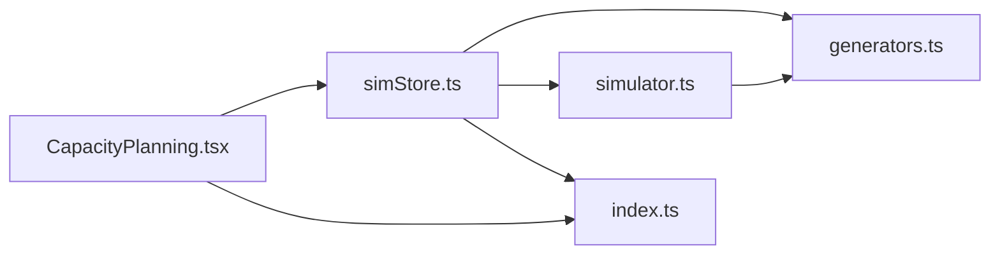

# 容量规划工具

<cite>
**本文引用的文件**   
- [CapacityPlanning.tsx](file://src/pages/CapacityPlanning.tsx)
- [simStore.ts](file://src/stores/simStore.ts)
- [generators.ts](file://src/mock/generators.ts)
- [simulator.ts](file://src/mock/simulator.ts)
- [index.ts](file://src/types/index.ts)
</cite>

## 目录
1. [引言](#引言)
2. [项目结构](#项目结构)
3. [核心组件](#核心组件)
4. [架构总览](#架构总览)
5. [详细组件分析](#详细组件分析)
6. [依赖关系分析](#依赖关系分析)
7. [性能与扩展性](#性能与扩展性)
8. [故障排查指南](#故障排查指南)
9. [结论](#结论)
10. [附录：参数与假设清单](#附录参数与假设清单)

## 引言
本容量规划工具面向智算数据中心，围绕 GPU 算力、存储容量与网络带宽三类关键资源，提供以下能力：
- 资源利用率分析：基于运行任务与节点状态，计算当前已用与可用容量。
- 扩容需求预测：以月增长率为输入，外推未来 12 个月算力需求，并给出缺口与采购建议。
- 瓶颈识别建议：通过利用率、温度、功耗等指标识别潜在瓶颈，辅助扩容与优化决策。
- 可视化展示：容量水位、历史与预测曲线、置信区间、情景模拟与成本估算。
- 算法与假设：线性剩余天数、指数增长预测、固定硬件规格与单价的 CAPEX 估算。

该工具以 React + ECharts 构建前端页面，使用 Zustand 管理仿真状态，并通过 Mock 数据驱动实时趋势与告警，便于演示与方案验证。

## 项目结构
容量规划相关代码主要分布在以下位置：
- 页面层：容量规划主页面与图表配置。
- 状态层：仿真 Store，聚合拓扑、任务、告警、KPI 与时序数据。
- 仿真层：节点/机柜/KPI/任务/告警推进逻辑。
- 类型定义：统一领域模型与接口。

**图示来源**
- [CapacityPlanning.tsx:1-274](file://src/pages/CapacityPlanning.tsx#L1-L274)
- [simStore.ts:1-270](file://src/stores/simStore.ts#L1-L270)
- [generators.ts:1-408](file://src/mock/generators.ts#L1-L408)
- [simulator.ts:1-331](file://src/mock/simulator.ts#L1-L331)
- [index.ts:1-192](file://src/types/index.ts#L1-L192)

**章节来源**
- [CapacityPlanning.tsx:1-274](file://src/pages/CapacityPlanning.tsx#L1-L274)
- [simStore.ts:1-270](file://src/stores/simStore.ts#L1-L270)

## 核心组件
- 容量规划页面（CapacityPlanning.tsx）
  - 计算当前 GPU/存储/网络使用率与剩余可用天数。
  - 生成 12 月历史 + 6 月预测曲线，带置信区间。
  - 根据业务增长率计算 12 个月后需求、缺口、服务器/机柜/交换机数量与 CAPEX。
  - 提供“业务月增长率”滑块进行情景模拟。
- 仿真 Store（simStore.ts）
  - 维护机房拓扑、节点、任务、告警、KPI、慢节点与时序曲线。
  - 驱动 tick 步进，更新节点指标、机柜聚合、告警注入、任务流转、PUE 波动与 KPI 汇总。
- 仿真器（simulator.ts）
  - 节点指标漂移、机柜聚合、KPI 汇总、告警注入与流转、任务状态机、慢节点检测。
- 数据生成器（generators.ts）
  - 确定性伪随机数、机房拓扑、资产台账、初始任务与故障预测。
- 类型定义（index.ts）
  - 节点、机柜、机房、任务、告警、KPI、时序、慢节点等统一类型。

**章节来源**
- [CapacityPlanning.tsx:14-146](file://src/pages/CapacityPlanning.tsx#L14-L146)
- [simStore.ts:99-265](file://src/stores/simStore.ts#L99-L265)
- [simulator.ts:51-139](file://src/mock/simulator.ts#L51-L139)
- [generators.ts:159-206](file://src/mock/generators.ts#L159-L206)
- [index.ts:32-152](file://src/types/index.ts#L32-L152)

## 架构总览
容量规划的数据流从仿真 Store 到页面渲染，再到图表配置与交互反馈，形成闭环。

**图示来源**
- [CapacityPlanning.tsx:14-146](file://src/pages/CapacityPlanning.tsx#L14-L146)
- [simStore.ts:164-207](file://src/stores/simStore.ts#L164-L207)
- [simulator.ts:51-139](file://src/mock/simulator.ts#L51-L139)

## 详细组件分析

### 容量规划页面（CapacityPlanning.tsx）
职责与实现要点：
- 资源基线与当前用量
  - GPU 总量、存储总量、网络带宽为常量；GPU 已用量由运行中任务的 gpuRequest 累加；存储与网络用量随在线节点与 GPU 使用比例轻微波动。
- 剩余可用天数
  - 按线性外推：每日增长 = 当前用量 × (月增长率 / 100) / 30；剩余天数 = (总量 - 已用) / 日增长。
- 增长预测曲线
  - 历史 12 月：以当前用量反推并按增长率回退，叠加噪声。
  - 预测 6 月：以当前用量按增长率指数外推，上下界分别乘以递增系数构造置信区间。
  - 图表包含历史实线、预测虚线、置信区间带与装机上限参考线。
- 扩容建议与成本估算
  - 12 个月后需求 = 当前用量 × (1 + 月增长率)^12。
  - 缺口 = max(0, 需求 - 总量)。
  - 服务器台数 = ceil(缺口 / 8)，机柜数 = ceil(服务器 / 4)，IB 交换机数 = ceil(机柜 / 2)。
  - CAPEX = 服务器台数 × 单台价格（万元），再换算为亿元。
- 交互
  - 业务月增长率滑块（0%~30%），实时更新预测与建议。

**图示来源**
- [CapacityPlanning.tsx:19-52](file://src/pages/CapacityPlanning.tsx#L19-L52)
- [CapacityPlanning.tsx:170-273](file://src/pages/CapacityPlanning.tsx#L170-L273)

**章节来源**
- [CapacityPlanning.tsx:19-52](file://src/pages/CapacityPlanning.tsx#L19-L52)
- [CapacityPlanning.tsx:170-273](file://src/pages/CapacityPlanning.tsx#L170-L273)

### 仿真 Store（simStore.ts）
职责与实现要点：
- 初始化静态数据：拓扑、资产、任务、告警、预测、基线。
- 时序种子：为利用率、功耗、PUE、告警数量生成历史序列。
- tick 步进流程：
  - 节点指标漂移（正弦波 + 噪声）。
  - 机柜聚合（每 3 tick 更新一次）。
  - 告警注入与流转。
  - 任务状态机推进（排队→运行→完成/失败）。
  - PUE 缓慢波动。
  - KPI 汇总（算力、在线率、平均利用率、功耗、PUE、活跃告警、运行任务数）。
  - 慢节点检测（每 5 tick）。
- UI 动作：确认/静音/恢复告警、提交任务、切换视图模式、选择机柜、导览开关。

**图示来源**
- [simStore.ts:164-207](file://src/stores/simStore.ts#L164-L207)
- [simulator.ts:51-139](file://src/mock/simulator.ts#L51-L139)

**章节来源**
- [simStore.ts:40-158](file://src/stores/simStore.ts#L40-L158)
- [simStore.ts:164-265](file://src/stores/simStore.ts#L164-L265)

### 仿真器（simulator.ts）
职责与实现要点：
- 节点推进：围绕基线做正弦漂移 + 噪声，限制范围，健康等级与评分更新。
- 机柜聚合：按机柜维度汇总功耗与出风温度，判定健康等级。
- KPI 汇总：统计 GPU 总数/在线数、平均利用率、IT 功耗、冷却功耗、PUE、活跃告警、运行任务数。
- 告警注入：按概率注入模板化告警，目标优先热点节点。
- 任务推进：排队任务按优先级尝试启动；运行任务进度、loss、吞吐、MFU 波动；极小概率失败。
- 慢节点检测：相对集群均值偏差低于阈值即标记，给出原因与建议。

**图示来源**
- [simulator.ts:35-139](file://src/mock/simulator.ts#L35-L139)
- [simulator.ts:165-259](file://src/mock/simulator.ts#L165-L259)
- [simulator.ts:303-318](file://src/mock/simulator.ts#L303-L318)

**章节来源**
- [simulator.ts:35-139](file://src/mock/simulator.ts#L35-L139)
- [simulator.ts:165-259](file://src/mock/simulator.ts#L165-L259)
- [simulator.ts:303-318](file://src/mock/simulator.ts#L303-L318)

### 数据生成器（generators.ts）
职责与实现要点：
- 确定性伪随机数：Mulberry32，保证每次刷新一致。
- 拓扑生成：两机房、行列机柜布局、节点分布、坐标计算。
- 资产台账：服务器、交换机、存储阵列、备件 GPU 卡，含生命周期与业务归属。
- 初始任务：训练/推理/调试队列，不同 GPU 请求规模与状态分布。
- 故障预测：对健康度较低节点生成故障概率、RUL 与置信度。

**图示来源**
- [generators.ts:15-35](file://src/mock/generators.ts#L15-L35)
- [generators.ts:159-206](file://src/mock/generators.ts#L159-L206)
- [generators.ts:216-328](file://src/mock/generators.ts#L216-L328)
- [generators.ts:345-384](file://src/mock/generators.ts#L345-L384)
- [generators.ts:389-405](file://src/mock/generators.ts#L389-L405)

**章节来源**
- [generators.ts:15-35](file://src/mock/generators.ts#L15-L35)
- [generators.ts:159-206](file://src/mock/generators.ts#L159-L206)
- [generators.ts:216-328](file://src/mock/generators.ts#L216-L328)
- [generators.ts:345-384](file://src/mock/generators.ts#L345-L384)
- [generators.ts:389-405](file://src/mock/generators.ts#L389-L405)

### 类型定义（index.ts）
职责与实现要点：
- 统一领域模型：GPU 型号、健康等级、告警级别/状态/来源、节点/机柜/机房、任务、资产、KPI、时序、慢节点、自愈日志等。
- 为页面与仿真模块提供强类型约束，确保数据结构一致性。

**章节来源**
- [index.ts:1-192](file://src/types/index.ts#L1-L192)

## 依赖关系分析
- CapacityPlanning.tsx 依赖 simStore.ts 提供的 jobs/nodes 与 KPI 数据，用于计算容量水位与预测。
- simStore.ts 依赖 generators.ts 与 simulator.ts 生成与推进数据，依赖 index.ts 的类型定义。
- simulator.ts 依赖 generators.ts 中的常量与函数（如 GPUS_PER_NODE、MODEL_PFLOPS、healthFromTemp）。
- 所有模块共享 index.ts 的类型定义，避免耦合与不一致。

**图示来源**
- [CapacityPlanning.tsx:1-7](file://src/pages/CapacityPlanning.tsx#L1-L7)
- [simStore.ts:1-37](file://src/stores/simStore.ts#L1-L37)
- [simulator.ts:1-13](file://src/mock/simulator.ts#L1-L13)
- [index.ts:1-192](file://src/types/index.ts#L1-L192)

**章节来源**
- [CapacityPlanning.tsx:1-7](file://src/pages/CapacityPlanning.tsx#L1-L7)
- [simStore.ts:1-37](file://src/stores/simStore.ts#L1-L37)
- [simulator.ts:1-13](file://src/mock/simulator.ts#L1-L13)
- [index.ts:1-192](file://src/types/index.ts#L1-L192)

## 性能与扩展性
- 性能特征
  - 节点指标与机柜聚合在 tick 中批量处理，复杂度 O(N)（N 为节点数）。
  - 告警注入与任务推进为常数级概率判断与映射，整体 O(J)（J 为任务数）。
  - 时序数据采用滑动窗口 pushSeries，长度受限，内存稳定。
- 可扩展点
  - 增长率预测可替换为更复杂的回归或季节性模型。
  - 扩容建议可接入真实报价与交付周期，支持多供应商与分期策略。
  - 瓶颈识别可增加网络带宽、存储 IOPS、延迟等多维指标联动分析。

[本节为通用指导，不直接分析具体文件]

## 故障排查指南
- 容量水位异常偏高
  - 检查运行任务是否过多或单机占用过高；查看节点健康等级与温度。
  - 关注剩余可用天数是否快速下降，必要时提高增长率或提前扩容。
- 预测曲线与置信区间不符预期
  - 确认增长率设置是否正确；检查历史数据是否被噪声覆盖。
  - 若置信区间过宽，可调整上下界系数以降低不确定性。
- 扩容建议不合理
  - 核对服务器/机柜/交换机的规格与单价假设；确认每台服务器 GPU 数量与机柜承载能力。
  - 若 CAPEX 过高，考虑分阶段交付与混合部署策略。
- 仿真数据不更新
  - 检查 start/stop 是否调用；确认 tick 间隔与浏览器定时器是否正常。
  - 查看控制台是否有错误导致 step 中断。

**章节来源**
- [simStore.ts:164-207](file://src/stores/simStore.ts#L164-L207)
- [simulator.ts:165-259](file://src/mock/simulator.ts#L165-L259)

## 结论
容量规划工具以简洁的前端页面与稳定的仿真引擎为核心，提供了从当前容量评估到未来需求预测、从瓶颈识别到扩容成本估算的一体化能力。通过可调的增长率参数与可视化图表，帮助运维与规划人员快速做出扩容与优化决策。建议在真实环境中接入实际监控与报价数据，进一步提升预测精度与方案可行性。

[本节为总结性内容，不直接分析具体文件]

## 附录：参数与假设清单
- 资源总量
  - GPU 总量：6144 卡
  - 存储总量：240 PB
  - 网络带宽总量：512 Tb/s
- 增长预测
  - 历史 12 月：按增长率回退 + 噪声
  - 预测 6 月：指数外推 + 置信区间（上界系数递增，下界系数递减）
- 扩容建议
  - 服务器规格：每台 8 卡 H100 SXM5
  - 机柜承载：每机柜 4 台服务器
  - IB 交换机：每 2 个机柜配 1 台 Q3200 骨干
  - CAPEX：服务器单价约 220 万元/台
- 仿真参数
  - 节点健康等级：normal/warning/critical/offline
  - 任务并发上限：40（演示）
  - PUE 范围：1.09~1.32
  - 慢节点阈值：相对集群均值偏差 < -18%

**章节来源**
- [CapacityPlanning.tsx:9-12](file://src/pages/CapacityPlanning.tsx#L9-L12)
- [CapacityPlanning.tsx:44-52](file://src/pages/CapacityPlanning.tsx#L44-L52)
- [simulator.ts:200-201](file://src/mock/simulator.ts#L200-L201)
- [simStore.ts:182-184](file://src/stores/simStore.ts#L182-L184)
- [simulator.ts:303-318](file://src/mock/simulator.ts#L303-L318)