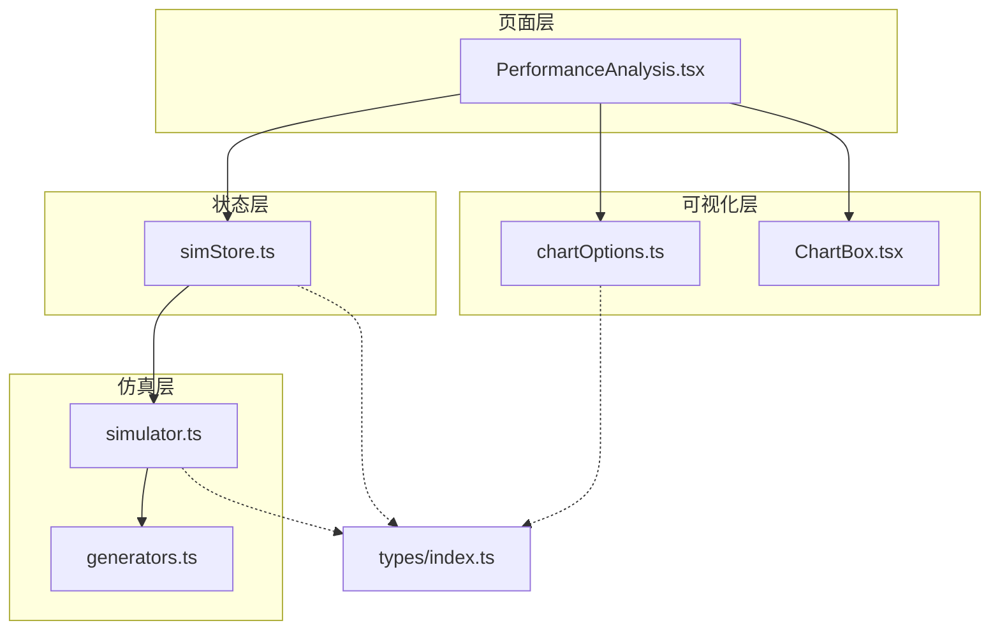
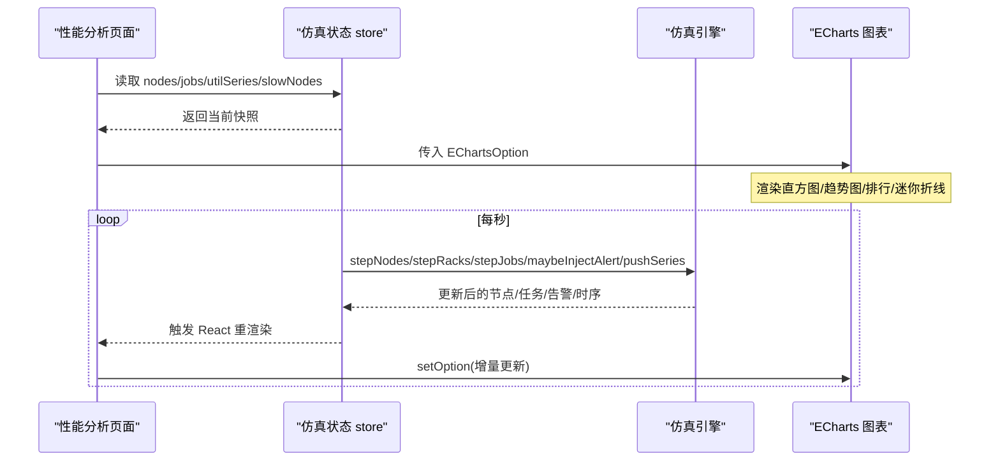
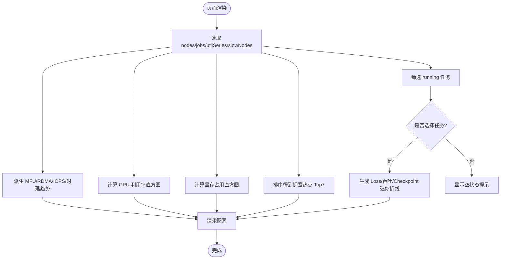
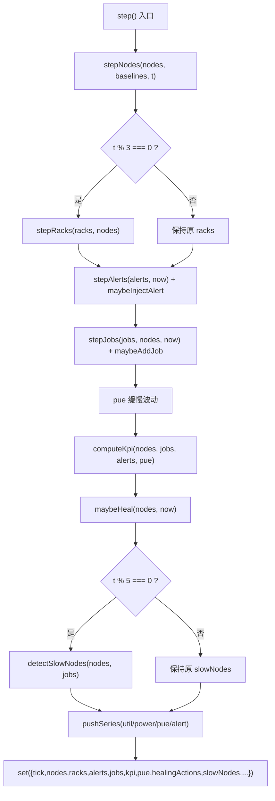
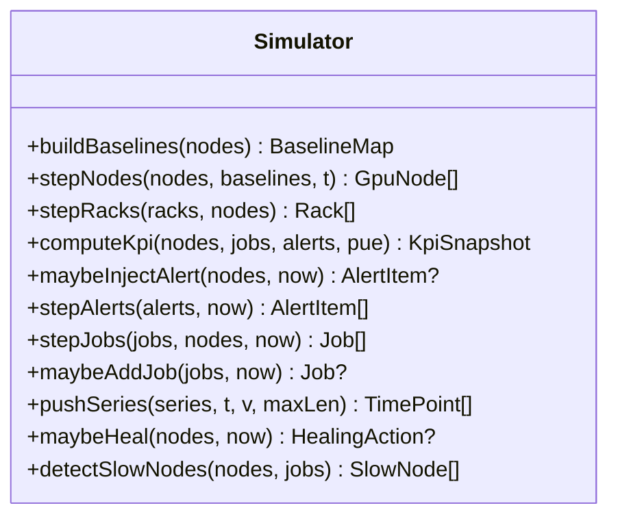
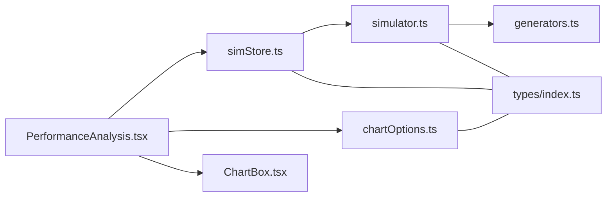
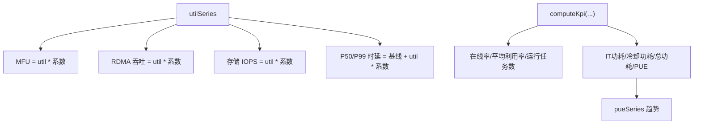
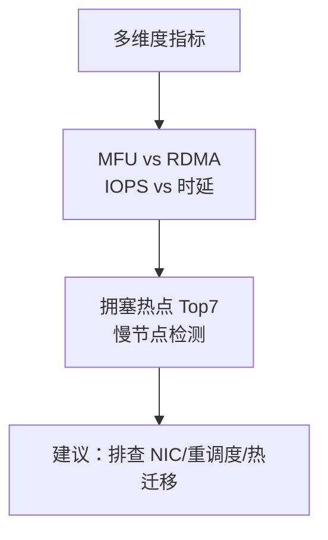
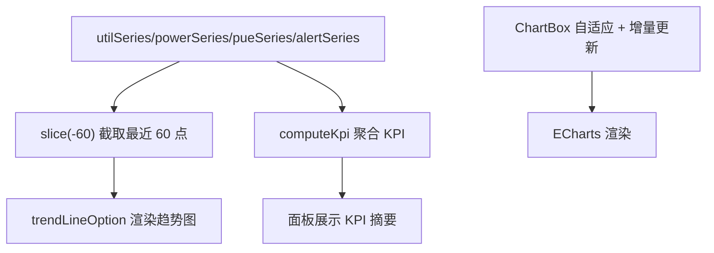
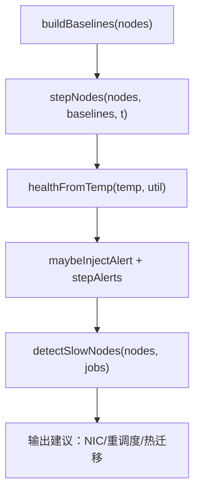

# 性能分析平台

<cite>
**本文引用的文件**   
- [PerformanceAnalysis.tsx](file://src/pages/PerformanceAnalysis.tsx)
- [simStore.ts](file://src/stores/simStore.ts)
- [generators.ts](file://src/mock/generators.ts)
- [simulator.ts](file://src/mock/simulator.ts)
- [chartOptions.ts](file://src/theme/chartOptions.ts)
- [ChartBox.tsx](file://src/components/ChartBox.tsx)
- [types/index.ts](file://src/types/index.ts)
</cite>

## 目录
1. [引言](#引言)
2. [项目结构](#项目结构)
3. [核心组件](#核心组件)
4. [架构总览](#架构总览)
5. [详细组件分析](#详细组件分析)
6. [依赖关系分析](#依赖关系分析)
7. [性能与渲染优化](#性能与渲染优化)
8. [历史趋势、容量评估与能效分析](#历史趋势容量评估与能效分析)
9. [多维度指标、对比分析与瓶颈识别](#多维度指标对比分析与瓶颈识别)
10. [时间范围选择、数据聚合与图表渲染](#时间范围选择数据聚合与图表渲染)
11. [基线设定、异常检测与调优建议](#基线设定异常检测与调优建议)
12. [故障排查指南](#故障排查指南)
13. [结论](#结论)

## 引言
本页面是性能分析平台的核心视图，面向数据中心 GPU 集群的性能观测、任务级训练曲线、网络与存储瓶颈定位以及慢节点自动诊断。它通过模拟仿真引擎驱动实时指标，将利用率、显存、功耗、PUE、告警、任务进度等数据以直方图、趋势图、排行和迷你折线图呈现，帮助运维与算法团队快速发现热点、定位瓶颈并给出优化建议。

## 项目结构
该功能由以下模块协作完成：
- 页面层：性能分析主页面负责布局、指标计算与图表配置。
- 状态层：Zustand store 维护节点、任务、时序、KPI 与 UI 状态，并提供步进、启动、停止等操作。
- 仿真层：纯函数驱动的仿真器推进节点、机柜、任务、告警、自愈动作与时序数据。
- 主题与图表：统一的 ECharts 选项生成器与图表容器封装。
- 类型定义：统一的数据模型约束。

**图示来源**
- [PerformanceAnalysis.tsx:1-10](file://src/pages/PerformanceAnalysis.tsx#L1-L10)
- [simStore.ts:1-37](file://src/stores/simStore.ts#L1-L37)
- [simulator.ts:1-13](file://src/mock/simulator.ts#L1-L13)
- [chartOptions.ts:1-4](file://src/theme/chartOptions.ts#L1-L4)
- [ChartBox.tsx:1-5](file://src/components/ChartBox.tsx#L1-L5)

**章节来源**
- [PerformanceAnalysis.tsx:1-10](file://src/pages/PerformanceAnalysis.tsx#L1-L10)
- [simStore.ts:1-37](file://src/stores/simStore.ts#L1-L37)

## 核心组件
- 性能分析页面：展示集群维度（GPU 利用率分布、显存占用分布、MFU 算力利用率）、网络与存储维度（RDMA 吞吐、拥塞热点 Top7、IOPS 与时延）、训练任务视角（运行中任务列表、任务性能曲线、慢节点检测）。
- 仿真状态管理：提供节点、任务、告警、KPI、时序数据的初始化与步进更新，暴露 step/start/stop 等方法。
- 仿真引擎：基于基线与随机扰动推进节点指标、机柜聚合、任务状态机、告警注入、自愈日志、慢节点检测与时序推送。
- 图表选项生成：提供趋势线、直方图、仪表盘、堆叠面积、水平条形、热力图、桑基图等通用 ECharts 配置。
- 图表容器：封装 ECharts 初始化、自适应尺寸、增量更新与事件绑定。

**章节来源**
- [PerformanceAnalysis.tsx:32-227](file://src/pages/PerformanceAnalysis.tsx#L32-L227)
- [simStore.ts:99-265](file://src/stores/simStore.ts#L99-L265)
- [simulator.ts:35-139](file://src/mock/simulator.ts#L35-L139)
- [chartOptions.ts:37-70](file://src/theme/chartOptions.ts#L37-L70)
- [ChartBox.tsx:17-58](file://src/components/ChartBox.tsx#L17-L58)

## 架构总览
性能分析平台的运行时流程如下：
- 页面加载时，store 使用 generators 生成拓扑、资产、初始任务与预测结果，并构建节点基线。
- 页面订阅 store 中的 nodes/jobs/utilSeries/slowNodes 等状态，计算直方图、趋势序列与热点排行。
- 每秒钟触发一次 step，调用 simulator 推进节点、机柜、任务、告警、自愈动作，并推入时序数组。
- 图表通过 ChartBox 渲染，使用 chartOptions 提供的 ECharts 配置进行展示。

**图示来源**
- [simStore.ts:164-206](file://src/stores/simStore.ts#L164-L206)
- [simulator.ts:54-92](file://src/mock/simulator.ts#L54-L92)
- [simulator.ts:199-234](file://src/mock/simulator.ts#L199-L234)
- [simulator.ts:264-268](file://src/mock/simulator.ts#L264-L268)
- [PerformanceAnalysis.tsx:105-227](file://src/pages/PerformanceAnalysis.tsx#L105-L227)

## 详细组件分析

### 性能分析页面（PerformanceAnalysis）
职责：
- 从 store 获取节点、任务、利用率时序与慢节点。
- 计算利用率与显存占用的直方图分布。
- 派生 MFU、RDMA 吞吐、存储 IOPS 与 P50/P99 时延的最近 60 点趋势。
- 按利用率排序输出网络拥塞热点 Top7。
- 展示运行中任务列表，支持点击切换任务。
- 为选中任务绘制 Loss、吞吐、Checkpoint 时长迷你折线。
- 展示慢节点检测结果与建议。

关键实现要点：
- 直方图 bins 固定为 10 段，统计非离线节点的 util 与 memUtil。
- 趋势序列基于 utilSeries 做线性缩放或偏移，取最近 60 个点。
- 热点 congestion 综合利用率与温度，gbps 由利用率映射到带宽。
- 任务曲线使用确定性种子生成稳定可复现的 Loss/吞吐/Checkpoint 序列。

**图示来源**
- [PerformanceAnalysis.tsx:40-103](file://src/pages/PerformanceAnalysis.tsx#L40-L103)
- [PerformanceAnalysis.tsx:105-227](file://src/pages/PerformanceAnalysis.tsx#L105-L227)
- [PerformanceAnalysis.tsx:230-295](file://src/pages/PerformanceAnalysis.tsx#L230-L295)

**章节来源**
- [PerformanceAnalysis.tsx:40-103](file://src/pages/PerformanceAnalysis.tsx#L40-L103)
- [PerformanceAnalysis.tsx:105-227](file://src/pages/PerformanceAnalysis.tsx#L105-L227)
- [PerformanceAnalysis.tsx:230-295](file://src/pages/PerformanceAnalysis.tsx#L230-L295)

### 仿真状态管理（simStore）
职责：
- 初始化静态拓扑、资产、任务、预测结果与基线。
- 生成 24h 历史算力利用率曲线（演示用，1 分钟粒度取 120 点）。
- 维护 KPI 快照、PUE、活跃告警数、运行任务数等汇总指标。
- 提供 step/start/stop 控制仿真心跳，每秒推进一次。
- 暴露 ack/silence/resolve 告警操作与提交新任务的接口。

关键实现要点：
- step 内顺序执行节点漂移、机柜聚合、告警注入与流转、任务状态机、PUE 波动、KPI 计算、自愈动作、慢节点检测。
- 时序数据通过 pushSeries 保持固定长度窗口（默认 60 点），避免无限增长。
- 慢节点检测每 5 tick 执行一次，降低计算开销。

**图示来源**
- [simStore.ts:164-206](file://src/stores/simStore.ts#L164-L206)
- [simulator.ts:54-92](file://src/mock/simulator.ts#L54-L92)
- [simulator.ts:199-234](file://src/mock/simulator.ts#L199-L234)
- [simulator.ts:264-268](file://src/mock/simulator.ts#L264-L268)

**章节来源**
- [simStore.ts:42-58](file://src/stores/simStore.ts#L42-L58)
- [simStore.ts:99-265](file://src/stores/simStore.ts#L99-L265)

### 仿真引擎（simulator）
职责：
- 构建节点基线（util/temp/power/phase/speed）。
- 推进节点指标（正弦漂移 + 噪声），更新健康等级与健康分数。
- 聚合机柜功耗与回风温度，判定机柜健康等级。
- 计算 KPI 汇总（PFLOPS、在线率、平均利用率、活跃告警、PUE、功率分解、运行任务数）。
- 注入告警模板，自然流转告警状态。
- 推进任务状态机（排队→运行→成功/失败），补充新任务维持队列活跃度。
- 推送时序数据（固定长度窗口）。
- 自愈动作日志（隔离、降频、迁移、链路切换、快照等）。
- 慢节点检测（相对均值偏差阈值过滤）。

关键实现要点：
- 节点指标在 clamp 范围内更新，防止越界。
- KPI 中 PFLOPS 根据型号算力与利用率加权求和。
- 告警注入概率与目标选择策略保证真实感。
- 任务进度、Loss、吞吐、MFU 均带随机扰动，符合训练过程特征。
- detectSlowNodes 按利用率相对均值偏差筛选，并给出建议。

**图示来源**
- [simulator.ts:35-139](file://src/mock/simulator.ts#L35-L139)
- [simulator.ts:165-194](file://src/mock/simulator.ts#L165-L194)
- [simulator.ts:199-259](file://src/mock/simulator.ts#L199-L259)
- [simulator.ts:264-318](file://src/mock/simulator.ts#L264-L318)

**章节来源**
- [simulator.ts:35-139](file://src/mock/simulator.ts#L35-L139)
- [simulator.ts:165-194](file://src/mock/simulator.ts#L165-L194)
- [simulator.ts:199-259](file://src/mock/simulator.ts#L199-L259)
- [simulator.ts:264-318](file://src/mock/simulator.ts#L264-L318)

### 图表选项与容器（chartOptions / ChartBox）
职责：
- 提供趋势线、直方图、仪表盘、堆叠面积、水平条形、热力图、桑基图等 ECharts 配置生成器。
- 统一颜色、网格、坐标轴样式与渐变填充。
- ChartBox 封装 ECharts 实例生命周期、ResizeObserver 自适应、增量 setOption 与事件绑定。

关键实现要点：
- trendLineOption 支持多系列、单位、平滑、图例开关。
- histogramOption 用于利用率/显存分布直方图。
- ChartBox 支持 noAnimation 禁用动画以提升高频刷新场景性能。
- ensureEchartsTheme 应用驾驶舱主题。

**章节来源**
- [chartOptions.ts:37-70](file://src/theme/chartOptions.ts#L37-L70)
- [chartOptions.ts:297-318](file://src/theme/chartOptions.ts#L297-L318)
- [ChartBox.tsx:17-58](file://src/components/ChartBox.tsx#L17-L58)

## 依赖关系分析
- PerformanceAnalysis 依赖 simStore 提供数据，依赖 chartOptions 提供图表配置，依赖 ChartBox 渲染图表。
- simStore 依赖 simulator 与 generators 提供仿真逻辑与静态数据。
- simulator 依赖 generators 提供工具函数与常量。
- 所有模块共享 types/index.ts 的类型定义。

**图示来源**
- [PerformanceAnalysis.tsx:1-10](file://src/pages/PerformanceAnalysis.tsx#L1-L10)
- [simStore.ts:1-37](file://src/stores/simStore.ts#L1-L37)
- [simulator.ts:1-13](file://src/mock/simulator.ts#L1-L13)
- [chartOptions.ts:1-4](file://src/theme/chartOptions.ts#L1-L4)
- [ChartBox.tsx:1-5](file://src/components/ChartBox.tsx#L1-L5)

**章节来源**
- [PerformanceAnalysis.tsx:1-10](file://src/pages/PerformanceAnalysis.tsx#L1-L10)
- [simStore.ts:1-37](file://src/stores/simStore.ts#L1-L37)

## 性能与渲染优化
- 使用 useMemo 缓存直方图、趋势序列与热点排行，避免重复计算。
- 图表容器 ChartBox 使用 memo 包裹，减少不必要的重渲染。
- 高频刷新场景可通过 noAnimation 禁用动画，提升渲染性能。
- 机柜聚合每 3 tick 更新一次，慢节点检测每 5 tick 执行一次，降低计算压力。
- 时序数据 pushSeries 限制最大长度（默认 60），避免内存增长。

**章节来源**
- [PerformanceAnalysis.tsx:40-103](file://src/pages/PerformanceAnalysis.tsx#L40-L103)
- [ChartBox.tsx:17-58](file://src/components/ChartBox.tsx#L17-L58)
- [simStore.ts:171-190](file://src/stores/simStore.ts#L171-L190)
- [simulator.ts:264-268](file://src/mock/simulator.ts#L264-L268)

## 历史趋势、容量评估与能效分析
- 历史趋势：利用 utilSeries 派生 MFU、RDMA 吞吐、存储 IOPS 与 P50/P99 时延，展示近 60 分钟趋势。
- 容量评估：通过 KPI 汇总（PFLOPS、在线率、平均利用率、运行任务数）评估集群算力与负载能力；结合节点利用率分布直方图判断资源紧张程度。
- 能效分析：KPI 包含 IT 功耗、冷却功耗与总功耗，PUE 作为能效指标；pueSeries 展示 PUE 变化趋势。

**图示来源**
- [PerformanceAnalysis.tsx:66-88](file://src/pages/PerformanceAnalysis.tsx#L66-L88)
- [simulator.ts:97-139](file://src/mock/simulator.ts#L97-L139)
- [simStore.ts:155-158](file://src/stores/simStore.ts#L155-L158)

**章节来源**
- [PerformanceAnalysis.tsx:66-88](file://src/pages/PerformanceAnalysis.tsx#L66-L88)
- [simulator.ts:97-139](file://src/mock/simulator.ts#L97-L139)
- [simStore.ts:155-158](file://src/stores/simStore.ts#L155-L158)

## 多维度指标、对比分析与瓶颈识别
- 多维度指标：GPU 利用率、显存占用、RDMA 吞吐、存储 IOPS、P50/P99 时延、PUE、活跃告警数。
- 对比分析：MFU 与 RDMA 吞吐对比观察算力与通信匹配度；IOPS 与时延对比观察存储性能瓶颈。
- 瓶颈识别：网络拥塞热点 Top7 按 congestion 排序，结合 gbps 与利用率定位高负载节点；慢节点检测按利用率相对均值偏差给出建议。

**图示来源**
- [PerformanceAnalysis.tsx:90-103](file://src/pages/PerformanceAnalysis.tsx#L90-L103)
- [PerformanceAnalysis.tsx:125-160](file://src/pages/PerformanceAnalysis.tsx#L125-L160)
- [simulator.ts:303-318](file://src/mock/simulator.ts#L303-L318)

**章节来源**
- [PerformanceAnalysis.tsx:90-103](file://src/pages/PerformanceAnalysis.tsx#L90-L103)
- [PerformanceAnalysis.tsx:125-160](file://src/pages/PerformanceAnalysis.tsx#L125-L160)
- [simulator.ts:303-318](file://src/mock/simulator.ts#L303-L318)

## 时间范围选择、数据聚合与图表渲染
- 时间范围选择：趋势图默认展示最近 60 个时间点（约 60 分钟），通过 slice(-60) 截取。
- 数据聚合：utilSeries/powerSeries/pueSeries/alertSeries 通过 pushSeries 维护固定长度窗口；KPI 对节点与任务进行聚合计算。
- 图表渲染：ChartBox 使用 ResizeObserver 自适应尺寸，增量 setOption 更新数据；noAnimation 可禁用动画提升性能。

**图示来源**
- [PerformanceAnalysis.tsx:66-88](file://src/pages/PerformanceAnalysis.tsx#L66-L88)
- [simulator.ts:264-268](file://src/mock/simulator.ts#L264-L268)
- [ChartBox.tsx:22-39](file://src/components/ChartBox.tsx#L22-L39)

**章节来源**
- [PerformanceAnalysis.tsx:66-88](file://src/pages/PerformanceAnalysis.tsx#L66-L88)
- [simulator.ts:264-268](file://src/mock/simulator.ts#L264-L268)
- [ChartBox.tsx:22-39](file://src/components/ChartBox.tsx#L22-L39)

## 基线设定、异常检测与调优建议
- 基线设定：buildBaselines 为每个节点建立初始 util/temp/power/phase/speed，stepNodes 围绕基线做正弦漂移与噪声。
- 异常检测：maybeInjectAlert 根据节点健康状态与模板注入告警；stepAlerts 自然流转告警状态；detectSlowNodes 识别慢节点。
- 调优建议：慢节点检测输出 metric 与 suggestion，如“建议排查 NIC 链路/重调度”或“建议观察或热迁移”。

**图示来源**
- [simulator.ts:35-47](file://src/mock/simulator.ts#L35-L47)
- [simulator.ts:54-71](file://src/mock/simulator.ts#L54-L71)
- [simulator.ts:165-194](file://src/mock/simulator.ts#L165-L194)
- [simulator.ts:303-318](file://src/mock/simulator.ts#L303-L318)

**章节来源**
- [simulator.ts:35-47](file://src/mock/simulator.ts#L35-L47)
- [simulator.ts:54-71](file://src/mock/simulator.ts#L54-L71)
- [simulator.ts:165-194](file://src/mock/simulator.ts#L165-L194)
- [simulator.ts:303-318](file://src/mock/simulator.ts#L303-L318)

## 故障排查指南
常见问题与处理建议：
- 图表不更新：检查 ChartBox 的 noAnimation 与 setOption 调用是否正确；确认 store 的 step/start/stop 是否启用。
- 数据不增长：确认 pushSeries 的 maxLen 设置与 slice(-60) 截取逻辑是否符合预期。
- 热点不准确：检查 hotspots 的排序与 congestion 计算公式；确认节点 status 过滤逻辑。
- 慢节点缺失：确认 detectSlowNodes 的偏差阈值与筛选条件；检查 jobs.assignedNodes 关联是否正确。

**章节来源**
- [ChartBox.tsx:17-58](file://src/components/ChartBox.tsx#L17-L58)
- [simulator.ts:264-268](file://src/mock/simulator.ts#L264-L268)
- [PerformanceAnalysis.tsx:90-103](file://src/pages/PerformanceAnalysis.tsx#L90-L103)
- [simulator.ts:303-318](file://src/mock/simulator.ts#L303-L318)

## 结论
性能分析平台通过仿真引擎驱动实时指标，结合直方图、趋势图、排行与迷你折线图，全面展示集群算力、网络与存储性能，辅助用户进行历史趋势分析、容量评估与能效分析。其设计强调可观测性、可解释性与可操作性，提供瓶颈识别与优化建议，帮助用户快速定位问题并制定调优策略。