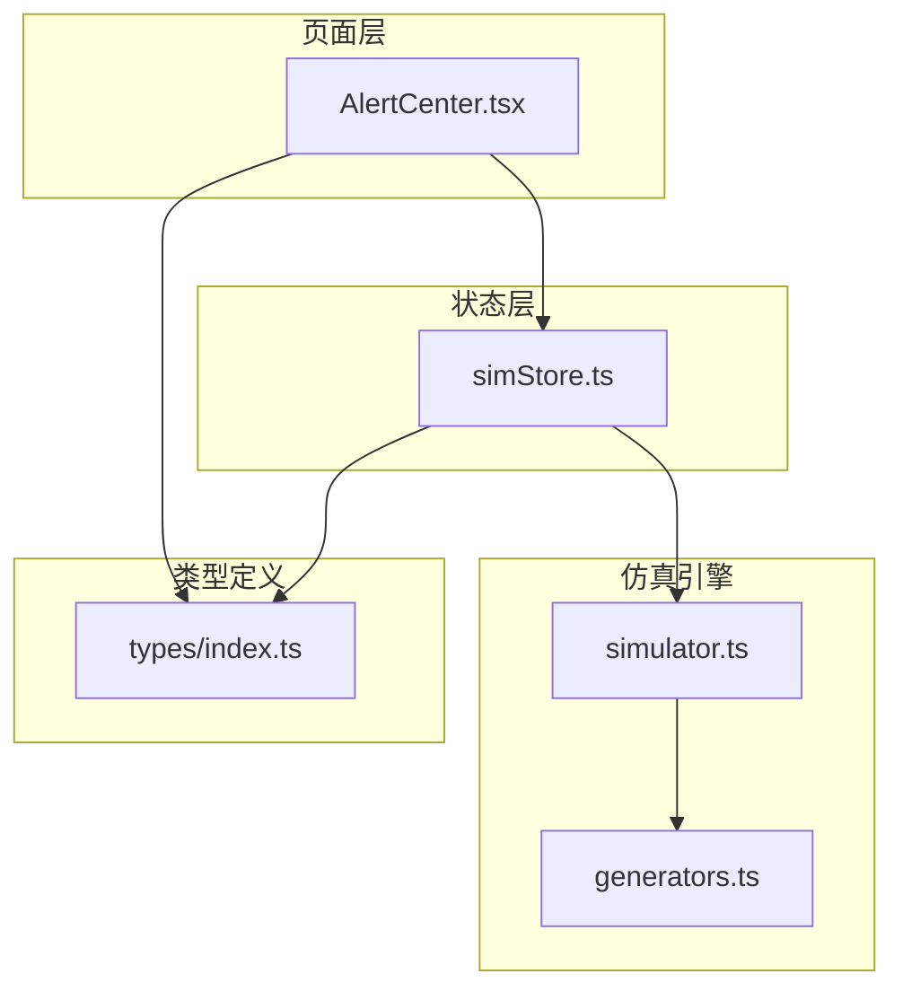
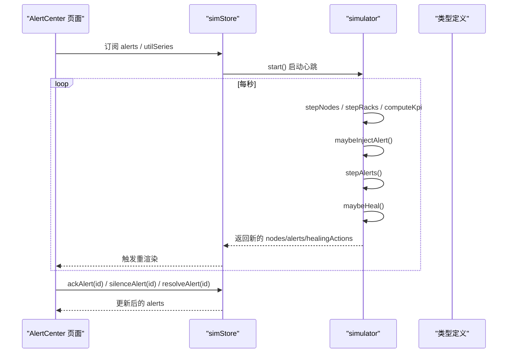
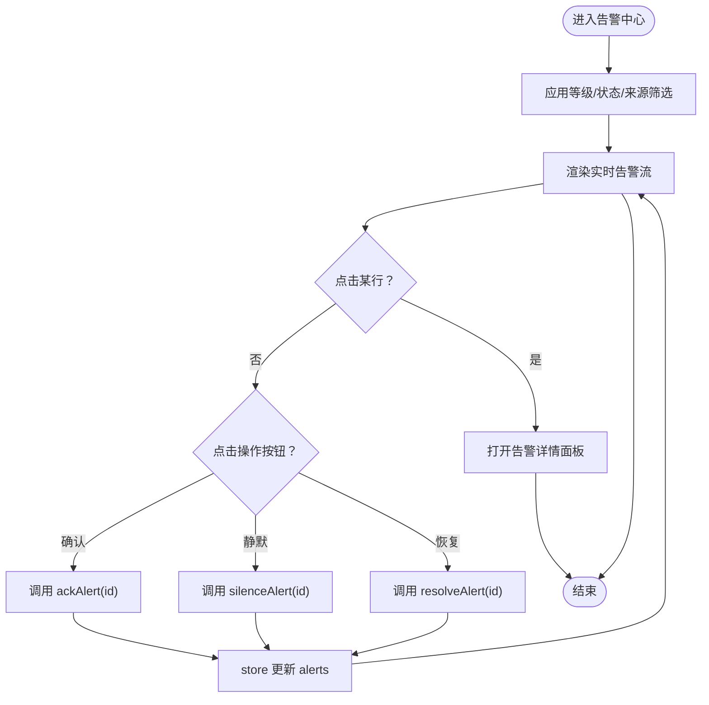
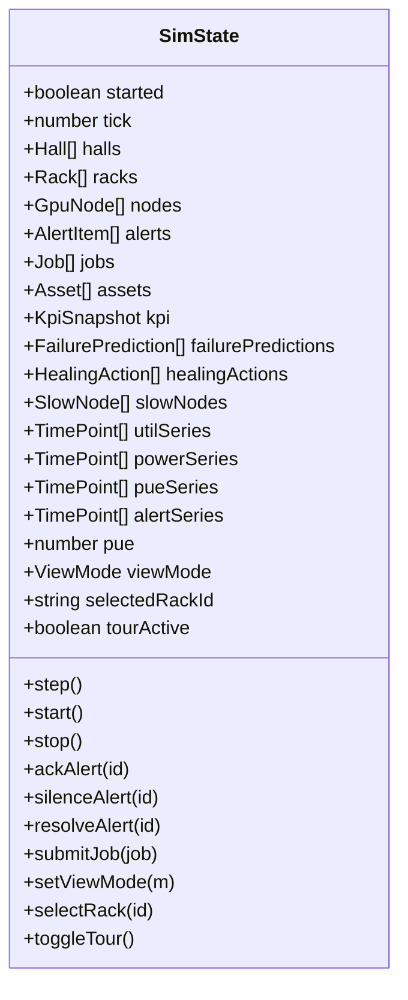
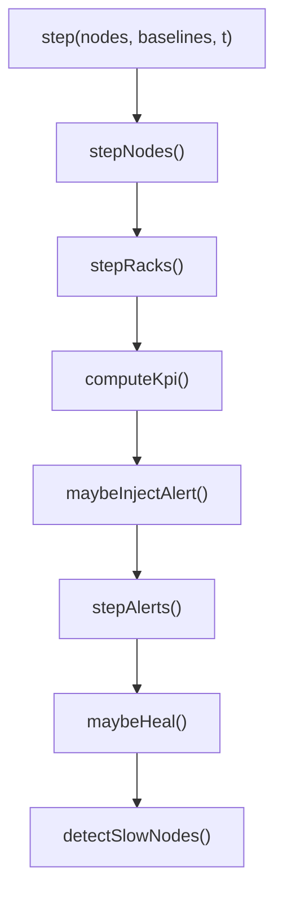
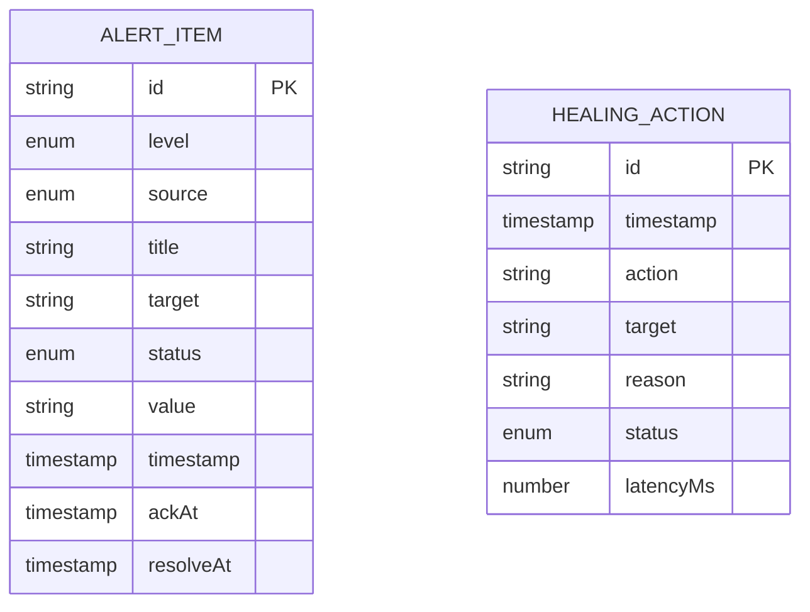
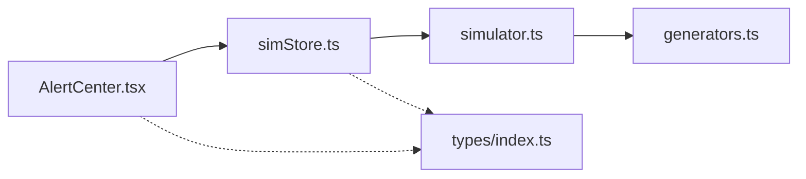

# 智能告警中心

<cite>
**本文引用的文件**   
- [AlertCenter.tsx](file://src/pages/AlertCenter.tsx)
- [simStore.ts](file://src/stores/simStore.ts)
- [simulator.ts](file://src/mock/simulator.ts)
- [generators.ts](file://src/mock/generators.ts)
- [index.ts](file://src/types/index.ts)
</cite>

## 目录
1. [引言](#引言)
2. [项目结构](#项目结构)
3. [核心组件](#核心组件)
4. [架构总览](#架构总览)
5. [详细组件分析](#详细组件分析)
6. [依赖关系分析](#依赖关系分析)
7. [性能与可扩展性](#性能与可扩展性)
8. [故障排查指南](#故障排查指南)
9. [结论](#结论)
10. [附录：告警规则与阈值说明](#附录告警规则与阈值说明)

## 引言
本文件面向“智能告警中心”页面，系统性梳理多级告警分类、告警处理操作、自愈机制日志等核心能力。文档从告警事件接收、分类、优先级排序、展示逻辑入手，详细说明确认、静默、恢复等操作的处理流程，以及自愈动作的自动执行与状态跟踪；同时给出告警规则配置、阈值设置和通知机制的实现思路，并提供历史查询、统计分析和问题定位的使用方法与最佳实践。

## 项目结构
智能告警中心由以下关键模块组成：
- 页面层：负责筛选、列表渲染、详情面板与统计图表。
- 状态层：集中管理仿真数据、告警集合、自愈日志、时序指标等。
- 仿真引擎：驱动节点指标漂移、告警注入、任务调度、自愈动作生成。
- 类型定义：统一领域模型，包括告警、节点、任务、自愈动作等。

**图示来源**
- [AlertCenter.tsx:1-10](file://src/pages/AlertCenter.tsx#L1-L10)
- [simStore.ts:1-37](file://src/stores/simStore.ts#L1-L37)
- [simulator.ts:1-13](file://src/mock/simulator.ts#L1-L13)
- [generators.ts:1-12](file://src/mock/generators.ts#L1-L12)
- [index.ts:1-18](file://src/types/index.ts#L1-L18)

**章节来源**
- [AlertCenter.tsx:1-216](file://src/pages/AlertCenter.tsx#L1-L216)
- [simStore.ts:99-162](file://src/stores/simStore.ts#L99-L162)
- [simulator.ts:141-194](file://src/mock/simulator.ts#L141-L194)
- [index.ts:75-87](file://src/types/index.ts#L75-L87)

## 核心组件
- 告警中心页面（AlertCenter）
  - 提供等级、状态、来源三类筛选器。
  - 实时告警流表格，支持确认、静默、恢复操作。
  - 右侧告警详情面板，包含时间线、关联指标快照、根因拓扑链路。
  - 顶部统计卡片：活跃告警、今日累计、MTTA、MTTR。
  - 24h 告警趋势堆叠图与 Top 告警源排行。
- 仿真 Store（simStore）
  - 维护全局状态：节点、机柜、告警、任务、自愈日志、KPI、时序曲线等。
  - 暴露 step/start/stop 及 ackAlert/silenceAlert/resolveAlert 等方法。
  - 心跳驱动仿真推进，周期性注入告警、流转状态、生成自愈日志。
- 仿真引擎（simulator）
  - 节点指标步进、机柜聚合、KPI 汇总。
  - 告警模板注入、告警自然流转、慢节点检测。
  - 自愈动作生成与日志追加。
- 类型定义（types）
  - 统一 AlertItem、AlertLevel、AlertStatus、AlertSource、HealingAction 等模型。

**章节来源**
- [AlertCenter.tsx:22-216](file://src/pages/AlertCenter.tsx#L22-L216)
- [simStore.ts:142-265](file://src/stores/simStore.ts#L142-L265)
- [simulator.ts:51-139](file://src/mock/simulator.ts#L51-L139)
- [index.ts:11-18](file://src/types/index.ts#L11-L18)
- [index.ts:75-87](file://src/types/index.ts#L75-L87)
- [index.ts:173-182](file://src/types/index.ts#L173-L182)

## 架构总览
智能告警中心的整体交互如下：
- 页面通过 Zustand store 订阅 alerts、utilSeries 等状态。
- 用户操作（确认、静默、恢复）调用 store 方法更新告警状态。
- 仿真引擎每秒推进一次，可能注入新告警、自动恢复部分活跃告警、追加自愈日志。
- 页面根据当前 alerts 计算筛选结果、统计指标与趋势图。

**图示来源**
- [AlertCenter.tsx:22-48](file://src/pages/AlertCenter.tsx#L22-L48)
- [simStore.ts:164-207](file://src/stores/simStore.ts#L164-L207)
- [simulator.ts:165-194](file://src/mock/simulator.ts#L165-L194)
- [simulator.ts:283-298](file://src/mock/simulator.ts#L283-L298)

## 详细组件分析

### 告警中心页面（AlertCenter）
- 筛选维度
  - 等级：P0/P1/P2/P3 或全部。
  - 状态：全部/活跃/已确认/已静默/已恢复。
  - 来源：GPU/节点/网络/存储/供电/制冷。
- 列表与操作
  - 显示等级、标题、对象、来源、时间、状态。
  - 对活跃告警提供“确认”“静默”“恢复”按钮。
- 详情面板
  - 时间线：触发、确认、恢复时间点。
  - 关联指标快照：近 60 秒利用率迷你图。
  - 根因拓扑链路：按来源类别高亮对应层级，并给出 AI 根因建议。
- 统计与趋势
  - 活跃告警数、今日累计、MTTA、MTTR。
  - 24h 分级堆叠趋势图，结合当前活跃数微调末值。
  - Top 告警源排行。

**图示来源**
- [AlertCenter.tsx:34-48](file://src/pages/AlertCenter.tsx#L34-L48)
- [AlertCenter.tsx:161-196](file://src/pages/AlertCenter.tsx#L161-L196)
- [AlertCenter.tsx:231-317](file://src/pages/AlertCenter.tsx#L231-L317)

**章节来源**
- [AlertCenter.tsx:12-20](file://src/pages/AlertCenter.tsx#L12-L20)
- [AlertCenter.tsx:34-71](file://src/pages/AlertCenter.tsx#L34-L71)
- [AlertCenter.tsx:108-216](file://src/pages/AlertCenter.tsx#L108-L216)
- [AlertCenter.tsx:231-317](file://src/pages/AlertCenter.tsx#L231-L317)

### 仿真 Store（simStore）
- 状态字段
  - 基础拓扑：halls/racks/nodes。
  - 业务数据：alerts/jobs/assets/kpi/failurePredictions/healingActions/slowNodes。
  - 时序数据：utilSeries/powerSeries/pueSeries/alertSeries。
  - UI 控制：viewMode/selectedRackId/tourActive。
- 生命周期
  - start/stop 控制定时器驱动。
  - step 每 tick 推进节点、机柜、告警、任务、KPI、自愈日志、慢节点检测，并推送时序点。
- 告警操作
  - ackAlert：将状态改为已确认，记录确认时间。
  - silenceAlert：将状态改为已静默。
  - resolveAlert：将状态改为已恢复，记录恢复时间。

**图示来源**
- [simStore.ts:99-134](file://src/stores/simStore.ts#L99-L134)

**章节来源**
- [simStore.ts:142-265](file://src/stores/simStore.ts#L142-L265)

### 仿真引擎（simulator）
- 节点与机柜
  - stepNodes：基于基线正弦漂移+噪声更新利用率、温度、功耗与健康等级。
  - stepRacks：按节点聚合机柜功耗与出风温度，判定健康等级。
- KPI 汇总
  - computeKpi：汇总算力、在线率、平均利用率、活跃告警数、能耗等。
- 告警注入与流转
  - ALERT_TEMPLATES：定义 P0-P3 多来源告警模板。
  - maybeInjectAlert：按概率注入新告警，优先选择热点节点。
  - stepAlerts：部分活跃告警以一定概率自动恢复。
- 自愈动作
  - HEAL_ACTIONS：定义自动隔离、降频保护、任务迁移、服务重启、链路切换、快照触发等。
  - maybeHeal：当存在 critical 节点时，随机触发自愈动作并追加日志。
- 慢节点检测
  - detectSlowNodes：对比集群均值，识别通信或算力异常节点并给出建议。

**图示来源**
- [simulator.ts:51-92](file://src/mock/simulator.ts#L51-L92)
- [simulator.ts:97-139](file://src/mock/simulator.ts#L97-L139)
- [simulator.ts:151-182](file://src/mock/simulator.ts#L151-L182)
- [simulator.ts:187-194](file://src/mock/simulator.ts#L187-L194)
- [simulator.ts:283-298](file://src/mock/simulator.ts#L283-L298)
- [simulator.ts:303-318](file://src/mock/simulator.ts#L303-L318)

**章节来源**
- [simulator.ts:51-139](file://src/mock/simulator.ts#L51-L139)
- [simulator.ts:151-194](file://src/mock/simulator.ts#L151-L194)
- [simulator.ts:283-318](file://src/mock/simulator.ts#L283-L318)

### 类型定义（types）
- 告警相关
  - AlertLevel：P0/P1/P2/P3。
  - AlertStatus：active/acked/silenced/resolved。
  - AlertSource：GPU/节点/网络/存储/供电/制冷。
  - AlertItem：告警实体，含 id、level、source、title、target、status、value、timestamp、ackAt、resolveAt。
- 自愈相关
  - HealingAction：id、timestamp、action、target、reason、status、latencyMs。

**图示来源**
- [index.ts:11-18](file://src/types/index.ts#L11-L18)
- [index.ts:75-87](file://src/types/index.ts#L75-L87)
- [index.ts:173-182](file://src/types/index.ts#L173-L182)

**章节来源**
- [index.ts:11-18](file://src/types/index.ts#L11-L18)
- [index.ts:75-87](file://src/types/index.ts#L75-L87)
- [index.ts:173-182](file://src/types/index.ts#L173-L182)

## 依赖关系分析
- 页面层依赖 store 提供的 alerts/utilSeries 与操作方法。
- Store 依赖 simulator 的纯函数进行数据演进，避免循环引用。
- simulator 依赖 generators 提供的确定性随机数与拓扑常量。
- 所有模块共享 types 中的领域模型，保证数据结构一致性。

**图示来源**
- [AlertCenter.tsx:1-10](file://src/pages/AlertCenter.tsx#L1-L10)
- [simStore.ts:1-37](file://src/stores/simStore.ts#L1-L37)
- [simulator.ts:1-13](file://src/mock/simulator.ts#L1-L13)
- [generators.ts:1-12](file://src/mock/generators.ts#L1-L12)
- [index.ts:1-18](file://src/types/index.ts#L1-L18)

**章节来源**
- [AlertCenter.tsx:1-10](file://src/pages/AlertCenter.tsx#L1-L10)
- [simStore.ts:1-37](file://src/stores/simStore.ts#L1-L37)
- [simulator.ts:1-13](file://src/mock/simulator.ts#L1-L13)
- [generators.ts:1-12](file://src/mock/generators.ts#L1-L12)
- [index.ts:1-18](file://src/types/index.ts#L1-L18)

## 性能与可扩展性
- 渲染优化
  - 使用 useMemo 缓存筛选结果、趋势图与 Top 源，减少重复计算。
  - 列表限制最多渲染前 100 条，避免大数据量导致卡顿。
- 仿真开销控制
  - 机柜聚合每 3 tick 更新一次，慢节点检测每 5 tick 计算一次。
  - 告警与任务队列长度上限（如 120 条告警、80 条任务），防止内存增长。
- 可扩展建议
  - 将告警模板与阈值参数化，便于外部配置。
  - 将自愈策略抽象为可插拔策略集，支持不同场景下的自动处置。
  - 引入分页与虚拟滚动，提升海量告警列表体验。

[本节为通用指导，不直接分析具体文件]

## 故障排查指南
- 告警未出现
  - 检查模拟器是否启动（started 状态）。
  - 查看 maybeInjectAlert 的概率与热点节点过滤逻辑。
- 告警无法确认/恢复
  - 确认按钮仅在 active 状态可见；静默/恢复在 active 或 acked 状态可见。
  - 检查 store 中 ackAlert/silenceAlert/resolveAlert 是否正确映射到目标 id。
- 自愈日志缺失
  - 检查是否存在 critical 节点且 maybeHeal 被触发。
  - 确认 healingActions 数组是否被正确追加与切片限制。
- MTTA/MTTR 异常
  - 确认 ackAt/resolveAt 是否被正确赋值。
  - 校验计算逻辑中对空集合的默认值处理。

**章节来源**
- [AlertCenter.tsx:176-196](file://src/pages/AlertCenter.tsx#L176-L196)
- [simStore.ts:221-238](file://src/stores/simStore.ts#L221-L238)
- [simulator.ts:165-194](file://src/mock/simulator.ts#L165-L194)
- [simulator.ts:283-298](file://src/mock/simulator.ts#L283-L298)

## 结论
智能告警中心通过页面层、状态层与仿真引擎的协作，实现了多级告警的分类、处理与可视化，并结合自愈机制形成闭环运维能力。借助确定性仿真与清晰的数据模型，平台能够稳定演示告警接收、分类、优先级排序、展示与处置全流程，并为后续接入真实数据源与扩展自愈策略奠定基础。

[本节为总结性内容，不直接分析具体文件]

## 附录：告警规则与阈值说明
- 告警等级与来源
  - 等级：P0（严重）、P1（高）、P2（中）、P3（低）。
  - 来源：GPU、节点、网络、存储、供电、制冷。
- 告警模板示例
  - GPU 温度严重过高：超过阈值 88°C。
  - ECC 错误累积超阈值：每小时可纠正错误次数。
  - 计算节点心跳丢失：节点离线时长。
  - InfiniBand 链路抖动：误码率升高。
  - GPU 利用率持续打满：长时间高负载。
  - 机柜功耗异常波动：瞬时功率偏移。
  - 热通道温度偏高：回风温度升高。
  - 存储时延升高：P99 时延增大。
  - HBM 显存降频：频率下降。
- 自愈动作示例
  - 自动隔离故障节点。
  - GPU 降频保护。
  - 任务热迁移。
  - 重启 NCCL 通信服务。
  - 切换备用 InfiniBand 链路。
  - 触发存储快照。

**章节来源**
- [simulator.ts:151-161](file://src/mock/simulator.ts#L151-L161)
- [simulator.ts:274-281](file://src/mock/simulator.ts#L274-L281)
- [index.ts:11-18](file://src/types/index.ts#L11-L18)
- [index.ts:173-182](file://src/types/index.ts#L173-L182)