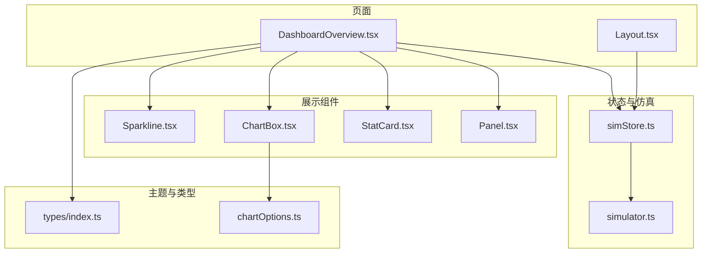
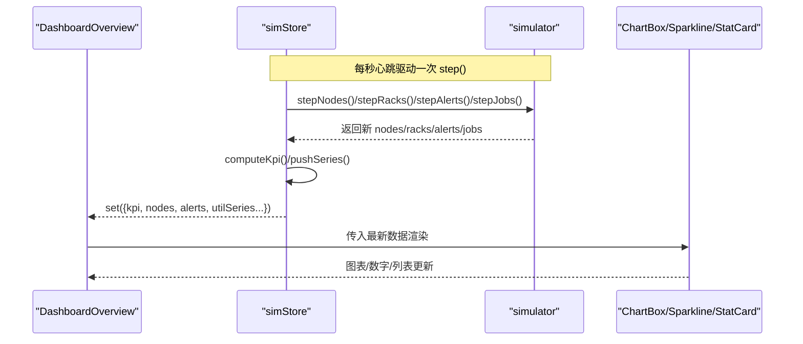
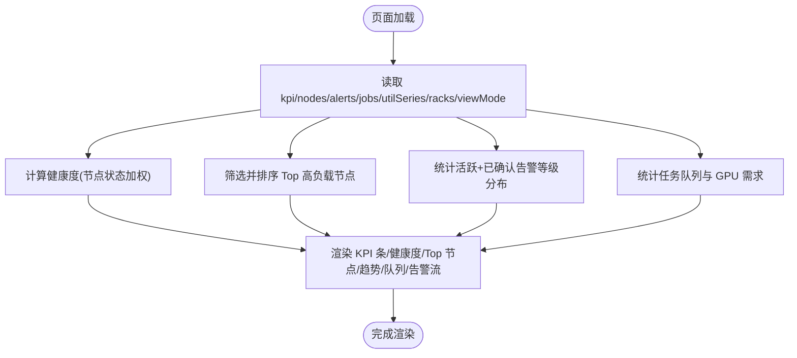
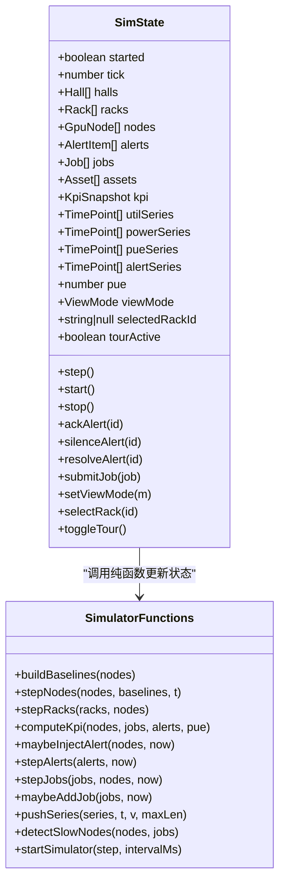
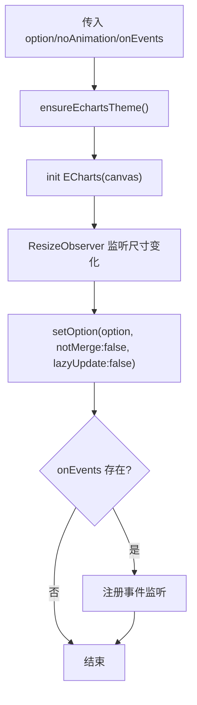
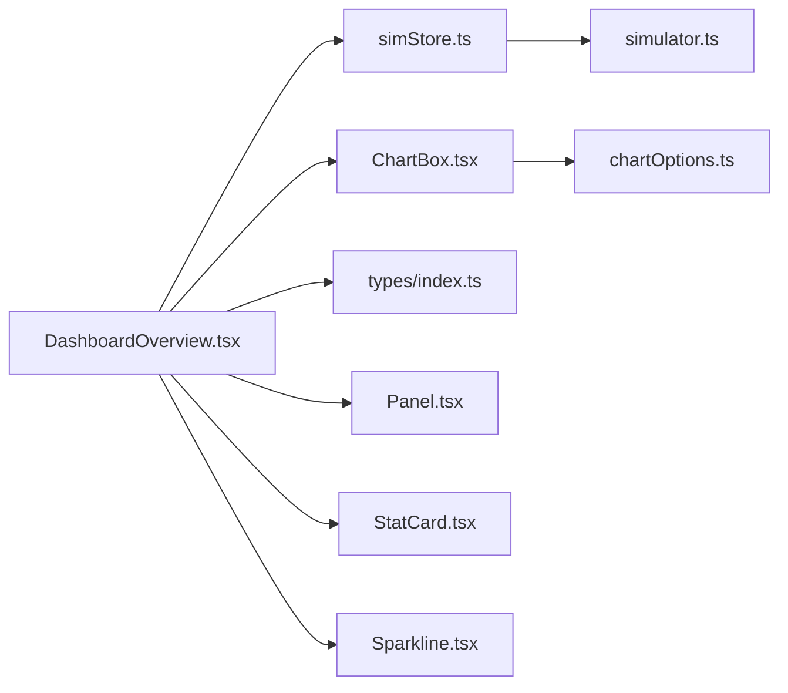
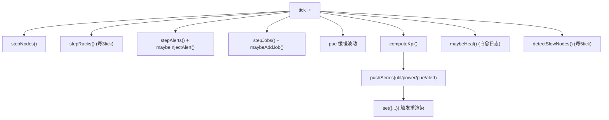
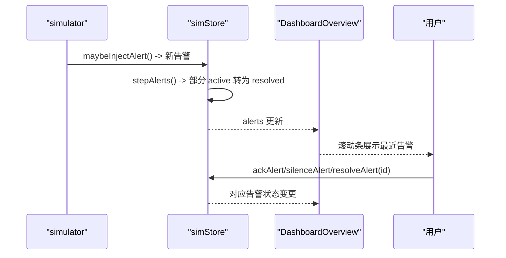
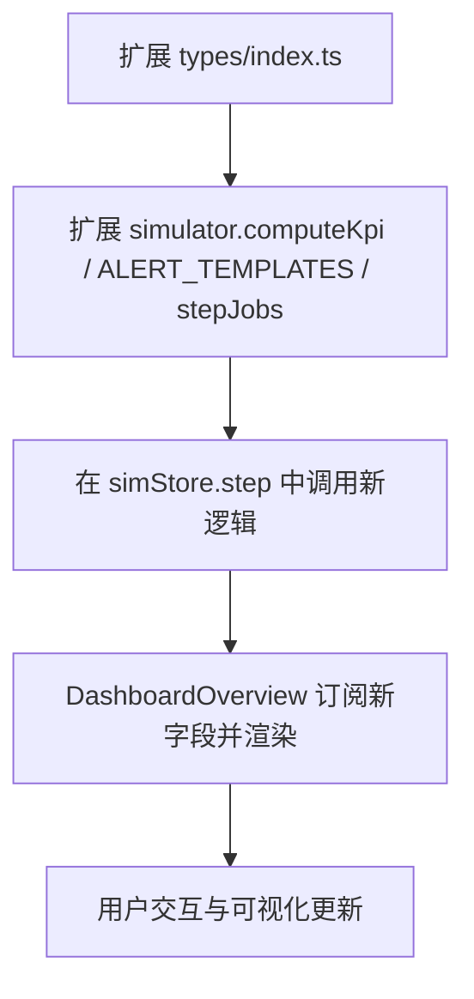

# 监控仪表板

<cite>
**本文引用的文件**   
- [DashboardOverview.tsx](file://src/pages/DashboardOverview.tsx)
- [simStore.ts](file://src/stores/simStore.ts)
- [simulator.ts](file://src/mock/simulator.ts)
- [Layout.tsx](file://src/components/Layout.tsx)
- [Panel.tsx](file://src/components/Panel.tsx)
- [StatCard.tsx](file://src/components/StatCard.tsx)
- [ChartBox.tsx](file://src/components/ChartBox.tsx)
- [Sparkline.tsx](file://src/components/Sparkline.tsx)
- [chartOptions.ts](file://src/theme/chartOptions.ts)
- [index.ts](file://src/types/index.ts)
</cite>

## 目录
1. [引言](#引言)
2. [项目结构](#项目结构)
3. [核心组件](#核心组件)
4. [架构总览](#架构总览)
5. [详细组件分析](#详细组件分析)
6. [依赖关系分析](#依赖关系分析)
7. [性能与刷新机制](#性能与刷新机制)
8. [告警处理与状态管理](#告警处理与状态管理)
9. [自定义指标与告警规则配置](#自定义指标与告警规则配置)
10. [故障排查指南](#故障排查指南)
11. [结论](#结论)

## 引言
本文件面向“监控仪表板”页面，系统性说明其布局设计、KPI 概览、健康度监控、实时告警流等核心功能；解释数据刷新机制、指标计算逻辑、用户交互流程；并给出与 Zustand store 的集成方式、数据订阅模式、性能优化策略，以及扩展自定义指标和告警规则的配置方法。文档兼顾技术实现细节与非技术读者的可读性。

## 项目结构
监控仪表板由以下关键部分组成：
- 页面层：仪表盘主视图 DashboardOverview
- 状态层：Zustand Store simStore
- 仿真引擎：纯函数模拟节点、机柜、任务、告警、时序数据更新 simulator
- 展示层：通用面板 Panel、统计卡片 StatCard、图表容器 ChartBox、迷你折线 Sparkline
- 主题与图表选项：ECharts 主题与图表配置 chartOptions
- 类型定义：领域模型 types

**图示来源**
- [DashboardOverview.tsx:1-30](file://src/pages/DashboardOverview.tsx#L1-L30)
- [simStore.ts:96-162](file://src/stores/simStore.ts#L96-L162)
- [simulator.ts:15-47](file://src/mock/simulator.ts#L15-L47)
- [Panel.tsx:1-54](file://src/components/Panel.tsx#L1-L54)
- [StatCard.tsx:1-83](file://src/components/StatCard.tsx#L1-L83)
- [ChartBox.tsx:1-61](file://src/components/ChartBox.tsx#L1-L61)
- [Sparkline.tsx:1-51](file://src/components/Sparkline.tsx#L1-L51)
- [chartOptions.ts:1-319](file://src/theme/chartOptions.ts#L1-L319)
- [index.ts:1-192](file://src/types/index.ts#L1-L192)

**章节来源**
- [DashboardOverview.tsx:1-30](file://src/pages/DashboardOverview.tsx#L1-L30)
- [simStore.ts:96-162](file://src/stores/simStore.ts#L96-L162)
- [simulator.ts:15-47](file://src/mock/simulator.ts#L15-L47)
- [Panel.tsx:1-54](file://src/components/Panel.tsx#L1-L54)
- [StatCard.tsx:1-83](file://src/components/StatCard.tsx#L1-L83)
- [ChartBox.tsx:1-61](file://src/components/ChartBox.tsx#L1-L61)
- [Sparkline.tsx:1-51](file://src/components/Sparkline.tsx#L1-L51)
- [chartOptions.ts:1-319](file://src/theme/chartOptions.ts#L1-L319)
- [index.ts:1-192](file://src/types/index.ts#L1-L192)

## 核心组件
- DashboardOverview：仪表板主视图，聚合 KPI、健康度、Top 高负载节点、机房 3D 透视、告警滚动条、利用率趋势、任务队列概览等模块。
- simStore：基于 Zustand 的全局状态容器，负责初始化静态数据、驱动仿真步进、暴露操作（启动/停止、确认/静音/恢复告警、提交任务、切换视图等）。
- simulator：纯函数仿真引擎，提供节点漂移、机柜聚合、KPI 汇总、告警注入与流转、任务状态机推进、慢节点检测、时序数据推进、心跳驱动等能力。
- Panel/StatCard/ChartBox/Sparkline：可复用 UI 组件，分别承担面板容器、KPI 卡片、ECharts 封装、轻量迷你折线。
- chartOptions：ECharts 图表配置生成器，统一视觉风格与交互行为。
- types：领域模型定义，贯穿各层数据结构契约。

**章节来源**
- [DashboardOverview.tsx:15-301](file://src/pages/DashboardOverview.tsx#L15-L301)
- [simStore.ts:96-265](file://src/stores/simStore.ts#L96-L265)
- [simulator.ts:51-139](file://src/mock/simulator.ts#L51-L139)
- [Panel.tsx:1-54](file://src/components/Panel.tsx#L1-L54)
- [StatCard.tsx:1-83](file://src/components/StatCard.tsx#L1-L83)
- [ChartBox.tsx:1-61](file://src/components/ChartBox.tsx#L1-L61)
- [Sparkline.tsx:1-51](file://src/components/Sparkline.tsx#L1-L51)
- [chartOptions.ts:1-319](file://src/theme/chartOptions.ts#L1-L319)
- [index.ts:1-192](file://src/types/index.ts#L1-L192)

## 架构总览
仪表板采用“页面 + Store + 仿真引擎 + 展示组件”的分层架构：
- 页面通过 useSimStore 订阅所需字段，仅渲染变化部分。
- Store 在 tick 中调用 simulator 的纯函数更新状态，并通过 set 触发 React 重渲染。
- 展示组件将数据转换为 ECharts 或 SVG 图形进行可视化。
- Layout 提供全局时钟、活跃告警角标、全屏控制等框架能力。

**图示来源**
- [simStore.ts:164-207](file://src/stores/simStore.ts#L164-L207)
- [simulator.ts:51-139](file://src/mock/simulator.ts#L51-L139)
- [DashboardOverview.tsx:15-66](file://src/pages/DashboardOverview.tsx#L15-L66)
- [ChartBox.tsx:17-39](file://src/components/ChartBox.tsx#L17-L39)

**章节来源**
- [simStore.ts:164-207](file://src/stores/simStore.ts#L164-L207)
- [simulator.ts:51-139](file://src/mock/simulator.ts#L51-L139)
- [DashboardOverview.tsx:15-66](file://src/pages/DashboardOverview.tsx#L15-L66)
- [ChartBox.tsx:17-39](file://src/components/ChartBox.tsx#L17-L39)

## 详细组件分析

### 仪表板页面 DashboardOverview
- KPI 概览：顶部 6 个 StatCard，展示总算力、GPU 在线率、平均利用率、活跃告警、PUE、运行任务数，附带进度条与提示文案。
- 集群健康度：使用 gaugeOption 半环仪表盘，按节点状态加权计算综合健康评分，并显示正常/警告/严重数量。
- Top 高负载节点：按利用率排序，展示节点 ID、型号、温度与健康分。
- 机房 3D 透视：嵌入 DataCenterScene，支持点击跳转大屏。
- 实时告警流：滚动条展示最近告警，包含等级徽章、目标、标题与数值。
- 算力利用率趋势：Sparkline + trendLineOption 近 60 分钟曲线。
- 任务队列概览：运行/排队/已完成数量与 GPU 占用需求。

**图示来源**
- [DashboardOverview.tsx:25-66](file://src/pages/DashboardOverview.tsx#L25-L66)
- [DashboardOverview.tsx:68-273](file://src/pages/DashboardOverview.tsx#L68-L273)

**章节来源**
- [DashboardOverview.tsx:25-66](file://src/pages/DashboardOverview.tsx#L25-L66)
- [DashboardOverview.tsx:68-273](file://src/pages/DashboardOverview.tsx#L68-L273)

### Zustand Store 与仿真引擎
- Store 状态包括：started/tick/halls/racks/nodes/alerts/jobs/assets/kpi/failurePredictions/healingActions/slowNodes/utilSeries/powerSeries/pueSeries/alertSeries/pue/viewMode/selectedRackId/tourActive。
- step 动作：每 tick 执行节点漂移、机柜聚合（每 3 tick）、告警注入与流转、任务推进、PUE 波动、KPI 汇总、自愈日志、慢节点检测（每 5 tick），最后 pushSeries 更新时序。
- start/stop：通过 startSimulator 以 1 秒间隔驱动 step。
- 告警操作：ackAlert/silenceAlert/resolveAlert 修改告警状态。
- submitJob：构造 Job 对象插入 jobs 头部。
- simulator 提供纯函数：stepNodes/stepRacks/computeKpi/maybeInjectAlert/stepAlerts/stepJobs/maybeAddJob/pushSeries/detectSlowNodes/startSimulator。

**图示来源**
- [simStore.ts:96-265](file://src/stores/simStore.ts#L96-L265)
- [simulator.ts:35-47](file://src/mock/simulator.ts#L35-L47)
- [simulator.ts:51-139](file://src/mock/simulator.ts#L51-L139)
- [simulator.ts:165-194](file://src/mock/simulator.ts#L165-L194)
- [simulator.ts:199-259](file://src/mock/simulator.ts#L199-L259)
- [simulator.ts:264-268](file://src/mock/simulator.ts#L264-L268)
- [simulator.ts:303-318](file://src/mock/simulator.ts#L303-L318)
- [simulator.ts:327-330](file://src/mock/simulator.ts#L327-L330)

**章节来源**
- [simStore.ts:96-265](file://src/stores/simStore.ts#L96-L265)
- [simulator.ts:35-47](file://src/mock/simulator.ts#L35-L47)
- [simulator.ts:51-139](file://src/mock/simulator.ts#L51-L139)
- [simulator.ts:165-194](file://src/mock/simulator.ts#L165-L194)
- [simulator.ts:199-259](file://src/mock/simulator.ts#L199-L259)
- [simulator.ts:264-268](file://src/mock/simulator.ts#L264-L268)
- [simulator.ts:303-318](file://src/mock/simulator.ts#L303-L318)
- [simulator.ts:327-330](file://src/mock/simulator.ts#L327-L330)

### 图表与可视化组件
- ChartBox：ECharts 封装，自动应用主题、ResizeObserver 自适应尺寸、增量 setOption、事件绑定、可选禁用动画。
- Sparkline：轻量 SVG 迷你折线，用于 KPI 内嵌趋势。
- chartOptions：提供 gaugeOption、trendLineOption、rosePieOption、stackedAreaOption、hBarOption、heatmapOption、sankeyOption、histogramOption 等配置生成器。

**图示来源**
- [ChartBox.tsx:17-49](file://src/components/ChartBox.tsx#L17-L49)
- [chartOptions.ts:37-70](file://src/theme/chartOptions.ts#L37-L70)
- [chartOptions.ts:110-155](file://src/theme/chartOptions.ts#L110-L155)
- [chartOptions.ts:75-105](file://src/theme/chartOptions.ts#L75-L105)

**章节来源**
- [ChartBox.tsx:1-61](file://src/components/ChartBox.tsx#L1-L61)
- [Sparkline.tsx:1-51](file://src/components/Sparkline.tsx#L1-L51)
- [chartOptions.ts:1-319](file://src/theme/chartOptions.ts#L1-L319)

### 布局与全局交互
- Layout：侧边导航、顶栏标题、实时时钟、活跃告警角标、全屏切换。
- Panel：带切角、扫描线、入场动效的面板容器，支持标题、副标题、操作区与延迟动画。
- StatCard：KPI 卡片，支持数值动画、单位、进度条、趋势箭头与提示文案。

**章节来源**
- [Layout.tsx:1-125](file://src/components/Layout.tsx#L1-L125)
- [Panel.tsx:1-54](file://src/components/Panel.tsx#L1-L54)
- [StatCard.tsx:1-83](file://src/components/StatCard.tsx#L1-L83)

## 依赖关系分析
- DashboardOverview 依赖 simStore 提供的 kpi/nodes/alerts/jobs/utilSeries/racks/viewMode。
- simStore 依赖 simulator 的纯函数进行状态更新，避免循环引用。
- ChartBox 依赖 echarts 与 theme/echartsTheme，chartOptions 提供统一样式。
- 所有数据结构遵循 types/index.ts 的类型契约。

**图示来源**
- [DashboardOverview.tsx:1-13](file://src/pages/DashboardOverview.tsx#L1-L13)
- [simStore.ts:1-37](file://src/stores/simStore.ts#L1-L37)
- [ChartBox.tsx:1-5](file://src/components/ChartBox.tsx#L1-L5)
- [chartOptions.ts:1-3](file://src/theme/chartOptions.ts#L1-L3)
- [index.ts:1-10](file://src/types/index.ts#L1-L10)

**章节来源**
- [DashboardOverview.tsx:1-13](file://src/pages/DashboardOverview.tsx#L1-L13)
- [simStore.ts:1-37](file://src/stores/simStore.ts#L1-L37)
- [ChartBox.tsx:1-5](file://src/components/ChartBox.tsx#L1-L5)
- [chartOptions.ts:1-3](file://src/theme/chartOptions.ts#L1-L3)
- [index.ts:1-10](file://src/types/index.ts#L1-L10)

## 性能与刷新机制
- 心跳驱动：simulator.startSimulator 以 1000ms 间隔调用 step，确保数据稳定刷新。
- 局部更新：store.step 对非关键数据（如 racks）每 3 tick 更新一次，slowNodes 每 5 tick 更新一次，减少计算开销。
- 图表优化：ChartBox 支持 noAnimation 关闭动画，使用 notMerge:false 与 lazyUpdate:false 提升增量更新效率；ResizeObserver 避免重复 resize。
- 数据切片：DashboardOverview 使用 useMemo 缓存健康度、Top5、告警分布、任务统计等派生数据；utilSeries.slice(-60) 限制渲染长度。
- 序列长度限制：pushSeries 默认最大长度 60，防止历史数据无限增长。

**图示来源**
- [simStore.ts:164-207](file://src/stores/simStore.ts#L164-L207)
- [simulator.ts:51-139](file://src/mock/simulator.ts#L51-L139)
- [simulator.ts:264-268](file://src/mock/simulator.ts#L264-L268)
- [ChartBox.tsx:35-39](file://src/components/ChartBox.tsx#L35-L39)
- [DashboardOverview.tsx:25-66](file://src/pages/DashboardOverview.tsx#L25-L66)

**章节来源**
- [simStore.ts:164-207](file://src/stores/simStore.ts#L164-L207)
- [simulator.ts:51-139](file://src/mock/simulator.ts#L51-L139)
- [simulator.ts:264-268](file://src/mock/simulator.ts#L264-L268)
- [ChartBox.tsx:35-39](file://src/components/ChartBox.tsx#L35-L39)
- [DashboardOverview.tsx:25-66](file://src/pages/DashboardOverview.tsx#L25-L66)

## 告警处理与状态管理
- 告警注入：maybeInjectAlert 根据节点健康状态与模板随机生成新告警，限制目标为热点节点概率更高。
- 告警流转：stepAlerts 使部分 active 告警自然恢复为 resolved。
- 用户操作：ackAlert/silenceAlert/resolveAlert 修改告警状态并记录时间戳。
- 展示：DashboardOverview 的滚动条展示最近告警，结合 LevelBadge 显示等级；Layout 顶栏显示活跃告警总数。

**图示来源**
- [simulator.ts:165-194](file://src/mock/simulator.ts#L165-L194)
- [simStore.ts:221-238](file://src/stores/simStore.ts#L221-L238)
- [DashboardOverview.tsx:38-49](file://src/pages/DashboardOverview.tsx#L38-L49)
- [DashboardOverview.tsx:204-221](file://src/pages/DashboardOverview.tsx#L204-L221)
- [Layout.tsx:94-106](file://src/components/Layout.tsx#L94-L106)

**章节来源**
- [simulator.ts:165-194](file://src/mock/simulator.ts#L165-L194)
- [simStore.ts:221-238](file://src/stores/simStore.ts#L221-L238)
- [DashboardOverview.tsx:38-49](file://src/pages/DashboardOverview.tsx#L38-L49)
- [DashboardOverview.tsx:204-221](file://src/pages/DashboardOverview.tsx#L204-L221)
- [Layout.tsx:94-106](file://src/components/Layout.tsx#L94-L106)

## 自定义指标与告警规则配置
- 自定义指标
  - 在 types/index.ts 中扩展 KpiSnapshot 或新增指标接口，并在 simulator.computeKpi 中增加计算逻辑。
  - 在 simStore.step 中调用新的 compute 函数并将结果写入 set。
  - 在 DashboardOverview 中通过 useSimStore 订阅新字段，并以 StatCard/ChartBox 展示。
- 自定义告警规则
  - 在 simulator.ALERT_TEMPLATES 中添加模板，定义 level/source/title/value 生成逻辑。
  - 调整 maybeInjectAlert 的概率阈值或热点节点选择策略。
  - 如需持久化或对接外部系统，可在 simStore 中扩展 action，将告警推送到后端或消息队列。
- 自定义任务调度
  - 在 simulator.stepJobs 中调整并发上限 capacity、启动概率、失败概率等参数。
  - 在 simStore.submitJob 中扩展 Job 字段，并在 DashboardOverview 的任务队列面板中展示。

**图示来源**
- [index.ts:139-152](file://src/types/index.ts#L139-L152)
- [simulator.ts:97-139](file://src/mock/simulator.ts#L97-L139)
- [simulator.ts:151-161](file://src/mock/simulator.ts#L151-L161)
- [simulator.ts:199-259](file://src/mock/simulator.ts#L199-L259)
- [simStore.ts:164-207](file://src/stores/simStore.ts#L164-L207)
- [DashboardOverview.tsx:15-66](file://src/pages/DashboardOverview.tsx#L15-L66)

**章节来源**
- [index.ts:139-152](file://src/types/index.ts#L139-L152)
- [simulator.ts:97-139](file://src/mock/simulator.ts#L97-L139)
- [simulator.ts:151-161](file://src/mock/simulator.ts#L151-L161)
- [simulator.ts:199-259](file://src/mock/simulator.ts#L199-L259)
- [simStore.ts:164-207](file://src/stores/simStore.ts#L164-L207)
- [DashboardOverview.tsx:15-66](file://src/pages/DashboardOverview.tsx#L15-L66)

## 故障排查指南
- 图表不更新
  - 检查 ChartBox 是否传入了正确的 option 且 noAnimation 未误关闭动画。
  - 确认 ResizeObserver 是否正常触发 chart.resize。
- 数据不刷新
  - 确认 simStore.start 已调用，driver 处于 RUNNING 状态。
  - 检查 step 中的 set 是否被调用，以及 useEffect/useMemo 依赖是否正确。
- 告警不出现或状态不变
  - 检查 maybeInjectAlert 的概率阈值与 ALERT_TEMPLATES 配置。
  - 确认用户操作 ackAlert/silenceAlert/resolveAlert 是否被正确调用。
- 性能问题
  - 评估是否频繁创建大量图表实例，必要时复用 ChartBox 或使用 memo。
  - 降低 pushSeries 的 maxLen 或减少高频更新项。

**章节来源**
- [ChartBox.tsx:17-49](file://src/components/ChartBox.tsx#L17-L49)
- [simStore.ts:209-219](file://src/stores/simStore.ts#L209-L219)
- [simulator.ts:165-194](file://src/mock/simulator.ts#L165-L194)
- [simulator.ts:264-268](file://src/mock/simulator.ts#L264-L268)

## 结论
监控仪表板通过清晰的层次结构与纯函数仿真引擎，实现了稳定的数据刷新与丰富的可视化展示。Zustand store 作为单一状态源，配合按需订阅与 useMemo 缓存，有效降低了不必要的重渲染。图表组件与主题配置统一了视觉体验，同时提供了良好的性能优化点。扩展自定义指标与告警规则时，建议优先在 types 与 simulator 中集中定义，再在 store 与页面层接入，以保持代码的可维护性与一致性。