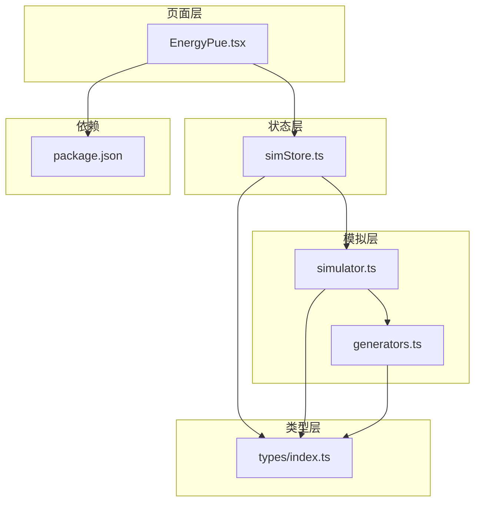
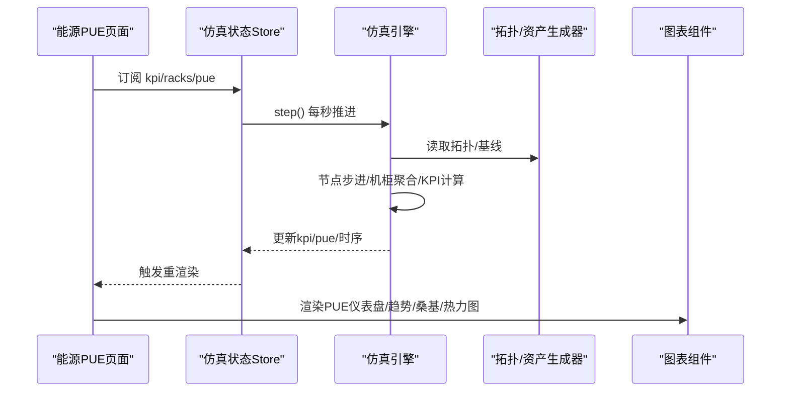
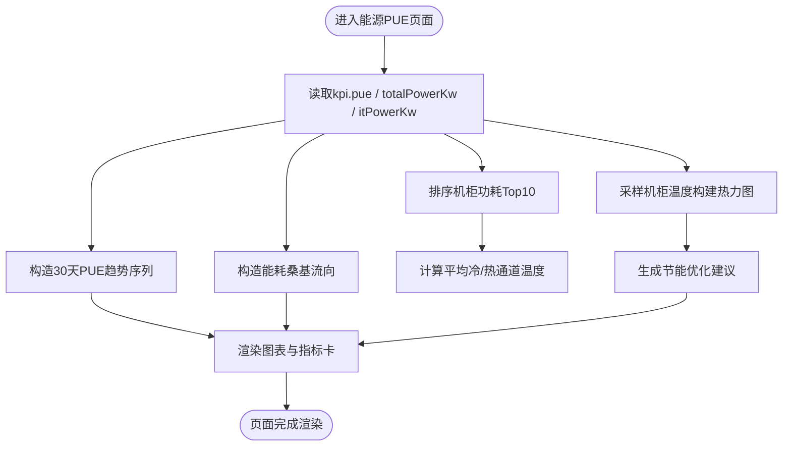
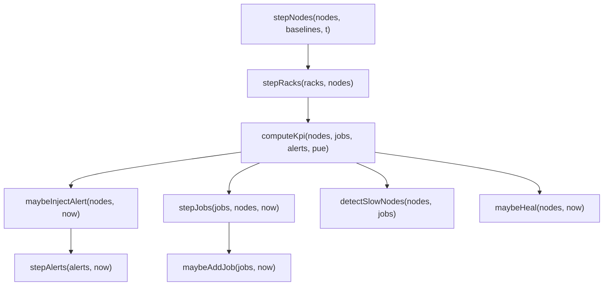
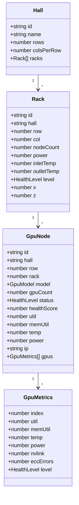
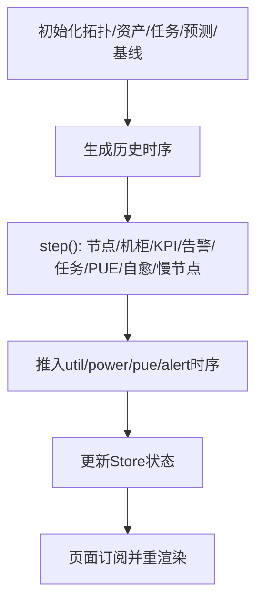
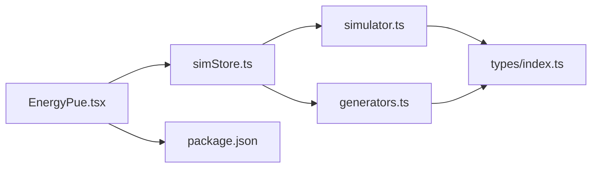
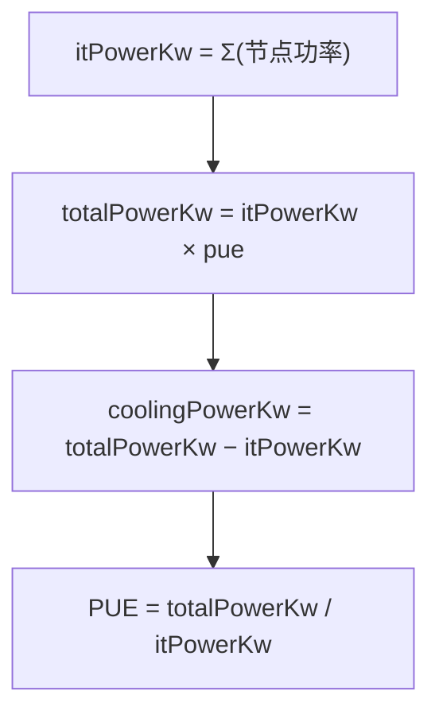
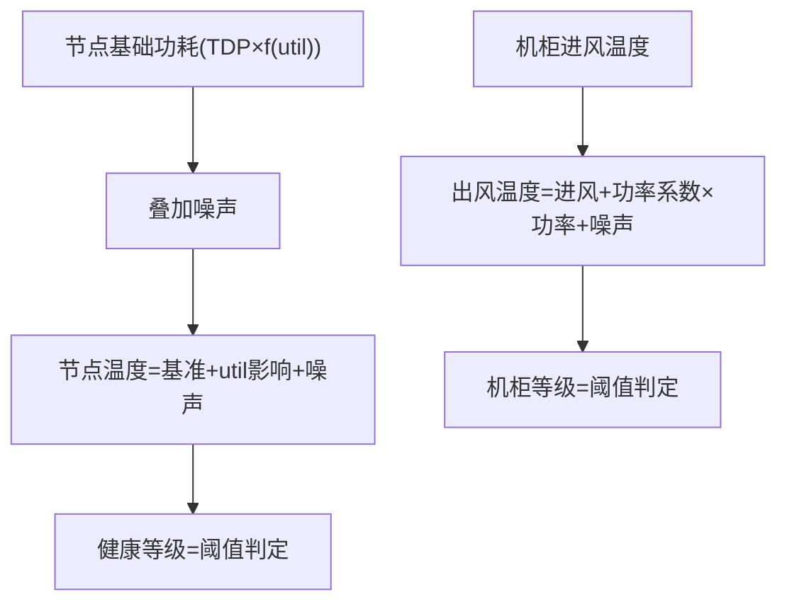
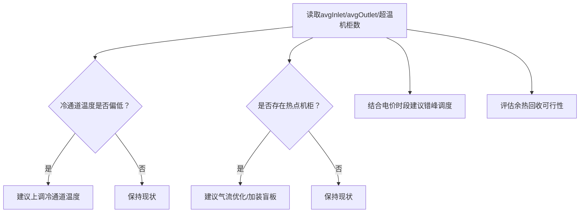

# 能源管理平台

<cite>
**本文引用的文件**   
- [EnergyPue.tsx](file://src/pages/EnergyPue.tsx)
- [simulator.ts](file://src/mock/simulator.ts)
- [generators.ts](file://src/mock/generators.ts)
- [simStore.ts](file://src/stores/simStore.ts)
- [index.ts](file://src/types/index.ts)
- [package.json](file://package.json)
</cite>

## 目录
1. [引言](#引言)
2. [项目结构](#项目结构)
3. [核心组件](#核心组件)
4. [架构总览](#架构总览)
5. [详细组件分析](#详细组件分析)
6. [依赖关系分析](#依赖关系分析)
7. [性能与可扩展性](#性能与可扩展性)
8. [故障排查指南](#故障排查指南)
9. [结论](#结论)
10. [附录：能效建模、优化策略与碳足迹](#附录能效建模优化策略与碳足迹)

## 引言
本文件面向能源管理平台的研发与运维人员，系统性说明平台在 PUE 实时监控、功耗分布分析、节能策略优化等方面的实现思路与数据流。平台以“仿真驱动 + 可视化”的方式，演示从电力消耗数据采集、PUE 指标计算、能效分析到节能建议生成的完整闭环，并覆盖能耗趋势分析、热点区域识别、冷却效率评估和节能措施实施路径。文档同时给出 PUE 计算公式、能耗建模算法与节能策略优化逻辑，并提供能效管理最佳实践、节能改造方案与碳足迹计算的指导。

## 项目结构
本项目采用前端 React + TypeScript 技术栈，围绕数据中心仿真与可视化展开。与能源管理相关的关键代码分布在页面、模拟引擎、状态管理与类型定义中：
- 页面层：能源 PUE 页面负责展示实时 PUE、30 天趋势、桑基图、机柜 Top10、温度热力图与 AI 节能建议。
- 模拟层：节点/机柜/KPI/告警/任务等数据的生成与步进更新。
- 状态层：Zustand Store 统一维护仿真状态、时序曲线与交互动作。
- 类型层：领域模型定义，贯穿各模块的数据契约。
- 依赖层：ECharts 图表库、React 生态与构建工具链。

**图示来源**
- [EnergyPue.tsx:1-199](file://src/pages/EnergyPue.tsx#L1-L199)
- [simStore.ts:1-270](file://src/stores/simStore.ts#L1-L270)
- [simulator.ts:1-331](file://src/mock/simulator.ts#L1-L331)
- [generators.ts:1-408](file://src/mock/generators.ts#L1-L408)
- [index.ts:1-192](file://src/types/index.ts#L1-L192)
- [package.json:1-38](file://package.json#L1-L38)

**章节来源**
- [EnergyPue.tsx:1-199](file://src/pages/EnergyPue.tsx#L1-L199)
- [simStore.ts:1-270](file://src/stores/simStore.ts#L1-L270)
- [simulator.ts:1-331](file://src/mock/simulator.ts#L1-L331)
- [generators.ts:1-408](file://src/mock/generators.ts#L1-L408)
- [index.ts:1-192](file://src/types/index.ts#L1-L192)
- [package.json:1-38](file://package.json#L1-L38)

## 核心组件
- 能源 PUE 页面（EnergyPue）：聚合 KPI、机柜排行、温度热力图与节能建议，提供 PUE 仪表盘与 30 天趋势。
- 仿真引擎（simulator）：节点步进、机柜聚合、KPI 汇总、告警注入、任务流转、慢节点检测、心跳驱动。
- 拓扑与资产生成器（generators）：机房拓扑、GPU 节点、机柜、资产台账、初始任务与故障预测。
- 状态管理（simStore）：初始化静态数据、驱动仿真 tick、维护时序曲线与用户操作。
- 类型定义（types）：统一领域模型，包括 GPU 节点、机柜、KPI、告警、任务等。

**章节来源**
- [EnergyPue.tsx:1-199](file://src/pages/EnergyPue.tsx#L1-L199)
- [simulator.ts:1-331](file://src/mock/simulator.ts#L1-L331)
- [generators.ts:1-408](file://src/mock/generators.ts#L1-L408)
- [simStore.ts:1-270](file://src/stores/simStore.ts#L1-L270)
- [index.ts:1-192](file://src/types/index.ts#L1-L192)

## 架构总览
能源管理平台的运行时架构由“页面渲染 → 状态订阅 → 仿真步进 → 数据聚合 → 图表展示”构成。PUE 作为关键能效指标，贯穿采集、计算、分析与优化建议生成全流程。

**图示来源**
- [EnergyPue.tsx:11-169](file://src/pages/EnergyPue.tsx#L11-L169)
- [simStore.ts:164-207](file://src/stores/simStore.ts#L164-L207)
- [simulator.ts:54-139](file://src/mock/simulator.ts#L54-L139)
- [generators.ts:159-206](file://src/mock/generators.ts#L159-L206)

## 详细组件分析

### 能源 PUE 页面（EnergyPue）
该页面是能效可视化的主入口，负责：
- 实时 PUE 仪表盘：基于当前 pue 值渲染仪表，带阈值分区。
- PUE 30 天趋势：使用确定性历史序列 + 最新实时点。
- 能耗桑基图：将市电输入拆分为 IT 设备、制冷系统、供电损耗，再进一步拆分至 GPU 计算、存储、网络。
- 机柜功耗 Top10：按 power 降序展示前 10 机柜。
- 温度热力图：采样部分机柜的冷通道/热通道温度，形成二维热力矩阵。
- AI 节能优化建议：根据平均冷/热通道温度、超温机柜数量、电价时段与余热回收潜力输出建议卡片。

**图示来源**
- [EnergyPue.tsx:15-66](file://src/pages/EnergyPue.tsx#L15-L66)
- [EnergyPue.tsx:103-166](file://src/pages/EnergyPue.tsx#L103-L166)

**章节来源**
- [EnergyPue.tsx:11-169](file://src/pages/EnergyPue.tsx#L11-L169)

### 仿真引擎（simulator）
仿真引擎负责数据中心运行态的演进，包含：
- 节点步进：基于基线做正弦漂移与噪声，更新利用率、温度、功耗与健康等级。
- 机柜聚合：按节点归属聚合机柜功率、出风温度与健康等级。
- KPI 汇总：统计算力、在线率、平均利用率、活跃告警数、IT 负载功率、总功率与制冷功率。
- 告警注入与流转：概率注入告警，并按概率自然恢复。
- 任务状态机：排队→运行→成功/失败，含进度、吞吐、MFU 等指标演化。
- 慢节点检测：相对集群均值偏差筛选异常节点并给出建议。
- 心跳驱动：定时调用 step 回调推进仿真。

**图示来源**
- [simulator.ts:54-139](file://src/mock/simulator.ts#L54-L139)
- [simulator.ts:165-194](file://src/mock/simulator.ts#L165-L194)
- [simulator.ts:199-259](file://src/mock/simulator.ts#L199-L259)
- [simulator.ts:303-318](file://src/mock/simulator.ts#L303-L318)
- [simulator.ts:327-331](file://src/mock/simulator.ts#L327-L331)

**章节来源**
- [simulator.ts:54-139](file://src/mock/simulator.ts#L54-L139)
- [simulator.ts:165-194](file://src/mock/simulator.ts#L165-L194)
- [simulator.ts:199-259](file://src/mock/simulator.ts#L199-L259)
- [simulator.ts:303-318](file://src/mock/simulator.ts#L303-L318)
- [simulator.ts:327-331](file://src/mock/simulator.ts#L327-L331)

### 拓扑与资产生成器（generators）
生成器负责数据中心静态拓扑与初始数据：
- 机房布局常量：机房编号、行列、列数、每机柜节点数、GPU 数量等。
- GPU 型号参数：单卡算力（PFLOPS）、单卡功耗上限（W）。
- 机柜坐标计算：用于 3D 场景定位。
- 节点生成：为每个 GPU 卡生成利用率、温度、显存占用、功耗、NVLink 带宽、ECC 错误计数与健康等级。
- 拓扑生成：遍历机房/排/列/槽位，生成 Hall/Rack/Node 全量拓扑。
- 资产台账：服务器、交换机、存储阵列、备件 GPU 卡的 CMDB 条目。
- 初始任务：训练/推理/调试任务池，含队列、优先级、模型、吞吐、MFU 等。
- 故障预测：对健康度较低的设备进行故障概率与剩余寿命估算。

**图示来源**
- [index.ts:32-64](file://src/types/index.ts#L32-L64)
- [index.ts:20-30](file://src/types/index.ts#L20-L30)
- [generators.ts:159-206](file://src/mock/generators.ts#L159-L206)

**章节来源**
- [generators.ts:15-87](file://src/mock/generators.ts#L15-L87)
- [generators.ts:92-154](file://src/mock/generators.ts#L92-L154)
- [generators.ts:159-206](file://src/mock/generators.ts#L159-L206)
- [generators.ts:216-328](file://src/mock/generators.ts#L216-L328)
- [generators.ts:345-384](file://src/mock/generators.ts#L345-L384)
- [generators.ts:389-405](file://src/mock/generators.ts#L389-L405)

### 状态管理（simStore）
Store 承担以下职责：
- 初始化静态数据：拓扑、资产、任务、预测、基线。
- 种子时序：利用率、总功率、PUE、告警数量的历史曲线。
- 仿真步进 step：节点步进、机柜聚合（每 3 tick）、告警注入与流转、任务流转、PUE 缓慢波动、KPI 汇总、自愈日志、慢节点检测（每 5 tick），并推送时序。
- 启动/停止：通过定时器驱动 step。
- 用户操作：告警确认/静音/解决、提交任务、视图模式切换、机柜选择、导览开关。

**图示来源**
- [simStore.ts:42-58](file://src/stores/simStore.ts#L42-L58)
- [simStore.ts:142-207](file://src/stores/simStore.ts#L142-L207)
- [simStore.ts:209-219](file://src/stores/simStore.ts#L209-L219)
- [simStore.ts:221-265](file://src/stores/simStore.ts#L221-L265)

**章节来源**
- [simStore.ts:42-58](file://src/stores/simStore.ts#L42-L58)
- [simStore.ts:142-207](file://src/stores/simStore.ts#L142-L207)
- [simStore.ts:209-219](file://src/stores/simStore.ts#L209-L219)
- [simStore.ts:221-265](file://src/stores/simStore.ts#L221-L265)

### 类型定义（types）
类型层定义了平台的核心领域模型，包括：
- 设备健康等级、告警等级/状态/来源、GPU 指标、GPU 节点、机柜、机房、KPI、任务、资产、时序点、视图模式、故障预测、自愈动作、慢节点等。
这些类型贯穿生成器、模拟器、Store 与页面，确保数据契约一致。

**章节来源**
- [index.ts:1-192](file://src/types/index.ts#L1-L192)

## 依赖关系分析
- 页面 EnergyPue 依赖 Store 提供的 kpi、racks、pue 等状态，并通过主题配置渲染图表。
- Store 依赖 generators 生成静态拓扑与初始数据，依赖 simulator 提供步进函数与驱动。
- Simulator 依赖 types 中的领域模型，并在内部复用 generators 的随机数与模型参数。
- 所有模块共享 types 定义，保证数据结构一致性。
- 运行时依赖 ECharts 与 React 生态，构建依赖 Vite/Tailwind 等工具链。

**图示来源**
- [EnergyPue.tsx:1-9](file://src/pages/EnergyPue.tsx#L1-L9)
- [simStore.ts:16-37](file://src/stores/simStore.ts#L16-L37)
- [simulator.ts:1-13](file://src/mock/simulator.ts#L1-L13)
- [generators.ts:1-12](file://src/mock/generators.ts#L1-L12)
- [package.json:11-22](file://package.json#L11-L22)

**章节来源**
- [EnergyPue.tsx:1-9](file://src/pages/EnergyPue.tsx#L1-L9)
- [simStore.ts:16-37](file://src/stores/simStore.ts#L16-L37)
- [simulator.ts:1-13](file://src/mock/simulator.ts#L1-L13)
- [generators.ts:1-12](file://src/mock/generators.ts#L1-L12)
- [package.json:11-22](file://package.json#L11-L22)

## 性能与可扩展性
- 仿真步进频率：默认每秒一次，适合演示；生产环境可按需降低或异步批处理。
- 机柜聚合频率：每 3 tick 更新一次，减少聚合开销。
- 慢节点检测：每 5 tick 执行一次，避免频繁计算。
- 时序数据长度：pushSeries 支持最大长度限制，防止内存增长。
- 扩展建议：
  - 将 PUE 波动策略抽象为可配置参数，支持不同机房/季节/负载场景。
  - 将节能建议规则引擎化，支持多策略组合与权重评分。
  - 引入真实传感器数据接入层，替换仿真数据源。
  - 增加能耗预测模型（如时间序列回归）以提前预警高能耗时段。

[本节为通用性能讨论，不直接分析具体文件]

## 故障排查指南
- PUE 异常偏高：检查 computeKpi 中 totalPowerKw = itPowerKw * pue 的计算链路，确认 pue 输入是否合理。
- 机柜温度异常：核查 stepRacks 中 outletTemp 计算与 inletTemp 输入，关注功率密度与散热能力匹配。
- 告警风暴：检查 maybeInjectAlert 的概率与模板，必要时降低注入频率或提高阈值。
- 任务堆积：查看 stepJobs 并发上限 capacity 与资源分配逻辑，调整容量或优先级策略。
- 慢节点误报：复核 detectSlowNodes 的偏差阈值与 metric 判定条件。

**章节来源**
- [simulator.ts:97-139](file://src/mock/simulator.ts#L97-L139)
- [simulator.ts:165-194](file://src/mock/simulator.ts#L165-L194)
- [simulator.ts:199-259](file://src/mock/simulator.ts#L199-L259)
- [simulator.ts:303-318](file://src/mock/simulator.ts#L303-L318)

## 结论
本平台以仿真为核心，构建了从数据采集、PUE 计算、能效分析到节能建议的完整闭环。通过可视化仪表盘、趋势分析、热点识别与冷却效率评估，帮助运营团队快速定位能耗瓶颈并制定优化策略。未来可通过接入真实数据、引入预测模型与策略引擎，进一步提升能效管理的自动化与智能化水平。

[本节为总结性内容，不直接分析具体文件]

## 附录：能效建模、优化策略与碳足迹

### PUE 指标与计算流程
- 定义：PUE = 数据中心总能耗 / IT 设备能耗。
- 平台实现：
  - IT 负载功率 itPowerKw：由节点功率累加得到。
  - 总功率 totalPowerKw = itPowerKw × pue。
  - 制冷功率 coolingPowerKw = totalPowerKw − itPowerKw。
- 数据来源：
  - 节点功率来自 stepNodes 的功率步进与基线扰动。
  - pue 在 simStore.step 中缓慢波动，体现实际运行中的动态变化。

**图示来源**
- [simulator.ts:97-139](file://src/mock/simulator.ts#L97-L139)
- [simStore.ts:181-184](file://src/stores/simStore.ts#L181-L184)

**章节来源**
- [simulator.ts:97-139](file://src/mock/simulator.ts#L97-L139)
- [simStore.ts:181-184](file://src/stores/simStore.ts#L181-L184)

### 能耗建模算法
- 节点功耗建模：
  - 基础功耗由 GPU 型号 TDP 与利用率线性插值，叠加随机噪声。
  - 温度随利用率上升而升高，健康等级依据温度与利用率阈值划分。
- 机柜温度建模：
  - 出风温度 = 进风温度 + 功率系数 × 功率 + 随机扰动。
  - 健康等级依据出风温度阈值划分。
- 时序建模：
  - 利用率、总功率、PUE、告警数量均使用正弦波 + 噪声生成历史曲线，体现周期性与时变特性。

**图示来源**
- [generators.ts:92-154](file://src/mock/generators.ts#L92-L154)
- [simulator.ts:54-91](file://src/mock/simulator.ts#L54-L91)
- [simStore.ts:49-58](file://src/stores/simStore.ts#L49-L58)

**章节来源**
- [generators.ts:92-154](file://src/mock/generators.ts#L92-L154)
- [simulator.ts:54-91](file://src/mock/simulator.ts#L54-L91)
- [simStore.ts:49-58](file://src/stores/simStore.ts#L49-L58)

### 节能策略优化逻辑
- 冷通道温度上调：
  - 依据平均冷通道温度，建议调高设定值以降低制冷能耗。
- 热点机柜气流优化：
  - 针对热通道超温机柜数量，建议加装盲板或调整风机转速。
- 错峰调度：
  - 将非紧急任务调度至电价低谷时段，降低电费成本。
- 余热回收：
  - 利用液冷回路出水温度接入园区供暖，实现能量再利用。

**图示来源**
- [EnergyPue.tsx:137-166](file://src/pages/EnergyPue.tsx#L137-L166)

**章节来源**
- [EnergyPue.tsx:137-166](file://src/pages/EnergyPue.tsx#L137-L166)

### 能效管理最佳实践
- 建立 PUE 目标区间与分级告警，结合行业先进与国标要求。
- 定期开展能耗审计，识别高功耗机柜与低效冷却区域。
- 优化冷热通道隔离，提升气流组织效率。
- 引入智能温控与变频设备，按需调节制冷输出。
- 结合业务峰谷特征，实施任务调度与资源编排优化。

[本节为通用实践指导，不直接分析具体文件]

### 节能改造方案
- 硬件升级：更换高效电源、风扇与液冷方案。
- 气流治理：封堵盲板、优化走线与布风。
- 控制策略：自适应温控、按需供冷、分区控制。
- 运维优化：巡检与预防性维护，减少隐性能耗。

[本节为通用改造指导，不直接分析具体文件]

### 碳足迹计算指导
- 范围一（直接排放）：柴油发电机、制冷剂泄漏等。
- 范围二（外购电力间接排放）：按电网排放因子 × 用电量计算。
- 范围三（其他间接排放）：供应链、废弃物处理等。
- 平台建议：
  - 将 PUE 与总用电量关联，估算范围二碳排放。
  - 结合余热回收与绿电采购，量化减碳收益。
  - 建立碳账户与年度减排目标，纳入绩效考核。

[本节为通用碳足迹指导，不直接分析具体文件]