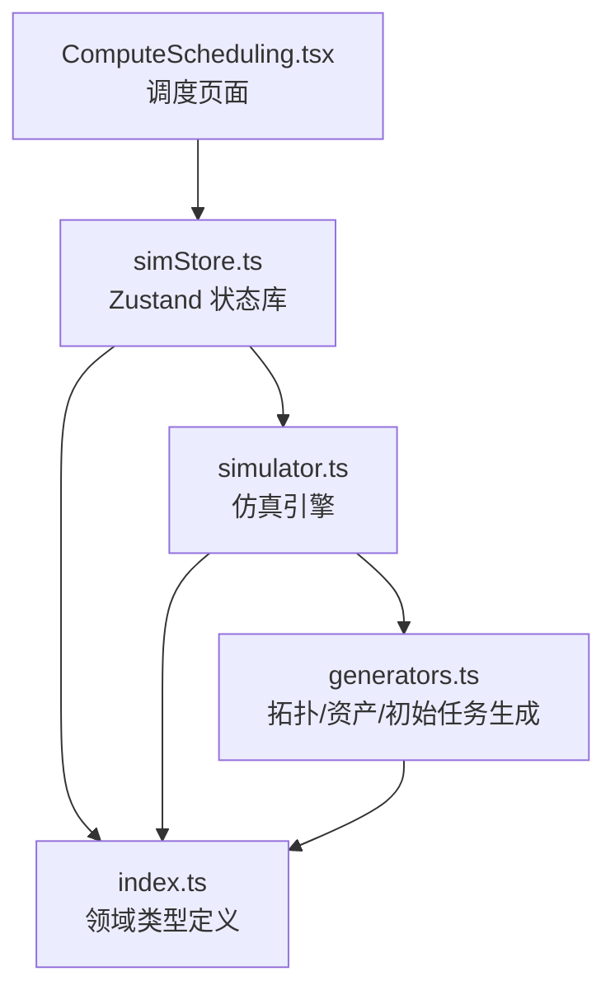
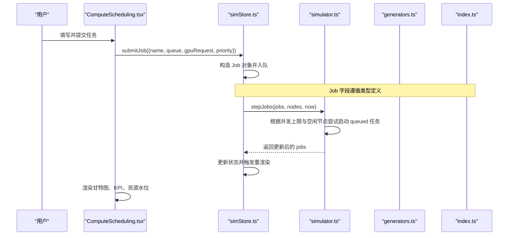
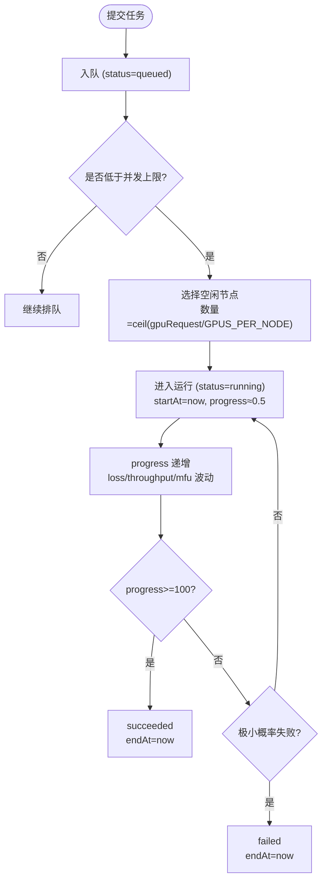
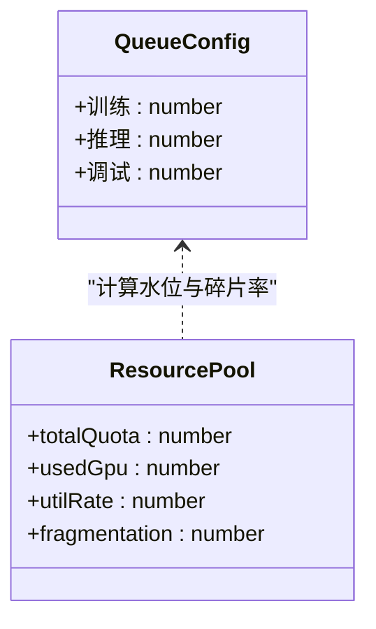
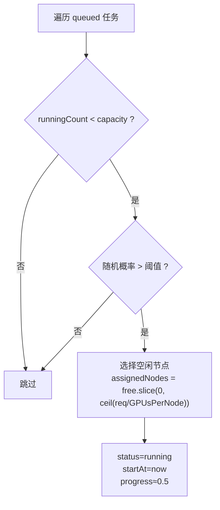
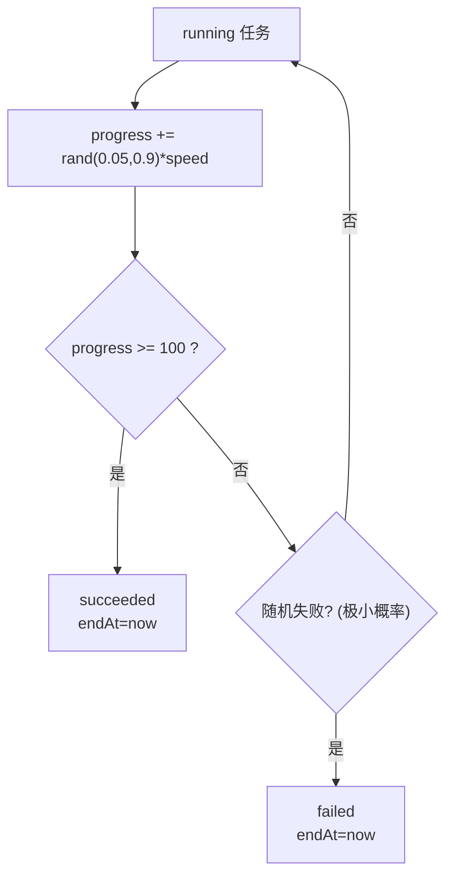
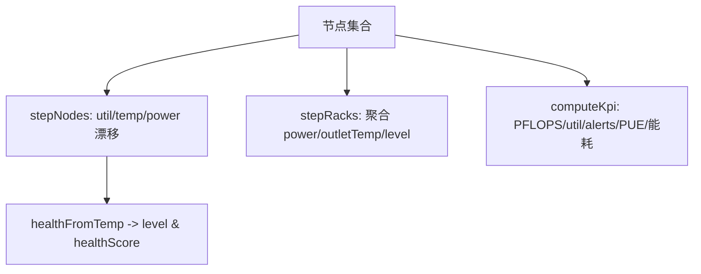
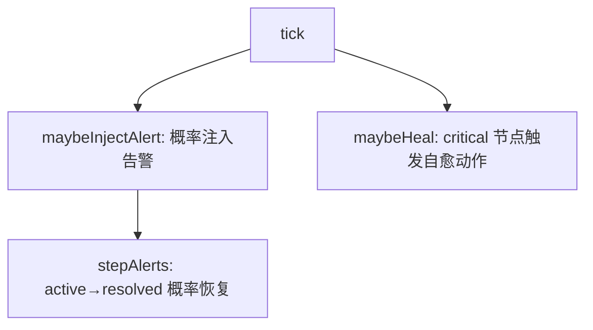
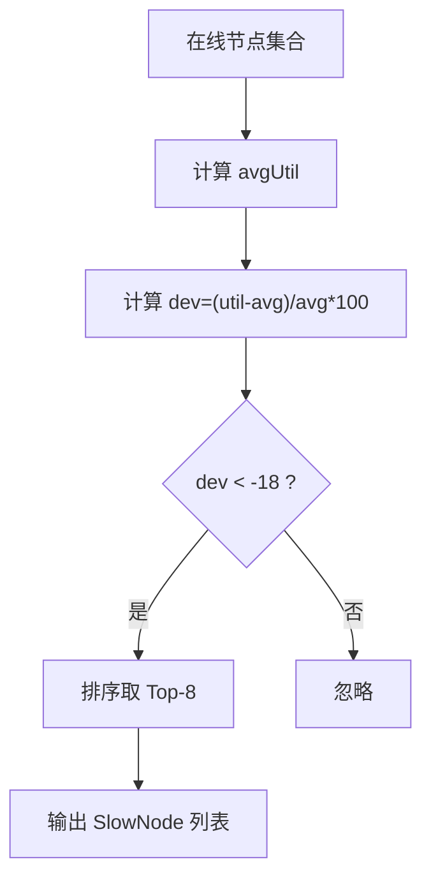
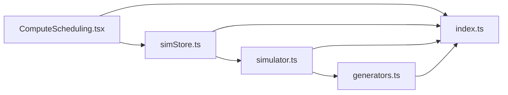

# 计算调度系统

<cite>
**本文引用的文件**   
- [ComputeScheduling.tsx](file://src/pages/ComputeScheduling.tsx)
- [simStore.ts](file://src/stores/simStore.ts)
- [simulator.ts](file://src/mock/simulator.ts)
- [generators.ts](file://src/mock/generators.ts)
- [index.ts](file://src/types/index.ts)
</cite>

## 目录
1. [引言](#引言)
2. [项目结构](#项目结构)
3. [核心组件](#核心组件)
4. [架构总览](#架构总览)
5. [详细组件分析](#详细组件分析)
6. [依赖关系分析](#依赖关系分析)
7. [性能与容量规划](#性能与容量规划)
8. [故障排查指南](#故障排查指南)
9. [结论](#结论)
10. [附录：关键配置与调优建议](#附录关键配置与调优建议)

## 引言
本文件面向“计算调度系统”的完整技术文档，聚焦任务队列管理、资源分配策略、作业进度跟踪等核心能力，覆盖任务的提交、调度、执行与完成全生命周期。系统以 React 前端页面为入口，通过状态库驱动仿真引擎，模拟 GPU 集群上的训练、推理与调试三类任务，并可视化展示调度时间轴、资源水位与碎片率等指标。

## 项目结构
本项目采用按功能域组织的前端工程结构：
- 页面层：ComputeScheduling.tsx 提供调度主界面，包含 KPI、甘特图、资源池水位、任务提交表单与建议提示。
- 状态层：simStore.ts 使用 Zustand 维护全局状态，封装 tick 步进、任务提交、告警处理、时序数据推进等动作。
- 仿真层：simulator.ts 提供纯函数式仿真逻辑，包括节点指标演进、KPI 汇总、任务状态机、告警注入、慢节点检测等。
- 生成器层：generators.ts 负责拓扑、资产、初始任务等静态数据的确定性生成。
- 类型定义：index.ts 统一领域模型，如 Job、GpuNode、Rack、AlertItem、KpiSnapshot 等。

图表来源
- [ComputeScheduling.tsx:1-277](file://src/pages/ComputeScheduling.tsx#L1-L277)
- [simStore.ts:1-270](file://src/stores/simStore.ts#L1-L270)
- [simulator.ts:1-331](file://src/mock/simulator.ts#L1-L331)
- [generators.ts:1-408](file://src/mock/generators.ts#L1-L408)
- [index.ts:1-192](file://src/types/index.ts#L1-L192)

章节来源
- [ComputeScheduling.tsx:1-277](file://src/pages/ComputeScheduling.tsx#L1-L277)
- [simStore.ts:1-270](file://src/stores/simStore.ts#L1-L270)
- [simulator.ts:1-331](file://src/mock/simulator.ts#L1-L331)
- [generators.ts:1-408](file://src/mock/generators.ts#L1-L408)
- [index.ts:1-192](file://src/types/index.ts#L1-L192)

## 核心组件
- 调度页面 ComputeScheduling.tsx
  - 提供任务提交表单（名称、队列、GPU 数量、优先级）。
  - 展示各队列配额水位、GPU 碎片率仪表盘、运行中/排队中/已完成/失败任务计数。
  - 渲染近 8 小时任务甘特时间轴，显示任务条、状态颜色与进度百分比。
- 状态库 simStore.ts
  - 初始化拓扑、资产、初始任务、基线、历史时序数据。
  - 暴露 step/start/stop 控制仿真循环；submitJob 将新任务入队。
  - 每 tick 调用仿真引擎推进节点、机柜、告警、任务、PUE、KPI、自愈日志与慢节点检测。
- 仿真引擎 simulator.ts
  - 节点指标步进：围绕基线的正弦漂移 + 噪声，健康等级与分数更新。
  - 机柜聚合：功耗、出风温度与健康等级。
  - KPI 汇总：算力、在线率、平均利用率、活跃告警数、PUE 相关能耗。
  - 任务状态机：queued → running → succeeded/failed，含并发上限、随机启动概率、进度增长、极小失败概率。
  - 告警注入与流转：按概率注入模板化告警，部分自动恢复。
  - 慢节点检测：基于利用率相对均值偏差识别慢节点，给出诊断建议。
- 生成器 generators.ts
  - 确定性伪随机数生成器，保证可复现实验。
  - 机房拓扑、机柜布局、服务器/交换机/存储/备件资产生成。
  - 初始任务集生成，覆盖不同队列、规模与状态分布。
- 类型 index.ts
  - 统一 Job、GpuNode、Rack、AlertItem、KpiSnapshot、SlowNode 等类型，贯穿 UI、Store、Sim 三层。

章节来源
- [ComputeScheduling.tsx:11-169](file://src/pages/ComputeScheduling.tsx#L11-L169)
- [simStore.ts:99-265](file://src/stores/simStore.ts#L99-L265)
- [simulator.ts:51-139](file://src/mock/simulator.ts#L51-L139)
- [simulator.ts:196-259](file://src/mock/simulator.ts#L196-L259)
- [generators.ts:159-206](file://src/mock/generators.ts#L159-L206)
- [generators.ts:345-384](file://src/mock/generators.ts#L345-L384)
- [index.ts:89-113](file://src/types/index.ts#L89-L113)

## 架构总览
下图展示从用户提交到任务完成的全链路交互：

图表来源
- [ComputeScheduling.tsx:41-50](file://src/pages/ComputeScheduling.tsx#L41-L50)
- [simStore.ts:240-260](file://src/stores/simStore.ts#L240-L260)
- [simulator.ts:199-234](file://src/mock/simulator.ts#L199-L234)
- [index.ts:96-113](file://src/types/index.ts#L96-L113)

## 详细组件分析

### 任务提交与生命周期管理
- 提交流程
  - 用户在 ComputeScheduling.tsx 选择队列、GPU 数量与优先级后点击提交。
  - Store.submitJob 构造 Job 对象，默认状态为 queued，并插入 jobs 列表头部。
- 生命周期阶段
  - queued：等待调度，按优先级与可用资源尝试启动。
  - running：已分配节点，进度递增，loss/throughput/mfu 波动。
  - succeeded：进度达到阈值后成功结束，记录 endAt。
  - failed：极小概率失败，记录 endAt 与当前进度。
- 并发与资源匹配
  - 运行中任务存在演示性并发上限（例如 40），超过则排队。
  - 启动时从正常状态节点中选择若干节点，数量为 ceil(gpuRequest / GPUS_PER_NODE)。
- 进度与指标
  - 运行中任务 progress 逐步增加，调试队列增速更快。
  - loss 缓慢下降，throughput 与 mfu 在合理区间内波动。

图表来源
- [simulator.ts:199-234](file://src/mock/simulator.ts#L199-L234)
- [generators.ts:44-44](file://src/mock/generators.ts#L44-L44)

章节来源
- [ComputeScheduling.tsx:41-50](file://src/pages/ComputeScheduling.tsx#L41-L50)
- [simStore.ts:240-260](file://src/stores/simStore.ts#L240-L260)
- [simulator.ts:199-234](file://src/mock/simulator.ts#L199-L234)
- [generators.ts:44-44](file://src/mock/generators.ts#L44-L44)

### 队列管理与资源配额
- 队列类型
  - 训练、推理、调试三类队列，分别对应不同的 GPU 需求与行为特征。
- 配额与水位
  - 页面侧定义各队列配额（GPU 数）与颜色映射，实时统计 running 任务占用，计算水位百分比。
  - 总配额为各队列配额之和，用于计算整体利用率与碎片率估算。
- 碎片率估算
  - 页面侧根据利用率与排队任务数量估算碎片率，作为优化建议输入。

图表来源
- [ComputeScheduling.tsx:11-32](file://src/pages/ComputeScheduling.tsx#L11-L32)

章节来源
- [ComputeScheduling.tsx:11-32](file://src/pages/ComputeScheduling.tsx#L11-L32)

### 调度算法与负载均衡
- 调度策略
  - 优先检查运行中任务数是否低于并发上限。
  - 若满足条件，按一定概率尝试启动 queued 任务（演示中使用随机概率）。
  - 节点选择仅考虑 status=normal 的节点，数量由 gpuRequest 与每台节点 GPU 数决定。
- 负载均衡
  - 当前实现未显式做跨节点或跨机柜均衡，属于简化演示。
  - 可通过扩展节点评分、亲和/反亲和规则、Gang Scheduling 增强均衡效果。
- 优先级
  - Job.priority 字段存在但未参与排序，可在调度前对 queued 任务按优先级降序排列。

图表来源
- [simulator.ts:199-214](file://src/mock/simulator.ts#L199-L214)

章节来源
- [simulator.ts:199-214](file://src/mock/simulator.ts#L199-L214)

### 作业进度跟踪与可视化
- 进度跟踪
  - running 任务 progress 每次步进增加一个随机增量，调试队列增速更高。
  - 当 progress≥100 时转为 succeeded；极小概率失败转 failed。
- 甘特时间轴
  - 页面渲染最近 8 小时的任务条，按 startAt/submitAt 排序，最多显示 40 条。
  - 任务条长度与位置由时间窗口计算，颜色依据状态映射，进度百分比在条内显示。

图表来源
- [simulator.ts:217-231](file://src/mock/simulator.ts#L217-L231)
- [ComputeScheduling.tsx:192-276](file://src/pages/ComputeScheduling.tsx#L192-L276)

章节来源
- [simulator.ts:217-231](file://src/mock/simulator.ts#L217-L231)
- [ComputeScheduling.tsx:192-276](file://src/pages/ComputeScheduling.tsx#L192-L276)

### 资源监控与 KPI 汇总
- 节点指标演进
  - 每个节点 util/temp/power 围绕基线正弦漂移 + 噪声，健康等级由温度与利用率判定。
  - healthScore 综合温度、ECC 错误、健康等级计算。
- 机柜聚合
  - 按 rack 聚合功耗与出风温度，level 由 outletTemp 判定。
- KPI 汇总
  - 统计 GPU 总数/在线数、平均利用率、活跃告警数、总算力 PFLOPS、IT 与制冷功耗、PUE。

图表来源
- [simulator.ts:51-92](file://src/mock/simulator.ts#L51-L92)
- [simulator.ts:97-139](file://src/mock/simulator.ts#L97-L139)
- [generators.ts:83-87](file://src/mock/generators.ts#L83-L87)

章节来源
- [simulator.ts:51-92](file://src/mock/simulator.ts#L51-L92)
- [simulator.ts:97-139](file://src/mock/simulator.ts#L97-L139)
- [generators.ts:83-87](file://src/mock/generators.ts#L83-L87)

### 告警注入与自愈机制
- 告警注入
  - 每秒有一定概率注入模板化告警，目标可为热点节点或随机节点。
  - 告警模板涵盖 GPU、节点、网络、存储、供电、制冷等多源。
- 告警流转
  - active 告警有概率自动 resolved，体现自然恢复。
- 自愈动作
  - 当出现 critical 节点时，可能触发自动隔离、降频保护、任务热迁移等操作，记录 latencyMs 与状态。

图表来源
- [simulator.ts:151-194](file://src/mock/simulator.ts#L151-L194)
- [simulator.ts:274-298](file://src/mock/simulator.ts#L274-L298)

章节来源
- [simulator.ts:151-194](file://src/mock/simulator.ts#L151-L194)
- [simulator.ts:274-298](file://src/mock/simulator.ts#L274-L298)

### 慢节点检测
- 检测逻辑
  - 计算在线节点的平均利用率，筛选相对均值偏差低于阈值的节点。
  - 结合任务分配信息，输出慢节点原因与建议（通信同步耗时偏高或算力利用率偏低）。
- 输出
  - 返回 Top-N 慢节点，包含 deviation、metric、suggestion。

图表来源
- [simulator.ts:303-318](file://src/mock/simulator.ts#L303-L318)

章节来源
- [simulator.ts:303-318](file://src/mock/simulator.ts#L303-L318)

## 依赖关系分析
- 模块耦合
  - ComputeScheduling.tsx 依赖 simStore 提供的 jobs 与 submitJob。
  - simStore 依赖 simulator 的 stepJobs、maybeAddJob、stepAlerts、stepNodes、stepRacks、computeKpi、detectSlowNodes 等纯函数。
  - simulator 依赖 generators 的常量与工具函数（GPUS_PER_NODE、MODEL_PFLOPS、createRng、healthFromTemp）。
  - 所有模块共享 types/index.ts 的类型定义，确保数据结构一致。
- 外部依赖
  - 使用 Zustand 管理状态。
  - 使用 React Hooks（useMemo、useState）进行状态派生与交互。
  - 使用 window.setInterval 驱动仿真心跳。

图表来源
- [ComputeScheduling.tsx:1-10](file://src/pages/ComputeScheduling.tsx#L1-L10)
- [simStore.ts:1-37](file://src/stores/simStore.ts#L1-L37)
- [simulator.ts:1-13](file://src/mock/simulator.ts#L1-L13)
- [generators.ts:1-12](file://src/mock/generators.ts#L1-L12)
- [index.ts:1-192](file://src/types/index.ts#L1-L192)

章节来源
- [ComputeScheduling.tsx:1-10](file://src/pages/ComputeScheduling.tsx#L1-L10)
- [simStore.ts:1-37](file://src/stores/simStore.ts#L1-L37)
- [simulator.ts:1-13](file://src/mock/simulator.ts#L1-L13)
- [generators.ts:1-12](file://src/mock/generators.ts#L1-L12)
- [index.ts:1-192](file://src/types/index.ts#L1-L192)

## 性能与容量规划
- 仿真步长与开销
  - 心跳间隔为 1000ms，每 tick 更新节点、机柜、告警、任务、KPI、时序数据。
  - 机柜聚合每 3 tick 更新一次，慢节点检测每 5 tick 更新一次，以降低计算开销。
- 任务并发与队列容量
  - 运行中任务并发上限为演示值（例如 40），可根据集群规模调整。
  - 队列配额（训练/推理/调试）可按实际 GPU 总量与业务占比配置。
- 资源碎片与 Gang Scheduling
  - 页面估算碎片率并提供建议，建议在训练队列启用 Gang Scheduling，减少资源空转。
- 指标采样与历史曲线
  - 时序数据点固定最大长度（例如 60），避免内存无限增长。
  - 历史算力利用率曲线采用 1 分钟粒度取 120 点，便于观察趋势。

章节来源
- [simStore.ts:164-207](file://src/stores/simStore.ts#L164-L207)
- [simulator.ts:327-330](file://src/mock/simulator.ts#L327-L330)
- [ComputeScheduling.tsx:11-32](file://src/pages/ComputeScheduling.tsx#L11-L32)
- [simulator.ts:264-268](file://src/mock/simulator.ts#L264-L268)

## 故障排查指南
- 任务无法启动
  - 检查运行中任务数是否已达并发上限。
  - 确认是否有足够 normal 状态的节点满足 gpuRequest。
  - 查看 maybeAddJob 与 stepJobs 的随机概率参数，评估启动频率。
- 任务长时间不完成
  - 检查 progress 增量与调试队列加速逻辑。
  - 观察 loss/throughput/mfu 是否在合理范围，异常波动可能影响完成判断。
- 告警频繁或自愈动作过多
  - 检查 maybeInjectAlert 的概率与模板，确认热点节点比例。
  - 关注 maybeHeal 的触发条件与成功率，必要时调整阈值。
- 慢节点定位
  - 查看 detectSlowNodes 的输出，结合 metric 与 suggestion 进行 NIC/通信或负载不均排查。
- 资源水位与碎片率
  - 核对 QUEUE_QUOTA 与实际 running 任务占用，调整配额或合并小任务释放连续资源。

章节来源
- [simulator.ts:199-234](file://src/mock/simulator.ts#L199-L234)
- [simulator.ts:151-194](file://src/mock/simulator.ts#L151-L194)
- [simulator.ts:274-298](file://src/mock/simulator.ts#L274-L298)
- [simulator.ts:303-318](file://src/mock/simulator.ts#L303-L318)
- [ComputeScheduling.tsx:11-32](file://src/pages/ComputeScheduling.tsx#L11-L32)

## 结论
该计算调度系统以简洁的前端页面与状态库为核心，配合纯函数式仿真引擎，实现了任务队列管理、资源分配、作业进度跟踪与资源监控的完整闭环。尽管调度算法与负载均衡为演示实现，但已具备可扩展的基础设施：类型定义清晰、模块职责明确、仿真逻辑可替换。通过引入优先级排序、Gang Scheduling、更精细的资源匹配与均衡策略，以及完善的故障恢复与自愈机制，可进一步提升调度效率与集群稳定性。

## 附录：关键配置与调优建议
- 任务提交配置
  - 队列选择：训练/推理/调试，对应不同 GPU 需求与行为。
  - GPU 数量：可选 8/16/32/64/128/256/512，需与队列配额匹配。
  - 优先级：1-9 滑块，建议在调度前按优先级排序 queued 任务。
- 资源配额
  - 训练队列配额较大，适合大规模预训练；推理与调试队列配额较小，适合低延迟与实验场景。
  - 建议定期评估配额与实际负载，动态调整以避免碎片化。
- 调度参数
  - 并发上限：根据集群规模与网络拓扑设置，避免过度抢占。
  - 启动概率：控制 queued 任务启动节奏，避免瞬时拥塞。
- 监控与优化
  - 关注碎片率与资源水位，合并小任务或启用 Gang Scheduling。
  - 利用慢节点检测结果进行通信链路或负载再平衡。
  - 结合 KPI 中的 avgUtil、onlineRate、totalPowerKw 与 PUE 进行能效优化。

章节来源
- [ComputeScheduling.tsx:11-169](file://src/pages/ComputeScheduling.tsx#L11-L169)
- [simulator.ts:199-234](file://src/mock/simulator.ts#L199-L234)
- [simulator.ts:97-139](file://src/mock/simulator.ts#L97-L139)