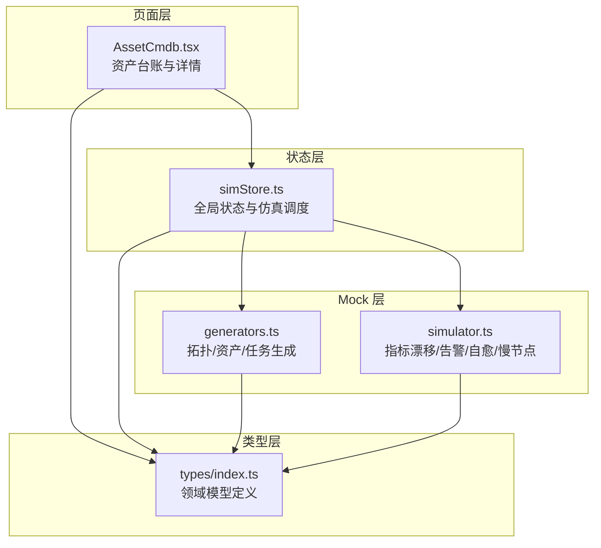
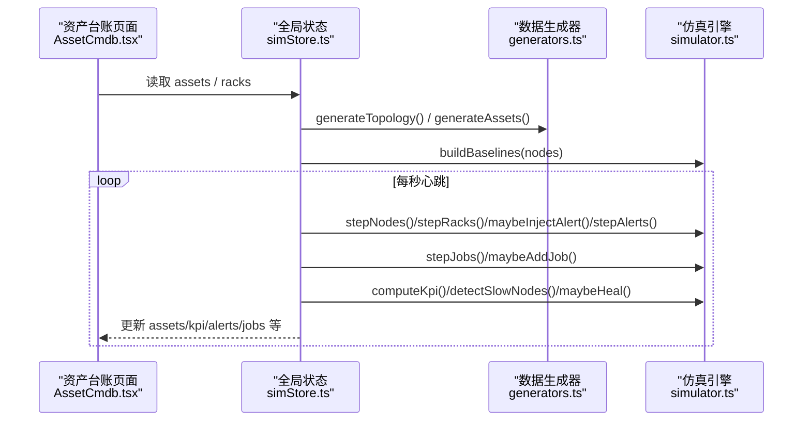
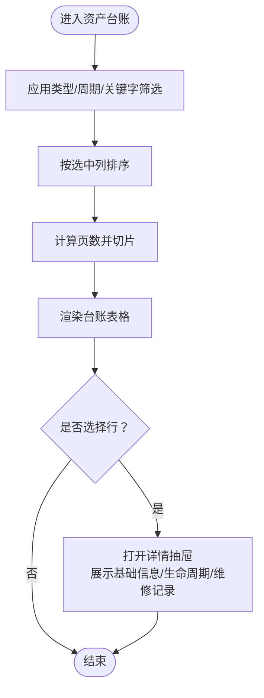
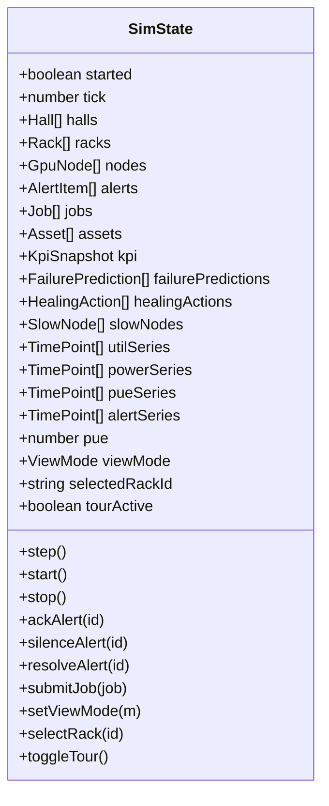
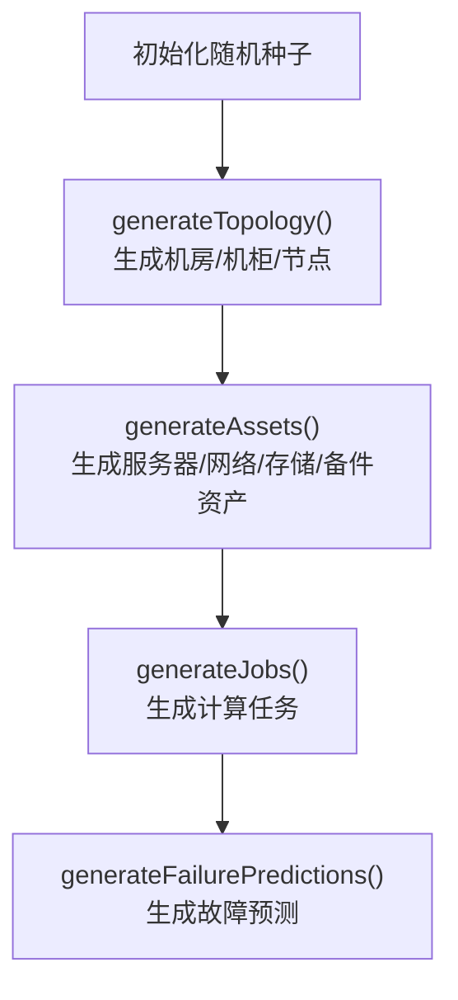
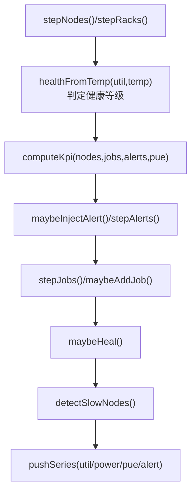
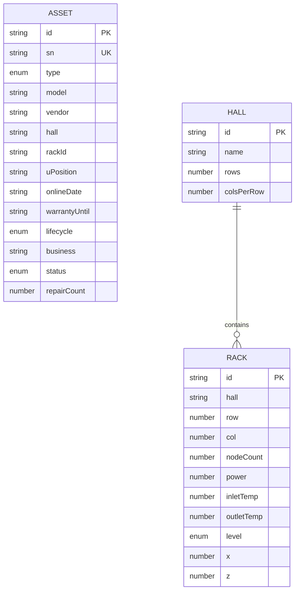
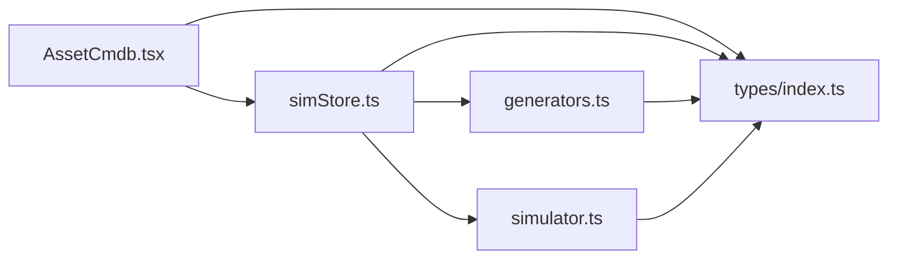

# 资产管理系统

<cite>
**本文引用的文件**   
- [AssetCmdb.tsx](file://src/pages/AssetCmdb.tsx)
- [index.ts](file://src/types/index.ts)
- [generators.ts](file://src/mock/generators.ts)
- [simulator.ts](file://src/mock/simulator.ts)
- [simStore.ts](file://src/stores/simStore.ts)
</cite>

## 目录
1. [引言](#引言)
2. [项目结构](#项目结构)
3. [核心组件](#核心组件)
4. [架构总览](#架构总览)
5. [详细组件分析](#详细组件分析)
6. [依赖关系分析](#依赖关系分析)
7. [性能与可扩展性](#性能与可扩展性)
8. [故障排查指南](#故障排查指南)
9. [结论](#结论)
10. [附录：数据模型与流程规范](#附录数据模型与流程规范)

## 引言
本资产管理子系统聚焦于 CMDB 数据管理、设备生命周期、维护记录跟踪、资产台账查询与统计分析，以及配置信息与变更历史的可追溯能力。系统以前端 React 页面为核心交互入口，通过状态库集中管理仿真数据，结合模拟生成器与仿真引擎驱动数据演进，形成“录入—更新—查询—统计—审计”的闭环流程。

## 项目结构
资产相关代码主要分布在以下模块：
- 页面层：资产台账与详情面板（CMDB 视图）
- 类型定义：资产、机房、机柜、节点、告警、任务等统一领域模型
- Mock 层：确定性数据生成与仿真引擎（心跳驱动）
- Store 层：全局状态、动作与仿真调度

**图表来源**
- [AssetCmdb.tsx:1-32](file://src/pages/AssetCmdb.tsx#L1-L32)
- [simStore.ts:1-47](file://src/stores/simStore.ts#L1-L47)
- [generators.ts:216-327](file://src/mock/generators.ts#L216-L327)
- [simulator.ts:51-139](file://src/mock/simulator.ts#L51-L139)
- [index.ts:115-137](file://src/types/index.ts#L115-L137)

**章节来源**
- [AssetCmdb.tsx:1-32](file://src/pages/AssetCmdb.tsx#L1-L32)
- [simStore.ts:1-47](file://src/stores/simStore.ts#L1-L47)

## 核心组件
- 资产台账页面：提供按类型、生命周期、关键字筛选；支持多列排序、分页；点击行展示资产详情抽屉，包含基本信息、生命周期、运行状态与维修记录。
- 全局状态 Store：初始化静态拓扑与资产，启动心跳驱动，周期性推进节点指标、机柜聚合、告警注入与流转、任务状态机、PUE 波动、KPI 汇总、自愈日志与慢节点检测。
- Mock 生成器：基于确定性随机种子生成机房拓扑、GPU 节点、交换机与存储阵列资产、备件 GPU 卡、计算任务与故障预测。
- 仿真引擎：纯函数式步进，围绕基线做正弦漂移与噪声，计算健康等级与健康评分，聚合机柜功耗与温度，注入告警并自然恢复，推进任务队列，检测慢节点。
- 类型定义：统一资产、机房、机柜、节点、告警、任务、KPI、时序点等数据结构，确保前后端一致的数据契约。

**章节来源**
- [AssetCmdb.tsx:22-227](file://src/pages/AssetCmdb.tsx#L22-L227)
- [simStore.ts:96-265](file://src/stores/simStore.ts#L96-L265)
- [generators.ts:216-327](file://src/mock/generators.ts#L216-L327)
- [simulator.ts:51-139](file://src/mock/simulator.ts#L51-L139)
- [index.ts:115-137](file://src/types/index.ts#L115-L137)

## 架构总览
资产管理的端到端流程如下：
- 初始化阶段：生成机房拓扑、节点、机柜、资产台账、初始告警与任务，构建基线。
- 运行时阶段：每秒触发 step，推进节点指标、机柜聚合、告警注入与流转、任务状态机、PUE 波动、KPI 汇总、自愈日志与慢节点检测，并推入时序曲线。
- 用户交互：在资产台账页进行筛选、排序、分页与详情查看；所有数据来源于 Store，Store 由仿真引擎驱动。

**图表来源**
- [AssetCmdb.tsx:22-227](file://src/pages/AssetCmdb.tsx#L22-L227)
- [simStore.ts:142-207](file://src/stores/simStore.ts#L142-L207)
- [generators.ts:159-206](file://src/mock/generators.ts#L159-L206)
- [simulator.ts:51-139](file://src/mock/simulator.ts#L51-L139)

## 详细组件分析

### 资产台账页面（AssetCmdb.tsx）
- 功能要点
  - 筛选：按资产类型、生命周期、关键字（ID/SN/型号/机柜）过滤。
  - 排序：支持按编号、类型、上架日期、保修截止、维修次数排序，升/降序切换。
  - 分页：固定每页数量，计算安全页码并切片渲染。
  - 统计：资产构成（玫瑰图）、生命周期分布、机架上架率（服务器数 vs 机柜容量）。
  - 详情抽屉：展示资产基础信息、厂商、业务、机房位置、U 位、生命周期、运行状态与维修记录。
- 关键实现
  - 使用 useMemo 缓存过滤与统计结果，避免重复计算。
  - 使用 HealthBadge 显示运行状态，生命周期颜色映射到主题色板。
  - 详情页根据 onlineDate 动态生成维修记录时间序列。

**图表来源**
- [AssetCmdb.tsx:34-87](file://src/pages/AssetCmdb.tsx#L34-L87)
- [AssetCmdb.tsx:136-227](file://src/pages/AssetCmdb.tsx#L136-L227)
- [AssetCmdb.tsx:238-296](file://src/pages/AssetCmdb.tsx#L238-L296)

**章节来源**
- [AssetCmdb.tsx:22-227](file://src/pages/AssetCmdb.tsx#L22-L227)
- [AssetCmdb.tsx:238-296](file://src/pages/AssetCmdb.tsx#L238-L296)

### 全局状态与仿真调度（simStore.ts）
- 职责
  - 初始化静态数据：拓扑、资产、任务、告警、自愈日志、时序曲线。
  - 暴露 actions：step/start/stop、ackAlert/silenceAlert/resolveAlert、submitJob、setViewMode/selectRack/toggleTour。
  - 心跳驱动：每秒调用 step，组合仿真引擎的多个纯函数推进状态。
- 关键逻辑
  - step 中依次推进节点指标、机柜聚合、告警注入与流转、任务状态机、PUE 波动、KPI 汇总、自愈日志、慢节点检测，并推入时序数据。
  - 控制并发上限与数据长度上限，避免内存增长。

**图表来源**
- [simStore.ts:96-134](file://src/stores/simStore.ts#L96-L134)
- [simStore.ts:142-265](file://src/stores/simStore.ts#L142-L265)

**章节来源**
- [simStore.ts:1-47](file://src/stores/simStore.ts#L1-L47)
- [simStore.ts:96-265](file://src/stores/simStore.ts#L96-L265)

### Mock 数据生成器（generators.ts）
- 职责
  - 确定性伪随机数生成（Mulberry32），保证刷新一致性。
  - 机房拓扑与坐标计算。
  - GPU 节点生成：含单卡指标、健康等级、健康评分、IP 分配。
  - 资产台账生成：服务器、交换机、存储阵列、备件 GPU 卡，字段覆盖 id/sn/type/model/vendor/hall/rackId/uPosition/onlineDate/warrantyUntil/lifecycle/business/status/repairCount。
  - 计算任务与故障预测条目生成。
- 关键逻辑
  - 生命周期判定：依据 ageYears 与 warrantyUntil 推导“在保/过保/待报废”。
  - 资产关联：服务器资产关联节点 hall/row/rack，交换机与存储阵列按机房与行列规则放置。

**图表来源**
- [generators.ts:17-35](file://src/mock/generators.ts#L17-L35)
- [generators.ts:159-206](file://src/mock/generators.ts#L159-L206)
- [generators.ts:216-327](file://src/mock/generators.ts#L216-L327)
- [generators.ts:345-384](file://src/mock/generators.ts#L345-L384)
- [generators.ts:389-405](file://src/mock/generators.ts#L389-L405)

**章节来源**
- [generators.ts:17-35](file://src/mock/generators.ts#L17-L35)
- [generators.ts:159-206](file://src/mock/generators.ts#L159-L206)
- [generators.ts:216-327](file://src/mock/generators.ts#L216-L327)
- [generators.ts:345-384](file://src/mock/generators.ts#L345-L384)
- [generators.ts:389-405](file://src/mock/generators.ts#L389-L405)

### 仿真引擎（simulator.ts）
- 职责
  - 节点指标步进：围绕基线做正弦漂移与噪声，计算健康等级与健康评分。
  - 机柜聚合：按节点分组计算功耗与回风温度，判定健康等级。
  - KPI 汇总：算力、在线率、平均利用率、活跃告警数、PUE 分解。
  - 告警注入与流转：概率注入新告警，部分 active 告警自动恢复。
  - 任务状态机：排队→运行→完成/失败，维持队列活跃度。
  - 慢节点检测：相对集群均值偏差识别异常节点。
  - 自愈动作日志：自动隔离、降频、热迁移、链路切换等。
- 关键逻辑
  - 健康等级判定：温度与利用率阈值映射到 normal/warning/critical/offline。
  - 数据长度限制：告警与自愈日志保留最近 N 条，防止无限增长。

**图表来源**
- [simulator.ts:51-71](file://src/mock/simulator.ts#L51-L71)
- [simulator.ts:76-92](file://src/mock/simulator.ts#L76-L92)
- [simulator.ts:97-139](file://src/mock/simulator.ts#L97-L139)
- [simulator.ts:165-194](file://src/mock/simulator.ts#L165-L194)
- [simulator.ts:199-259](file://src/mock/simulator.ts#L199-L259)
- [simulator.ts:283-298](file://src/mock/simulator.ts#L283-L298)
- [simulator.ts:303-318](file://src/mock/simulator.ts#L303-L318)

**章节来源**
- [simulator.ts:51-139](file://src/mock/simulator.ts#L51-L139)
- [simulator.ts:165-194](file://src/mock/simulator.ts#L165-L194)
- [simulator.ts:199-259](file://src/mock/simulator.ts#L199-L259)
- [simulator.ts:283-298](file://src/mock/simulator.ts#L283-L298)
- [simulator.ts:303-318](file://src/mock/simulator.ts#L303-L318)

### 类型定义（types/index.ts）
- 资产相关类型
  - AssetType：服务器/GPU卡/交换机/存储阵列
  - LifecycleStatus：在保/过保/待报废
  - Asset：完整资产条目，涵盖标识、SN、类型、型号、厂商、机房、机柜、U 位、上架日期、保修截止、生命周期、业务、运行状态、维修次数
- 其他领域类型：GpuModel、HealthLevel、AlertLevel/Source/Status、GpuMetrics、GpuNode、Rack、Hall、AlertItem、Job、KpiSnapshot、TimePoint、FailurePrediction、HealingAction、SlowNode

**图表来源**
- [index.ts:115-137](file://src/types/index.ts#L115-L137)
- [index.ts:50-73](file://src/types/index.ts#L50-L73)

**章节来源**
- [index.ts:115-137](file://src/types/index.ts#L115-L137)
- [index.ts:50-73](file://src/types/index.ts#L50-L73)

## 依赖关系分析
- 页面层依赖 Store 提供的 assets/racks 与 UI 组件。
- Store 依赖 Mock 层的 generators 与 simulator，以及 types 中的领域模型。
- Mock 层内部：generators 产出拓扑与资产，simulator 基于节点基线驱动实时指标与事件。
- 类型层为全仓共享契约，确保各层数据结构一致。

**图表来源**
- [AssetCmdb.tsx:1-32](file://src/pages/AssetCmdb.tsx#L1-L32)
- [simStore.ts:1-47](file://src/stores/simStore.ts#L1-L47)
- [generators.ts:1-12](file://src/mock/generators.ts#L1-L12)
- [simulator.ts:1-13](file://src/mock/simulator.ts#L1-L13)
- [index.ts:115-137](file://src/types/index.ts#L115-L137)

**章节来源**
- [AssetCmdb.tsx:1-32](file://src/pages/AssetCmdb.tsx#L1-L32)
- [simStore.ts:1-47](file://src/stores/simStore.ts#L1-L47)

## 性能与可扩展性
- 性能优化
  - 使用 useMemo 缓存过滤与统计结果，减少重渲染开销。
  - 分页与切片渲染，避免一次性渲染大量台账行。
  - 仿真引擎对机柜聚合与慢节点检测采用间隔更新，降低计算频率。
  - 告警与自愈日志保留最近 N 条，控制内存占用。
- 可扩展建议
  - 将资产台账的筛选与排序下沉至后端服务，支持大数据量检索与索引。
  - 引入增量同步机制（如 WebSocket 或 SSE），替代全量心跳推送。
  - 扩展资产类型枚举与生命周期策略，支持更多设备类别与自定义状态机。
  - 增加审计日志表，记录资产录入、更新、删除与审批流。

[本节为通用指导，不直接分析具体文件]

## 故障排查指南
- 常见问题定位
  - 台账无匹配：检查筛选条件（类型/周期/关键字）是否正确，确认搜索字段包含 ID/SN/型号/机柜。
  - 生命周期显示异常：核对 onlineDate 与 warrantyUntil 的计算逻辑，确认生命周期判定规则。
  - 运维指标不更新：确认 Store 的 start/step 是否被调用，检查定时器是否正常运行。
  - 告警未注入：检查 maybeInjectAlert 的概率阈值与 hotNodes 集合是否为空。
  - 任务不启动：检查 stepJobs 的 capacity 与 runningCount 限制，确认可用节点状态。
- 调试建议
  - 在 Store 的 step 中打印 tick 与关键指标变化，观察数据推进节奏。
  - 在 AssetCmdb 中打印 filtered 与 pageAssets 的长度，验证筛选与分页逻辑。
  - 使用浏览器开发者工具监控内存与渲染帧率，评估大数据集下的性能瓶颈。

**章节来源**
- [AssetCmdb.tsx:34-87](file://src/pages/AssetCmdb.tsx#L34-L87)
- [simStore.ts:164-207](file://src/stores/simStore.ts#L164-L207)
- [simulator.ts:165-194](file://src/mock/simulator.ts#L165-L194)
- [simulator.ts:199-259](file://src/mock/simulator.ts#L199-L259)

## 结论
本资产管理系统以清晰的类型契约、可复用的 Mock 生成器与纯函数仿真引擎为基础，构建了从资产台账到运维指标的完整可视化与分析能力。通过 Store 的心跳驱动，系统实现了数据的持续演进与事件的自动处理，满足资产管理、生命周期跟踪与维护记录的审计需求。未来可通过后端化检索、增量同步与审计日志增强系统的可扩展性与合规性。

[本节为总结性内容，不直接分析具体文件]

## 附录：数据模型与流程规范

### CMDB 数据模型
- 资产（Asset）
  - 标识：id、sn
  - 分类：type（服务器/GPU卡/交换机/存储阵列）
  - 规格：model、vendor
  - 位置：hall、rackId、uPosition
  - 时间：onlineDate、warrantyUntil
  - 生命周期：lifecycle（在保/过保/待报废）
  - 业务：business
  - 运行状态：status（normal/warning/critical/offline）
  - 维护：repairCount
- 机房（Hall）与机柜（Rack）
  - Hall：id、name、rows、colsPerRow、racks
  - Rack：id、hall、row、col、nodeCount、power、inletTemp、outletTemp、level、x、z

**章节来源**
- [index.ts:50-73](file://src/types/index.ts#L50-L73)
- [index.ts:115-137](file://src/types/index.ts#L115-L137)

### 资产录入与更新流程
- 录入
  - 通过 generateAssets 批量生成服务器、交换机、存储阵列与备件 GPU 卡资产。
  - 服务器资产关联节点 hall/row/rack，交换机与存储阵列按机房与行列规则放置。
- 更新
  - 生命周期随 time 推进与 warrantyUntil 比较而更新。
  - 运行状态与 healthScore 由仿真引擎根据温度与利用率动态调整。
  - 维修记录通过 repairCount 与 onlineDate 推算展示。

**章节来源**
- [generators.ts:216-327](file://src/mock/generators.ts#L216-L327)
- [simulator.ts:51-71](file://src/mock/simulator.ts#L51-L71)

### 查询与统计分析流程
- 查询
  - 前端按类型、生命周期、关键字筛选，支持多列排序与分页。
- 统计
  - 资产构成（按类型）、生命周期分布、机架上架率（服务器数 vs 机柜容量）。
  - KPI 汇总：算力、在线率、平均利用率、活跃告警数、PUE 分解。

**章节来源**
- [AssetCmdb.tsx:54-79](file://src/pages/AssetCmdb.tsx#L54-L79)
- [simulator.ts:97-139](file://src/mock/simulator.ts#L97-L139)

### 配置信息与变更历史
- 配置信息
  - 资产的基础配置（型号、厂商、位置、业务）在生成时确定，后续由仿真引擎更新运行状态与健康评分。
- 变更历史
  - 当前实现以 repairCount 与衍生维修记录展示维护轨迹。
  - 建议扩展审计日志表，记录资产变更操作人、时间与原因。

**章节来源**
- [AssetCmdb.tsx:275-292](file://src/pages/AssetCmdb.tsx#L275-L292)

### 数据同步机制
- 心跳驱动
  - Store 每秒调用 step，组合仿真引擎的多个纯函数推进状态。
- 增量同步建议
  - 引入 WebSocket/SSE 推送增量数据，减少全量刷新。
  - 对台账与统计结果进行服务端缓存与分页检索。

**章节来源**
- [simStore.ts:164-207](file://src/stores/simStore.ts#L164-L207)
- [simulator.ts:327-331](file://src/mock/simulator.ts#L327-L331)

### 资产管理规范与数据治理
- 命名规范
  - 资产编号前缀区分类型（SRV/NET/STG/GPU），SN 唯一且可读。
- 生命周期策略
  - 依据 ageYears 与 warrantyUntil 判定在保/过保/待报废，定期复核。
- 数据质量
  - 校验必填字段（id/sn/type/model/vendor/hall/rackId/uPosition/onlineDate/warrantyUntil/lifecycle/business/status）。
  - 对异常值（如负数 repairCount、越界 U 位）进行拦截与告警。
- 审计追踪
  - 记录资产录入、更新、删除与审批流，支持回溯与合规审计。

[本节为通用规范建议，不直接分析具体文件]