# 页面组件

<cite>
**本文引用的文件**   
- [App.tsx](file://src/App.tsx)
- [main.tsx](file://src/main.tsx)
- [package.json](file://package.json)
- [DashboardOverview.tsx](file://src/pages/DashboardOverview.tsx)
- [GpuCluster.tsx](file://src/pages/GpuCluster.tsx)
- [DataCenter3D.tsx](file://src/pages/DataCenter3D.tsx)
- [AlertCenter.tsx](file://src/pages/AlertCenter.tsx)
- [PerformanceAnalysis.tsx](file://src/pages/PerformanceAnalysis.tsx)
- [ComputeScheduling.tsx](file://src/pages/ComputeScheduling.tsx)
- [AiOps.tsx](file://src/pages/AiOps.tsx)
- [AssetCmdb.tsx](file://src/pages/AssetCmdb.tsx)
- [EnergyPue.tsx](file://src/pages/EnergyPue.tsx)
- [CapacityPlanning.tsx](file://src/pages/CapacityPlanning.tsx)
</cite>

## 目录
1. [引言](#引言)
2. [项目结构](#项目结构)
3. [核心组件](#核心组件)
4. [架构总览](#架构总览)
5. [详细组件分析](#详细组件分析)
6. [依赖关系分析](#依赖关系分析)
7. [性能与优化](#性能与优化)
8. [故障排查指南](#故障排查指南)
9. [结论](#结论)
10. [附录：扩展与定制指南](#附录扩展与定制指南)

## 引言
本文件面向 IDC AI 运维平台的“页面组件”维度，系统性梳理十大核心页面的功能特性、用户交互流程、数据展示方式、业务逻辑以及与状态管理、可视化、3D 场景等模块的集成关系。文档同时给出路由配置、状态共享机制、性能优化策略，以及开发者扩展与定制的实践建议，帮助读者快速理解并二次开发平台。

## 项目结构
平台采用 React + TypeScript + Vite 构建，使用 react-router-dom 进行页面路由，zustand 作为全局状态容器，ECharts 负责图表渲染，Three.js + React Three Fiber 实现数据中心 3D 可视化。页面按功能域拆分在 src/pages 下，通用 UI 与图表封装位于 src/components，主题与图表选项集中在 src/theme，类型定义在 src/types。

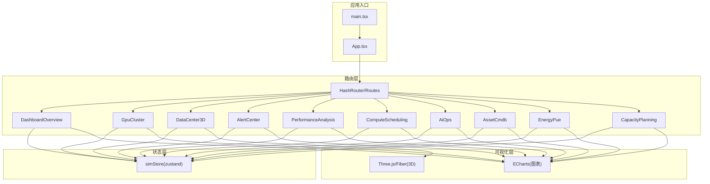

图示来源
- [App.tsx:1-47](file://src/App.tsx#L1-L47)
- [main.tsx:1-11](file://src/main.tsx#L1-L11)
- [package.json:11-22](file://package.json#L11-L22)

章节来源
- [App.tsx:1-47](file://src/App.tsx#L1-L47)
- [main.tsx:1-11](file://src/main.tsx#L1-L11)
- [package.json:1-38](file://package.json#L1-L38)

## 核心组件
- 路由与布局
  - App.tsx 通过 HashRouter 注册所有页面路由，统一挂载 Layout 布局，并在启动时初始化 ECharts 主题与仿真数据流（start/stop）。
- 全局状态
  - simStore 提供集群 KPI、节点、机柜、告警、任务、利用率序列、慢节点、预测与自愈动作等数据，供各页面订阅与更新。
- 可视化
  - 图表：ChartBox 封装 ECharts，配合 theme/chartOptions 提供统一图表配置。
  - 3D：DataCenterScene 基于 Three.js/React Three Fiber 渲染机房机柜、拓扑与巡检动画。

章节来源
- [App.tsx:18-46](file://src/App.tsx#L18-L46)
- [DashboardOverview.tsx:1-20](file://src/pages/DashboardOverview.tsx#L1-L20)
- [DataCenter3D.tsx:1-24](file://src/pages/DataCenter3D.tsx#L1-L24)

## 架构总览
平台以“页面组件 → 状态管理 → 可视化/3D”的分层组织，页面之间通过 zustand store 共享数据，避免重复请求；图表与 3D 场景按需渲染，减少主线程压力。

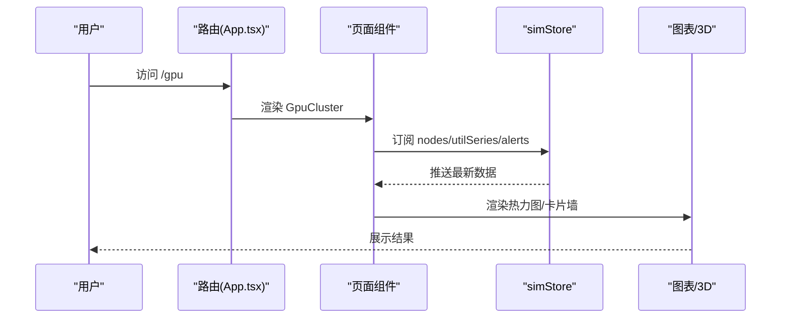

图示来源
- [App.tsx:28-46](file://src/App.tsx#L28-L46)
- [GpuCluster.tsx:1-22](file://src/pages/GpuCluster.tsx#L1-L22)

## 详细组件分析

### 监控仪表板（DashboardOverview）
- 功能特性
  - 顶部 KPI：总算力、GPU 在线率、平均利用率、活跃告警、PUE、运行任务数。
  - 左侧：集群健康度仪表盘、Top 高负载节点排行。
  - 中部：全域机房 3D 透视（嵌入 DataCenterScene），点击可跳转至独立大屏。
  - 右侧：告警等级分布、算力利用率趋势、任务队列概览。
- 用户交互
  - 点击“进入大屏”跳转到 /dc3d。
  - 滚动播报条实时展示最近告警。
- 数据与逻辑
  - 健康度由节点状态加权计算；Top5 按利用率排序；告警分布统计 active/acked 数量；任务队列统计 queued/running/succeeded 及 GPU 需求。
- 与其他模块集成
  - 3D 场景复用 DataCenterScene；图表使用 ChartBox 与 chartOptions；状态来自 simStore。

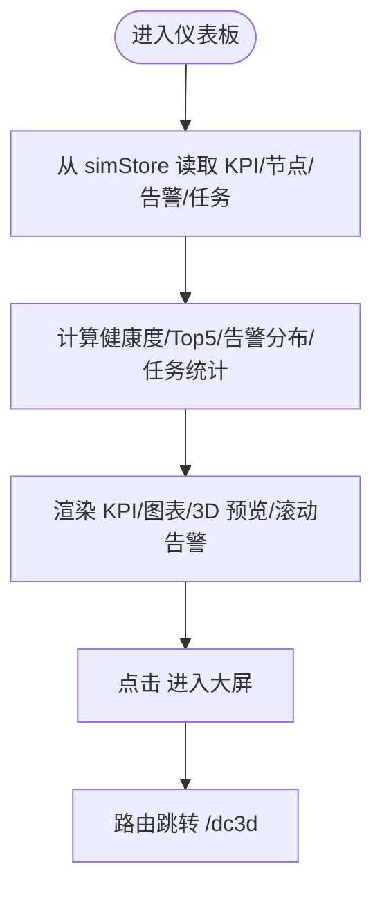

图示来源
- [DashboardOverview.tsx:15-68](file://src/pages/DashboardOverview.tsx#L15-L68)
- [DashboardOverview.tsx:175-202](file://src/pages/DashboardOverview.tsx#L175-L202)

章节来源
- [DashboardOverview.tsx:15-68](file://src/pages/DashboardOverview.tsx#L15-L68)
- [DashboardOverview.tsx:175-202](file://src/pages/DashboardOverview.tsx#L175-L202)

### GPU 集群管理（GpuCluster）
- 功能特性
  - 筛选栏：机房、型号、状态、搜索。
  - 节点卡片墙：分页展示节点，显示 8 卡利用率条形、温度、功耗与健康评分。
  - 热力图：采样节点 × 8 卡位，支持温度/利用率切换。
  - 节点详情抽屉：展示每卡指标（利用率/显存/温度/NVLink/ECC）。
- 用户交互
  - 点击节点打开详情抽屉；切换筛选条件重置页码。
- 数据与逻辑
  - 过滤链：hall/model/status/search；热力图采样步长动态计算；选中节点实时同步。
- 与其他模块集成
  - 状态来自 simStore；图表使用 ChartBox；颜色体系来自 theme/colors。

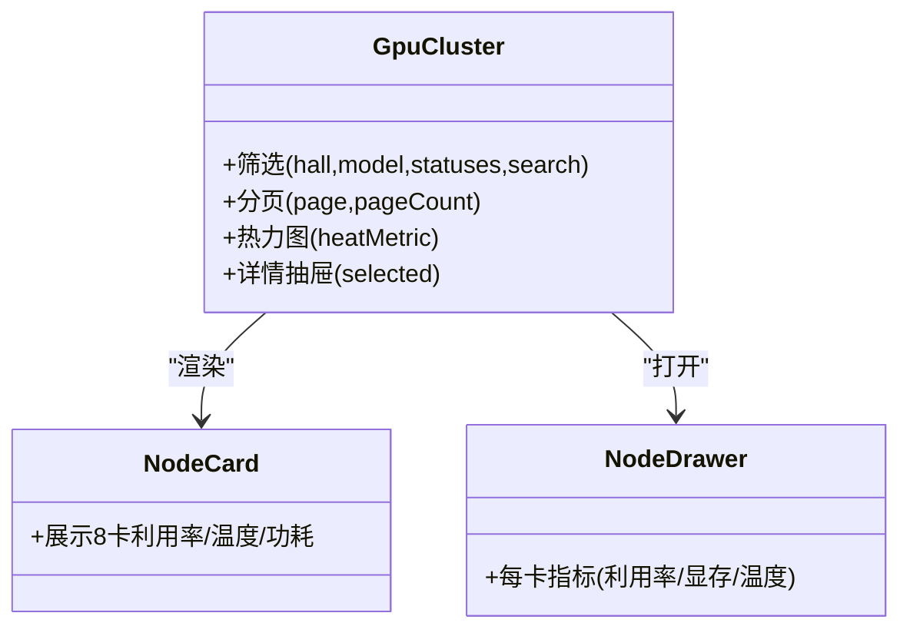

图示来源
- [GpuCluster.tsx:13-58](file://src/pages/GpuCluster.tsx#L13-L58)
- [GpuCluster.tsx:164-215](file://src/pages/GpuCluster.tsx#L164-L215)
- [GpuCluster.tsx:217-267](file://src/pages/GpuCluster.tsx#L217-L267)

章节来源
- [GpuCluster.tsx:13-58](file://src/pages/GpuCluster.tsx#L13-L58)
- [GpuCluster.tsx:164-215](file://src/pages/GpuCluster.tsx#L164-L215)
- [GpuCluster.tsx:217-267](file://src/pages/GpuCluster.tsx#L217-L267)

### 3D 数据中心可视化（DataCenter3D）
- 功能特性
  - 全屏 3D 场景，支持温度热力、负载视图、告警视图、线缆拓扑四种模式。
  - 自动巡检开关；左侧统计面板；底部操作提示。
- 用户交互
  - 切换视图模式；开启/停止自动巡检；点击机柜查看详情。
- 数据与逻辑
  - 统计项：严重/警告节点数、平均温度/利用率、总功耗、告警机柜数。
- 与其他模块集成
  - 复用 DataCenterScene；状态来自 simStore；颜色映射来自 theme/colors。

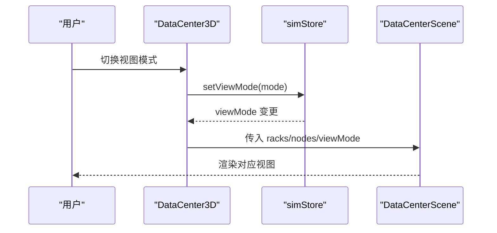

图示来源
- [DataCenter3D.tsx:15-33](file://src/pages/DataCenter3D.tsx#L15-L33)
- [DataCenter3D.tsx:37-49](file://src/pages/DataCenter3D.tsx#L37-L49)

章节来源
- [DataCenter3D.tsx:15-33](file://src/pages/DataCenter3D.tsx#L15-L33)
- [DataCenter3D.tsx:37-49](file://src/pages/DataCenter3D.tsx#L37-L49)

### 智能告警中心（AlertCenter）
- 功能特性
  - 概览：活跃告警、今日累计、MTTA/MTTR。
  - 24h 告警趋势（按等级堆叠）、Top 告警源。
  - 实时告警流：支持等级/状态/来源筛选，行内确认/静默/恢复操作。
  - 告警详情：时间线、关联指标快照、根因定位链路。
- 用户交互
  - 点击行选择告警；执行确认/静默/恢复；查看趋势与详情。
- 数据与逻辑
  - 趋势构造：确定性历史 + 实时活跃微调；MTTA/MTTR 基于时间戳计算。
- 与其他模块集成
  - 状态来自 simStore；图表使用 stackedAreaOption；颜色来自 LEVEL_COLOR。

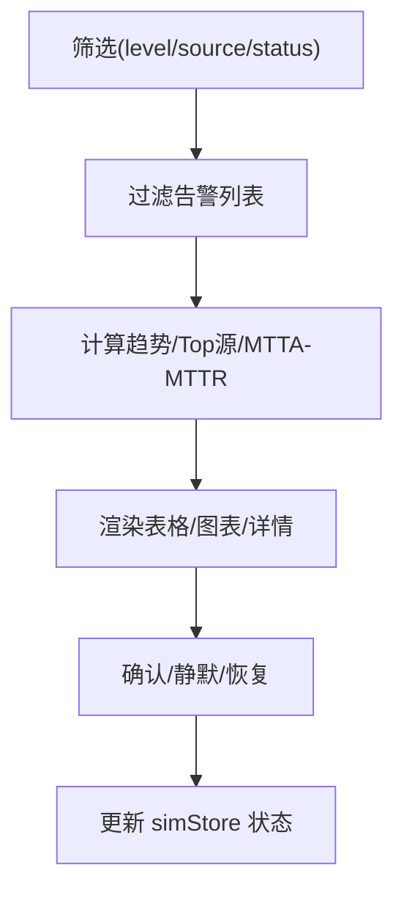

图示来源
- [AlertCenter.tsx:22-48](file://src/pages/AlertCenter.tsx#L22-L48)
- [AlertCenter.tsx:47-71](file://src/pages/AlertCenter.tsx#L47-L71)
- [AlertCenter.tsx:139-200](file://src/pages/AlertCenter.tsx#L139-L200)

章节来源
- [AlertCenter.tsx:22-48](file://src/pages/AlertCenter.tsx#L22-L48)
- [AlertCenter.tsx:47-71](file://src/pages/AlertCenter.tsx#L47-L71)
- [AlertCenter.tsx:139-200](file://src/pages/AlertCenter.tsx#L139-L200)

### 性能分析（PerformanceAnalysis）
- 功能特性
  - 集群维度：GPU 利用率分布、显存占用分布、MFU 趋势。
  - 网络与存储：RDMA 吞吐、拥塞热点 Top7、IOPS 与时延。
  - 训练任务视角：运行中任务列表、单任务 Loss/吞吐/Checkpoint 曲线、慢节点检测。
- 用户交互
  - 选择任务查看其性能曲线；浏览热点与慢节点。
- 数据与逻辑
  - 直方图分桶；MFU/RDMA/IOPS/时延由 utilSeries 派生；热点按利用率+温度计算。
- 与其他模块集成
  - 状态来自 simStore；图表使用 histogram/trendLineOption；颜色来自 COLORS。

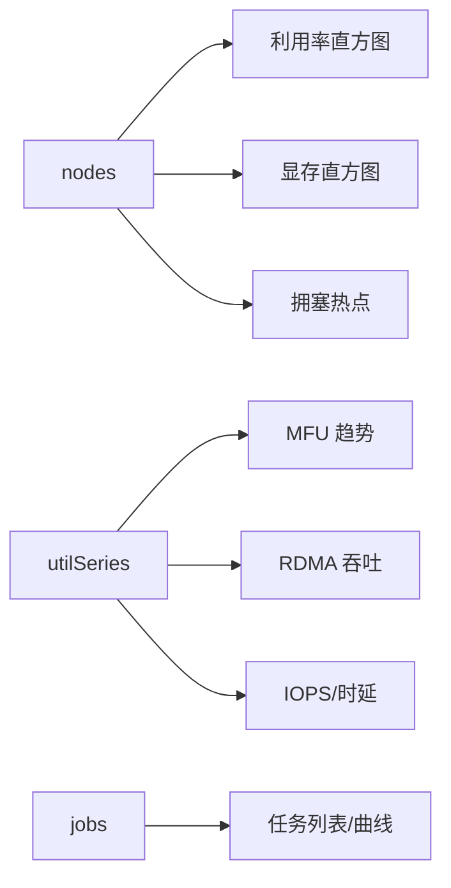

图示来源
- [PerformanceAnalysis.tsx:32-103](file://src/pages/PerformanceAnalysis.tsx#L32-L103)
- [PerformanceAnalysis.tsx:105-227](file://src/pages/PerformanceAnalysis.tsx#L105-L227)

章节来源
- [PerformanceAnalysis.tsx:32-103](file://src/pages/PerformanceAnalysis.tsx#L32-L103)
- [PerformanceAnalysis.tsx:105-227](file://src/pages/PerformanceAnalysis.tsx#L105-L227)

### 计算调度（ComputeScheduling）
- 功能特性
  - KPI：运行中/排队中任务、已分配 GPU、集群配额。
  - 甘特时间轴：近 8 小时任务调度可视化。
  - 资源池水位：训练/推理/调试队列配额与占用。
  - 碎片率评估与建议；任务提交表单（名称/队列/GPU 数量/优先级）。
- 用户交互
  - 调整优先级、提交任务；观察甘特图与水位变化。
- 数据与逻辑
  - 队列配额常量；碎片率经验公式；甘特窗口与进度条计算。
- 与其他模块集成
  - 状态来自 simStore；图表使用 gaugeOption；颜色来自 JOB_STATUS_COLOR。

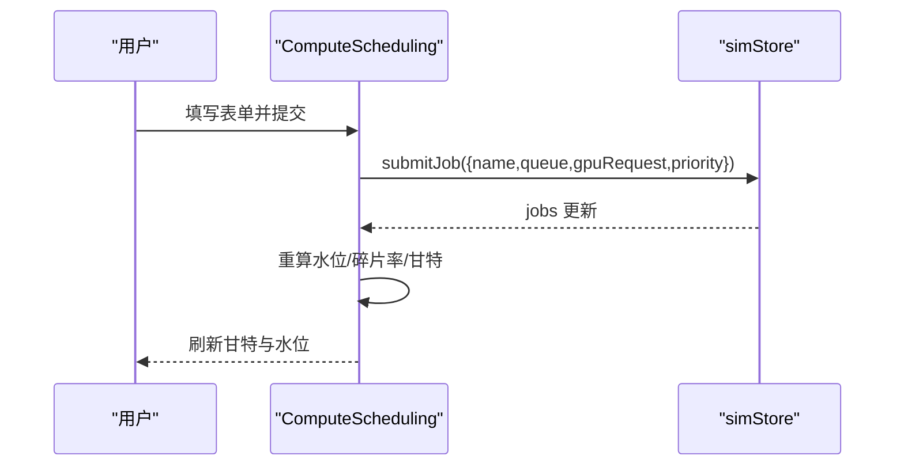

图示来源
- [ComputeScheduling.tsx:15-50](file://src/pages/ComputeScheduling.tsx#L15-L50)
- [ComputeScheduling.tsx:192-276](file://src/pages/ComputeScheduling.tsx#L192-L276)

章节来源
- [ComputeScheduling.tsx:15-50](file://src/pages/ComputeScheduling.tsx#L15-L50)
- [ComputeScheduling.tsx:192-276](file://src/pages/ComputeScheduling.tsx#L192-L276)

### AI 运维（AiOps）
- 功能特性
  - 异常检测：滑动窗口 3σ 标注异常点。
  - 设备故障预测：RUL 剩余寿命、概率与置信度。
  - 智能诊断对话：规则问答，结合实时 KPI 输出根因分析与建议。
  - 自愈动作日志：自动化闭环处置记录。
- 用户交互
  - 输入问题或快捷问题；查看预测与自愈日志。
- 数据与逻辑
  - 异常检测基于均值与标准差阈值；对话规则匹配关键词；自愈日志来自 simStore。
- 与其他模块集成
  - 状态来自 simStore；图表使用 ECharts 自定义 option；颜色来自 COLORS。

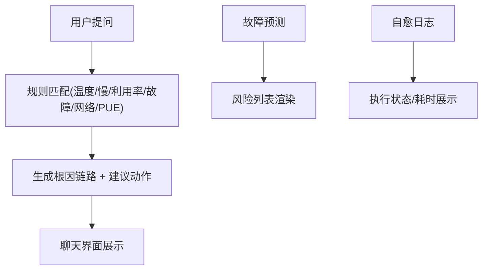

图示来源
- [AiOps.tsx:19-38](file://src/pages/AiOps.tsx#L19-L38)
- [AiOps.tsx:191-212](file://src/pages/AiOps.tsx#L191-L212)
- [AiOps.tsx:214-306](file://src/pages/AiOps.tsx#L214-L306)

章节来源
- [AiOps.tsx:19-38](file://src/pages/AiOps.tsx#L19-L38)
- [AiOps.tsx:191-212](file://src/pages/AiOps.tsx#L191-L212)
- [AiOps.tsx:214-306](file://src/pages/AiOps.tsx#L214-L306)

### 资产管理（AssetCmdb）
- 功能特性
  - 资产构成与生命周期分布（玫瑰图/环形图）。
  - 机架上架率与剩余 U 位。
  - 台账表：类型/周期筛选、搜索、排序、分页；详情抽屉展示维修记录。
- 用户交互
  - 筛选/搜索/排序/分页；点击行查看资产详情。
- 数据与逻辑
  - 类型/生命周期计数；上架率 = 服务器数/(机柜数×4)；排序键支持多字段。
- 与其他模块集成
  - 状态来自 simStore；图表使用 rosePieOption；颜色来自 COLORS。

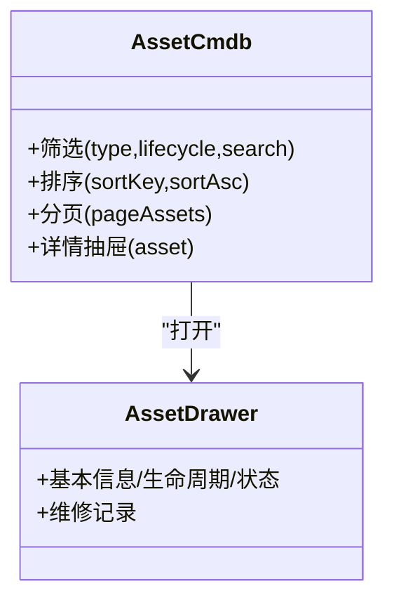

图示来源
- [AssetCmdb.tsx:22-87](file://src/pages/AssetCmdb.tsx#L22-L87)
- [AssetCmdb.tsx:238-296](file://src/pages/AssetCmdb.tsx#L238-L296)

章节来源
- [AssetCmdb.tsx:22-87](file://src/pages/AssetCmdb.tsx#L22-L87)
- [AssetCmdb.tsx:238-296](file://src/pages/AssetCmdb.tsx#L238-L296)

### 能源管理（EnergyPue）
- 功能特性
  - 实时 PUE 仪表盘；30 天 PUE 趋势；能耗桑基图。
  - 功率与能耗指标条；机柜功耗 Top10；温湿度热力图。
  - AI 节能优化建议（冷通道温度上调/热点气流优化/错峰调度/余热回收）。
- 用户交互
  - 浏览趋势与热力图；阅读节能建议。
- 数据与逻辑
  - PUE 历史序列构造；桑基图根据 IT/制冷/损耗比例生成；热力图采样冷/热通道温度。
- 与其他模块集成
  - 状态来自 simStore；图表使用 gauge/trend/sankey/heatmap 选项；颜色来自 COLORS。

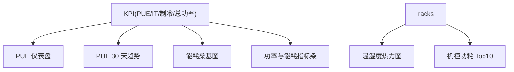

图示来源
- [EnergyPue.tsx:11-46](file://src/pages/EnergyPue.tsx#L11-L46)
- [EnergyPue.tsx:48-70](file://src/pages/EnergyPue.tsx#L48-L70)
- [EnergyPue.tsx:72-169](file://src/pages/EnergyPue.tsx#L72-L169)

章节来源
- [EnergyPue.tsx:11-46](file://src/pages/EnergyPue.tsx#L11-L46)
- [EnergyPue.tsx:48-70](file://src/pages/EnergyPue.tsx#L48-L70)
- [EnergyPue.tsx:72-169](file://src/pages/EnergyPue.tsx#L72-L169)

### 容量规划（CapacityPlanning）
- 功能特性
  - 容量水位：GPU/存储/网络当前用量与百分比、剩余可用天数。
  - 增长预测：历史 12 月 + 预测 6 月（带置信区间）。
  - 情景模拟：调节月增长率，评估缺口与采购建议（服务器/机柜/交换机/投资估算）。
- 用户交互
  - 拖动滑块调整增长率；查看预测与采购建议。
- 数据与逻辑
  - 线性外推剩余天数；指数增长预测；置信区间上下界；采购换算（8 卡/台、4 台/柜）。
- 与其他模块集成
  - 状态来自 simStore；图表为自定义 ECharts option；颜色来自 COLORS。

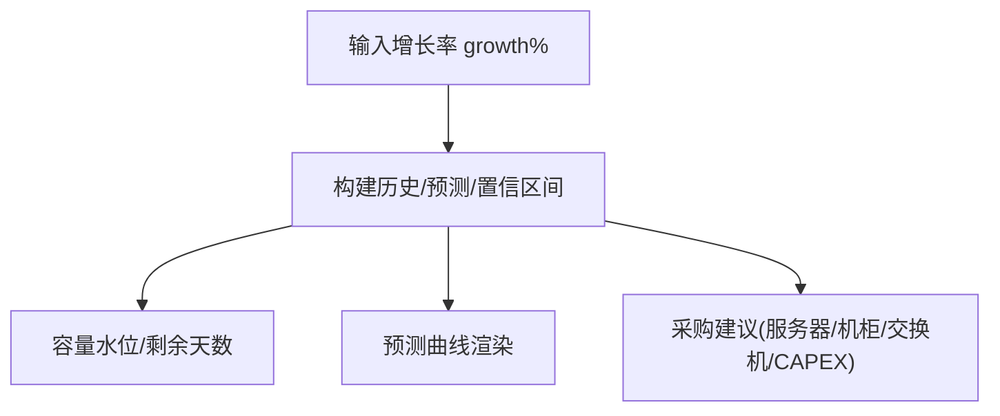

图示来源
- [CapacityPlanning.tsx:14-52](file://src/pages/CapacityPlanning.tsx#L14-L52)
- [CapacityPlanning.tsx:170-273](file://src/pages/CapacityPlanning.tsx#L170-L273)

章节来源
- [CapacityPlanning.tsx:14-52](file://src/pages/CapacityPlanning.tsx#L14-L52)
- [CapacityPlanning.tsx:170-273](file://src/pages/CapacityPlanning.tsx#L170-L273)

## 依赖关系分析
- 外部依赖
  - React/ReactDOM：UI 框架。
  - react-router-dom：路由。
  - zustand：轻量状态管理。
  - echarts/echarts-for-react：图表渲染。
  - three/@react-three/fiber/drei：3D 场景。
  - framer-motion：动效（可选）。
  - TailwindCSS：样式系统。
- 内部依赖
  - 页面组件均依赖 simStore 提供的数据与动作。
  - 图表组件依赖 theme/chartOptions 与 theme/colors。
  - 3D 页面依赖 components/scene/DataCenterScene。

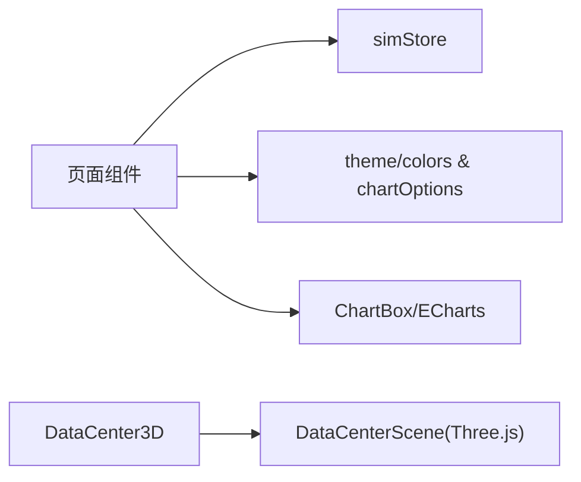

图示来源
- [package.json:11-22](file://package.json#L11-L22)
- [App.tsx:1-16](file://src/App.tsx#L1-L16)

章节来源
- [package.json:11-22](file://package.json#L11-L22)
- [App.tsx:1-16](file://src/App.tsx#L1-L16)

## 性能与优化
- 渲染优化
  - 大量列表/卡片使用 useMemo 缓存计算结果（如 DashboardOverview 的 health/top5/alertDist/jobStat；GpuCluster 的 filtered/heat；PerformanceAnalysis 的 utilHist/memHist/hotspots；EnergyPue 的 sankey/heat/topRacks；CapacityPlanning 的 forecast/suggestion）。
  - 图表禁用动画（noAnimation）以减少频繁重绘（如趋势类图表）。
- 数据流优化
  - 通过 zustand selector 精确订阅所需字段，避免全量重渲染。
  - 3D 场景仅在独立页面全屏渲染，仪表板仅嵌入紧凑版。
- 交互优化
  - 分页与采样（GpuCluster 节点卡片分页、热力图采样；AssetCmdb 台账分页）。
  - 节流/防抖未直接实现，但通过 memo 与局部 state 降低重渲染频率。

[本节为通用指导，不直接分析具体文件]

## 故障排查指南
- 路由问题
  - 检查 App.tsx 中的 Routes 是否包含目标路径与组件映射。
- 状态为空或不更新
  - 确认页面是否正确订阅 simStore 字段；检查 start/stop 是否在 App 生命周期中调用。
- 图表不显示
  - 检查 ChartBox 的 option 是否有效；确认 ensureEchartsTheme 已执行。
- 3D 场景黑屏
  - 检查 DataCenterScene 的 props（racks/nodes/viewMode）是否传递正确；确认 Three.js 依赖安装。

章节来源
- [App.tsx:22-26](file://src/App.tsx#L22-L26)
- [App.tsx:28-46](file://src/App.tsx#L28-L46)

## 结论
本平台以清晰的页面分层与状态共享机制，将监控、集群管理、3D 可视化、告警、性能、调度、AI 运维、资产、能源与容量规划等能力整合于统一界面。通过 ECharts 与 Three.js 的组合，既满足大规模数据的直观呈现，也提供了沉浸式的数据中心全景视图。借助 zustand 的状态管理与组件级 memo 优化，系统在交互流畅性与可扩展性之间取得良好平衡。

[本节为总结性内容，不直接分析具体文件]

## 附录：扩展与定制指南
- 新增页面
  - 在 src/pages 下创建新组件，并在 App.tsx 的 Routes 中注册路由。
  - 如需使用全局状态，通过 useSimStore(selector) 订阅数据。
  - 如需图表，使用 ChartBox 并参考 theme/chartOptions 配置。
- 扩展状态
  - 在 simStore 中添加新的 slice 或字段，并在仿真器（mock/simulator）中注入数据。
- 扩展 3D 场景
  - 在 components/scene/DataCenterScene 中增加新的可视元素（如线缆、风扇、液冷回路），并通过 viewMode 控制显示。
- 主题与样式
  - 在 theme/colors.ts 中扩展色板；在 tailwind.config.js 中扩展工具类。
- 性能调优
  - 对大数据集使用分页/采样；对频繁更新的图表设置 noAnimation；尽量使用 selector 订阅最小数据集。

[本节为通用指导，不直接分析具体文件]