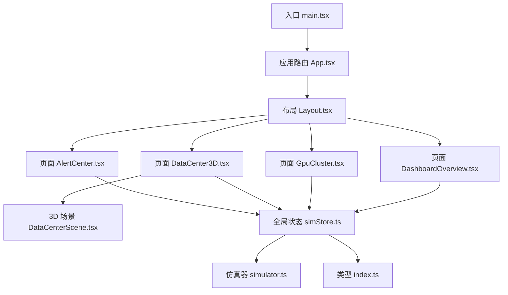
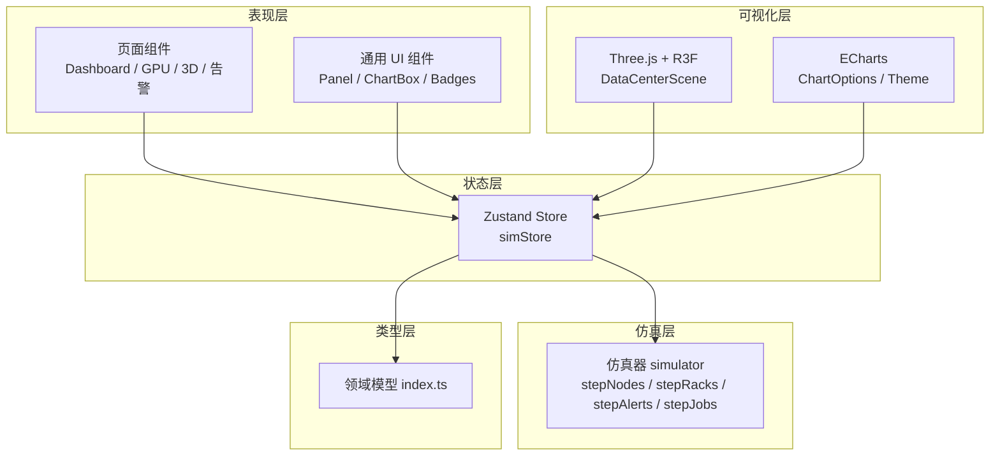
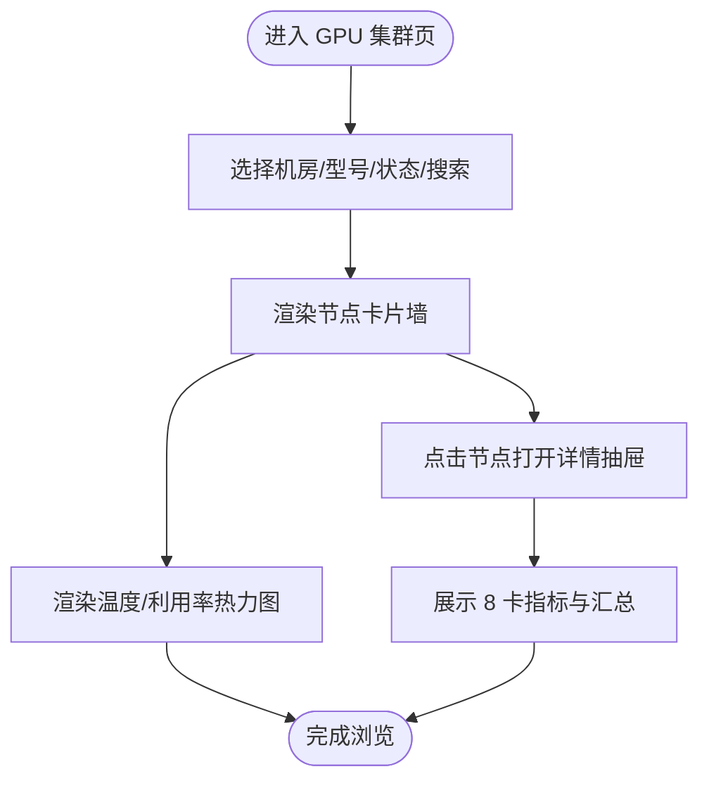
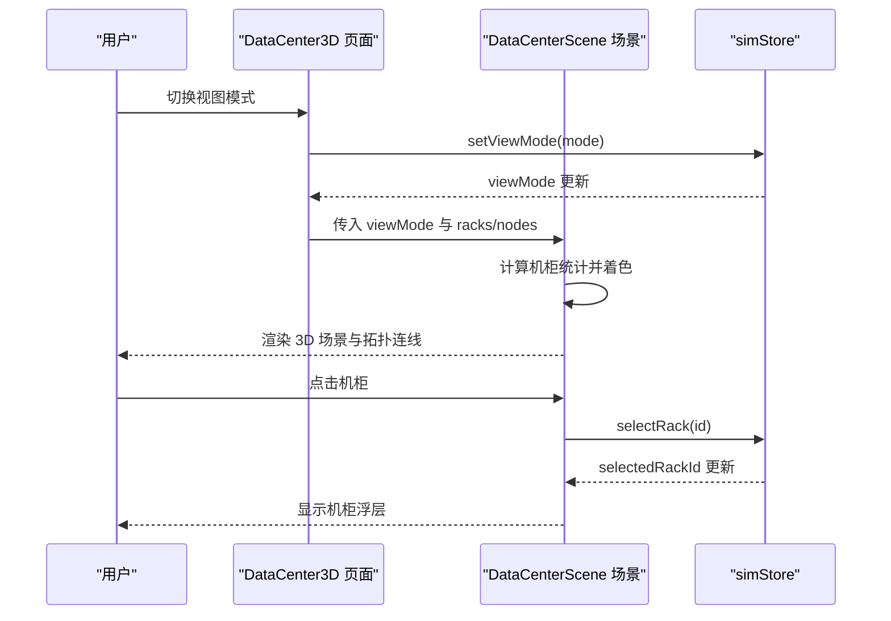
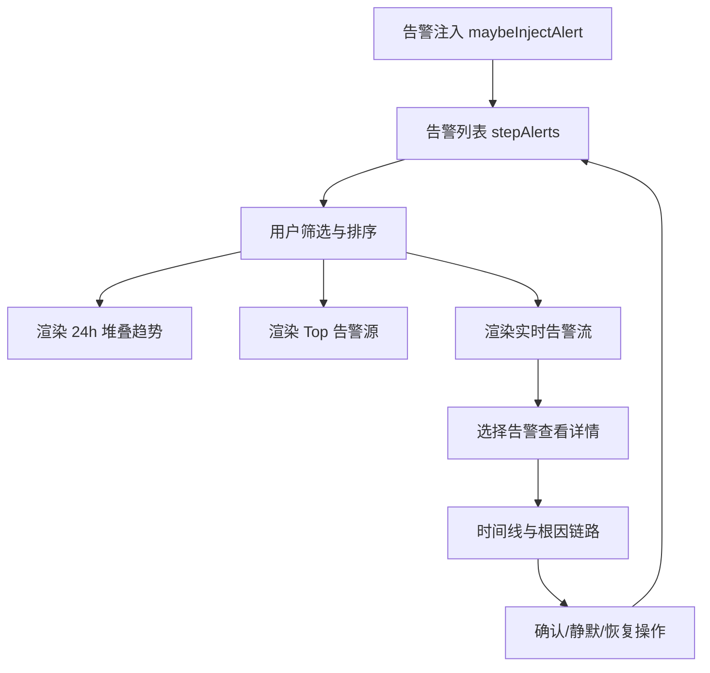
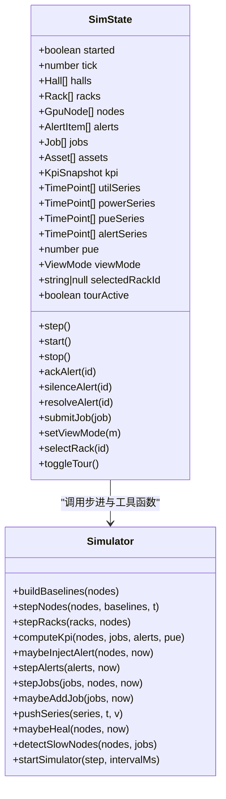
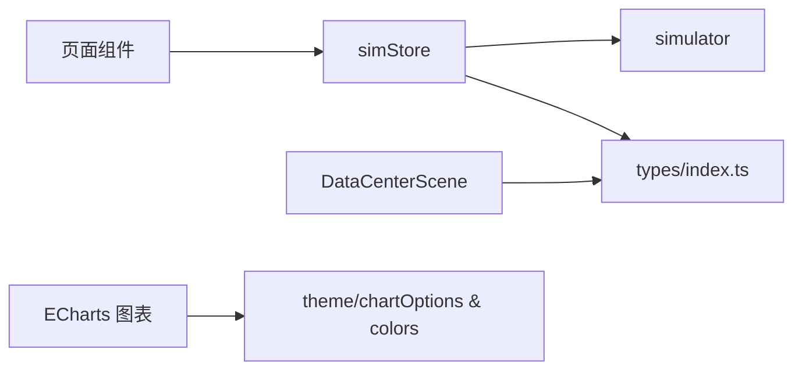

# 项目概述

<cite>
**本文引用的文件**   
- [package.json](file://package.json)
- [main.tsx](file://src/main.tsx)
- [App.tsx](file://src/App.tsx)
- [Layout.tsx](file://src/components/Layout.tsx)
- [DashboardOverview.tsx](file://src/pages/DashboardOverview.tsx)
- [GpuCluster.tsx](file://src/pages/GpuCluster.tsx)
- [DataCenter3D.tsx](file://src/pages/DataCenter3D.tsx)
- [AlertCenter.tsx](file://src/pages/AlertCenter.tsx)
- [DataCenterScene.tsx](file://src/components/scene/DataCenterScene.tsx)
- [simStore.ts](file://src/stores/simStore.ts)
- [simulator.ts](file://src/mock/simulator.ts)
- [index.ts](file://src/types/index.ts)
</cite>

## 目录
1. [引言](#引言)
2. [项目结构](#项目结构)
3. [核心组件](#核心组件)
4. [架构总览](#架构总览)
5. [详细组件分析](#详细组件分析)
6. [依赖关系分析](#依赖关系分析)
7. [性能与体验设计](#性能与体验设计)
8. [故障排查指南](#故障排查指南)
9. [结论](#结论)

## 引言
本项目是面向超级智算数据中心的 AI 运维可视化平台，目标是把 GPU 集群、机房物理布局、任务调度、能耗 PUE、告警处置等复杂运维信息，以“可观测、可定位、可决策”的方式呈现给运维与算法工程师。平台通过实时仿真引擎驱动全局状态，结合 React + TypeScript 构建页面，Three.js + React Three Fiber 实现 3D 数据中心透视，ECharts 提供丰富的 2D 图表能力，最终形成一套现代化、沉浸式的数据中心运维界面。

核心目标包括：
- 统一监控：汇聚算力、能耗、告警、任务等多维指标，形成全局 KPI 视图。
- 三维可视：用 3D 场景直观展示机柜、冷热通道、拓扑链路和告警热点。
- 智能告警：支持分级告警、自动注入、确认/静默/恢复闭环，并提供根因定位链路。
- 资源洞察：GPU 节点卡片墙、热力图、慢节点检测与自愈动作日志辅助容量与性能优化。
- 可扩展架构：基于 Zustand 的状态管理、纯函数仿真器与类型化领域模型，便于接入真实后端。

## 项目结构
仓库采用前端工程化结构，按功能域组织页面与组件：
- src/pages：业务页面（总览、GPU 集群、3D 机房、告警中心、能效、容量规划等）。
- src/components：通用 UI 与 3D 场景组件。
- src/stores：Zustand 全局状态与仿真驱动。
- src/mock：仿真数据生成与推进逻辑。
- src/theme：主题、颜色与 ECharts 配置。
- src/types：领域模型与枚举类型定义。

**图示来源**
- [main.tsx:1-11](file://src/main.tsx#L1-L11)
- [App.tsx:1-47](file://src/App.tsx#L1-L47)
- [Layout.tsx:1-125](file://src/components/Layout.tsx#L1-L125)
- [DashboardOverview.tsx:1-301](file://src/pages/DashboardOverview.tsx#L1-L301)
- [GpuCluster.tsx:1-287](file://src/pages/GpuCluster.tsx#L1-L287)
- [DataCenter3D.tsx:1-159](file://src/pages/DataCenter3D.tsx#L1-L159)
- [DataCenterScene.tsx:1-401](file://src/components/scene/DataCenterScene.tsx#L1-L401)
- [simStore.ts:1-270](file://src/stores/simStore.ts#L1-L270)
- [simulator.ts:1-331](file://src/mock/simulator.ts#L1-L331)
- [index.ts:1-192](file://src/types/index.ts#L1-L192)

**章节来源**
- [package.json:1-38](file://package.json#L1-L38)
- [main.tsx:1-11](file://src/main.tsx#L1-L11)
- [App.tsx:1-47](file://src/App.tsx#L1-L47)

## 核心组件
- 应用入口与路由：React 根组件渲染 App，使用 HashRouter 注册各业务页面路由，并在启动时初始化 ECharts 主题与仿真引擎。
- 布局容器：侧边导航、顶部时钟与全局活跃告警角标，支持全屏大屏模式。
- 总览页：KPI 条、集群健康度、Top 高负载节点、全域机房 3D 缩略图、告警滚动播报、利用率趋势与任务队列概览。
- GPU 集群页：筛选栏、节点卡片墙、温度/利用率热力图、节点详情抽屉。
- 3D 数据中心页：全屏 3D 场景、视图模式切换（温度/负载/告警/拓扑）、自动巡检、统计面板与图例。
- 告警中心：等级/来源/状态筛选、24h 堆叠趋势、Top 告警源、MTTA/MTTR、实时告警流与详情时间线、根因定位链路。
- 3D 场景组件：机柜 Mesh、负载灯带、告警脉冲、拓扑连线、相机巡检、机柜浮层。
- 全局状态与仿真：Zustand store 维护节点、机柜、告警、任务、时序与 KPI；仿真器提供纯函数步进、告警注入、任务流转、慢节点检测与自愈动作。

**章节来源**
- [App.tsx:1-47](file://src/App.tsx#L1-L47)
- [Layout.tsx:1-125](file://src/components/Layout.tsx#L1-L125)
- [DashboardOverview.tsx:1-301](file://src/pages/DashboardOverview.tsx#L1-L301)
- [GpuCluster.tsx:1-287](file://src/pages/GpuCluster.tsx#L1-L287)
- [DataCenter3D.tsx:1-159](file://src/pages/DataCenter3D.tsx#L1-L159)
- [AlertCenter.tsx:1-358](file://src/pages/AlertCenter.tsx#L1-L358)
- [DataCenterScene.tsx:1-401](file://src/components/scene/DataCenterScene.tsx#L1-L401)
- [simStore.ts:1-270](file://src/stores/simStore.ts#L1-L270)
- [simulator.ts:1-331](file://src/mock/simulator.ts#L1-L331)

## 架构总览
平台采用“页面组件 + 3D 场景 + 全局状态 + 仿真引擎”的分层架构：
- 表现层：React 页面与通用 UI 组件，负责交互与可视化。
- 可视化层：Three.js + React Three Fiber 渲染 3D 机房；ECharts 渲染 2D 图表。
- 状态层：Zustand store 集中管理仿真数据与 UI 状态。
- 仿真层：纯函数驱动的模拟器，周期性推进节点、机柜、告警、任务与时序。
- 类型层：统一的领域模型与枚举，确保前后端数据结构一致。

**图示来源**
- [App.tsx:1-47](file://src/App.tsx#L1-L47)
- [DataCenterScene.tsx:1-401](file://src/components/scene/DataCenterScene.tsx#L1-L401)
- [simStore.ts:1-270](file://src/stores/simStore.ts#L1-L270)
- [simulator.ts:1-331](file://src/mock/simulator.ts#L1-L331)
- [index.ts:1-192](file://src/types/index.ts#L1-L192)

## 详细组件分析

### 超级智算数据中心运维可视化设计理念
- 全局 KPI 优先：在总览页首屏展示总算力、GPU 在线率、平均利用率、活跃告警、PUE、运行任务等关键指标，帮助运维快速把握整体态势。
- 三维透视增强空间认知：3D 机房以机柜为基本单元，结合冷热通道色带、拓扑连线与告警脉冲，使物理布局与逻辑拓扑一目了然。
- 多视图融合：将 2D 图表（利用率趋势、告警分布、热力图）与 3D 场景联动，既适合宏观监控，也支持微观定位。
- 告警闭环：从触发、确认、静默到恢复的全流程记录，配合根因定位链路与关联指标快照，缩短排障时间。
- 可解释的自动化：自愈动作日志与慢节点检测给出可操作的优化建议，体现“AI Ops”的智能化。

**章节来源**
- [DashboardOverview.tsx:1-301](file://src/pages/DashboardOverview.tsx#L1-L301)
- [DataCenter3D.tsx:1-159](file://src/pages/DataCenter3D.tsx#L1-L159)
- [AlertCenter.tsx:1-358](file://src/pages/AlertCenter.tsx#L1-L358)

### GPU 集群监控模块
- 筛选与分页：支持机房、型号、健康状态与搜索关键词组合筛选，分页展示节点卡片。
- 节点卡片墙：每张卡片显示 8 个 GPU 小格，高度映射利用率，边框与背景色反映健康状态。
- 热力图：采样节点 × 8 卡位，支持温度与利用率两种度量，色阶直观呈现热点。
- 节点详情抽屉：展示平均利用率、温度、功耗、健康评分以及每卡的 NVLink、ECC、显存与温度指标。

**图示来源**
- [GpuCluster.tsx:1-287](file://src/pages/GpuCluster.tsx#L1-L287)

**章节来源**
- [GpuCluster.tsx:1-287](file://src/pages/GpuCluster.tsx#L1-L287)

### 3D 数据中心可视化模块
- 视图模式：温度热力、负载视图、告警视图、线缆拓扑四种模式，通过顶部控件切换。
- 机柜渲染：每个机柜为独立 Mesh，带有自发光材质、负载灯带与告警脉冲球；选中或严重告警时高亮描边。
- 拓扑连线：拓扑模式下绘制 InfiniBand 骨干链路，连接排汇聚点与机房核心。
- 相机巡检：自动环绕巡检，便于大屏演示；也可手动旋转、平移、缩放。
- 机柜浮层：点击机柜弹出详细信息，包括平均利用率、温度、功耗、节点数、冷/热通道温度与严重告警数量。

**图示来源**
- [DataCenter3D.tsx:1-159](file://src/pages/DataCenter3D.tsx#L1-L159)
- [DataCenterScene.tsx:1-401](file://src/components/scene/DataCenterScene.tsx#L1-L401)
- [simStore.ts:1-270](file://src/stores/simStore.ts#L1-L270)

**章节来源**
- [DataCenter3D.tsx:1-159](file://src/pages/DataCenter3D.tsx#L1-L159)
- [DataCenterScene.tsx:1-401](file://src/components/scene/DataCenterScene.tsx#L1-L401)

### 智能告警中心模块
- 多维筛选：按等级（P0-P3）、来源（GPU/节点/网络/存储/供电/制冷）、状态（活跃/已确认/已静默/已恢复）过滤。
- 趋势与排行：24h 分级堆叠趋势图与 Top 告警源排行，辅助识别高频问题。
- MTTA/MTTR：自动计算平均确认时间与平均恢复时间，衡量运维效率。
- 实时告警流：表格展示告警内容、对象、来源、时间与状态，支持确认、静默、恢复操作。
- 告警详情：时间线（触发/确认/恢复）、关联指标快照、根因定位链路（GPU→节点→IB→存储），并给出 AI 根因分析建议。

**图示来源**
- [AlertCenter.tsx:1-358](file://src/pages/AlertCenter.tsx#L1-L358)
- [simulator.ts:1-331](file://src/mock/simulator.ts#L1-L331)

**章节来源**
- [AlertCenter.tsx:1-358](file://src/pages/AlertCenter.tsx#L1-L358)
- [simulator.ts:141-194](file://src/mock/simulator.ts#L141-L194)

### 全局状态与仿真引擎
- 状态结构：包含 halls/racks/nodes/alerts/jobs/assets/kpi/failurePredictions/healingActions/slowNodes 以及 utilSeries/powerSeries/pueSeries/alertSeries 等时序数据。
- 步进逻辑：step 方法依次推进节点指标、机柜聚合、告警注入与流转、任务状态机、PUE 波动、KPI 汇总、自愈日志与慢节点检测。
- 驱动机制：start/stop 通过 setInterval 驱动仿真器，每秒调用一次 step。
- 用户操作：ackAlert/silenceAlert/resolveAlert 修改告警状态；submitJob 新增训练/推理/调试任务；setViewMode/selectRack/toggleTour 控制 3D 视图。

**图示来源**
- [simStore.ts:1-270](file://src/stores/simStore.ts#L1-L270)
- [simulator.ts:1-331](file://src/mock/simulator.ts#L1-L331)

**章节来源**
- [simStore.ts:96-270](file://src/stores/simStore.ts#L96-L270)
- [simulator.ts:35-139](file://src/mock/simulator.ts#L35-L139)
- [simulator.ts:141-331](file://src/mock/simulator.ts#L141-L331)

### 技术栈与协同方式
- React + TypeScript：组件化开发，类型安全，提升可维护性与协作效率。
- Three.js + @react-three/fiber + @react-three/drei：声明式 3D 场景，封装 OrbitControls、Grid、Line 等常用能力，降低 3D 开发门槛。
- ECharts + echarts-for-react：丰富的 2D 图表能力，配合自定义主题与选项，满足运维看板需求。
- Zustand：轻量级状态管理，适合中小型应用，避免 Redux 样板代码。
- Vite + Tailwind CSS：快速构建与原子化样式，提升开发体验与一致性。

这些技术协同工作的方式：
- 页面组件订阅 Zustand store，获取实时数据并渲染 ECharts 图表与 UI。
- 3D 场景组件读取 store 中的 racks/nodes/viewMode，动态着色与交互。
- 仿真器作为纯函数库，不直接耦合 UI，由 store 定时驱动，保证状态演进的可测试性。
- 类型定义贯穿所有模块，确保数据契约稳定。

**章节来源**
- [package.json:11-32](file://package.json#L11-L32)
- [App.tsx:1-47](file://src/App.tsx#L1-L47)
- [DataCenterScene.tsx:1-401](file://src/components/scene/DataCenterScene.tsx#L1-L401)

## 依赖关系分析
- 页面到状态：DashboardOverview、GpuCluster、DataCenter3D、AlertCenter 均通过 useSimStore 订阅全局状态。
- 状态到仿真：simStore.step 调用 simulator 的步进函数，更新节点、机柜、告警、任务与时序。
- 3D 场景到类型：DataCenterScene 使用 Rack、GpuNode、ViewMode 等类型进行渲染与交互。
- 主题与图表：页面使用 chartOptions 与 colors 配置 ECharts 图表样式与配色。

**图示来源**
- [DashboardOverview.tsx:1-301](file://src/pages/DashboardOverview.tsx#L1-L301)
- [GpuCluster.tsx:1-287](file://src/pages/GpuCluster.tsx#L1-L287)
- [DataCenter3D.tsx:1-159](file://src/pages/DataCenter3D.tsx#L1-L159)
- [AlertCenter.tsx:1-358](file://src/pages/AlertCenter.tsx#L1-L358)
- [DataCenterScene.tsx:1-401](file://src/components/scene/DataCenterScene.tsx#L1-L401)
- [simStore.ts:1-270](file://src/stores/simStore.ts#L1-L270)
- [simulator.ts:1-331](file://src/mock/simulator.ts#L1-L331)
- [index.ts:1-192](file://src/types/index.ts#L1-L192)

**章节来源**
- [simStore.ts:1-270](file://src/stores/simStore.ts#L1-L270)
- [simulator.ts:1-331](file://src/mock/simulator.ts#L1-L331)
- [index.ts:1-192](file://src/types/index.ts#L1-L192)

## 性能与体验设计
- 渲染性能：3D 场景根据 compact 模式调整 DPR 与相机参数，减少不必要的网格文字与动画开销；OrbitControls 限制最大距离与极角，避免过度缩放。
- 数据刷新：机柜聚合每 3 tick 更新一次，慢节点检测每 5 tick 执行一次，降低频繁计算带来的性能压力。
- 用户体验：
  - 总览页首屏即见关键 KPI，辅以 3D 缩略图与告警滚动条，快速感知异常。
  - GPU 集群页提供卡片墙与热力图双重视角，便于从宏观到微观定位问题。
  - 3D 机房支持自动巡检与拓扑视图，适合大屏展示与汇报。
  - 告警中心提供时间线与根因链路，帮助运维快速理解事件脉络。

[本节为通用指导，无需具体文件引用]

## 故障排查指南
- 仿真未启动：检查 App 中 ensureEchartsTheme 与 start/stop 生命周期是否正确挂载；查看 Layout 中仿真引擎状态指示。
- 3D 场景无渲染：确认 DataCenterScene 的 Canvas 尺寸与 props 是否传入 racks/nodes/viewMode；检查浏览器 WebGL 支持。
- 图表空白：确认 ECharts 主题初始化与 ChartBox 的 option 配置正确；检查数据序列长度与字段名。
- 告警不更新：检查 simStore.step 是否被定时器调用；确认 maybeInjectAlert 与 stepAlerts 的逻辑分支。
- 任务不流转：验证 stepJobs 的并发上限与概率分支；检查 maybeAddJob 的任务生成条件。

**章节来源**
- [App.tsx:18-26](file://src/App.tsx#L18-L26)
- [Layout.tsx:67-79](file://src/components/Layout.tsx#L67-L79)
- [DataCenterScene.tsx:230-324](file://src/components/scene/DataCenterScene.tsx#L230-L324)
- [simStore.ts:164-219](file://src/stores/simStore.ts#L164-L219)
- [simulator.ts:199-259](file://src/mock/simulator.ts#L199-L259)

## 结论
本项目以“全局 KPI + 3D 透视 + 智能告警”为核心，构建了面向超级智算数据中心的现代化运维可视化平台。通过 React + TypeScript + Three.js + ECharts 的技术组合，实现了从宏观态势到微观细节的多层次观测能力；借助 Zustand 与纯函数仿真器，保证了状态演进的可控性与可测试性。未来可进一步接入真实后端数据源，扩展预测与自愈策略，持续强化 AI Ops 的能力边界。